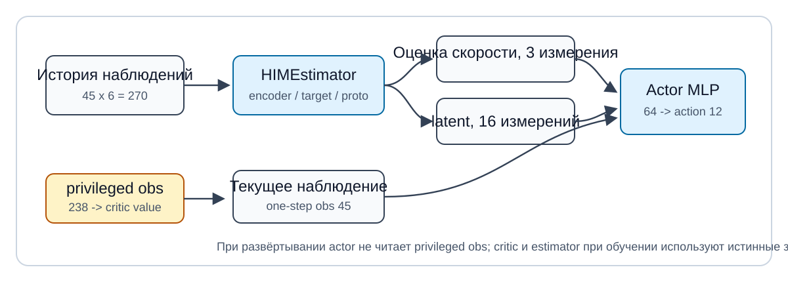

# От Isaac Gym к Isaac Sim / Isaac Lab: опыт миграции HIMLoco

Чтобы перенести существующий проект обучения с подкреплением для четырёхногого робота на новый симулятор, сначала нужно разобраться, что означают период управления, порядок наблюдений и смысл обучающих примеров. Миграция HIMLoco — конкретный пример: на видеокарте Blackwell старое окружение могло загрузить точку входа обучения, но вычисления на устройстве падали с ошибкой. После миграции удалось выполнить минимальное обучение, обновление параметров и запись видео с роботом.

Эта статья основана на локальных экспериментах и исходном коде миграции, проведённых в июне 2026 года. Проверены: одна среда с одной итерацией, 64 среды с двумя итерациями и короткое видео на четырёх средах. Результаты движения из статьи, полная сходимость и управление реальным роботом не проверялись. Шаги установки и исходное описание метода — в [основном руководстве](README.md).

## 1. Сначала определите, на каком уровне возникает конфликт версий

Старый проект одновременно зависит от нативных привязок Python, PyTorch и бинарных компонентов симулятора. Если обновить только один из них, весь процесс обучения может по-прежнему не запуститься.

| Попытка | Наблюдение | Что это значит для решения о миграции |
| --- | --- | --- |
| Isaac Gym Preview 4, Python 3.7, PyTorch 1.10.0+cu113 | Команда справки запускается, но вычисления на устройстве падают из-за несовместимости архитектуры | Успешный импорт не доказывает, что обучение работает |
| Python 3.8, PyTorch 2.4.1+cu124 | Список архитектур установленного пакета заканчивается на `sm_90`, а на машине `sm_120`; вычисления всё равно падают | Эта комбинация обновлений по-прежнему не удовлетворяет требованиям оборудования |
| Isaac Sim 5.1, Isaac Lab, Python 3.11, PyTorch 2.7.0+cu128 | Минимальное обучение выполнено | Именно эта проверенная комбинация использована для адаптации задачи |

**Таблица 1. Комбинации версий в эксперименте.** В таблице записаны только реально проверенные комбинации, а не все совместимые версии. Старые пакеты содержали нативные привязки только для Python 3.6, 3.7 и 3.8, поэтому смена интерпретатора требует проверить и совместимость самого симулятора.

Диагностику окружения нужно проводить и по распознаванию устройства, и по реальным вычислениям. Следующая команда запускается в проверяемом окружении Python; синхронизация после матричного умножения позволяет сразу увидеть асинхронную ошибку устройства.

```bash
python - <<'PY'
import torch
print(torch.__version__, torch.version.cuda)
print(torch.cuda.get_device_name(0))
print(torch.cuda.get_device_capability(0))
print(torch.cuda.get_arch_list())
x = torch.randn(128, 128, device="cuda")
y = x @ x.T
torch.cuda.synchronize()
print(torch.isfinite(y).all().item())
PY
```

## 2. Установите соответствие между ресурсами, задачами и алгоритмом

В исходном проекте большая часть логики среды сосредоточена в `legged_robot.py`. В миграционной версии используется готовая задача скоростного слежения для A1 из Isaac Lab; сцена и параметры управления настраиваются через конфигурацию, а логика обучения HIM сохраняется во внешнем пакете задач.

| Уровень миграции | Задача в исходной реализации | Файлы миграционной версии и на что обращать внимание |
| --- | --- | --- |
| Робот и управление | Начальная поза, цели суставов, приводы | `a1/rough_env_cfg.py`: проверить имена и порядок суставов, позу по умолчанию и масштаб действий |
| Определение задачи | Рельеф, команды скорости, награды, сброс | `a1/rough_env_cfg.py`: перенос в конфигурацию сцены и менеджеров |
| Наблюдения | История собственных ощущений, привилегированная информация для обучения | `him_one_step_obs`, `him_critic_obs`: проверить порядок, систему координат, масштабирование и направление истории |
| Алгоритм | Обновление политики и оценка внутреннего состояния | `rsl_rl_him.py`: адаптация групп наблюдений, хранения данных и вспомогательных потерь |
| Точка входа | Регистрация задачи, запуск обучения, сохранение результатов | `scripts/isaaclab_train_himloco.py`: выбор тренера и настроек записи |

**Таблица 2. Зоны ответственности при переносе кода.** Файлы `a1/` и `rsl_rl_him.py` находятся в локальном пакете миграции `source/himloco_isaaclab_tasks/himloco_isaaclab_tasks/`. Это файлы миграционной версии, а не входы, которые были в исходном репозитории автора.

В этом сопоставлении физический шаг равен 0,005 с, а политика выполняет действие раз в четыре физических шага, поэтому период политики составляет 0,02 с, то есть 50 Гц. Масштаб действий равен 0,25, параметры приводов — жёсткость 40 и демпфирование 1, длительность эпизода — 20 с. При переносе других задач нужно также проверить время удержания действия, умножается ли награда на шаг времени и частоту проверки условий завершения. Одного копирования весов наград недостаточно, чтобы цель обучения совпала.

## 3. Помимо размерностей тензоров, проверьте смысл обучающих примеров



**Рисунок 1. Поток данных между историческими наблюдениями, внутренней моделью и политикой.** Текущие 45 наблюдений, оценённые три компоненты скорости и 16-мерная скрытая переменная вместе образуют 64-мерный вход политики. Источник: схема построена проектом по исходному коду HIMLoco; исходная схема метода и её происхождение указаны в [основном руководстве](README.md).

Вход истории имеет размер `45 × 6 = 270`, вход сети оценки ценности — `45 + 3 + 3 + 187 = 238`, а выход действий — 12. Размерности помогают найти ошибки интерфейса, но не могут обнаружить ошибку сдвига данных при той же размерности.

Например, если текущий кадр записан в начало истории или в её конец, политика будет читать разную информацию. В миграционном коде `_legacy_history` переставляет историю в направление, которое ожидает старый алгоритм. При проверке этой операции используйте последовательность с вручную заданными номерами шагов, а также проверьте, что история очищается после сброса среды. Одна лишь проверка длины выхода не подтверждает корректность.

Значения наблюдений также следуют чётким соглашениям. В текущей реализации команды из трёх компонентов умножаются на `[2.0, 2.0, 0.25]`, угловая скорость — на 0,25, скорости суставов — на 0,05, линейная скорость корпуса — на 2,0. Порядок суставов, система координат скорости и опорная точка высоты рельефа должны проверяться независимо. Изменение нормализованного входа одновременно влияет на политику, оценку ценности и вспомогательный контроль.

## 4. Сохраняйте следующее наблюдение, которое нужно внутренней модели

HIM (Hybrid Internal Model, гибридная внутренняя модель) использует историю наблюдений, чтобы выучить оценку скорости и представление скрытого состояния. Поэтому обучающий пример помимо действия, награды и признака завершения должен содержать привилегированное наблюдение следующего шага. В миграционной версии в `HIMRolloutStorage` добавлено поле `next_critic_observations`, которое участвует в обновлении вместе с историческими входами.

Здесь нужно внимательно проверить автоматический сброс: наблюдение, которое возвращает среда после завершения эпизода, может относиться к новому эпизоду. Если использовать его как реакцию на действие старого эпизода, возникнет перекрёстный контроль между эпизодами. Текущий код использует следующее наблюдение для сети ценности, которое возвращает среда, но строгая эквивалентность с обработкой завершающего наблюдения в старой версии ещё не проверена. Перед продолжением обучения проверьте отдельно нормальные переходы, падения с завершением эпизода и обрезку по лимиту времени, а затем решите: восстанавливать завершающее наблюдение или маскировать некорректный вспомогательный контроль.

Ещё одно отличие касается наблюдений внешних сил: сейчас сохранены три нулевых слота, чтобы сохранить разметку 238 измерений. Это не значит, что перенос данных о внешних силах завершён. Для полной репродукции нужно определить систему координат внешних сил, момент их приложения и способ получать согласованные значения контроля из журнала событий среды.

Также стоит проверить фактическую конфигурацию шума наблюдений. Флаг `enable_corruption` лишь разрешает добавлять возмущения; нужно убедиться, что для каждого наблюдения задан конкретный шум. Сейчас мы не можем утверждать, что распределение шума полностью совпадает с исходным проектом, опираясь только на этот флаг.

## 5. Разделите проверку на три контрольных точки: обучение, изображение и поведение

Одна среда с одной итерацией нужна, чтобы проверить создание среды, сбор данных, обратное распространение и сохранение. 64 среды с двумя итерациями проверяют размерности батчей и несколько ветвей потерь. Кривые по двум итерациям показывают только то, что процесс обновления записан, но не то, что робот научился ходить.

Проверять видео нужно, глядя на первый, средний и последний кадры. Изначально видео имело правильное разрешение и длительность, но на нём был виден только рельеф. Причина: камера по умолчанию смотрела на начало мировых координат, а робот находился в выделенной для него зоне рельефа. После того как цель камеры переключили на корпус `robot/trunk` первой среды, на кадре появился A1.

```python
env_cfg.viewer.origin_type = "asset_body"
env_cfg.viewer.env_index = 0
env_cfg.viewer.asset_name = "robot"
env_cfg.viewer.body_name = "trunk"
env_cfg.viewer.eye = (2.0, -2.0, 1.2)
env_cfg.viewer.lookat = (0.0, 0.0, 0.25)
```

**Код 1. Положение камеры для записи A1.** `trunk` — имя корпуса этого ассета. При смене робота имя корпуса нужно узнать заново.

Интервал записи тоже влияет на результат. При `--video_interval 1` запись перезапускалась на каждом шаге и создавала много одиночных кадров. После замены на `--video_length 120 --video_interval 100000` получился связный короткий ролик.

<video controls muted preload="metadata" poster="assets/videos/him_local_smoke_train_4env_poster.png" width="100%">
  <source src="assets/videos/him_local_smoke_train_4env.mp4" type="video/mp4">
</video>

**Видео 1. Проверка рендеринга на четырёх средах и двух итерациях.** Источник: собственный эксперимент проекта в июне 2026 года; исходный ролик около 2,42 с. Робот виден, но его поза нестабильна. Это подтверждает, что цель съёмки выбрана правильно, однако не доказывает сходимость политики управления. Для проверки походки нужны непрерывное движение при фиксированной команде, ошибка слежения за скоростью и статистика падений.

## 6. Сохраняйте опыт так, чтобы его можно было повторить

В будущих полных экспериментах следует сохранять конфигурацию среды и алгоритма, версию кода, начальные значения генератора случайных чисел, кривые обучения и использованную версию модели. Прежде чем увеличивать число итераций, проверьте завершающие образцы, шум наблюдений, порядок суставов и временные масштабы наград: эти различия меняют процесс обучения, и их нельзя устранить простым увеличением числа итераций.

В репозиторий с исходным кодом стоит помещать конфигурацию, скрипты и небольшое количество учебных материалов. Новые окружения, веса моделей, наборы данных и пакетные видео лучше записывать на отдельный диск с данными. Рекомендуется задавать корень данных переменной окружения `DATA_ROOT` и размещать окружение в его подкаталоге `envs/`. Чтобы перенести проект на другую машину, достаточно изменить эту переменную, а абсолютные пути, привязанные к конкретному компьютеру, в руководство не записывать.

Текущая точка входа миграции устанавливает корень журналов в `logs/rsl_rl`, который задаётся относительно рабочего каталога. Чтобы вынести большой объём результатов за пределы репозитория, сначала нужно добавить настраиваемый каталог вывода или явно задать сопоставление с внешним хранилищем: одна переменная окружения, которую скрипт не читает, место сохранения не изменит.

Все десять файлов моделей в этом примере прошли только одну-две итерации и не содержат весов, которые демонстрируют устойчивую походку. Поэтому при подготовке материалов отладочные файлы удалены, а конфигурация, кривые и короткие видео сохранены. У проекта нет отдельного набора обучающих данных: обучающие примеры генерируются параллельной симуляцией в процессе обучения. Повторная минимальная проверка снова создаст файлы моделей.

Если модели и данные будут публиковаться на Hugging Face, список для публикации должен включать название задачи, происхождение файлов, лицензию, конфигурацию, контрольные суммы и способ загрузки. После успешной загрузки и проверки можно удалять локальные копии по этому списку. Токены доступа передаются через закрытое окружение и не попадают в руководство или историю версий.

## Ссылки

- [Исходный репозиторий HIMLoco](https://github.com/OpenRobotLab/HIMLoco): исходный код задачи и алгоритма.
- [Официальная страница проекта HIMLoco](https://junfeng-long.github.io/HIMLoco/): схема метода и демонстрации авторов.
- [Локальное руководство по миграции](README.md): окружение, команды и кривые эксперимента.
