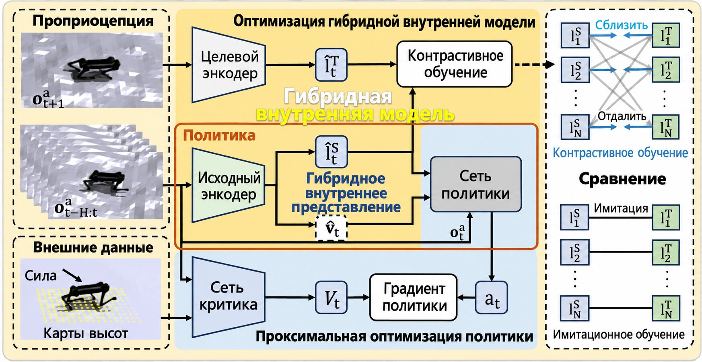
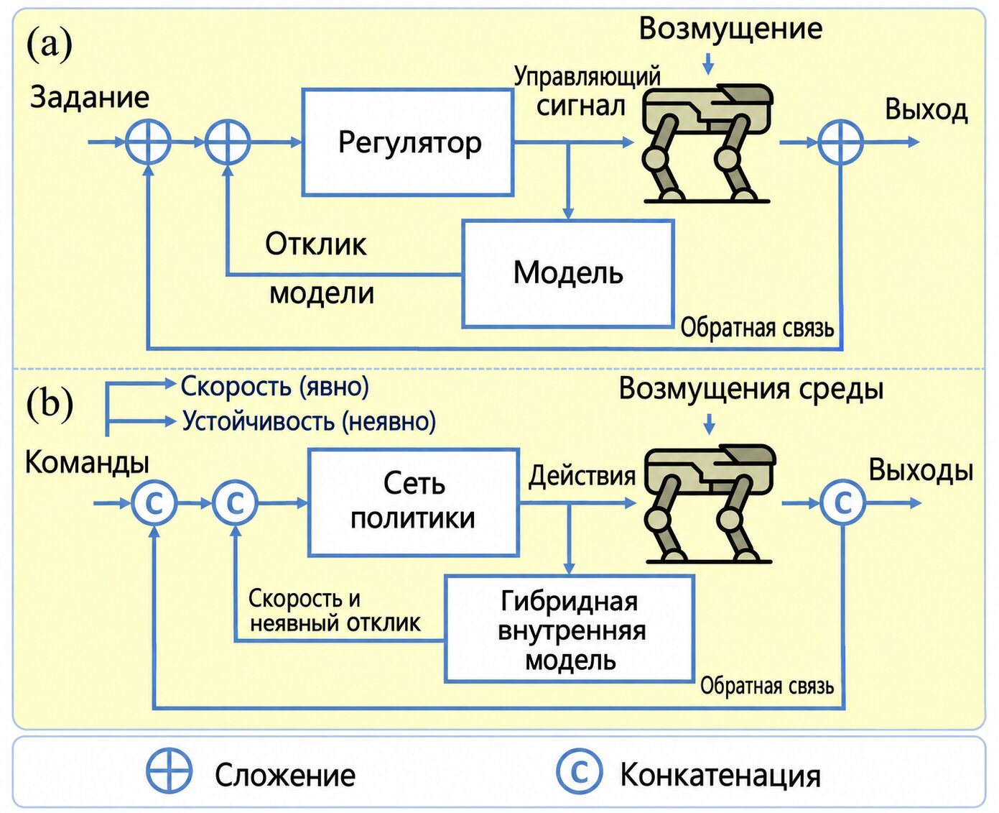
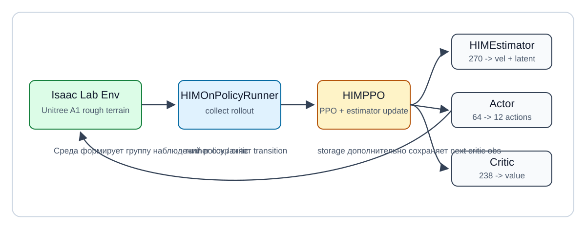
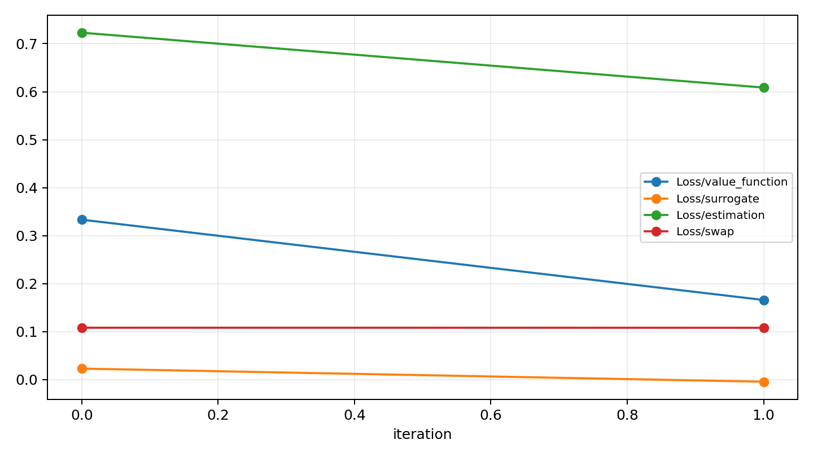
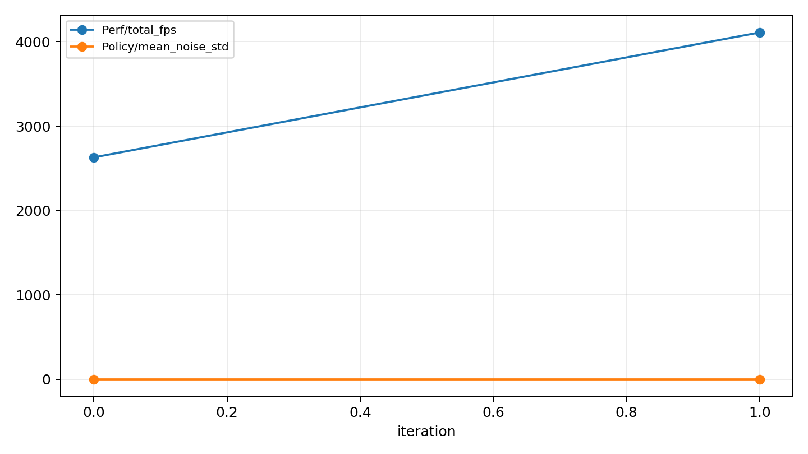

# Управление движением четырёхногого робота HIMLoco: от понимания статьи до воспроизведения на новом стеке Isaac Lab

Продолжение: [От Isaac Gym к Isaac Sim / Isaac Lab: опыт миграции](02-migration-experience-sharing.md) — версии и диагностика, сопоставление задач, временные ряды наблюдений, обработка завершающих образцов и проверка видео.

В этой главе мы проходим инженерный учебный путь по HIMLoco: сначала разбираем статью **Hybrid Internal Model: Learning Agile Legged Locomotion with Simulated Robot Response** (ICLR 2024) и выясняем, какую задачу она решает. Затем по открытому репозиторию изучаем наблюдения, внутреннюю модель, обучение PPO и схему Sim2Real. Наконец, переносим цепочку обучения, которая опиралась на Isaac Gym Preview 4, на новый стек Isaac Sim / Isaac Lab и запускаем проверочный smoke test на видеокарте Blackwell.

Цель главы — не натренировать политику уровня статьи, а освоить ключевую инженерную цепочку:

- почему HIMLoco — не обычный PPO вида `obs -> action`;
- откуда берутся история наблюдений размером `45 x 6 = 270` и привилегированное наблюдение критика размером `238`;
- как `HIMEstimator` учится оценивать скорость и скрытую переменную по истории собственных ощущений;
- почему старый стек Isaac Gym перестаёт работать на Blackwell;
- как с помощью нового стека Isaac Lab / PyTorch CUDA 12.8 запустить задачу и алгоритм HIM;
- какая связь между официальными демонстрационными видео, локально отрендеренными видео и полными результатами обучения;
- что smoke test доказывает, а что — нет.

> Примечание: в этой главе используется открытый репозиторий [OpenRobotLab/HIMLoco](https://github.com/OpenRobotLab/HIMLoco), страница проекта — [HIMLoco](https://junfeng-long.github.io/HIMLoco/), статья — [arXiv:2312.11460](https://arxiv.org/abs/2312.11460). В README официального репозитория указано, что код обучения опубликован, а инструкций по развёртыванию пока нет. Поэтому основное внимание уделено цепочке обучения, структуре алгоритма и миграции на Isaac Lab; smoke test не следует понимать как завершённое развёртывание на реальном роботе.

## План воспроизведения

Эту главу можно воспринимать как лабораторную работу по управлению четырёхногим роботом. Сначала мы разбираем исходную статью и репозиторий, затем смотрим, как тензоры проходят через систему, и, наконец, проверяем миграционную версию задачи на минимальном обучении.

| Этап | Основная цель | Признак успеха | Что проверить в первую очередь при сбое |
| :-- | :-- | :-- | :-- |
| 1. Понять метод статьи | Разобраться в связи HIM, привилегированного критика и истории наблюдений | Можно объяснить, почему actor работает только с наблюдениями, доступными при развёртывании | Не пытайтесь сразу разобрать все детали функции награды |
| 2. Прочитать исходный репозиторий | Найти код среды, алгоритма, runner и estimator | Можно найти `him_ppo.py` и `him_estimator.py` | Убедитесь, что используется модифицированный в репозитории `rsl_rl` |
| 3. Проверить старый стек | Поднять окружение Isaac Gym Preview 4 | Команда `train.py --help` работает | Python 3.7/3.8, `LD_LIBRARY_PATH` |
| 4. Разобраться с Blackwell | Понять, поддерживает ли старая сборка PyTorch/CUDA текущую видеокарту | Обнаружено несоответствие `sm_120` и старого wheel | `torch.cuda.get_arch_list()` |
| 5. Миграция в Isaac Lab | Зарегистрировать новую задачу и новый runner | Наблюдения политики `270`, наблюдения критика `238` | Путь Isaac Lab, точка входа задачи |
| 6. Smoke test HIM | Запустить 64 среды и 2 итерации | Появляются loss, fps, checkpoint | Группы наблюдений, форма батча, версия CUDA |
| 7. Проверка рендеринга | Записать видео обучения в Isaac Lab | Видно, как A1 движется в сцене с неровным рельефом | Не принимайте короткую случайную политику за сходящуюся походку |

Смысл smoke test нужно понимать точно: он подтверждает, что создание среды, построение наблюдений, исполнение действий, расчёт награды, хранение rollout, обратное распространение и обновление оптимизатора работают. Он не доказывает, что политика сошлась и что её можно сразу ставить на реального робота.

## Часть первая. Какую задачу решает HIMLoco

В управлении движением четырёхногих роботов возникает противоречие. Симулятор знает многое, что недоступно роботу при реальной работе: точную линейную скорость корпуса, внешние возмущающие силы, высоту рельефа, состояние контакта и изменение массы звеньев. На реальном роботе политика обычно опирается только на IMU, энкодеры суставов, предыдущее действие и небольшую оценку состояния.

Если обучать actor, который напрямую читает эти привилегированные сигналы симулятора, политика в симуляции выглядит отлично, но при развёртывании информация отсутствует, и перенос на реальный робот становится хрупким. Если же не использовать эти сигналы вообще, обучение теряет полезную информацию, которую симулятор может дать.

Идея HIMLoco — построить мост между этими крайностями:

- во время обучения критик может использовать привилегированные наблюдения, что помогает PPO точнее оценивать функцию ценности;
- actor не читает привилегированные наблюдения напрямую, а опирается только на историю собственных ощущений, которая вероятнее всего доступна при развёртывании;
- дополнительно обучается `HIMEstimator`, который по истории наблюдений оценивает линейную скорость корпуса и скрытую переменную (latent);
- итоговый actor получает `текущее наблюдение + оценённая скорость + latent` и выдаёт 12 значений действий для суставов.

Иначе говоря, HIMLoco не даёт политике «подглядывать в ответы», а обучает внутреннюю модель, которая позволяет роботу выводить текущее состояние динамики из собственной истории реакций.

<p align="center">
  
</p>

**Рисунок 1. Общая схема метода HIMLoco от авторов.** Политика опирается не только на текущий кадр наблюдений, но и на историю реакции робота: из неё выучивается внутреннее представление состояния, которое подаётся в контроллер движения. Обратите внимание на два момента: внутренняя модель связывает историческую реакцию с текущим управлением, а симулированная информация используется при обучении представления, а не становится обязательным входом при развёртывании.

<p align="center"><sub>Источник: страница проекта HIMLoco, файл изображения `overview.jpeg`.</sub></p>

<p align="center">
  
</p>

**Рисунок 2. Схема управления с внутренней моделью от авторов.** Здесь акцент сделан на идее internal model control: после выполнения действия робот создаёт физическую реакцию, а историческая реакция кодируется во внутреннее состояние, которое нужно политике. Для тех, кто работает с управлением роботами, важно следующее: HIMLoco не просто добавляет слой MLP в архитектуру, а явно задаёт в целевой функции обучения, чтобы сеть выучивала динамическую информацию, заложенную в реакции робота.

<p align="center"><sub>Источник: страница проекта HIMLoco, файл изображения `imc.jpeg`.</sub></p>

### Официальные видео и локальные видео воспроизведения

На странице проекта HIMLoco есть несколько демонстрационных роликов. Сначала посмотрите их, чтобы понять, какого поведения ожидает метод, затем обратитесь к локальным видео smoke test из этой главы и убедитесь, что миграционная цепочка Isaac Lab умеет рендерить сцену, продвигать симуляцию, выводить действия и записывать checkpoint. Оба типа видео означают разное: официальные показывают результат статьи, а локальные — минимальное подтверждение работоспособности миграции.

<table>
  <tr>
    <td width="50%">
      <iframe width="100%" height="260" src="https://www.youtube.com/embed/WUXcnNHXk20?si=1EdxpU6VFoh_xpSI" title="Demo of HIMLoco" frameborder="0" allowfullscreen></iframe>
      <p><strong>Видео 1. Общий обзорный демонстрационный ролик HIMLoco.</strong> Ролик показывает общее движение метода в разных задачах и помогает получить представление о динамичной (agile) локомоции.</p>
    </td>
    <td width="50%">
      <iframe width="100%" height="260" src="https://www.youtube.com/embed/AU-vu2kezQY?si=9nrQv7CHw47P5Q9R" title="Running along Huangpu River" frameborder="0" allowfullscreen></iframe>
      <p><strong>Видео 2. Официальный демонстрационный ролик с реальным роботом на улице.</strong> Unitree A1 бежит на открытом воздухе; ролик иллюстрирует цель Sim2Real, которую подчёркивает статья.</p>
    </td>
  </tr>
  <tr>
    <td width="50%">
      <iframe width="100%" height="260" src="https://www.youtube.com/embed/k7r-MDys6Pg?si=1zrnB3I3Vo-1yvWZ" title="Walking on Steep Slope Covered by Sands" frameborder="0" allowfullscreen></iframe>
      <p><strong>Видео 3. Официальный ролик: ходьба по крутому песчаному склону.</strong> Такая сцена проверяет адаптацию политики к изменению контакта, уклону рельефа и возмущениям динамики.</p>
    </td>
    <td width="50%">
      <iframe width="100%" height="260" src="https://www.youtube.com/embed/5rUPhZlX2-Q?si=TAIwQOxHWDjXaEDy" title="Walking on Stairs in Different Ways" frameborder="0" allowfullscreen></iframe>
      <p><strong>Видео 4. Официальный ролик: движение по лестнице разными способами.</strong> Его можно сравнить с сценой неровного рельефа в симуляции: чтобы политика была устойчивой при развёртывании, на обучении она должна встречать разнообразные поверхности.</p>
    </td>
  </tr>
</table>

<p align="center"><sub>Источник: видео YouTube, встроенные в страницу проекта HIMLoco.</sub></p>

## Часть вторая. Как устроен исходный репозиторий

Открытый репозиторий HIMLoco основан на `legged_gym` и `rsl_rl`, которые модифицированы авторами. Не сверяйте код с оригинальными `legged_gym` или `rsl_rl` при установке: в репозитории добавлены специальные runner, storage, actor-critic и PPO для HIM.

Основные каталоги:

| Путь | Назначение |
| :-- | :-- |
| `legged_gym/legged_gym/envs/base/legged_robot.py` | Базовый класс среды четырёхногого робота: шаг симуляции, награды, завершение эпизода, наблюдения |
| `legged_gym/legged_gym/envs/a1/a1_config.py` | Начальная поза Unitree A1, PD-параметры, веса наград, диапазоны команд |
| `legged_gym/legged_gym/scripts/train.py` | Точка входа обучения: создание среды и runner |
| `legged_gym/legged_gym/scripts/play.py` | Точка входа для теста и экспорта TorchScript |
| `rsl_rl/rsl_rl/runners/him_on_policy_runner.py` | Основной цикл обучения HIM |
| `rsl_rl/rsl_rl/algorithms/him_ppo.py` | Обновление PPO и обновление estimator |
| `rsl_rl/rsl_rl/modules/him_actor_critic.py` | Объединённая сеть: actor, critic и estimator |
| `rsl_rl/rsl_rl/modules/him_estimator.py` | Estimator внутренней модели и функции потерь с самоконтролем |
| `rsl_rl/rsl_rl/storage/him_rollout_storage.py` | Буфер rollout, хранящий следующее привилегированное наблюдение |

Сама точка входа обучения очень короткая:

```python
env, env_cfg = task_registry.make_env(name=args.task, args=args)
ppo_runner, train_cfg = task_registry.make_alg_runner(env=env, name=args.task, args=args)
ppo_runner.learn(num_learning_iterations=train_cfg.runner.max_iterations, init_at_random_ep_len=True)
```

Основная логика находится в среде и runner, которые создаёт registry. Читать код удобнее в порядке «среда сначала создаёт тензоры, runner затем их использует», а не начинать сразу с формул PPO.

## Часть третья. Как наблюдения проходят через систему

Устройство наблюдений — самая ценная часть статьи и репозитория. Здесь чётко разделено то, что видит actor, и то, что видит critic.

### 1. Однокадровое наблюдение actor

В исходном репозитории каждый кадр наблюдения actor имеет размерность 45:

| Состав | Размерность | Смысл |
| :-- | --: | :-- |
| команда | 3 | целевые скорости x/y и скорость рыскания (yaw) |
| угловая скорость основания | 3 | угловая скорость в системе координат корпуса |
| спроецированная гравитация | 3 | проекция гравитации в системе корпуса, описывает ориентацию |
| ошибка положения суставов | 12 | разность текущих и стандартных положений суставов |
| скорость суставов | 12 | скорости суставов |
| предыдущее действие | 12 | действие на предыдущем шаге |
| итого | 45 | собственные ощущения одного кадра |

Затем HIMLoco складывает 6 кадров истории:

```text
наблюдение actor = 45 x 6 = 270
```

Это похоже на «краткосрочную память» робота. Один кадр собственных ощущений не даёт точно узнать скорость, задержку, контакт и внешние возмущения, но 6 кадров истории позволяют сети вывести эти состояния из тенденций реакции.

### 2. Привилегированное наблюдение critic

Critic использует 238-мерное привилегированное наблюдение:

| Состав | Размерность | Смысл |
| :-- | --: | :-- |
| однокадровое наблюдение actor | 45 | совпадает с текущим кадром actor |
| линейная скорость основания | 3 | симулятор может дать её напрямую; на реальном роботе обычно ненадёжна |
| внешняя сила | 3 | возмущающая сила в симуляции |
| сканирование высот | 187 | выборка высот рельефа вокруг корпуса |
| итого | 238 | привилегированная информация для обучения critic / estimator |

Это классическая асимметричная схема actor-critic: actor соответствует ограничениям развёртывания, а critic использует истинные значения симулятора, чтобы упростить обучение.

### 3. Реально поступающие в actor 64 значения

Многие, читая код впервые, думают, что MLP actor получает 270 значений. На самом деле `HIMEstimator` сначала превращает 270 значений истории в:

```text
оценённая скорость основания: 3
latent: 16
```

И только потом входом MLP actor становятся:

```text
текущее однокадровое наблюдение 45
+ оценённая скорость основания 3
+ latent 16
= 64
```

Именно так внутренняя модель HIMLoco выглядит в коде.

<p align="center">
  
</p>

**Рисунок 3. Поток тензоров HIMLoco.** Схема построена в этой главе по исходному коду как воспроизводимая версия потока данных. Главное — входы actor и critic различаются: actor получает внутреннее состояние через estimator по истории наблюдений, а critic напрямую читает привилегированное наблюдение, доступное при обучении.

## Часть четвёртая. Цель обучения estimator

`HIMEstimator` — не просто кодировщик. У него две цели обучения:

1. предсказывать линейную скорость основания;
2. выучивать структурированный latent через функцию потерь в духе prototype / Sinkhorn (swap loss).

Ключевые срезы в коде выглядят так:

```python
vel = next_critic_obs[:, self.num_one_step_obs:self.num_one_step_obs+3].detach()
next_obs = next_critic_obs.detach()[:, 3:self.num_one_step_obs+3]
```

Здесь `vel` берётся из следующего привилегированного наблюдения, где находится истинная линейная скорость основания, и служит контрольным сигналом для estimator. `next_obs` используется целевой сетью, чтобы получить целевой latent. Затем код вычисляет:

```python
estimation_loss = F.mse_loss(pred_vel, vel)
swap_loss = -0.5 * (q_s * log_p_t + q_t * log_p_s).mean()
```

Для робототехники здесь интересна идея: сеть не просто тренируется end-to-end на награду, а получает промежуточную задачу, в которой выучивает величины динамики, которые при развёртывании трудно измерить напрямую.

## Часть пятая. Почему старый стек Isaac Gym не работает на новых видеокартах

Официальный README рекомендует такое окружение:

```text
Ubuntu 20.04
Python 3.7.16
PyTorch 1.10.0+cu113
Isaac Gym Preview 4
```

Для старых видеокарт оно разумно, но на Blackwell возникает несоответствие архитектуры CUDA. В нашем проверочном стенде стоит `NVIDIA RTX PRO 6000 Blackwell Workstation Edition` с compute capability `sm_120`. PyTorch 1.10.0+cu113 поддерживает только старые архитектуры, поэтому при обучении возникает ошибка:

```text
CUDA error: no kernel image is available for execution on the device
```

Мы также пробовали Python 3.8 с более новым PyTorch 2.4.1+cu124 — это одна из самых новых версий Python, которую принимают привязки Isaac Gym Preview 4. Но у этого wheel `torch.cuda.get_arch_list()` заканчивается на `sm_90` и не покрывает `sm_120`.

Поэтому для Blackwell разумнее не латать Isaac Gym Preview 4, а перейти на:

```text
Isaac Sim / Isaac Lab
Python 3.11
PyTorch 2.7.0+cu128
rsl-rl-lib 3.0.1
```

Именно такой стек использован во второй половине главы.

## Часть шестая. Структура проекта после миграции на Isaac Lab

Цель миграции — не переписать все физические детали, а сохранить смысл обучения HIMLoco:

- Unitree A1, управление суставами по положению с 12 значениями;
- масштаб действий `0.25`;
- жёсткость PD 40.0, демпфирование 1.0;
- `dt=0.005`, decimation 4, длина эпизода 20 с;
- программа усложнения неровного рельефа (rough terrain curriculum);
- диапазон команд `x/y = [-1, 1]`, рыскание/направление `[-pi, pi]`;
- наблюдения политики `270`;
- наблюдения критика `238`;
- runner HIM включает `HIMActorCritic`, `HIMEstimator` и `HIMPPO`.

Структура проекта после миграции:

```text
HIMLoco/
  source/himloco_isaaclab_tasks/
    himloco_isaaclab_tasks/
      a1/
        rough_env_cfg.py
        agents/rsl_rl_ppo_cfg.py
      rsl_rl_him.py
  scripts/
    isaaclab_train_himloco.py
    train_himloco_isaaclab.sh
    train_himloco_isaaclab_him.sh
```

Файл `rough_env_cfg.py` переделывает задачу неровного рельефа A1 из Isaac Lab в конфигурацию в духе HIMLoco: наблюдения, награды и рандомизация параметров домена. Файл `rsl_rl_him.py` адаптирует алгоритм HIM из исходного репозитория к группам наблюдений и интерфейсу TensorDict библиотеки `rsl-rl-lib 3.x`.

<p align="center">
  
</p>

**Рисунок 4. Локальная цепочка воспроизведения после миграции на Isaac Lab.** Это инженерная схема, которая отличается от официальной: она показывает, какие модули взаимодействуют при реальном запуске. Среда создаёт группы наблюдений, runner собирает rollout, PPO обновляет actor и critic, а estimator через следующее наблюдение критика выучивает внутреннюю модель.

## Часть седьмая. Подготовка окружения

Сначала задайте переменные путей, чтобы не привязывать команды к конкретной машине:

```bash
export HIMLOCO_ROOT=/path/to/HIMLoco
export ISAACLAB_ROOT=/path/to/IsaacLab
export PYTHON_BIN=/path/to/isaaclab-python/bin/python
```

Ключевые версии в проверочном окружении:

```text
GPU: NVIDIA RTX PRO 6000 Blackwell Workstation Edition, sm_120
Torch: 2.7.0+cu128
Isaac Sim: 5.1
rsl-rl-lib: 3.0.1
```

Пакет задачи миграции устанавливается в режиме editable:

```bash
cd "$HIMLOCO_ROOT"

"$PYTHON_BIN" -m pip install -e \
  "$HIMLOCO_ROOT/source/himloco_isaaclab_tasks" \
  --no-deps
```

Флаг `--no-deps` нужен, чтобы pip не переустанавливал большие зависимости Isaac Sim / Isaac Lab. Окружение Isaac лучше поддерживать существующими средствами Isaac Lab, не позволяя маленькому пакету задачи запускать полную переустановку зависимостей.

## Контрольная точка 1. Базовый PPO запускается

После миграции сохранена обычная базовая линия PPO, чтобы проверить, что сама задача Isaac Lab работает корректно:

```bash
cd "$HIMLOCO_ROOT"
./scripts/train_himloco_isaaclab.sh --num_envs 1 --max_iterations 1
```

При успехе вы должны увидеть примерно такой вывод менеджера наблюдений:

```text
Active Observation Terms in Group: 'policy' (shape: (270,))
Active Observation Terms in Group: 'critic' (shape: (238,))
Action Terms (shape: 12)
```

Затем структура actor/critic выведет:

```text
Actor MLP: Linear(in_features=270, ...)
Critic MLP: Linear(in_features=238, ...)
```

Эта базовая линия проверяет регистрацию задачи, создание среды, рельеф, награды, группы наблюдений и стандартный runner rsl-rl 3.x. Это не воспроизведение алгоритма HIM: actor напрямую читает 270 значений истории и не использует 64-мерный вход, который формирует estimator.

## Контрольная точка 2. Smoke test алгоритма HIM

Более близкий к исходному HIMLoco вариант запускается так:

```bash
cd "$HIMLOCO_ROOT"
./scripts/train_himloco_isaaclab_him.sh --num_envs 1 --max_iterations 1
```

При успехе появится:

```text
HIMActorCritic ...
Actor MLP: Linear(in_features=64, out_features=512, ...)
Critic MLP: Linear(in_features=238, out_features=512, ...)
Estimator: Linear(in_features=270, out_features=128, ...)
```

Это подтверждает, что три ключевые размерности совпадают:

| Модуль | Входная размерность | Выход или назначение |
| :-- | --: | :-- |
| `HIMEstimator` | 270 | оценка скорости (3) и latent (16) |
| `Actor` | 64 | выдаёт 12 значений действий |
| `Critic` | 238 | выдаёт значение функции ценности |

Smoke test на одной среде доказывает работоспособность кода, но не выявляет проблем, связанных с батчами. Поэтому стоит запустить небольшую отладку, более близкую к реальному обучению:

```bash
cd "$HIMLOCO_ROOT"
./scripts/train_himloco_isaaclab_him.sh --num_envs 64 --max_iterations 2
```

Ключевой журнал, полученный в проверке:

```text
Iteration 0/2:
Computation: 2630 steps/s
Mean value_function loss: 0.3333
Mean surrogate loss: 0.0228
Mean entropy loss: 17.0127
Mean estimation loss: 0.7230
Mean swap loss: 0.1080
Mean reward: -2.80
Total timesteps: 6400

Iteration 1/2:
Computation: 4110 steps/s
Mean value_function loss: 0.1658
Mean surrogate loss: -0.0045
Mean entropy loss: 17.0122
Mean estimation loss: 0.6086
Mean swap loss: 0.1079
Mean reward: -3.24
Total timesteps: 12800
```

Полная выдержка сохранена в [assets/logs/him_smoke_64env_2iter.txt](assets/logs/him_smoke_64env_2iter.txt). За 2 итерации эти значения потерь не говорят о качестве политики; они лишь подтверждают, что потери PPO, estimator и swap участвуют в обновлении.

<p align="center">
  
</p>

**Рисунок 5. Кривые потерь smoke test HIM.** Это локальная проверка на 64 средах и 2 итерациях. Кривые очень короткие, поэтому по ним нельзя судить о сходимости, но видно, что value loss, surrogate loss, estimation loss и swap loss записаны в TensorBoard.

<p align="center">
  
</p>

**Рисунок 6. Записи производительности smoke test HIM.** На графике показаны `total_fps` и стандартное отклонение шума действий. Для smoke test эти числа служат лишь ориентиром того, что среда продвигается на GPU, а не показывают производительность полного обучения.

### Контрольная точка 3. Запись локального видео

Чтобы проверить, что цепочка рендеринга Isaac Lab тоже работает, включите запись видео в точке входа HIM:

```bash
cd "$HIMLOCO_ROOT"
./scripts/train_himloco_isaaclab_him.sh \
  --num_envs 4 \
  --max_iterations 2 \
  --video \
  --video_length 120 \
  --video_interval 100000
```

При записи видео важна позиция камеры. Скрипт миграции по умолчанию при флаге `--video` направляет камеру просмотра на `robot/trunk` первой среды; иначе Isaac Lab может записать одну только сцену с неровным рельефом, без собаки-робота. Не ставьте слишком маленький `video_interval`: если запись запускается на каждом шаге, `RecordVideo` из Gymnasium создаёт много клипов из одного кадра, которые неудобно публиковать.

Это видео подтверждает, что среда A1 с неровным рельефом, захват камеры, исполнение действий и цикл обучения работают вместе. Но обучение длилось всего 2 итерации, стабильной походки политика ещё не освоила, поэтому не сравнивайте его с финальными движениями в официальном видео. Стрелки голубого и зелёного цвета на кадрах — визуализация команды Isaac Lab: они показывают заданную скорость и текущее направление движения.

<video controls muted preload="metadata" poster="assets/videos/him_local_smoke_train_4env_poster.png" width="100%">
  <source src="assets/videos/him_local_smoke_train_4env.mp4" type="video/mp4">
</video>

**Видео 5. Локальный smoke test рендеринга в Isaac Lab.** Это короткий фрагмент, записанный на видеокарте Blackwell в новом стеке Isaac Lab: 4 среды, 2 итерации. Его задача — показать, что рендеринг и цикл обучения работают вместе. Политика находится на самом раннем этапе обучения после случайной инициализации, поэтому неустойчивость и падения в кадре — нормальное явление. Для поведения, близкого к статье, нужны длительное обучение, подходящий checkpoint и последующие процедуры play/record.

## Часть восьмая. Обычный запуск обучения

Если все smoke test пройдены, можно вернуть число сред и итераций к масштабу полного обучения:

```bash
cd "$HIMLOCO_ROOT"
./scripts/train_himloco_isaaclab_him.sh --num_envs 4096 --max_iterations 200000
```

Журналы по умолчанию пишутся в:

```text
logs/rsl_rl/himloco_a1_rough_him_isaaclab
```

Если вы только отлаживаете систему, не запускайте сразу 4096 сред. Безопасная лестница отладки:

```bash
./scripts/train_himloco_isaaclab_him.sh --num_envs 1 --max_iterations 1
./scripts/train_himloco_isaaclab_him.sh --num_envs 64 --max_iterations 2
./scripts/train_himloco_isaaclab_him.sh --num_envs 512 --max_iterations 10
./scripts/train_himloco_isaaclab_him.sh --num_envs 4096 --max_iterations 200000
```

На каждой ступени проверяйте форму наблюдений, отсутствие NaN в потерях, стабильность памяти GPU и корректность сохранения checkpoint. Так проще найти проблему, чем сразу запуская полное обучение.

## Часть девятая. Границы миграции

Миграция — не построчный перенос. При воспроизведении важно понимать, где соответствие строгое, а где это инженерное приближение.

Строго сохранено:

- размерность наблюдений политики `270`;
- размерность наблюдений критика `238`;
- вход actor `64 = 45 + 3 + 16`;
- масштаб действий A1, коэффициенты PD, dt, decimation и длина эпизода;
- гиперпараметры PPO сопоставлены с конфигурацией исходного репозитория;
- потери скорости и swap в estimator сохранены.

Приближения:

- внешние силы в Isaac Lab не выставляют напрямую буфер `disturbance` исходного `legged_gym`, поэтому три слота внешней силы в привилегированном наблюдении заполнены нулями, чтобы сохранить разметку 238;
- исходный репозиторий специально обрабатывает привилегированные наблюдения при завершении эпизода; миграционная версия аппроксимирует это следующим наблюдением критика;
- генератор рельефа, USD-ассеты и имена контактов взяты из Isaac Lab и не совпадают пиксель в пиксель с Isaac Gym Preview 4;
- smoke test проверяет только цепочку обучения, но не метрики статьи и не производительность на реальном роботе.

Эти отличия не мешают изучать основной конвейер HIMLoco. Однако для серьёзного воспроизведения статьи нужны длительное обучение, несколько случайных зерён, сверка с официальными метриками и проверка на реальном роботе.

## Часть десятая. Типичные ошибки и диагностика

### 1. `no kernel image is available for execution on the device`

Обычно это значит, что сборка PyTorch CUDA не поддерживает архитектуру текущей видеокарты. Для Blackwell проверьте:

```bash
"$PYTHON_BIN" - <<'PY'
import torch
print(torch.__version__, torch.version.cuda)
print(torch.cuda.get_device_name(0))
print(torch.cuda.get_arch_list())
PY
```

Если в списке нет `sm_120` или `compute_120`, старый стек, скорее всего, не запустится. Рекомендуется перейти на сборку PyTorch 2.7+ CUDA 12.8, которая поддерживает Blackwell.

### 2. Isaac Gym не находит `libpython3.7m.so.1.0`

Это типичная проблема старой версии Isaac Gym Preview 4. Добавьте каталог `lib` conda-окружения в `LD_LIBRARY_PATH`:

```bash
export LD_LIBRARY_PATH=/path/to/conda/env/lib:${LD_LIBRARY_PATH:-}
```

Если вы уже работаете на новом стеке Isaac Lab, эта проблема обычно не является основной.

### 3. Не регистрируется задача

Если система не находит `Isaac-HIMLoco-Rough-Unitree-A1-v0`, проверьте:

```bash
echo "$HIMLOCO_ROOT"
echo "$ISAACLAB_ROOT"
"$PYTHON_BIN" -m pip show himloco_isaaclab_tasks
```

Также убедитесь, что скрипт обучения добавил в `sys.path` эти пути:

```text
HIMLoco/source/himloco_isaaclab_tasks
IsaacLab/source/isaaclab
IsaacLab/source/isaaclab_tasks
IsaacLab/source/isaaclab_assets
IsaacLab/source/isaaclab_rl
```

### 4. Размерность входа actor не равна 64

Если runner HIM выводит размерность входа actor, отличную от 64, в первую очередь проверьте, остаются ли наблюдения политики `45 x 6 = 270`. Порядок истории по умолчанию в Isaac Lab отличается от старого репозитория, поэтому в миграционном коде историю нужно переставить, и только потом взять текущий кадр из 45 значений и передать в actor.

### 5. В потерях появляется NaN

Сначала уменьшите масштаб:

```bash
./scripts/train_himloco_isaaclab_him.sh --num_envs 1 --max_iterations 1
```

Убедившись, что формы наблюдений, компоненты награды и потери estimator нормальны, постепенно увеличивайте `num_envs`. Если NaN появляется сразу на 4096 средах, причину трудно найти: она может быть в сбросе, сканировании высот, рельефе или размерности батча.

## Часть одиннадцатая. Что вы должны уметь после главы

После этой главы вы должны уметь изложить HIMLoco как единый конвейер:

```text
Unitree A1 / неровный рельеф
  -> параллельная среда симуляции
  -> однокадровое наблюдение 45
  -> 6 кадров истории → наблюдение политики 270
  -> привилегированное наблюдение критика 238
  -> HIMEstimator оценивает скорость и latent по истории
  -> actor получает 64 входа и выдаёт 12 действий
  -> critic использует привилегированное наблюдение 238, чтобы оценить ценность
  -> HIMPPO обновляет политику, критика и estimator
  -> checkpoint / TensorBoard / последующий play или развёртывание
```

Важнее всего понять, что в проектах управления четырёхногими роботами качество определяется не только тем, что «запущен PPO». Решают:

- какие величины доступны при развёртывании, а какие — только при обучении;
- как история наблюдений компенсирует ненаблюдаемые состояния;
- как привилегированный критик использует истинные значения симулятора;
- как рандомизация параметров домена создаёт устойчивость при переносе на реального робота;
- что проверяют smoke test, отладочное обучение и полное обучение.

Эти идеи применимы не только к HIMLoco, но и к многим задачам управления ногами, мобильными роботами и переносу из симуляции в реальность.

## Список литературы

- Страница проекта HIMLoco: [https://junfeng-long.github.io/HIMLoco/](https://junfeng-long.github.io/HIMLoco/)
- Статья HIMLoco: [Hybrid Internal Model: Learning Agile Legged Locomotion with Simulated Robot Response](https://arxiv.org/abs/2312.11460)
- Открытый репозиторий HIMLoco: [https://github.com/OpenRobotLab/HIMLoco](https://github.com/OpenRobotLab/HIMLoco)
- Официальный репозиторий Isaac Lab: [https://github.com/isaac-sim/IsaacLab](https://github.com/isaac-sim/IsaacLab)
- Исходный проект legged_gym: [https://github.com/leggedrobotics/legged_gym](https://github.com/leggedrobotics/legged_gym)
