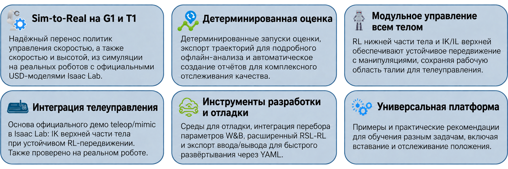
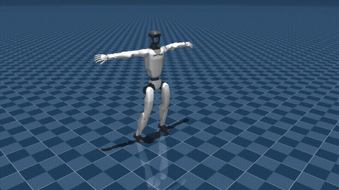
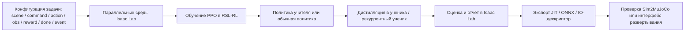
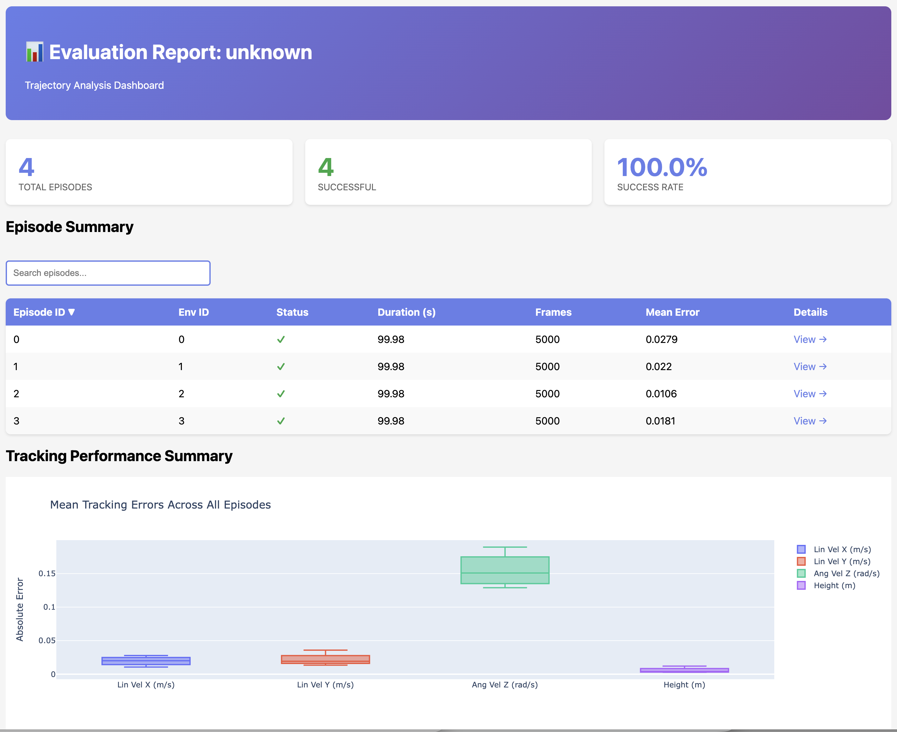
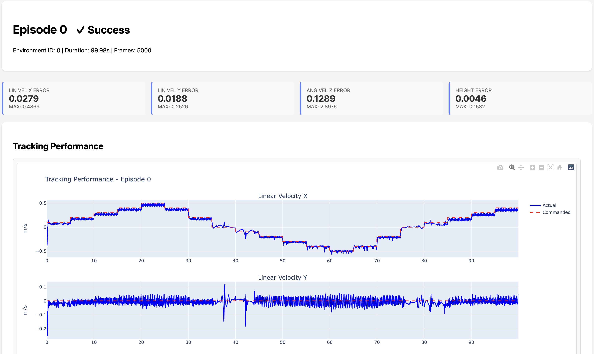

# AGILE для локомоции и манипуляций гуманоида: воспроизведение на Isaac Sim 5.1

Сопроводительное чтение: [Опыт воспроизведения: диагностика видео, границы оценки и управление ассетами](experience-sharing.md).

В этой главе рассматривается **AGILE: A Generic Isaac-Lab based Engine for humanoid loco-manipulation learning** от команды NVIDIA Isaac с открытым кодом. Статья — **AGILE: A Comprehensive Workflow for Humanoid Loco-Manipulation Learning**, официальный репозиторий — [nvidia-isaac/WBC-AGILE](https://github.com/nvidia-isaac/WBC-AGILE), arXiv — [arXiv:2603.20147](https://arxiv.org/abs/2603.20147).

Глава не представляет AGILE как систему, которая уже стала универсальным домашним роботом. Сначала нужно понять границы: AGILE скорее похож на рабочий процесс обучения с подкреплением для гуманоидных роботов. В одном проекте он объединяет конфигурацию задач, обучение PPO, дистилляцию teacher-student, экспорт политик, отчёты оценки и проверку в MuJoCo. Статья показывает задачи слежения за скоростью, управления высотой, подъёма после падения, имитации движений и ограниченный сценарий захвата и укладки предмета. Она пока не решает напрямую дальнюю навигацию в помещениях, распознавание объектов по открытому словарю, избегание препятствий всем телом и перенос предметов между комнатами.

После этой главы вы сможете:

- понимать, какие гуманоидные задачи AGILE действительно проверяет и почему они проще «полной домашней манипуляции»;
- воспроизвести репозиторий AGILE в окружении Isaac Sim 5.1 / Isaac Lab 2.3.2 и получить короткие видео для задач T1 (слежение за скоростью), G1 (скорость и высота) и сцены захвата G1;
- читать исходный код и понимать, из чего состоит задача AGILE: сцена, команды, действия, наблюдения, награды, условия завершения, события и конфигурация агента.

## 1. Какую проблему решает AGILE

Обучение с подкреплением гуманоидов легко ограничить тем, что политика «в симуляции может пройти несколько шагов». При реальном воспроизведении и переносе на робота трудности обычно связаны не с формулой PPO, а с инженерными деталями:

- конфигурация задач разбросана по многим слоям наследования, и трудно понять, что на самом деле задают награды, условия завершения и масштаб действий;
- актор на этапе обучения может видеть истинные значения симулятора, а на реальном роботе доступны только IMU, энкодеры суставов и предыдущее действие;
- после экспорта чекпоинта не хватает понятного описания наблюдений и действий, поэтому при переносе в MuJoCo или на робота легко ошибиться с размерностями, порядком суставов и нормировкой;
- по случайным прогонам трудно понять, действительно ли политика отслеживает скорость, высоту, поворот и устойчивость, если смотреть только видео;
- в одном проекте одновременно есть локомоция, подъём, имитация движения и манипуляции, и легко спутать «фреймворк поддерживает» с «статья полностью решила».

Ценность AGILE в том, что он организует эти этапы в проверяемый конвейер. Это не только архитектура нейросети, а шаблон всего пути: от определения задачи до оценки и экспорта.

<p align="center">
  
</p>

**Рисунок 1. Общий обзор задач AGILE от авторов.** Рисунок объединяет представительные задачи для роботов Booster T1 и Unitree G1. Так можно быстро понять, что в статье есть: слежение за скоростью, подъём, управление скоростью и высотой, телеуправление и имитация танца. Это не система полной навигации и манипуляций в помещении.

<p align="center"><sub>Источник: официальный репозиторий NVIDIA Isaac WBC-AGILE, `docs/figures/agile_highlights.png`.</sub></p>

## 2. Какие задачи проверены в статье

В статье задачи разделены на пять групп. Обратите внимание на границы задач: в названии AGILE есть loco-manipulation, но это не готовая система манипуляций в открытой среде.

| Группа задач | Робот | Цель управления | Границы сложности |
| :-- | :-- | :-- | :-- |
| Слежение за скоростью (Velocity tracking) | Booster T1 / Unitree G1 | Отслеживать команды скорости `vx, vy, yaw_rate` | Управление нижней частью тела, без зрительной навигации |
| Слежение за скоростью и высотой (Velocity-height tracking) | Unitree G1 | Одновременно отслеживать скорость и высоту корпуса | Дистилляция teacher-student, в основном управление нижней частью тела |
| Подъём (Stand-up) | Booster T1 / Unitree G1 | Подняться из упавшего состояния | Управление всем телом, но не задача манипуляции при движении |
| Имитация движения (Motion imitation) | Unitree G1 | Повторять эталонное движение, например танец | Зависит от данных эталонного движения, не автономное планирование |
| Захват и укладка / генерация данных для VLA (Pick-and-place) | Unitree G1 | Захватить и положить предмет в фиксированной сцене | Нижняя часть тела — замороженная локомоция, верхняя часть отслеживает траекторию или используется для генерации данных VLA |

Поэтому, если спросить, можно ли с помощью этого проекта дойти по комнате до стола, взять там предмет и отнести его в другую комнату, ответ такой: **сам репозиторий этого напрямую не делает**. AGILE даёт нижний уровень локомоции, локальные манипуляции, дистилляцию и оценку. Для полной манипуляции в помещении понадобятся ещё семантическая карта, локализация и навигация, детекция объектов, оценка 6D-позы, планирование захвата, избегание препятствий всем телом и длинный конечный автомат состояний.

Дальше в главе эта граница объясняется подробнее: AGILE можно использовать как курсовой ориентир по RL для гуманоидов, но не стоит принимать официальные демонстрации за «уже готового бытового робота».

## 3. Официальные и локальные видео: в чём разница

В официальном репозитории AGILE есть несколько GIF. Они опубликованы авторами и показывают эффекты статьи и проекта. Часть из них загружена в `assets/official_videos/` для сравнения. Локальные видео, которые мы записали заново, лежат в `assets/local_videos/`; они показывают, что окружение, ассеты и скрипты работают на текущей связке Isaac Sim 5.1.

Смысл двух типов видео различается:

- официальные видео показывают, чего хотят добиться авторы статьи и проекта;
- локальные короткие видео показывают, что на нашей машине создаётся среда, загружается политика, работает рендеринг и выполняется короткий rollout;
- короткие smoke-test видео не означают, что политика переобучена до сходимости или что её можно сразу ставить на реального робота.

<table>
  <tr>
    <td width="50%">
      
      <p><strong>Видео 1. Официальный результат Booster T1 в симуляции: слежение за скоростью.</strong> Видео показывает, как T1 следует командам скорости в симуляции. Это базовая способность задач локомоции в AGILE.</p>
      <p align="center"><sub>Источник: официальный репозиторий NVIDIA Isaac WBC-AGILE, `docs/videos/booster_t1_vel_sim2sim.gif`.</sub></p>
    </td>
    <td width="50%">
      
      <p><strong>Видео 2. Официальный результат Booster T1 на реальном роботе: слежение за скоростью.</strong> Видео иллюстрирует цель переноса из симуляции в реальность, о которой говорит статья. Не смешивайте его с локальными короткими видео этой главы.</p>
      <p align="center"><sub>Источник: официальный репозиторий NVIDIA Isaac WBC-AGILE, `docs/videos/booster_t1_vel_sim2real.gif`.</sub></p>
    </td>
  </tr>
  <tr>
    <td width="50%">
      
      <p><strong>Видео 3. Официальный результат Unitree G1 в симуляции: скорость и высота.</strong> Здесь G1 одновременно отслеживает скорость движения и высоту корпуса. За этим стоит подход teacher-student, который повышает реализуемость на роботе.</p>
      <p align="center"><sub>Источник: официальный репозиторий NVIDIA Isaac WBC-AGILE, `docs/videos/unitree_g1_vel_height_sim2sim.gif`.</sub></p>
    </td>
    <td width="50%">
      
      <p><strong>Видео 4. Официальный результат Unitree G1 на реальном роботе: скорость и высота.</strong> Видео соответствует эксперименту статьи по управлению скоростью и высотой G1.</p>
      <p align="center"><sub>Источник: официальный репозиторий NVIDIA Isaac WBC-AGILE, `docs/videos/unitree_g1_vel_height_sim2real.gif`.</sub></p>
    </td>
  </tr>
</table>

<p align="center">
  
</p>

**Видео 5. Официальная демонстрация захвата и укладки Unitree G1.** Видно захват и укладку предмета на фиксированном столе. Важно понимать: это ближе к локальной манипуляции и генерации данных, а не к длинной навигации по открытому помещению.

<p align="center"><sub>Источник: официальный репозиторий NVIDIA Isaac WBC-AGILE, `docs/videos/g1_apple_grasp_black_sort_bin_multi_objects_no_marker_reduced.gif`.</sub></p>

<p align="center">
  
</p>

**Видео 6. Официальная симуляция имитации движения Unitree G1.** Это задача, связанная с танцем из статьи: робот повторяет эталонное движение. Она не означает автономного сочинения танца или планирования задач в помещении.

<p align="center"><sub>Источник: официальный репозиторий NVIDIA Isaac WBC-AGILE, `docs/videos/unitree_g1_dancing_sim.gif`.</sub></p>

## 4. Инженерный конвейер AGILE

Общую структуру AGILE можно понимать как «конфигурация задач + алгоритм RL + оценка и экспорт + перекрёстная проверка в другом симуляторе».



Важная особенность AGILE по сравнению с обычным Isaac Lab: проект не поощряет глубокие цепочки наследования конфигураций. Каждый файл `*_env_cfg.py` стремится быть самодостаточным. Открыв один файл, вы видите сцену, наблюдения, действия, награды, условия завершения и учебный план.

Основные каталоги:

| Путь | На что смотреть |
| :-- | :-- |
| `agile/rl_env/tasks/` | Полная конфигурация MDP каждой задачи и регистрация в gym |
| `agile/rl_env/mdp/` | Общие функции наблюдений, наград, действий, событий и завершения |
| `agile/rl_env/assets/robots/` | Имена суставов G1 и T1, масштаб действий, конфигурации USD и приводов |
| `agile/rl_env/rsl_rl/` | Адаптация AGILE к обёртке и конфигурации RSL-RL |
| `agile/algorithms/rsl_rl/` | Форк PPO, дистилляции и рекуррентных политик |
| `agile/sim2mujoco/` | Перенос политики в MuJoCo через IO-дескриптор для проверки |
| `scripts/train.py` | Точка входа обучения: загрузка конфигурации задачи, создание среды и runner |
| `scripts/eval.py` | Точка входа оценки и экспорта: видео, траектории, отчёты, IO-дескрипторы |
| `scripts/play.py` | Проверка среды без загрузки политики; подходит для smoke test и отладочных видео |

<p align="center">
  
</p>

**Рисунок 2. Разделение политик верхней и нижней частей тела в AGILE.** На официальной схеме показан ключевой для захвата и укладки приём: нижняя часть тела использует замороженную политику локомоции для устойчивости, а верхняя часть отдельно обучается или отслеживает траекторию манипуляции. Такой слоистый подход полезен при проектировании мобильных манипуляций, но AGILE пока не является полной системой навигации и захвата в помещении.

<p align="center"><sub>Источник: официальный репозиторий NVIDIA Isaac WBC-AGILE, `docs/figures/separate_upper_lower_body_policy_diagram.png`.</sub></p>

## 5. Как конфигурация задачи превращается в код

Возьмём задачу локомоции. Конфигурация задачи AGILE обычно включает несколько групп параметров.

### 1. Сцена: робот, рельеф и датчики

`SceneCfg` задаёт рельеф, USD-модель робота, датчики контакта, ray caster и освещение. Например, задача скорости T1 создаёт неровный рельеф, помещает в сцену `booster_t1.T1_DELAYED_DC_CFG`, а также подключает датчик силы контакта и ray caster для измерения высоты.

Этот этап отвечает на вопрос, в каком мире обучается робот. Для тех, кто работает с RL роботов, сцена — не декорация: она определяет контакты, трение, рельеф, датчики и начальное состояние.

### 2. Команды: что должна отслеживать политика

Команды для задачи скорости обычно имеют вид:

```text
lin_vel_x, lin_vel_y, ang_vel_z
```

В задаче скорости и высоты добавляется команда высоты корпуса:

```text
lin_vel_x, lin_vel_y, ang_vel_z, base_height
```

Эти команды не выдаёт сама сеть. Их выбирает среда, а задача политики — по текущей проприоцепции и команде вычислить управление суставами.

### 3. Действия: как выход политики становится целями суставов

AGILE часто использует управление по положению суставов. Политика выдаёт нормированный вектор действий, а среда по именам суставов, масштабу действий, смещению по умолчанию и диапазону ограничения переводит его в целевые положения суставов. Здесь легко допустить ошибку в порядке суставов и масштабе действий, поэтому AGILE экспортирует IO-дескриптор, который помогает согласовать политику в MuJoCo или на роботе.

### 4. Наблюдения: актор, критик, учитель и ученик видят разное

Многие задачи AGILE используют асимметричный actor-critic или схему teacher-student. Для G1 с управлением скоростью и высотой это выглядит так:

- учитель и критик могут использовать привилегированные наблюдения, например карту высот рельефа под роботом;
- ученик видит данные, ближе к реальным на роботе: величины IMU, положения и скорости суставов, предыдущее действие и команды;
- рекуррентный ученик использует LSTM, чтобы компенсировать отсутствующие привилегированные наблюдения памятью о предыстории.

Эта схема перекликается с работами по локомоции ног: на этапе обучения используется истинная информация симулятора, а при развёртывании политика опирается на доступные датчики.

### 5. Награды и условия завершения: превращение цели задачи в сигнал обучения

Награды для задач локомоции обычно включают:

- отслеживание линейной и угловой скорости;
- высоту основания и плоскую ориентацию;
- штрафы за момент, скорость и ускорение суставов и изменение действия;
- штрафы за скольжение стоп, позу стоп, расстояние между стопами и столкновения;
- штрафы за выход из пределов суставов и ограничений момента.

Условие завершения отвечает за конец эпизода: падение, недопустимое касание, слишком большой наклон, аномальное расстояние стопа—колено или тайм-аут. В AGILE также добавлено формирование «хороших» и «плохих» завершений, поэтому причина конца эпизода влияет на обучение PPO.

### 6. События: доменная рандомизация

Для перехода из симуляции в реальность AGILE сильно опирается на рандомизацию событий. Обычно варьируются:

- трение и коэффициент восстановления твёрдых тел;
- жёсткость и демпфирование приводов;
- трение и armature суставов;
- масса и центр масс звеньев;
- внешние силы и моменты;
- начальные положения корня и суставов при сбросе.

Эта рандомизация нужна не для красоты симуляции, а чтобы политика выучила закономерности управления, устойчивые к изменению физических параметров.

## 6. Teacher-student: зачем нужна дистилляция в G1

Задача G1 со скоростью и высотой — один из самых поучительных примеров в AGILE. Здесь не просто обучается один MLP: сначала тренируется учитель, а затем он дистиллируется в ученика, который годится для развёртывания.

Учитель получает привилегированные наблюдения, например карту высот под стопами. В симуляции ему легче научиться подстраивать нижнюю часть тела под рельеф и команду высоты. Проблема в том, что такая информация на реальном роботе не всегда доступна.

Ученик получает входы ближе к реальным. В AGILE есть два варианта:

- рекуррентный ученик: LSTM или GRU запоминает скрытое состояние по истории;
- ученик с историей: несколько кадров истории подаются в MLP.

При дистилляции ученик повторяет выходы учителя. Тогда при развёртывании ученику не нужен прямой доступ к привилегированной информации симулятора, но он наследует управление учителя. Эту схему полезно запомнить для собственных роботов: **учитель использует информацию симулятора, чтобы выучить задачу, а ученик переносит поведение на наблюдения, доступные на реальном роботе**.

## 7. Почему захват и укладка — ещё не полная мобильная манипуляция

Захват и укладка в AGILE хорошо подходят для обучения, потому что показывают связь локомоции нижней части тела с манипуляцией верхней. Но границы задачи надо назвать прямо.

В AGILE захват G1 не означает, что робот самостоятельно идёт из любой комнаты к столу, распознаёт любой предмет, планирует захват и укладку всем телом. Скорее всё устроено так:

- в сцене уже есть стол, целевой предмет и эталонная траектория манипуляции;
- нижняя часть тела управляется замороженной политикой локомоции и поддерживает устойчивость;
- верхнюю часть тела, кисть и корпус ведёт политика верхней части тела или отладочные действия;
- задача в основном проверяет локальную манипуляцию, отслеживание траектории и цепочку генерации данных.

Чтобы расширить задачу до навигации и захвата в помещении, нужно добавить:

- карту помещения или SLAM;
- детекцию объектов и оценку 6D-позы;
- навигацию по точкам пути и выбор позы подхода;
- переключение стойки и избегание препятствий всем телом;
- планирование захвата, укладки и восстановления после неудачи;
- верхний конечный автомат состояний или VLA/VLM для планирования задач.

Поэтому эту главу мы относим к «RL-фундаменту гуманоидов», а не к готовой системе бытового агента.

### Полная оценка захвата требует дополнительного чекпоинта

Предобученные политики из `agile/data/policy/` в официальном репозитории в основном относятся к скорости, скорости с высотой и управлению нижней частью тела. При воспроизведении этой главы мы не нашли в репозитории или в локальных журналах обучения чекпоинт RL для верхней части тела задачи `G1-PickPlace-Tracking-v0`. Официальная документация `data-recording` также требует указать `--checkpoint <path/to/rl/checkpoint.pt>` для `G1-PickPlace-Tracking-v0-Record` как предварительное условие.

Поэтому для полной оценки захвата сначала нужна обученная политика захвата. Когда чекпоинт получен, оценку можно запустить так:

```bash
cd "$AGILE_ROOT"
OMNI_KIT_ACCEPT_EULA=YES \
ISAACLAB_PATH="$ISAACLAB_PATH" \
"$AGILE_PY" scripts/eval.py \
  --task G1-PickPlace-Tracking-v0 \
  --num_envs 1 \
  --headless \
  --video \
  --video_length 300 \
  --num_steps 300 \
  --checkpoint /path/to/g1_pick_place_tracking_checkpoint.pt \
  --run_evaluation \
  --save_trajectories
```

Если такого чекпоинта нет, можно выполнить только проверку сцены, визуализацию эталонной траектории или сравнение с официальными GIF, но нельзя заявлять, что полная оценка захвата пройдена.

## 8. Подготовка локального окружения

В этой главе используется связка Isaac Sim 5.1 и Isaac Lab 2.3.2. Чтобы не испортить уже существующее окружение Isaac, лучше создать новое, а не выполнять `pip install` в исходном.

Команды ниже используют переменные путей. Замените их на пути своей машины:

```bash
export WORKSPACE=/path/to/06Agile-Loco-Manipulation
export ISAACLAB_PATH=$WORKSPACE/IsaacLab
export AGILE_ROOT=$WORKSPACE/WBC-AGILE
export AGILE_ENV=/path/to/envs/agile-wbc-isaac51-py311
export AGILE_PY=$AGILE_ENV/bin/python
```

### Контрольная точка 1. Клонируем репозиторий и фиксируем Isaac Lab

```bash
mkdir -p "$WORKSPACE"
cd "$WORKSPACE"

git clone https://github.com/nvidia-isaac/WBC-AGILE.git
git clone https://github.com/isaac-sim/IsaacLab.git

cd "$ISAACLAB_PATH"
git checkout v2.3.2
```

README AGILE требует Isaac Lab v2.3.2 и Isaac Sim 5.1. Не смешивайте в одном окружении Isaac Lab 1.x, 2.0 или Isaac Sim 4.x.

### Контрольная точка 2. Загружаем ассеты Git LFS

Предобученные политики и официальные медиа AGILE хранятся через Git LFS. После клонирования выполните:

```bash
cd "$AGILE_ROOT"
git lfs install
git lfs pull
git lfs ls-files
```

Если файлы `.pt` или `.onnx` весят всего сто с небольшим байт, у вас указатель Git LFS, а не настоящие веса.

Ключевые файлы политик, которые мы проверяли:

| Файл | Назначение |
| :-- | :-- |
| `agile/data/policy/velocity_t1/booster_t1_velocity_v0.pt` | Предобученная политика слежения за скоростью Booster T1 |
| `agile/data/policy/velocity_g1/unitree_g1_velocity_history.pt` | Политика G1 с историей скорости |
| `agile/data/policy/velocity_height_g1/unitree_g1_velocity_height_teacher.pt` | Учитель G1 для скорости и высоты |
| `agile/data/policy/velocity_height_g1/unitree_g1_velocity_height_recurrent_student_checkpoint.pt` | Полный чекпоинт рекуррентного ученика G1 |
| `agile/data/policy/velocity_height_g1/unitree_g1_velocity_height_recurrent_student.pt` | Политика ученика G1 в экспорте TorchScript |
| `agile/data/policy/velocity_height_g1/unitree_g1_velocity_height_recurrent_student.onnx` | Политика ученика G1 в экспорте ONNX |

### Контрольная точка 3. Устанавливаем AGILE в копию окружения

Способ создания окружения зависит от машины. В этой главе использован вариант «скопировать уже работающее окружение Isaac 5.1 из micromamba и установить AGILE в копии», чтобы не сломать исходное. Вы также можете создать окружение по официальной инструкции.

```bash
cd "$AGILE_ROOT"
export ISAACLAB_PATH="$ISAACLAB_PATH"

"$AGILE_PY" -m pip install -e "$ISAACLAB_PATH/source/isaaclab"
"$AGILE_PY" -m pip install -e "$ISAACLAB_PATH/source/isaaclab_tasks"
"$AGILE_PY" -m pip install -e "$ISAACLAB_PATH/source/isaaclab_assets"
"$AGILE_PY" -m pip install -e .
```

Если при запуске Isaac появляется много предупреждений о кэше расширений, можно докачать пакеты extscache для Isaac Sim 5.1. Они очень большие, поэтому лучше скачать их в общий кэш, проверить хэш и только потом установить в копию окружения. Не экспериментируйте в исходном окружении Isaac.

## 9. Локальный smoke test: что именно мы проверили

В этой главе получены три коротких видео. Это не финальные результаты обучения, а подтверждение работоспособности цепочки воспроизведения:

1. Предобученная политика T1 для скорости загружается и рендерит короткий rollout;
2. Полный чекпоинт рекуррентного ученика G1 со скоростью и высотой загружается и рендерит короткий rollout;
3. Сцена захвата G1 загружается и записывает короткое видео для проверки сцены, робота, маркеров эталонной траектории и цепочки действий.

### 1. Короткое видео политики скорости T1

```bash
cd "$AGILE_ROOT"
OMNI_KIT_ACCEPT_EULA=YES \
ISAACLAB_PATH="$ISAACLAB_PATH" \
"$AGILE_PY" scripts/eval.py \
  --task Velocity-T1-v0 \
  --num_envs 1 \
  --headless \
  --video \
  --video_length 180 \
  --num_steps 180 \
  --checkpoint agile/data/policy/velocity_t1/booster_t1_velocity_v0.pt
```

<video controls muted preload="metadata" width="100%">
  <source src="assets/local_videos/t1_velocity_policy_smoke.mp4" type="video/mp4">
</video>

**Видео 7. Локальное воспроизведение: smoke test политики скорости Booster T1.** Видео показывает, что окружение может запустить Isaac Lab, загрузить предобученную политику T1, создать сцену и записать короткий rollout. Это не результат переобучения.

<p align="center"><sub>Источник: локальное воспроизведение в этой главе, команда приведена выше.</sub></p>

### 2. Короткое видео рекуррентного ученика G1 со скоростью и высотой

Экспортированная TorchScript-версия рекуррентного ученика G1 (`.pt`) в `eval.py` попадает в ветку рекуррентного fallback и при прямой загрузке как обычного чекпоинта может не загрузиться. Поэтому для локального короткого видео использован полный чекпоинт:

```bash
cd "$AGILE_ROOT"
OMNI_KIT_ACCEPT_EULA=YES \
ISAACLAB_PATH="$ISAACLAB_PATH" \
"$AGILE_PY" scripts/eval.py \
  --task Velocity-Height-G1-Distillation-Recurrent-v0 \
  --num_envs 1 \
  --headless \
  --video \
  --video_length 120 \
  --num_steps 120 \
  --checkpoint agile/data/policy/velocity_height_g1/unitree_g1_velocity_height_recurrent_student_checkpoint.pt
```

<video controls muted preload="metadata" width="100%">
  <source src="assets/local_videos/g1_velocity_height_checkpoint_smoke.mp4" type="video/mp4">
</video>

**Видео 8. Локальное воспроизведение: минимальный запуск политики G1 со скоростью и высотой.** Видео подтверждает, что полный чекпоинт загружается и рендерится в Isaac Sim 5.1 / Isaac Lab 2.3.2. Это проверка инференса, а не завершённое переобучение.

<p align="center"><sub>Источник: локальное воспроизведение в этой главе, команда приведена выше.</sub></p>

### 3. Короткое видео сцены захвата G1

Здесь записывается нерегулируемая задача `G1-PickPlace-Tracking-v0` (не Debug-вариант). Это не финальная оценка политики захвата, а проверка сцены с синусоидальными действиями из `scripts/play.py`. По сравнению с Debug-вариантом исходные действия верхней и нижней части тела не заменяются GUI-действиями, поэтому запись без интерфейса лучше подходит для демонстрации.

```bash
cd "$AGILE_ROOT"
OMNI_KIT_ACCEPT_EULA=YES \
ISAACLAB_PATH="$ISAACLAB_PATH" \
"$AGILE_PY" scripts/play.py \
  --task G1-PickPlace-Tracking-v0 \
  --num_envs 1 \
  --headless \
  --video \
  --video_length 180 \
  --num_steps 180
```

<video controls muted preload="metadata" width="100%">
  <source src="assets/local_videos/g1_pickplace_tracking_scene_smoke.mp4" type="video/mp4">
</video>

**Видео 9. Локальное воспроизведение: smoke test сцены захвата G1.** Видео используется для изучения загрузки сцены захвата, визуализации эталонной траектории и цепочки действий, но не показывает замкнутый захват политикой. Настоящий эффект захвата нужно сверять с официальной демонстрацией или оценивать обученной политикой верхней части тела.

<p align="center"><sub>Источник: локальное воспроизведение в этой главе, команда приведена выше.</sub></p>

## 10. Оценка и отчёты: не судите только по видео

Механизм оценки в AGILE сложнее простой записи видео. Поддерживаются два пути:

- оценка в Isaac Lab: параллельный rollout на GPU, сохранение траекторий в Parquet, метрики и HTML-отчёт;
- оценка Sim2MuJoCo: проверка на одной среде CPU MuJoCo с тем же расписанием команд в YAML, чтобы понять, как политика ведёт себя в другом симуляторе.

<p align="center">
  
</p>

**Рисунок 3. Официальная сводка отчёта оценки AGILE.** На рисунке показаны агрегированные метрики отчёта. При изучении стоит смотреть вместе на отслеживание скорости, отслеживание высоты, завершение эпизодов и плавность действий, а не судить о политике только по видео.

<p align="center"><sub>Источник: официальный репозиторий NVIDIA Isaac WBC-AGILE, `docs/figures/evaluation_report_summary.png`.</sub></p>

<p align="center">
  
</p>

**Рисунок 4. Кривые отслеживания в официальном отчёте AGILE.** По таким кривым видно ошибку между командой и фактическим движением, например успевает ли политика за изменением команды скорости.

<p align="center"><sub>Источник: официальный репозиторий NVIDIA Isaac WBC-AGILE, `docs/figures/evaluation_report_tracking.png`.</sub></p>

Типичная команда оценки в Isaac Lab:

```bash
cd "$AGILE_ROOT"
OMNI_KIT_ACCEPT_EULA=YES \
ISAACLAB_PATH="$ISAACLAB_PATH" \
"$AGILE_PY" scripts/eval.py \
  --task Velocity-T1-v0 \
  --num_envs 32 \
  --checkpoint agile/data/policy/velocity_t1/booster_t1_velocity_v0.pt \
  --run_evaluation \
  --save_trajectories \
  --generate_report
```

Для детерминированного перебора параметров можно передать конфигурацию оценки из AGILE:

```bash
"$AGILE_PY" scripts/eval.py \
  --task Velocity-Height-G1-v0 \
  --num_envs 16 \
  --checkpoint /path/to/model.pt \
  --run_evaluation \
  --eval_config agile/algorithms/evaluation/configs/examples/x_velocity_sweep.yaml
```

## 11. Sim2MuJoCo: зачем проверять в другом симуляторе

В `agile/sim2mujoco/` есть инструменты для переноса экспортированной политики в MuJoCo. Смысл здесь не в том, что MuJoCo «реалистичнее» Isaac. Второй физический бэкенд помогает понять, не зависит ли политика от особенностей контактов, суставов, задержек или реализации приводов конкретного симулятора.

Базовый порядок такой:

1. Экспортировать политику и IO-дескриптор из чекпоинта Isaac Lab;
2. Подготовить MJCF робота, например официальный `unitree_mujoco`;
3. Выполнить короткий rollout в MuJoCo с тем же расписанием команд;
4. Сохранить траекторию в Parquet и сравнить её с результатами Isaac Lab.

Пример команд:

```bash
cd "$AGILE_ROOT"

"$AGILE_PY" scripts/export_IODescriptors.py \
  --task Velocity-G1-History-v0 \
  --output_dir /path/to/exported_policy

"$AGILE_PY" scripts/sim2mujoco_eval.py \
  --checkpoint /path/to/exported_policy/policy.pt \
  --config /path/to/exported_policy/config.yaml \
  --mjcf /path/to/unitree_mujoco/unitree_robots/g1/scene_29dof.xml \
  --eval-config agile/sim2mujoco/configs/x_velocity_sweep.yaml \
  --save-data \
  --no-viewer
```

Если в MuJoCo робот заметно неустойчив, можно попробовать `--pd-scale 0.3`, чтобы снизить коэффициенты PD. Это не окончательное решение, а способ понять, связана ли нестабильность с усилением управления или с различиями симуляторов.

## 12. Частые проблемы и диагностика

### 1. При запуске Isaac появляется много предупреждений extscache

Если предупреждения указывают на отсутствие `isaacsim/extscache/.../extension.toml`, обычно не докачаны пакеты расширений Isaac Sim. Можно установить соответствующие версии `isaacsim-extscache-kit`, `isaacsim-extscache-kit-sdk` и `isaacsim-extscache-physics`. Эти пакеты очень большие, поэтому скачивайте их заранее, проверяйте хэш и устанавливайте в копию окружения.

### 2. Пути к ассетам Nucleus выглядят как `None/Isaac/...`

Если запускать `SimulationApp` напрямую, настройки корня ассетов Isaac Lab могут не загрузиться. Лучше использовать `isaaclab.app.AppLauncher` или скрипты AGILE: тогда `ISAAC_NUCLEUS_DIR` и `ISAACLAB_NUCLEUS_DIR` будут указывать на официальный корень ассетов Isaac 5.1 в S3.

### 3. Прямая оценка TorchScript рекуррентного ученика G1 завершается ошибкой

В нашем воспроизведении `unitree_g1_velocity_height_recurrent_student.pt` распознаётся `eval.py` как рекуррентный TorchScript, после чего он переключается на путь обычного чекпоинта и не загружается. Для локального короткого видео используйте полный чекпоинт:

```text
agile/data/policy/velocity_height_g1/unitree_g1_velocity_height_recurrent_student_checkpoint.pt
```

С ним можно выполнить локальный короткий smoke test с видео.

### 4. В отладочной задаче захвата в режиме headless объекты не двигаются

`G1-PickPlace-Tracking-v0-Debug` отключает исходные `upper_body_joint_pos` и `lower_body_joint_pos` и подставляет управление суставами через GUI, управление позой объекта через GUI и визуализатор наград. При записи без интерфейса никто не двигает GUI и не подаёт вход на объект, поэтому в конце видео всё почти неподвижно. В этой главе для локального видео сцены взята нерегулируемая задача `G1-PickPlace-Tracking-v0`.

### 5. Что доказывает smoke test

Smoke test показывает:

- цепочка Python, Isaac Sim, Isaac Lab и импорт AGILE работает;
- USD-модель робота и ассеты Nucleus загружаются;
- предобученная политика или чекпоинт проходит через путь инференса;
- rendering без графического интерфейса записывает короткое видео.

Smoke test не доказывает:

- что переобучение сошлось;
- что политику можно сразу ставить на реального робота;
- что захват и укладка обобщаются в открытой среде помещения;
- что навигация по помещению, семантическое восприятие и планирование длинных задач уже реализованы.

## 13. Как расширить до навигации и захвата в помещении

Если цель — «пройти по комнате, взять предмет со стола и отнести в другое место», AGILE можно взять как базовый слой навыков, но понадобится ещё системный уровень.

Разумный путь исследования:

1. Воспроизвести `Velocity-G1-History-v0` или `Velocity-Height-G1-Distillation-Recurrent-v0`, получив стабильный интерфейс команд нижней части тела;
2. Подключить простой следователь по точкам пути, который переводит выход навигатора в `vx, vy, yaw_rate`;
3. Воспроизвести `G1-PickPlace-Tracking-v0` и понять, как замороженная нижняя часть тела сочетается с действиями верхней части;
4. Получить позы объекта, позы захвата и позы укладки от модуля зрения или VLA;
5. Организовать конечный автомат: `навигация -> подход -> стабилизация -> тянуться -> захват -> перенос -> укладка -> восстановление`;
6. Добавить проверку столкновений всем телом, избегание рук и повторные попытки при неудаче.

То есть AGILE — хорошая «база RL для гуманоидов», но полноценная мобильная манипуляция в помещении требует совместной работы навигации, восприятия, планирования и управления задачами.

## Источники и материалы

- Статья: Huihua Zhao и соавт., **AGILE: A Comprehensive Workflow for Humanoid Loco-Manipulation Learning**, arXiv:2603.20147.
- Официальный репозиторий: [nvidia-isaac/WBC-AGILE](https://github.com/nvidia-isaac/WBC-AGILE).
- Официальная документация: [NVIDIA Isaac WBC-AGILE Documentation](https://nvidia-isaac.github.io/WBC-AGILE/).
- Isaac Lab: [isaac-sim/IsaacLab](https://github.com/isaac-sim/IsaacLab), в этой главе использована версия v2.3.2.
- Официальные изображения и GIF взяты из `docs/figures/` и `docs/videos/` репозитория WBC-AGILE и для учебных целей размещены в `assets/official_figures/` и `assets/official_videos/`.
- Короткие локальные видео созданы скриптами AGILE в окружении Isaac Sim 5.1 / Isaac Lab 2.3.2 и сохранены в `assets/local_videos/`.
