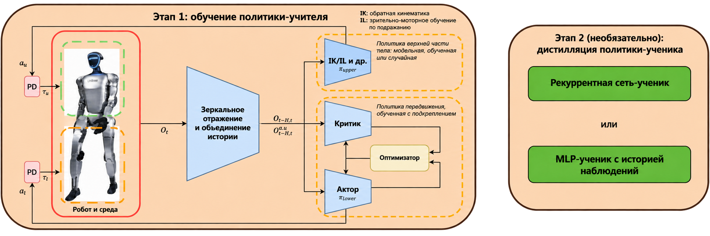

# Опыт воспроизведения AGILE: диагностика видео, границы оценки и управление ассетами

Чтобы воспроизвести AGILE, нужно последовательно связать регистрацию задачи, загрузку сцены, входы и выходы политики и метрики оценки. В этой главе на примере задач T1 со скоростным слежением, G1 со скоростью и высотой и сцены захвата и укладки G1 показано, как диагностировать видео, на котором ничего не движется, как выбрать файл весов и как очистить копии моделей, сохранив воспроизводимость. Команды установки и полные видео — в [основном руководстве](README.md).

## 1. Сначала определите, что должен подтвердить каждый эксперимент

| Эксперимент | Вход и способ выполнения | Полученное доказательство | Что нужно для полной оценки |
| :-- | :-- | :-- | :-- |
| T1, слежение за скоростью | Предобученная политика и команда скорости | Загрузка политики, продвижение симуляции и запись короткого видео | Статистика ошибки скорости и падений по нескольким эпизодам |
| G1, скорость и высота | Полный чекпоинт рекуррентной ученической политики | Загрузка политики, продвижение симуляции и запись короткого видео | Статистика ошибки высоты, ошибки скорости и устойчивости |
| Сцена захвата и укладки G1 | Управление синусоидальными действиями | Работоспособность сцены, опорной траектории и цепочки действий | Политика верхней части тела под задачу, критерии успеха и оценка по нескольким эпизодам |

**Таблица 1. Границы доказательств для трёх экспериментов.** Сцена запускается, политика выдаёт вывод, задача выполнена — это три разных условия приёмки. Короткое видео не даёт процента успешных захватов и не доказывает, что политика была переобучена.

Проверенная в июне 2026 года версия WBC-AGILE — `7259792cf10803aab814d101134d493d24c8f22f`. В каталоге предобученных политик этой версии есть веса управления движением, но нет чекпоинта верхней части тела для `G1-PickPlace-Tracking-v0`. Этот вывод относится только к проверенной версии: поддерживается ли позже такой чекпоинт, нужно смотреть в официальной документации по предобученным политикам и в списке файлов.

## 2. Если видео не двигается, проверяйте цепочку действий

Первую запись сцены захвата делали с отладочной задачей. В исходном коде `agile/rl_env/tasks/pick_place/g1/g1_pick_place_tracking_env_cfg.py` отладочная конфигурация убирает исходные действия суставов верхней и нижней части тела и добавляет действие управления суставами через графический интерфейс. При запуске без интерфейса никаких интерактивных входов нет, поэтому записанная картинка может быть почти статичной.

При диагностике сначала смотрите конфигурацию, которая действительно используется в задаче, затем код генерации действий. Нужно проверить, растёт ли число шагов симуляции, меняются ли действия со временем, остаются ли действия связанными с суставами и как сравниваются положения объекта и конца манипулятора. Сравнения двух кадров недостаточно, чтобы доказать выполнение задачи: тени, положение камеры или маркеры тоже меняют пиксели.

`scripts/play.py` генерирует синусоидальные действия через `generate_sinusoidal_actions()`. Если переключиться на обычную задачу `G1-PickPlace-Tracking-v0`, можно проверить исходную цепочку действий и сцену, но обученная политика верхней части тела для захвата при этом не выполняется. Полная оценка политики должна идти через `scripts/eval.py` с явной загрузкой чекпоинта, подходящего для задачи.

<video controls muted preload="metadata" width="100%">
  <source src="assets/local_videos/g1_pickplace_tracking_scene_smoke.mp4" type="video/mp4">
</video>

**Видео 1. Проверка сцены захвата и укладки G1 с синусоидальным управлением.** Здесь видно робота, сцену и опорную траекторию; видео не демонстрирует успешный замкнутый захват.

Источник: собственная локальная генерация проекта; команды запуска см. в [разделе 9 основного руководства](README.md).

## 3. Одинаковое расширение файла не означает одинаковый интерфейс загрузки

Файл `.pt` может быть как чекпоинтом обучения, так и политикой, экспортированной в TorchScript [формат скриптованных моделей]. Чекпоинт обучения восстанавливается фреймворком обучения с сетью и связанными состояниями; экспортированная политика предоставляет вывод через интерфейс развёртывания. При выборе файла нужно проверить задачу, структуру сети, порядок наблюдений, масштаб действий и интерфейс скрытого состояния рекуррентной сети.

В проверке G1 с рекуррентной ученической политикой использован `unitree_g1_velocity_height_recurrent_student_checkpoint.pt`. Экспортированная политика в той же папке не может заменить его на том же пути загрузки лишь потому, что расширение совпадает. После замены файла сначала выполните короткий запуск с одной средой, и только потом проверяйте метрики слежения. Совпадение размерностей тензоров не гарантирует, что порядок суставов и смысл нормализации одинаковы.

<p align="center">
  
</p>

**Рисунок 1. Разделение обязанностей политик верхней и нижней частей тела.** Политики движения ног и манипуляций руками требуют собственных входов и выходов; уже имеющиеся веса ходьбы не заменяют веса для захвата.

Источник: [официальная схема WBC-AGILE](https://github.com/nvidia-isaac/WBC-AGILE/blob/7259792cf10803aab814d101134d493d24c8f22f/docs/figures/separate_upper_lower_body_policy_diagram.png).

## 4. Фиксируйте версии и выносите большие файлы на отдельный диск

В этом воспроизведении использованы Isaac Sim 5.1 и Isaac Lab 2.3.2. Это разные проекты, и их номера версий нельзя менять местами. При воспроизведении копируйте уже работающее окружение и устанавливайте зависимости проекта в копии; новые окружения, кэши загрузок и пакетные выходы держите на диске с достаточным объёмом.

Ниже пример структуры каталогов. Сначала замените корень данных на реально смонтированный диск, и только потом переходите к установке по основному руководству. Сами переменные не создают окружение.

```bash
export DATA_ROOT=/path/to/data-disk
export WORKSPACE="$DATA_ROOT/projects/agile"
export AGILE_ROOT="$WORKSPACE/WBC-AGILE"
export ISAACLAB_PATH="$WORKSPACE/IsaacLab"
export AGILE_ENV="$DATA_ROOT/envs/agile-wbc-isaac51-py311"
export AGILE_PY="$AGILE_ENV/bin/python"
export PIP_CACHE_DIR="$DATA_ROOT/cache/pip"
export HF_HOME="$DATA_ROOT/cache/huggingface"
```

Записывать версию исходного кода, команды запуска и ключевой вывод удобнее, чем сохранять архив целого окружения. Для предобученных файлов сохраните официальный адрес, соответствующую версию исходного кода, размер и SHA-256 [хеш-сумма SHA-256], а после загрузки проверяйте содержимое файла.

## 5. Восстанавливайте модели по необходимости, а в руководстве оставляйте лёгкие доказательства

Модели, которые можно заново скачать с официального источника, можно удалить с локальной машины. В репозитории с Git LFS [Git Large File Storage] рабочая копия весов и локальный кэш объектов существуют одновременно, и удаление только одной из копий может не освободить ожидаемого места. Перед очисткой проверьте, что локальный файл не изменён, официальный файл можно скачать, контрольные суммы совпадают и никакой процесс обучения или вывода не использует файл.

Указатели больших файлов в исходном коде позволяют и дальше фиксировать хеш и размер исходных весов. Следующие команды выполняются в уже клонированном каталоге AGILE и восстанавливают только файлы политик, не скачивая официальные видео:

```bash
cd "$AGILE_ROOT"
git lfs pull --include="agile/data/policy/**" --exclude=""
git lfs ls-files
```

После восстановления файлы весов должны перестать быть указателями на сто с лишним байт и стать реальными моделями. Завершите восстановление до запуска команд вывода из основного руководства; особенно учитывайте, что сцена захвата тоже может зависеть от политики движения нижней части тела.

Собственные веса, уникальные собранные данные и траектории оценки сначала нужно архивировать, и только потом удалять локальные файлы. При публикации в Hugging Face-репозитории Datawhale приложите лицензию на использование, конфигурацию задачи, источник, список файлов и контрольные суммы, а очищать локальную копию стоит только после проверки удалённых файлов. В этом проекте не появилось новых весов захвата и отдельного собранного набора данных, которые нужно было бы публиковать; текущие официальные веса можно восстановить из вышестоящего источника по необходимости.

В руководстве оставлены необходимые иллюстрации, короткие видео и указания на источники. Общие ресурсы симуляции, данные других проектов и уже существующие окружения нужно вести по их собственным правилам использования; один лишь большой размер каталога не означает, что он относится к текущему проекту.

## 6. Как принимать результат полной оценки захвата

После получения верхней политики, соответствующей задаче, сначала убедитесь, что её выход действительно управляет суставами верхней части тела. Затем раздельно фиксируйте подход, контакт, захват, перенос, отпускание и устойчивую укладку. Критерии успеха должны учитывать расстояние от объекта до целевой области, состояние отпускания, длительность устойчивого положения и падение робота, а также явно описывать правила таймаута и сброса при неудаче.

В итоговом отчёте укажите число эпизодов оценки, зерно генератора случайных чисел, распределение начальных положений объектов, число успехов, долю успеха и причины неудач. Одно успешное видео подходит для демонстрации поведения, а статистика по многим эпизодам нужна, чтобы судить о надёжности политики. Перенос между комнатами требует также локализации, навигации, обхода препятствий и планирования задач; эти модули выходят за рамки проверки локальной сцены.

## Ссылки

- [Официальный исходный код](https://github.com/nvidia-isaac/WBC-AGILE/tree/7259792cf10803aab814d101134d493d24c8f22f), [документация по предобученным политикам](https://github.com/nvidia-isaac/WBC-AGILE/blob/7259792cf10803aab814d101134d493d24c8f22f/docs/source/pretrained-policies.md), [документация по записи данных](https://github.com/nvidia-isaac/WBC-AGILE/blob/7259792cf10803aab814d101134d493d24c8f22f/docs/source/data-recording.md).
