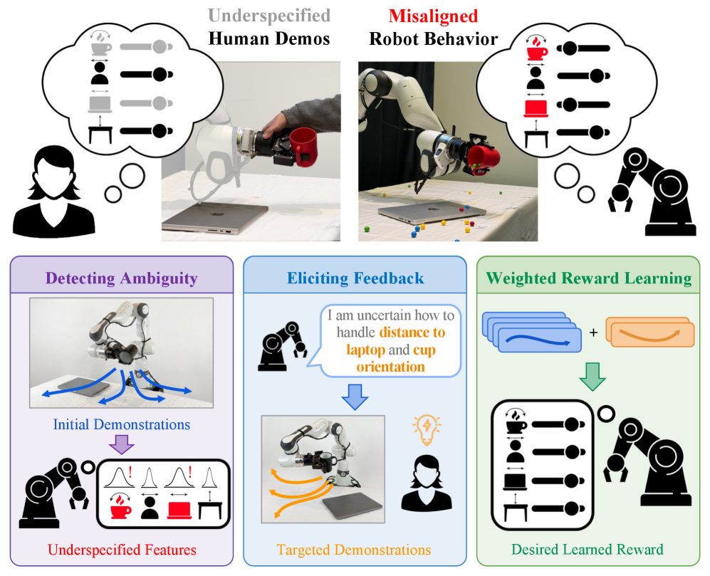
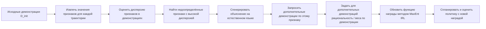
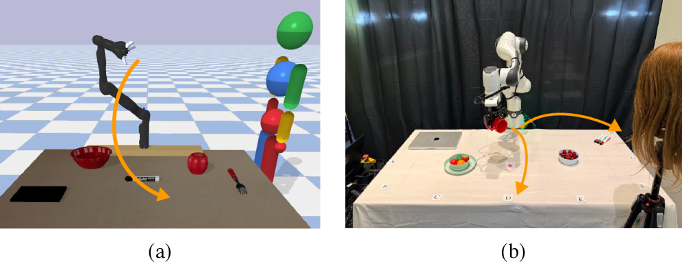
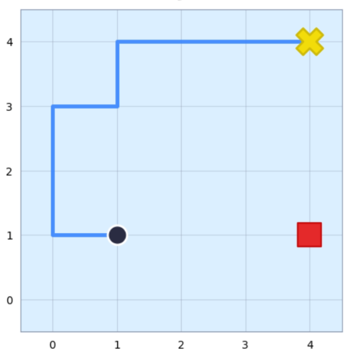
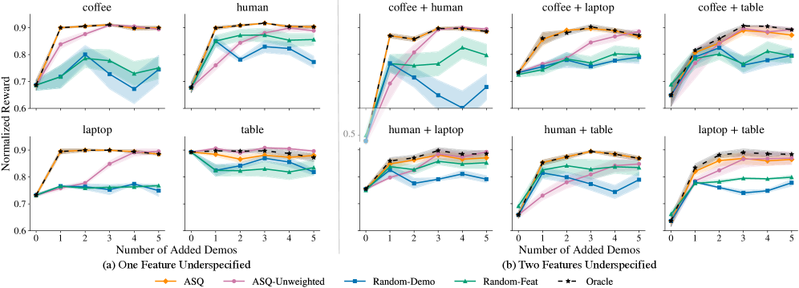
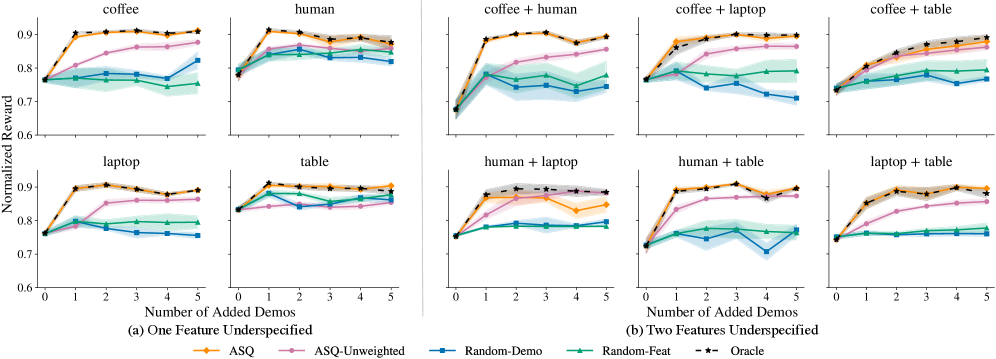
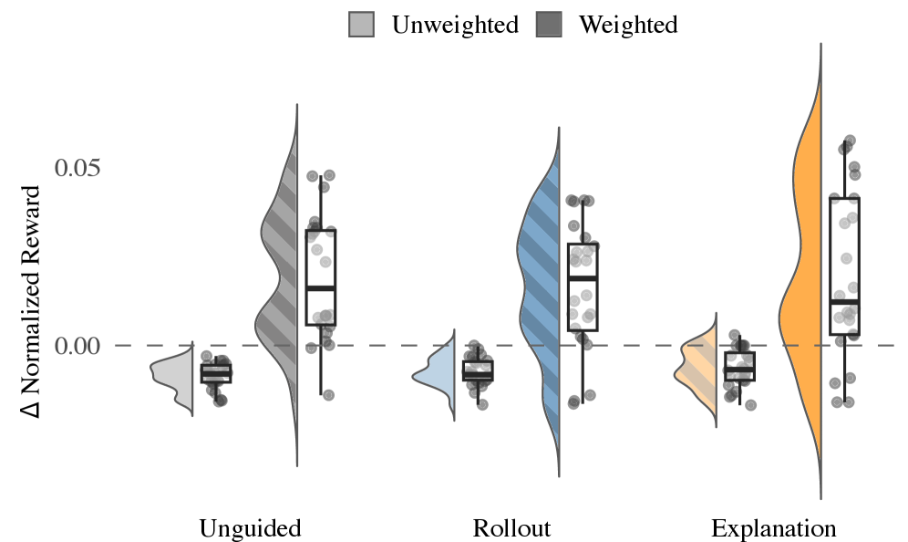
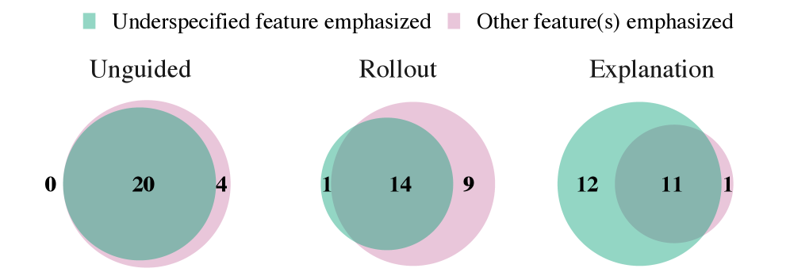
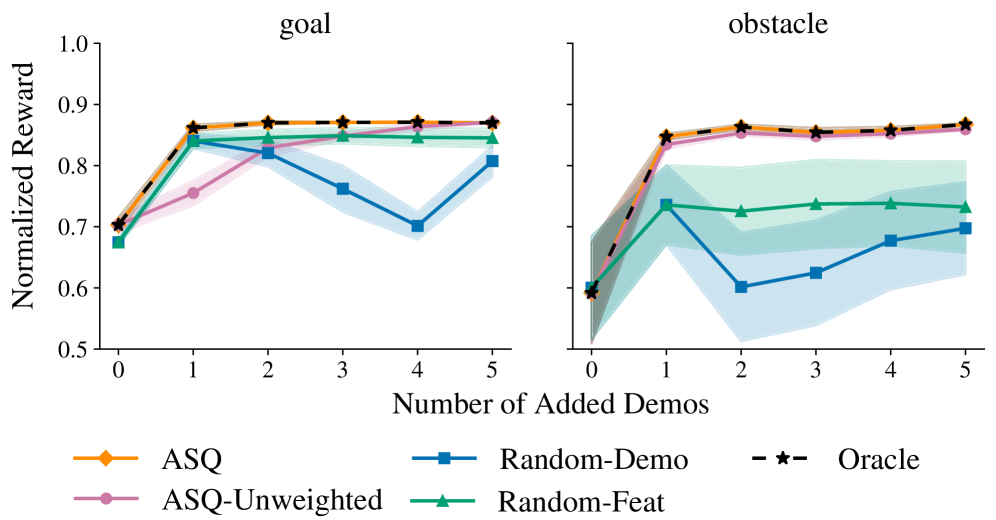

# Robots That Know What to Ask: восстановление рассогласованной награды через целевые объяснения

> Статья: *Robots That Know What to Ask: Recovering Misaligned Rewards through Targeted Explanations*
> Авторы: Helena Merker, Nick Walker, Andreea Bobu
> Конференция: Robotics: Science and Systems, RSS 2026
> arXiv: https://arxiv.org/abs/2605.22986
> Страница RSS: https://roboticsconference.org/program/papers/116/
> Состояние кода: по состоянию на 2026-07-18 официальная страница проекта или репозиторий кода от авторов не найдены; в этом руководстве основными источниками служат статья, HTML-версия arXiv с рисунками и информация RSS.

Эту статью уместно поместить в раздел «Глубокое обучение и обучение с подкреплением для воплощённых сред», а не в главы о моделях мира или базовых моделях VLA. Она изучает не то, как робот прокручивает будущее в модели мира, и не то, какую более сильную модель «визуальный язык — действие» подключить. Её тема — более базовая и часто упускаемая из виду проблема: демонстрации, которые человек даёт роботу, не всегда полностью описывают цель задачи, поэтому функция награды, которую робот выучивает по этим неполным демонстрациям, может расходиться с истинной целью. Может ли робот сам определить, какой именно информации ему не хватает, и целенаправленно попросить у человека дополнительные демонстрации?

Коротко: авторы предлагают ASQ (Ambiguity-Sensitive Querying). Метод использует дисперсию признаков в демонстрациях, чтобы найти «недоопределённые» признаки, затем объясняет человеку на естественном языке, в каком измерении робот не уверен, и тот даёт дополнительные корректирующие демонстрации, нацеленные на этот признак. Так исправляется рассогласование награды в обратном обучении с подкреплением.

## Зачем нужна эта статья

Многие методы обучения роботов по умолчанию исходят из того, что человеческие демонстрации, пусть и несовершенные, по крайней мере охватывают важные целевые измерения задачи. Например, робот должен переместить чашку. Истинные предпочтения человека могут быть такими:

- чашка должна стоять прямо;
- чашка должна стоять близко к столу;
- чашка не должна задевать ноутбук;
- чашка не должна подходить близко к человеку.

Проблема в том, что человек не всегда может учесть все цели одновременно. Какие-то цели могут быть упущены из-за нагрузки на внимание, какие-то не проявляются из-за ограничений движения манипулятора, а какие-то просто не встречаются в обучающих сценах. В итоге демонстраций как будто много, но один из ключевых признаков на самом деле не описан.

Это приводит к неоднозначности награды (reward ambiguity). Когда робот восстанавливает веса награды из демонстраций методом MaxEnt IRL или аналогичным, он может решить, что признак не важен, и при развёртывании выполнить действие, которое человек не хотел, но которое в данных не было явно исключено. Центральная мотивация статьи — как справиться именно с таким рассогласованием награды из-за недоопределённости демонстраций.

## Общий обзор метода

Источник: HTML-версия arXiv, рисунок 1, *Robots That Know What to Ask*.

Это главный рисунок статьи. Слева показан обычный процесс обучения награды по демонстрациям: человек даёт набор траекторий, робот по ним выучивает функцию награды, затем с её помощью планирует действия. Проблема возникает в середине: если некоторые релевантные признаки задачи недостаточно выражены в демонстрациях, выученная награда смещается.

Справа — основная идея ASQ:

1. Сначала смотрим на распределение значений каждого признака в имеющихся демонстрациях.
2. Если признак стабильно оптимизируется человеком, его значения в демонстрациях меняются мало.
3. Если признак не выражен стабильно, его значения в демонстрациях меняются сильнее.
4. Робот выделяет признаки с высокой дисперсией, которые, вероятно, недоопределены.
5. Робот объясняет на естественном языке, в каком признаке он не уверен.
6. Человек дополняет демонстрации именно по этому признаку.
7. Обучатель награды использует дополнительные демонстрации как целевые корректирующие и обновляет награду с подходящими весами.

Это можно понимать как «активный опрос» в обучении награды. Робот не говорит общо «покажите ещё несколько раз», а уточняет: «Я не уверен, хотите ли вы, чтобы я держался дальше от ноутбука. Покажите, пожалуйста, несколько примеров именно на этот счёт».

## Разбор ключевых идей

### 1. Явное моделирование неполноты демонстраций

Традиционные методы обратного обучения с подкреплением и обучения по демонстрациям рассматривают демонстрации как прямое свидетельство предпочтений человека. Если человек показал траекторию, алгоритм склонен считать, что она отражает предпочтения по всем признакам одинаково.

Статья показывает, что это предположение слишком сильное. Демонстрации могут быть «рациональными» только по части признаков. Например, человек в этот раз следил за тем, чтобы чашка не опрокинулась, но не подумал о расстоянии до ноутбука. Если алгоритм считает такую демонстрацию свидетельством того, что все признаки учтены одинаково, награда будет выучена неверно.

Поэтому первый шаг ASQ — не сразу собирать больше данных, а понять, какого измерения надзора данным не хватает.

### 2. Поиск недоопределённых измерений по дисперсии признаков

Ключевое наблюдение статьи простое, но полезное:

- признак, который оптимизируется стабильно, в траекториях демонстраций ведёт себя однородно;
- признак, который не выражен стабильно, в траекториях демонстраций сильно варьируется.

Если человеку всегда важно, чтобы чашка стояла прямо, то наклон чашки во всех демонстрациях будет небольшим, и дисперсия мала. Наоборот, если в демонстрациях человек не заботился о расстоянии до ноутбука, то разные траектории дают очень разные расстояния. ASQ использует именно этот статистический сигнал, чтобы понять, какой признак, вероятно, не описан.

Преимущество метода в том, что ему не нужно предварительно выполнять много неудачных rollout и не нужно, чтобы человек заранее написал полную функцию награды. Он использует уже собранные демонстрации.

### 3. Не просто «покажите ещё раз», а объяснение того, чего не хватает

Запросы ASQ — не случайный сбор дополнительных демонстраций, а целевые объяснения (targeted explanations). Робот сообщает человеку, какой недоопределённый признак он выделил, и просит дать дополнительные демонстрации именно по этому признаку.

Этот момент важен. Если просто показать человеку неудачный rollout и попросить догадаться, что робот сделал не так, эффект может быть слабым. Человек видит поведение, но не всегда способен понять, какой именно признак не доучен обучателем награды. По результатам реального пользовательского эксперимента в статье, в условиях Rollout участники часто ошибались с определением недоопределённого признака; в условиях Explanation они гораздо чаще направляли внимание на названный признак.

### 4. Рациональность и веса для каждой демонстрации

Статья также подчёркивает, что дополнительные демонстрации не должны рассматриваться так же, как исходные.

Если человек давал демонстрации с подсказкой «покажи, пожалуйста, как ты держишься подальше от ноутбука», то эти демонстрации сильнее задают признак расстояния до ноутбука, но не обязательно в той же мере задают все остальные признаки. Поэтому при обучении награды нужна рациональность или веса для каждой демонстрации, которые фиксируют, к какому признаку относится данный пример.

Именно поэтому условие Explanation имеет дополнительную ценность: только когда робот явно говорит, на какой признак обратить внимание, алгоритм имеет основания считать дополнительные демонстрации целевыми. В условиях Unguided или Rollout человек может сосредоточиться на любом признаке, и алгоритм не может надёжно назначить вес конкретному признаку.

### 5. Фильтрация через LLM в средах с несколькими признаками

В эксперименте с 8 признаками в сцене присутствуют как релевантные признаки задачи, так и посторонние отвлекающие объекты. Если напрямую искать признаки с высокой дисперсией, алгоритм может запросить уточнение и по посторонним объектам. Поэтому авторы добавляют фильтрацию через LLM: языковая модель по смыслу задачи отсеивает явно нерелевантные признаки, а статистическая проверка дисперсии работает уже с оставшимися кандидатами.

Здесь LLM — не итоговая модель награды, а семантический фильтр: она сначала убирает из множества объектов сцены то, что явно не относится к задаче, а затем работает статистика.

## Экспериментальная среда

Источник: HTML-версия arXiv, рисунок 2, *Robots That Know What to Ask*.

В статье используются два основных типа экспериментальных сред:

1. **Симуляция JacoRobot — настольная задача манипулирования**: 7-степенной манипулятор Jaco переносит кофейную чашку по столу с препятствиями. Эта среда служит для систематического сравнения ASQ, случайных запросов и Oracle по качеству восстановления награды.
2. **Пользовательский эксперимент с реальным манипулятором Franka**: в реальной настольной задаче участники дают корректирующие демонстрации, и сравнивается, как разные формы обратной связи влияют на исправление награды.

В приложении также описана среда GridRobot — навигация на двумерной сетке, которая показывает базовую идею восстановления награды в упрощённом виде.

Источник: HTML-версия arXiv, рисунок 7, *Robots That Know What to Ask*.

GridRobot скорее учебная среда: состояние, действия и признаки там легко контролировать, и она подходит, чтобы повторить базовую идею ASQ. Если вы хотите сделать собственную минимальную реализацию, начните с GridWorld / GridRobot, а не сразу с реального манипулятора.

## Как читать результаты симуляции

Источник: HTML-версия arXiv, рисунок 3, *Robots That Know What to Ask*.

На рисунке 3 сравниваются ситуации с одним или двумя недоопределёнными признаками в JacoRobot. По вертикальной оси — нормированная награда: чем выше значение, тем ближе выученная награда к истинной цели. По горизонтальной оси — число дополнительных корректирующих демонстраций.

Основные выводы рисунка:

- ASQ заметно лучше случайных запросов и пассивного добавления данных;
- ASQ быстрее приближается к Oracle;
- чем больше недоопределённых признаков, тем менее эффективны случайные данные, потому что случайные демонстрации не обязательно попадают в отсутствующее измерение;
- целевые демонстрации, направляемые объяснением, дают лучшую эффективность использования выборки.

Oracle здесь можно понимать как идеального опрашивающего, который знает, какого признака на самом деле не хватает. Смысл ASQ в том, чтобы без знания реального пробела приблизиться к Oracle, используя сигнал дисперсии в демонстрациях.

Источник: HTML-версия arXiv, рисунок 4, *Robots That Know What to Ask*.

На рисунке 4 показан более близкий к реальности случай: в среде есть не только признаки задачи, но и отвлекающие объекты. Например, на столе много предметов, но не каждый из них относится к целевым измерениям награды. В эксперименте с 8 признаками авторы используют 4 релевантных признака и 4 посторонних объекта.

Этот эксперимент показывает два момента:

1. Одной дисперсии недостаточно: отвлекающие объекты тоже могут давать высокую дисперсию.
2. С фильтрацией через LLM ASQ сначала исключает семантически нерелевантных кандидатов, а затем находит действительно недоопределённый признак задачи.

Для современных робототехнических систем на основе больших моделей это практично. В реальных настольных задачах пространство признаков обычно не чистое: робот видит гораздо больше объектов, чем цель задачи. Сначала отфильтровать по языковому смыслу, а затем активно опрашивать по статистике траекторий — достаточно надёжная комбинация.

## Как читать пользовательский эксперимент

Источник: HTML-версия arXiv, рисунок 5, *Robots That Know What to Ask*.

В пользовательском эксперименте статья сравнивает три условия:

- **Unguided**: никакой дополнительной обратной связи, человек просто дополняет демонстрации.
- **Rollout**: человеку показывают rollout поведения робота с текущей выученной наградой, и он сам решает, что не так.
- **Explanation**: человеку прямо сообщают, в каком признаке робот не уверен, и он дополняет демонстрации именно по этому признаку.

Цели задачи включают: чашка стоит прямо, стоит близко к столу, далеко от ноутбука и далеко от человека. В эксперименте участвовали 12 человек по схеме within-subjects; эффективность исправления награды измерялась по нормированному восстановлению награды.

Главный вывод рисунка 5: только условие Explanation в среднем даёт положительный прирост награды. Rollout существенно не превосходит Unguided. Интуитивно это означает: показать человеку ошибочное поведение — не то же самое, что объяснить модели, чего она не знает. Человек может заметить, что движение неудачно, но не угадать точную неоднозначность в обучателе награды.

Источник: HTML-версия arXiv, рисунок 6, *Robots That Know What to Ask*.

На рисунке 6 показано, на что участники сами говорят, что обращали внимание во время демонстраций. В условии Explanation участники чаще сообщали, что подчёркивали признак, который назвал робот; в условии Rollout чаще внимание смещалось на другие признаки или распределялось между несколькими.

Это объясняет, почему Explanation вместе с весами работает лучше: он не просто даёт человеку больше данных, а согласует внимание человека с неопределённостью награды в алгоритме.

## Результаты для GridRobot из приложения

Источник: HTML-версия arXiv, рисунок 8, *Robots That Know What to Ask*.

Результаты GridRobot можно использовать как учебный ориентир. Для них не нужен реальный манипулятор и сложное визуальное восприятие, достаточно:

- небольшой дискретной среды;
- нескольких вручную заданных признаков, например расстояние до цели, близость к препятствию, прохождение через опасную зону;
- набора специально недоопределённых демонстраций;
- реализации MaxEnt IRL или упрощённого подбора награды;
- стратегии активного запроса, которая выбирает признаки для дополнения по дисперсии.

Если вы собираетесь делать «облегчённую» версию воспроизведения, начните именно с этого направления, а не с прямого повторения JacoRobot или пользовательского эксперимента с Franka.

## В чём ценность работы

Статья сильна не масштабом моделей и не аппаратными результатами. Её достоинство — в том, что она чётко выделяет проблему, которую часто не замечают: дефицит демонстраций — не единственная беда; демонстрации могут быть «смещёнными» и «недоопределёнными», и это тоже искажает награду.

Вклад можно свести к трём пунктам:

1. **Ясная постановка проблемы**: авторы не просто говорят, что «человеческие демонстрации несовершенны», а конкретно указывают, что признаки задачи могут быть недоопределены.
2. **Простой и эффективный критерий запроса**: дисперсия признаков в демонстрациях показывает, какие измерения цели не выражены стабильно.
3. **Разумный цикл взаимодействия человека и робота**: робот сначала объясняет неопределённость, затем запрашивает целевые демонстрации и, наконец, обновляет награду с весами на уровне признаков.

Для учебного курса по воплощённому ИИ это полезно, потому что помогает детальнее рассмотреть задачу «выучить цели робота из человеческих данных». Многим работам по VLA, обучению с подкреплением и посттренировке моделей мира нужен сигнал награды или предпочтений; если такой сигнал сам недоопределён, даже сильная посттренировка может оптимизироваться в неверном направлении.

## Что статья не решает

Нужно также понимать границы:

1. Метод опирается на явное пространство признаков. Робот должен уметь отображать траектории на набор интерпретируемых признаков, чтобы вычислять, какой признак имеет высокую дисперсию. В сквозной пиксельной модели VLA без промежуточных признаков (объекты, расстояния, позы, контакты) этот подход напрямую не применим.
2. Это не универсальный агент для вопросов. Робот не задаёт произвольные вопросы, а определяет, какое измерение из заранее заданного набора признаков недоопределено.
3. Это не модель мира. Она не генерирует будущее видео, не предоставляет интерфейс симуляции `step(action)` и не обучает политику на воображаемых rollout.
4. Это не проект, который легко воспроизвести одной командой. На момент подготовки в открытом доступе не найден официальный репозиторий кода, а пользовательский эксперимент требует платформы с роботом и процедуры набора испытуемых; воспроизведение недешёвое.
5. Основная проверка — восстановление награды, а не большая таблица успешности по открытому миру. Эксперименты показывают, что целевые объяснения улучшают обучение награды, но это не означает, что проблема согласования роботов в открытом мире решена.

## Связь с работами по VLA и моделям мира

Статья дополняет несколько современных направлений:

- **Agentic-VLA**: в нём внешний контур онлайн-адаптации VLA фокусируется на автоматическом синтезе награды, исследовании и памяти опыта; ASQ фокусируется на недоопределённости награды, вызванной человеческими демонстрациями, и может рассматриваться как модуль исправления награды с участием человека.
- **RAW-Dream / GE-Sim 2.0**: модели мира позволяют прокручивать воображаемые rollout, но обучение с подкреплением в воображении всё равно требует награды. ASQ напоминает: если награда или VLM-оценщик не чувствительны к каким-то признакам, оптимизация в модели мира лишь усилит рассогласование.
- **VisualThink-VLA**: в нём VLA рассуждает по визуальным свидетельствам перед действием; ASQ может помочь уточнить через объяснения и демонстрации, какие визуальные и пространственные признаки действительно являются целями задачи.
- **Традиционное обратное RL и обучение по предпочтениям**: ASQ по сути соединяет активное обучение, объяснения от человека и MaxEnt IRL, поэтому уместно изучать его в курсе по обучению наград и обучению с подкреплением в робототехнике.

## С чего начать воспроизведение

Пока не стоит делать эту статью обязательным заданием в учебной группе, но можно выполнить облегчённый концептуальный эксперимент:

1. Постройте двумерную среду GridWorld или упрощённую настольную среду.
2. Определите 3–5 признаков, например расстояние до цели, расстояние до препятствия, близость к конкретному объекту, длину пути.
3. Вручную создайте демонстрации, в которых один признак намеренно не оптимизируется стабильно.
4. Выучите награду методом MaxEnt IRL или линейной подгонкой награды.
5. Вычислите дисперсию каждого признака в демонстрациях и выберите кандидатов с высокой дисперсией.
6. Сгенерируйте текстовую подсказку, например «Я не уверен, нужно ли держаться дальше от препятствий; покажите, пожалуйста, несколько примеров с акцентом на это».
7. Добавьте целевые демонстрации и сравните, улучшилось ли восстановление награды.

Если вы хотите приблизиться к реальному роботу, понадобится дополнительно:

- экстрактор признаков траекторий, например расстояние до объекта, ориентация чашки, путь концевого эффектора, события столкновений и контакта;
- планировщик или оптимизатор траекторий, который использует выученную награду для генерации поведения;
- интерфейс для человеческих демонстраций, например кинестетическое обучение, телеуправление, VR или контроллер;
- протокол эксперимента с участниками: рандомизация условий, опросники NASA-TLX или оценки предпочтений;
- эталонные значения восстановления награды или прокси-метрики оценки.

## Как использовать статью на занятиях

Её можно предложить как задание для продвинутого обзора по Task04 (управление и манипуляции). Рекомендуемые вопросы:

1. Почему «собрать больше демонстраций» не всегда исправляет награду?
2. Как ASQ определяет, какой признак недоопределён?
3. Почему обратная связь в виде rollout может уступать объяснению через признаки?
4. Какую роль играют рациональность и веса для демонстрации при обучении награды?
5. Если подключить ASQ к посттренировке VLA или модели мира, на каком уровне его нужно встроить?

Хорошее домашнее задание — не воспроизведение настоящего манипулятора, а схема «демонстрации → дисперсия признаков → обнаружение недоопределённости → объяснительный запрос → дополнительные демонстрации → обновление награды» с небольшим примером, показывающим, как возникает рассогласование награды.

## Рекомендуемый порядок чтения

1. Сначала рисунок 1 статьи, чтобы понять, какую проблему решает ASQ.
2. Затем рисунки 3 и 4, чтобы увидеть, почему целевые запросы эффективнее случайных в симуляции.
3. Далее рисунки 5 и 6, чтобы понять, почему объяснение важно в пользовательском эксперименте.
4. В конце приложение про GridRobot — как минимальный ориентир для собственного воспроизведения.

## Ссылки

- Страница arXiv: https://arxiv.org/abs/2605.22986
- HTML-версия arXiv: https://arxiv.org/html/2605.22986v1
- Страница статьи RSS 2026: https://roboticsconference.org/program/papers/116/
- Публикации Nick Walker: https://nickwalker.us/publications/
