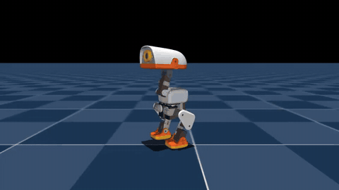
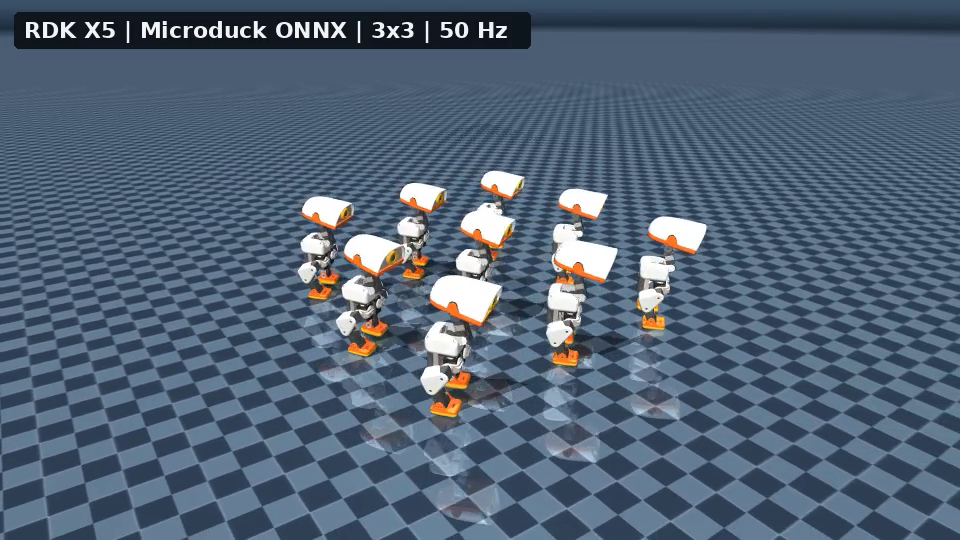
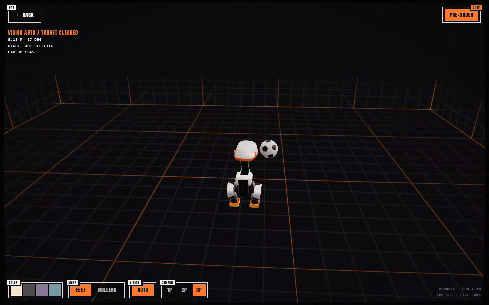
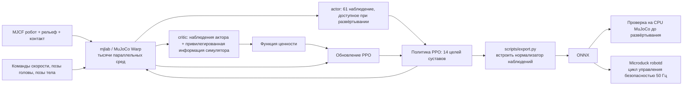
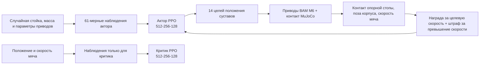
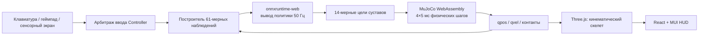
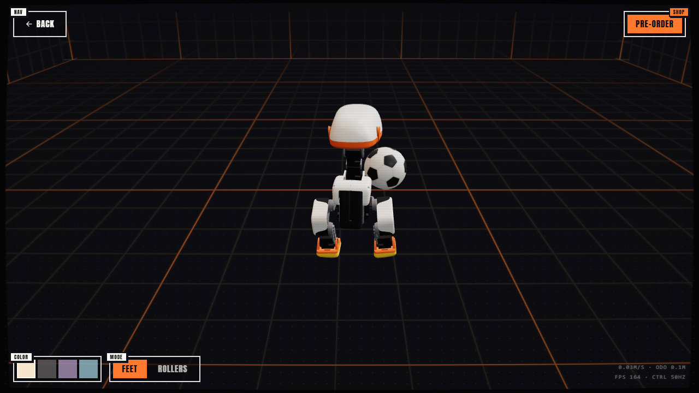
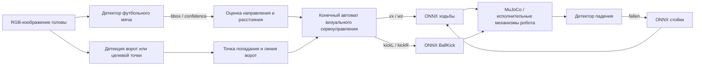
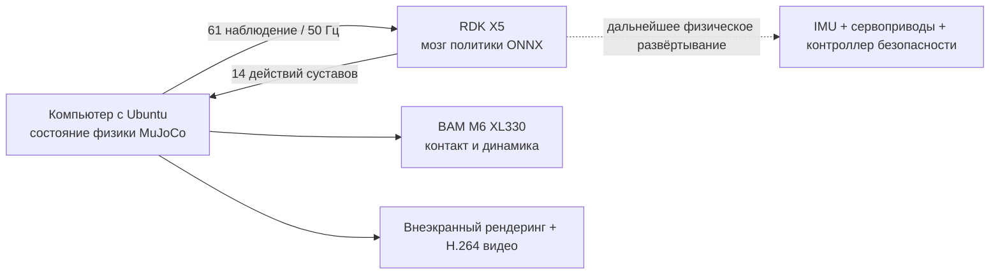
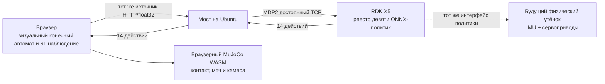

# Open Duck Mini и Microduck: от модели URDF до обучения ходьбе и удару по мячу с подкреплением, веб-развёртывания

В этой главе разбираются два поколения открытых двуногих роботов-«утят»: [Open Duck Mini v2](https://github.com/apirrone/Open_Duck_Mini/tree/v2) и [Microduck](https://github.com/pollen-robotics/microduck). Мы рассматриваем их не как два скрипта в одном репозитории, а как целостный путь: откуда скачивается описание робота, как собирается среда обучения с подкреплением, как PPO учит ходьбе и удару по мячу, и как чекпоинт экспортируется в ONNX и запускается на RDK или в браузере.

После этой главы вы сможете:

- различать ответственность четырёх проектов: Open Duck Mini v2, Open Duck Playground, Microduck и Microduck RL;
- скачать только URDF и STL-сетки Open Duck Mini v2 и проверить, что ассеты полные;
- для Microduck RL сначала запустить smoke test на `64 среды × 5 итераций`, а затем начать полное обучение;
- разобрать `Mjlab-BallKick-Flat-MicroDuck`: асимметричный actor-critic, награды, рандомизацию мяча и обучение левой и правой ноги;
- запустить локально браузерный Microduck Sandbox на MuJoCo WebAssembly и `onnxruntime-web` и подключить свою политику удара;
- воспроизвести политику, записать видео симуляции, экспортировать ONNX с нормализатором наблюдений и заставить RDK X5 работать как мозг политики, управляющий MuJoCo на компьютере с Ubuntu;
- понять, каких инженерных шагов не хватает, чтобы политика, которая ходит в симуляции, стабильно ходила на реальном роботе с частотой 50 Гц.

## 1. Сначала разберёмся с четырьмя проектами

Проект «Open Duck» прошёл несколько итераций: механическое проектирование, генерация эталонных движений, обучение с подкреплением в MuJoCo и новая среда выполнения на реальном роботе. Названия очень похожи, но форматы файлов и команды нельзя смешивать.

| Проект | Роль | Описание робота | Как используется при обучении |
| :-- | :-- | :-- | :-- |
| [Open Duck Mini v2](https://github.com/apirrone/Open_Duck_Mini/tree/v2) | Открытый центр механических и встраиваемых ресурсов для робота около 42 см | `robot.urdf` и `robot.xml`, STL-сетки в той же папке | Изучение URDF, механической конструкции и раннего переноса из симуляции в реальность |
| [Open Duck Reference Motion Generator](https://github.com/apirrone/Open_Duck_reference_motion_generator) | Генерация эталонных движений ходьбы через Placo | Встроены URDF и сетки нескольких поколений Duck | Создание `polynomial_coefficients.pkl` для награды за имитацию |
| [Open Duck Playground](https://github.com/apirrone/Open_Duck_Playground) | Линия обучения Open Duck Mini v2 на MuJoCo Playground / JAX | Используется MJCF из репозитория | Воспроизведение политики ходьбы старого большого «утёнка» |
| [Microduck RL](https://github.com/pollen-robotics/microduck_rl) + [Microduck](https://github.com/pollen-robotics/microduck) | Обучающая и аппаратная часть нового «утёнка» около 25 см и 800 г | Для обучения в качестве входа используется MJCF, а не URDF | Изучение полной цепочки `mjlab + MuJoCo Warp + PPO + ONNX + среда выполнения 50 Гц` |

> **Ключевой вывод:** если цель — «скачать URDF и изучить механику», начинайте с Open Duck Mini v2. Если цель — «запустить актуальное официальное обучение с подкреплением», начинайте с Microduck RL. Подстановка URDF Open Duck Mini v2 в Microduck RL сама по себе не сработает: имена суставов, число степеней свободы, массы компонентов, коллизионные тела и контракт наблюдений и действий политики — разные.

## 2. Сначала — официальные результаты, чтобы сложить интуицию

<p align="center">
  
</p>

**Рисунок 1. Официальный обзор проекта Microduck RL.** Новая линия проекта обучает не только одну политику ходьбы вперёд, а собирает в общем реестре задач слежение за скоростью, подъём, посадку, захват зубами, удар по мячу, кувырок вперёд и езду на роликах. Все задачи используют общий контракт из 61 наблюдения актора и 14 действий, поэтому на роботе можно переключаться между политиками ходьбы, стойки и трюков.

<p align="center"><sub>Источник: титульное изображение README официального репозитория `microduck_rl` компании Pollen Robotics; исходный проект распространяется по лицензии Apache-2.0.</sub></p>

<video controls muted playsinline preload="metadata" width="100%">
  <source src="assets/official_videos/microduck_real_walking.mp4" type="video/mp4">
</video>

**Видео 1. Официальный фрагмент ходьбы реального Microduck.** Материал взят с официальной страницы проекта Microduck RL, в учебном руководстве взяты первые 20 секунд и перекодированы в H.264 MP4, который лучше воспроизводится в браузере. Это демонстрация эффекта официальной политики, а не результат сходимости локального переобучения из этого руководства.

[](assets/local_videos/microduck_4096env_6000iter_walk.mp4)

**Видео 2. Результат обучения с подкреплением на 4096 средах, выполненного в этом руководстве.** Мы взяли `microduck_rl` версии `29e887e`, обучили задачу `Mjlab-Velocity-Flat-MicroDuck` на 6000 итерациях PPO, а затем воспроизвели итоговый `model_5999.pt` при фиксированной команде движения вперёд `0.4 м/с`. Во время записи отключили внешние толчки при тестировании, но не делали постобработки чекпоинта и не вырезали удачные фрагменты. На странице показан GIF, созданный из этого же видео; при нажатии на изображение открывается исходный H.264-файл 960×540.

| Параметр воспроизведения | Фактическое значение |
| :-- | :-- |
| Число параллельных сред | 4096 |
| Шагов сэмплирования на среду за итерацию | 24 |
| Итерации PPO | 6000 |
| Суммарные transition в симуляции | 589 824 000 |
| Время обучения | 1 час 27 минут 41 секунда |
| Итоговые mean reward / mean episode length | 119.57 / 972.52 |
| Контракт экспортированного ONNX | `[1, 61] -> [1, 14]` |

Эти значения нужны только для того, чтобы показать происхождение видео и масштаб воспроизведения. Не сравнивайте их напрямую с другими экспериментами без учёта версии кода, случайного зерна и учебной программы.

Полные веса по этапам, итоговый ONNX, конфигурации, журналы TensorBoard и видео проверки опубликованы в [Datawhale/Microduck-RL-4096x6000](https://huggingface.co/Datawhale/Microduck-RL-4096x6000). В модельном репозитории также есть файл `SHA256SUMS`, по которому можно проверить целостность загруженных файлов.

[](assets/local_videos/microduck_command_dance.mp4)

**Видео 3. Командная хореография на той же политике ходьбы из этого руководства.** Это не отдельно обученная политика танца, а та же политика ходьбы с 61 входом. Меняя во времени команды `vx / vy / yaw rate` и четыре значения позы головы, мы заставляем уже обученную политику в реальном времени кивать, двигаться боком, поворачиваться влево и вправо, делать шаги вперёд и назад и идти по дуге. Двенадцатисекундное видео получено из непрерывного замкнутого цикла, позы робота не редактировались покадрово. На странице показан сжатый GIF, при нажатии открывается H.264-файл 960×540.

[](assets/local_videos/microduck_rdk_brain_single_12s.mp4)

**Видео 4. RDK X5 как мозг политики управляет одним Microduck.** Компьютер с Ubuntu отвечает только за физическую симуляцию MuJoCo и отрисовку. Каждые 50 Гц вектор наблюдений из 61 значения по локальной сети отправляется на RDK, который выполняет `microduck_policy_5999.onnx` и возвращает 14 значений действий. Видео — непрерывный замкнутый цикл длиной 12 секунд, 600 управляющих циклов и 360 кадров; действия не были рассчитаны заранее и затем проиграны. При нажатии открывается H.264-файл 960×540, 30 кадров в секунду.

[](assets/local_videos/microduck_rdk_brain_3x3_12s.mp4)

**Видео 5. RDK X5 как мозг политики управляет квадратом Microduck 3×3.** Девять утят находятся в одном мире MuJoCo; у каждого свое свободное основание, состояние суставов, наблюдения IMU, история действий и состояние приводов BAM M6 XL330. Компьютер с Ubuntu упаковывает девять наборов наблюдений в один сетевой запрос, RDK выполняет ONNX для каждого набора и возвращает девять наборов действий, которые записываются обратно в соответствующих роботов. Это проверяет пакетный вывод одной политики на периферийном устройстве и визуализацию нескольких экземпляров, но не доказывает, что девять роботов научились общаться или координироваться.

[](assets/local_videos/microduck_visual_soccer_continuous_chase.mp4)

**Видео 6A. Три вида: Microduck преследует один мяч и трижды бьёт по нему.** Браузер размещает мяч один раз в начале, после этого не меняет его положение, ориентацию или скорость. Утёнок делает первый удар, затем ждёт, пока мяч естественно катится в MuJoCo, после чего заново обнаруживает его, догоняет, выравнивается и наносит второй и третий удар. Поэтому это не склейка из трёх сегментов, в которых мяч возвращается к ноге. В начале кратко показаны вид от первого лица с головного датчика и близкий вид от второго лица, затем переход к виду от третьего лица по умолчанию; на протяжении погони, выравнивания ног, переключения политики удара, касания мяча и стабилизации утёнок остаётся в центре кадра. В этих трёх попытках правую ногу выбирает конечный автомат; площадь смещения мяча в окне касания одной ногой составила около `0.112 м`, `0.288 м` и `0.376 м`; после каждого касания управление возвращалось политике ходьбы, корпус всё время оставался вертикальным. При нажатии на обложку открывается H.264-файл 1440×900, 25 кадров в секунду.

[](assets/local_videos/microduck_physical_impulse_recovery.mp4)

**Видео 6B. Физическое возмущение, падение и автоматическое вставание.** Тест восстановления записан отдельно от основного видео с ударами. Тест не меняет позу робота или кватернион напрямую, а даёт плавающему основанию импульс боковой линейной скорости и угловой скорости крена. Последующее падение, контакт с землёй и изменение позы полностью определяются тяжестью, столкновениями, ограничениями суставов и решателем MuJoCo. Когда детектор падения подтверждает потерю равновесия, управление берёт политика стойки, и примерно через `1.96 с` робот снова выпрямляется, после чего управление возвращается политике ходьбы. Итоговое `gravity_z=-0.99998`, высота основания около `0.1165 м`. Видео подтверждает цепочку восстановления после внешнего возмущения и не выдаёт «переворот модели» за физический эксперимент.

<video controls muted playsinline preload="metadata" width="100%">
  <source src="assets/official_videos/open_duck_mini_v2_sim_walking.mp4" type="video/mp4">
</video>

**Видео 7. Официальный фрагмент симуляции ходьбы Open Duck Mini v2.** Фрагмент взят из раздела «переход к MuJoCo Playground» проекта Open Duck Mini v2. Он относится к старому роботу 42 см и не соответствует контракту 14 степеней свободы новой политики Microduck.

## 3. Полная схема обучения



**Рисунок 2. Поток данных Microduck RL.** В этой архитектуре пять модулей, которые нельзя пропускать.

### 1. Модель робота и модель приводов

Основные MJCF-файлы Microduck RL находятся здесь:

```text
src/mjlab_microduck/robot/microduck/
├── robot_walk.xml
├── robot_allcollisions.xml
├── robot_allcollisions_rollers.xml
├── robot_*_backlash.xml
└── scene*.xml
```

`robot_walk.xml` предназначен для слежения за скоростью: он убирает лишние контакты туловища и головы. `robot_allcollisions.xml` сохраняет коллизии всего тела для подъёма, посадки, захвата зубами и кувырка вперёд; версия с роликами добавляет к подошве неприводные колёса. В обучении двигатели моделируются не как идеальные ПД-приводы, а через модель привода Dynamixel XL330 из [BAM](https://github.com/Rhoban/bam): учитываются противо-ЭДС, кулоновское и статическое трение, трение, зависящее от нагрузки, и напряжение батареи.

### 2. Наблюдения, команды и контракт действий

Новая политика актора получает 61 значение на входе и выдаёт 14 значений действий. Слоты команд фиксированы:

```text
команда twist (скорость) 3
+ команда позы головы 4
+ команда позы тела 6
= 13-мерный подвектор команд
```

Остальные наблюдения поступают от IMU, положений и скоростей суставов и истории действий. Актор не использует линейную скорость основания, которую на реальном роботе трудно измерить надёжно; критик при обучении может дополнительно читать это значение из симуляции. Это типичная асимметричная схема actor-critic: функция ценности использует более полную информацию и ускоряет обучение, а сетевая политика сохраняет применимость при развёртывании.

### 3. Награда — не только «двигаться вперёд»

Основная задача `Mjlab-Velocity-Flat-MicroDuck` включает такие группы наград и ограничений:

| Категория | Примеры | Назначение |
| :-- | :-- | :-- |
| Награды за задачу | слежение за линейной и угловой скоростью | Следовать командам `vx, vy, yaw rate` |
| Награды за позу | вертикальность, поза, слежение за позой головы | Не опрокидываться ради скорости, но сохранять управление головой |
| Награды за походку | время в воздухе, зазор стопы, высота переноса | Заставить ноги действительно отрываться от земли, а не скользить по ней |
| Сглаживание и безопасность | скорость изменения действий, самопересечение, скольжение стопы | Подавить высокочастотную дрожь, самоконтакт и чрезмерное скольжение |
| Учебная программа | доля стойки, диапазон позы головы, веса наград | Сначала освоить базовую походку, затем постепенно увеличивать диапазон команд и строгость регуляризации |

Здесь важнее всего не конкретный вес, а конкуренция между наградами. Например, если слишком сильно штрафовать скольжение стопы, то и поворотное движение маленького робота на месте подавляется; если же с самого начала слишком сильно штрафовать скорость изменения действий, политика не научится делать шаги и будет вынуждена стоять неподвижно. Поэтому в официальной конфигурации используется учебная программа: ограничения сглаживания и диапазон команд вводятся постепенно на последующих этапах.

### 4. Четыре слоя защиты при переносе из симуляции в реальность

Microduck RL не полагается на идеально точный симулятор, а одновременно делает четыре вещи:

1. С помощью BAM сокращает разрыв между идеальным мотором и маленьким сервоприводом;
2. Применяет рандомизацию домена к массе и моменту инерции, центру масс, трению, напряжению, ошибке установки IMU, смещению энкодеров и задержке действий;
3. Предоставляет вариант задачи `Backlash` с неприводными пассивными шарнирами, моделирующими люфт зубчатой передачи при обратном ходе;
4. Перед реальным роботом с помощью `infer_policy.py` воспроизводит тот же контракт наблюдений и действий, что и среда выполнения, включая переключение политик.

## 4. Основной путь: обучение новой ходьбе Microduck

### 0. Требования к окружению

Официальный проект в настоящее время требует:

- Linux x86_64 или официально поддерживаемый Linux на ARM;
- CUDA-GPU, поддерживаемый текущим стеком обучения, обучение идёт через MuJoCo Warp; конкретная модель видеокарты не обязательна;
- Python `>=3.12,<3.13`, окружение создаётся через `uv` по `uv.lock`;
- для официального обучения по умолчанию используется Weights & Biases для записи экспериментов и чекпоинтов.

Сначала проверьте GPU и базовые инструменты:

```bash
nvidia-smi
git --version
curl --version
```

### 1. Клонирование и установка

Рабочая папка — любой путь без пробелов в Linux.

```bash
curl -LsSf https://astral.sh/uv/install.sh | sh
source "$HOME/.local/bin/env"

git clone https://github.com/pollen-robotics/microduck_rl.git
cd microduck_rl
uv sync

# Перед полным обучением войдите в W&B, чтобы записывать кривые и чекпоинты
uv run wandb login
```

Если локальное окружение пока неудобно, те же команды можно выполнить на облачной машине для разработки. Например, после создания Linux-инстанса в облаке можно открыть Jupyter Terminal или скопировать SSH-команду; сам код Microduck RL при этом не меняется.

> [!TIP]
> В готовых образах для облачных машин обычно уже есть Ubuntu, CUDA и MuJoCo с `mujoco_warp` и `mujoco_playground`. Удобно смотреть симуляцию через удалённый рабочий стол в браузере, а также запускать команды ниже через Jupyter или SSH. Playground из образа — не зафиксированное окружение Microduck RL, поэтому всё равно выполняйте `git clone` и `uv sync` и не пропускайте установку зависимостей проекта.

Лучше хранить проект, кэш зависимостей и результаты обучения на диске данных, а не на системном диске:

```bash
export WORKSPACE=/path/to/data/microduck
export UV_CACHE_DIR=/path/to/data/.cache/uv

mkdir -p "$WORKSPACE" "$UV_CACHE_DIR"
cd "$WORKSPACE"

git clone https://github.com/pollen-robotics/microduck_rl.git
cd microduck_rl
uv sync
```

Дальше выполняйте по порядку smoke test, полное обучение и экспорт ONNX. Тогда `logs/`, чекпоинты, записи и `output.onnx` будут сохраняться в каталогах диска данных, и их можно скачать через список файлов в Jupyter. Если нужно временно уйти, выключите инстанс в консоли; и только убедившись, что результаты загружены и больше не нужны, решайте, освобождать ли инстанс. Не путайте «выключить» и «удалить данные».

На ARM-машинах (DGX Spark/GB10 или Jetson) при первой загрузке колёс CUDA официальная рекомендация — увеличить тайм-аут `uv`:

```bash
export UV_HTTP_TIMEOUT=600
uv sync
```

**Контрольная точка 1.** Не начинайте обучение сразу; сначала убедитесь, что реестр задач и модульные тесты на CPU работают.

```bash
uv run list-envs | grep MicroDuck
uv run --with pytest pytest tests/
```

Если видно задачи вроде `Mjlab-Velocity-Flat-MicroDuck` и тесты проходят, это значит только то, что зависимости, реестр и ограничения конфигурации работают. Это не означает, что обучение на GPU может длительно и стабильно выполняться.

### 2. Обязательный smoke test на пяти итерациях

Сопровождающие проекта в `AGENTS.md` прямо рекомендуют перед длительным обучением запустить 64 параллельные среды на 5 итерациях PPO:

```bash
uv run train Mjlab-Velocity-Flat-MicroDuck \
  --env.scene.num-envs 64 \
  --agent.max_iterations 5
```

**Контрольная точка 2.** Этот маленький тест должен подтвердить:

- MuJoCo Warp может создать параллельные среды на CUDA;
- размерности наблюдений актора и действий совпадают с моделью;
- каждая награда, условие завершения и событие выполняются хотя бы один раз;
- rollout не даёт NaN в первые несколько шагов;
- чекпоинт записывается в каталог `logs/`.

Он не доказывает, что политика научилась ходить. На пяти итерациях действия остаются почти случайными — это нормально.

### 3. Полное обучение

```bash
uv run train Mjlab-Velocity-Flat-MicroDuck \
  --env.scene.num-envs 4096
```

По опыту, описанному в официальном README, при 4096 средах походку можно увидеть примерно через 1–2 часа, но реальное время сходимости зависит от GPU, конфигурации, случайного зерна и учебной программы. Не принимайте эту цифру за гарантию.

Команда, которой получено видео из этой главы, полностью выглядит так. `WANDB_MODE=offline` записывает журнал обучения только локально — это удобно для рабочей станции без подключения к W&B; если нужен облачный трекинг экспериментов, уберите эту переменную и заранее выполните `wandb login`.

```bash
WANDB_MODE=offline uv run train Mjlab-Velocity-Flat-MicroDuck \
  --env.scene.num-envs 4096 \
  --agent.max_iterations 6000 \
  --agent.save-interval 500 \
  --agent.run-name every-embodied-4096x6000
```

Если цель — сначала пройти весь путь «обучение, сохранение чекпоинта, экспорт ONNX, воспроизведение», можно оставить 64 среды из smoke test, но увеличить число итераций. Ниже учебная конфигурация, которую легче запустить на обычном компьютере разработки или в облаке:

```bash
uv run train Mjlab-Velocity-Flat-MicroDuck \
  --env.scene.num-envs 64 \
  --agent.max_iterations 10000
```

Здесь `64 × 10000` — уменьшенный учебный режим, а не результат пятиитерационного smoke test и не эквивалент эффективности официальной конфигурации на 4096 средах. Первое упражнение можно остановить, когда убедитесь, что чекпоинт записывается и кривая награды меняется, и перейти к экспорту. Для лучшей походки продлите обучение или увеличьте число параллельных сред.

Во время нормального обучения как минимум следите за такими показателями:

| Показатель | Что смотреть | Типичная ошибка интерпретации |
| :-- | :-- | :-- |
| mean reward | Долгосрочный рост, а не рост на каждой итерации | Смотреть только суммарную награду и не замечать, как политика эксплуатирует награды |
| episode length | Читать вместе с этапом учебной программы и частотой падений | Считать, что чем длиннее, тем лучше |
| velocity tracking | Растут ли оба показателя: линейной и угловой скорости | Думать, что раз робот идёт вперёд, он уже освоил поворот |
| penalty terms | Взвешенные штрафы должны быть неположительными | Знак перепутан, и политика набирает очки за самопересечение |
| видео действий и позы | Скольжение стоп, касание земли задом, головой или высокочастотная дрожь | Смотреть только на кривые и не смотреть на физическое поведение |

Официальная команда для возобновления после прерывания:

```bash
uv run train Mjlab-Velocity-Flat-MicroDuck \
  --env.scene.num-envs 4096 \
  --agent.run-name resume \
  --agent.load-checkpoint model_29999.pt \
  --agent.resume True
```

#### Скачивание опубликованных весов из этого руководства

Если не хочется заново проходить 6000 итераций PPO, можно скачать веса, которые использованы в этом разделе, из модельного репозитория Datawhale на Hugging Face. В нём есть `model_0.pt`, промежуточные чекпоинты каждые 500 итераций, итоговый `model_5999.pt`, а также соответствующие `agent.yaml`, `env.yaml`, журналы обучения и ONNX с 61 входом.

```bash
# Установить или обновить CLI Hugging Face
python -m pip install -U huggingface_hub

# Скачать итоговый чекпоинт
hf download Datawhale/Microduck-RL-4096x6000 \
  checkpoints/model_5999.pt \
  --local-dir Microduck-RL-4096x6000

# Скачать все промежуточные веса и материалы для воспроизведения
hf download Datawhale/Microduck-RL-4096x6000 \
  --local-dir Microduck-RL-4096x6000
```

После загрузки рекомендуется сверить по [карточке модели](https://huggingface.co/Datawhale/Microduck-RL-4096x6000) указанный коммит upstream, контракт наблюдений и границы лицензии. Итоговое значение `mean reward = 119.57` — это лишь цифра журнала одного конкретного запуска, её нельзя принимать за эталон для разных случайных зёрен.

### 4. Воспроизведение и запись видео ходьбы или хореографии

Официальный quickstart находит чекпоинт по пути W&B run:

```bash
uv run play Mjlab-Velocity-Flat-MicroDuck \
  --wandb-run-path <entity/project/run_id>
```

Если чекпоинт сохранён локально, воспроизведите его через `--checkpoint-file`:

```bash
uv run play Mjlab-Velocity-Flat-MicroDuck \
  --checkpoint-file logs/rsl_rl/velocity/<run-name>/model_<iteration>.pt
```

Официальная команда `play` удобна для интерактивного просмотра, но после записи заданного числа кадров продолжает работать сервер Viser. Чтобы на сервере Linux без рабочего стола автоматически получить ограниченное по времени видео с крупным планом, в учебном руководстве есть `record_microduck_policy.py`:

```bash
export EVERY_EMBODIED=/path/to/every-embodied

MUJOCO_GL=egl uv run python \
  "$EVERY_EMBODIED/05-deep-and-reinforcement-learning/05-open-duck-mini-and-microduck-biped-rl/record_microduck_policy.py" \
  --checkpoint logs/rsl_rl/velocity/<run-name>/model_<iteration>.pt \
  --output-dir artifacts/microduck-video \
  --frames 600 \
  --width 960 \
  --height 540 \
  --speed 0.4 \
  --seed 42
```

`--motion walk` — режим по умолчанию. Скрипт отключает внешние толчки, которые используются при обучении, фиксирует команду скорости вперёд и выключает среду после записи 600 кадров. Видео сохраняется в `artifacts/microduck-video/`. Скрипт меняет только условия воспроизведения, но не сам чекпоинт; запись — физическое доказательство того, что походка, скольжение, падения и дрожание в порядке, и её нельзя заменить кривой суммарной награды.

#### Одна и та же политика — хореография из нескольких команд

Политика ходьбы с 61 входом уже содержит слоты команд `twist(3) + head_pose(4) + body_pose(6)`, поэтому не нужно переобучать её для каждого нового движения. Если добавить `--motion dance`, скрипт в течение 12 секунд записывает ограниченные и непрерывно меняющиеся команды:

```bash
MUJOCO_GL=egl uv run python \
  "$EVERY_EMBODIED/05-deep-and-reinforcement-learning/05-open-duck-mini-and-microduck-biped-rl/record_microduck_policy.py" \
  --checkpoint logs/rsl_rl/velocity/<run-name>/model_<iteration>.pt \
  --output-dir artifacts/microduck-dance \
  --motion dance \
  --frames 600 \
  --width 960 \
  --height 540 \
  --seed 42
```

| Время | Основные записываемые команды | Видимое движение |
| :-- | :-- | :-- |
| 0–2 с | Скорость ноль, синусоидальное движение головы | Кивки на месте, покачивание головы и наклоны |
| 2–4 с | Изменение `vy` влево и вправо | Боковые шаги |
| 4–6 с | Изменение `yaw rate` влево и вправо | Повороты влево и вправо |
| 6–8 с | Изменение знака `vx` | Шаги вперёд и назад |
| 8–10 с | Положительный `vx` и фиксированный `yaw rate` | Движение по дуге |
| 10–12 с | Наложение боковых шагов, поворотов и команд головы | Итоговая композиция |

Скрипт на каждом управляющем цикле сначала обновляет тензор команд в `command_manager`, затем формирует наблюдения, вызывает политику и продвигает MuJoCo. Действия по-прежнему выдаёт политика PPO, а не записываются заранее заданные углы суставов в симуляцию. Все команды скорости и головы ограничены диапазоном, который использовался при обучении.

Важно различать «хореографию команд» и «обучение нового навыка». Хореография команд повторно использует уже готовую политику ходьбы и подходит для быстрой проверки единого интерфейса команд. Кувырок вперёд, удар по мячу и езда на роликах меняют режим контакта или саму модель робота, поэтому для них нужны отдельные официальные задачи:

| Какой трюк показать | Официальная задача | Можно ли использовать чекпоинт ходьбы |
| :-- | :-- | :-- |
| Сесть и встать | `Mjlab-SitStand-Flat-MicroDuck` | Нет |
| Кувырок вперёд | `Mjlab-Roulade-Flat-MicroDuck` | Нет |
| Удар по мячу | `Mjlab-BallKick-Flat-MicroDuck` | Нет |
| Вращение на роликах | `Mjlab-Spin-Flat-MicroDuck` | Нет, и нужна модель с роликами |

В Microduck RL сейчас нет зарегистрированной задачи с названием `Dance`. Поэтому в этом руководстве видео мы честно называем «хореографией команд». Если нужен навык танца, устойчивый к возмущениям и вызываемый в любой момент, надо добавить конфигурацию задачи с фазой или эталонным движением, а не выдавать сценарий показа за результат обучения.

### 5. Обучение удару по мячу и запуск политики в браузере

Политика ходьбы решает задачу непрерывного слежения за скоростью, а удар по мячу — разовый контактный навык. Обе политики выдают 14 целей суставов, но распределения состояний и награды у них совершенно разные: ходьбе нужно постоянно следовать за командой скорости, тогда как удару надо сначала устойчиво стоять, затем одной ногой быстро качнуться, при этом опорная нога не отрывается от земли, и после окончания движения вернуться в стойку, которую можно передать другой политике. Поэтому нельзя переименовать ONNX для ходьбы в политику удара и нельзя в демонстрационном скрипте жёстко прописывать углы суставов, а потом объявлять, что это результат обучения с подкреплением.

#### 5.1 Структура задачи BallKick

Официальный идентификатор задачи — `Mjlab-BallKick-Flat-MicroDuck`, основная конфигурация находится здесь:

```text
src/mjlab_microduck/tasks/microduck_ball_kick_env_cfg.py
```

В задаче используется свободный мяч диаметром 70 мм и массой 15 г. Каждый эпизод длится 5 секунд; центр мяча изначально находится примерно в `x=0.09 м` впереди ноги, которой бьют, и `|y|=0.042 м` в стороне; кроме того, в плоскости задаётся случайное смещение `±0.015 м`. Это смещение важно: у политики нет зрения, поэтому на реальном роботе оператор сначала должен навести робота на мяч, а политика может терпеть лишь небольшую ошибку прицеливания благодаря рандомизации позиции при обучении.



**Рисунок 3. Поток данных асимметричного actor-critic в BallKick.** Актор читает только IMU, суставы, текущую команду и историю действий, а критик при обучении дополнительно читает положение и скорость мяча. При развёртывании остаётся только актор, поэтому политика не зависит от истинных значений мяча из симулятора.

Входы актора BallKick размером 61 по-прежнему соответствуют контракту, общему для всех политик Microduck:

| Блок | Размерность | Назначение |
| :-- | --: | :-- |
| Угловая скорость основания | 3 | Оценка вращения корпуса |
| Спроецированная гравитация | 3 | Оценка наклона и того, стоит ли робот прямо |
| 14 положений суставов | 14 | Текущая поза |
| 14 скоростей суставов | 14 | Текущая тенденция движения |
| Предыдущее действие | 14 | Ограничение резких изменений и короткая память о действиях |
| Блок команд `twist + head + body` | 13 | В этой задаче сохранён единый интерфейс, неиспользуемые слоты заполняются нулями |
| Итого | 61 | Форма входа ONNX `[1,61]` |

Обучение использует асимметричный actor-critic: критик дополнительно видит `ball_position(3) + ball_velocity(3)`, а актор мяч не видит. Так функция ценности точнее оценивает, «попадёт ли эта нога по мячу», и при этом в развёртываемую модель не попадает истинное значение датчика мяча, которого на реальном роботе нет.

Награда задана не просто как «чем дальше катится мяч, тем лучше». В текущей конфигурации целевая скорость мяча — `1.0 м/с`, и поведение формируется несколькими группами ограничений:

| Награда или ограничение | Основная задача |
| :-- | :-- |
| `ball_forward_velocity` | Поощряет движение мяча вперёд, по начальному направлению робота, и обрезает награду у целевой скорости |
| `ball_speed_overshoot` | Штрафует превышение целевой скорости, чтобы политика не стремилась к грубому сильному удару |
| `support_foot_grounded` | Требует, чтобы не бьющая нога постоянно касалась земли, подавляя прыжки на двух ногах и беспорядочные движения, которые сбивают мяч |
| `pose_stand_legs` / `pose_stand_neck` | Возвращают робота до и после удара в стойку, которую можно передать другой политике |
| `upright` / `height_stand` | Не дают приседать слишком низко, падать набок или толкать мяч корпусом |
| `action_rate_l2` | Постепенно усиливается учебной программой |
| Регуляризаторы самопересечения, углового момента и т. п. | Снижают специфичные для симуляции читерские движения |

Во время обучения также рандомизируются центр масс и моменты инерции туловища и головы, трение в суставах, armature, угол установки IMU, смещения энкодеров и внешние толчки. Учебная программа сначала даёт политике найти движение взмаха ногой, а затем постепенно добавляет штраф за изменение действий и внешние толчки. Если сразу включить все возмущения, короткое контактное движение обычно исследуется гораздо труднее.

#### 5.2 Сначала небольшая проверка обучения

В каталоге учебного руководства есть [`train_microduck_ballkick.sh`](train_microduck_ballkick.sh). Скрипт не меняет официальную задачу, а только выносит число сред, число итераций, частоту сохранения и режим W&B в переменные окружения. Зайдите в корень `microduck_rl` и сначала запустите 5 итераций на 64 средах:

```bash
export MICRODUCK_RL=$PWD
export NUM_ENVS=64
export MAX_ITERATIONS=5
export SAVE_INTERVAL=5
export WANDB_MODE=offline

bash /path/to/every-embodied/05-deep-and-reinforcement-learning/05-open-duck-mini-and-microduck-biped-rl/train_microduck_ballkick.sh
```

Этот шаг доказывает только пять вещей: задача зарегистрирована, ассет мяча загружается, датчики контакта работают, PPO выполняет обратное распространение, чекпоинт записывается на диск. Пять итераций не выучат пригодный удар, поэтому видео smoke test нельзя принимать за результат обучения.

Этот набор `64 env × 5 iterations` в этом руководстве действительно выполнен на upstream-коммите `29e887e`: процесс завершился нормально, всего собрано 7680 шагов, записаны `model_0.pt`, `model_4.pt` и ONNX; итоговая средняя награда — `1.31`. Эти числа подтверждают только работоспособность цепочки выполнения и не говорят о качестве политики. Машиночитаемые данные по среде, хэшам и последним метрикам — в [`microduck_ballkick_smoke.json`](assets/local_reports/microduck_ballkick_smoke.json).

Когда станет ясно, что видеопамять и журналы в порядке, запускайте полное обучение:

```bash
export MICRODUCK_RL=$PWD
export NUM_ENVS=4096
export MAX_ITERATIONS=6000
export SAVE_INTERVAL=250
export WANDB_MODE=offline

bash /path/to/every-embodied/05-deep-and-reinforcement-learning/05-open-duck-mini-and-microduck-biped-rl/train_microduck_ballkick.sh \
  2>&1 | tee ballkick_train.log
```

По умолчанию `KICK_FOOT = "right"`, то есть выше обучается политика правой ноги. Политики для левой и правой ноги нужно запускать в двух отдельных прогонах: для обучения левой ноги в отдельной ветке Git замените `KICK_FOOT` в начале `microduck_ball_kick_env_cfg.py` на `"left"`, не перезаписывая журнал правой ноги. Официально симметричная аугментация данных для этой задачи отключена, потому что то, какой ногой бьют и какой ногой опираются, — часть смысла задачи.

6000 итераций — бюджет обучения, который использован в этом руководстве, а не официально гарантированная точка сходимости. Проверяя чекпоинт, обращайте внимание как минимум на следующее:

1. Мяч после касания ногой движется по направлению корпуса, а не смещается из-за того, что при инициализации он провалился сквозь тело или был задет корпусом;
2. Опорная нога остаётся на земле во время удара;
3. После удара робот возвращается в стойку;
4. Попадает ли робот в мяч при разных отклонениях начального положения, разных зёрнах и внешних толчках;
5. Не появляется ли вырождение «бьёт сильнее, но штраф за превышение скорости выше».

#### 5.3 Экспорт локального чекпоинта

Для локального офлайн-обучения не обязательно сначала загружать данные в W&B. Укажите `--checkpoint-file` на сохранённую модель: официальный экспортёр встроит нормализатор наблюдений в ONNX:

```bash
uv run scripts/export.py Mjlab-BallKick-Flat-MicroDuck \
  --checkpoint-file logs/rsl_rl/ball_kick_right/<run-name>/model_5999.pt \
  --onnx-file ball_kick_right.onnx
```

После экспорта сначала проверьте контракт ONNX `[1,61] -> [1,14]` по следующему разделу. Если вход стал 51-мерным, значит, вы получили модель со старым форматом команд и её нельзя напрямую подставить в текущий веб-симулятор.

#### 5.4 Как работает веб-симулятор с экрана

> **Онлайн-демонстрация: [Microduck MuJoCo и ONNX в GitHub Pages](https://datawhalechina.github.io/every-embodied/zh-cn/demos/microduck/)**
>
> Этот адрес не требует, чтобы компьютер автора или RDK X5 были постоянно включены. Страница, девять ONNX-политик и ресурсы робота отдаются как статические файлы через GitHub Pages; после открытия страницы MuJoCo WebAssembly и `onnxruntime-web` выполняются в браузере посетителя. Публичная страница по умолчанию работает в режиме ONNX в браузере; мост к политике на RDK включается только при локальной отладке с параметром `?rdk=...`.

Скриншот в этом разделе относится к официальному [Microduck Sandbox](https://huggingface.co/spaces/pollen-robotics/microduck-simulator) компании Pollen Robotics. Это не видеопоток рабочего стола Ubuntu, который передаётся в браузер, и у него нет серверного бэкенда на Python; физика MuJoCo и нейросеть ONNX выполняются в текущей вкладке браузера:



**Рисунок 4. Замкнутый цикл Microduck Sandbox в браузере.** В каждом управляющем цикле браузер выполняет один ONNX-вывод и затем продвигает физику на 4 шага MuJoCo по `5 мс`, получая управление примерно на 50 Гц; Three.js использует `qpos` для обновления визуальных сеток.

Распределение файлов в исходном коде такое:

| Файл | Ответственность |
| :-- | :-- |
| `app/src/game/game.js` | Загружает MJCF, добавляет землю, ограждения и мяч, строит 61-мерные наблюдения, запускает цикл политики и физики 50 Гц |
| `app/src/game/duck.js` | Строит скелет робота в Three.js по `kinematics.json` и STL/GLB |
| `app/src/game/controls/` | Единая обработка клавиатуры, геймпада, сенсорного экрана и точек маршрута |
| `app/src/game/ball-actor.js` | Управляет появлением, исчезновением и синхронизацией физической позы мяча |
| `app/src/scene/GameCanvas.jsx` | Управляет холстом React Three Fiber, освещением и обновлением каждого кадра |
| `app/src/store.js` | Передаёт состояние между симуляционным ядром и React HUD через Zustand |
| `app/public/policies/` | ONNX для ходьбы, посадки, кувырка, левого и правого удара и др. |
| `app/public/robot/mjlab/` | MJCF, описание кинематики и обработанные сетки робота |

Несколько полупрозрачных роботов в многопользовательском режиме соединяются через Trystero с общедоступным Nostr-relay по WebRTC, и каждый робот передаёт позу с частотой 10 Гц; это не связано с локальным физическим циклом. Если публичный relay временно недоступен, призрачные роботы исчезают, но однопользовательская ходьба, удар и вывод ONNX продолжают работать.

<p align="center">
  
</p>

**Рисунок 5. Момент удара правой ногой в браузере на локальной машине.** Страница использует официальный `ball_kick_right.onnx`. Автоматическая приёмка сначала ставит мяч в номинальную позицию правой ноги, соответствующую задаче обучения, затем один раз запускает политику. Мяч смещается в плоскости примерно на `1.11 м`, что подтверждает реальную работу физики WASM, вывода ONNX, переключения политик и контакта с мячом. Полная машиночитаемая запись — в [`microduck_web_kick_qa.json`](assets/local_reports/microduck_web_kick_qa.json).

Важно: веб-страница — интерактивная песочница, а не эталон обучения. Сейчас на странице мяч весит 30 г, и его можно случайно разместить далеко впереди утёнка; в задаче обучения мяч весит 15 г и рандомизируется у кончика ноги в пределах `±1.5 см`. Дальность удара в браузере нельзя использовать как метрику обучения.

#### 5.5 Запуск веб-страницы локально или в локальной сети

Сначала установите Git LFS. ONNX, STL, GLB и аудио управляются через LFS; если загружен только указатель размером в несколько десятков байт, страница при запуске выдаст `Unexpected token 'v'`, потому что строка `version https://git-lfs...` будет ошибочно принята за модель или JSON.

```bash
git lfs install
git clone https://huggingface.co/spaces/pollen-robotics/microduck-simulator
cd microduck-simulator
git lfs pull

cd app
npm ci
npm test
npm run dev -- --host 0.0.0.0 --port 5175
```

Откройте в браузере на этом компьютере `http://localhost:5175/`. Для других устройств в той же локальной сети используйте `http://<локальный адрес компьютера с веб-страницей>:5175/`; если страница не открывается, проверьте, что брандмауэр разрешает Node.js слушать порт 5175. На телефоне лучше использовать горизонтальную ориентацию.

Основные управляющие клавиши:

| Ввод | Действие |
| :-- | :-- |
| Стрелки или WASD / ZQSD | Движение вперёд, назад и повороты |
| Q / E | Удар левой / правой ногой |
| F | Удары левой и правой ногой по очереди |
| R | Посадка и встание ногами, для колёсной версии — приседание и скольжение |
| G | Наклон головы для захвата зубами |
| M | Переключение FEET / ROLLERS |
| C | Переключение камеры слежения |
| Space | Сброс сцены |

Политика удара на веб-странице управляет только 25 циклами, то есть `0.5 с`; затем следует блокировка ввода `0.4 с`, после чего управление возвращается политике ходьбы. Такое «горячее переключение короткой навыковой политики на стабильную политику» совпадает с порядком работы на реальном роботе и не даёт одноразовой политике продолжать выдавать бессмысленные цели суставов после окончания движения.

Чтобы заменить политику удара правой ногой на собственную, обученную локально, просто подставьте ONNX с тем же именем и пересоберите страницу:

```bash
cp /path/to/ball_kick_right.onnx \
  app/public/policies/ball_kick_right.onnx

cd app
npm test
npm run build
npm run preview -- --host 0.0.0.0 --port 5175
```

Готовые статические файлы находятся в `app/dist/`; их можно отдать Nginx, статическому хостингу типа GitHub Pages или контейнеру. Официальный Space собирает Vite в Docker, а затем непривилегированный Nginx отдаёт статику на порту 8080; при работе не нужна GPU и сервер не хранит состояние симуляции. Исходный код Space открыт для чтения, но в корне репозитория нет отдельного файла `LICENSE`. Для учёбы и локального запуска препятствий нет; если вы собираетесь распространять изменённую версию страницы, сначала уточните у сопровождающих, что разрешено для кода оболочки страницы и сопутствующих материалов.

#### 5.6 Частые проблемы на веб-странице

| Симптом | Диагностика и решение |
| :-- | :-- |
| В BIOS-подобном экране `SYSTEM HALTED` появляется текст LFS-указателя | Выполните `git lfs pull` и убедитесь, что ONNX весит сотни килобайт, а не несколько десятков байт |
| Есть только HUD, робота не видно | Проверьте WebGL2 и аппаратное ускорение браузера; посмотрите первую ошибку загрузки WASM/MJCF |
| В консоли постоянно появляются ошибки Nostr/WebSocket | Это влияет только на синхронизацию многопользовательского режима; если локальный `CTRL 50HZ` работает, можно продолжать |
| Q/E: нога качается, но мяча не касается | Политика не видит мяч, нужно подойти на подходящее расстояние и выровнять мяч с нужной ногой |
| После замены ONNX робот сразу падает | Сначала проверьте `[1,61] -> [1,14]`, встроен ли нормализатор, порядок суставов и MJCF, использованный при обучении |
| Мобильный экран слишком узкий | Переверните устройство горизонтально; сенсорные джойстики и кнопки действий отобразятся в мобильной разметке |
| Страница перестаёт работать после закрытия сервера разработки | `npm run dev` — процесс переднего плана; для долгой демонстрации соберите `npm run build` и раздавайте `dist/` |

#### 5.7 От «слепого удара» к автономному удару по мячу с несколькими видами

Официальная ONNX-политика BallKick видит только 61 значение проприоцепции; на входе нет ни изображения, ни рамки обнаружения, ни координат мяча. Она хорошо справляется с ситуацией «мяч уже у ноги — стабильно выполнить один взмах и удар», но сама не может найти мяч и дойти до него. Поэтому полноценная автономная система удара по мячу делится как минимум на три уровня:



Это не одновременный вывод нескольких моделей с последующим усреднением, а иерархическое управление с чётким распределением обязанностей: детектор отвечает на вопрос «где мяч», политика ходьбы обеспечивает непрерывное движение, левая и правая политики удара подключаются только на время контакта, а политика стойки берёт управление только при падении.

##### 5.7.1 Что означает рамка обнаружения в браузере

В демонстрации на веб-странице для генерации интерфейса, одинакового по форме с реальным детектором, используются истинные координаты мяча из MuJoCo. Пусть положение робота на плоскости — `(x_r, y_r, θ)`, центр мяча — `(x_b, y_b)`; сначала переведём разность мировых координат в систему координат корпуса:

```text
dx = x_b - x_r,  dy = y_b - y_r
ball_x =  cos(θ) * dx + sin(θ) * dy
ball_y = -sin(θ) * dx + cos(θ) * dy
bearing = atan2(ball_y, ball_x)
```

Затем трёхмерный центр мяча проецируется на камеру, и по центру проекции и радиусу строится `bbox = [left, top, right, bottom]`. В HUD выводятся `BALL xx%`, расстояние, угол и рамка обнаружения. Так проверяются интерфейс камеры, выход детектора, состояния управления и переключение политик, но это **не обученный визуальный детектор, и его точность нельзя считать экспериментальным результатом**. Когда RDK или реальный робот будет подключён, достаточно заменить источник `bbox/confidence` на YOLO или другой детектор; конечный автомат переписывать не нужно.

Автоматическое управление и выбор вида не зависят друг от друга: после включения `AUTO` вид всё равно можно переключать:

| Кнопка | Вид | Что удобно проверять |
| :-- | :-- | :-- |
| `1P` | Вид от первого лица с датчика головы | Попал ли мяч в поле зрения, лежит ли рамка на цели, мёртвые зоны близко |
| `2P` | Близкий вид от второго лица со смещением к плечу | Относительное положение тела утёнка, мяча и точки опоры, процесс выравнивания левой и правой ноги |
| `3P` | Центрированный вид по умолчанию | Полный просмотр приближения, удара, падения и восстановления; камера плавно следует за роботом и всегда смотрит на центр корпуса |

В виде от третьего лица мяч может быть перекрыт телом утёнка. В этом случае выводятся только расстояние, направление и выбор ноги из конечного автомата управления, а двумерная рамка не рисуется, чтобы не отображать спроецированный закрытый мяч поверх тела робота. Обычная ссылка по умолчанию работает в **режиме одного утёнка**; подключение к комнате для нескольких игроков и показ других утят из других вкладок или устройств включаются только при явном параметре `?multiplayer=1`, поэтому обычные локальные страницы больше не покажут «лишнего утёнка» в сцене.

##### 5.7.2 Почему ногу выбирают «позже»

Положение мяча слева или справа в поле зрения меняется по мере поворота робота. Если выбрать левую или правую ногу уже при первом обнаружении, к моменту подхода мяч может пройти через срединную линию тела. В этом руководстве нога выбирается только тогда, когда расстояние меньше `0.24 м`, и по `ball_y`; выбор можно обновлять до команды удара:

| Условие | Решение |
| :-- | :-- |
| `ball_y > 0.006 м` | Предпочтение левой ноге, целевая боковая позиция примерно `+0.043 м` |
| Прочие случаи | Предпочтение правой ноге, целевая боковая позиция примерно `-0.043 м` |
| Появился ввод человека с клавиатуры, геймпада или сенсорного экрана | Ручной ввод немедленно перехватывает управление, а автоматические команды обнуляются |

Положительное и отрицательное направления здесь определены для системы координат корпуса Microduck; их нельзя переносить на робота с другими именами суставов или зеркальным направлением камеры.

##### 5.7.3 Модель ворот и геометрия точного удара

Ворота в онлайн-демонстрации — не картинка на заднем плане. На физическом уровне они состоят из двух цилиндрических стоек, перекладины, двух боковых сеток и одной задней сетки — это статические коллизионные тела MuJoCo. На уровне отображения используются трубки и сетка Three.js того же размера. Оба уровня используют общие `lineX`, `halfWidth`, `height`, `postRadius` и координаты целевой точки, чтобы не возникала ситуация «на экране мяч уже в воротах, а физика считает по другой линии».

Модуль зрения ведёт одновременно целевой мяч и целевые ворота. Пусть центр мяча — `b`, выбранная точка внутри ворот — `g`; тогда ожидаемое направление удара и подготовительная точка за мячом вычисляются так:

```text
d = normalize(g - b)
p_stage = b - 0.27 * d
theta_shot = atan2(d_y, d_x)
```

Контроллер не бежит прямо от текущего положения робота к мячу, а сначала определяет, находится ли робот на стороне `-d`. Если робот перед мячом или сбоку, выбирается точка обхода слева или справа за мячом; после прибытия в зону подготовки выравнивается `theta_shot`, и только затем начинается выбор ноги и контроль близкого контакта. Поскольку эта политика ходьбы не умеет надёжно двигаться боком, обход выполняется дискретной навигацией «поворот на месте + движение вперёд»; когда расстояние до мяча меньше `0.27 м`, сначала выполняется отход до `0.38 м` с гистерезисом, чтобы не вращаться у мяча по предельному циклу.

Гол засчитывается не тогда, когда центр мяча коснулся линии ворот. Только если выполнены все три условия ниже, HUD показывает `SCORE 1 / VERIFIED OVER LINE`:

```text
ball_x - radius > goal_line_x
abs(ball_y) + radius < goal_half_width - post_radius
ball_z + radius < goal_height - post_radius
```

Первое выражение требует, чтобы **весь мяч** пересёк линию ворот, два других — чтобы он полностью находился внутри стоек и перекладины. После попадания мяча в ворота задняя сетка, у которой есть коллизия, его останавливает, а AUTO тут же обнуляется, чтобы можно было проверить конечное состояние. Перекрестье `GOAL TARGET` на странице — проекция этой трёхмерной целевой точки на текущую камеру. В учебной версии истинные значения MuJoCo используются для формирования интерфейса той же формы, что у детектора; на реальном роботе их можно заменить ключевыми точками ворот, семантической сегментацией или маркерами AprilTag.

##### 5.7.4 Визуальный сервоконтроль из девяти этапов

| Состояние | Условие входа | Выход и условие выхода |
| :-- | :-- | :-- |
| `searching` | Мяча нет или он не в поле зрения | Поворот на месте; при обнаружении мяча переход к выравниванию |
| `circling-ball` | Робот не находится за линией «мяч — ворота» | Выбирается обход слева или справа, чтобы не идти прямо на мяч |
| `clearing-ball` | При перепланировании расстояние до мяча меньше `0.27 м` | Отход по радиусу; при превышении `0.38 м` — новое планирование |
| `staging-shot` | Робот уже за мячом, но ещё не в подготовительной точке | Движение к точке подготовки на расстоянии около `0.27 м` от мяча |
| `aligning-shot` | Подготовительная точка достигнута, но ориентация отклонена от ворот | Выравнивание направления удара от центра мяча к целевой точке |
| `aligning` | Азимут мяча большой | Поворот политикой ходьбы с гистерезисом, чтобы не дрожать влево-вправо |
| `approaching` | Мяч впереди и далеко | Прямое приближение, только небольшая угловая поправка |
| `aligning-foot` | Мяч вошёл в ближнюю зону примерно `0.17 м` | Поворот на месте, чтобы мяч оказался в полосе контакта выбранной ноги |
| `approaching-foot` | Боковая позиция допустима, продольная ещё немного далеко | Медленное движение прямо к точке перед кончиком стопы |
| `kick-ready / kicking` | `x≈0.07–0.122 м` и боковая ошибка достаточно мала | Сначала нулевая команда на `0.55 с` для устойчивости, затем соответствующая ONNX BallKick на `0.5 с` |
| `goal` | Весь мяч пересёк линию ворот и находится внутри рамы | Фиксирует гол и останавливает выход; сохраняет конечное физическое состояние мяча и робота |

Поворот и движение вперёд выполняются дискретными этапами, а не длительной одновременной подачей небольших `vx+wz`. Причина не в том, что классические регуляторы не умеют рисовать дуги, а в том, что эта политика ходьбы при сложных малоскоростных командах может сходиться к почти неподвижной позе. Поэтому сначала поворот, затем движение и гистерезис — более стабильный порядок именно для уже обученной политики.

##### 5.7.5 Окно удара по результатам сканирования контакта

«Кажется, что ступня близко» — не надёжный порог. В этом руководстве при фиксированной стойке робота в той же веб-среде MuJoCo мы перебрали `x={0.08,0.10,0.12,0.14,0.16} м` и `y={-0.08,-0.04,0,+0.04,+0.08} м`, запуская левую и правую политику удара и записывая горизонтальное смещение мяча. Эффективные контакты сосредоточены здесь:

| Политика | Основная полоса контакта | Максимальное смещение при сканировании |
| :-- | :-- | :-- |
| Левая нога | `x≈0.08–0.12 м, y≈+0.04 м` | около `1.03 м` |
| Правая нога | `x≈0.08–0.12 м, y≈-0.04 м` | около `0.93 м` |

Максимальное смещение нужно только для локализации тепловой зоны контакта, а не как статистика устойчивости. Формальная приёмка должна начинаться с дальней смещённой позиции мяча, требовать, чтобы политика ходьбы сама дошла до мяча, и считать успехом изменение координат мяча, а не сам факт перехода в состояние `kicking`. Видео 6A ставит мяч один раз в начале в координаты корпуса `(0.42, -0.11) м` и затем две следующие попытки просто догоняют тот же мяч, который продолжает двигаться после предыдущего удара. Конечная точка первого касания `(-0.070, -0.134) м` не совпадает со стартом второй погони `(0.052, -0.150) м`, потому что мяч продолжает двигаться из-за инерции, трения и контактных ограничений до повторного захвата; скрипт не записывал новых координат мяча. То же относится ко второму и третьему удару. Во всех трёх попытках смещение мяча можно измерить, а итоговая проекция гравитации `gravity_z=-0.99996` показывает, что корпус остаётся вертикальным.

##### 5.7.6 Обнаружение падения и восстановление

На каждом управляющем цикле 50 Гц веб-страница проверяет проекцию гравитации в системе корпуса. Если `gravity_z > -0.5` держится `0.2 с`, значит наклон корпуса заметно отклонился от вертикали; конечный автомат сначала замораживает управление на `0.3 с`, чтобы дождаться стабилизации контакта, затем переключается на политику стойки. Восстановление считается успешным, только если `gravity_z < -0.85` держится непрерывно `1 с`, и управление возвращается политике ходьбы; если за `6 с` восстановления не произошло, состояние сбрасывается, чтобы испорченное состояние не продолжалось бесконечно.

Приёмка восстановления использует моделирование мгновенного внешнего воздействия через импульс обобщённых скоростей: скорость свободного основания по боковой оси увеличивается на `1.55 м/с`, угловая скорость крена — на `5.4 рад/с`. Такой тест эквивалентен идеальному мгновенному импульсу на свободное основание: меняется скорость, а не поза; дальнейшее движение подчиняется законам динамики симулятора. Для проверки постоянной силы или контактного удара можно дополнительно записывать `qfrc_applied` на нескольких субшагах MuJoCo и одновременно логировать внешнюю силу, импульс контакта и изменение энергии.

Финальный чекпоинт, правая ONNX-политика и машиночитаемые записи приёмки опубликованы в [Datawhale/Microduck-BallKick-4096x6000](https://huggingface.co/Datawhale/Microduck-BallKick-4096x6000). Локальная загрузка:

```bash
hf download Datawhale/Microduck-BallKick-4096x6000 \
  --local-dir Microduck-BallKick-4096x6000
```

Подробные данные обучения и веб-страницы — в [`microduck_ballkick_visual_qa.json`](assets/local_reports/microduck_ballkick_visual_qa.json). При воспроизведении сохраняйте не менее: коммит кода, имя задачи, число параллельных сред, хэши чекпоинта и ONNX, начальную позу мяча, результат выбора ноги, смещение мяча и итоговое состояние корпуса; одного видео недостаточно, чтобы понять, совпадает ли контракт политики.

### 6. Экспорт ONNX и предварительная проверка на CPU MuJoCo

```bash
uv run scripts/export.py Mjlab-Velocity-Flat-MicroDuck \
  --wandb-run-path <entity/project/run_id> \
  --onnx-file output.onnx

uv run scripts/infer_policy.py --walking output.onnx --new-cmd-obs
```

`scripts/export.py` — не просто переименование расширения у сети PyTorch. Он встраивает в граф ONNX нормализатор наблюдений, который использовался при обучении. Если вручную конвертировать чекпоинт, размерности могут совпасть, но при развёртывании политика полностью сломается, потому что входы не нормализованы.

Перед открытием окна MuJoCo стоит выполнить проверку контракта ONNX, которая не требует монитора:

```bash
uv run python - <<'PY'
import numpy as np
import onnxruntime as ort

session = ort.InferenceSession("output.onnx")
model_input = session.get_inputs()[0]
model_output = session.get_outputs()[0]
print(f"input : {model_input.name} {model_input.shape} {model_input.type}")
print(f"output: {model_output.name} {model_output.shape} {model_output.type}")

assert model_input.shape == [1, 61], model_input.shape
assert model_output.shape == [1, 14], model_output.shape
action = session.run(None, {model_input.name: np.zeros((1, 61), dtype=np.float32)})[0]
assert action.shape == (1, 14) and np.isfinite(action).all()
print("ONNX contract and one-step inference: PASS")
PY
```

Текущая политика получает на входе 61 значение: 48 значений собственных ощущений и 13 значений команд, структура команд — `twist(3) + head_pose(4) + body_pose(6)`. Для совместимости со старыми чекпоинтами `infer_policy.py` по умолчанию строит вход размером 51, то есть 48 значений собственных ощущений и старые 3 значения команд. Поэтому, если у новой модели не указать `--new-cmd-obs`, появится ошибка `Got: 51 Expected: 61`. В этом случае нужно исправить параметр инференса, а не обрезать вход модели или дописывать нули в конец, потому что смысл и порядок слотов команд должны совпадать с обучением.

`infer_policy.py` поддерживает управление скоростью с клавиатуры и может одновременно загружать политики ходьбы, стойки, посадки и кувырка:

```bash
uv run scripts/infer_policy.py \
  --walking walk.onnx \
  --standing stand.onnx \
  --sitstand sitstand.onnx \
  --roulade roulade.onnx \
  --new-cmd-obs
```

На этом шаге нужно проверить три вещи: вход и выход ONNX должны быть `[1,61] -> [1,14]`, слоты команд должны соответствовать среде выполнения, а при переключении политик не должно быть резкого скачка позы.

`infer_policy.py` использует нативное интерактивное окно MuJoCo, которому нужна работающая сессия рабочего стола и контекст OpenGL. При запуске по чистому SSH после исправления размерности модели может появиться ошибка `GLXBadDrawable`; это проблема графического канала, а не самого ONNX. Для управления с клавиатурой запускайте команду выше в терминале на локальном рабочем столе или в сеансе удалённого рабочего стола / VNC. Если нужна только проверка модели на сервере без экрана, сначала выполните контрольную проверку контракта; для записи видео без интерактивного окна используйте скрипт записи из предыдущего раздела с включённым EGL:

```bash
MUJOCO_GL=egl uv run python \
  "$EVERY_EMBODIED/05-deep-and-reinforcement-learning/05-open-duck-mini-and-microduck-biped-rl/record_microduck_policy.py" \
  --checkpoint logs/rsl_rl/velocity/<run-name>/model_<iteration>.pt \
  --output-dir artifacts/microduck-video
```

Если контрольная проверка проходит, а интерактивное окно падает, ищите причину только в `DISPLAY`, сеансе удалённого рабочего стола и OpenGL/GLX, не переэкспортируя ONNX. Если сама контрольная проверка падает, возвращайтесь к чекпоинту, скрипту экспорта и контракту наблюдений.

### 7. RDK X5 как мозг политики, компьютер с Ubuntu для симуляции и рендеринга

Запускать MuJoCo непосредственно на RDK можно. В этом руководстве на RDK X5 после установки `mujoco==3.3.7` удалось скомпилировать официальный MJCF Microduck, запустить приводы BAM и записать видео H.264. Однако встроенный драйвер EGL на RDK не предоставляет `eglQueryDevicesEXT`, который нужен MuJoCo для внеэкранного рендеринга; при переходе на OSMesa стоимость отрисовки детализированных STL-сеток становится гораздо выше стоимости вывода политики. Более соответствующее реальным роботам разделение ролей такое:



**Рисунок 3. Разделение обязанностей между мозгом политики на RDK и симуляцией с рендерингом на Ubuntu.** Здесь не то, что ONNX остаётся на Ubuntu и выдаётся за развёртывание на плате. В удалённом режиме скрипт рендеринга не создаёт локальной сессии ONNX Runtime; сервер RDK при запуске возвращает размерности входа и выхода модели и SHA256, затем по постоянному TCP-соединению принимает наблюдения и возвращает действия. Компьютер с Ubuntu хранит состояние физики и продвигает его, поэтому при обрыве связи с RDK или несовпадении размерностей симуляция немедленно останавливается.

В руководстве есть три скрипта:

| Скрипт | Где запускать | Назначение |
| :-- | :-- | :-- |
| [`rdk_policy_smoke.py`](rdk_policy_smoke.py) | RDK | Проверка контракта ONNX, задержки чистого инференса и дедлайна 50 Гц |
| [`rdk_policy_server.py`](rdk_policy_server.py) | RDK | Пакетный инференс `61 -> 14` по постоянному TCP-соединению |
| [`rdk_microduck_video.py`](rdk_microduck_video.py) | Ubuntu | Запуск MuJoCo с одним или несколькими утятами, запрос действий у RDK и кодирование MP4 |

#### Шаг 1: запуск сервиса политики на RDK

Сначала скопируйте ONNX и `rdk_policy_server.py` на RDK. На плате не нужно устанавливать `mjlab`, PyTorch или MuJoCo, достаточно NumPy и ONNX Runtime:

```bash
python3 -m pip install --user numpy onnxruntime

python3 rdk_policy_smoke.py \
  --model microduck_policy_5999.onnx \
  --iterations 2000 \
  --paced-steps 250 \
  --control-hz 50 \
  --json-output rdk_smoke_report.json

python3 rdk_policy_server.py \
  --model microduck_policy_5999.onnx \
  --host 0.0.0.0 \
  --port 8765
```

Серверный протокол сначала отправляет рукопожатие `MDP1 + размерность входа + размерность выхода + SHA256 модели`. Каждый запрос состоит из размера батча и последовательных `float32`-наблюдений; ответ — `float32`-действия того же размера батча. Для одного утёнка запрос имеет вид `[1,61] -> [1,14]`; для квадрата из девяти утят в один управляющий цикл отправляется `[9,61]`, RDK выполняет ONNX для каждого набора с фиксированным батчем 1 и возвращает `[9,14]`. Такая конструкция соответствует статическому контракту батча текущей модели и не требует заново экспортировать другую модель для демонстрационного видео.

#### Шаг 2: создание видео одного утёнка на компьютере с Ubuntu

На компьютере с Ubuntu должны быть установлены окружение Microduck RL и `ffmpeg`. `--policy-host` — адрес RDK в той же локальной сети; в удалённом режиме параметр `--model` не нужен:

```bash
export EVERY_EMBODIED=/path/to/every-embodied
export MICRODUCK_RL=/path/to/microduck_rl
cd "$MICRODUCK_RL"

MUJOCO_GL=egl uv run python \
  "$EVERY_EMBODIED/05-deep-and-reinforcement-learning/05-open-duck-mini-and-microduck-biped-rl/rdk_microduck_video.py" \
  --microduck-repo "$MICRODUCK_RL" \
  --policy-host <RDK_IP> \
  --policy-port 8765 \
  --output microduck_rdk_brain_single_12s.mp4 \
  --rows 1 --cols 1 \
  --duration 12 --fps 30 \
  --width 960 --height 540 \
  --speed 0.30 \
  --camera-distance 0.70
```

Скрипт строит наблюдения так же, как при обучении: проецированная гравитация, относительные положения суставов, скорости суставов, история действий и 13 слотов команд; физика продвигается с управляющим циклом `4 × 0.005 с = 20 мс`. Рядом с видео создаётся JSON с тем же именем, в котором записаны хэш модели, число управляющих шагов, задержка круговых запросов к RDK, смещение каждого робота, минимальная высота корпуса и параметры кодирования видео.

#### Шаг 3: квадрат из девяти утят в одной сцене

Квадрат — не просто копия одного видео девять раз. Скрипт с помощью `MjSpec.attach` объединяет девять экземпляров Microduck с отдельными префиксами имён в один мир и затем для каждого робота создаёт собственные индексы суставов, IMU, историю действий и приводов:

```bash
MUJOCO_GL=egl uv run python \
  "$EVERY_EMBODIED/05-deep-and-reinforcement-learning/05-open-duck-mini-and-microduck-biped-rl/rdk_microduck_video.py" \
  --microduck-repo "$MICRODUCK_RL" \
  --policy-host <RDK_IP> \
  --policy-port 8765 \
  --output microduck_rdk_brain_3x3_12s.mp4 \
  --rows 3 --cols 3 \
  --duration 12 --fps 30 \
  --width 960 --height 540 \
  --speed 0.30 \
  --camera-distance 1.65
```

Девять утят используют одну и ту же весовую политику и одну команду скорости, но не разделяют физическое состояние. Их действия выглядят синхронными, потому что начальные позы одинаковы и политика детерминирована; небольшие различия возникают из-за того, что решатель контактов в общем мире обрабатывает каждого утёнка отдельно. Чтобы исследовать сохранение строя, избегание столкновений или связь, нужно явно добавить состояние соседей в наблюдения, награды и задачу обучения; это выходит за рамки проверки на периферийном устройстве.

#### Фактическая проверка

| Пункт проверки | Результат на RDK X5 |
| :-- | :-- |
| Система и среда вывода | Система RDK `3.3.3`, ARM64, ONNX Runtime `1.23.2` |
| Контракт модели | `obs [1,61] -> actions [1,14]` |
| SHA256 модели | `216fff94da1b88159327c426686fcfcca4763f571b4d123be6b2ca549042f9f0` |
| 2000 инференсов на плате | В среднем `0.315 мс`, p50 `0.309 мс`, p99 `0.437 мс` |
| 250 шагов по таймеру 50 Гц | p50 `0.399 мс`, p99 `0.785 мс`, максимум `0.809 мс`, пропущенных дедлайнов `0/250` |
| Полный замкнутый цикл одного утёнка | 12 секунд, 600 запросов к RDK, видео 360 кадров H.264 |
| Полный замкнутый цикл квадрата 3×3 | 12 секунд, 600 пакетных запросов, всего 5400 инференсов ONNX на RDK, видео 360 кадров H.264 |

Тест на плате и полные записи прогонов сохранены в [`rdk_policy_smoke_report.json`](assets/local_reports/rdk_policy_smoke_report.json), [`microduck_rdk_brain_single_12s.json`](assets/local_reports/microduck_rdk_brain_single_12s.json) и [`microduck_rdk_brain_3x3_12s.json`](assets/local_reports/microduck_rdk_brain_3x3_12s.json). Эти данные нужны, чтобы показать, что контракт модели на плате, непрерывный вывод и замкнутый цикл управления работают, а не для сравнения скорости с другими аппаратами.

В системе RDK есть `hobot_dnn`, `hrt_model_exec` и узлы устройства BPU, но `hrt_model_exec` не загружает обычный ONNX напрямую: модель сначала нужно конвертировать в формат платы соответствующей версией инструментария D-Robotics. Текущий MLP с 14 степенями свободы на CPU значительно укладывается в бюджет управления 20 мс, поэтому переносить маленькую политику на BPU нет смысла: реальной пользы это не даст. Когда появятся визуальный детектор или глубокие сети, разумнее оставить BPU для вычислительно тяжёлых моделей восприятия.

#### Шаг 4: расширение RDK до мозга с несколькими навыками

Сервис `MDP1` выше загружает только одну модель ходьбы и подходит для проверки одного утёнка и квадрата. Веб-страница с ударами по мячу должна переключаться между ходьбой, ударами левой и правой ногой и восстановлением после падения, поэтому здесь предусмотрен протокол `MDP2` с несколькими политиками. При запуске RDK возвращает каталог именованных политик, а Ubuntu или веб-страница запрашивает действия по имени:



Здесь важны границы ответственности. Браузер отвечает за результаты обнаружения мяча, автоматическое сближение, выравнивание, выбор ноги и MuJoCo; RDK X5 лишь по 61-мерным наблюдениям актора запускает выбранную ONNX-политику и возвращает 14 действий. Актор BallKick во время обучения не видит мяча, состояние мяча нужно только критику, поэтому «погоня за мячом» по определению относится к слою визуального управления и не может незаметно подменяться координатами мяча внутри актора при развёртывании.

Новые скрипты:

| Файл | Где запускать | Назначение |
| :-- | :-- | :-- |
| [`rdk_policy_protocol.py`](rdk_policy_protocol.py) | Обе стороны | Рукопожатие `MDP2`, именованные запросы и ответы с ошибками |
| [`rdk_multi_policy_server.py`](rdk_multi_policy_server.py) | RDK X5 | Несколько клиентов, реестр из девяти политик; каждая модель публикует размерности и SHA256 |
| [`start_rdk_brain.sh`](start_rdk_brain.sh) | RDK X5 | Запуск полного набора навыков веб-страницы с фиксированными именами политик |
| [`rdk_policy_client.py`](rdk_policy_client.py) | Ubuntu | Строгий клиент: проверка размерностей, конечности значений, обязательных политик и задержек |
| [`rdk_multi_policy_smoke.py`](rdk_multi_policy_smoke.py) | Ubuntu | Параллельная приёмка ходьбы и ударов левой и правой ногой даже при работающей веб-странице |
| [`rdk_web_policy_bridge.py`](rdk_web_policy_bridge.py) | Ubuntu | Тонкий мост между HTTP браузера и TCP `MDP2` на плате; может также раздавать статические файлы страницы |
| [`rdk_web_policy_provider.js`](rdk_web_policy_provider.js) | Исходный код браузера | Сопоставляет `walk/kickL/kickR/...` с именами политик RDK и проверяет ответы |
| [`rdk_microduck_soccer.py`](rdk_microduck_soccer.py) | Ubuntu | Автономный замкнутый цикл MuJoCo с офлайн-рендерингом, непрерывная погоня за одним мячом и кодирование MP4 |

Скопируйте девять ONNX из браузерного симулятора на RDK. В примере предполагается, что указанные выше файлы Python и shell лежат в `~/microduck_policy_v2/`:

```bash
# Выполнить на компьютере с Ubuntu; <RDK_IP> — адрес платы.
scp microduck-simulator/app/public/policies/*.onnx \
  sunrise@<RDK_IP>:~/microduck_policy_v2/models/

scp rdk_policy_protocol.py rdk_multi_policy_server.py start_rdk_brain.sh \
  sunrise@<RDK_IP>:~/microduck_policy_v2/

ssh sunrise@<RDK_IP> \
  'chmod +x ~/microduck_policy_v2/start_rdk_brain.sh && \
   cd ~/microduck_policy_v2 && \
   nohup ./start_rdk_brain.sh >logs/server.log 2>&1 &'
```

Девять имён — не угаданные имена файлов, а стабильный интерфейс между конечным автоматом веб-страницы и реестром на плате:

| Имя на RDK | Файл ONNX | Поведение на веб-странице |
| :-- | :-- | :-- |
| `walking` | `BEST_alpha_walking.onnx` | Ходьба, повороты, погоня за мячом и корректировка положения ног |
| `kick_left` / `kick_right` | `ball_kick_left.onnx` / `ball_kick_right.onnx` | Разовый трюк удара левой или правой ногой |
| `stand` | `BEST_alpha_stand.onnx` | Подъём после падения |
| `sitstand` | `BEST_alpha_sitstand.onnx` | Посадка и вставание |
| `roll` | `roulade.onnx` | Трюк кувырка |
| `groundpick` | `alpha_ground_pick.onnx` | Наклон головы для захвата с земли |
| `drive` / `crouch` | `BEST_roller.onnx` / `BEST_roller_crouch.onnx` | Езда на роликах и скольжение в приседе |

Сначала проведите независимую приёмку. Скрипт открывает второе TCP-соединение, поэтому его можно запускать, когда длинное соединение веб-страницы уже работает:

```bash
python rdk_multi_policy_smoke.py \
  --host <RDK_IP> --port 8766 \
  --iterations 100 \
  --json-output rdk_multi_policy_smoke_report.json
```

Перед замкнутым циклом на веб-странице проверьте, что каталог из девяти политик имеет вид `[1,61] -> [1,14]` и что `walking`, `kick_left`, `kick_right` возвращают конечные значения. Отчёт сохраняет версию ONNX Runtime на плате, SHA256 каждой модели и задержку сетевого обмена, чтобы не спутать checkpoint и не судить о результате только по картинке.

#### Шаг 5: MuJoCo в браузере получает действия от RDK X5

Браузер не может напрямую открыть сырой TCP-канал, поэтому на Ubuntu нужен тонкий мост. Он ничего не выводит сам, а только пересылает `float32`-наблюдения и действия; при перезапуске RDK мост переподключается, но не создаёт локальной сессии ONNX. Сначала соберите изменённую Microduck Sandbox:

```bash
cd /path/to/microduck-simulator/app
npm ci
npm run build

python "$EVERY_EMBODIED/05-deep-and-reinforcement-learning/05-open-duck-mini-and-microduck-biped-rl/rdk_web_policy_bridge.py" \
  --rdk-host <RDK_IP> --rdk-port 8766 \
  --listen-host 0.0.0.0 --listen-port 8767 \
  --static-root "$PWD/dist"
```

Откройте в браузере устройства из той же локальной сети адрес:

```text
http://<UBUNTU_IP>:8767/?rdk=self
```

`rdk=self` означает, что страница и API моста работают на одном источнике, поэтому на каждом цикле 50 Гц не возникает дополнительных CORS-предзапросов. При разработке можно также настроить в Vite проксирование `/rdk-api` на `127.0.0.1:8767` и открыть `http://localhost:5173/?rdk=/rdk-api`.

При интеграции в веб-страницу замените исходный фрагмент:

```js
const out = await activeSession().run({
  obs: new ort.Tensor("float32", observation, [1, 61]),
});
const action = out.actions.data;
```

на:

```js
const rdk = await RdkPolicyProvider.connect(window.location.origin);
const { actions, latencyMs } = await rdk.run(activePolicySlot(), observation);
```

В удалённом режиме больше не скачивайте ONNX для ходьбы, ударов и стойки. Если в каталоге нет обязательной политики, запуск завершается ошибкой; если RDK отключается во время работы, управление останавливается и на экране появляется `RDK X5 / OFFLINE`. Только такое поведение с остановкой при отказе доказывает, что движения на веб-странице действительно вычисляются платой.

В проверке на месте страница запускалась с исходной сцены; на виде от третьего лица состояния сменялись: `AUTO APPROACH`, затем `ALIGN TARGET`, затем после `kick_right` снова `SEARCH BALL`, и поиск продолжался уже по тому же мячу, который не сбрасывали. HUD всё время показывал `BRAIN RDK X5 / ONLINE`; журнал моста зафиксировал успешные ответы на `walking` и `kick_right`, а локальную политику в качестве запасного варианта страница не загружала. Среднее сетевое время обмена по отдельной серии из 300 тестов составило около `2.1 мс`; исходные данные — в [`rdk_multi_policy_smoke_report.json`](assets/local_reports/rdk_multi_policy_smoke_report.json). Эти числа нужны для проверки бюджета управления 20 мс, а не для ранжирования оборудования.

#### Шаг 6: видео удара, записанное нативной MuJoCo в Ubuntu

Если нужно видео H.264 для архивации без браузера, запустите нативный скрипт. Мяч размещается один раз в начале; после удара он не перемещается обратно, а контроллер продолжает искать тот же катящийся мяч:

```bash
MUJOCO_GL=egl uv run python \
  "$EVERY_EMBODIED/05-deep-and-reinforcement-learning/05-open-duck-mini-and-microduck-biped-rl/rdk_microduck_soccer.py" \
  --microduck-repo "$MICRODUCK_RL" \
  --policy-host <RDK_IP> --policy-port 8766 \
  --output microduck_rdk_soccer.mp4 \
  --max-kicks 3 --max-duration 90 \
  --fps 30 --width 1280 --height 720
```

Скрипт не принимает локальный параметр `--model` и не переходит на резервный режим при разрыве связи. Успешная приёмка непрерывной погони засчитывается только если в JSON одновременно выполнены `ball_placement_count = 1`, `completed_kicks = 3`, а в `rdk_latency` встречаются и `walking`, и политики ударов.

При последующем обучении новых движений на мощной видеокарте протокол менять не нужно: официальный экспортёр создаёт ONNX `[1,61] -> [1,14]`, файл копируется на RDK, в `start_rdk_brain.sh` добавляется строка `--policy имя_навыка=models/файл.onnx`, а в конечном автомате веб-страницы добавляется отображение с тем же именем. Видеокарта отвечает за обучение, компьютер с Ubuntu — за мир и изображение, а RDK X5 всегда остаётся мозгом политики на стороне развёртывания.

### 8. Границы развёртывания на реальном роботе

Модуль `robotd` в репозитории Microduck на реальном роботе работает с частотой 50 Гц, читает состояние IMU и сервоприводов, строит 61-мерные наблюдения, вызывает ONNX-политику и превращает 14 действий в цели суставов. Но между `output.onnx` и реальным роботом обязательно должны быть:

- проверка порядка суставов, направлений, нулевых положений и ограничений;
- калибровка системы координат IMU и ошибки установки;
- защита от потери связи, перегрева, падения, аномальной амплитуды действий и ошибки загрузки политики;
- испытания: сначала подвешенный робот с малой амплитудой, затем испытание на опорной раме, затем испытание с защитным тросом при касании земли, и только потом свободная ходьба.

Поэтому команды в этом разделе доходят до проверки на CPU MuJoCo. Пока не пройдены калибровка оборудования и ворота безопасности, не следует записывать новую политику в реального робота.

## 5. Загрузка URDF и полного набора сеток Open Duck Mini v2

Файл `robot.urdf` Open Duck Mini v2 — не однофайловая модель. Он содержит 21 звено, 20 суставов и ссылается на 45 типов STL-сеток в той же папке. Если скачать только `robot.urdf` с веб-страницы GitHub, при загрузке появится ошибка вида `body_front.stl not found`.

### Способ A: разреженное клонирование папки модели робота

```bash
git clone --depth 1 --filter=blob:none --sparse --branch v2 \
  https://github.com/apirrone/Open_Duck_Mini.git
cd Open_Duck_Mini
git sparse-checkout set mini_bdx/robots/open_duck_mini_v2
```

Ключевые файлы после загрузки:

```text
Open_Duck_Mini/mini_bdx/robots/open_duck_mini_v2/
├── robot.urdf
├── robot.xml
├── robot_motors.xml
├── config.json
├── *.stl
└── *.part
```

Проверка целостности:

```bash
MODEL_DIR=mini_bdx/robots/open_duck_mini_v2
test -f "$MODEL_DIR/robot.urdf"
test "$(find "$MODEL_DIR" -maxdepth 1 -name '*.stl' | wc -l)" -gt 0
grep -n 'mesh filename' "$MODEL_DIR/robot.urdf" | head
```

Пути к сеткам в URDF записаны в виде `package:///body_front.stl`. Разные загрузчики по-разному обрабатывают пустое имя пакета; если просмотрщик не находит сетки, сначала укажите корень пакета или ресурсов на эту папку модели, а не удаляйте все ссылки на сетки.

В окружении с установленным ROS можно сначала проверить дерево XML и звеньев:

```bash
check_urdf "$MODEL_DIR/robot.urdf"
```

Успешная проверка `check_urdf` не означает, что пути к сеткам, инерции, коллизионные тела и направления суставов уже проверены в целевом симуляторе. Это лишь первая структурная проверка.

### Способ B: скачать URDF из репозитория эталонных движений

Если цель — генерация эталонных траекторий для имитационного обучения, лучше клонировать репозиторий эталонных движений. Он использует Git LFS:

```bash
sudo apt update
sudo apt install -y git-lfs
git lfs install

git clone https://github.com/apirrone/Open_Duck_reference_motion_generator.git
cd Open_Duck_reference_motion_generator
git lfs pull

uv run scripts/auto_waddle.py -j4 \
  --duck open_duck_mini_v2 \
  --sweep

uv run scripts/fit_poly.py --ref_motion recordings/
uv run scripts/replay_motion.py -f recordings/<motion-file>.json
```

После `-j` всегда указывайте число параллельных процессов, например `-j4`. В официальном README отдельно предупреждается, что одиночный `-j` попытается занять все ядра процессора, и на обычной машине это может привести к нехватке памяти и зависанию системы.

## 6. Воспроизведение старой линии обучения Open Duck Mini v2

Если цель — 42-сантиметровый Open Duck Mini v2, используйте Open Duck Playground, а не новую задачу Microduck.

```bash
git clone https://github.com/apirrone/Open_Duck_Playground.git
cd Open_Duck_Playground

curl -LsSf https://astral.sh/uv/install.sh | sh
source "$HOME/.local/bin/env"

uv run playground/open_duck_mini_v2/runner.py \
  --task flat_terrain_backlash \
  --num_timesteps 300000000
```

Воспроизведение экспортированного ONNX:

```bash
uv run playground/open_duck_mini_v2/mujoco_infer.py \
  -o <path-to-policy.onnx>
```

Если нужно включить награду за имитацию, скопируйте `polynomial_coefficients.pkl`, созданный в предыдущем разделе, в:

```text
playground/open_duck_mini_v2/data/polynomial_coefficients.pkl
```

Затем в `playground/open_duck_mini_v2/joystick.py` установите `USE_IMITATION_REWARD` в `True`. Это отдельная линия воспроизведения для старого робота, и её чекпоинты нельзя напрямую подставлять в `robotd` нового Microduck.

## 7. Частые сбои и диагностика

| Симптом | Первопричина | Что делать |
| :-- | :-- | :-- |
| Тайм-аут `uv sync` при загрузке колёс CUDA | На ARM первое скачивание занимает несколько гигабайт | Выполните `export UV_HTTP_TIMEOUT=600` и повторите |
| При запуске обучения не находится GPU | Установлен PyTorch только для CPU или CUDA/драйвер недоступны | Проверьте `nvidia-smi` и `uv run python -c "import torch; print(torch.cuda.is_available())"` |
| URDF показывает только оси, без внешнего вида робота | Скачан только `robot.urdf` или неверный корень ресурсов | Скачайте всю папку `open_duck_mini_v2/` и укажите корень ресурсов на папку с STL |
| Награда при обучении растёт, но робот не идёт | Награда эксплуатируется, например робот раскачивается на месте или задевает землю | Запишите воспроизведение и проверьте по отдельности слежение, время в воздухе, скольжение и скорость изменения действий |
| В симуляции воспроизведение работает, а вручную экспортированный ONNX не работает | Нормализатор наблюдений не попал в граф вычислений | Экспортируйте только через `scripts/export.py` |
| ONNX Runtime выдаёт `Got: 51 Expected: 61` | Для новой модели с 61 входом используется старый 51-мерный вход для инференса | Сначала выполните проверку контракта ONNX, затем добавьте `--new-cmd-obs` в `infer_policy.py` |
| Удалённый запуск выдаёт `GLXBadDrawable` | В сеансе SSH нет рабочего контекста рабочего стола / GLX, или окно графики больше не действительно | Интерактивное воспроизведение выполняйте на локальном рабочем столе или в VNC; запись без экрана — с `MUJOCO_GL=egl` |
| Политика на реальном роботе сильно дрожит | Не совпадают задержка действий, порядок суставов, нули или динамика приводов | Вернитесь к проверке на CPU MuJoCo и испытаниям с подвешенным роботом, не продолжайте пробы на полу |
| Генератор эталонов сообщает об ошибке representation STL | Не загружены сетки Git LFS | В репозитории выполните `git lfs pull` |

## 8. Рекомендуемый порядок изучения

1. Сначала посмотрите два официальных видео в этом разделе, чтобы понять целевой эффект на реальном роботе и в симуляции.
2. Разреженно клонируйте папку модели Open Duck Mini v2 и разберитесь в соответствии между URDF, STL, звеньями и суставами.
3. Пройдите в Microduck RL модульные тесты на CPU и smoke test `64 env × 5 iterations`.
4. Запустите полное обучение на 4096 средах, одновременно следя за покомпонентными наградами и видео поведения.
5. Отдельно обучите BallKick и проверьте направление удара, контакт опорной ноги и устойчивость после удара, не выдавая политику ходьбы за политику трюка.
6. Экспортируйте ONNX официальным скриптом, сначала проведите проверку на CPU MuJoCo, затем замените политику в Microduck Sandbox и проверьте замкнутый цикл в браузере.
7. Переходите к реальному роботу, только когда пройдены проверка контракта наблюдений, калибровка суставов и механизмы аппаратной безопасности.

## 9. Ссылки и источники материалов

- [Среда выполнения Microduck на реальном роботе от Pollen Robotics](https://github.com/pollen-robotics/microduck)
- [Microduck RL от Pollen Robotics](https://github.com/pollen-robotics/microduck_rl)
- [Microduck Sandbox от Pollen Robotics (официальный браузерный симулятор)](https://huggingface.co/spaces/pollen-robotics/microduck-simulator)
- [Исходный код Microduck Sandbox](https://huggingface.co/spaces/pollen-robotics/microduck-simulator/tree/main)
- [Open Duck Mini v2](https://github.com/apirrone/Open_Duck_Mini/tree/v2)
- [Open Duck Playground](https://github.com/apirrone/Open_Duck_Playground)
- [Open Duck Reference Motion Generator](https://github.com/apirrone/Open_Duck_reference_motion_generator)
- [BAM: Better Actuator Models](https://github.com/Rhoban/bam)
- [mjlab](https://github.com/mujocolab/mjlab)
- [MuJoCo Playground](https://github.com/google-deepmind/mujoco_playground)
- [Учебное видео по обучению microduck (Bilibili)](https://www.bilibili.com/video/BV1jUtG6KEiC/)

Официальные видео и заглавное изображение этого раздела взяты с перечисленных страниц проектов; видео только перекодированы, масштабированы и обрезаны по фрагментам, содержание экспериментов не изменено. Рисунок 5 — локальный скриншот официального Sandbox, сделанный в этом руководстве. Программный код Microduck и Microduck RL распространяется по лицензии Apache-2.0, 3D-модели Microduck RL — по Creative Commons BY-SA-NC; Sandbox сейчас публикует исходный код, но не имеет отдельного `LICENSE` в корне, поэтому это руководство не зеркалирует его полный исходный код. Код и механические ресурсы Open Duck Mini следует сверять с актуальным `LICENSE` соответствующих репозиториев и заявлениями о сторонних ресурсах. Учебное видео Bilibili здесь только указано ссылкой; видеофайл в этом репозитории не публикуется.
