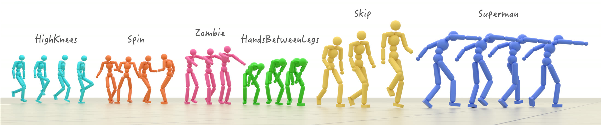
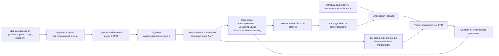

# SMP: обучение гуманоидного робота с помощью переиспользуемого априорного распределения движений, основанного на score matching

В этом разделе рассматривается [SMP (Score-Matching Motion Priors)](https://yxmu.foo/smp-page/): сначала на данных движений обучается небольшая диффузионная модель, затем она замораживается и превращается в «награду за естественность движения» на этапе обучения с подкреплением. Так одно априорное распределение движений может многократно использоваться в задачах отслеживания скорости, поворотов, целевых положений, уклонения и взаимодействия с объектами, и не нужно заново обучать дискриминатор для каждой новой задачи.

В разделе также разъясняются два кода, которые легко спутать:

- [xbpeng/MimicKit](https://github.com/xbpeng/MimicKit) — исходная референсная реализация, опубликованная авторами статьи;
- [SUZ-tsinghua/smp](https://github.com/SUZ-tsinghua/smp) — учебное воспроизведение на базе `mjlab` для робота Unitree G1; в нём есть признаки G1, четыре задачи и три предобученных априорных распределения движений.

После изучения вы должны уметь ответить на четыре вопроса: почему SMP — не обычный генератор движений; как диффузионная модель становится наградой для PPO; какие проблемы решают ESM, адаптивная нормализация и GSI; как с помощью учебного репозитория от Цинхуа пропустить предварительное обучение априорного распределения и сразу перейти к обучению G1 с подкреплением.

## 1. Главный вывод: какую проблему решает метод

Традиционные состязательные априорные распределения движений, например AMP, обычно обучают дискриминатор вместе с текущей политикой. При смене задачи состояния, которые посещает политика, меняются, поэтому дискриминатор часто приходится переобучать, и он по-прежнему читает исходные данные о движениях. SMP разделяет эти два этапа:

1. **Предварительное обучение априорного распределения:** на окнах движений обучается модель шумоподавления диффузии, которая учится «естественному распределению движений».
2. **Управление на этапе обучения с подкреплением:** модель замораживается, с её помощью оценивается, насколько действия политики близки к этому распределению, и полученная оценка используется как награда для PPO.
3. **Повторное использование в задачах:** при смене скорости, направления, положения или взаимодействия меняются только награда задачи и среда; априорное распределение заново обучать не нужно.

Поэтому суть SMP не в том, что диффузионная модель напрямую управляет роботом по кадрам, а в следующем:

> **Замороженная диффузионная модель оценивает окно движения, а эта оценка ограничивает обучение с подкреплением.**

На странице проекта показаны одно априорное распределение для нескольких задач, более 100 стилей, комбинации стилей, совместные движения человека и объектов, а также перенос G1 на реального робота. Статья включена в сборник ACM Transactions on Graphics, соответствующий SIGGRAPH 2026; текущая версия на arXiv — v3 от апреля 2026 года.

## 2. Сначала официальные результаты

<p align="center">
  
</p>

**Рисунок 1. Официальные примеры многостильных движений SMP.** Разные цвета соответствуют разным стилям движения. Здесь показано, что замороженное априорное распределение ограничивает несколько видов естественных движений, а не заставляет каждую задачу подгонять отдельную референсную траекторию.

<p align="center"><sub>Источник: официальный репозиторий SMP `xbpeng/MimicKit`. Изображение уменьшено для веб-страницы.</sub></p>

<video controls muted playsinline preload="metadata" width="100%">
  <source src="assets/official_videos/smp_pipeline.mp4" type="video/mp4">
</video>

**Видео 1. Официальный конвейер метода SMP.** Диффузионная модель движений сначала предобучается на референсных движениях; на этапе PPO к действиям добавляется шум, замороженный шумоподавитель предсказывает этот шум, а остаток преобразуется в награду за априорное распределение движений. Видео взято со страницы проекта статьи и переведено в совместимый с браузерами H.264 MP4.

<video controls muted playsinline preload="metadata" width="100%">
  <source src="assets/official_videos/g1_forward.mp4" type="video/mp4">
</video>

**Видео 2. Задача движения вперёд для G1 из учебного воспроизведения Цинхуа.** В коде задаётся целевая скорость в диапазоне `0.5–5.0 м/с`. Это диапазон команд, а не гарантия того, что каждый эпизод стабильно достигает 5 м/с; фактическую скорость нужно измерять по журналам каждого эпизода.

<video controls muted playsinline preload="metadata" width="100%">
  <source src="assets/official_videos/g1_steering.mp4" type="video/mp4">
</video>

**Видео 3. Задача поворота для G1 из учебного воспроизведения Цинхуа.** Направление целевой скорости может не совпадать с направлением корпуса, поэтому политике нужно не только двигаться, но и формировать боковые и перекрёстные шаги, оставаясь в рамках SMP.

<p align="center"><sub>Видео 2 и 3 взяты из ветки `assets` репозитория `SUZ-tsinghua/smp`; GIF переведены в H.264 MP4.</sub></p>

## 3. Общая архитектура: как диффузионное априорное распределение попадает в PPO



**Рисунок 2. Цепочка обучения и повторного использования SMP.** Верхняя часть обучает диффузионное априорное распределение движений один раз; нижняя часть может многократно запускаться для разных задач. Замороженное априорное распределение выполняет две функции: оценивает движения и инициализирует состояния.

В архитектуре шесть модулей.

### 1. Представление окна движения

Диффузионная модель читает не изображения, а структурированное состояние движения на нескольких последовательных кадрах. В учебном воспроизведении для G1 по умолчанию используется окно из 10 кадров по 59 значений в каждом:

```text
root_pos(3)
+ root_rot(6)
+ joint_pos(29)
+ end_effector_pos(15)
+ root_linear_velocity(3)
+ root_angular_velocity(3)
= 59 значений на кадр
```

Пять концевых точек — левая и правая стопа, туловище и левая и правая кисти. Пространственные величины переводятся в локальную систему координат с yaw последнего кадра окна; положение корня также считается относительно последнего кадра. Такой выбор убирает мировые координаты и глобальную ориентацию, поэтому априорное распределение описывает, как движется тело, а не где робот находится в сетке симуляции.

### 2. Шумоподавитель DDPM

К стандартизованному окну движения `x_0` добавляется гауссов шум:

$$
x_t=\sqrt{\bar\alpha_t}x_0+\sqrt{1-\bar\alpha_t}\epsilon,
\qquad \epsilon\sim\mathcal N(0,I).
$$

Цель предобучения шумоподавителя `ε_θ(x_t, t)` — восстановить истинный шум. В учебном воспроизведении используется функция потерь L1 для предсказания шума. Важно не то, что модель генерирует полное движение с нуля, а то, что сеть учится локальному направлению распределения движений на разных масштабах шума.

### 3. SDS: превращение ошибки шумоподавления в награду

Когда политика порождает новое окно движения, к нему также добавляется шум, и вычисляется:

$$
e_t(x_0)=\left\|\epsilon_\theta(x_t,t)-\epsilon\right\|^2.
$$

Если окно близко к многообразию обучающих движений, замороженный шумоподавитель лучше угадывает добавленный шум, и остаток обычно мал; неестественное, несбалансированное окно или окно вне распределения даёт большой остаток. Остаток преобразуется экспоненциальной функцией в неотрицательную награду:

$$
r_{\mathrm{SMP}}(x_0)=
\exp\left(-\lambda\,\bar e(x_0)\right).
$$

Здесь диффузионная модель не участвует в обратном распространении ошибки для PPO. Она всё время заморожена, а PPO по-прежнему оптимизирует распределение действий своей политики градиентом политики.

### 4. ESM: оценка сразу по нескольким моментам шума

Если выбирать диффузионный момент `t` случайно, дисперсия награды будет очень большой: низкий уровень шума сильнее учитывает детали движения, высокий — общую структуру, и разные батчи попадают на разные масштабы, из-за чего целевые значения ценности в PPO колеблются. Ensemble Score-Matching (ESM) усредняет остатки по фиксированному набору моментов `K`:

$$
\bar e(x_0)=\frac{1}{|K|}\sum_{t\in K}
\frac{e_t(x_0)}{\mu_t+\varepsilon}.
$$

В учебном воспроизведении по умолчанию выбраны три момента: `(8, 15, 22)`. Многомасштабное усреднение снижает дисперсию оценки награды и позволяет не перебирать все диффузионные моменты на каждом шаге.

### 5. Адаптивная нормализация: сравнимость разных уровней шума

Исходные ошибки SDS для разных `t` сильно различаются по величине, и это различие меняется от одной контрольной точки априорного распределения к другой. Если усреднять их напрямую, один момент с наибольшей ошибкой будет доминировать в награде. SMP поддерживает для каждого момента скользящее среднее `μ_t`, нормирует ошибку по нему и только потом агрегирует. Это также снижает объём ручной настройки `sds_loss_scale`.

Отсюда и требование в учебном воспроизведении к файлу `datasets/norm_stats.npz`: признаки движения сначала считаются по достаточно широкому распределению данных, вычисляются квантили q01/q99 и затем отображаются в диапазон `[-1, 1]`. Если оценить диапазон по нескольким слишком узким примерам, признаки на этапе PPO рано насыщаются при выходе за пределы распределения, и априорное распределение перестаёт давать корректирующий сигнал именно там, где он больше всего нужен.

### 6. GSI: инициализация состояний из априорного распределения

Generative State Initialization (GSI) позволяет замороженной диффузионной модели генерировать окна движения, по последнему кадру задаётся начальное состояние симуляции, а полным окном заполняется онлайн-буфер признаков. Это даёт два эффекта:

- политика начинает исследование из разнообразных состояний — стоя, в шаге, в беге или после падения, — а не всегда из одной T-позы;
- на первом шаге среды уже есть полное окно движения, поэтому награда SMP не теряет силу из-за пустой истории кадров.

В исходном MimicKit для многодвижущихся задач GSI включён по умолчанию, поэтому на этапе обучения политики с подкреплением исходный файл движений не читается. Но эта оговорка относится только к последующему этапу PPO: сама диффузионная модель всё равно сначала обучается на данных движений.

## 4. Различия между оригинальной статьёй и воспроизведением G1

| Пункт | Исходный SMP / MimicKit | Воспроизведение G1 из `SUZ-tsinghua/smp` |
| :-- | :-- | :-- |
| Роль | Референсная реализация статьи | Учебное воспроизведение на основе `mjlab` |
| Робот | Различные персонажи и задачи статьи, включая демонстрацию G1 на реальном роботе | Настройка задач симуляции Unitree G1 |
| Вход в симуляцию | Бэкенды MimicKit: Isaac Gym / Isaac Lab / Newton и др. | `mjlab` с фиксированной ревизией + MuJoCo |
| Комбинация награды за априорное распределение | $w_t r_{task}+w_s r_{SMP}$ | $r_{task}\times r_{SMP}$ |
| Априорные распределения | MimicKit даёт конфигурации и часть моделей из статьи | Репозиторий сразу содержит 3 априорных распределения G1 размером около 2,8 МБ |
| Задачи для последующего обучения | Положение, поворот, уклонение, имитация отдельного движения и др. | Движение вперёд, поворот, целевое положение, подъём |
| Цель для G1 | В статье есть перенос sim-to-real | В README прямо указано, что это учебное воспроизведение, а не полный стек развёртывания на реальном роботе |

В статье используется аддитивная награда, которая позволяет независимо регулировать вес выполнения задачи и вес априорного распределения движений:

$$
r=w_{task}r_{task}+w_{SMP}r_{SMP}.
$$

Учебное воспроизведение G1 намеренно заменяет её на мультипликативный гейтинг:

$$
r=r_{task}\cdot r_{SMP}.
$$

Идея мультипликативной схемы: высокая награда достаётся только тогда, когда задача выполнена **и** движение естественно. Это уменьшает необходимость подбирать соотношение весов задачи и априорного распределения; но обратная сторона в том, что если одна из частей близка к нулю, суммарная награда тоже падает, и на раннем этапе исследования результат сильнее зависит от GSI и масштабов наград. При описании результатов нужно указывать, что это не исходная конфигурация статьи.

## 5. Структура модулей учебного репозитория G1

После клонирования наиболее важные каталоги выглядят так:

```text
smp/
├── datasets/
│   ├── pretrain_ckpt/        # 3 замороженных априорных распределения, поставляемых вместе с репозиторием
│   └── norm_stats.npz        # квантили q01/q99 признаков движения
├── scripts/
│   ├── csv_to_npz.py         # воспроизведение CSV, FK, интерполяция и нарезка на окна
│   ├── compute_norm_stats.py # вычисление квантилей признаков
│   ├── pretrain.py           # обучение DDPM epsilon-предсказателя
│   ├── train.py              # регистрация задач SMP и вызов обучения mjlab
│   └── play.py               # загрузка run W&B и воспроизведение политики
└── src/smp/
    ├── pretrain/             # набор данных, шумоподавитель и планировщик диффузии
    └── rl/
        ├── events.py         # загрузка априорного распределения, сброс и обновление GSI
        ├── rewards.py        # награда SDS с ESM и произведение task x SMP
        ├── utils.py          # буфер признаков движения размером 59
        └── tasks/            # Forward / Steering / Location / Getup
```

Три предобученных априорных распределения связаны с конфигурациями задач:

| Контрольная точка | Обучающие движения | Задача по умолчанию |
| :-- | :-- | :-- |
| `pretrained_loco.pt` | walk / jog / run | `Smp-Forward-G1` |
| `pretrained_lafan_run.pt` | подмножество бега LAFAN | `Smp-Steering-G1`, `Smp-Location-G1` |
| `pretrained_getup_f2s2.pt` | переход от падения к стойке | `Smp-Getup-G1` |

Это значит, что при первом знакомстве не нужно скачивать LAFAN1 и запускать 10000 эпох диффузионного предобучения.

## 6. Быстрое воспроизведение: использовать поставляемые априорные распределения

### 0. Границы окружения

Рекомендуется Linux с видеокартой NVIDIA и исправным драйвером CUDA. Проект требует Python `>=3.10,<3.14`, зависимости зафиксированы в `uv.lock`, а `mjlab` привязан к конкретной ревизии Git. В репозитории нет инструкции для нативного Windows и не обещана поддержка цепочки обучения на AMD ROCm.

Все команды ниже выполняются в обычном рабочем пространстве Linux:

```bash
curl -LsSf https://astral.sh/uv/install.sh | sh
source "$HOME/.local/bin/env"

git clone https://github.com/SUZ-tsinghua/smp.git
cd smp
uv sync
```

**Контрольная точка 1.** Убедитесь, что три априорных распределения действительно скачались как обычные файлы рабочей копии Git, а не как указатели Git LFS:

```bash
ls -lh datasets/pretrain_ckpt/*.pt
uv run python -c "import torch; print(torch.cuda.is_available(), torch.__version__)"
```

Сейчас каждый из трёх файлов `.pt` весит около 2,8 МБ. Если файлы занимают всего несколько килобайт, проверьте, полностью ли прошло клонирование.

### 1. Тест на пять итераций

Сначала уменьшите число параллельных сред и итераций, чтобы проверить только поток данных:

```bash
uv run scripts/train.py Smp-Forward-G1 \
  --env.scene.num-envs=64 \
  --agent.max-iterations=5
```

Если текущий интерфейс `mjlab` принимает параметры с подчёркиванием, можно использовать `--agent.max_iterations=5`; ориентируйтесь на вывод `uv run scripts/train.py --help`.

Этот smoke test проверяет только цепочку: создание среды, загрузка априорного распределения G1, инициализация GSI, обновление окна признаков размером 59, ESM по трём моментам, обратное распространение PPO и запись checkpoint. Пять итераций не могут доказать, что робот научился устойчиво бегать.

### 2. Полное обучение

```bash
uv run scripts/train.py Smp-Forward-G1 \
  --env.scene.num-envs=4096
```

Чтобы обучить другие навыки, замените имя задачи:

```bash
uv run scripts/train.py Smp-Steering-G1 --env.scene.num-envs=4096
uv run scripts/train.py Smp-Location-G1 --env.scene.num-envs=4096
uv run scripts/train.py Smp-Getup-G1 --env.scene.num-envs=4096
```

Максимальное число итераций по умолчанию в конфигурации RL — 30000. Для серьёзного эксперимента сохраняйте как минимум такие кривые: награда за задачу, награда SMP, исходная ошибка SDS, длина эпизода, целевая и фактическая скорость. Одной суммарной наградой нельзя определить, действительно ли политика отслеживает скорость или её доминирует априорная награда.

### 3. Воспроизведение политики

Результаты обучения по умолчанию пишутся в `logs/` и фиксируются в W&B. Воспроизведение по пути к run:

```bash
uv run scripts/play.py Smp-Forward-G1 \
  --wandb-run-path <org>/<project>/<run> \
  --num-envs 4
```

Если нужна проверяемая запись видео, используйте параметры записи входа `mjlab`:

```bash
uv run scripts/play.py Smp-Forward-G1 \
  --wandb-run-path <org>/<project>/<run> \
  --num-envs 1 \
  --video \
  --video-length 600 \
  --video-width 1280 \
  --video-height 720
```

Видео сохраняется в `videos/play/` внутри каталога run, которому принадлежит checkpoint. Если checkpoint уже лежит на диске, `--wandb-run-path` можно заменить на `--checkpoint-file /path/to/model.pt`.

**Контрольная точка 2.** При воспроизведении смотрите одновременно на стрелку цели, фактическое направление движения, скольжение стоп, дрожание верхней части тела и восстановление после падения. Для требования «5 м/с» фиксируйте среднее, стандартное отклонение фактической скорости корня по времени и долю успешных эпизодов, а не делайте выводы по диапазону команд или одному видеофрагменту.

## 7. Полный путь: обучение собственного априорного распределения по LAFAN1

Полный путь нужен, только если вы хотите сменить стиль движений, представление признаков или форму робота.

### 1. Загрузка перенацеленных на G1 движений

```bash
uv pip install -U huggingface_hub

hf download lvhaidong/LAFAN1_Retargeting_Dataset \
  --repo-type dataset \
  --include "g1/*.csv" \
  --local-dir datasets/csv/_lafan_dl

mkdir -p datasets/csv/lafan
mv datasets/csv/_lafan_dl/g1/*.csv datasets/csv/lafan/
```

Скрипт `csv_to_npz.py` сканирует только первый уровень входного каталога `*.csv`, поэтому файлы нельзя оставлять во вложенном подкаталоге `g1/`.

### 2. Воспроизведение CSV, интерполяция и нарезка на окна

```bash
uv run scripts/csv_to_npz.py \
  --input-dir datasets/csv/lafan \
  --output-dir datasets/npz/lafan
```

Скрипт читает CSV без заголовка по 29 суставам G1 в заданном порядке, выполняет прямую кинематику в MuJoCo, интерполирует данные с 30 до 50 кадров в секунду и нарезает их на окна `(N, 10, 59)`. Результат — один сжатый NPZ-файл на каждое движение.

### 3. Вычисление статистики нормировки

```bash
uv run scripts/compute_norm_stats.py \
  --input-dir datasets/npz/lafan \
  --output datasets/norm_stats.npz
```

По умолчанию вычисляются поэлементные квантили q01/q99. Если вы не меняли раскладку 59 признаков, лучше сохранить статистику, которую репозиторий рассчитал по полным данным LAFAN для G1; не стоит оценивать её по одному беговому движению.

### 4. Обучение диффузионного априорного распределения

Пример конфигурации для априорного распределения движения вперёд из README репозитория:

```bash
uv run scripts/pretrain.py \
  --data-dir datasets/npz/forward/ \
  --num-layers 2 \
  --no-use-ema \
  --save-interval 5000 \
  --num-epochs 10000 \
  --train-split 1.0 \
  --d-model 128
```

Итоговое априорное распределение сохраняется в `logs/pretrain/<name>/<timestamp>/pretrained.pt`. При подключении нового checkpoint к задаче обязательно проверьте длину окна, размерность признаков, q01/q99, порядок суставов, порядок концевых точек и частоту управления. То, что модель успешно загрузилась через `load_state_dict`, не гарантирует, что эти смысловые соглашения совпадают.

## 8. Исходный MimicKit: как запускать

Если цель — воспроизвести конфигурацию статьи, комбинации стилей или задачу с уклонением от мяча, а не учебную реализацию для G1, используйте MimicKit:

```bash
git clone https://github.com/xbpeng/MimicKit.git
cd MimicKit
# Выберите и установите бэкенд Isaac Gym, Isaac Lab или Newton по README репозитория
pip install -r requirements.txt
```

Затем по [официальному пакету данных из README MimicKit](https://github.com/xbpeng/MimicKit#installation) скачайте ресурсы персонажей, предобученные модели и данные движений и распакуйте их в каталог `data/` репозитория. Одного клонирования кода недостаточно для запуска приведённых ниже команд обучения.

Официальная команда обучения политики позиционирования с предобученным априорным распределением LaFAN1:

```bash
python mimickit/run.py \
  --mode train \
  --num_envs 4096 \
  --engine_config data/engines/isaac_gym_engine.yaml \
  --env_config data/envs/smp_location_humanoid_env.yaml \
  --agent_config data/agents/smp_task_humanoid_agent.yaml \
  --visualize false \
  --out_dir output/
```

Вход для обучения нового априорного распределения:

```bash
python tools/diffusion_model/train_tinymdm.py \
  --cfg_path tools/diffusion_model/config/tinymdm_multi_clip.yaml \
  --out_dir output/smp_prior
```

Затем в конфигурации агента укажите:

```yaml
smp_prior_cfg: output/smp_prior/diffusion_config.yaml
smp_prior_model: output/smp_prior/model.pt
```

Приоритеты настройки параметров, которые даёт `docs/README_SMP.md` в MimicKit:

```text
smp_reward_weight > sds_loss_scale >= diffusion_steps
```

Эти приоритеты описывают аддитивную награду из статьи и не должны переноситься на мультипликативную награду учебного воспроизведения Цинхуа.

## 9. Частые вопросы

| Симптом | Что проверить в первую очередь | Причина |
| :-- | :-- | :-- |
| `uv sync` зависает на `mjlab` | Соединение с GitHub, зафиксированная ревизия, колёса CUDA | Проект зависит от ревизии Git, а не от чистой установки из PyPI |
| Не найдены CSV движений | Лежат ли CSV прямо в `--input-dir` | Скрипт преобразования не сканирует подкаталоги рекурсивно |
| checkpoint загружается, но награда SMP аномальна | Размерность признаков, размер окна, q01/q99, частота управления | У априорного распределения и среды есть неявные смысловые соглашения |
| Награда быстро приближается к нулю | GSI, насыщение признаков, скользящее среднее SDS | Мультипликативная награда усиливает последствия провала оценки априорного распределения |
| Награда растёт, но фактическая скорость невелика | Постройте отдельно целевую скорость и скорость корня | `0.5–5.0 м/с` — диапазон команд, а не гарантия результата |
| В симуляции хорошо, на реальном роботе не работает | Рандомизация динамики, согласование наблюдений, задержка и защитный слой | Учебный репозиторий Цинхуа — симуляционное воспроизведение G1, а не полный стек развёртывания |

## 10. Ценность метода и его границы

Главная ценность SMP — превращение данных о движениях в замороженную, повторно используемую модель награды. По сравнению с переобучением дискриминатора для каждой задачи такой подход более модульный; по сравнению со строгим покадровым отслеживанием референсного движения он оставляет политике возможность находить новые походки и новые сочетания движений. Сообщения на странице проекта — «3 секунды данных для обучения непрерывному изменению скорости» и «одно априорное распределение для многих задач» — как раз подтверждают эти два свойства.

Но сохраняйте три оговорки:

1. **Априорное распределение — не физический симулятор.** Контакты, динамику и успех задачи по-прежнему вычисляют MuJoCo, Isaac Gym и другие среды;
2. **Естественность не означает правильность.** SMP ограничивает только распределение движений, а задача по-прежнему должна указать, куда идти, с какой скоростью и взять ли объект;
3. **Симуляционное воспроизведение не равно системе для реального робота.** Для реального робота нужны согласование наблюдений, модель исполнительных механизмов, рандомизация задержек, безопасное управление и идентификация системы.

## 11. Рекомендуемый порядок изучения

1. Сначала рисунок 2 и видео 1, чтобы понять, что диффузионная модель здесь работает как награда, а не как прямой контроллер.
2. Клонируйте `SUZ-tsinghua/smp` и запустите smoke test на 64 средах с поставляемыми априорными распределениями.
3. Прочитайте `src/smp/rl/rewards.py` и сверьте его с формулами ESM, адаптивной нормализации и мультипликативной наградой.
4. Воспроизведите политики движения вперёд и поворота и отдельно записывайте заданную и фактическую скорость.
5. Только потом скачайте LAFAN1, обучите новое априорное распределение и попробуйте сменить стиль движения или признаки робота.

## 12. Источники

- [Официальная страница проекта SMP](https://yxmu.foo/smp-page/)
- [Статья SMP: arXiv:2512.03028](https://arxiv.org/abs/2512.03028)
- [Исходный код статьи: xbpeng/MimicKit](https://github.com/xbpeng/MimicKit)
- [Учебное воспроизведение для Unitree G1: SUZ-tsinghua/smp](https://github.com/SUZ-tsinghua/smp)
- [Набор перенацеленных на G1 данных LAFAN1](https://huggingface.co/datasets/lvhaidong/LAFAN1_Retargeting_Dataset)
- [mjlab](https://github.com/mujocolab/mjlab)
- [Источник упоминания в этом разделе: пост «Открытый код | SMP на скорости до 5 м/с» на Xiaohongshu](https://www.xiaohongshu.com/explore/6a8cf8eb0000000010022cf6)

Рисунки и видео в этом разделе взяты со страницы проекта статьи или из перечисленных официальных репозиториев; источник указан в подписи каждого рисунка. Учебное руководство лишь меняет формат и уменьшает размер изображений на веб-странице и не использует сторонние перепечатанные видео в качестве доказательства метода.
