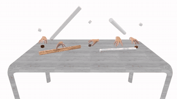
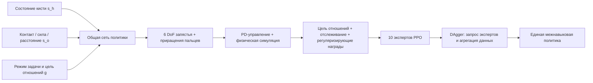
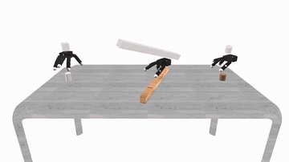
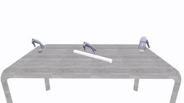
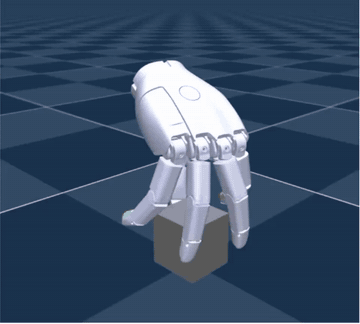

# UniCross: унифицированная постановка межнавыковой ловкой манипуляции для захвата, перемещения и манипуляций в руке

[UniCross](https://zdchan.github.io/UniCross/) — полное название *Unified Cross-Skill Dexterous Manipulation Synthesis*. Работа изучает не то, как обучить ещё одну политику захвата, а более базовый вопрос: можно ли записать захват, перемещение, поворот в руке и перенос в руке как одну и ту же задачу, чтобы одна политика выполняла несколько этапов ловкой манипуляции подряд.

Эту работу уместно поместить в главу о обучении с подкреплением и ловкой манипуляции, а не в главы о VLA или моделях мира. Вход — структурированное состояние кисти, объекта и цели, выход — команды для запястья и пальцев; обучение опирается на физическую симуляцию, PPO и DAgger. Языковых моделей, моделей «изображение — язык» или генерации будущих видео здесь нет.

После этого раздела вы должны уметь ответить на четыре вопроса:

- почему UniCross не обучает и не запускает четыре навыка отдельно и не переключает их;
- как «относительное движение кисти и объекта» объединяет четыре типа контакта, которые сильно отличаются друг от друга;
- почему десять экспертов PPO можно дистиллировать с помощью обычного DAgger в одну политику той же структуры;
- что доказывают результаты статьи и каких шагов воспроизведения пока не позволяют материалы.

## 1. Статья и открытые ресурсы

| Ресурс | Адрес | Что дает сейчас |
| :-- | :-- | :-- |
| Страница проекта | [zdchan.github.io/UniCross](https://zdchan.github.io/UniCross/) | Официальные видео, обзор метода и результаты для разных кистей |
| Статья | [arXiv:2607.28198](https://arxiv.org/abs/2607.28198) | Полный метод, эксперименты, абляции и гиперпараметры |
| Код | Кнопка `Code` на странице проекта пока ведёт на заглушку | Пока нельзя опираться на неё для надёжных команд клонирования и запуска |

По состоянию на 4 сентября 2026 года на странице проекта опубликованы статья и многочисленные видео результатов; показаны эффекты в Isaac Gym, Isaac Lab и mjlab. Однако кнопка `Code` пока не ведёт на рабочий репозиторий. Поэтому этот раздел — обзор метода и чек-лист подготовки к воспроизведению, а не руководство с командами, которые уже проверены на открытом коде.

## 2. Что именно объединяет UniCross

**Видео 1. Непрерывная композиция навыков UniCross.** Одна и та же политика последовательно выполняет захват, перемещение и манипуляцию в руке. Важно не только то, что каждый этап успешен: конец предыдущего этапа — это корректное начальное состояние для следующего. Источник: [страница проекта UniCross](https://zdchan.github.io/UniCross/).

Статья делит ловкую манипуляцию, при которой объект всё время удерживается рукой, на четыре типа относительного движения:

| Навык | Что сохраняется | Что должно меняться | Простой смысл |
| :-- | :-- | :-- | :-- |
| Захват (Grasp) | Поза объекта в корневой системе координат | Положение кисти в корневой системе координат | Кисть подходит к неподвижному объекту и обхватывает его |
| Перемещение (Relocate) | Поза объекта относительно кисти | Поза кисти и объекта в корневой системе координат | Объект надёжно удерживается, а запястье переносит его в целевую позу |
| Поворот в руке (Rotate) | Поза запястья в корневой системе координат, положение объекта относительно кисти | Ориентация объекта относительно кисти | Запястье неподвижно, пальцы меняют точки контакта и поворачивают объект вокруг заданной оси |
| Перенос в руке (Translate) | Поза запястья в корневой системе координат, ориентация объекта относительно кисти | Положение объекта относительно кисти | Запястье неподвижно, объект скользит в руке вдоль заданной оси |

Такой взгляд обходит привычку писать отдельную задачу для каждого типа контакта. Захват требует установить контакт, а поворот и перенос требуют постоянно перестраивать контакты; внешне это очень разные задачи. Но все они записываются так: отслеживаются одни отношения «кисть — объект», другие фиксируются, а оставшиеся степени свободы свободны. Унификация происходит на уровне постановки задачи, а не в виде склейки четырёх разных политик.

## 3. Схема данных от начала до конца

*Схема в исходном репозитории отсутствует; ниже приведено её описание.*

**Рисунок 1. Общая схема UniCross.** Слева каждый навык обучается с общими наблюдениями, сетью, действиями и наградами; справа сначала получаются десять экспертов, затем DAgger объединяет их в одну общую политику. Источник: [официальная статья UniCross, рисунок 2](https://arxiv.org/abs/2607.28198).

### 1. Общее наблюдение — это не просто склейка идентификатора навыка

Наблюдение политики записывается так:

$$
o_t=(s_t^h,s_t^o,g_t).
$$

Три части выполняют разные функции.

**Состояние кисти $s_t^h$.** Оно включает текущие положения суставов $q_t$ и целевые положения суставов на предыдущем шаге $q_{t-1}^{target}$. Вторая часть показывает политике, что приводы только что получили, и уменьшает неоднозначность, которая возникает, если смотреть лишь на текущее положение.

**Объект, описанный через взаимодействие $s_t^o$.** Для каждого звена кисти модель читает:

- двоичный признак контакта с объектом $c_t$;
- величину контактной силы $f_t$;
- трёхмерный вектор расстояния от звена до ближайшей точки поверхности объекта $v_t$.

На вход не подаются категория объекта или полная сетка. Вектор расстояния описывает локальную геометрию, а контакт и сила — текущее состояние связей. Вместе они говорят политике, какой палец где находится, касается ли он объекта и насколько крепко удерживает. В абляции без признака контакта успешность поворота упала с `98.8%` до `82.7%`, а средний поворот — с `13.6 рад` до `8.78 рад`. Это показывает, что динамическая манипуляция в руке особенно сильно опирается на состояние контакта.

**Цель отношений $g_t$.** Это 55-мерный вектор целевых признаков:

$$
g_t=[I_t,d_t^h,g_t^{current},g_t^{target}].
$$

$I_t$ — one-hot кодирование одного из десяти режимов экспертов, $d_t^h$ — трёхмерная целевая ось в системе координат кисти, а последние два члена описывают текущую и целевую позы «кисть — объект» в нескольких системах координат. Десять режимов состоят из `1 захват + 1 перемещение + 6 направлений поворота + 2 направления переноса`.

### 2. Зачем одновременно нужны системы координат кисти и корня

Если записывать цель только в мировых координатах, политика будет принимать глобальное смещение за сам навык. Если записывать её только в системе кисти, нельзя описать, куда запястье должно переместить объект. UniCross одновременно ведёт:

- положение и ориентацию объекта в системе кисти $(x_o^h,q_o^h)$;
- положение и ориентацию объекта в корневой системе $(x_o^r,q_o^r)$;
- положение и ориентацию кисти в корневой системе $(x_h^r,q_h^r)$.

Корневая система задаётся в начале каждого эпизода по исходной позе запястья и далее не меняется. Так цель перемещения можно выразить в корневой системе, а повороты и переносы в руке — в системе кисти, и при этом уменьшается зависимость от абсолютного положения в мире.

### 3. Единое пространство действий

Действия охватывают шесть виртуальных степеней свободы запястья и все суставы пальцев. Политика выдаёт приращение $a_t$, которое переводится в целевые положения суставов:

$$
q_t^{act}=\operatorname{clamp}(q_t^{ref}+\alpha\odot a_t,q_{min},q_{max}).
$$

Для пальцев опорным значением служит целевое положение на предыдущем шаге, а для запястья — текущая цель отношений. Затем ПД-регулятор переводит целевые положения в моменты в суставах. Остаточная форма действий делает движения пальцев более плавными и не заставляет политику с нуля исследовать большие перемещения запястья.

### 4. Единая структура наград

Все четыре навыка используют общий каркас награды:

$$
r_t=r_t^{goal}+r_t^{track}+r_t^{reg}.
$$

| Компонент | Основной сигнал | Какую проблему решает |
| :-- | :-- | :-- |
| $r_t^{goal}$ | Расстояние от звеньев до объекта, состояние контакта, сила контакта, движение объекта вдоль целевой оси | Нужно и удерживать объект, и двигать его в нужном направлении |
| $r_t^{track}$ | Ошибка целевой позы кисти и объекта в системах корня и кисти | Превращает четыре типа отношений в одну задачу слежения за целью |
| $r_t^{reg}$ | Отклонение пальцев от начальной позы, скорость запястья, энергия и штраф за падение | Подавляет дрожание, излишние действия, энергозатраты и выигрыш за счёт «отпускания» |

«Единая награда» не означает, что все веса одинаковы. Статья по-прежнему подбирает веса для взаимодействия под каждый навык, но семантика и структура наград одинаковы, поэтому состояния, которые посещают разные эксперты, легче совместить.

## 4. Почему сначала обучаются десять экспертов, а потом дистиллируют одну политику

Если одна политика одновременно исследует десять режимов, на раннем этапе возникает серьёзная конкуренция градиентов: захват сначала должен научиться подходить и устанавливать контакт, а поворот требует, чтобы объект уже был удержан и пальцы могли продолжать его менять. UniCross сначала обучает экспертов по отдельности с PPO, чтобы они не холодно стартовали все вместе из одной случайной политики.

Поскольку все эксперты используют одинаковые наблюдения, действия, сеть и структуру наград, дистилляция в общую политику становится прямой:

1. Текущая общая политика проходит по состояниям;
2. Для каждой среды по паре `(объект, навык)` запрашивается действие соответствующего эксперта;
3. Новое состояние и действие эксперта добавляются в буфер воспроизведения;
4. Общая политика обновляется функцией потерь поведенческого клонирования MSE;
5. Сбор и агрегация повторяются, чтобы уменьшить накопление ошибок, когда общая политика уходит от распределения экспертов.

Это стандартный DAgger, а не отдельно спроектированный маршрутизатор смеси экспертов. В конфигурации статьи доля запросов к эксперту составляет `100%`, буфер воспроизведения — `1 000 000`, на каждом раунде сбора — `32` шага, максимум обучения — `3500` эпох. В таблице абляций общая политика почти совпадает с десятью экспертами: успешность поворота `98.8%` против `99.1%`. Это говорит о том, что главное — совместимое пространство задач, которое создано заранее, а не сложность самого алгоритма дистилляции.

## 5. Как проводятся эксперименты и как читать цифры

### 1. Данные и протокол симуляции

Статья в основном обучает в Isaac Gym с физической частотой `120 Гц` и частотой управления `20 Гц`. Объекты обучения — случайно генерируемые боксы и цилиндры, которые делятся на охватываемые и длинные; всего `400` обучающих и `400` тестовых объектов. Для PPO используются коэффициент дисконтирования `0.99`, GAE `0.95`, размер батча `32768`; эпизод поворота — `400` шагов, эпизоды остальных навыков — `64` шага.

Это не готовый публичный бенчмарк, по которому выставляется общий балл. Статья задаёт собственный протокол навыков, и у каждого навыка свои критерии успеха:

| Навык | Основное условие успеха |
| :-- | :-- |
| Захват | За 75 шагов, после 50-го шага запястье поднимается, объект всё время не падает |
| Перемещение | Попадание в цель с точностью `3 см` по положению и `0.15 рад` по ориентации, без падения |
| Поворот | За 400 шагов объект поворачивается больше чем на $\pi/2$ и не падает |
| Перенос | За 50 шагов объект смещается по целевому направлению больше чем на `5 см`, без падения |

Поэтому нельзя сравнивать успешность разных навыков напрямую, как и складывать радианы поворота с сантиметрами переноса в один показатель.

### 2. Производительность отдельных навыков

В более общей постановке статьи UniCross достигает успешности: захват `98.7%`, перемещение `99.0%`, поворот `98.8%`, перенос `99.1%`. Для сравнения используются GraspXL, RotateIt и отдельный метод переноса в руке; для перемещения готовых аналогов нет, и авторы построили базовый вариант с жёсткими пальцами и ПД-управлением запястьем.

Высокая успешность показывает, что общая постановка не жертвует способностями отдельных навыков. Однако из этого нельзя напрямую вывести успешность на реальном роботе. В статье показано движение и совместимость политик в симуляции; эксперименты с реальной ловкой кистью не приведены.

### 3. Невиданные объекты, возмущения и разные кисти

Невиданные объекты — сфера, шестиугольная призма и удлинённая восьмиугольная призма. Политика обучалась только на боксах и цилиндрах, но сохраняет результаты, близкие к обучающим. В экспериментах с возмущениями на объект постоянно действует случайная сила до `10 m_obj g`; у всех четырёх навыков успешность снижается лишь немного.

| Allegro Hand | Sharpa Wave |
| :--: | :--: |
|  |  |

**Видео 2. Композиции навыков на разных кистях.** Авторы не копируют веса суставов Allegro на Sharpa, а для каждой формы кисти обучают общую политику при той же постановке задачи. Здесь показано, что постановка переносима, но не то, что одна и та же контрольная точка работает без дообучения на всех кистях. Источник: [страница проекта UniCross](https://zdchan.github.io/UniCross/).

Статья также проверяет 26-степенную кисть MANO и 28-степенную Sharpa Wave (с учётом 6 виртуальных степеней свободы запястья). У Sharpa успешность по четырём навыкам остаётся `99.1% / 98.0% / 98.5% / 99.0%`; у MANO из-за более ограниченного диапазона суставов амплитуды поворотов и переносов уменьшаются, но успешность по всем четырём навыкам выше `94%`.

### 4. Длинные последовательности

Настоящая проверка общей политики — составные задачи. Статья сообщает:

| Последовательность | SR захвата | SR перемещения | SR манипуляций в руке | Общий SR |
| :-- | --: | --: | --: | --: |
| Захват + перемещение + поворот | 99.7 | 92.2 | 95.1 | 87.4 |
| Захват + перемещение + перенос | 99.9 | 98.3 | 98.0 | 96.3 |

Общая успешность ниже, чем у каждого этапа по отдельности, и это нормально: три этапа должны быть выполнены подряд в одном непрерывном rollout. Цепочка поворотов сложнее: после перемещения ладонь может оказаться обращённой вниз или наклонённой, и объект легче соскальзывает.

## 6. Isaac Gym, Isaac Lab и mjlab

**Видео 3. Реализация в mjlab на странице проекта.** Основной текст статьи описывает обучение в Isaac Gym, а страница проекта затем показывает варианты в IsaacLab, IsaacGym и mjlab. Видео подтверждает, что авторы запускали работу на разных симуляторах, но до открытия входа в код нельзя по нему судить о инструкции по установке, фиксации версий, лицензиях на ассеты или публикации всех трёх вариантов. Источник: [страница проекта UniCross](https://zdchan.github.io/UniCross/).

Когда код станет доступен, воспроизведение лучше вести в таком порядке:

1. Зафиксировать коммит, версии симулятора и версию ассетов кисти, указанные авторами;
2. Провести smoke test на одном объекте, одном эксперте захвата и небольшом числе параллельных сред;
3. Проверить форму и систему координат флага контакта, контактной силы и вектора до ближайшей поверхности;
4. Обучить десять экспертов отдельно и перепроверить критерии успеха каждого навыка;
5. Запустить DAgger и проверить запросы экспертов, рост буфера и MSE общей политики;
6. Провести последовательную оценку трёх этапов в одном rollout, а не заменять общую успешность средним по отдельным навыкам.

Пока не опубликован код, не стоит строить собственный «вариант UniCross» по тексту статьи и называть его воспроизведением. Труднее всего восстановить не PPO, а геометрию коллизий кисти, определение датчиков контакта, распределение объектов, распределение начальных захватов и правила обновления целевых отношений.

## 7. Сильные стороны и ограничения

Самое ценное в UniCross — не более крупная сеть, а поиск координатной системы задачи, которая остаётся согласованной для разных навыков. Общие наблюдения и награды делают распределения состояний экспертов совместимыми, поэтому обычный DAgger почти без потерь сводит их в одну политику. Общая политика может также продолжать использовать текущий контакт при смене навыка, не сбрасывая объект и не возвращаясь к заранее заданной позе с ладонью вверх.

Ограничения так же ясны:

- это управление в симуляции по состоянию: в работе не используются реальные RGB-изображения, естественный язык или открытый словарь задач;
- для разных кистей политику нужно обучать отдельно: одна контрольная точка не управляет всеми ловкими кистями;
- объекты обучения — в основном примитивные геометрические формы, а тестовые формы остаются близки к этим семействам;
- реальных экспериментов с роботом в статье нет; рандомизация домена подтверждает устойчивость только к возмущениям в симуляции;
- публичного рабочего кода пока нет, поэтому строгий сквозной аудит воспроизведения невозможен.

Поэтому UniCross скорее похож на фундамент для общей постановки ловкой манипуляции. В будущем зрительное восприятие, языковые цели или VLA могут поставлять цели отношений и последовательность навыков, а низкоуровневая политика в духе UniCross будет выполнять их непрерывно с учётом контактных ограничений. Такой слоистый интерфейс проще проверять, чем ситуацию, когда VLA напрямую выдаёт все углы суставов пальцев, и он лучше подходит для длинных последовательностей навыков.

## 8. Литература

1. Hui Zhang, Julian Ferchow, Jie Song, Mirko Meboldt. [UniCross: Unified Cross-Skill Dexterous Manipulation Synthesis](https://arxiv.org/abs/2607.28198), 2026.
2. [Страница проекта UniCross](https://zdchan.github.io/UniCross/).
