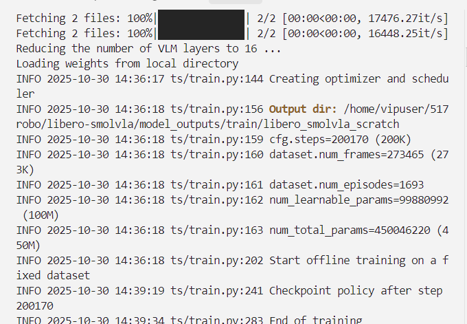

Загрузка:

https://huggingface.co/lerobot/smolvla_base

Модель можно использовать с нашими инструментами:

https://huggingface.co/datasets/nikriz/aopoli-lv-libero_combined_no_noops_lerobot_v21

Данные рекомендуем загружать через git lfs clone: отдельные файлы небольшие, но общий объём большой.

```bash
git clone https://github.com/huggingface/lerobot
cd lerobot && git stash
cd lerobot && git checkout d602e816 # Обязательно именно эта версия: более поздние могут выдавать ошибки!
git clone https://github.com/Lifelong-Robot-Learning/LIBERO
```

```bash
export DATA_ROOT=/path/to/data
python3 download_hf_files.py nikriz/aopoli-lv-libero_combined_no_noops_lerobot_v21 main --repo-type dataset --download_path "$DATA_ROOT/aopoli-lv-libero"
```

### Первым делом настройте окружение

```bash
~$ micromamba create -n smolvla python=3.10 -c conda-forge --yes

~$ mamba activate smolvla_new
~$ pip install torch==2.7.1+cu121 torchvision==0.22.1+cu121 torchaudio==2.7.1+cu121 -f https://mirror.sjtu.edu.cn/pytorch-wheels/cu121/

pip install torch==2.7.1 torchvision==0.22.1 torchaudio==2.7.1 -f https://mirror.sjtu.edu.cn/pytorch-wheels/cu121/

# Важно! Если вы на Windows, выполните эту команду:
pip install torch torchvision torchaudio --index-url https://download.pytorch.org/whl/cu124

cd lerobot && pip install -e ".[smolvla]"

cd LIBERO
pip install -e .
pip install robosuite==1.4.0
pip install bddl
pip install easydict
pip install gym
pip install matplotlib
```

Чтобы избежать предупреждений или взаимной блокировки в библиотеке `tokenizers` от Hugging Face, перед запуском скриптов задайте переменную окружения:

```bash
export TOKENIZERS_PARALLELISM=false
```

Эту строку можно добавить в `~/.bashrc` или `~/.zshrc`, тогда при каждом входе её не придётся задавать заново.

#### Шаг 4: исправляем `torch.load` (если возникла ошибка)

Если при запуске скрипта оценки появляется ошибка `_pickle.UnpicklingError: Weights only load failed.`, нужно вручную изменить код LIBERO.

1. Найдите файл `.../LIBERO/libero/libero/benchmark/__init__.py` (по пути к клонированному репозиторию LIBERO).
2. Перейдите примерно к 164-й строке.
3. Замените:

   ```python
   init_states = torch.load(init_states_path)
   ```

   на:

   ```python
   init_states = torch.load(init_states_path, weights_only=False)
   ```

   Сохраните файл.

Теперь окружение полностью настроено, и можно воспроизводить результаты SmolVLA на LIBERO по командам обучения и оценки из обсуждения (Issue).

### Шаг первый: обучение SmolVLA на свободном подмножестве

```bash
export MODEL_ROOT=/path/to/models
export DATA_ROOT=/path/to/data
export OUTPUT_ROOT=/path/to/outputs

python -m lerobot.scripts.train \
  --policy.type="$MODEL_ROOT/smolvla_base" \
  --policy.load_vlm_weights True \
  --dataset.repo_id="$DATA_ROOT/aopoli-lv-libero" \
  --batch_size=64 \
  --steps=200000 \
  --wandb.enable=true \
  --save_freq 10000 \
  --output_dir="$OUTPUT_ROOT/libero_smolvla_scratch" \
  --job_name=libero_smolvla_scratch_ckk \
  --policy.push_to_hub=False

# Как продолжить обучение
python -m lerobot.scripts.train \
  --resume=true \
  --config_path="$OUTPUT_ROOT/libero_smolvla_scratch/checkpoints/200000/pretrained_model/train_config.json" \
  --steps=200170

  20260124

python -m lerobot.scripts.train \
  --resume=true \
  --config_path="$OUTPUT_ROOT/libero_smolvla_scratch/checkpoints/200000/pretrained_model/train_config.json" \
  --steps=200340
```

170 шагов занимают примерно 5 минут.

Я использовал образ yaya1.



`CUDA_VISIBLE_DEVICES="0"` нужен, чтобы решить проблемы при обучении на нескольких GPU. Кроме того, я рекомендую увеличить `save_freq`.

Обучение на моей RTX 3090 выглядит так:


Обучение заняло около 10 часов.


Результаты, которые получили другие участники, становятся хорошими после 60 тысяч шагов и больше. Я остановил обучение раньше, потому что хотел проверить скрипт оценки.

2. Установка LIBERO

Самая трудная часть — установка [LIBERO](https://github.com/Lifelong-Robot-Learning/LIBERO).

Официальный скрипт установки LIBERO я не использовал. Ниже шаги, которые я выполнил для `lerobot`:

```bash
conda activate lerobot
cd <LIBERO>
pip install -e .
pip install robosuite==1.4.0
pip install bddl
pip install easydict
pip install gym
```

3. Оценка с помощью скрипта [@zlw21gxy](https://github.com/zlw21gxy)

Ещё раз привожу скрипт здесь: я внёс небольшие изменения в журналирование.

```python
"""
This script demonstrates how to evaluate a pretrained smolVLA policy on the LIBERO benchmark.
https://github.com/huggingface/lerobot/issues/1316
"""

import collections
import dataclasses
import logging
import math
import pathlib
import os

import cv2
import draccus
import imageio
import numpy as np
import torch
from libero.libero import benchmark, get_libero_path
from libero.libero.envs import OffScreenRenderEnv
from tqdm import tqdm

from lerobot.policies.smolvla.modeling_smolvla import SmolVLAPolicy
torch.serialization.add_safe_globals([np.core.multiarray._reconstruct])
os.environ["TOKENIZERS_PARALLELISM"] = "false"

LIBERO_DUMMY_ACTION = [0.0] * 6 + [-1.0]
LIBERO_ENV_RESOLUTION = 256  # resolution used to render training data


def normalize_gripper_action(action, binarize=True):
    """
    Changes gripper action (last dimension of action vector) from [0,1] to [-1,+1].
    Necessary for some environments (not Bridge) because the dataset wrapper standardizes gripper actions to [0,1].
    Note that unlike the other action dimensions, the gripper action is not normalized to [-1,+1] by default by
    the dataset wrapper.

    Normalization formula: y = 2 * (x - orig_low) / (orig_high - orig_low) - 1
    """
    # Just normalize the last action to [-1,+1].
    orig_low, orig_high = 0.0, 1.0
    action[..., -1] = 2 * (action[..., -1] - orig_low) / (orig_high - orig_low) - 1

    if binarize:
        # Binarize to -1 or +1.
        action[..., -1] = np.sign(action[..., -1])

    return action


def invert_gripper_action(action):
    """
    Flips the sign of the gripper action (last dimension of action vector).
    This is necessary for some environments where -1 = open, +1 = close, since
    the RLDS dataloader aligns gripper actions such that 0 = close, 1 = open.
    """
    action[..., -1] = action[..., -1] * -1.0
    return action


@dataclasses.dataclass
class Args:
    """
    Evaluation arguments for smolVLA on LIBERO.
    """

    # --- Hugging Face arguments ---
    policy_path: str = "lerobot/smolvla_base"
    """Path to the pretrained policy on the Hugging Face Hub or local directory."""

    # --- LIBERO environment-specific parameters ---
    task_suite_name: str = "libero_spatial"
    """Task suite. Options: libero_spatial, libero_object, libero_goal, libero_10, libero_90"""
    num_steps_wait: int = 10
    """Number of steps to wait for objects to stabilize in sim."""
    num_trials_per_task: int = 1 #TODO: вы можете изменить это значение
    """Number of rollouts per task."""

    # --- Evaluation arguments ---
    video_out_path: str = "data/libero/videos"
    """Path to save videos."""
    device: str = "cuda"
    """Device to use for evaluation."""

    seed: int = 7
    """Random Seed (for reproducibility)"""


@draccus.wrap()
def eval_libero(args: Args) -> None:
    # Set random seed
    torch.manual_seed(args.seed)
    np.random.seed(args.seed)

    # --- Load Policy ---
    policy = SmolVLAPolicy.from_pretrained(args.policy_path)
    policy.to(args.device)
    policy.eval()

    # --- Initialize LIBERO task suite ---
    benchmark_dict = benchmark.get_benchmark_dict()
    try:
        task_suite = benchmark_dict[args.task_suite_name]()
    except KeyError:
        raise ValueError(
            f"Unknown task suite: {args.task_suite_name}. "
            f"Available options are: {list(benchmark_dict.keys())}"
        )
    num_tasks_in_suite = task_suite.n_tasks
    logging.info(f"Task suite: {args.task_suite_name}")

    pathlib.Path(args.video_out_path).mkdir(parents=True, exist_ok=True)

    if args.task_suite_name == "libero_spatial":
        max_steps = 220  # longest training demo has 193 steps
    elif args.task_suite_name == "libero_object":
        max_steps = 280  # longest training demo has 254 steps
    elif args.task_suite_name == "libero_goal":
        max_steps = 300  # longest training demo has 270 steps
    elif args.task_suite_name == "libero_10":
        max_steps = 520  # longest training demo has 505 steps
    elif args.task_suite_name == "libero_90":
        max_steps = 400  # longest training demo has 373 steps
    else:
        # Fallback for custom task suites
        max_steps = 520

    # --- Evaluation Loop ---
    total_episodes, total_successes = 0, 0
    for task_id in tqdm(range(num_tasks_in_suite), desc="Tasks"):
        # Get task
        task = task_suite.get_task(task_id)

        # Get default LIBERO initial states
        initial_states = task_suite.get_task_init_states(task_id)

        # Initialize LIBERO environment and task description
        env, task_description = _get_libero_env(task, LIBERO_ENV_RESOLUTION, args.seed)

        # Start episodes
        task_episodes, task_successes = 0, 0
        for episode_idx in tqdm(
            range(min(args.num_trials_per_task, len(initial_states))),
            desc=f"Task {task_id}: {task.language}",
            leave=False,
        ):
            logging.info(f"\nTask: {task_description}")

            # Reset environment and policy
            env.reset()
            policy.reset()

            # Set initial states
            obs = env.set_init_state(initial_states[episode_idx])

            # IMPORTANT: Do nothing for the first few timesteps because the simulator drops objects
            # and we need to wait for them to fall
            for _ in range(args.num_steps_wait):
                obs, _, _, _ = env.step(LIBERO_DUMMY_ACTION)

            # Setup
            t = 0
            frames = []
            done = False

            # Add initial frame
            agentview_image = np.ascontiguousarray(obs["agentview_image"][::-1, ::-1])
            # frames.append(agentview_image)
            # import ipdb; ipdb.set_trace()
            logging.info(f"Starting episode {task_episodes+1}...")
            while t < max_steps:
                try:
                    # Get preprocessed image
                    # IMPORTANT: rotate 180 degrees to match train preprocessing
                    wrist_img = np.ascontiguousarray(obs["robot0_eye_in_hand_image"][::-1, ::-1])
                    agentview_image = np.ascontiguousarray(obs["agentview_image"][::-1, ::-1])
                    frames.append(agentview_image)

                    # Prepare observations dict
                    state = np.concatenate(
                        (
                            obs["robot0_eef_pos"],
                            _quat2axisangle(obs["robot0_eef_quat"]),
                            obs["robot0_gripper_qpos"],
                        )
                    )
                    observation = {
                        "observation.images.image": torch.from_numpy(agentview_image / 255.0)
                        .permute(2, 0, 1)
                        .to(torch.float32)
                        .to(args.device).unsqueeze(0),
                        "observation.images.wrist_image": torch.from_numpy(wrist_img / 255.0)
                        .permute(2, 0, 1)
                        .to(torch.float32)
                        .to(args.device).unsqueeze(0),
                        "observation.state": torch.from_numpy(state).to(torch.float32).to(args.device).unsqueeze(0),
                        "task": task_description,
                    }

                    # Query model to get action
                    with torch.inference_mode():
                        action_tensor = policy.select_action(observation)
                    action = action_tensor.cpu().numpy()[0]
                    # action[-1] = 1 - action[-1]
                    action = normalize_gripper_action(action, binarize=False)
                    action = invert_gripper_action(action)

                    # Execute action in environment
                    obs, _, done, _ = env.step(action)
                    if done:
                        task_successes += 1
                        total_successes += 1
                        break
                    t += 1

                except Exception as e:
                    logging.error(f"Caught exception: {e}")
                    break

            task_episodes += 1
            total_episodes += 1

            # Save a replay video of the episode
            suffix = "success" if done else "failure"
            task_segment = task_description.replace(" ", "_").replace("/", "_")
            video_path = (
                pathlib.Path(args.video_out_path) / f"rollout_task_{task_id}_episode_{episode_idx}_{task_segment}_{suffix}.mp4"
            )
            fps = 30
            writer = imageio.get_writer(video_path, fps=fps)

            for image in frames:
                writer.append_data(image)
            writer.close()
            logging.info(f"Saved video to {video_path}")
            # import ipdb; ipdb.set_trace()

            # Log current results
            logging.info(f"Success: {done}")
            if total_episodes > 0:
                logging.info(f"# episodes completed so far: {total_episodes}")
                logging.info(f"# successes: {total_successes} ({total_successes / total_episodes * 100:.1f}%)")

        # Log final results for the task
        if task_episodes > 0:
            logging.info(f"Task {task_id} success rate: {float(task_successes) / float(task_episodes):.2f}")
        if total_episodes > 0:
            logging.info(f"Cumulative success rate: {float(total_successes) / float(total_episodes):.2f}")

    logging.info("--- Evaluation finished ---")
    if total_episodes > 0:
        logging.info(f"Total success rate: {float(total_successes) / float(total_episodes):.2f}")
    logging.info(f"Total episodes: {total_episodes}")
    logging.info(f"Total successes: {total_successes}")
    # cv2.destroyAllWindows()


def _get_libero_env(task, resolution, seed):
    """Initializes and returns the LIBERO environment, along with the task description."""
    task_description = task.language
    task_bddl_file = pathlib.Path(get_libero_path("bddl_files")) / task.problem_folder / task.bddl_file
    env_args = {
        "bddl_file_name": str(task_bddl_file),
        "camera_heights": resolution,
        "camera_widths": resolution,
    }
    env = OffScreenRenderEnv(**env_args)
    env.seed(seed)  # IMPORTANT: seed seems to affect object positions even when using fixed initial state
    return env, task_description


def _quat2axisangle(quat):
    """
    Copied from robosuite:
    https://github.com/ARISE-Initiative/robosuite/blob/eafb81f54ffc104f905ee48a16bb15f059176ad3/robosuite/utils/transform_utils.py#L490C1-L512C55
    """
    # clip quaternion
    if quat[3] > 1.0:
        quat[3] = 1.0
    elif quat[3] < -1.0:
        quat[3] = -1.0

    den = np.sqrt(1.0 - quat[3] * quat[3])
    if math.isclose(den, 0.0):
        # This is (close to) a zero degree rotation, immediately return
        return np.zeros(3)

    return (quat[:3] * 2.0 * math.acos(quat[3])) / den


if __name__ == "__main__":
    logging.basicConfig(
        level=logging.INFO,
        format="%(asctime)s - %(levelname)s - %(message)s",
        handlers=[
            logging.FileHandler("evaluation_log.txt"),
            logging.StreamHandler()  # Optional: keeps logging in the terminal too
        ]
    )
    eval_libero()

```

Скрипт для задачи номер 1:

```
"""
This script demonstrates how to evaluate a pretrained smolVLA policy on the LIBERO benchmark.
https://github.com/huggingface/lerobot/issues/1316
"""

import collections
import dataclasses
import logging
import math
import pathlib
import os
from typing import Optional

import cv2
import draccus
import imageio
import numpy as np
import torch
from libero.libero import benchmark, get_libero_path
from libero.libero.envs import OffScreenRenderEnv
from tqdm import tqdm

from lerobot.policies.smolvla.modeling_smolvla import SmolVLAPolicy
torch.serialization.add_safe_globals([np.core.multiarray._reconstruct])
os.environ["TOKENIZERS_PARALLELISM"] = "false"

LIBERO_DUMMY_ACTION = [0.0] * 6 + [-1.0]
LIBERO_ENV_RESOLUTION = 256  # resolution used to render training data


def normalize_gripper_action(action, binarize=True):
    """
    Changes gripper action (last dimension of action vector) from [0,1] to [-1,+1].
    Necessary for some environments (not Bridge) because the dataset wrapper standardizes gripper actions to [0,1].
    Note that unlike the other action dimensions, the gripper action is not normalized to [-1,+1] by default by
    the dataset wrapper.

    Normalization formula: y = 2 * (x - orig_low) / (orig_high - orig_low) - 1
    """
    # Just normalize the last action to [-1,+1].
    orig_low, orig_high = 0.0, 1.0
    action[..., -1] = 2 * (action[..., -1] - orig_low) / (orig_high - orig_low) - 1

    if binarize:
        # Binarize to -1 or +1.
        action[..., -1] = np.sign(action[..., -1])

    return action


def invert_gripper_action(action):
    """
    Flips the sign of the gripper action (last dimension of action vector).
    This is necessary for some environments where -1 = open, +1 = close, since
    the RLDS dataloader aligns gripper actions such that 0 = close, 1 = open.
    """
    action[..., -1] = action[..., -1] * -1.0
    return action


@dataclasses.dataclass
class Args:
    """
    Evaluation arguments for smolVLA on LIBERO.
    """

    # --- Hugging Face arguments ---
    policy_path: str = "lerobot/smolvla_base"
    """Path to the pretrained policy on the Hugging Face Hub or local directory."""

    # --- LIBERO environment-specific parameters ---
    task_suite_name: str = "libero_spatial"
    """Task suite. Options: libero_spatial, libero_object, libero_goal, libero_10, libero_90"""
    num_steps_wait: int = 10
    """Number of steps to wait for objects to stabilize in sim."""
    num_trials_per_task: int = 10 #TODO: вы можете изменить это значение
    """Number of rollouts per task."""

    # --- Evaluation arguments ---
    video_out_path: str = "data/libero/videos_task1"
    """Path to save videos."""
    device: str = "cuda"
    """Device to use for evaluation."""

    seed: int = 7
    """Random Seed (for reproducibility)"""
    
    specific_task_id: Optional[int] = 1 # TODO: вы можете изменить здесь номер задачи
    """Specific task ID to run (if None, runs all tasks). For task1, set to 1."""


@draccus.wrap()
def eval_libero(args: Args) -> None:
    # Set random seed
    torch.manual_seed(args.seed)
    np.random.seed(args.seed)

    # --- Load Policy ---
    policy = SmolVLAPolicy.from_pretrained(args.policy_path)
    policy.to(args.device)
    policy.eval()

    # --- Initialize LIBERO task suite ---
    benchmark_dict = benchmark.get_benchmark_dict()
    try:
        task_suite = benchmark_dict[args.task_suite_name]()
    except KeyError:
        raise ValueError(
            f"Unknown task suite: {args.task_suite_name}. "
            f"Available options are: {list(benchmark_dict.keys())}"
        )
    num_tasks_in_suite = task_suite.n_tasks
    logging.info(f"Task suite: {args.task_suite_name}")

    pathlib.Path(args.video_out_path).mkdir(parents=True, exist_ok=True)

    if args.task_suite_name == "libero_spatial":
        max_steps = 220  # longest training demo has 193 steps
    elif args.task_suite_name == "libero_object":
        max_steps = 280  # longest training demo has 254 steps
    elif args.task_suite_name == "libero_goal":
        max_steps = 300  # longest training demo has 270 steps
    elif args.task_suite_name == "libero_10":
        max_steps = 520  # longest training demo has 505 steps
    elif args.task_suite_name == "libero_90":
        max_steps = 400  # longest training demo has 373 steps
    else:
        # Fallback for custom task suites
        max_steps = 520

    # --- Evaluation Loop ---
    total_episodes, total_successes = 0, 0
    
    # Determine which tasks to run
    if args.specific_task_id is not None:
        if args.specific_task_id >= num_tasks_in_suite:
            raise ValueError(f"Task ID {args.specific_task_id} is out of range. Available tasks: 0-{num_tasks_in_suite-1}")
        task_ids = [args.specific_task_id]
        logging.info(f"Running only task {args.specific_task_id}")
    else:
        task_ids = list(range(num_tasks_in_suite))
        logging.info(f"Running all {num_tasks_in_suite} tasks")
    
    for task_id in tqdm(task_ids, desc="Tasks"):
        # Get task
        task = task_suite.get_task(task_id)

        # Get default LIBERO initial states
        initial_states = task_suite.get_task_init_states(task_id)

        # Initialize LIBERO environment and task description
        env, task_description = _get_libero_env(task, LIBERO_ENV_RESOLUTION, args.seed)

        # Start episodes
        task_episodes, task_successes = 0, 0
        for episode_idx in tqdm(
            range(min(args.num_trials_per_task, len(initial_states))),
            desc=f"Task {task_id}: {task.language}",
            leave=False,
        ):
            logging.info(f"\nTask: {task_description}")

            # Reset environment and policy
            env.reset()
            policy.reset()

            # Set initial states
            obs = env.set_init_state(initial_states[episode_idx])

            # IMPORTANT: Do nothing for the first few timesteps because the simulator drops objects
            # and we need to wait for them to fall
            for _ in range(args.num_steps_wait):
                obs, _, _, _ = env.step(LIBERO_DUMMY_ACTION)

            # Setup
            t = 0
            frames = []
            done = False

            # Add initial frame
            agentview_image = np.ascontiguousarray(obs["agentview_image"][::-1, ::-1])
            # frames.append(agentview_image)
            # import ipdb; ipdb.set_trace()
            logging.info(f"Starting episode {task_episodes+1}...")
            while t < max_steps:
                try:
                    # Get preprocessed image
                    # IMPORTANT: rotate 180 degrees to match train preprocessing
                    wrist_img = np.ascontiguousarray(obs["robot0_eye_in_hand_image"][::-1, ::-1])
                    agentview_image = np.ascontiguousarray(obs["agentview_image"][::-1, ::-1])
                    frames.append(agentview_image)

                    # Prepare observations dict
                    state = np.concatenate(
                        (
                            obs["robot0_eef_pos"],
                            _quat2axisangle(obs["robot0_eef_quat"]),
                            obs["robot0_gripper_qpos"],
                        )
                    )
                    observation = {
                        "observation.images.image": torch.from_numpy(agentview_image / 255.0)
                        .permute(2, 0, 1)
                        .to(torch.float32)
                        .to(args.device).unsqueeze(0),
                        "observation.images.wrist_image": torch.from_numpy(wrist_img / 255.0)
                        .permute(2, 0, 1)
                        .to(torch.float32)
                        .to(args.device).unsqueeze(0),
                        "observation.state": torch.from_numpy(state).to(torch.float32).to(args.device).unsqueeze(0),
                        "task": task_description,
                    }

                    # Query model to get action
                    with torch.inference_mode():
                        action_tensor = policy.select_action(observation)
                    action = action_tensor.cpu().numpy()[0]
                    # action[-1] = 1 - action[-1]
                    action = normalize_gripper_action(action, binarize=False)
                    action = invert_gripper_action(action)

                    # Execute action in environment
                    obs, _, done, _ = env.step(action)
                    if done:
                        task_successes += 1
                        total_successes += 1
                        break
                    t += 1

                except Exception as e:
                    logging.error(f"Caught exception: {e}")
                    break

            task_episodes += 1
            total_episodes += 1

            # Save a replay video of the episode
            suffix = "success" if done else "failure"
            task_segment = task_description.replace(" ", "_").replace("/", "_")
            video_path = (
                pathlib.Path(args.video_out_path) / f"rollout_task_{task_id}_episode_{episode_idx}_{task_segment}_{suffix}.mp4"
            )
            fps = 30
            writer = imageio.get_writer(video_path, fps=fps)

            for image in frames:
                writer.append_data(image)
            writer.close()
            logging.info(f"Saved video to {video_path}")
            # import ipdb; ipdb.set_trace()

            # Log current results
            logging.info(f"Success: {done}")
            if total_episodes > 0:
                logging.info(f"# episodes completed so far: {total_episodes}")
                logging.info(f"# successes: {total_successes} ({total_successes / total_episodes * 100:.1f}%)")

        # Log final results for the task
        if task_episodes > 0:
            logging.info(f"Task {task_id} success rate: {float(task_successes) / float(task_episodes):.2f}")
        if total_episodes > 0:
            logging.info(f"Cumulative success rate: {float(total_successes) / float(total_episodes):.2f}")

    logging.info("--- Evaluation finished ---")
    if total_episodes > 0:
        logging.info(f"Total success rate: {float(total_successes) / float(total_episodes):.2f}")
    logging.info(f"Total episodes: {total_episodes}")
    logging.info(f"Total successes: {total_successes}")
    # cv2.destroyAllWindows()


def _get_libero_env(task, resolution, seed):
    """Initializes and returns the LIBERO environment, along with the task description."""
    task_description = task.language
    task_bddl_file = pathlib.Path(get_libero_path("bddl_files")) / task.problem_folder / task.bddl_file
    env_args = {
        "bddl_file_name": str(task_bddl_file),
        "camera_heights": resolution,
        "camera_widths": resolution,
    }
    env = OffScreenRenderEnv(**env_args)
    env.seed(seed)  # IMPORTANT: seed seems to affect object positions even when using fixed initial state
    return env, task_description


def _quat2axisangle(quat):
    """
    Copied from robosuite:
    https://github.com/ARISE-Initiative/robosuite/blob/eafb81f54ffc104f905ee48a16bb15f059176ad3/robosuite/utils/transform_utils.py#L490C1-L512C55
    """
    # clip quaternion
    if quat[3] > 1.0:
        quat[3] = 1.0
    elif quat[3] < -1.0:
        quat[3] = -1.0

    den = np.sqrt(1.0 - quat[3] * quat[3])
    if math.isclose(den, 0.0):
        # This is (close to) a zero degree rotation, immediately return
        return np.zeros(3)

    return (quat[:3] * 2.0 * math.acos(quat[3])) / den


if __name__ == "__main__":
    logging.basicConfig(
        level=logging.INFO,
        format="%(asctime)s - %(levelname)s - %(message)s",
        handlers=[
            logging.FileHandler("evaluation_log.txt"),
            logging.StreamHandler()  # Optional: keeps logging in the terminal too
        ]
    )
    eval_libero()

```

Чтобы запустить этот скрипт, используйте:

```
export OUTPUT_ROOT=/path/to/outputs

python eval_LIBERO.py --policy_path="$OUTPUT_ROOT/libero_smolvla_scratch/checkpoints/140000/pretrained_model/"

python eval_LIBERO.py --policy_path="$OUTPUT_ROOT/libero_smolvla_scratch/checkpoints/130000/pretrained_model/"

python eval_LIBERO.py --policy_path="$OUTPUT_ROOT/libero_smolvla_scratch/checkpoints/200000/pretrained_model/"

python eval_LIBERO.py --policy_path="$OUTPUT_ROOT/libero_smolvla_scratch/checkpoints/200170/pretrained_model/"

python eval_LIBERO-task1.py --policy_path="$OUTPUT_ROOT/libero_smolvla_scratch/checkpoints/200170/pretrained_model/"


python eval_LIBERO.py --policy_path="$OUTPUT_ROOT/libero_smolvla_scratch/checkpoints/200340/pretrained_model/"

python eval_LIBERO-task1.py --policy_path="$OUTPUT_ROOT/libero_smolvla_scratch/checkpoints/200340/pretrained_model/"


python eval_LIBERO-task1-libero10.py --policy_path="$OUTPUT_ROOT/libero_smolvla_scratch/checkpoints/200340/pretrained_model/"

```

Если вы получили такую ошибку:

```
File "/home/tay/Documents/robo-intel-action/finetuning\_lerobot/LIBERO/libero/libero/benchmark/\_\_init\_\_.py", line 164, in get\_task\_init\_states
init\_states = torch.load(init\_states\_path)
File "/home/tay/miniconda3/envs/lerobot/lib/python3.10/site-packages/torch/serialization.py", line 1524, in load
raise pickle.UnpicklingError(\_get\_wo\_message(str(e))) from None
_pickle.UnpicklingError: Weights only load failed. This file can still be loaded, to do so you have two options, do those steps only if you trust the source of the checkpoint.
```

в файле `libero.benchmark.__init__.py` измените строку 164 с:

init\_states \= torch.load(init\_states\_path)

на:

init_states = torch.load(init_states_path, weights_only=False)

4. Результаты

Скрипт оценки выводит в терминал данные о развёртывании и статистику (я сохранял их в `evaluation_log.txt`).

2025-08-07 10:49:34,622 - INFO - --- Evaluation finished ---
2025-08-07 10:49:34,622 - INFO - Total success rate: 0.71
2025-08-07 10:49:34,622 - INFO - Total episodes: 500
2025-08-07 10:49:34,622 - INFO - Total successes: 356

Видео: задача 9, эпизод 47: положить чёрную чашку на деревянную полку и на тарелку — успешно. Задача 3, эпизод 26: взять чёрную чашку с коробки с печеньем и поставить на тарелку — успешно.
