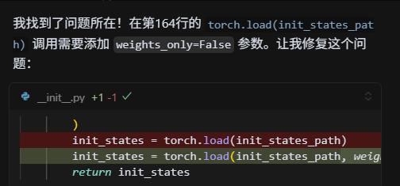
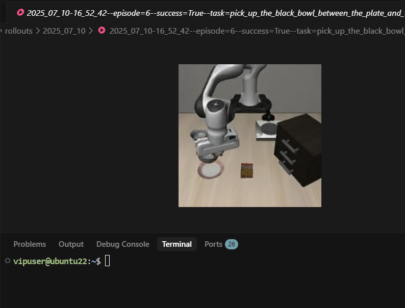
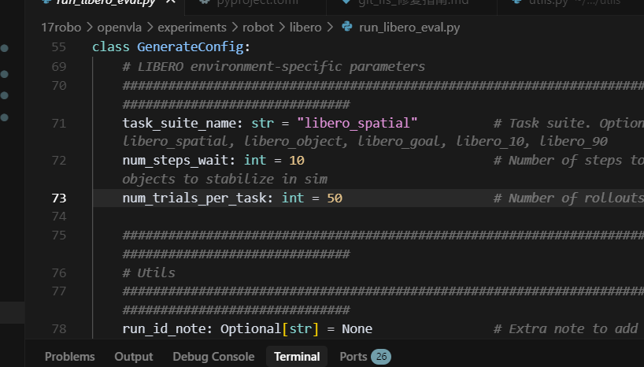

# OpenVLA на практике: настройка окружения, оценка и разбор принципов

## 1. Введение

Этот документ — практическое руководство по модели OpenVLA (Open Vision-Language-Action). Он охватывает настройку базового окружения, установку зависимостей, пакетную загрузку весов модели и оценку на бенчмарке Libero. Кроме того, здесь описаны типичные ошибки, которые возникают при запуске, и их решения, а также подробно разобраны архитектура OpenVLA и принципы обработки мультимодальных данных. Документ рассчитан на исследователей и разработчиков и сочетает теорию с практикой.

## 2. Настройка окружения и подготовка модели

### 2.1 Установка базовых зависимостей

Сначала нужно установить набор инструментов NVIDIA CUDA и клонировать репозиторий OpenVLA.

```bash
# Установка NVIDIA CUDA Toolkit
sudo apt install nvidia-cuda-toolkit

# Клонирование репозитория весов модели OpenVLA (Hugging Face)
git clone https://huggingface.co/openvla/openvla-7b

# Клонирование репозитория кода OpenVLA (GitHub)
git clone https://github.com/openvla/openvla.git
# Запасной адрес зеркала: git clone https://bgithub.xyz/openvla/openvla.git
```

### 2.2 Настройка окружения Python

Перейдите в каталог с кодом и установите необходимые зависимости Python. Некоторые шаги требуют доступа к GitHub, поэтому убедитесь, что сеть работает.

```bash
cd openvla

# Установка текущего каталога в режиме редактирования (editable)
# Внимание: этот шаг обращается к github.com. Если сеть недоступна, может появиться ошибка "Failed to connect to github.com port 443"
pip install -e .

# Установка инструментов сборки
pip install packaging ninja

# Проверка установки Ninja (должен вернуться код выхода "0")
ninja --version; echo $?

# Установка Flash Attention (конкретная версия)
pip install "flash-attn==2.5.5" --no-build-isolation

# Необязательно: установка CUDA Toolkit через mamba (если системная установка работает некорректно)
# mamba install -c nvidia cuda-toolkit=11.8

# Активация окружения и проверка NVCC
mamba activate dl && nvcc -V
```

### 2.3 Пакетная загрузка весов модели

Чтобы ускорить работу, удобно использовать `tmux` и параллельно скачивать веса моделей, дообученных на разных наборах задач Libero.

```bash
# Создание новой сессии tmux
tmux new-session -d -s openvla_download

# Создание четырёх панелей, чтобы скачивать модели для разных задач одновременно
tmux split-window -h
tmux split-window -v
tmux select-pane -t 0
tmux split-window -v

# В каждой панели запускается своя команда загрузки (в каталог /data1)
tmux send-keys -t 0 'cd /data1 && git lfs clone https://huggingface.co/openvla/openvla-7b-finetuned-libero-spatial' Enter
tmux send-keys -t 1 'cd /data1 && git lfs clone https://huggingface.co/openvla/openvla-7b-finetuned-libero-object' Enter
tmux send-keys -t 2 'cd /data1 && git lfs clone https://huggingface.co/openvla/openvla-7b-finetuned-libero-goal' Enter
tmux send-keys -t 3 'cd /data1 && git lfs clone https://huggingface.co/openvla/openvla-7b-finetuned-libero-10' Enter

# Подключение к сессии для просмотра хода загрузки
tmux attach-session -t openvla_download
```

## 3. Запуск оценки на Libero

### 3.1 Стандартная команда оценки

После загрузки моделей запустите скрипт `run_libero_eval.py` для оценки на разных наборах задач (например, `libero_spatial`, `libero_goal`).

```bash
# Оценка на задачах Libero Spatial
python experiments/robot/libero/run_libero_eval.py \
    --model_family openvla \
    --pretrained_checkpoint /data1/openvla-7b-finetuned-libero-spatial \
    --task_suite_name libero_spatial \
    --center_crop True

# Оценка на задачах Libero Goal
python experiments/robot/libero/run_libero_eval.py \
    --model_family openvla \
    --pretrained_checkpoint /data1/openvla-7b-finetuned-libero-goal \
    --task_suite_name libero_goal \
    --center_crop True
```

### 3.2 Настройка параметров оценки

Параметры оценки задаются через аргументы командной строки. Например, число испытаний можно уменьшить, чтобы быстро проверить работоспособность.

**Просмотр справки:**

```bash
micromamba activate dl && cd /home/user/17robo/openvla && python experiments/robot/libero/run_libero_eval.py --help | grep -A 5 -B 5 "num_trials"
```

**Пример изменения числа испытаний:**

По умолчанию `num_trials_per_task` равно 50. Чтобы установить 10 испытаний:

```bash
python experiments/robot/libero/run_libero_eval.py \
    --model_family openvla \
    --pretrained_checkpoint /data1/openvla-7b-finetuned-libero-spatial \
    --task_suite_name libero_spatial \
    --center_crop True \
    --num_trials_per_task 10
```

## 4. Устранение неполадок

При запуске скрипта оценки могут появиться перечисленные ниже ошибки. В этом разделе описаны тексты сообщений и способы их исправления.

### 4.1 Ошибка 1: Weights only load failed (ошибка десериализации Pickle)

**Текст ошибки:**

```plaintext
_pickle.UnpicklingError: Weights only load failed. This file can still be loaded, to do so you have two options...
WeightsUnpickler error: Unsupported global: GLOBAL numpy.core.multiarray._reconstruct was not an allowed global by default.
```

**Причина:**

Это следствие защитного режима новых версий PyTorch. По умолчанию `torch.load` работает с `weights_only=True` и ограничивает, какие глобальные объекты можно десериализовать. Файлы начального состояния Libero содержат объекты `numpy`, поэтому загрузка блокируется.

**Решение:**

Нужно изменить код загрузки в библиотеке `libero` и явно разрешить объекты `numpy`, либо временно отключить ограничение `weights_only`.

**Место изменения:**

Файл `/data/17robo/LIBERO/libero/libero/benchmark/__init__.py` (около 164 строки).



**Исправленный код:**

Замените:

```python
init_states = torch.load(init_states_path)
```

на:

```python
# Разрешаем загрузку объектов numpy
import numpy as np
init_states = torch.load(init_states_path, weights_only=False)
# Или более безопасный вариант (если версия PyTorch это поддерживает):
# torch.serialization.add_safe_globals([np.core.multiarray._reconstruct])
# init_states = torch.load(init_states_path)
```

### 4.2 Ошибка 2: EGL Context Error (можно игнорировать)

**Текст ошибки:**

```plaintext
OpenGL.raw.EGL._errors.EGLError: EGLError(err = EGL_NOT_INITIALIZED, ...)
```

**Пояснение:**

Так Robosuite/MuJoCo сообщает об ошибке при уничтожении контекста рендеринга. Обычно это происходит при завершении программы или смене задачи. **На работу оценки и результаты это не влияет**, поэтому ошибку можно игнорировать.

### 4.3 Проверка успешного запуска

После исправления ошибки Pickle скрипт должен работать и создавать видео оценки.

**Пример журнала запуска:**

```plaintext
Loading checkpoint shards: 100%|██████████████████| 4/4 [00:01<00:00,  3.16it/s]
Loaded model: <class 'transformers_modules.openvla...OpenVLAForActionPrediction'>
Task: pick up the black bowl between the plate and the ramekin and place it on the plate
Starting episode 1...
Saved rollout MP4 at path ./rollouts/...--success=True--task=....mp4
Success: True
```



**Занятая видеопамять:** около 10321 МБ.



## 5. Архитектура OpenVLA и принцип работы в симуляции

В этом разделе подробно разобраны внутренние механизмы OpenVLA и порядок работы модели в симуляторе Libero.

### 5.1 Основная архитектура

OpenVLA — типичная мультимодальная модель **Vision-Language-Action (VLA)**. Её архитектура объединяет визуальное восприятие, понимание языка и генерацию действий в одной сквозной Transformer-сети.

#### 1. Визуальная основа (Vision Backbone)

- **Назначение**: извлекает высокоуровневые семантические признаки изображения.
- **Поддерживаемые модели**: SigLIP, DINOv2, CLIP и другие популярные предобученные модели.
- **Стратегия с двумя энкодерами**: можно одновременно использовать два визуальных энкодера (например, DINOv2 + CLIP), объединяя разные признаки: DINOv2 лучше передаёт пространственную геометрию, CLIP — семантическое соответствие.
- **Выход**: эмбеддинги патчей изображения, форма `[batch, num_patches, vision_dim]`.

#### 2. Проекционный слой «визуальный — языковой» (Projector)

- **Назначение**: переводит визуальные признаки в пространство эмбеддингов языковой модели (LLM), чтобы LLM могла их «понимать».
- **Структура**: обычно многослойный перцептрон (MLP).

```python
# Пример структуры для двух визуальных энкодеров
fc1: vision_dim -> 4 * vision_dim
fc2: 4 * vision_dim -> llm_dim
fc3: llm_dim -> llm_dim
```

#### 3. Языковая основа (LLM Backbone)

- **Назначение**: обрабатывает мультимодальную последовательность входов, выполняет вывод и генерацию.
- **Поддерживаемые модели**: LLaMA-2, Vicuna, Mistral и др.
- **Оптимизации**: используется **Flash Attention 2** для ускорения вычислений и точность **BF16** для снижения потребления видеопамяти.

#### 4. Голова предсказания действий (Action Head)

- **Назначение**: декодирует выход LLM в конкретные команды управления роботом.
- **Пространство выхода**: 7-мерный непрерывный вектор действий `[x, y, z, rx, ry, rz, gripper]` (положение, ориентация и открытие/закрытие захвата).
- **Нормализация**: модель предсказывает нормализованные действия, поэтому при выводе их нужно денормализовать по статистике датасета.

### 5.2 Работа в симуляции

Бенчмарк Libero построен на физическом движке **RoboSuite** и **MuJoCo** и обеспечивает стандартизованный процесс оценки.

#### Псевдокод цикла оценки:

```python
# Перебор задач набора (например, в Libero Spatial 10 задач)
for task_id in range(10):
    # Для каждой задачи проводится несколько испытаний (по умолчанию 50)
    for episode in range(50):
        env.reset()
        # Установка заранее заданного начального состояния для честного сравнения
        obs = env.set_init_state(initial_states[episode])

        for step in range(max_steps):
            # 1. Получение RGB-изображения текущего кадра
            image = get_libero_image(obs)

            # 2. Формирование текстовой инструкции (prompt)
            prompt = f"What action should the robot take to {task_description}?"

            # 3. Вывод VLA-модели
            # Вход: инструкция + изображение
            # Выход: нормализованное действие -> денормализованное действие
            action = vla.predict_action(prompt, image, unnorm_key=task_suite_name)

            # 4. Выполнение действия в симуляции
            obs, reward, done, info = env.step(action)

            if done: break
```

## 6. Обработка мультимодальных данных

Главное преимущество OpenVLA — эффективное объединение визуальных данных, текста и действий.

### 6.1 Стратегия мультимодального слияния

#### 1. Предобработка входов

- **Текст**: токенизатор переводит инструкцию в идентификаторы токенов.
- **Изображение**: масштабируется до 224×224 и пропускается через визуальную основу, получая признаки `[num_patches, vision_dim]`.

#### 2. Выравнивание признаков и конкатенация

- Визуальные признаки проецируются в размерность LLM: `[num_patches, llm_dim]`.
- Во входной последовательности визуальные токены вставляются между текстовыми (обычно перед инструкцией или внутри неё).

```python
input_embeds = [text_embeds[:prefix], projected_vision, text_embeds[prefix:]]
```

#### 3. Совместное внимание

- **Межмодальное взаимодействие**: за счёт механизма self-attention Transformer текстовые токены могут обращаться к визуальным патчам и наоборот. Благодаря этому модель понимает инструкции вроде «возьми [на изображении] красный кубик».
- **Причинная маска (Causal Mask)**: сохраняет авторегрессивный характер генерации и не допускает утечки информации из будущего.

### 6.2 Конвейер обучающих данных

1. **Формат данных**:
   - **Изображение**: RGB-наблюдение.
   - **Текст**: описание задачи на естественном языке.
   - **Метки**: 7-мерный вектор действий из демонстрационной траектории эксперта.

2. **Аугментация данных**:
   - **На этапе обучения**: случайное кадрирование (Random Crop), цветовой джиттер (Color Jitter) и др. — для повышения устойчивости.
   - **На этапе вывода**: центральное кадрирование (Center Crop), чтобы входы оставались согласованными.

3. **Нормализация действий**:
   Поскольку амплитуды действий в разных задачах сильно различаются, прямая регрессия исходных значений плохо сходится. OpenVLA использует Z-нормализацию:

   $$\text{normalized\_action} = \frac{\text{action} - \mu}{\sigma}$$

   При выводе:

   $$\text{action} = \text{normalized\_action} \times \sigma + \mu$$

Благодаря такой сквозной архитектуре и аккуратной обработке данных OpenVLA обеспечивает эффективный замкнутый цикл от восприятия до решения и демонстрирует хорошую обобщающую способность на бенчмарках вроде Libero.
