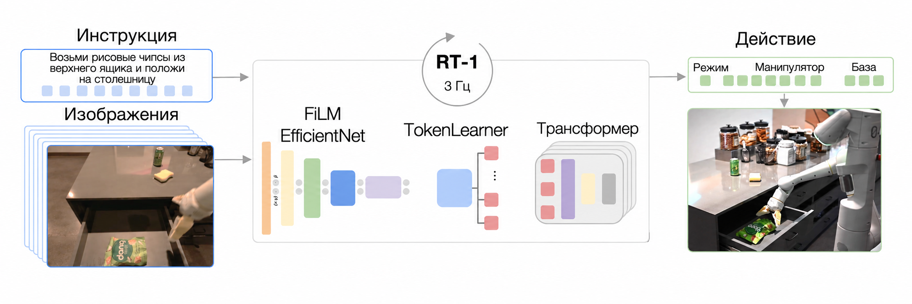
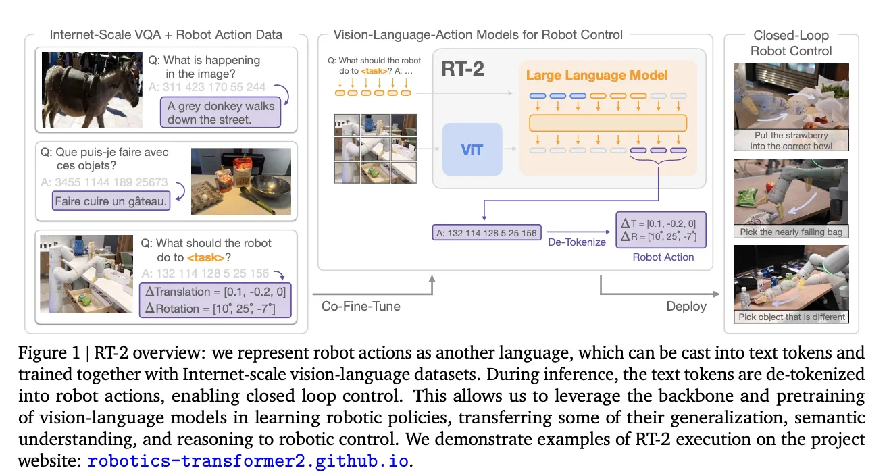
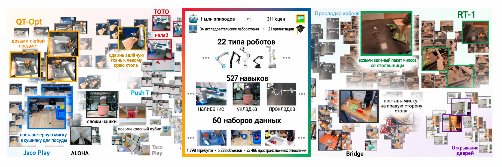

# Серия Robotics Transformer: RT-1, RT-2 и RT-X

## 1. Введение: от экспертных моделей к универсальным

В традиционном обучении роботов из-за нехватки данных и сложности физического мира обычно обучают отдельную модель под каждую конкретную задачу (специалист, Specialist). Однако успех больших языковых моделей (LLM) вдохновил и робототехнику: можно ли построить универсальную **базовую модель для роботов (Robot Foundation Model)**, которая понимала бы физический мир манипуляций так же, как ChatGPT понимает язык?

Серия RT от Google DeepMind стала ключевой вехой на этом пути:

- **RT-1 (2022)**: показала, что архитектура Transformer эффективна для управления роботами, и ввела ключевую идею **токенизации действий (Action Tokenization)**.
- **RT-2 (2023)**: предложила парадигму **VLA (Vision-Language-Action)** и рассматривает действия робота как «язык», что позволило переносить знания из интернета в робототехнику.
- **RT-X (2023)**: на основе набора данных **Open X-Embodiment** показала, что обучение на нескольких типах роботов (Cross-Embodiment) возможно.

------

## 2. RT-1: основа Transformer для манипуляций

RT-1 — сквозная модель управления на основе Transformer. Её главный вклад — эффективная архитектура, которая выдаёт команды управления в реальном времени с частотой 3 Гц и обладает высокой устойчивостью к помехам.

### 2.1 Архитектура модели

RT-1 использует **EfficientNet** в качестве визуального энкодера, слои **FiLM (Feature-wise Linear Modulation)** для объединения языковой инструкции и **Token Learner** для сжатия визуальных признаков перед подачей в Transformer.

<p align="center">



<b>Рисунок 1. Архитектура RT-1 и схема модуляции FiLM</b>

</p>

### 2.2 Ключевая идея: токенизация действий (Action Tokenization)

Это основа серии RT. Традиционное имитационное обучение обычно регрессирует непрерывные значения действий (скорость, положение). RT-1 **дискретизирует** непрерывные действия.

- **Интервалы дискретизации**: действие по каждой координате (движение по осям $x, y, z$, открытие захвата и т. д.) равномерно делится на 256 интервалов (корзин, Bins).
- **Токенизация**: каждое измерение действия становится задачей классификации (целое число от 0 до 255).
- **Преимущества**: Transformer хорошо работает с последовательностями дискретных токенов (как при предсказании следующего слова), поэтому управление роботом превращается в «предсказание следующего слова действия».

### 2.3 Разбор кода на Python: токенизатор действий

Ниже показано, как RT-1 превращает непрерывное действие манипулятора в токены, которые может читать Transformer.

```python
import numpy as np
import tensorflow as tf

class RT1ActionTokenizer:
    def __init__(self, action_min=-1.0, action_max=1.0, vocab_size=256):
        self.min = action_min
        self.max = action_max
        self.vocab_size = vocab_size

    def tokenize(self, action_continuous):
        """
        Преобразует непрерывное действие [-1, 1] в дискретные токены [0, 255]
        """
        # 1. Нормализация в [0, 1]
        action_norm = (action_continuous - self.min) / (self.max - self.min)
        action_norm = np.clip(action_norm, 0, 1)

        # 2. Отображение в [0, vocab_size - 1]
        action_tokens = np.floor(action_norm * (self.vocab_size - 1)).astype(np.int32)
        return action_tokens

    def detokenize(self, action_tokens):
        """
        Декодирует дискретные токены обратно в непрерывные действия
        """
        # 1. Отображение обратно в [0, 1]
        action_norm = (action_tokens + 0.5) / self.vocab_size

        # 2. Денормализация в [min, max]
        action_continuous = action_norm * (self.max - self.min) + self.min
        return action_continuous

# --- Пример ---
tokenizer = RT1ActionTokenizer()
raw_action = np.array([0.5, -0.2, 0.9])  # скорости x, y, z
tokens = tokenizer.tokenize(raw_action)

print(f"Исходное действие: {raw_action}")
print(f"Результат токенизации: {tokens}")
# Пример вывода: [191, 102, 242] -> эти целые числа подаются в Transformer как целевые токены
```

------

## 3. RT-2: модель «зрение — язык — действие» (VLA)

RT-2 — качественный скачок. Модель уже не обучается с нуля для робота, а дообучает предобученную **визуально-языковую модель (VLM)**, например PaLI-X или PaLM-E, чтобы она выдавала действия.

### 3.1 Основная идея: действие — это язык

В RT-2 действие робота кодируется как текстовая строка (например, последовательность числовых токенов). Для модели ответ на вопрос «что на картинке?» (ответ: «Apple») и ответ на вопрос «как взять яблоко?» (ответ: «128 128 100...») по сути одинаковы.

Благодаря этому RT-2 наследует **семантическое понимание** и **логическое рассуждение**, которым VLM научилась на огромных интернет-данных.

<p align="center">



<b>Рисунок 2. Стратегия совместного дообучения (Co-fine-tuning) в RT-2</b>

</p>

### 3.2 Эмерджентные способности

Благодаря знаниям, полученным из интернета, RT-2 демонстрирует впечатляющую способность к обобщению:

1. **Символическое рассуждение**: по команде «возьми вымирающее животное» RT-2 находит и берёт игрушечного динозавра, хотя в обучающих данных никогда не было пар «вымирающее животное — действие».
2. **Визуально-семантическое обобщение**: модель распознаёт предметы и фоны, которых не было в обучающей выборке.

### 3.3 Стратегия обучения: совместное дообучение (Co-fine-tuning)

RT-2 дообучается не только на данных роботов: данные роботов **смешиваются** с исходными данными визуальных вопросов и ответов из интернета (VQA).

- **Цель**: предотвратить «катастрофическое забывание». Если дообучать только на данных роботов, большая модель станет узкоспециализированной и потеряет общие знания и способность к рассуждению.

------

## 4. RT-X: обобщение между разными воплощениями

Если RT-2 решает проблему «мозга», то RT-X — проблему разнообразия «тел».

### 4.1 Набор данных Open X-Embodiment

Google вместе с 33 лабораториями собрал данные 22 различных роботов (Franka, UR5, WidowX и др.) и создал набор данных Open X-Embodiment.

<p align="center">



<b>Рисунок 3. Типы роботов, представленные в наборе данных Open X-Embodiment</b>

</p>

### 4.2 Кросс-воплощённый вывод (Cross-Embodiment)

У разных роботов разное число суставов, длина манипуляторов и частота управления. Как одна модель может управлять всеми ими?

- **Единое пространство действий**: действия всех роботов приводятся к стандартному пространству 7 степеней свободы (положение + ориентация + захват).
- **Модель RT-X**: строится на архитектурах RT-1 и RT-2 и обучается на смешанном наборе данных. Результаты показывают, что **обучение на данных других роботов повышает качество на вашем собственном роботе** (положительный перенос, Positive Transfer), особенно в задачах с малым объёмом данных.

------

## 5. Итоги и сравнительный анализ

В таблице ниже собрана логика развития серии RT. Она важна для понимания OpenVLA — открытого аналога RT-2.

| **Признак**   | **RT-1**                               | **RT-2**                        | **RT-X**                           |
| -------------- | -------------------------------------- | ------------------------------- | ---------------------------------- |
| **Дата выхода** | 2022                                   | 2023                            | 2023                               |
| **Базовая архитектура** | EfficientNet + Transformer             | VLM (PaLI-X / PaLM-E)           | Варианты RT-1 / RT-2               |
| **Число параметров** | 35M (мало, быстрый вывод)              | 55B (много, медленный вывод)    | Несколько вариантов                |
| **Входные модальности** | Изображение + текстовая инструкция     | Изображение + текст             | Изображение + текст + тип робота   |
| **Выходные модальности** | Дискретные токены действий             | Текстовые токены (интерпретируются как действия) | Дискретные токены действий |
| **Главный вклад** | Показала работоспособность Transformer + токенизации | Ввела парадигму VLA и семантическое рассуждение | Показала эффективность обучения на данных разных роботов |
| **Частота вывода** | ~3 Гц (реальное время)                 | <1 Гц (нужно облако или квантизация) | Зависит от базовой модели     |

### Рекомендации для начинающих

Новичкам стоит пройти такой путь:

1. **Воспроизвести RT-1**: разобраться с базовой токенизацией и процессом обучения Transformer (Google открыл код `rt-1`).
2. **Использовать OpenVLA**: это открытый аналог RT-2 (на основе Llama 2 + Prismatic), веса можно скачать и дообучить (см. предыдущий раздел).
3. **Изучить BridgeData V2**: один из самых распространённых поднаборов RT-X, удобен для проверки переноса между областями.
