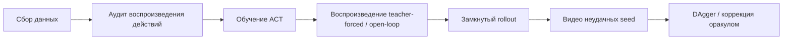

# Диагностика политики и оценка физического успеха

Этот раздел рассчитан на тех, кто уже запустил базовое обучение ACT, SmolVLA или pi_0. После него вы сможете оценивать успех не только по loss или встроенному в среду признаку `success`, но и по видео, состоянию объекта и диагностике по этапам, чтобы понять, действительно ли политика выполняет задачу захвата.

Раздел рекомендуется проходить после `3.train.ipynb`, `4.deploy.ipynb`, `7.pi0.ipynb` и `8.smolvla.ipynb` как продвинутый эксперимент. Он не заменяет эти ноутбуки, а дополняет их методами оценки того, действительно ли воспроизведённая политика справляется с задачей.

## Зачем нужна дополнительная диагностика

В MuJoCo-задаче «поставить кружку на тарелку» геометрические условия успеха среды иногда засчитывают граничные случаи как успешные. Например, кружку не захватили захватом, а подтолкнули к тарелке концом манипулятора; или кружка уже упала, но оказалась недалеко от тарелки. Такие результаты вводят в заблуждение: в журнале написано «успех», а на видео видно, что политика не годится для реального захвата.

Поэтому в этом разделе успех разделяется на два уровня:

| Метрика | Значение | На какой вопрос отвечает |
| --- | --- | --- |
| `legacy_success` | Исходная функция среды `check_success()` | Выполнены ли исходные геометрические условия завершения |
| `physical_success` | Целевая кружка поднята, поставлена на тарелку и в конечном состоянии стоит примерно вертикально | Действительно ли политика выполнила захват, перенос и постановку |

При сообщении результатов модели рекомендуем в первую очередь использовать `physical_success`, а `legacy_success` сохранять как контрольный показатель. Если они расходятся, сначала откройте видео и проверьте.

## Критерии физического успеха

Сейчас рекомендуется такой порядок определения:

1. Исходное условие успеха среды выполнено;
2. Целевая кружка поднята относительно начальной высоты минимум на `0.03 м`;
3. Состояние подъёма держится не менее нескольких управляющих тактов, чтобы не принять случайное столкновение за успех;
4. В конечном состоянии локальная ось z кружки примерно направлена вверх, чтобы опрокинутая кружка не засчитывалась как успех.

Эти критерии нужны не для того, чтобы снизить процент успеха, а для того, чтобы он лучше соответствовал тому, что вы видите на видео. При отладке политики каждый rollout удобно относить к одной из четырёх категорий:

| Тип ошибки | Типичная картина | Что проверять в первую очередь |
| --- | --- | --- |
| Нет контакта | Захват стоит рядом с кружкой или около тарелки | Условия изображения, начальная поза, языковая инструкция, смещение в замкнутом цикле |
| Недостаточный подъём | Касание кружки, но не удалось устойчиво её захватить | Действия захвата, траектория подхода, нормализация действий |
| Неточная постановка | Кружку подняли, но поставили далеко от тарелки | Длина chunk, демонстрации этапа у конца траектории, коррекция DAgger |
| Опрокинутая кружка | Кружка доходит до тарелки, но стоит не вертикально | Момент отпускания, высота постановки, устойчивость в конечном состоянии |

## Основная линия диагностики ACT

Отладка ACT направлена не на простое увеличение числа шагов обучения, а на различение трёх проблем:

1. Можно ли воспроизвести успешно сами данные;
2. Выучила ли модель действия в режиме teacher-forced / open-loop;
3. Не уходит ли модель при замкнутом развёртывании в сторону из-за ранних отклонений.

Рекомендуемый порядок диагностики:



Если воспроизведение действий из данных не удаётся, сначала исправьте данные. Если open-loop работает, а замкнутый цикл нет, в первую очередь рассмотрите DAgger, данные, выровненные по сбросу, или коррекцию состояний после ошибок. Если падает только отпускание захвата, отдельно проверьте метки захвата, финальное движение освобождения и голову захвата (gripper head).

## DAgger и коррекция оракулом

В этой задаче главная ценность DAgger — восполнить состояния, в которые попадает политика после ухода в сторону. Понятный учебный порядок такой:

1. Обучить политику со старта после сброса (reset-start);
2. Запустить её на первые несколько десятков управляющих шагов, например на первые 40;
3. В состояниях, где политика склонна ошибаться, переключиться на скриптовый оракул;
4. Сохранить суффикс оракула как корректирующие данные;
5. При объединении данных явно записывать смещение по времени или флаг источника, чтобы данные из разных фаз не загрязняли друг друга;
6. Корректирующие данные брать с пониженным весом, чтобы небольшой объём исправлений не разрушил исходное поведение reset-start.

Здесь особенно рекомендуется фиксировать источник каждого объединения данных, диапазон эпизодов и веса выборки. Данные DAgger не должны накапливаться бесконтрольно: если напрямую подмешать к основному обучению данные полного сброса после провалов, поведение, которое раньше работало, может деградировать.

## Основная линия диагностики SmolVLA

Сильная сторона SmolVLA — более развитая связь с языком и визуальной основой, но нужно учитывать смещение по цвету или распределению задач. В задаче с красной и синей кружками при оценке лучше фиксировать языковую инструкцию для каждого цвета:

```bash
python audit_language_policy_physical.py \
  --policy-type smolvla \
  --policy-path ./ckpt/your_smolvla_checkpoint/checkpoints/000500/pretrained_model \
  --instruction "Place the red mug on the plate." \
  --seeds 0 1 2 3 4 5 6 7 8 9 \
  --max-action-steps 600 \
  --output-jsonl outputs/eval_red.jsonl \
  --summary-json outputs/summary_red.json
```

Одни и те же seed нужно прогнать отдельно для красной и синей кружки. Только так можно понять, действительно ли модель научилась задаче, или она просто склоняется к одному цвету или к одному типу начальной позы.

В нашем эксперименте по переносу простое копирование эпизодов с синей кружкой заметно повысило успешность для синей кружки, но могло ухудшить результаты для красной. Более устойчивый способ — `WeightedRandomSampler`, который взвешивает кадры целевой задачи, не копируя parquet-эпизоды. Этот вывод удобно обсудить на занятии: аугментация данных — это не только «добавить ещё примеров», но и проверка того, не нарушено ли исходное распределение.

## Проверка pi_0 перед переносом (smoke test)

pi_0 использует PaliGemma; при первом запуске может понадобиться доступ к закрытой модели Hugging Face и загрузка больших весов. Рекомендуется сначала выполнить smoke test, а не сразу запускать длительное обучение:

```bash
RUN_SMOKE=1 RUN_FULL_TRAIN=0 ./run_pi0_train_eval_after_hf_ready.sh
```

Этот smoke test подтверждает лишь несколько вещей:

1. Токен Hugging Face имеет доступ к `google/paligemma-3b-pt-224` и `lerobot/pi0`;
2. `demo_data_language` корректно загружается LeRobot;
3. Политика pi_0 создаётся и выполняет 1 шаг обучения;
4. Цепочка сохранения контрольных точек работает.

Он не доказывает, что pi_0 сошлась, и не говорит о финальном проценте успеха. После полноценного обучения оценку по-прежнему нужно проводить по тем же `physical_success` для красной и синей кружек.

## Рекомендуемые для публикации скрипты

Чтобы раздел стал воспроизводимым экспериментом, а не только текстом для чтения, в каталоге руководства стоит оставить публичные версии следующих скриптов. Перед публикацией локальные абсолютные пути, частные IP-адреса, токены, учётные записи удалённых машин и пути к большим файлам нужно заменить переменными или заполнителями.

| Скрипт | Назначение | Замечания при публикации |
| --- | --- | --- |
| `audit_language_policy_physical.py` | Строгая оценка физического успеха для SmolVLA / pi_0 | Не фиксировать удалённые пути; выводить JSONL и сводку |
| `record_language_policy_video.py` | Запись видео успешного или неудачного seed | Видео по умолчанию не коммитить в репозиторий |
| `train_model_weighted_episode_sampler.py` | Обучение с весовой выборкой по задачам для языковых задач | Сохранить прежнее поведение `train_model.py`, вес задавать переменной окружения |
| `run_pi0_train_eval_after_hf_ready.sh` | Проверка доступа pi_0, smoke-тест на 1 шаг, полное обучение и точка входа для оценки | Токен читать только из переменных окружения или ввода вручную |
| `compare_eval_summaries.py` | Сводная таблица успешности красной и синей кружек по нескольким контрольным точкам | Выводить небольшие TSV/Markdown-таблицы, не сохранять большие журналы |

## Рекомендации по структуре руководства

Этот материал лучше организовать в два уровня:

1. **Основной технический текст главы 06**: разместить в текущем каталоге MuJoCo для ACT / pi_0 / SmolVLA как продвинутую часть исходного руководства; объяснить методы диагностики, скрипты и условия эксперимента.
2. **Вход для учебной групповой работы**: оформить в `16-study-programs` (учебные групповые занятия) как 4–5 заданий, чтобы участники по неделям проходили окружение, данные, диагностику ACT, сравнение с SmolVLA и smoke-тест pi_0.

Так основной путь «сбор — обучение — развёртывание» не нарушается, а групповые занятия получают полный ритм работы.
