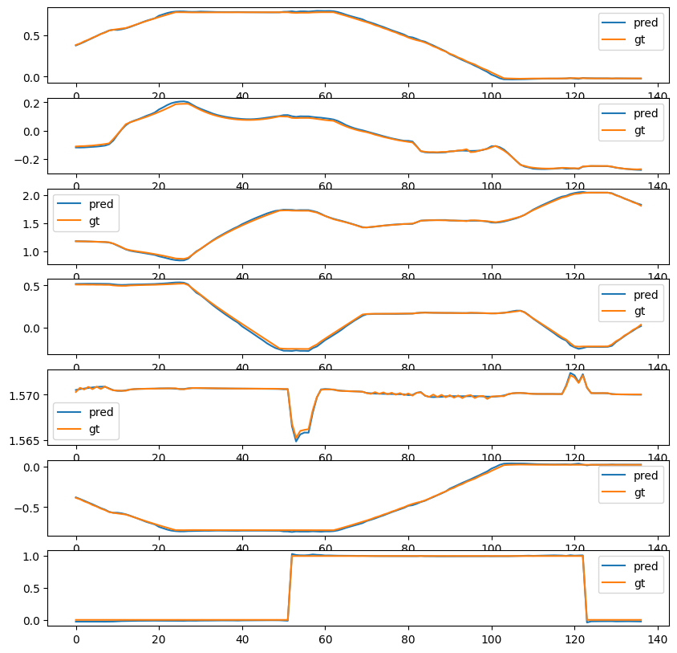
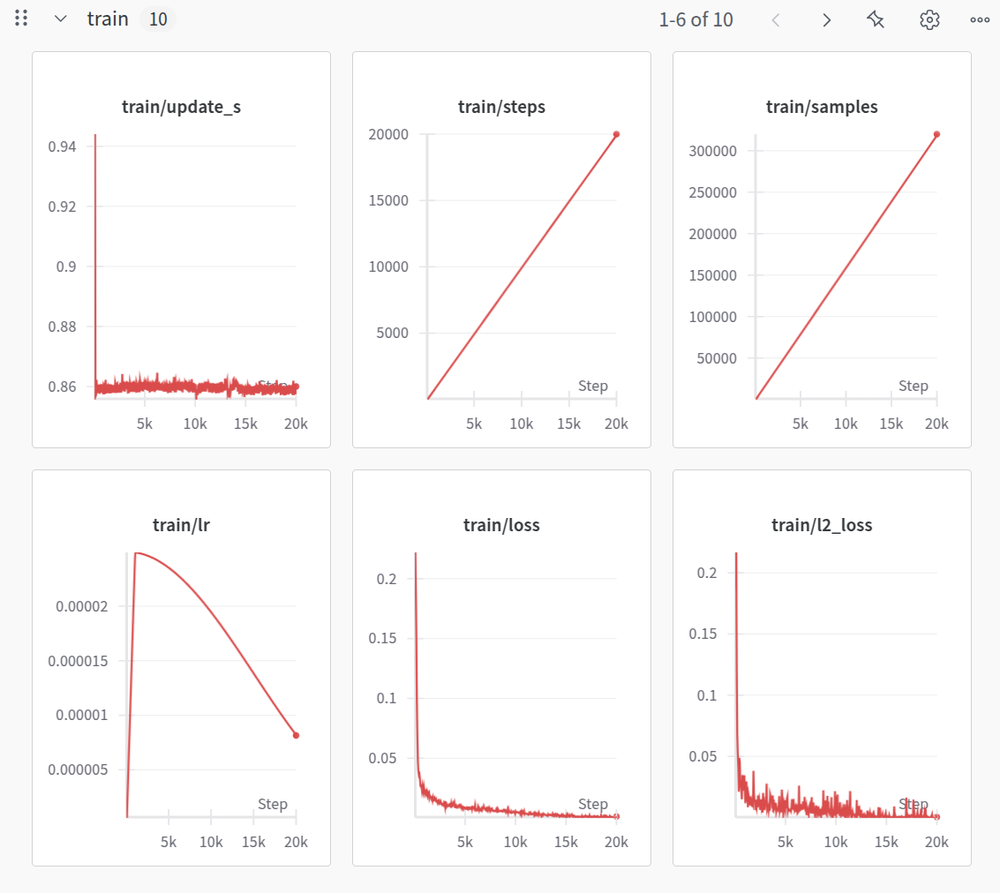
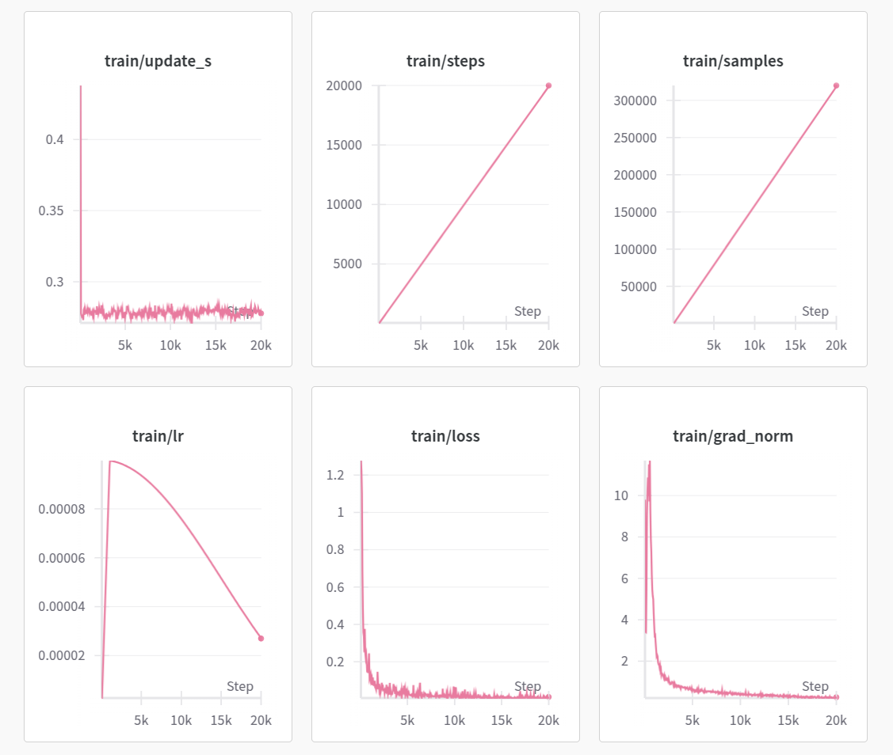

# Учебное руководство: обучение ACT, Pi0 и SmolVLA в MuJoCo

Этот репозиторий содержит минимальный работающий пример: сбор демонстрационных данных и обучение (или дообучение) модели «визуально-языково-действие» (VLA) на собственном наборе данных.

## Содержание

- [Установка](#установка)
- [План обновлений](#план-обновлений)
- [1. Сбор демонстраций](#1-сбор-демонстраций)
- [2. Воспроизведение данных](#2-воспроизведение-данных)
- [3. Обучение Action-Chunking-Transformer (ACT)](#3-обучение-action-chunking-transformeract)
- [4. Развёртывание политики ACT](#4-развёртывание-политики-act)
- [5-6. Сбор и визуализация в среде с языковыми условиями](#5-6-сбор-и-визуализация-в-среде-с-языковыми-условиями)
- [Модели и наборы данных](#модели-и-наборы-данных)
- [7. Обучение и развёртывание pi_0](#7-обучение-и-развёртывание-pi_0)
- [8. Обучение и развёртывание SmolVLA](#8-обучение-и-развёртывание-smolvla)
- [10. Дообучение OMY с помощью π0.5](#10-дообучение-omy-с-помощью-π05)
- [Благодарности](#благодарности)

## Установка

Мы проверяли работу на **Python 3.10**.

Не рекомендуется напрямую использовать `pip install lerobot`: это может привести к ошибкам.

Установка зависимостей MuJoCo и lerobot:

```bash
conda create -n py310 python=3.10
pip install -r requirements.txt
conda install jupyterlab
pip install ipywidgets ipykernel
python -m ipykernel install --user --name py310 --display-name "py310"
jupyter lab .
# Запускаем в текущем каталоге


# Если с CUDA для torch возникли проблемы:
pip uninstall -y torch torchvision torchaudio
pip install --no-cache-dir --force-reinstall --index-url https://download.pytorch.org/whl/cu124 torch==2.6.0 torchvision==0.21.0 torchaudio==2.6.0
python -c "import torch; print(torch.__version__, torch.version.cuda, torch.cuda.is_available())"


```

Убедитесь, что версия MuJoCo — **3.1.6**.

Распакуйте файлы ресурсов:

```bash
cd asset/objaverse
unzip plate_11.zip
```

## План обновлений

- [x] Обновлён просмотрщик (Viewer)
- [x] Добавлено несколько видов кружек и тарелок с разными языковыми инструкциями
- [x] Добавлено обучение и инференс pi_0
- [x] Добавлен SmolVLA

## 1. Сбор демонстраций

Запустите [1.collect_data.ipynb](1.collect_data.ipynb).

По умолчанию используется **симуляционная модель шестиосевого манипулятора ROBOTIS OMY с захватом** в MuJoCo; сцена задаётся файлом `asset/example_scene_y.xml`, реальный манипулятор не нужен. После запуска блока сбора дайте окну MuJoCo фокус клавиатуры, прежде чем управлять. Формат `LeRobotDataset` в версии, зафиксированной в этой главе, — LeRobot v2.1.

Соберите демонстрации в заданной среде. Задача — взять кружку и поставить её на тарелку. Среда засчитывает успех, когда кружка стоит на тарелке, захват открыт, а концевой эффектор находится над кружкой.


Назначение клавиш:
- `WASD`: перемещение в плоскости x-y
- `R/F`: перемещение по оси z
- `Q/E`: наклон
- `Стрелки`: остальные повороты
- `Пробел`: переключить состояние захвата
- `Z`: сбросить среду и отбросить буфер текущего эпизода

Пояснения к наложенным изображениям:
- справа вверху: вид агента
- справа внизу: вид с запястья (от первого лица)
- слева вверху: боковой вид
- слева внизу: вид сверху

Структура набора данных:

```python
fps = 20,
features={
    "observation.image": {
        "dtype": "image",
        "shape": (256, 256, 3),
        "names": ["height", "width", "channels"],
    },
    "observation.wrist_image": {
        "dtype": "image",
        "shape": (256, 256, 3),
        "names": ["height", "width", "channel"],
    },
    "observation.state": {
        "dtype": "float32",
        "shape": (6,),
        "names": ["state"], # x, y, z, roll, pitch, yaw
    },
    "action": {
        "dtype": "float32",
        "shape": (7,),
        "names": ["action"], # 6 углов суставов + 1 захват
    },
    "obj_init": {
        "dtype": "float32",
        "shape": (6,),
        "names": ["obj_init"], # только начальная позиция объекта, при обучении не используется
    },
},
```

Данные по умолчанию сохраняются в каталог `./demo_data`. Исторический пример из репозитория `demo_data_example/` можно использовать, чтобы посмотреть структуру каталога и воспроизвести данные; для обучения лучше использовать данные, собранные заново после исправления.

После начала работы код накапливает изображения, состояние и действия с частотой 20 Гц; когда выполнено условие успеха, сохраняется один эпизод. Клавиша `Z` отбрасывает текущий несохранённый эпизод; после сохранения или сброса нужно снова начать действовать, чтобы записался новый эпизод. По умолчанию `NUM_DEMO=1`, то есть собирается одна демонстрация; для обучения её нужно увеличить и охватить разные положения объекта.

**Различие между действием и наблюдением**: в четырёх клавиатурных сценариях сбора `observation.state` — это положение конца манипулятора до отправки команды на текущем кадре, а `action` — абсолютные целевые углы суставов, найденные обратной кинематикой, плюс нормализованная команда захвата (0 — открыт, 1 — закрыт). Для OMY, Nova5 и xArm6 вектор действия 7-мерный, для xArm7 — 8-мерный. После того как `PnPEnv.step(action)` подготовит управляющую команду, метку действия читают через `PnPEnv.get_commanded_joint_action()`; возвращаемое значение `step()` по-прежнему является наблюдением и не может использоваться как целевое действие. Если у захвата есть сглаживание или ограничения при контакте, метка записывает команду, которая реально отправлена после этих ограничений.

**Обработка старых данных (2026-10-02)**: в старых версиях `1.collect_data.ipynb`, `1.collect_data_nova5.ipynb`, `1.collect_data_xarm6.ipynb` и `1.collect_data_xarm7.ipynb` в метки действий по ошибке записывалось текущее состояние суставов. Рекомендуется заново собрать данные с исправленным кодом и обучать на них; одного обновления кода недостаточно, чтобы исправить метки в уже собранных данных. Сохраните резервную копию старых данных, используйте новый каталог `ROOT` и одновременно поменяйте путь к данным для обучения, чтобы старые данные не попали в обучение. После обновления кода перезапустите ядро ноутбука и выполните его заново с начала.

Точки входа для сбора с языковыми условиями (раздел 5) используют тот же интерфейс целевых действий, но `observation.state` там остаётся текущими шестью углами суставов манипулятора, а не положением конца; при обучении и развёртывании используйте определение состояния, соответствующее каждому варианту.

После установки зависимостей главы можно из каталога главы запустить `python -m unittest -v test_collection_actions`, чтобы проверить метки действий, команды захвата, границы эпизодов и пять точек входа сбора. Эта проверка не требует открытия графического окна и обучения на GPU.

## 2. Воспроизведение данных

Выберите точку входа, соответствующую роботу, на котором собраны данные: путь к данным и модель робота должны совпадать:

- [Воспроизведение OMY](2.visualize_data-omy.ipynb)
- [Воспроизведение Nova5](2.visualize_data-nova5.ipynb)
- [Воспроизведение xArm7](2.visualize_data-xarm7.ipynb)


Ваши действия визуализируются в восстановленной симуляционной сцене. Основное окно проигрывает действия; наложенные справа вверху и справа внизу изображения берутся из набора данных.

## 3. Обучение Action-Chunking-Transformer (ACT)

Запустите [3.train.ipynb](3.train.ipynb).

**Занимает примерно 30–60 минут.**

Обучение ACT на собственном наборе данных. В примере `chunk_size=10`.

Обученная контрольная точка сохраняется в `./ckpt/act_y`.

Ошибку политики можно оценить, сравнив её с истинными действиями из набора данных.



<details>
    <summary>PicklingError: Can't pickle &lt;function &lt;lambda&gt;...&gt;</summary>
Если возникает ошибка pickling, задайте `num_workers` равным `0`, например:

```python
dataloader = torch.utils.data.DataLoader(
    dataset,
    num_workers=0, # 4
    batch_size=64,
    shuffle=True,
    pin_memory=device.type != "cpu",
    drop_last=True,
)
```
</details>

## 4. Развёртывание политики ACT

Запустите [4.deploy.ipynb](4.deploy.ipynb).

Если нет GPU, пригодной для обучения, контрольную точку можно скачать с Google Drive:
- https://drive.google.com/drive/folders/1UqxqUgGPKU04DkpQqSWNgfYMhlvaiZsp?usp=sharing


## 5-6. Сбор и визуализация в среде с языковыми условиями

- [5.language_env.ipynb](5.language_env.ipynb): сбор данных с клавиатурным телеуправлением (клавиши те же, что и в первой среде)
- В разделе 1 собирается одна демонстрация, в разделе 5 — 20 демонстраций для двух задач: с красной кружкой и с синей кружкой.
- [6.visualize_data.ipynb](6.visualize_data.ipynb): визуализация собранных данных

**Пример данных**


## Модели и наборы данных

### Получение набора данных с языковыми условиями

Pi0 и SmolVLA используют одни и те же данные с языковыми условиями; достаточно выбрать один из двух способов. Все команды выполняются в каталоге главы, данные хранятся в `./demo_data_language`.

**Способ первый: загрузить публичный образец**

[Публичный образец Datawhale](https://huggingface.co/datasets/Datawhale/datawhale_eai_pnp_language) — это набор данных LeRobot v2.1 для сцены OMY; в нём 20 эпизодов, 2621 кадр и две задачи: с красной и с синей кружкой.

Сначала установите Git LFS, затем выполните:

```bash
git lfs install
git clone https://huggingface.co/datasets/Datawhale/datawhale_eai_pnp_language demo_data_language
git -C demo_data_language lfs pull
```

Если каталог с таким именем уже существует, не выполняйте повторный clone и не удаляйте исходные данные. Если каталог — это Git-репозиторий данного набора, для загрузки файлов LFS достаточно последней команды. Наличие только указателей LFS не означает, что данные полностью скачаны.

**Способ второй: собрать самостоятельно**

Запустите [5.language_env.ipynb](5.language_env.ipynb), оставьте `REPO_NAME = 'datawhale_eai_pnp_language'` и `ROOT = "./demo_data_language"`, соберите и сохраните демонстрации с красной и синей кружками, а затем проверьте траектории в [6.visualize_data.ipynb](6.visualize_data.ipynb). В этом ноутбуке при уже существующем каталоге есть шаг подтверждения удаления старых данных; если данные уже скачаны или собраны, сначала сделайте резервную копию или укажите другой каталог.

В обоих случаях можно использовать файлы главы `pi0_datawhale_eai.yaml` и `smolvla_datawhale_eai.yaml` без изменения конфигурации:

```yaml
dataset:
  repo_id: datawhale_eai_pnp_language
  root: ./demo_data_language
```

`root` — локальный путь к данным относительно каталога запуска; если полный набор уже находится в этом каталоге, зафиксированная версия LeRobot использует локальные файлы. `repo_id` — идентификатор набора данных; значение без имени организации соответствует названию, которое задано в ноутбуке сбора, и не является полным адресом Hugging Face, по которому можно искать. Для автоматической загрузки из Hub нужно использовать полный идентификатор `Datawhale/datawhale_eai_pnp_language`. Если меняется локальный каталог, надо синхронно поменять путь в YAML и в ноутбуке развёртывания.

### Модели для справки

| Модель 🤗 | Набор данных 🤗 |
| ------------------------------------------------------------ | ------------------------------------------------------------ |
| [pi_0 дообученная](https://huggingface.co/Jeongeun/omy_pnp_pi0) | [набор данных](https://huggingface.co/datasets/Jeongeun/omy_pnp_language) |
| [smolvla дообученная](https://huggingface.co/Jeongeun/omy_pnp_smolvla) | то же |

## 7. Обучение и развёртывание pi_0

Все команды ниже выполняются в каталоге главы и используют версию LeRobot `10b7b3532543b4adfb65760f02a49b4c537afde7`, зафиксированную в `requirements.txt`.
Сначала выполните `python check_training_configs.py`, чтобы проверить две конфигурации (без обучения и без загрузки весов).
В команде YAML между `--config_path` и именем файла нужен пробел; в этой версии запись со знаком равенства идёт по ветке загрузки контрольной точки в JSON.

- [train_model.py](train_model.py): скрипт обучения
- [pi0_datawhale_eai.yaml](pi0_datawhale_eai.yaml): конфигурация обучения
- [7.pi0.ipynb](7.pi0.ipynb): пример развёртывания

Команда обучения:

```bash
python train_model.py --config_path pi0_datawhale_eai.yaml
```

Результат развёртывания:


Журнал обучения:



Конфигурация соответствует YAML по ссылке в этом разделе. По умолчанию читается `./demo_data_language` из раздела 5, `dataset.repo_id` равен `datawhale_eai_pnp_language`; при использовании других данных нужно поменять оба значения. По умолчанию W&B выключен; чтобы включить, укажите свой проект и учётную запись. Для обучения нужны полный набор данных, веса модели и окружение CUDA; успешный разбор конфигурации не означает, что полное обучение проверено.

## 8. Обучение и развёртывание SmolVLA

- [train_model.py](train_model.py): скрипт обучения
- [smolvla_datawhale_eai.yaml](smolvla_datawhale_eai.yaml): конфигурация обучения
- [8.smolvla.ipynb](8.smolvla.ipynb): пример развёртывания

Команда обучения:

```bash
python train_model.py --config_path smolvla_datawhale_eai.yaml
```

Результат развёртывания:


Журнал обучения:



Конфигурация соответствует YAML по ссылке в этом разделе. По умолчанию читается `./demo_data_language` из раздела 5, `dataset.repo_id` равен `datawhale_eai_pnp_language`; при использовании других данных нужно поменять оба значения. По умолчанию W&B выключен; чтобы включить, укажите свой проект и учётную запись. Для обучения нужны полный набор данных, веса модели и окружение CUDA; успешный разбор конфигурации не означает, что полное обучение проверено.

## 10. Дообучение OMY с помощью π0.5

Запустите [10.pi05_omy.ipynb](10.pi05_omy.ipynb). Процесс продолжает работу с данными OMY по одной кружке из раздела 1: проверка демонстраций и меток действий, конвертация LeRobot v2.1 в отдельный набор v3, расчёт квантилей по обучающим эпизодам, проверка обучения из пяти шагов, полноценное дообучение, сравнение действий на отложенных данных и оценка в симуляции MuJoCo.

Используйте отдельное окружение **Python 3.12 / LeRobot 0.6.1** и файл [requirements_pi05.txt](requirements_pi05.txt); не обновляйте старое окружение разделов 1–9. Конкретные команды установки, параметры редактируемой установки и запуск описаны в ноутбуке; вспомогательный интерфейс находится в [pi05_omy_utils.py](pi05_omy_utils.py). По умолчанию дообучение идёт от `lerobot/pi05_base`, но можно указать совместимый локальный каталог предобученной модели через `OMY_PI05_PRETRAINED`. Размер батча равен 1, обучается только экспертный блок действий, сначала выполняется проверка на пяти шагах; полные результаты обучения и оценки получаются при фактическом запуске.

[pi05_omy_train.py](pi05_omy_train.py) вызывает официальный вход обучения и требует, чтобы все предобученные параметры загрузились успешно: если веса не прочитались, обучение останавливается. Загрузка для инференса выполняет ту же проверку, чтобы откат к случайной инициализации в фиксированной версии загрузчика не был ошибочно принят за успешное дообучение. Настройки короткой проверки на удалённой машине, её источники и результаты — в [pi05_omy_short_check.md](pi05_omy_short_check.md).

Вход модели — два изображения, шестимерная **поза конца манипулятора** и языковая инструкция; выход — шесть **абсолютных целевых углов суставов** и нормализованная команда захвата. Частота сбора поддерживается 20 Гц, относительное преобразование действий отключено. Состояние из раздела 5 — это углы суставов, а интерфейс сцены там другой, поэтому поток раздела 10 напрямую с ним не работает. Ошибочные метки действий из старых данных нельзя восстановить переформатированием: используйте заново собранные данные после исправления раздела 1 и проверьте их воспроизведением.

Конвертация сохраняет исходные данные, целевой каталог должен быть пустым. Если эпизодов больше двух, около 20% эпизодов целиком откладываются для оценки; нормализационная статистика считается только по обучающим эпизодам. Один-два примера подходят для проверки интерфейса, но не для оценки обобщающей способности. Обучению нужна подходящая рабочая станция с CUDA; прохождение короткого обучения и снижение функции потерь не означают, что захват и укладка уже успешно воспроизведены.

После установки отдельного окружения выполните в каталоге главы `python -m unittest -v test_pi05_omy`: тест проверяет новый интерфейс данных, точность изображений и действий, границы эпизодов и тайминг управления. Тест не загружает веса моделей и не запускает полное обучение.

В дальнейшем мы также добавим примеры обучения ACT и диффузионной модели для захвата на нескольких демонстрациях. Следите за обновлениями.

## Благодарности

- Ресурсы манипулятора Robotis-OMY взяты из [robotis_mujoco_menagerie](https://github.com/ROBOTIS-GIT/robotis_mujoco_menagerie/tree/main)
- [MuJoco Parser Class](./mujoco_env/mujoco_parser.py) основан на [yet-another-mujoco-tutorial-v3](https://github.com/sjchoi86/yet-another-mujoco-tutorial-v3)
- Руководство опирается на [примеры lerobot](https://github.com/huggingface/lerobot/tree/main/examples)
- Ресурсы plate и mug взяты с [Objaverse](https://objaverse.allenai.org/)
