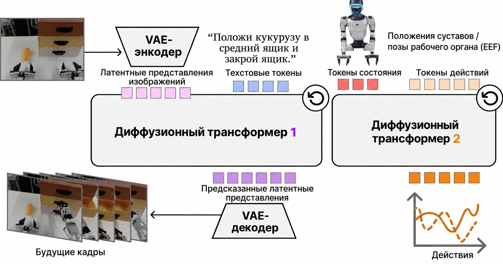
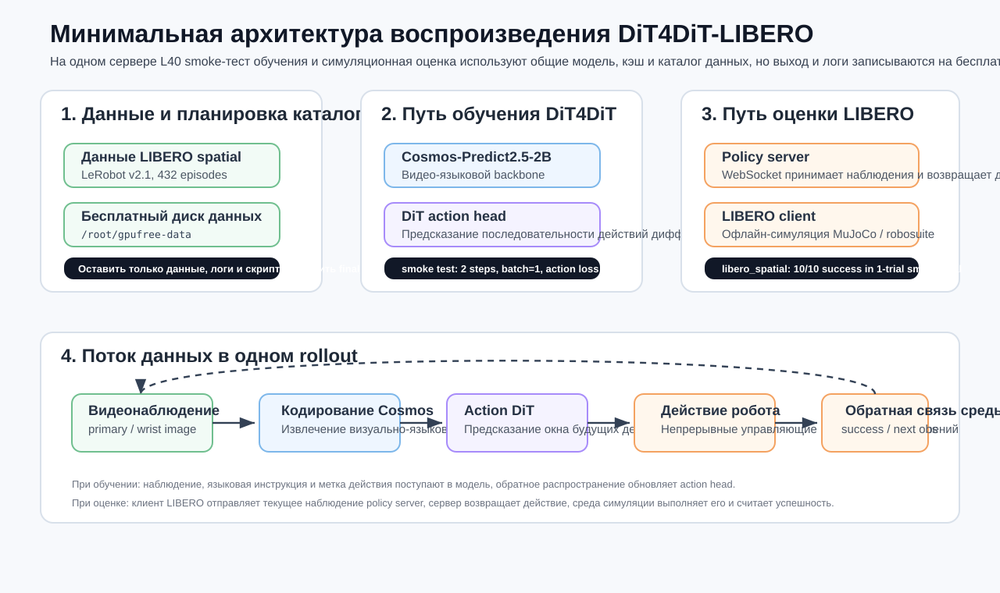
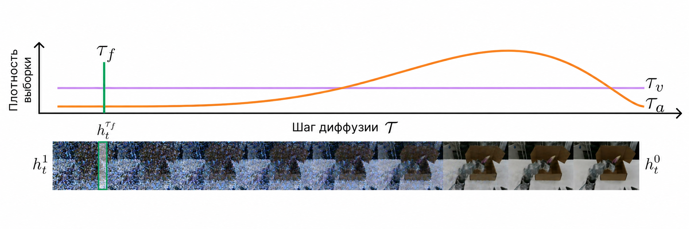

# Воспроизведение DiT4DiT-LIBERO: обучение и оценка

В этой главе мы проходим минимальный воспроизводимый путь DiT4DiT на бенчмарке LIBERO: сначала запускаем оценку предобученной модели, затем проводим тест на 2 шагах обучения на данных `libero_spatial`. Цель не в том, чтобы воспроизвести полное обучение из статьи. Задача — понять инженерную цепочку DiT4DiT: как данные попадают в модель, как сервер модели связан с симуляцией LIBERO и как скрипт обучения проверяет, что обратное распространение работает.

Практическое окружение этой главы — один сервер с видеокартой NVIDIA L40. Мы выполнили две проверки:

- Тест оценки `libero_spatial`: 10 задач, по одному прогону на задачу, успешность `10/10`.
- Тест обучения `libero_spatial`: 2 шага оптимизации, размер батча 1; проверены загрузка модели, чтение данных, обратное распространение, инициализация DeepSpeed и запись в W&B в офлайн-режиме.

> Примечание: публичное симуляционное воспроизведение DiT4DiT в основном опирается на MuJoCo-среды LIBERO и RoboCasa. Воспроизведение LIBERO из этой главы не требует Isaac Sim.

Рекомендуем воспринимать эту главу как вводное лабораторное занятие, а не как попытку сразу повторить обучение из статьи. Полное обучение требует большего объёма данных, нескольких GPU, долгой стабильной работы и аккуратного управления контрольными точками. Здесь мы проверяем по отдельности самые уязвимые звенья цепочки. Когда все контрольные точки пройдены, расширять набор данных, число шагов обучения и параллелизм на нескольких GPU будет гораздо проще.

## Дорожная карта воспроизведения

Следуйте этому маршруту. Каждый шаг связан с понятным признаком успеха, чтобы не возникало ситуации «команда работает уже очень долго, но неизвестно, где именно она застряла».

| Этап | Среда выполнения | Главная цель | Признак успеха | Что проверять в первую очередь при сбое |
| :-- | :-- | :-- | :-- | :-- |
| 1. Подготовка сервера | Командная строка Linux | Проверить GPU, диск, прокси и токен | `nvidia-smi` работает, `HF_TOKEN=set` | Драйвер CUDA, монтирование дисков, доступ к HF |
| 2. Загрузка модели | Окружение DiT4DiT | Скачать контрольную точку DiT4DiT и бэкбон Cosmos | Каталог модели существует, нет файлов `.incomplete` | Права доступа gated-моделей на HF, узел прокси |
| 3. Оценка LIBERO | Два окружения вместе | Сервер политики соединён с клиентом LIBERO | Выведен `Total success rate` | Порт сервера, websockets, рендеринг EGL |
| 4. Подготовка данных | Окружение DiT4DiT | Скачать `libero_spatial` и дополнить метаданные | Длина даталоадера `52970` | `modality.json`, `pyarrow`, декодирование видео |
| 5. Тест обучения | Окружение DiT4DiT | Проверить цепочку обучения из 2 шагов | Появляются `Step 1`, `Step 2`, `Training complete` | Видеопамять, DeepSpeed, отсутствующие пакеты, сохранение контрольной точки |

Эту таблицу удобно использовать как указатель для диагностики. Если сервер модели не запущен, не нужно искать причину низкой успешности в LIBERO. Если даталоадер не создан, не стоит проверять, нормален ли loss. Определив конкретный этап, где возникла проблема, вы значительно быстрее воспроизведёте результат.

## Часть первая. Что делает DiT4DiT

DiT4DiT можно понимать как фреймворк «большая модель + диффузионная голова действий» для задач манипуляции роботом. Он использует видео- и визуально-языковой бэкбон, например Cosmos-Predict2.5-2B, чтобы получить условия из изображения и языка, а затем с помощью головы действий в стиле DiT предсказывает последовательность будущих действий.

Название легко запутать, поэтому разберём его по частям:

- Первое `DiT` ближе к диффузионному трансформеру (diffusion transformer): идея диффузии применяется для генерации непрерывных действий.
- Второе `DiT` относится к общей архитектуре проекта: видео-языковой бэкбон и диффузионная голова действий соединены в единую стратегию обучения.
- В задаче LIBERO модель выдаёт не текст, а непрерывные управляющие величины для следующего отрезка движения манипулятора.

Поэтому важно удержать основную мысль при воспроизведении: это не просто запуск языковой модели и не только запуск среды MuJoCo. Нужно согласовать три части: визуально-языковую модель, голову генерации действий и симулятор.

В задаче LIBERO модель на каждом шаге получает:

- текущие изображения камеры, например основной вид и вид с запястья;
- языковую инструкцию задачи, например «pick up the black bowl ...»;
- текущее состояние робота;
- во время обучения также метки действий для вычисления ошибки действий (action loss).

При оценке симулятор LIBERO отправляет наблюдения серверу политики, сервер возвращает действие, симулятор выполняет его и фиксирует, выполнена ли задача.

<p align="center">
  
</p>

**Рисунок 1. Общий обзор метода DiT4DiT от авторов.** Рисунок показывает основную идею статьи: сначала видео-модель с предсказанием будущих кадров помогает понять визуальные и языковые условия, а затем генерация действий организована как диффузионный процесс на трансформере. Обратите внимание на два момента: политика получает не один кадр, а историю наблюдений, язык и временные условия; между видеомоделью мира и диффузионной головой действий есть явная передача условий.

<p align="center"><sub>Источник: страница проекта DiT4DiT и иллюстрация метода из статьи.</sub></p>

Официальный рисунок лучше объясняет идею статьи, а схема ниже показывает реальную инженерную цепочку, которую мы запускали: что лежит на диске сервера, какие скрипты работают в окружении DiT4DiT, какие — в окружении LIBERO, и как два процесса обмениваются данными при оценке.

<p align="center">
  
</p>

**Рисунок 2. Минимальная архитектура воспроизведения DiT4DiT-LIBERO.** Слева — данные обучения и план каталогов, в центре — бэкбон Cosmos и голова действий DiT, справа — сервер политики и клиент симуляции LIBERO при оценке. Пунктирные стрелки обозначают цикл rollout: наблюдение поступает в модель, действие возвращается в среду, а среда формирует следующий кадр.

<p align="center">
  
</p>

**Рисунок 3. Механизм tri-timestep в DiT4DiT.** Официальная схема поясняет, как DiT4DiT работает со временем: у видеомодели есть собственный временной шаг, у диффузионной головы действий — свой шаг шумоподавления, а у траектории робота — реальное время управления. При воспроизведении обучения менять этот механизм не нужно, но следует помнить, что проблемы с loss, числом шагов сэмплирования и горизонтом действий связаны именно с этими временными шкалами.

<p align="center"><sub>Источник: страница проекта DiT4DiT и иллюстрация механизма из статьи.</sub></p>

## Часть вторая. Как устроены обучающие данные

Мы скачали только один набор, `libero_spatial_no_noops_1.0.0_lerobot`. Это данные в формате LeRobot: 432 эпизода, около 53 тысяч кадров, объём примерно 362 МБ. Такой набор хорошо подходит для обучения и проверки.

Три видео ниже взяты из одного каталога обучающих данных и показывают, какие визуальные наблюдения LIBERO видит модель. Первая и вторая колонки — основной вид и вид с запястья одного эпизода; третья колонка — основной вид другого эпизода, чтобы показать различие задач.

<table>
  <tr>
    <td width="33%">
      <video controls muted preload="metadata" poster="assets/libero_spatial_episode_285_primary.png" width="100%">
        <source src="assets/libero_spatial_episode_285_primary.mp4" type="video/mp4">
      </video>
      <br>
      <strong>Видео 1. Наблюдение основного вида</strong><br>
      <sub>Эпизод 285, общий вид стола для наблюдения за объектами и зоной цели.</sub>
    </td>
    <td width="33%">
      <video controls muted preload="metadata" poster="assets/libero_spatial_episode_285_wrist.png" width="100%">
        <source src="assets/libero_spatial_episode_285_wrist.mp4" type="video/mp4">
      </video>
      <br>
      <strong>Видео 2. Наблюдение с запястья</strong><br>
      <sub>Эпизод 285, вид с конца манипулятора, фокус на локальном контакте у захвата.</sub>
    </td>
    <td width="33%">
      <video controls muted preload="metadata" poster="assets/libero_spatial_episode_372_primary.png" width="100%">
        <source src="assets/libero_spatial_episode_372_primary.mp4" type="video/mp4">
      </video>
      <br>
      <strong>Видео 3. Другая траектория задачи</strong><br>
      <sub>Эпизод 372, данные пространственной манипуляции при другом начальном состоянии.</sub>
    </td>
  </tr>
</table>

**Рисунок 4. Многовидовые видеопримеры обучающих данных LIBERO spatial.** Это не финальный рендер оценки, а демонстрационные траектории из обучающего набора. Их задача — помочь понять входы модели: языковая инструкция задаёт задачу, визуальная последовательность описывает состояние сцены, а метки действий дают обучающий сигнал.

## Часть третья. Планирование серверов и каталогов

Ключевой принцип этой главы: большие модели и окружения conda можно хранить на общем платном диске, а данные обучения, журналы и учебные результаты — на бесплатном диске данных. Так проверка проходит, и тест не заполняет бесплатный диск контрольными точками размером в десятки гигабайт.

| Тип | Путь на нашем сервере | Назначение |
| :-- | :-- | :-- |
| Корень проекта | `/path/to/share/dit4dit_eval` | Репозитории DiT4DiT и LIBERO, кэш моделей |
| Окружение DiT4DiT | `/path/to/share/conda-envs/dit4dit` | Сервер политики и скрипты обучения |
| Окружение LIBERO | `/path/to/share/conda-envs/libero` | Оценка в симуляторе MuJoCo / robosuite |
| Бесплатный диск данных | `/path/to/data/dit4dit_train_test` | Набор одного suite, журналы обучения, результаты теста |
| Бэкбон Cosmos | `/path/to/share/dit4dit_eval/models/Cosmos-Predict2.5-2B` | Модель Hugging Face с ограниченным доступом |
| Контрольная точка DiT4DiT | `/path/to/share/dit4dit_eval/models/dit4dit-model/dit4dit_libero/final_model/pytorch_model.pt` | Веса предобученной политики |

Если вы работаете на своём сервере, сохраните этот принцип, но замените пути на свои точки монтирования. Для оценки и теста обучения рекомендуется иметь не менее 48 ГБ видеопамяти. RTX 4090 тоже может пройти часть процесса, но при 24 ГБ вероятна ошибка нехватки памяти.

Отдельно обратите внимание на планирование диска. Веса DiT4DiT, бэкбон Cosmos и окружения conda довольно большие, их лучше размещать на общем или долговременном диске большого объёма. Данные теста обучения, журналы и временные результаты — на дешёвом диске данных. Если поместить всё на системный диск, легко получить `No space left on device`. Такая ошибка часто проявляется во время установки pip, загрузки с HF или сохранения контрольной точки, и её поиск отнимает много времени.

## Часть четвёртая. Прокси и доступ к Hugging Face

Cosmos-Predict2.5-2B — модель с ограниченным доступом: чтобы её скачать, нужно принять лицензию NVIDIA на странице модели в Hugging Face. На сервере достаточно, чтобы текущая оболочка могла читать `HF_TOKEN`, и не стоит записывать токен в учебник, скрипты или Git-репозиторий.

Рекомендуемый способ — хранить на сервере приватный файл окружения:

```bash
mkdir -p ~/.secrets
chmod 700 ~/.secrets
cat > ~/.secrets/codex_tokens.env <<'EOF'
export HF_TOKEN=hf_xxx
export HUGGING_FACE_HUB_TOKEN="$HF_TOKEN"
EOF
chmod 600 ~/.secrets/codex_tokens.env
```

Затем загрузите его в окружение проекта или в текущую оболочку:

```bash
source ~/.secrets/codex_tokens.env
```

Проверяя, видит ли текущая оболочка токен, не выводите его значение. Можно проверить только наличие переменной:

```bash
for k in HF_TOKEN HUGGING_FACE_HUB_TOKEN; do
  v=${!k:-}
  [ -n "$v" ] && echo "$k=set" || echo "$k=missing"
done
```

Если вывод `HF_TOKEN=set`, переменная видна. Если появилось `missing`, сначала проверьте, выполнен ли `source ~/.secrets/codex_tokens.env`, и загружает ли входная оболочка этот файл автоматически.

Если доступ к GitHub или Hugging Face на сервере медленный, можно установить совместимое с Clash ядро, например `mihomo`. В нашем воспроизведении загрузка с Hugging Face зависала на пути загрузки шардов Xet. Помогло закрепление более стабильного узла прокси и переменные окружения ниже:

```bash
export HF_HUB_DISABLE_XET=1
export HF_HUB_ENABLE_HF_TRANSFER=0
export HF_HUB_DOWNLOAD_TIMEOUT=600
```

## Часть пятая. Загрузка модели и данных

Для воспроизведения нужны два ресурса модели:

```bash
source /path/to/share/dit4dit_eval/env.sh

# Контрольная точка DiT4DiT для LIBERO
huggingface-cli download mondo-robotics/dit4dit-model \
  --local-dir /path/to/share/dit4dit_eval/models/dit4dit-model

# Бэкбон Cosmos, нужен доступ к gated-модели на HF
huggingface-cli download nvidia/Cosmos-Predict2.5-2B \
  --local-dir /path/to/share/dit4dit_eval/models/Cosmos-Predict2.5-2B
```

После загрузки сразу сделайте две проверки:

```bash
du -sh /path/to/share/dit4dit_eval/models/dit4dit-model
du -sh /path/to/share/dit4dit_eval/models/Cosmos-Predict2.5-2B
find /path/to/share/dit4dit_eval/models/Cosmos-Predict2.5-2B -name '*.incomplete' | wc -l
```

Первая проверка подтверждает, что модель действительно записана на диск. Вторая проверяет, что в каталоге Cosmos не осталось файлов `.incomplete`. Если их число не равно нулю, загрузка, вероятно, прерывалась. Тогда при загрузке модели часто возникают ошибки отсутствующих шардов или чтения safetensors.

Для теста обучения достаточно загрузить один набор LIBERO:

```bash
mkdir -p /path/to/data/dit4dit_train_test/datasets

huggingface-cli download IPEC-COMMUNITY/libero_spatial_no_noops_1.0.0_lerobot \
  --repo-type dataset \
  --local-dir /path/to/data/dit4dit_train_test/datasets/libero_spatial_no_noops_1.0.0_lerobot
```

Фактический объём загруженного каталога:

```text
362M  /path/to/data/dit4dit_train_test/datasets
```

Загрузка одного набора удобна тем, что он компактный и позволяет быстро проверить даталоадер обучения; при этом это настоящие данные LIBERO, а не искусственно созданные образцы. Поэтому значения loss, декодирование видео и соответствие полей состояния и действий будут такими же, как в дальнейших больших экспериментах.

## Часть шестая. Запуск оценки LIBERO

Оценка DiT4DiT в LIBERO обычно состоит из двух процессов: один запускает сервер политики, другой — клиент симуляции LIBERO. Для удобства обучения мы объединили запуск в один скрипт:

```bash
/path/to/share/dit4dit_eval/scripts/run_libero_one_suite.sh \
  /path/to/share/dit4dit_eval/models/dit4dit-model/dit4dit_libero/final_model/pytorch_model.pt \
  libero_spatial \
  1 \
  0
```

Четыре аргумента означают:

| Параметр | Значение |
| :-- | :-- |
| путь к контрольной точке | Предобученная контрольная точка DiT4DiT-LIBERO |
| набор задач | Здесь выбран `libero_spatial` |
| прогонов на задачу | Сколько раз запускать каждую задачу; для теста `1` |
| id GPU | На одном GPU обычно `0` |

Если шаг выполнен успешно, видны два признака:

- В `server.log` появляются `server running` и `connection open`: сервер политики загрузил контрольную точку, а клиент LIBERO смог подключиться к нему.
- В `eval_libero_spatial.log` регулярно появляются `Success: True` или `Success: False`: симулятор выполняет rollout, а не застревает на загрузке модели или инициализации среды.

Последние строки журнала теста:

```text
Task: pick up the black bowl on the wooden cabinet and place it on the plate
Starting episode 1...
Success: True
# episodes completed so far: 10
# successes: 10 (100.0%)
Current task success rate: 1.0
Current total success rate: 1.0
Total success rate: 1.0
Total episodes: 10
```

**Таблица 1. Результаты теста оценки LIBERO spatial.** Тест нужен только для проверки цепочки, поэтому на каждую задачу выполнен один прогон. Для полноценной оценки можно поставить `trials per task` равным `50`, но время выполнения заметно вырастет.

В конце оценки может появиться предупреждение об очистке EGL:

```text
Exception ignored in: <function MjRenderContext.__del__ ...>
OpenGL.raw.EGL._errors.EGLError: EGL_NOT_INITIALIZED
```

Это предупреждение возникает при уничтожении контекста robosuite / EGL. Если до него уже напечатаны `Total success rate` и `Total episodes`, оценка выполнена полностью.

Если в журнале есть только `server listening`, но нет `connection open`, обычно клиент не запущен, порт указан неверно или в окружении клиента не хватает пакетов. Если клиент запущен, но журнала задач нет, в первую очередь проверьте путь к данным LIBERO и возможность инициализации рендеринга EGL вне экрана.

## Часть седьмая. Тест обучения из 2 шагов

Полное обучение DiT4DiT очень тяжёлое, а официальные скрипты рассчитаны на многопроцессорное обучение на нескольких GPU. В учебных целях разумнее сначала доказать, что цепочка обучения работает: данные читаются, модель загружается, у головы действий есть обучаемые параметры, loss считается и проходит обратное распространение, оптимизатор делает шаг.

Этот тест из 2 шагов доказывает, что программа обучения работает. Он не доказывает, что модель обучена. Не стоит оценивать качество модели по loss из этих 2 шагов и не стоит использовать полученную контрольную точку для официальной оценки. Его ценность в быстрой проверке окружения, формата данных, видеопамяти, DeepSpeed и кода модели на предмет явных сбоев.

Скрипт, использованный в этой главе, находится в архиве:

```text
assets/logs/run_train_smoke_libero_spatial.sh
```

Команда запуска на сервере:

```bash
/path/to/data/dit4dit_train_test/run_train_smoke_libero_spatial.sh 2 1
```

Здесь `2` — число шагов обучения, `1` — размер батча на устройство. Скрипт делает несколько важных вещей:

```bash
export WANDB_MODE=offline
export HF_HOME="$FREE_ROOT/hf_cache"
export CUDA_VISIBLE_DEVICES="${CUDA_VISIBLE_DEVICES:-0}"

accelerate launch \
  --config_file DiT4DiT/config/deepseeds/deepspeed_zero2.yaml \
  --num_processes 1 \
  DiT4DiT/training/train.py \
  --datasets.vla_data.data_mix libero_spatial_only \
  --datasets.vla_data.per_device_batch_size "$BATCH" \
  --trainer.pretrained_checkpoint "$PRETRAINED" \
  --trainer.freeze_modules backbone_interface \
  --trainer.max_train_steps "$STEPS" \
  --trainer.save_interval 999999 \
  --trainer.eval_interval 999999
```

Здесь три ключевых момента:

1. `data_mix=libero_spatial_only`: используется один набор, поэтому не нужно скачивать все четыре набора LIBERO.
2. `freeze_modules=backbone_interface`: бэкбон Cosmos заморожен, поэтому проверяется только путь обучения головы действий.
3. `save_interval=999999`: промежуточные контрольные точки во время обучения не сохраняются, чтобы не записывать большие файлы слишком часто.

Скрипт также устанавливает `WANDB_MODE` в значение `offline`. Тогда W&B записывает кривые и сводку только локально и не требует входа в онлайн-аккаунт. Для учебного воспроизведения это удобнее: сначала добиваемся, чтобы обучение работало, а если понадобится долгий эксперимент, переключаем W&B обратно в онлайн-режим.

В журнале обучения видна статистика параметров модели:

```text
Total parameters:      10,641,307,643 (10641.308M)
Trainable parameters:  163,073,544 (163.074M)
Frozen parameters:     10,478,234,099 (10478.234M)
Trainable ratio:       1.53%
```

Это значит, что тест не пытается дообучить всю модель размером 10 млрд параметров, а обучает только параметры, связанные с моделью действий. Для учебного занятия такой вариант надёжнее и экономит видеопамять.

Ключевой журнал после двух шагов обучения:

```text
Total optimization steps = 2
Per device batch size = 1
len(vla_train_dataloader) = 52970

Step 1, Loss: {
  'action_dit_loss': 0.005973855499178171,
  'future_video_loss': 0.009470176883041859,
  'future_video_loss_scaled': 0.0,
  'total_loss': 0.005973855499178171
}

Step 2, Loss: {
  'action_dit_loss': 2.472470998764038,
  'future_video_loss': 0.004216373898088932,
  'future_video_loss_scaled': 0.0,
  'total_loss': 2.472470998764038
}

Training complete. Final model saved ...
```

**Таблица 2. Контрольные точки теста обучения DiT4DiT.** Результат показывает, что основной цикл обучения выполнил два шага оптимизатора. Поскольку шагов очень мало, значения loss не характеризуют сходимость, а лишь подтверждают, что цепочка работает.

Чтобы убедиться, что обучение действительно прошло полностью, а не только запустилась модель, смотрите на такие признаки:

- В журнале есть `Total optimization steps = 2`: конфигурация переопределена правильно.
- В журнале есть `len(vla_train_dataloader) = 52970`: набор данных правильно проиндексирован.
- Появляются `Step 1` и `Step 2`: даталоадер, прямой проход, обратный проход и шаг оптимизатора выполнились.
- В конце появляется `Training complete`: основной цикл обучения завершился штатно.

## Часть восьмая. Почему после обучения удаляется final_model

`_finalize_training()` в DiT4DiT в конце обучения сохраняет полный файл `final_model/pytorch_model.pt`. Даже после 2 шагов обучения этот файл занимает около 20 ГБ. Чтобы бесплатный диск не заполнился, скрипт теста по умолчанию удаляет этот каталог после подтверждения, что обучение завершилось:

```bash
FINAL="$RUN_ROOT/$RUN_ID/final_model/pytorch_model.pt"
if [ -f "$FINAL" ]; then
  du -sh "$RUN_ROOT/$RUN_ID" || true
  if [ "${KEEP_FINAL_MODEL:-0}" != "1" ]; then
    rm -rf "$RUN_ROOT/$RUN_ID/final_model"
    echo "Removed large final_model to keep free data disk small."
  fi
fi
```

Если вы хотите сохранить контрольную точку, запустите так:

```bash
KEEP_FINAL_MODEL=1 /path/to/data/dit4dit_train_test/run_train_smoke_libero_spatial.sh 2 1
```

Фактическое использование диска после очистки:

```text
362M  /path/to/data/dit4dit_train_test/datasets
96K   /path/to/data/dit4dit_train_test/logs
76K   /path/to/data/dit4dit_train_test/results
```

## Часть девятая. Добавление метаданных DiT4DiT к данным обучения

Набор данных на HF в формате LeRobot v2.1, но в исходном каталоге `meta/` нет файла `meta/modality.json`, который ожидает даталоадер DiT4DiT. Поэтому нужно добавить файл сопоставления полей: он переведёт `observation.state` и `action` LIBERO в имена полей, которые использует код DiT4DiT.

Это типичная проблема: сами данные полные, но разные проекты по-разному называют поля одного и того же набора и по-разному описывают его метаданные. Даталоадер DiT4DiT не только читает parquet, но сначала читает `meta/modality.json`, чтобы понять, какой столбец и какой фрагмент вектора соответствует абстрактным полям `state.x`, `action.gripper` и `video.primary_image`. Поэтому мы добавляем не новые данные, а описание того, как читать уже имеющиеся.

Пример сопоставления:

```json
{
  "state": {
    "x": {"start": 0, "end": 1, "absolute": true, "dtype": "float32", "original_key": "observation.state"},
    "y": {"start": 1, "end": 2, "absolute": true, "dtype": "float32", "original_key": "observation.state"},
    "z": {"start": 2, "end": 3, "absolute": true, "dtype": "float32", "original_key": "observation.state"},
    "gripper": {"start": 7, "end": 8, "absolute": true, "dtype": "float32", "original_key": "observation.state"}
  },
  "action": {
    "x": {"start": 0, "end": 1, "absolute": false, "dtype": "float32", "original_key": "action"},
    "y": {"start": 1, "end": 2, "absolute": false, "dtype": "float32", "original_key": "action"},
    "z": {"start": 2, "end": 3, "absolute": false, "dtype": "float32", "original_key": "action"},
    "gripper": {"start": 6, "end": 7, "absolute": false, "dtype": "float32", "original_key": "action"}
  },
  "video": {
    "primary_image": {"original_key": "observation.images.image"},
    "wrist_image": {"original_key": "observation.images.wrist_image"}
  },
  "annotation": {
    "human.action.task_description": {"original_key": "task_index"}
  }
}
```

При первом запуске даталоадера код сам считает `stats_gr00t.json` и создаёт `steps_data_index.pkl`. Для 432 файлов parquet это заняло немного времени; при следующих запусках используется кэш.

Если первый запуск заметно медленнее последующих, это нормально. Он делает две вещи: сканирует все файлы parquet для расчёта статистики и строит индекс шагов, из которых можно выбирать образцы для каждого эпизода. Когда `meta/stats_gr00t.json` и `meta/steps_data_index.pkl` созданы, последующие запуски заметно быстрее.

## Часть десятая. Типичные проблемы и их решение

### 1. Hugging Face возвращает 403

Если при загрузке Cosmos появилась ошибка:

```text
403 Forbidden: not in the authorized list
```

значит, учётная запись HF ещё не приняла лицензию модели `nvidia/Cosmos-Predict2.5-2B`. Сначала подайте заявку или примите лицензию на странице модели в Hugging Face, затем запустите загрузку снова.

### 2. Загрузка внезапно зависает

Если загрузка модели долго стоит на одном шарде, попробуйте:

```bash
export HF_HUB_DISABLE_XET=1
export HF_HUB_ENABLE_HF_TRANSFER=0
```

Если сервер использует прокси, совместимый с Clash, лучше закрепить узел, который стабильнее работает с Hugging Face, а не полагаться на автоматический выбор.

### 3. Совместимость версии Python в окружении LIBERO

Окружение LIBERO обычно использует Python 3.8. Если клиент оценки выдаёт ошибку аннотаций типов вида `list[int]` или `np.ndarray | float`, которая характерна для Python 3.10, добавьте в начало файла:

```python
from __future__ import annotations
```

Это не меняет логику выполнения, а лишь откладывает разбор аннотаций типов в старых версиях Python.

### 4. Не хватает лёгких зависимостей обучения

Для пути обучения в этой главе понадобились такие пакеты:

```bash
pip install wandb numpydantic albumentations opencv-python-headless pyarrow
```

Не стоит сразу устанавливать весь `requirements.txt` для обучения, потому что он может включать много пакетов, не относящихся к тесту, и тогда выше и время загрузки, и число возможных сбоев.

### 5. Не хочется собирать `pytorch3d`

Общий модуль преобразования состояний и действий DiT4DiT импортирует `pytorch3d.transforms` на верхнем уровне. Но путь LIBERO не использует преобразования представлений вращения. Чтобы не собирать `pytorch3d`, импорт можно сделать ленивым:

```python
try:
    import pytorch3d.transforms as pt
except ImportError:
    pt = None
```

Ошибку следует выдавать только при реальной инициализации `RotationTransform`. Так тест обучения LIBERO не будет затронут.

### 6. Версия websockets в клиенте оценки

Если в окружении Python 3.8 стоит старая версия `websockets`, параметры подключения могут не подходить: например, `ping_interval` не принимается нижележащим сокетом. Решение — заставить клиент использовать совместимый вызов и передавать только параметры, которые поддерживает текущая версия.

## Часть одиннадцатая. Какие файлы сохранить в репозитории

В открытом учебнике не стоит коммитить веса моделей, окружения conda, кэш HF и полные наборы данных. Здесь достаточно сохранить лёгкие доказательства, как в этой главе:

```text
05DiT4DiT-LIBERO/
  01-dit4dit-libero-training-and-evaluation.md
  assets/
    dit4dit_architecture.svg
    official_images/
      pipeline.jpg
      tri_timestep.png
    libero_spatial_episode_285_primary.mp4
    libero_spatial_episode_285_primary.png
    libero_spatial_episode_285_wrist.mp4
    libero_spatial_episode_285_wrist.png
    libero_spatial_episode_372_primary.mp4
    libero_spatial_episode_372_primary.png
    logs/
      train_smoke_libero_spatial_2steps.log
      eval_libero_spatial_1trial.log
      policy_server.log
      run_train_smoke_libero_spatial.sh
      dataset_statistics.json
```

Такой набор достаточен, чтобы понять ход воспроизведения, и при этом репозиторий не превращается в хранилище моделей или данных. Модели и наборы данных можно заново скачать скриптами, а в учебнике должны оставаться описание воспроизведения и признаки того, что оно прошло успешно.

## Часть двенадцатая. Что можно расширить дальше

После этой главы можно продолжить в трёх направлениях:

1. Увеличить `trials per task` с `1` до `50` и получить оценку успешности LIBERO spatial, близкую к официальной.
2. Скачать `libero_object`, `libero_goal`, `libero_10` и расширить `libero_spatial_only` до `libero_all`.
3. На многопроцессорном сервере отключить минимальные настройки головы действий для smoke-теста и постепенно увеличивать размер батча, число шагов обучения и частоту сохранения.

Главный вывод этой главы: не стоит сразу добиваться полного обучения из статьи. Сначала на одном наборе, одном GPU и тесте из 2 шагов проверьте окружение, данные, модель и цепочку симуляции, а затем постепенно увеличивайте масштаб. Так устранять неполадки гораздо дешевле.
