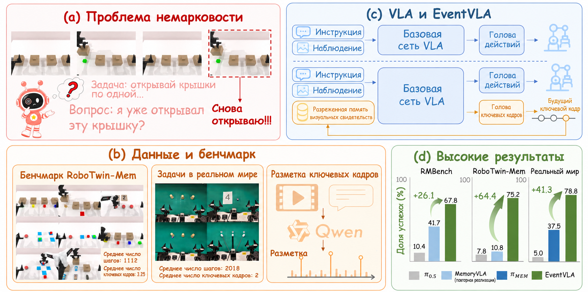
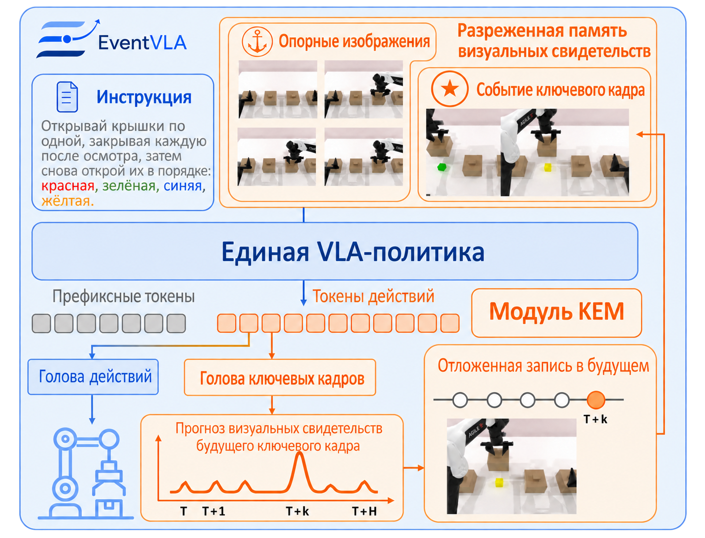
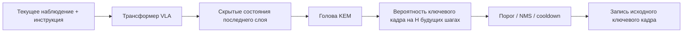
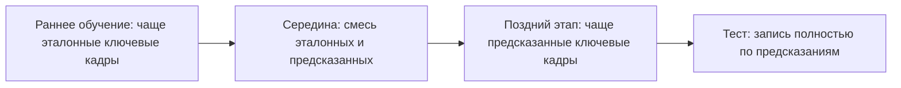
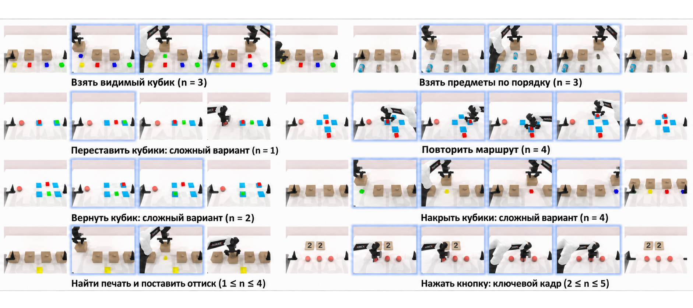
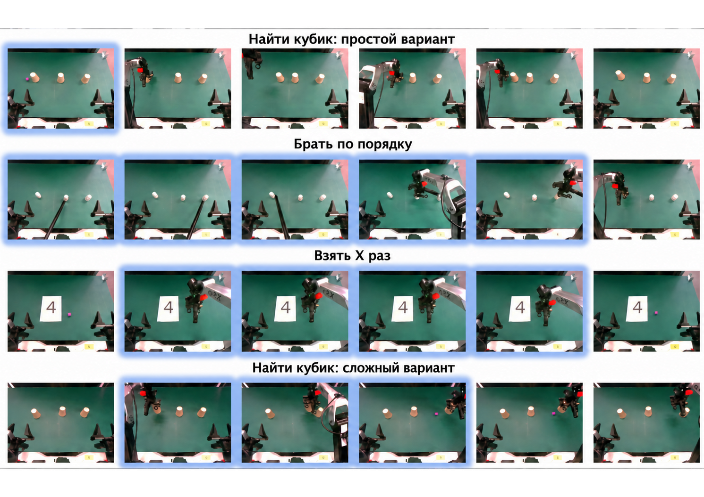

# EventVLA: событийная память визуальных доказательств

Полное название EventVLA — **EventVLA: Event-Driven Visual Evidence Memory for Long-Horizon Vision-Language-Action Policies**. Это не классическая модель мира и она не предсказывает будущее видео. Она решает другую практическую задачу: в длинных задачах роботов ключевые визуальные доказательства могут появиться ненадолго в середине эпизода, а потом скрыться из-за перекрытия, перемещения или выхода из поля зрения. Если VLA смотрит только на текущий кадр и короткую историю, она забывает эти доказательства.

После этого раздела нужно запомнить главную мысль:

> Ключевая идея EventVLA — не «заставить робота представлять будущее», а «сохранить те кадры, которые понадобятся позже, и показать их модели при предсказании действий».

## 1. Статья, код и состояние ресурсов

| Проект | Текущее состояние |
| :--- | :--- |
| Статья | [arXiv:2606.20092](https://arxiv.org/abs/2606.20092) |
| Страница проекта | [EventVLA Project Page](https://ganlin-yang.github.io/EventVLA.github.io/) |
| Код | [InternRobotics/EventVLA](https://github.com/InternRobotics/EventVLA) |
| Веса модели | [Hugging Face: ganlinyang/EventVLA](https://huggingface.co/ganlinyang/EventVLA) |
| Набор данных | [Hugging Face: RoboTwin-MeM](https://huggingface.co/datasets/ganlinyang/RoboTwin-MeM) |
| Границы открытого кода | Код обучения и оценки в симуляции, данные RoboTwin-MeM и контрольные точки опубликованы; в README код реального робота (inference и evaluation) и дообученная модель для реального робота пока помечены как Todo |

Поэтому EventVLA сейчас можно рассматривать как открытый проект, с которым можно запускать оценку в симуляции, но нельзя обещать читателям полное воспроизведение результатов на реальных роботах.

## 2. Одна картинка, которая объясняет задачу

<p align="center">
  
</p>

**Рисунок 1. Общий обзор EventVLA.** Слева — немарковская задача длинного горизонта: успех зависит от доказательства, которое появилось в середине эпизода, но текущее наблюдение его уже не содержит. Справа — идея sparse visual evidence memory в EventVLA: не загружать в модель всю историю кадров, а активно сохранять несколько ключевых визуальных событий.

Источник: [страница проекта EventVLA](https://ganlin-yang.github.io/EventVLA.github.io/).

У обычных VLA при работе с длинными задачами есть три типичных ограничения памяти:

| Проблема | Типичное проявление |
| :--- | :--- |
| Исчезновение доказательства | Робот на короткое время увидел цвет, метку, порядок или маршрут цели, а после смены ракурса уже не видит его |
| Слишком длинная история | Если просто подавать много исторических кадров, растут видеопамять, задержка и избыточность |
| Слишком сильное сжатие | Сжатие истории в один латентный вектор может потерять детали, особенно в задачах с несколькими событиями |

Выбор EventVLA прост: **хранить лишь несколько исходных ключевых кадров**. Ключевые кадры не кодируются в один нейросетевой вектор памяти, а сохраняются как изображения, и затем подаются в VLA как дополнительный визуальный вход.

## 3. Разбор архитектуры: визуальные якоря + KEM + память исходных изображений

<p align="center">
  
</p>

**Рисунок 2. Архитектура EventVLA.** При чтении схемы обратите внимание на три блока: фиксированные визуальные якоря дают стабильный контекст, KEM предсказывает, какие будущие шаги стоит записать в память, а буфер памяти возвращает ключевые кадры в исходном виде в VLA.

Источник: [EventVLA на arXiv HTML](https://arxiv.org/html/2606.20092v1).

Память EventVLA состоит из двух частей:

```text
M_t = базовые визуальные якоря + ключевые кадры событий
```

### 3.1 Базовые визуальные якоря

Визуальные якоря — фиксированное правило, которое не требует обучения. Обычно они включают:

- начальный кадр: сохраняет общую компоновку сцены в начале задачи;
- короткое окно истории: сохраняет последние кадры, то есть недавнее движение и текущую стадию взаимодействия.

Этот выбор важен. Многим задачам достаточно начальной компоновки и недавних кадров, поэтому динамические ключевые кадры не всегда нужны. В абляциях статьи видно, что если убрать начальный кадр или короткую историю, результат заметно ухудшается. Значит, EventVLA не просто «выбирает ключевые кадры», а сочетает долгосрочные якоря, короткое движение и динамические доказательства.

### 3.2 KEM: память ключевых доказательств

KEM (Keyframe Evidence Memory) — центральный модуль EventVLA. Он не пересматривает весь ролик постфактум, а по скрытым состояниям текущей VLA предсказывает: **на каких шагах в будущем горизонте действий появится ключевое визуальное доказательство задачи**.

Эту часть можно представить такой цепочкой:



Такой подход — «предсказывать будущие моменты записи в память» — сильнее обычного буфера памяти, потому что связывает план действий и запись в память. Модель не сохраняет всё подряд, а решает, какой момент будет полезен позже.

### 3.3 Память исходных изображений

EventVLA хранит исходные изображения ключевых кадров, а не сжатый латентный банк. На первый взгляд это не выглядит сложно, но для задач с несколькими событиями это важно. Разные ключевые доказательства могут находиться в цвете, положении предмета, маршруте, порядке или взаимном перекрытии, и принудительное сжатие в один вектор легко создаёт узкое место для информации.

Ближе к реальной логике кода поток выглядит так:

```text
KEM предсказывает смещение в будущее
-> записывается ожидающий запрос на target_step
-> среда или конвейер данных доходит до target_step
-> извлекается соответствующее исходное изображение
-> выбирается изображение основного вида
-> добавляется в банк ключевых кадров во время выполнения
-> удаляются дубликаты, кадры сортируются по времени, сохраняется не более max_keyframes
-> на следующем прямом проходе они подаются в модель как memory_keyframe_images
```

Таким образом, «память» EventVLA — это не скрытое состояние внутри нейросети, а набор изображений и метаданных, который ведётся на стороне Python во время выполнения. Такой выбор упрощает понимание и отладку: можно напрямую взять сохранённые моделью ключевые кадры и посмотреть на них.

## 4. Управление записью в реальном времени: зачем нужны NMS, cooldown и FIFO

KEM выдаёт вероятность для каждого шага внутри будущего горизонта. Если записывать кадр каждый раз, когда вероятность высока, рядом с ключевым кадром будут записаны несколько соседних кадров, и буфер быстро заполнится избыточными кадрами. Поэтому EventVLA использует систему управления записью в реальном времени:

| Механизм | Назначение |
| :--- | :--- |
| Порог уверенности | Принимаются только кандидаты в ключевые кадры с достаточно высокой уверенностью |
| Одномерный NMS | Сжимает непрерывные высокие пики вероятности до одного разреженного события |
| Временной cooldown | Не даёт за короткое время записать почти одинаковые кадры повторно |
| Буфер FIFO | При переполнении удаляются самые старые ключевые кадры |

Эта часть довольно инженерная, но для качества очень важна. Без этих механизмов буфер памяти превратился бы из «памяти ключевых доказательств» в набор повторяющихся снимков, сделанных с короткими промежутками.

## 5. Автоматическая разметка: Qwen3-VL размечает ключевые кадры

Для обучения KEM нужно знать, какие кадры являются ключевыми. Полностью ручная разметка стоила бы очень дорого. В EventVLA используется офлайн-конвейер на основе VLM: по демонстрационным видео и текстовым описаниям задач автоматически извлекаются временные метки промежуточных критичных событий. В статье и приложении упоминается использование Qwen3-VL для этой задачи.

Это даёт два следствия:

- Плюс: можно использовать много демонстраций без поэтапной ручной разметки.
- Риск: качество обучения KEM зависит от того, насколько VLM правильно определяет критичные для задачи доказательства. Если автоматическая разметка ошибочна, модель выучит смещённую стратегию записи.

Кроме того, разметка ключевых кадров не сводится к жёсткой метке в одной точке. В реальных физических взаимодействиях полезное доказательство может находиться в целом временном окне: например, после открытия крышки несколько кадров подряд показывают внутренний цвет. EventVLA использует мягкие метки, чтобы учитывать временную неоднозначность, и это разумнее, чем одна жёсткая метка 0/1 во времени.

## 6. Учебный план обучения: от памяти учителя к предсказанной памяти

Если на раннем этапе обучения полностью полагаться на ключевые кадры, которые предсказывает сама модель, она часто записывает неправильную память. Если же всё время использовать эталонные ключевые кадры (GT keyframes), то на тесте, где эталона нет, возникает разрыв между обучением и тестированием. Поэтому EventVLA использует учебную программу «от учителя к ученику»:



Смысл этого подхода в том, чтобы сначала модель научилась действовать при правильной памяти, а затем постепенно — самостоятельно записывать правильную память.

## 7. RoboTwin-MeM: бенчмарк для проверки немарковской памяти

<p align="center">
  
</p>

**Рисунок 3. Бенчмарк RoboTwin-MeM.** Бенчмарк специально построен так, чтобы для успеха нужно было запомнить ключевые визуальные доказательства, появившиеся в середине эпизода. На рисунке синими рамками отмечены промежуточные ключевые кадры, которые должны сохраниться.

Источник: [EventVLA на arXiv HTML](https://arxiv.org/html/2606.20092v1).

Значение RoboTwin-MeM в том, что это не обычный бенчмарк длинного манипулирования, а тест на то, сможет ли робот выполнить задачу после исчезновения промежуточного доказательства. Официальный набор данных доступен в двух форматах: LeRobot 2.1 и HDF5. Задачи включают:

```text
cover_blocks_hard
find_seal_and_seal_stamp
pick_objects_in_order
pick_the_unhidden_block
press_button_keyframe
put_back_block_hard
rearrange_blocks_hard
reproduce_route
```

Эти задачи охватывают кратковременное распознавание, подсчёт событий, имитацию в контексте, отслеживание порядка. Для длинных VLA такие задачи лучше выявляют проблему «забыл промежуточное доказательство», чем обычный pick-and-place.

## 8. Как читать результаты на реальном роботе

<p align="center">
  
</p>

**Рисунок 4. Последовательность действий EventVLA на реальном роботе.** Кадры, отмеченные синими рамками, — визуальные доказательства, которые политика сама захватила и записала в память. При чтении рисунка важно понимать: ключевой кадр — не итог действия, а свидетельство, к которому модель вернётся при последующих решениях.

Источник: [EventVLA на arXiv HTML](https://arxiv.org/html/2606.20092v1).

Раздел про реального робота показывает, что метод — не только симуляционная идея, но при этом открытые границы стоит назвать прямо: в README официального репозитория код inference и evaluation для реального робота и дообученная модель для него всё ещё помечены как Todo. Поэтому в учебнике не стоит писать, что читатели могут напрямую воспроизвести эксперименты на реальном роботе. Более корректная формулировка такая:

- Оценку в симуляции можно проводить по официальному коду и опубликованным контрольным точкам.
- Эксперименты на реальном роботе пока можно изучать по статье и видеоматериалам, дожидаясь публикации кода развёртывания и моделей.
- Если у вас есть двуручная платформа, можно использовать описанную в статье схему памяти, но не стоит предполагать, что официальный конвейер для реального робота уже работает «из коробки».

## 9. Если вы хотите воспроизвести: с чего начать

Здесь не будет пошаговых команд, только маршрут воспроизведения. Официальный README рекомендует два окружения:

| Окружение | Назначение |
| :--- | :--- |
| Окружение RoboTwin-MeM | Запуск симуляционных задач и ресурсов |
| Окружение EventVLA | Обучение модели, вывод и сервер политики |

Рекомендуемый порядок действий:

1. Клонировать [InternRobotics/EventVLA](https://github.com/InternRobotics/EventVLA).
2. Подготовить симуляционное окружение RoboTwin-MeM и его ресурсы.
3. Подготовить окружение EventVLA: установить `requirements.txt`, `flash-attn` и пакет в режиме редактирования (editable).
4. Загрузить контрольные точки EventVLA и набор данных RoboTwin-MeM с Hugging Face.
5. Сначала провести оценку одной задачи, чтобы убедиться, что сервер политики, симуляция и контрольная точка работают вместе.
6. Затем провести пакетную оценку по 8 задачам.
7. Если нужно обучение, использовать скрипты из `examples/RoboTwin-Mem/train_files/`.

В официальном README важны такие параметры конфигурации:

```text
memory_ablation_mode: pure_image_keyframe_memory
keyframe_image_memory.enabled: true
keyframe_train_memory_source: teacher_to_predict
keyframe_eval_memory_source: predict
max_keyframes: 4
temporal image anchors: first frame, t-30, t-15, current frame
action horizon: 50
maximum training steps: 100000
```

Эти параметры стоит понять раньше, чем просто запускать команды: они напрямую соответствуют методу EventVLA. Сохраняется не более 4 ключевых кадров, в качестве якорей используются начальный кадр и короткая история, а обучение переходит от памяти учителя к предсказанной памяти.

## 10. Отличие от WALL-WM

EventVLA и WALL-WM оба используют слово «event», но решают совершенно разные задачи:

| Сравнение | EventVLA | WALL-WM |
| :--- | :--- | :--- |
| Основная задача | Визуальные доказательства исчезают; как их запомнить | Фиксированный блок действий разрезает семантические события; как планировать и исполнять по событиям |
| Гранулярность события | Один или несколько ключевых кадров | Семантически цельный отрезок действий |
| Основные модули | KEM + память исходных изображений | Видео-DiT с несколькими видами + DiT действий |
| Предсказывает ли будущее видео | Нет | Да, предсказывает латенты будущего видео событий |
| Насколько близко к модели мира | Не модель мира | Да, World Action Model |

Коротко: **EventVLA — memory-first, WALL-WM — event-world-model-first.**

## 11. Источники

- Статья: [EventVLA: Event-Driven Visual Evidence Memory for Long-Horizon Vision-Language-Action Policies](https://arxiv.org/abs/2606.20092)
- Страница проекта: [EventVLA Project Page](https://ganlin-yang.github.io/EventVLA.github.io/)
- Код: [InternRobotics/EventVLA](https://github.com/InternRobotics/EventVLA)
- Модель: [Hugging Face: ganlinyang/EventVLA](https://huggingface.co/ganlinyang/EventVLA)
- Набор данных: [Hugging Face: RoboTwin-MeM](https://huggingface.co/datasets/ganlinyang/RoboTwin-MeM)
- Зависимые проекты: [RoboTwin 2.0](https://github.com/robotwin-Platform/RoboTwin), [RMBench](https://github.com/robotwin-Platform/RMBench), [StarVLA](https://github.com/starVLA/starVLA)
