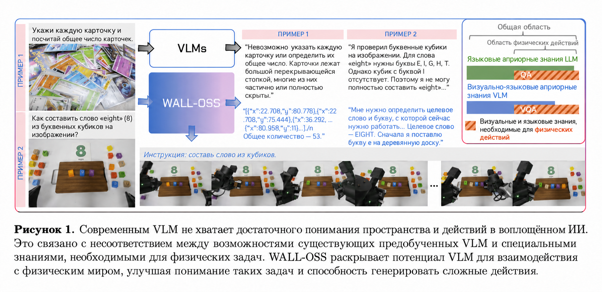
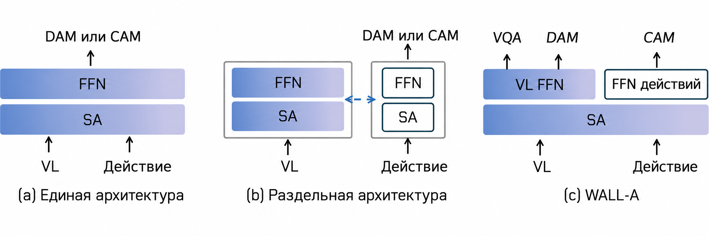
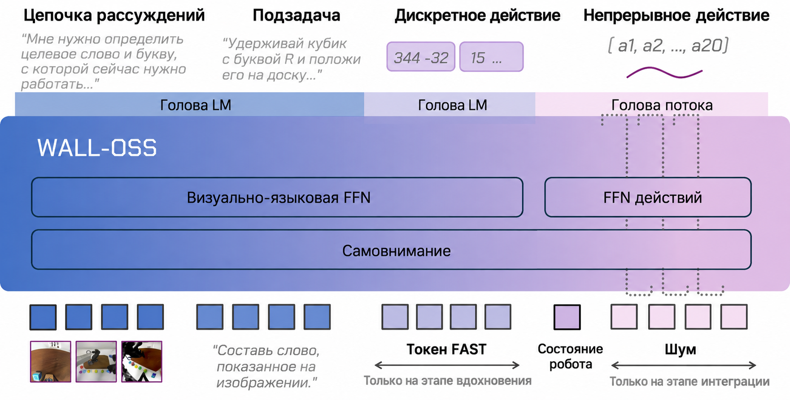
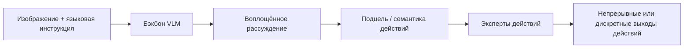
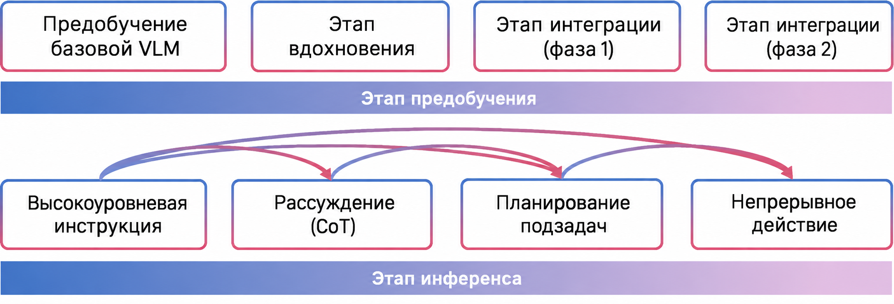
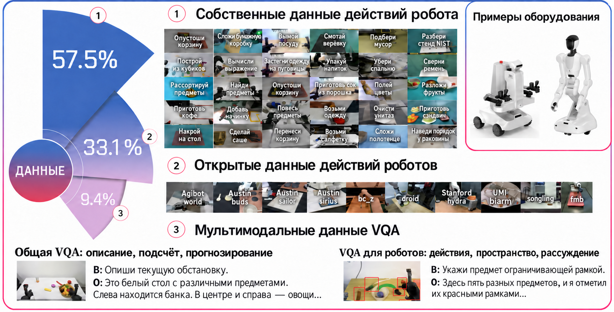

# WALL-OSS: от VLM к открытой модели VLA

WALL-OSS соответствует статье **Igniting VLMs toward the Embodied Space** и представляет собой открытую серию моделей VLA от X Square Robot. Её можно понимать как уровень моделей в экосистеме WALL, который открыт для дообучения, оценки и развёртывания. Это не статья о модели мира действий WALL-WM и не инженерный фреймворк WALL-X.

После этого раздела запомните главную мысль:

> Задача WALL-OSS — подключить способность предобученной VLM понимать изображение и язык к пространству действий робота, чтобы модель одновременно умела рассуждать о воплощённой среде и выдавать исполнимые действия.

## 1. Статья, код и точки входа к весам

| Проект | Текущее состояние |
| :--- | :--- |
| Статья | [arXiv:2509.11766](https://arxiv.org/abs/2509.11766) |
| Код фреймворка | [X-Square-Robot/wall-x](https://github.com/X-Square-Robot/wall-x) |
| Страница организации на Hugging Face | [x-square-robot](https://huggingface.co/x-square-robot) |
| Документация LeRobot | [WALL-OSS in LeRobot](https://huggingface.co/docs/lerobot/en/walloss) |
| Распространённые модели | `wall-oss-0.5`, `wall-oss-flow`, `wall-oss-flow-0.1`, `wall-oss-fast` |
| Рекомендуемый способ воспроизведения | Не обучать с нуля; сначала скачать контрольную точку и выполнить дообучение или оценку в WALL-X или LeRobot |

По состоянию на 2026-06-29 WALL-OSS удобнее WALL-WM как открытая точка входа для воспроизведения: у неё есть веса модели, фреймворк для обучения и вывода, а также интеграция с LeRobot. Если вы просто хотите «запустить модель из серии WALL», начинайте с WALL-OSS или WALL-OSS-0.5.

## 2. Одна картинка, которая показывает, что делает WALL-OSS

<p align="center">
  
</p>

**Рисунок 1. Обзор WALL-OSS в документации LeRobot.** На рисунке показано, что WALL-OSS уже интегрирована в экосистему LeRobot: её можно использовать как политику `wall_x` для дообучения, оценки и развёртывания.

Источник: [документация WALL-OSS в LeRobot на Hugging Face](https://huggingface.co/docs/lerobot/en/walloss).

Основное противоречие WALL-OSS такое: предобученная VLM хорошо видит изображения и понимает язык, но у неё нет встроенного умения работать с пространством действий робота. Действия робота должны одновременно удовлетворять нескольким требованиям:

- геометрия пространства должна быть точной, например относительное положение захвата и предмета;
- временной ритм должен быть правильным, например последовательность подъезда, захвата, подъёма, перемещения и опускания;
- представление действий должно быть устойчивым, например непрерывное управление, diffusion / flow matching или токены действий в стиле FAST;
- исходные способности VLM к пониманию изображений и языка не должны ухудшиться при обучении.

Поэтому WALL-OSS — это не просто «подключить к VLM линейную голову действий». Цель — объединить рассуждение о воплощённой среде (vision-language reasoning), декомпозицию подцелей (subgoal decomposition) и точный синтез действий (fine-grained action synthesis) в одной архитектуре VLA.

## 3. Разные способы перехода от VLM к моделированию действий

<p align="center">
  
</p>

**Рисунок 2. Разные парадигмы перехода от VLM к VLA.** На рисунке синим цветом выделены веса, унаследованные от предобученной VLM; DAM и CAM соответствуют моделированию дискретных и непрерывных действий. При чтении обратите внимание, используют ли токены действий и визуально-языковые токены общий бэкбон и попадает ли генерация действий внутрь пути рассуждения VLM.

Источник: [WALL-OSS на arXiv HTML](https://arxiv.org/html/2509.11766v1).

Есть три основных пути к VLA:

| Путь | Что делается | Риск |
| :--- | :--- | :--- |
| Только голова действий | VLM кодирует изображение и текст, а снаружи подключена небольшая голова, которая предсказывает действия | Слабая связь между генерацией действий и языковым рассуждением |
| Дискретные токены действий | Непрерывные действия превращаются в дискретные токены и генерируются как в языковой модели | Легко потерять точность управления |
| Моделирование непрерывных действий | Непрерывные действия предсказываются с помощью diffusion / flow matching | Сложнее обеспечить стабильность обучения и сохранить априорные знания VLM |

Стратегия WALL-OSS — учитывать и дискретное, и непрерывное моделирование действий: сначала модель формирует семантическую связь «воплощённая среда — действие», а затем непрерывная ветвь управления обеспечивает высокочастотное исполнение.

## 4. Архитектура: плотно связанная VLA

<p align="center">
  
</p>

**Рисунок 3. Архитектура WALL-OSS.** Важна не отдельная голова, а то, как визуальные, языковые и токены действий взаимодействуют в одной системе. WALL-OSS старается не допустить, чтобы ветвь действий полностью существовала отдельно от основного VLM.

Источник: [WALL-OSS на arXiv HTML](https://arxiv.org/html/2509.11766v1).

Документация LeRobot выделяет несколько ключевых элементов WALL-OSS:

| Модуль | Назначение |
| :--- | :--- |
| Предобучение с усилением восприятия воплощённой среды (Embodied perception-enhanced multimodal pretraining) | Использует данные «визуальный — языковой — действие», чтобы улучшить понимание пространства, причинности и манипуляций |
| Сквозная межуровневая цепочка рассуждений (Unified Cross-Level CoT / Uni-CoT) | Объединяет понимание высокоуровневой инструкции, декомпозицию подзадач и синтез тонких действий в непрерывную цепочку |
| Головы действий на основе MoE | В зависимости от стадии задачи динамически активируют разные эксперты; поддерживают дискретное и непрерывное моделирование действий |
| Двухэтапное обучение | Сначала дискретный априорный сигнал действий укрепляет связь «семантика — действие», затем flow matching обеспечивает непрерывное управление |

Цель обучения удобно представить как путь от «понимания сцены» к «исполнению действий»:



Такой дизайн важен тем, что генерация действий ближе к внутреннему процессу рассуждения VLM, а не выполняется отдельным регрессором после последнего слоя.

## 5. Конвейер обучения: от Inspiration к Integration

<p align="center">
  
</p>

**Рисунок 4. Конвейер обучения и вывода WALL-OSS.** При рассмотрении рисунка удобно разделить процесс на два шага: сначала модель получает предварительное знание о действиях в воплощённой среде, затем это знание подключается к генерации непрерывных действий высокой частоты.

Источник: [WALL-OSS на arXiv HTML](https://arxiv.org/html/2509.11766v1).

В документации LeRobot обучение описано как два этапа:

| Этап | Назначение | Интуитивный смысл |
| :--- | :--- | :--- |
| Inspiration | Добавить дискретное априорное знание о действиях, усилить пространственное понимание и связь «семантика — действие» | Сначала модель понимает, как язык соответствует стадиям манипуляции |
| Integration | Использовать flow matching для непрерывного управления высокой частоты | Затем модель выдаёт непрерывные действия, которые можно исполнить |

Такой путь надёжнее, чем просто дообучать голову действий на небольшом наборе данных, потому что он признаёт расхождение распределений между VLM и управлением роботом. Способности VLM сами по себе не равны способности к действию, и между ними нужен промежуточный мост.

## 6. Источники данных: почему это не только данные роботов

<p align="center">
  
</p>

**Рисунок 5. Обзор многоисточниковых данных WALL-OSS.** На рисунке собраны собственные данные действий, открытые данные действий и мультимодальные данные VQA: видно, что WALL-OSS обучается не только на траекториях роботов, но и сохраняет понимание визуально-языковых задач.

Источник: [WALL-OSS на arXiv HTML](https://arxiv.org/html/2509.11766v1).

Сложность VLA-моделей в том, что если обучать только на данных роботов, объём обычно недостаточен, а общие способности VLM легко испортить. Если же обучать только на изображениях и тексте, модель не научится исполнимым действиям. Поэтому WALL-OSS смешивает данные:

- собственные данные действий роботов;
- открытые данные действий роботов;
- мультимодальные данные VQA и визуально-языковые данные;
- длинные задачи манипуляции, рассуждения и выполнения инструкций.

Из-за этого при воспроизведении не стоит ожидать, что можно с нуля предобучить WALL-OSS по учебнику. Более реалистичный путь — скачать официальную контрольную точку и провести дообучение на собственных данных LeRobot или на LIBERO.

## 7. WALL-OSS, WALL-OSS-0.5, FLOW и FAST: как их различать

WALL-X README сейчас перечисляет такие модели:

| Модель | Как её понимать |
| :--- | :--- |
| `wall-oss-0.5` | Версия 2026 года, ближе к готовой к развёртыванию VLA; в карточке модели описана как VLA на 4B с бэкбоном VLM на 3B и компонентом действий |
| `wall-oss-flow` | Версия с генерацией непрерывных действий в стиле flow / diffusion |
| `wall-oss-flow-0.1` | Одна из ранних или обновлённых веток версии flow |
| `wall-oss-fast` | Версия с предсказанием действий в стиле FAST |

В учебнике и экспериментах не стоит смешивать эти названия. Наиболее аккуратный способ:

- описывая метод статьи, говорите «серия WALL-OSS»;
- описывая открытую точку воспроизведения, указывайте конкретную контрольную точку, например `x-square-robot/wall-oss-0.5` или `x-square-robot/wall-oss-flow`;
- при использовании документации LeRobot настраивайте `policy.type=wall_x` и `policy.pretrained_name_or_path=...`.

## 8. Если хотите воспроизвести: с какого пути начать

Не стоит начинать с воспроизведения предобучения из статьи. Рекомендуем такой путь:

1. **Быстро понять модель**: прочитать рисунки 2, 3 и 4 статьи WALL-OSS и разобраться, как связаны дискретные действия, непрерывные действия, Uni-CoT и головы действий на основе MoE.
2. **Скачать контрольную точку**: выбрать модель на [HF x-square-robot](https://huggingface.co/x-square-robot), например `wall-oss-0.5` или `wall-oss-flow`.
3. **Выбрать инженерную точку входа**:
   - если нужен ближе всего к официальному стеку WALL: [X-Square-Robot/wall-x](https://github.com/X-Square-Robot/wall-x);
   - если нужна привязка к экосистеме сообщества: [документация WALL-OSS в LeRobot](https://huggingface.co/docs/lerobot/en/walloss).
4. **Подготовить данные**: использовать данные в формате LeRobot, например LIBERO или собственные данные робота.
5. **Провести короткое дообучение или оценку**: сначала проверить, что модель загружается, данные читаются, ветвь действий работает и среда оценки отвечает.

Минимальная конфигурация, описанная в документации LeRobot, выглядит так:

```bash
lerobot-train \
  --dataset.repo_id=your_dataset \
  --policy.type=wall_x \
  --output_dir=./outputs/wallx_training \
  --job_name=wallx_training \
  --policy.repo_id=your_repo_id \
  --policy.pretrained_name_or_path=x-square-robot/wall-oss-flow \
  --policy.prediction_mode=diffusion \
  --policy.attn_implementation=eager \
  --steps=3000 \
  --policy.device=cuda \
  --batch_size=32
```

Эта команда скорее задаёт направление, чем является результатом, который учебник гарантирует. Перед реальным запуском нужно подстроить её под свой GPU, набор данных, версию LeRobot и название контрольной точки.

## 9. Связь с WALL-WM

WALL-OSS и WALL-WM относятся к одной экосистеме WALL, но решают разные исследовательские задачи:

| Сравнение | WALL-OSS | WALL-WM |
| :--- | :--- | :--- |
| Цель | Превратить VLM в исполнимую VLA | Моделировать мир и действия по семантическим событиям |
| Выход | Действия или распределение действий | Латенты будущего видео + траектория действий |
| Открытость | Есть код, модели и документация LeRobot | Статья открыта; полные контрольные точки и рецепт данных для статьи пока нужно отслеживать |
| Рекомендуемая практика | Дообучение, оценка, развёртывание | Чтение статьи и разбор на занятии |

Поэтому, если вас спрашивают, можно ли сейчас воспроизвести серию WALL, обычно ответ такой: **можно начать с дообучения или оценки WALL-OSS и WALL-X; пока не стоит писать WALL-WM как полностью воспроизводимое учебное руководство.**

## 10. Источники

- Статья WALL-OSS: [Igniting VLMs toward the Embodied Space](https://arxiv.org/abs/2509.11766)
- Код WALL-X: [X-Square-Robot/wall-x](https://github.com/X-Square-Robot/wall-x)
- Документация LeRobot: [WALL-OSS](https://huggingface.co/docs/lerobot/en/walloss)
- Страница организации на Hugging Face: [x-square-robot](https://huggingface.co/x-square-robot)
- Модель WALL-OSS-0.5: [x-square-robot/wall-oss-0.5](https://huggingface.co/x-square-robot/wall-oss-0.5)
- Модель WALL-OSS-FLOW: [x-square-robot/wall-oss-flow](https://huggingface.co/x-square-robot/wall-oss-flow)
- Модель WALL-OSS-FAST: [x-square-robot/wall-oss-fast](https://huggingface.co/x-square-robot/wall-oss-fast)
