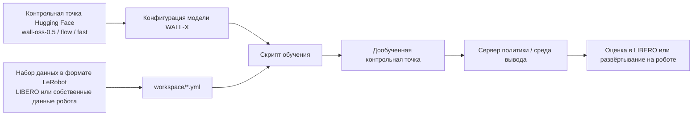
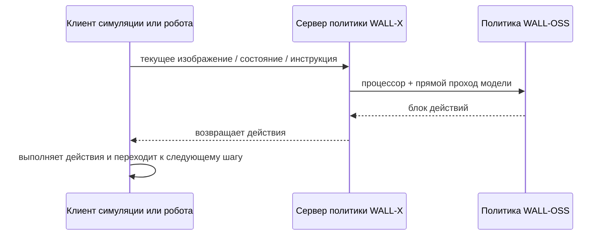

# WALL-X: открытый инженерный фреймворк серии WALL

WALL-X — не отдельная статья, а открытый инженерный стек X Square Robot для моделей серии WALL. Его можно понимать так: **скачать модель WALL-OSS, подготовить данные в формате LeRobot, настроить обучение, запустить сервер вывода, провести оценку и развёртывание**.

После этого раздела запомните главную мысль:

> WALL-X — основная инженерная точка входа для воспроизведения WALL-OSS, но он не равен автоматически полному пакету воспроизведения статьи WALL-WM.

## 1. Состояние репозитория и ресурсов

| Проект | Текущее состояние |
| :--- | :--- |
| Репозиторий с кодом | [X-Square-Robot/wall-x](https://github.com/X-Square-Robot/wall-x) |
| Лицензия | В репозитории указана лицензия Apache-2.0 |
| Поддерживаемые модели | `wall-oss-0.5`, `wall-oss-flow-0.1`, `wall-oss-flow`, `wall-oss-fast` |
| Основные возможности | Подготовка данных LeRobot, конфигурация моделей, ветви действий flow / FAST, сервер вывода, оценка, сборка CUDA-операторов |
| Рекомендуемое применение | Дообучение WALL-OSS-0.5, оценка на данных LIBERO / LeRobot, вывод в виде сервиса |

В новостях README WALL-X одновременно упоминаются WALL-OSS, WALL-OSS-0.5 и WALL-WM. Это легко может создать впечатление, что полный код WALL-WM уже можно запустить одной командой. Более осторожный вывод такой:

- WALL-X сейчас явно предоставляет стек обучения и вывода для открытых моделей серии WALL.
- `workspace/README.md` сейчас в первую очередь описывает **Wall-OSS-0.5**: дообучение, оценку в симуляции и развёртывание на реальном роботе.
- Статья и PDF WALL-WM опубликованы, но полные веса для событийной модели мира действий, данные по событиям и рецепт обучения не удаётся однозначно найти в списке моделей WALL-X.

## 2. Место WALL-X в общей цепочке



**Рисунок 1. Инженерная цепочка WALL-X.** Ценность WALL-X в том, что он связывает модель, данные, конфигурацию, обучение и развёртывание. Это не просто файл с определением модели, а набор инструментов для экспериментов с WALL-OSS.

Если вы пишете открытое учебное руководство, главу о WALL-X стоит строить не как пересказ статьи, а как навигацию по инженерным решениям: откуда начать и какой путь выбрать.

## 3. Наиболее важные возможности репозитория

По официальному README WALL-X включает несколько блоков:

| Возможность | Как объяснять в учебнике |
| :--- | :--- |
| Подготовка данных LeRobot | Траектории робота организуются в формат, который читает LeRobot; это снижает стоимость подключения собственных данных |
| Конфигурация модели | Через YAML задаются контрольная точка, процессор, размерности действий, пути к данным и гиперпараметры обучения |
| Ветвь действий flow-matching | Для генерации непрерывных действий, подходит для высокочастотного управления |
| Ветвь действий FAST | Для более быстрого пути с токенами действий или предсказанием действий |
| Утилиты сервера и оценки | Политика запускается как сервис, а клиент симуляции или робота обращается к нему |
| Исходники CUDA-операторов | При установке собираются пользовательские CUDA-операторы, поэтому нужно согласовать окружения CUDA, PyTorch и flash-attn |

Отсюда понятно, что сложность воспроизведения WALL-X связана не с количеством команд. Главные трудности — версии окружения, сборка CUDA-расширений, версия LeRobot, пути к контрольным точкам и формат данных.

## 4. С какой модели начинать: WALL-OSS-0.5

Официальный `workspace/README.md` прямо указывает, что текущий открытый релиз ориентирован на **Wall-OSS-0.5**. Если вы используете `WALL-OSS-FLOW` или `WALL-OSS-FAST`, в README рекомендуется вернуться к более ранним версиям кода.

Это важное замечание для учебного руководства. Не стоит смешивать все контрольные точки в одном плане. Рекомендуем такой выбор:

| Цель | Что выбрать |
| :--- | :--- |
| Первый запуск WALL-X | `wall-oss-0.5` и актуальная ветка main |
| Проверка старых моделей flow / FAST | Переключиться на соответствующий исторический коммит по инструкции проекта |
| Интеграция с инструментами сообщества LeRobot | Использовать `policy.type=wall_x` по документации LeRobot |
| Воспроизведение статьи WALL-WM | Пока не рекомендуется; сначала следить, опубликует ли официальный проект отдельную контрольную точку и рецепт данных |

## 5. Окружение и установка

Официальное окружение WALL-X выглядит примерно так:

```bash
conda create --name wallx python=3.10
conda activate wallx

pip install -r requirements.txt
pip install "dmuon @ git+https://github.com/X-Square-Robot/dmuon.git"

git clone https://github.com/huggingface/lerobot.git
cd lerobot
git checkout c66cd401767e60baece16e1cf68da2824227e076
pip install --no-deps -e .
cd -

MAX_JOBS=8 pip install --no-build-isolation -e .
```

При воспроизведении особенно проверяйте:

- версия Python — 3.10;
- CUDA, PyTorch и flash-attn совместимы друг с другом;
- LeRobot переключён на указанный в инструкции коммит;
- LeRobot установлен с флагом `--no-deps`, чтобы не перезаписать зависимости WALL-X;
- при установке WALL-X разрешена сборка CUDA-расширения.

Эти проверки важнее слепого повторения команд. Многие неудачи в VLA-проектах связаны не с самой моделью, а с конфликтами flash-attn, расширений CUDA, зависимостей LeRobot или версий torch.

## 6. Загрузка моделей и настройка путей

Для WALL-X сначала скачайте два типа файлов:

| Файл | Назначение |
| :--- | :--- |
| Контрольная точка WALL-OSS | Веса модели и конфигурация, например `x-square-robot/wall-oss-0.5` |
| Процессор Qwen2.5-VL | Токенизатор и процессор для обработки входов VLM |

Пример команд:

```bash
huggingface-cli download x-square-robot/wall-oss-0.5 \
  --local-dir /path/to/wall-oss-0.5

huggingface-cli download Qwen/Qwen2.5-VL-3B-Instruct \
  --local-dir /path/to/Qwen2.5-VL-3B-Instruct
```

В учебнике не следует подставлять на место `/path/to/...` пути из собственной машины автора. Лучше заранее задать переменные:

```bash
export MODEL_ROOT=/path/to/models
export DATA_ROOT=/path/to/data
export WALLX_ROOT=/path/to/wall-x
```

После этого в YAML можно использовать эти переменные, и другим читателям будет проще перенести руководство на свой сервер.

## 7. Данные и конфигурация обучения

Ядро конфигурации обучения WALL-X — файлы `workspace/example/*.yml`. Нужно обращать внимание на несколько полей:

| Поле конфигурации | Назначение |
| :--- | :--- |
| `model.config_path` | Путь к `config.json` внутри контрольной точки WALL-OSS |
| `model.processor_path` | Путь к процессору Qwen2.5-VL |
| `model.pretrained_path` | Путь к предобученным весам |
| Путь к набору данных | Путь к данным в формате LeRobot |
| Число степеней свободы робота | Размерность действий должна совпадать с данными робота |
| Ветвь действий | Режим предсказания: flow / FAST / другой |
| Размер батча и число шагов | Выбираются по объёму видеопамяти |

Если цель — написать открытое учебное руководство, удобно установить для воспроизведения уровень «проверка работоспособности»:

- модель и процессор загружаются;
- данные LeRobot читаются;
- несколько шагов обучения проходят прямой и обратный проход;
- контрольная точка сохраняется;
- оценка или фиктивный вывод возвращает действия.

Такая проверка подтверждает, что цепочка инженерии работает, но не доказывает, что модель достигла качества из статьи.

## 8. Сервер вывода и цепочка оценки

На практике WALL-X обычно работает по схеме «сервер политики + клиент среды или робота»:



**Рисунок 2. Цепочка вызовов сервера вывода.** Такая схема позволяет разделить процессы модели и управления симуляцией или роботом, а также запускать вывод на GPU и управление роботом на разных машинах.

Самые частые варианты оценки:

- оценка в симуляции LIBERO;
- дообучение и валидация на собственных данных в формате LeRobot;
- тест фиктивного вывода или запуска сервера;
- развёртывание на реальном роботе — но это требует дополнительного аппаратного интерфейса и систем безопасности, поэтому в общем руководстве его нельзя считать готовым «по умолчанию».

## 9. Связь с LeRobot

В документации LeRobot WALL-OSS уже доступна как политика:

```text
policy.type=wall_x
```

Для открытого учебника это полезно: многие читатели уже знакомы с форматом данных LeRobot и командами обучения, поэтому проще сначала попробовать WALL-OSS в LeRobot, чем сразу настраивать нативный WALL-X.

Два пути можно выбрать так:

| Путь | Для кого |
| :--- | :--- |
| Нативный WALL-X | Тем, кто хочет работать с официальным инженерным стеком X Square Robot и потом развернуть WALL-OSS-0.5 |
| Интеграция с LeRobot | Тем, у кого уже есть данные LeRobot или кто привык к `lerobot-train` |

## 10. Почему учебник пока не содержит пошагового воспроизведения

Для WALL-X можно выстроить воспроизводимый путь, но полное пошаговое руководство требует зафиксировать:

- конкретную версию контрольной точки;
- конкретный коммит кода;
- конкретный коммит LeRobot;
- конкретные сочетания CUDA, PyTorch и flash-attn;
- размер набора данных, способ загрузки и структуру диска;
- что именно запускается: LIBERO, реальный робот или собственные данные.

Если эти переменные не зафиксированы, написание «полного руководства с нуля» быстро превращается в неподдерживаемый набор команд. Поэтому сейчас лучше в этой главе описать инженерный стек, выбор модели и границы воспроизведения. Если позже мы решим воспроизводить `wall-oss-0.5` вместе с LIBERO, отдельно будет написано исполняемое руководство.

## 11. Источники

- Код WALL-X: [X-Square-Robot/wall-x](https://github.com/X-Square-Robot/wall-x)
- Руководство по workspace WALL-X: [workspace/README.md](https://github.com/X-Square-Robot/wall-x/blob/main/workspace/README.md)
- Модель WALL-OSS-0.5: [x-square-robot/wall-oss-0.5](https://huggingface.co/x-square-robot/wall-oss-0.5)
- Модель WALL-OSS-FLOW: [x-square-robot/wall-oss-flow](https://huggingface.co/x-square-robot/wall-oss-flow)
- Модель WALL-OSS-FAST: [x-square-robot/wall-oss-fast](https://huggingface.co/x-square-robot/wall-oss-fast)
- Документация WALL-OSS в LeRobot: [https://huggingface.co/docs/lerobot/en/walloss](https://huggingface.co/docs/lerobot/en/walloss)
- LeRobot: [https://github.com/huggingface/lerobot](https://github.com/huggingface/lerobot)
- LIBERO: [https://github.com/Lifelong-Robot-Learning/LIBERO](https://github.com/Lifelong-Robot-Learning/LIBERO)
