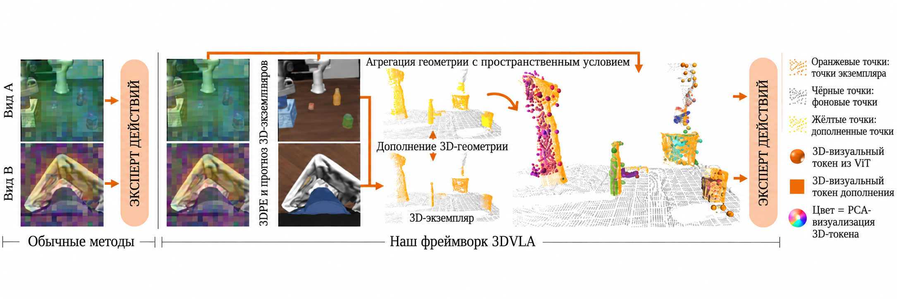
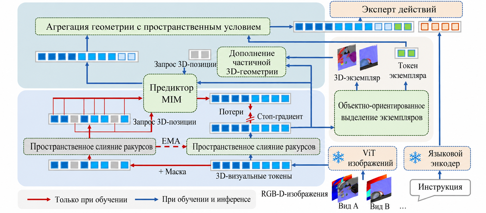
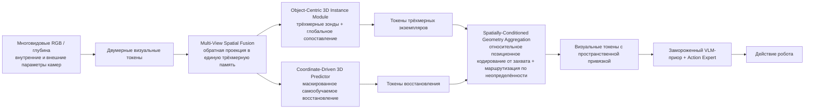
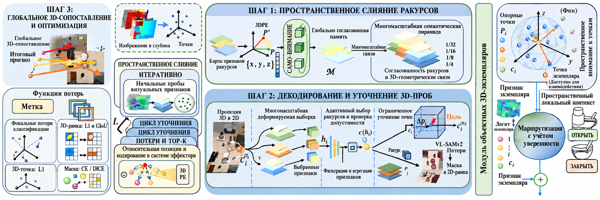
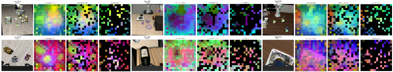
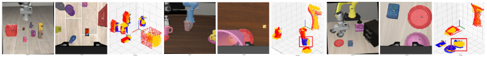

# 3DVLA: подключаемый модуль, который добавляет VLA трёхмерное пространственное и экземплярное понимание

Этот обзор относится к статье **3DVLA: Enhancing Vision-Language-Action Models via 3D Spatial and Instance Understanding** из Института компьютерных технологий имени Ван Сюаня Пекинского университета; препринт на arXiv опубликован 28 мая 2026 года. Его логично поместить в главу `06-manipulation-and-vla/large-model-control-vla-vlm` после OpenVLA, DiT4DiT, EventVLA и WALL-OSS/WALL-X.

После этого раздела запомните главный вывод:

> 3DVLA не обучает новую базовую VLA с нуля. Она вставляет между визуальными токенами существующей VLA и её action expert набор модулей для трёхмерного пространства, трёхмерных экземпляров и восстановления закрытой геометрии. Благодаря этому модель, которая в основном работает в двумерном пространстве, устойчивее понимает, где находится объект, какой экземпляр является целью и какой может быть скрытая часть его геометрии.

Раздел хорошо встаёт между темой «управление и манипуляция» и «восприятие и построение карт»: речь идёт не просто о распознавании объектов, а о том, как превратить трёхмерное пространственное понимание в токены, пригодные для предсказания действий.

## 1. Статус статьи и кода

| Проект | Текущее состояние |
| :--- | :--- |
| Статья | [arXiv:2605.29416](https://arxiv.org/abs/2605.29416), подана 2026-05-28 |
| HTML на arXiv | [3DVLA HTML](https://arxiv.org/html/2605.29416v1) |
| Аффилиация | Wangxuan Institute of Computer Technology, Peking University |
| Статус кода | По состоянию на 2026-07-18 официальный репозиторий GitHub для этой статьи не найден |
| Предостережение | Найденный по запросу [UMass-Embodied-AGI/3D-VLA](https://github.com/UMass-Embodied-AGI/3D-VLA) относится к другой статье 2024 года — **3D-VLA: A 3D Vision-Language-Action Generative World Model**, а не к 3DVLA 2026 года из Пекина |
| Рекомендация по воспроизведению | Сейчас уместно написать обзор метода и отметить место для будущей ссылки на код, но не обещать «запуск одной командой» и воспроизведение результатов статьи |

Здесь важно не ошибиться. Если искать на GitHub слово «3DVLA», легко попасть на репозиторий UMass за 2024 год с похожей тематикой, но другим названием, авторами и целями. Его нельзя принимать за код статьи Пекинского университета 2026 года. Пока что имеет смысл читать рисунки метода и таблицы экспериментов, а учебное руководство по воспроизведению писать после появления официального кода.

## 2. Какую задачу решает статья

Обычные VLA получают на вход многовидовые RGB-изображения, языковую инструкцию и историю наблюдений, а на выходе дают токены действий, приращения позы концевого эффектора или блоки действий (action chunk). Преимущество таких моделей в том, что они наследуют языковое понимание VLM. Однако у них есть заметный недостаток: многие VLA объединяют признаки в пространстве изображения, а трёхмерные пространственные отношения, которые нужны роботу, представлены слабо.

Статья разбивает проблему на три конкретные трудности:

| Трудность | Как проявляется | Что это меняет в манипуляции |
| :--- | :--- | :--- |
| Слабая трёхмерная локализация | Многовидовые изображения просто склеиваются или объединяются без единой трёхмерной системы координат | При смене ракурса камеры или положения предмета модель не знает, где объект на самом деле относительно системы робота |
| Слабое понимание экземпляров | Объект воспринимается как двумерная область, нет согласованного между видами представления экземпляра | Одна и та же кружка в двух камерах выглядит по-разному, и модель легко путает целевой экземпляр, фоновый предмет и закрытую область |
| Хрупкость рассуждений при перекрытии | Если цель частично скрыта, двумерные токены видят только искажённый внешний вид | Захват, укладка или протирание требуют угадывать невидимую часть, и чисто двумерная VLA начинает сбиваться с траектории |

Идея 3DVLA такова: не переделывать существующую VLA и не обучать тяжёлую отдельную трёхмерную модель, которая не совместима с VLM. Вместо этого геометрическая информация приводится к виду токенов, который понимает VLA, и подаётся в action expert.

Можно представить себе так:

```text
Многовидовые RGB / глубина / параметры камеры
        ↓
Визуальная память в единой трёхмерной системе
        ↓
Трёхмерные токены экземпляров, согласованные между видами
        ↓
Восстановление геометрии в закрытых областях (3D feature completion)
        ↓
Агрегация токенов с учётом относительного положения захвата (affordance-aware)
        ↓
Возврат в общий поток токенов VLA, action expert выдаёт действие
```

Поэтому это не просто «прикрутить энкодер облаков точек». Ключевой момент в другом: **трёхмерные токены должны быть совместимы с двумерными токенами VLA и при этом быть полезны для action expert.**

## 3. Общий рисунок: почему метод назван подключаемым (plug-and-play)

<p align="center">
  
</p>

**Рисунок 1. Общая схема 3DVLA.** Оранжевым выделены согласованные между видами трёхмерные экземпляры, жёлтым — восстановление геометрии закрытых частей. 3DVLA не заменяет VLA, а возвращает эти пространственные токены обратно в модель действий.

Источник: [3DVLA на arXiv HTML](https://arxiv.org/html/2605.29416v1).

Рисунок можно читать в три уровня.

Первый уровень — вход традиционной VLA. Робот видит несколько изображений с разных камер, получает языковую инструкцию и должен выдать действие. Без трёхмерной поддержки модель обычно учится лишь тому, что цель «примерно там» на плоскости изображения, но с трудом понимает реальное пространственное смещение цели относительно захвата.

Второй уровень — трёхмерное понимание, которое добавляет 3DVLA. Из многовидовых наблюдений извлекаются трёхмерные экземпляры, так что один и тот же физический предмет соответствует одной трёхмерной сущности во всех видах. Одновременно восстанавливается геометрия закрытых или невидимых с текущего ракурса частей.

Третий уровень — использование результата в модели действий. 3DVLA не выдаёт отдельный трёхмерный результат детекции для просмотра человеком. Трёхмерные токены экземпляров, токены восстановления и пространственные смещения вводятся в action expert, чтобы генерация действий была устойчивее.

Слово «подключаемый» означает две вещи:

- Большая VLM-основа заморожена, поэтому предобученные знания VLA не теряются.
- Новые трёхмерные модули создают признаки, которые совместимы с потоком токенов VLA и добавляются к визуальным токенам для action expert.

Это отличает 3DVLA от многих методов трёхмерного восприятия. Обычное трёхмерное обнаружение или сегментация облаков точек выдаёт рамки, маски или облака, но не обязательно задумано для встраивания в структуру «токены — действия» VLA. 3DVLA отвечает именно на вопрос, как сделать трёхмерное понимание полезным для предсказания действий.

## 4. Общая архитектура: четыре модуля в одной цепочке

<p align="center">
  
</p>

**Рисунок 2. Общая архитектура 3DVLA.** Метод делится на четыре модуля: Multi-View Spatial Fusion (многовидовое пространственное слияние), Object-Centric 3D Instance Module (модуль трёхмерных экземпляров с центром на объекте), Coordinate-Driven 3D Self-Supervised Predictor (координатно-управляемый трёхмерный самообучаемый предсказатель) и Spatially-Conditioned Geometry Aggregation (агрегация геометрии с пространственными условиями).

Источник: [3DVLA на arXiv HTML](https://arxiv.org/html/2605.29416v1).

Это главный рисунок статьи. Четыре модуля можно объяснить простыми словами:

| Модуль | Смысл | Какую проблему решает |
| :--- | :--- | :--- |
| Multi-View Spatial Fusion | Многовидовое пространственное слияние | Переводит двумерные токены из разных камер в общую трёхмерную память |
| Object-Centric 3D Instance Module | Модуль трёхмерных экземпляров | С помощью трёхмерных зондов находит экземпляры, согласованные между видами |
| Coordinate-Driven 3D Self-Supervised Predictor | Самообучаемый трёхмерный предсказатель | Восстанавливает признаки закрытых или ненаблюдаемых областей геометрии |
| Spatially-Conditioned Geometry Aggregation | Агрегация геометрии с пространственными условиями | Собирает экземпляры и восстановленную геометрию в токены, которые понимает action expert, с учётом положения захвата |

Упрощённый поток данных выглядит так:



Важно обратить внимание на `Camera intrinsics & extrinsics`. 3DVLA не получает трёхмерную информацию из одного RGB-изображения «на глазок». Она использует многовидовые наблюдения, глубину и параметры камер, чтобы связать визуальные токены с непрерывными трёхмерными координатами. Без этого геометрического выравнивания метод превращается в обычное слияние многовидовых признаков.

## 5. Модуль 1: многовидовое пространственное слияние

Модуль решает задачу: несколько камер видят один и тот же мир. Во многих VLA многовидовые изображения тоже поддерживаются, но чаще всего токены из разных видов просто склеивают или объединяют через внимание в трансформере. В результате модель видит несколько двумерных плоскостей и не имеет единой трёхмерной системы отсчёта. Например, левая камера видит кружку справа от кадра, а камера на запястье — в центре кадра. Эти двумерные координаты сами по себе не говорят action expert, где кружка относительно захвата.

3DVLA связывает визуальные признаки с трёхмерными координатами. С помощью внутренних и внешних параметров камер и глубины признаки переносятся в единое трёхмерное пространство, затем трансформерный энкодер строит геометрические соответствия между видами. В статье также используется Continuous 3D RoPE: относительное трёхмерное расстояние кодируется в векторах запроса и ключа внимания, поэтому модель чувствует евклидовы отношения между точками.

Здесь есть две выгоды:

- **Согласованность между видами**: одна и та же физическая точка не превращается в совершенно разные токены только из-за смены камеры.
- **Пригодность для действий**: положение предмета помещается в пространственную систему, нужную для манипуляции, а не остаётся в координатах изображения.

Именно это отличает метод от простой склейки многовидовых изображений. Склейка лишь увеличивает число двумерных токенов, а 3DVLA возвращает токены в трёхмерное пространство.

## 6. Модуль 2: модуль трёхмерных экземпляров с центром на объекте

<p align="center">
  
</p>

**Рисунок 3. Моделирование трёхмерных экземпляров и геометрическая агрегация.** Слева — моделирование экземпляров, согласованных между видами, с помощью трёхмерных зондов; справа — агрегация токенов экземпляров и восстановленной геометрии с пространственными условиями перед подачей в модель действий.

Источник: [3DVLA на arXiv HTML](https://arxiv.org/html/2605.29416v1).

В манипуляции недостаточно «увидеть предмет». Модель должна понять, какой предмет является целевым, какое место он занимает в трёхмерном пространстве и как он расположен относительно захвата. Двумерные маски или рамки в многовидовых сценах имеют естественную проблему: один и тот же объект выглядит по-разному в разных камерах — меняется форма, размер и видимая часть. Если сопоставлять экземпляры отдельно в каждом виде, легко возникают конфликты идентификаторов.

Модуль трёхмерных экземпляров 3DVLA использует **трёхмерные зонды (3D probes)**. Каждый зонд содержит два вида состояния:

- семантическое состояние: что это за сущность и какой у неё семантический признак;
- опорная трёхмерная точка: положение этой сущности в непрерывном трёхмерном пространстве.

Зонды проецируются на разные камеры, и из многомасштабных двумерных признаков берётся текстурная и семантическая информация. Чтобы не учитывать шум от видов, где объект закрыт или плохо виден, в модуль добавлено управление по окклюзии (occlusion-aware gating), которое снижает вес ненадёжных видов.

Особенно важно **глобальное трёхмерное сопоставление (global 3D matching)**. Статья не выполняет венгерский алгоритм отдельно в каждом двумерном виде. Вместо этого псевдометки из двумерных рамок и масок переносятся обратной проекцией в трёхмерные центроиды, а затем сопоставление делается в трёхмерном пространстве. Так один физический объект соответствует одному трёхмерному экземпляру, и конфликты идентификаторов между видами уходят.

Псевдометки создаются замороженной моделью восприятия, например моделью открытого мира для детекции и сегментации в духе VL-SAM-v2. Благодаря этому 3DVLA не требует дополнительной ручной разметки на уровне экземпляров, но всё же может обучать модуль экземпляров на псевдомасках и псевдорамках.

## 7. Модуль 3: координатно-управляемый трёхмерный самообучаемый предсказатель

<p align="center">
  
</p>

**Рисунок 4. Координатно-управляемый трёхмерный самообучаемый предсказатель.** Ветвь сохраняет маскированный самообучаемый предсказатель: при выводе он запрашивает трёхмерные токены в закрытых или ненаблюдаемых положениях и восстанавливает скрытую геометрию.

Источник: [3DVLA на arXiv HTML](https://arxiv.org/html/2605.29416v1).

Это один из наиболее изящных элементов статьи. Во многих методах самообучения с маскированием на этапе предобучения используют предсказание замаскированных фрагментов, а при развёртывании отбрасывают предсказатель и оставляют только энкодер. 3DVLA делает наоборот: раз манипуляции регулярно сопровождаются перекрытиями, предсказатель используется для восстановления признаков невидимых областей в трёхмерных координатах.

На этапе обучения вводятся два типа координат:

- координаты маски: позиции, которые во время обучения самообучаемого предсказания скрываются;
- координаты восстановления (completion coordinates): реальные геометрические позиции, которые не видны или закрыты в сцене.

Модель учится по асимметричной многовидовой маске (asymmetric multi-view masking) восстанавливать скрытую структуру по видимым видам. Здесь недостаточно обычной двумерной интерполяции, иначе модель может выучить «списывание» у соседних пикселей. В статье используется асимметричная маска с долей 50 %, поэтому модель обязана опираться на трёхмерные геометрические связи между видами, чтобы восстановить признаки.

Чтобы получить координаты восстановления, авторы используют такую цепочку:

1. Обратно проецируют двумерные маски в исходное облако точек;
2. Удаляют шум кластеризацией по плотности;
3. Используют заранее обученную сеть восстановления облаков точек, чтобы предсказать полную форму;
4. Выбирают невидимые структуры в областях, удалённых от видимых точек;
5. С помощью выборки наиболее удалённых точек (farthest point sampling) получают равномерные запросы восстановления.

На этапе вывода случайная маска не применяется. Вместо неё используются координаты восстановления, которые опрашивают непрерывное пространство и создают признаки закрытых областей. Для робота это значит, что даже когда цель частично скрыта, action expert получает подсказку о возможной полной геометрии.

Важно, что этот модуль решает задачу не визуального оформления, а устойчивости действий. Например, если захват видит только один бок кружки, для захвата нужно оценить центр и границы всей кружки. Двумерные токены здесь легко ошибаются, а трёхмерные токены восстановления дают более полные пространственные подсказки.

## 8. Модуль 4: агрегация геометрии с пространственными условиями

В конце трёхмерная информация должна служить действию, иначе это будет просто дополнительный результат восприятия. Агрегация 3DVLA делает два шага.

Первый шаг — **относительное позиционное кодирование с центром в концевом эффекторе (end-effector centric relative positional encoding)**. Действия робота обычно выполняются относительно захвата. Знания о том, что объект находится в мировой точке x = 0,4, недостаточно: модель должна сама выучить относительное смещение объекта от захвата и связь с кинематикой робота. 3DVLA переводит геометрическое представление в смещение относительно концевого эффектора, а затем кодирует его синусоидальным кодированием или MLP и добавляет к токенам экземпляров и восстановления.

Для механического инженера этот шаг очень практичен. Роботу нужна не абстрактная координата в мире, а такое описание:

```text
Цель относительно захвата: 8 см впереди, 2 см слева, 4 см ниже
```

Такое относительное описание напрямую полезно для генерации действий.

Второй шаг — **маршрутизация, управляемая неопределённостью (uncertainty-guided routing)**. Если двумерное зрение уже уверенно распознаёт цель, принудительное добавление большого количества трёхмерных восстановленных признаков к токенам экземпляров может испортить надёжное визуальное представление. Статья оценивает неопределённость по логитам классификации модуля экземпляров и решает, нужно ли добавлять локальный трёхмерный геометрический контекст.

Идею маршрутизации можно выразить так:

| Состояние визуальной информации | Нужно ли больше трёхмерного восстановления |
| :--- | :--- |
| Цель отчётливо видна, уверенность экземпляра высокая | Добавляется немного; исходное представление VLM/VLA сохраняется |
| Цель закрыта, вид размыт, экземпляр неопределён | Добавляется больше; восстановление в трёхмерном пространстве помогает рассуждать |

В статье также указано, что последний линейный слой маршрутизатора инициализируется нулями и получает постоянное смещение. Благодаря этому в начале обучения модуль близок к тождественному отображению и не портит предобученные признаки VLA. Эта деталь важна: новый трёхмерный модуль не должен сразу разрушать поведение предобученной модели.

## 9. Согласованность между видами и восстановление закрытых областей

<p align="center">
  
</p>

**Рисунок 5. Согласованность экземпляров между видами и трёхмерное восстановление.** Слева и в центре показано, что один и тот же экземпляр сохраняет идентичность в разных видах; справа — видимые точки и восстановленная геометрия в мировых координатах.

Источник: [3DVLA на arXiv HTML](https://arxiv.org/html/2605.29416v1).

Рисунок небольшой, но информативный. Он показывает главную способность 3DVLA по сравнению с обычной двумерной VLA:

- один и тот же объект в разных камерах сохраняет согласованный экземпляр;
- двумерные маски объекта можно спроецировать обратно в трёхмерное пространство;
- закрытые или ненаблюдаемые структуры могут быть восстановлены предсказателем;
- полученные результаты не являются конечным выходом, а превращаются в токены, которые поступят в action expert.

Для реальных задач это особенно важно. На настольных роботах часто встречаются закрытие камеры запястья, перекрытие цели захватом, частично видимое содержимое контейнера, взаимное перекрытие двух рук. Чисто двумерная модель воспринимает «не вижу» как «нет информации», а 3DVLA пытается восполнить невидимое по многовидовой и трёхмерной геометрии.

## 10. Как читать результаты экспериментов

Статья оценивает метод в двух симуляционных бенчмарках: LIBERO-Plus и RoboTwin 2.0. Метрика — доля успешных выполнений (success rate).

### 10.1 LIBERO-Plus

LIBERO-Plus — бенчмарк на основе LIBERO, который проверяет устойчивость к возмущениям: Camera, Robot, Language, Light, Background, Noise, Layout. Основные результаты статьи:

| Метод | Camera | Robot | Language | Light | Background | Noise | Layout | Среднее |
| :--- | ---: | ---: | ---: | ---: | ---: | ---: | ---: | ---: |
| WorldVLA | 0.1 | 27.9 | 41.6 | 43.7 | 17.1 | 10.9 | 38.0 | 25.0 |
| OpenVLA | 0.8 | 3.5 | 23.0 | 8.1 | 34.8 | 15.2 | 28.5 | 15.6 |
| NORA | 2.2 | 37.0 | 65.1 | 45.7 | 58.6 | 12.8 | 62.1 | 39.0 |
| UniVLA | 1.8 | 46.2 | 69.6 | 69.0 | 81.0 | 21.2 | 31.9 | 42.9 |
| π0-Fast | 65.1 | 21.6 | 61.0 | 73.2 | 73.2 | 74.4 | 68.8 | 61.6 |
| RIPT-VLA | 55.2 | 31.2 | 77.6 | 88.4 | 91.6 | 73.5 | 74.2 | 68.4 |
| OpenVLA-OFT | 56.4 | 31.9 | 79.5 | 88.7 | 93.3 | 75.8 | 74.2 | 69.6 |
| π0 | 61.0 | 40.8 | 63.5 | 89.3 | 84.1 | 80.1 | 76.4 | 69.4 |
| π0.5 | 71.2 | 77.1 | 89.9 | 94.7 | 94.0 | 84.2 | 84.3 | 84.2 |
| π0.5 + 3DVLA | 75.6 | 77.4 | 88.6 | 97.4 | 97.7 | 85.3 | 86.6 | 86.0 |

Из этой таблицы стоит смотреть прежде всего на Camera и Layout. 3DVLA улучшает показатели на пространственных возмущениях, а значит, трёхмерная привязка действительно важна для устойчивости к смене ракурса и изменению компоновки. Метод не поднимает все показатели одинаково сильно, но на уже сильной базе π0.5 повышает среднее значение до 86,0.

Есть и ограничение: в категории Language π0.5 показывает 89,9, а π0.5 + 3DVLA — 88,6, то есть немного хуже. Это подтверждает, что главная ценность 3DVLA — повышение устойчивости в трёхмерном пространстве и к перекрытиям, а не улучшение понимания языка.

### 10.2 RoboTwin 2.0

RoboTwin 2.0 сильнее опирается на многовидовые сцены, контакт, двуручные операции, перекрытия и физически насыщенные задачи. Результаты статьи:

| Метод | Easy | Hard |
| :--- | ---: | ---: |
| DP | 28.0% | 0.6% |
| ACT | 29.7% | 1.7% |
| RDT | 34.5% | 13.7% |
| DP3 | 55.2% | 5.0% |
| π0 | 46.4% | 16.3% |
| π0 + 3DVLA | 54.5% | 23.2% |
| X-VLA | 70.0% | 39.0% |
| X-VLA + 3DVLA | 72.6% | 42.1% |

Здесь видно два момента.

Во-первых, 3DVLA можно подключать к разным базовым VLA. π0 с 3DVLA повышает Easy с 46,4 % до 54,5 %, а Hard — с 16,3 % до 23,2 %; X-VLA с 3DVLA повышает Easy с 70,0 % до 72,6 %, а Hard — с 39,0 % до 42,1 %. Это подтверждает тезис «подключаемости».

Во-вторых, рост на Hard важнее. Задачи Hard обычно содержат более сильные перекрытия, сложный контакт и тонкие пространственные отношения. Улучшение именно на них говорит о том, что трёхмерные экземпляры и восстановление полезны не только в простых визуальных возмущениях.

### 10.3 Абляции

В статье модули добавляются поэтапно:

| Модель | Экземпляры | Предсказатель | Маршрутизация | RoboTwin Easy | RoboTwin Hard |
| :--- | :---: | :---: | :---: | ---: | ---: |
| Базовая π0 |  |  |  | 46.4% | 16.3% |
| A | ✓ |  |  | 50.1% | 18.9% |
| B | ✓ | ✓ |  | 53.4% | 21.8% |
| C | ✓ | ✓ | ✓ | 54.5% | 23.2% |
| Базовая X-VLA |  |  |  | 70.0% | 39.0% |
| A | ✓ |  |  | 71.3% | 40.4% |
| B | ✓ | ✓ |  | 72.1% | 41.6% |
| C | ✓ | ✓ | ✓ | 72.6% | 42.1% |

Абляция показывает: модуль трёхмерных экземпляров, трёхмерный предсказатель и маршрутизация дают прирост, но ни один из них не даёт всё сам по себе. Их можно понимать так:

- экземпляры отвечают за вопрос «какой это предмет и где он в трёхмерном пространстве»;
- предсказатель отвечает за вопрос «какой может быть невидимая часть»;
- маршрутизация отвечает за вопрос «когда стоит подмешивать эти трёхмерные признаки в токены исходной VLA».

## 11. Обучение и вычислительные затраты

В приложении статьи есть полезные сведения о реализации.

Обучение проходит в два этапа:

| Этап | Что обучается | Цель |
| :--- | :--- | :--- |
| Этап 1 | Multi-View Spatial Fusion, модуль трёхмерных экземпляров, action expert | Сначала научиться стабильной привязке двумерных признаков к экземплярам в трёхмерном пространстве |
| Этап 2 | Модули этапа 1 заморожены; обучаются трёхмерный самообучаемый предсказатель и агрегация геометрии, action expert продолжает обновляться | Научиться восстановлению закрытой геометрии и агрегации, не допуская раннего краха регрессии непрерывных признаков |

В статье также сказано, что большая VLM-основа при обучении заморожена; обновляются только новые модули трёхмерного восприятия и action expert. Модуль трёхмерных экземпляров инициализирует 100 зондов состояния; после сопоставления и фильтрации по неопределённости в каждой сцене остаётся не более 16 экземпляров с высокой уверенностью. Трёхмерный предсказатель обрабатывает не более 6 закрытых экземпляров, и для каждого экземпляра берётся 5 координатных запросов восстановления.

По вычислениям авторы сообщают, что двухэтапное обучение выполнялось на одном узле с 4 видеокартами NVIDIA A800: этап 1 занял около 5 часов, этап 2 — около 9 часов, всего около 14 часов. Оценка занимает больше времени, и узкое место здесь — рендеринг симуляции и физические шаги, а не вывод модели; для полной симуляционной оценки авторы использовали 8 видеокарт A800, около 14 часов.

Отсюда следует, что 3DVLA — не работа, требующая предобучения огромной VLA с нуля. Её вычислительные требования по-прежнему немалые, но как подключаемый модуль для VLA она обходится заметно дешевле полного переобучения базовой модели.

## 12. Отличие от других методов 3D и VLA

| Метод | Основная идея | Отличие от 3DVLA |
| :--- | :--- | :--- |
| OpenVLA / π0 / π0.5 | Прямое отображение визуальных и языковых признаков в действия через приор VLM | Семантика сильная, но пространственное и экземплярное понимание в 3D требует дополнительного усиления |
| DP3 | Визуомоторная политика на представлении облаков точек | Больше ориентирована на политику по облакам точек; 3DVLA сохраняет совместимость с токенами VLM/VLA и предобученным приором |
| DiT4DiT | Организация генерации зрения и действий через диффузионный трансформер | Главное — парадигма генерации действий; 3DVLA — внедрение трёхмерного восприятия |
| EventVLA | Память визуальных доказательств для длинных горизонтов | Решает долговременную память, но не решает напрямую трёхмерные экземпляры и восстановление перекрытий |
| WALL-OSS / WALL-X | Открытая модель VLA и инженерный фреймворк | Решают вопрос входа в модель, обучения и развёртывания; 3DVLA — подключаемый модуль для пространственного понимания |
| LeWM / RAW-Dream / RoboDream | Модели мира, воображаемые rollout или синтез данных | 3DVLA не является моделью мира, не генерирует будущее видео и в основном усиливает трёхмерное представление текущего наблюдения |

Краткая формулировка:

> 3DVLA не превращает VLA в модель мира и не переделывает её в чисто облачную точечную политику. Она добавляет к существующей VLA обучаемый, подключаемый слой трёхмерного пространственного и экземплярного понимания, совместимый с токенами VLM.

## 13. Как двигаться к воспроизведению

Пока официальный код не опубликован, писать пошаговое руководство нельзя. Но можно заранее подготовить контрольный список для будущего воспроизведения.

| Модуль | Что потребуется для воспроизведения |
| :--- | :--- |
| Базовая VLA | π0 / π0.5 / X-VLA или конкретная конфигурация, которую опубликуют авторы |
| Многовидовые входы | RGB, глубина, внутренние параметры камер, внешние параметры камер |
| Генерация псевдометок | Замороженная модель восприятия, например модель открытого мира для детекции и сегментации класса VL-SAM-v2 |
| Трёхмерные экземпляры | Зонды состояния, трёхмерное сопоставление, функции потерь для масок, рамок и центроидов |
| Трёхмерное восстановление | Сеть восстановления облаков точек, координаты маски, координаты восстановления |
| Action expert | Согласование с пространством действий целевой VLA, блоком действий и частотой управления |
| Бенчмарк | Официальные протоколы оценки LIBERO-Plus и RoboTwin 2.0 |

Если официальный код появится, имеет смысл сначала проверить три небольшие задачи:

1. **Работает ли inference или демонстрационная оценка**: проверить зависимости, загрузку модели и интерфейс бенчмарка.
2. **Можно ли воспроизвести прирост от базовая модель + 3DVLA**: лучше всего начать с π0 + 3DVLA или X-VLA + 3DVLA на RoboTwin 2.0.
3. **Можно ли визуализировать трёхмерные токены экземпляров и восстановления**: важно смотреть не только на успешность, но и на то, действительно ли трёхмерный модуль научился согласованности между видами.

## 14. Границы метода

Первое. 3DVLA не является сильной физической моделью мира. Она не предсказывает будущее видео и не выполняет многошагового внутреннего моделирования физического взаимодействия. Её цель — усилить трёхмерное пространственное и экземплярное представление текущего наблюдения.

Второе. Метод опирается на многовидовые наблюдения, глубину и геометрию камер. Без надёжной калибровки камер и выравнивания глубины модуль многовидового слияния теряет основу. На реальном роботе ошибки калибровки могут оказаться серьёзнее, чем в статье.

Третье. Качество псевдометок влияет на модуль экземпляров. Статья создаёт двумерные рамки и маски замороженной моделью восприятия, а затем переносит их в трёхмерное пространство. Если модель детекции плохо работает в целевом домене, трёхмерное обучение экземпляров тоже будет смещено.

Четвёртое. Официальный код пока не опубликован, поэтому этот обзор нельзя выдавать за «уже готовое воспроизведение».

Пятое. Эксперименты в основном выполнены в симуляции — LIBERO-Plus и RoboTwin 2.0. Эти бенчмарки ценны, но статья не показывает, что такой же прирост сохраняется на реальном роботе при сложных перекрытиях, шуме датчиков и ошибках контакта.

## 15. Порядок чтения с другими статьями главы

Рекомендуемый порядок чтения:

| Статья | Что изучить сначала |
| :--- | :--- |
| [Воспроизведение OpenVLA](../02-openvla-reproduction/02-openvla-reproduction.md) | Базовый вход и выход VLA, способы развёртывания |
| [MuJoCo ACT / Pi0 / SmolVLA](../04-mujoco-reproduction-act-pi0-smolvla/README.md) | Стратегии действий робота, сбор данных и обучение в симуляции |
| [DiT4DiT-LIBERO](../05DiT4DiT-LIBERO/01-dit4dit-libero-training-and-evaluation.md) | Как диффузия и трансформер строят генерацию действий |
| [EventVLA](../06-eventvla-visual-evidence-memory-guide/README.md) | Визуальная память доказательств для длинных задач |
| [WALL-OSS / WALL-X](../07-wall-oss-open-source-vla-model-introduction/README.md) | Открытые модели VLA и инженерные фреймворки |
| Эта статья 3DVLA | Как трёхмерное пространство, экземпляры и восстановление перекрытий усиливают VLA |

Если выразить суть одной фразой:

> Ценность 3DVLA в том, что она превращает вопросы «в каком трёхмерном месте робот видит нужный предмет, какой может быть его невидимая часть и где всё это находится относительно захвата» в токены, которые action expert VLA может использовать напрямую.

## 16. Ссылки

- Статья: [3DVLA: Enhancing Vision-Language-Action Models via 3D Spatial and Instance Understanding](https://arxiv.org/abs/2605.29416)
- HTML-версия с рисунками на arXiv: [https://arxiv.org/html/2605.29416v1](https://arxiv.org/html/2605.29416v1)
- Одноимённый по названию, но другой проект, который нужно не путать: [UMass-Embodied-AGI/3D-VLA](https://github.com/UMass-Embodied-AGI/3D-VLA)
