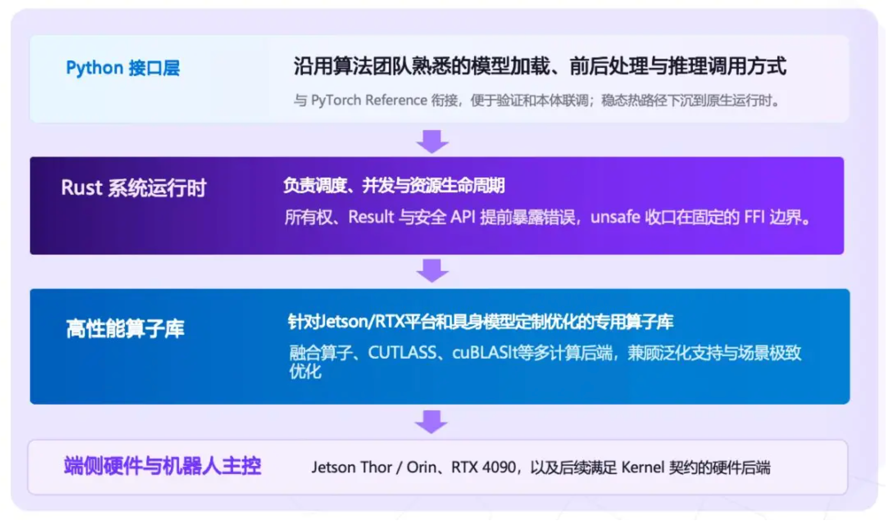
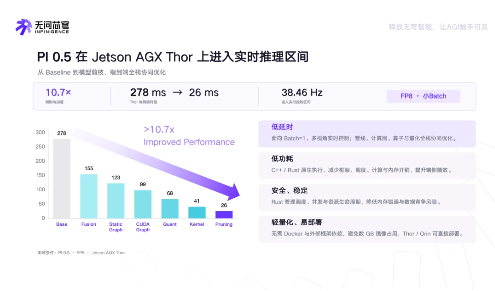

# Фреймворки вывода и развёртывания воплощённого ИИ: от APXInf до Jetson-PI и Embodied.cpp

## Какую задачу решает эта глава

Обученная модель VLA или WAM ещё не означает, что робот стабильно работает. Для реального развёртывания нужно решить: прямой проход модели, сэмплирование flow/diffusion, синхронизацию камер и состояния собственного тела, планирование блоков действий (action chunk), связь, обратную кинематику (IK), период управления, запись данных и распределение ресурсов между несколькими роботами.

В этой главе собраны проекты, которые легко перепутать, и поставлены в одну таблицу:

- **Среды вывода на устройстве**: APXInf, Embodied.cpp, vla.cpp, Jetson-PI-Edge;
- **Асинхронное управление и скрытие задержки**: Jetson-PI, OpenPI-RTC, EVA-Client;
- **Развёртывание на реальном роботе и замкнутый цикл данных**: EVA-Client;
- **Обслуживание нескольких роботов и облачный serving**: ROSA;
- **Инфраструктура обучения, rollout и оценки**: RLinf;
- **Эталонная реализация модели и сервер политики**: OpenPI;
- **Общая база развёртывания NVIDIA**: TensorRT, TensorRT-LLM, Isaac ROS.

Это разные типы программ, поэтому сравнивать их по одному показателю нельзя. В качестве воспроизводимого примера здесь разобран APXInf, остальные проекты помогают выстроить систему выбора и читать статьи.

## 1. Сначала разложим «фреймворк вывода» по слоям

Робототехническая система обычно выглядит так:

```text
Обучение / дообучение
  RLinf, LeRobot, OpenPI и др.
          ↓ контрольная точка
Модель и сервер политики
  OpenPI, GR00T, StarVLA или собственный сервер политики
          ↓ наблюдение / блок действий
Слой вывода и исполнения
  APXInf, Embodied.cpp, vla.cpp, TensorRT
  Jetson-PI, OpenPI-RTC, EVA-Client
          ↓ действие
Промежуточное ПО робота и контроллер
  ROS1/ROS2, ZeroMQ, IK, драйверы, аппаратура
```

Часто смешиваются два понятия:

1. **Среда вывода (Runtime)** определяет, как выполняется прямой проход модели: операторы, квантование, память видеокарты, захват графа и бэкенды.
2. **Клиент политики и исполнения** определяет, когда запрашивать модель, как склеивать блоки действий, как компенсировать задержку и как в итоге отправлять движения роботу.

APXInf относится в основном к первому типу; Jetson-PI и EVA-Client решают задачи второго типа; RLinf находится выше, на уровне обучения и оценки.

## 2. Общая таблица

### Таблица 1. Место проектов по воплощённому ИИ в стеке

| Проект | Слой | Основные особенности | Какие задачи решает | Статус публикации |
| --- | --- | --- | --- | --- |
| [APXInf](https://github.com/RLinf/APXinf-robo) | Среда вывода на устройстве | Среда выполнения на Rust, ядра CUDA, CUDA Graph, BF16/FP8/INT8 | Низкозадержечный вывод VLA на NVIDIA Jetson/RTX | Открытый проект; пока в основном документация проекта |
| [Embodied.cpp](https://github.com/SEU-PAISys/Embodied.cpp) | Общая среда выполнения для воплощённых моделей | Многослойная среда на C++, единый интерфейс VLA/WAM, работа с разнородным оборудованием | Развёртывание на разных моделях, роботах и устройствах | [arXiv:2607.02501](https://arxiv.org/abs/2607.02501); на публичной странице не указана официальная конференция или журнал |
| [vla.cpp](https://github.com/VinRobotics/vla.cpp) | Общая среда выполнения VLA | На основе llama.cpp/ggml, упаковка в GGUF, много моделей и бэкендов | Лёгкий вывод VLA без Python/PyTorch | [arXiv:2606.08094](https://arxiv.org/abs/2606.08094); на публичной странице не указана официальная конференция или журнал |
| [Jetson-PI](https://github.com/PKU-SEC-Lab/Jetson-PI) / [Jetson-PI-Edge](https://github.com/PKU-SEC-Lab/Jetson-PI-Edge) | Асинхронное управление и среда выполнения на периферии | Упреждающая коррекция, планирование по уверенности, CUDA Graph, буферы, постоянно находящиеся в GPU | Скрытие задержки вывода на Orin и рост эффективной частоты управления | В официальном репозитории указано: принято на CoRL 2026; статья также есть на [arXiv:2607.12659](https://arxiv.org/abs/2607.12659) |
| [EVA-Client](https://github.com/Noietch/EVA-CLIENT) | Клиент для реального робота | ROS/ZeroMQ, синхронный/асинхронный режим, ACT, RTC, IK, сбор данных и оценка | Подключение сервера политики к реальному роботу с сохранением диагностируемых данных | [arXiv:2607.02646](https://arxiv.org/abs/2607.02646); на публичной странице не указана официальная конференция или журнал |
| [ROSA](https://mast.stanford.edu/pubs/rosa_a_robotics_foundation_model_serving_system_for_robot_factories/) | Serving в кластере | Общий пул GPU, планирование с учётом восприятия роботов, конвейеры из нескольких моделей | Совместное использование GPU в облаке или серверной роботов | [arXiv:2607.01088](https://arxiv.org/abs/2607.01088); на публичной странице не указана официальная конференция или журнал |
| [RLinf](https://github.com/RLinf/RLinf) | Инфраструктура обучения и rollout | Распределённое RL, симуляция, оценка, много бэкендов | Обучение и оценка воплощённых политик | Открытый фреймворк; не среда вывода на устройстве |
| [OpenPI](https://github.com/Physical-Intelligence/openpi) | Эталонный стек модели и политики | Модели π0/π0.5, преобразования, сервер политики | Воспроизведение и интерфейсы политик | Открытые модель и код; не универсальная среда развёртывания |
| [TensorRT / Isaac ROS](https://developer.nvidia.com/isaac/ros) | Общая база развёртывания | Оптимизация графов, квантование и интеграция с ROS от NVIDIA | Инженерное развёртывание на фиксированной платформе NVIDIA | Официальный SDK и экосистема; не отдельный исследовательский Runtime для VLA |

### Как читать статус публикаций

В таблице отдельно указано «опубликовано в конференции» и «опубликовано как препринт». Jetson-PI в официальном репозитории прямо отмечен как принятый на CoRL 2026, поэтому помечен как «принято по данным репозитория». У Embodied.cpp, vla.cpp, EVA-Client и ROSA ссылки ведут на arXiv, и мы не утверждаем, что эти работы опубликованы в конференции или журнале. Для APXInf мы описываем проект по открытой документации и официальному техническому описанию, не придумывая публикаций.

## 3. APXInf: оптимизация VLA на NVIDIA-устройствах

APXInf решает задачу «как заставить уже обученную модель работать на самом роботе достаточно быстро и стабильно». Официальный репозиторий — [RLinf/APXinf-robo](https://github.com/RLinf/APXinf-robo); движок ApxInf подключён через git-submodule.

Типичная цепочка выглядит так:

```text
Python API / совместимый с OpenPI сервер
                 ↓
          Системная среда на Rust
                 ↓
  Слитые операторы, CUTLASS/cuBLAS, CUDA Graph, квантование
                 ↓
      Jetson Thor / Orin / RTX 4090
```



**Рисунок 1.** Официальная схема APXInf. Интерфейс Python сохраняет удобство загрузки модели, предобработки и вызова вывода; среда Rust отвечает за планирование и жизненный цикл ресурсов; библиотека операторов оптимизирована под Jetson, RTX и воплощённые модели.

Источник: [официальное описание APXInf от Infinigence AI](https://www.infinigence-ai.com/news-updates/233.html).

Первый официальный релиз ориентирован на π0.5 и поддерживает BF16, FP8 и INT8. Официальные задержки для π0.5 при batch=1, двух видах камер, 10 шагах flow и горизонте действий 10:

| Устройство | Точность | Базовая задержка | После onestep pruning |
| --- | --- | ---: | ---: |
| Jetson AGX Thor | BF16 | 72,45 мс | 44,05 мс |
| Jetson AGX Thor | FP8 | 41,16 мс | 26,32 мс |
| Jetson AGX Orin | BF16 | 165,67 мс | 119,05 мс |
| RTX 4090 | BF16 | 31,38 мс | 20,36 мс |



**Рисунок 2.** Официальная цепочка оптимизации. Снижение задержки достигнуто за счёт комбинации слитых операторов, статических графов, CUDA Graph, квантования, оптимизации ядер и обрезки генерации действий. Его нельзя приписать только Rust или одному ядру CUDA.

Источник: [официальное описание APXInf от Infinigence AI](https://www.infinigence-ai.com/news-updates/233.html).

### Минимальная проверка APXInf

Ниже описана проверка установки и цепочки вывода APXInf без загрузки весов модели в репозиторий учебника. Команды выполняются в корне репозитория APXinf-robo на Linux с видеокартой NVIDIA:

```bash
git clone --recursive https://github.com/RLinf/APXinf-robo.git
cd APXinf-robo

python3 -m venv .venv
source .venv/bin/activate
pip install maturin

CARGO_TARGET_DIR=target/wheel maturin build --release --features cuda \
  --auditwheel skip -m apxinf/crates/apxinf-py/Cargo.toml
pip install --force-reinstall target/wheel/wheels/apxinf_py-*.whl
pip install -e "./apxinf/python/apxinf[serving]" --config-settings editable_mode=strict
pip install -e ".[serve]"
```

Сначала проверяется импорт:

```bash
python -c 'import apxinf_py; print(apxinf_py.__version__)'
python -c 'import apxinf_robo; print(apxinf_robo.__version__)'
```

Затем тест среды выполнения со случайными весами:

```bash
python scripts/bench_pi05.py \
  --random-weights \
  --precision bf16 \
  --layer l1 \
  --views 2 \
  --token-count 10 \
  --action-horizon 10 \
  --num-flow-steps 10 \
  --warmup 10 \
  --samples 30 \
  --autotune
```

Случайные веса подтверждают только то, что формы входов, ядра CUDA, захват графа и цепочка измерения времени работают, но не говорят об успешности модели. Для реальной оценки нужны совместимая контрольная точка π0.5, `norm_stats.json`, LIBERO и MuJoCo. Официальная документация советует сначала прогнать одну задачу в одном эпизоде, и только потом переходить к полной оценке LIBERO-10. [Документация APXInf по LIBERO](https://github.com/RLinf/APXinf-robo#libero-evaluation)

## 4. Embodied.cpp: более общая среда выполнения для воплощённых моделей

[Embodied.cpp](https://github.com/SEU-PAISys/Embodied.cpp) решает проблему раздробленности стеков: у разных VLA и WAM разный Python-код, свои бэкенды и glue-код для робота, поэтому при смене модели, устройства или корпуса всё приходится подключать заново.

В статье среда выполнения разбита на пять слоёв:

```text
Адаптеры входа
      ↓
Построители последовательностей
      ↓
Выполнение бэкбона
      ↓
Подключаемые головы
      ↓
Адаптеры развёртывания
```

Исследовательский фокус — многоскоростное выполнение, вывод с приоритетом задержки при batch-1, слитое выполнение и развёртывание на разнородном оборудовании. По сравнению с APXInf цель шире: не довести π0.5 до предела на нескольких чипах NVIDIA, а создать переносимую среду на C++, которая может обслуживать VLA и WAM.

Статья Embodied.cpp пока существует как технический отчёт [arXiv:2607.02501](https://arxiv.org/abs/2607.02501), и в учебнике мы не называем её опубликованной в конференции. Инженерный потенциал и статус публикации — разные вещи.

## 5. vla.cpp: VLA в виде лёгкого движка в стиле GGUF/ggml

[vla.cpp](https://github.com/VinRobotics/vla.cpp) напоминает `llama.cpp`: модель конвертируется в самодостаточный GGUF и исполняется в среде C++/ggml, поэтому при выводе не нужны полные Python и PyTorch.

Публичный репозиторий уже поддерживает несколько стратегий и бэкендов: π0/π0.5, SmolVLA, BitVLA, Evo-1, OpenVLA-OFT, GR00T и др., а также пути CUDA, CPU, Apple Silicon, SYCL/OpenVINO. Он отвечает на вопрос:

> Можно ли одной лёгкой, переносимой и пакуемой средой выполнения запускать несколько VLA?

| Сравнение | APXInf | vla.cpp |
| --- | --- | --- |
| Основная цель | Максимальная производительность на устройстве для конкретной воплощённой модели и платформ NVIDIA | Много моделей, много платформ, лёгкая упаковка |
| Форма модели | Контрольная точка + специальная реализация | Самодостаточный пакет GGUF/ggml |
| Зависимости | Rust/CUDA/привязки Python | C++/ggml, при выводе заметно легче |
| Подходящие сценарии | Глубокая оптимизация на Thor/Orin/RTX | Когда нужно уменьшить зависимость от Python/PyTorch |
| Статус статьи | В основном документация проекта | [arXiv:2606.08094](https://arxiv.org/abs/2606.08094); на публичной странице не указана официальная конференция или журнал |

## 6. Jetson-PI: не только быстрее вывод, но и меньше ожиданий робота

Суть [Jetson-PI](https://github.com/PKU-SEC-Lab/Jetson-PI) — не просто замена PyTorch, а параллельная работа исполнения действий и следующего вывода. Метод назван Foresight-Aligned Asynchronous Correction: по уже отправленным действиям предсказывается будущее представление среды, и затем действия генерируются с этого будущего момента. Это уменьшает рассогласование между наблюдением и исполнением, которое возникает при асинхронном выводе.

```text
Исполнение текущего блока действий ───────────────→ контроллер робота
          │
          └── фоновый вывод → будущая коррекция → следующий блок действий
```

Метод также использует планирование по уверенности, повторное использование CUDA Graph, буферы, постоянно находящиеся в GPU, и развёртывание flow. Официальная статья сообщает, что на Jetson Orin частота управления выросла в 8,66× по сравнению с наивным PyTorch и в 5,41× по сравнению с vla.cpp. Этот результат включает алгоритм, планирование и системную оптимизацию, поэтому его нельзя принимать за скорость «голой» модели конкретной среды выполнения. [Статья Jetson-PI](https://arxiv.org/abs/2607.12659)

Официальный репозиторий Jetson-PI отмечает принятие на CoRL 2026. В учебнике мы отдельно пишем «информация о принятии из репозитория» и отдельно ссылку на arXiv, чтобы статус можно было обновить позже.

## 7. EVA-Client: слой исполнения на реальном роботе после вывода модели

[EVA-Client](https://github.com/Noietch/EVA-CLIENT) нельзя относить к движкам вывода на CUDA. Он стоит между сервером политики и физическим роботом и отвечает за:

- ROS1, ROS2, ZeroMQ и воспроизведение данных офлайн;
- бэкенды политик: OpenPI, OpenPI-RTC, StarVLA, GR00T и др.;
- режимы sync, async, naive, ACT ensemble и RTC;
- буфер действий, компенсацию задержки, преобразование EEF/Joint и IK;
- отладку, сбор данных, оценку и воспроизведение;
- одновременную запись исходного выхода политики, сглаженных действий и действительно отправленных команд.

Такие фреймворки решают вопрос: «модель уже выдаёт действия, но почему реальный робот всё равно замирает, дрожит, сбивается с траектории или не поддаётся разбору?» EVA-Client дополняет APXInf: APXInf может быть серверной частью вывода, а EVA-Client подключает результат к роботу и формирует замкнутый цикл данных. [Технический отчёт EVA-Client](https://arxiv.org/abs/2607.02646)

## 8. ROSA: от вывода на одном устройстве к обслуживанию роя роботов

[ROSA: A Robotics Foundation Model Serving System for Robot Factories](https://mast.stanford.edu/pubs/rosa_a_robotics_foundation_model_serving_system_for_robot_factories/) рассматривает другой вариант развёртывания: на фабрике много роботов, но на каждом не обязательно стоит мощный GPU.

```text
Рой роботов
   ↓ сетевые запросы
Общий пул GPU / Ray Serve
   ↓
Вывод нескольких моделей и планирование с учётом восприятия роботов
```

Фокус ROSA — общий пул GPU, конвейеры из нескольких моделей, требования на уровне задач и обработка сбоев. Цель — повысить производительность всей фабрики, а не минимизировать задержку одного вызова одного робота. С APXInf он дополняет друг друга по схеме «край и облако»: на роботе может работать APXInf, а в серверной — система serving вроде ROSA.

Публичная статья ROSA — [arXiv:2607.01088](https://arxiv.org/abs/2607.01088); эта страница не является доказательством публикации на конференции или в журнале.

## 9. Где место RLinf, OpenPI и TensorRT

### RLinf: инфраструктура обучения и rollout

[RLinf](https://github.com/RLinf/RLinf) поддерживает воплощённое обучение с подкреплением, симуляцию, rollout, распределённое выполнение и разные бэкенды моделей. Через APXinf-robo он может вызывать APXInf для оценки π0.5, но это не значит, что RLinf сам по себе — среда вывода на устройстве.

Понятная схема комбинирования:

```text
RLinf: обучение / обучение с подкреплением / rollout / оценка
  ↓ контрольная точка
APXInf или vla.cpp: вывод модели на устройстве
  ↓ блок действий
EVA-Client или собственный клиент: асинхронное исполнение, IK, запись и оценка на роботе
```

### OpenPI: эталонная реализация модели и политики

[OpenPI](https://github.com/Physical-Intelligence/openpi) предоставляет модели π0/π0.5, преобразования данных, обучение и референсную реализацию сервера политики. APXInf, vla.cpp, Jetson-PI и EVA-Client могут подключаться к OpenPI на разных уровнях. OpenPI отвечает на вопрос «как определяется и вызывается модель», но не решает все проблемы максимальной производительности на любом железе.

### TensorRT / Isaac ROS: промышленная база развёртывания

TensorRT, TensorRT-LLM и Isaac ROS не являются отдельной средой выполнения именно для VLA, но важны в экосистеме роботов NVIDIA. Если модель, устройство и форма входов фиксированы, путь TensorRT/NVFP4/FP8 может дать очень низкую задержку, а Isaac ROS предоставляет аппаратно ускоренные компоненты ROS и системную интеграцию.

Этот путь не стоит противопоставлять APXInf: APXInf может объединять сэмплирование VLA, горизонт действий, интерфейс политики и ограничения развёртывания на роботе, а TensorRT отвечает за общую оптимизацию графов и аппаратные бэкенды. Итоговое решение нужно измерять на одной модели, одинаковых входах, одинаковом числе шагов flow, одинаковой температуре и одной и той же методике подсчёта.

## 10. Как выбирать решение под задачу

### Таблица 2. Рекомендации по выбору

| Потребность | Что изучать или пробовать в первую очередь | Почему |
| --- | --- | --- |
| Сквозная низкая задержка π0.5 на Jetson Thor/Orin | APXInf, TensorRT на Thor | Готовый путь оптимизации под NVIDIA на периферии |
| Вывод медленный, но управление не должно останавливаться | Jetson-PI, OpenPI-RTC, EVA-Client | Задержка скрывается асинхронным исполнением, упреждающей коррекцией или RTC |
| Единое подключение нескольких VLA/WAM и нескольких аппаратных платформ | Embodied.cpp, vla.cpp | Больше внимания уделяется абстракции среды выполнения и переносимости |
| Сбор данных, оценка, воспроизведение и анализ сбоев на реальном роботе | EVA-Client | Развёртывание и замкнутый цикл данных в одном клиенте |
| Несколько роботов используют общий GPU на сервере | ROSA | Цель — уровень парка или фабрики |
| Обучение, обучение с подкреплением и крупномасштабный rollout | RLinf | Среда вывода на устройстве — не его основная задача |
| Сначала воспроизвести поведение π0/π0.5 | OpenPI | Прямой эталон для модели, преобразований и сервера политики |

## 11. Как сравнивать такие системы

Не стоит сравнивать только одну цифру «скорость вывода». Нужно отдельно фиксировать:

1. **Задержку среды выполнения**: время исполнения модели при фиксированном входе и фиксированном числе шагов сэмплирования;
2. **Задержку политики**: включая resize, токенизацию, нормализацию, сэмплирование и денормализацию;
3. **Задержку передачи**: межпроцессное взаимодействие и сетевой обмен;
4. **Частоту управления**: реально отправляемую частоту действий и эффективную частоту при асинхронной политике;
5. **Успешность выполнения задач**: одинаковая контрольная точка, одинаковый seed и один и тот же набор задач;
6. **Долгосрочную устойчивость**: видеопамять, оперативная память, очереди, потоки и восстановление после сбоев;
7. **Стоимость переноса**: нужно ли переписывать среду выполнения при смене модели, аппаратуры или корпуса робота.

Задержка голой модели 26 мс не обязательно лучше системы в 40 мс, которая работает асинхронно, умеет восстанавливаться после сбоев и даёт воспроизводимые записи: для реального робота важнее второе. И наоборот: клиент с высокой частотой управления ещё не является низкоуровневым движком вывода.

## 12. Итоги главы

Исследования инфраструктуры воплощённого вывода складываются в несколько взаимодополняющих направлений:

```text
Модели и обучение: OpenPI, RLinf
        ↓
Среды выполнения на устройстве: APXInf, Embodied.cpp, vla.cpp, TensorRT
        ↓
Асинхронное управление: Jetson-PI, OpenPI-RTC
        ↓
Замкнутый цикл на реальном роботе: EVA-Client, ROS / контроллер робота
        ↓
Serving в кластере: ROSA
```

APXInf углубляет оптимизацию вывода воплощённых моделей на NVIDIA-устройствах; Embodied.cpp и vla.cpp развивают общие среды выполнения; Jetson-PI решает рассогласование во времени между выводом и управлением; EVA-Client закрывает задачи исполнения на реальном роботе и сбора данных; ROSA переносит проблему на уровень роя роботов. Вместе они показывают, что «вывод» воплощённой модели — это уже не просто один прямой проход трансформера, а системная задача, где модель, планирование, аппаратура и управление роботом работают как единое целое.

## Источники

1. [Официальный репозиторий APXinf-robo](https://github.com/RLinf/APXinf-robo)
2. [Официальный репозиторий RLinf](https://github.com/RLinf/RLinf)
3. [Официальный репозиторий OpenPI](https://github.com/Physical-Intelligence/openpi)
4. [Официальный репозиторий Embodied.cpp](https://github.com/SEU-PAISys/Embodied.cpp) / [arXiv:2607.02501](https://arxiv.org/abs/2607.02501)
5. [Официальный репозиторий vla.cpp](https://github.com/VinRobotics/vla.cpp) / [arXiv:2606.08094](https://arxiv.org/abs/2606.08094)
6. [Официальный репозиторий Jetson-PI](https://github.com/PKU-SEC-Lab/Jetson-PI) / [arXiv:2607.12659](https://arxiv.org/abs/2607.12659)
7. [Официальный репозиторий EVA-Client](https://github.com/Noietch/EVA-CLIENT) / [arXiv:2607.02646](https://arxiv.org/abs/2607.02646)
8. [Официальная страница ROSA](https://mast.stanford.edu/pubs/rosa_a_robotics_foundation_model_serving_system_for_robot_factories/) / [arXiv:2607.01088](https://arxiv.org/abs/2607.01088)
9. [NVIDIA Isaac ROS](https://developer.nvidia.com/isaac/ros)
