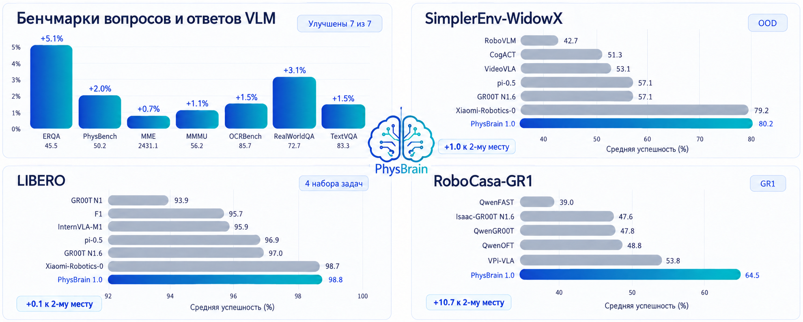
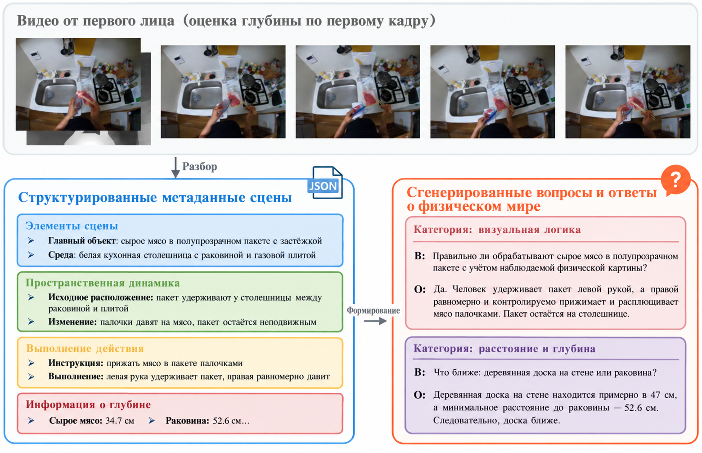
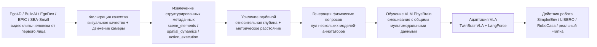
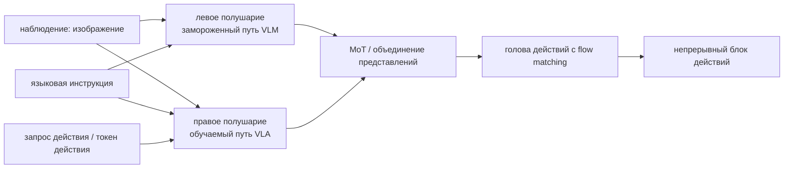

# PhysBrain 1.0: сначала физический здравый смысл, затем управление роботом

Эта глава посвящена статье **PhysBrain 1.0 Technical Report** (препринт [arXiv:2605.15298](https://arxiv.org/abs/2605.15298)). Страница проекта — [phys-brain.github.io](https://phys-brain.github.io/), код VLA — [Phys-Brain/PhysBrain-VLA](https://github.com/Phys-Brain/PhysBrain-VLA).

Раздел уместно поместить в `06-manipulation-and-vla/large-model-control-vla-vlm` после OpenVLA, DiT4DiT, EventVLA, WALL-OSS/WALL-X и 3DVLA. PhysBrain 1.0 служит задачам управления роботом и дообучения VLA. Это не мировая модель, которую можно запускать как симулятор через `step(action)`, и не нейросетевая модель для rollout видео.

После главы запомните основную мысль:

> Ключевое в PhysBrain 1.0 — не «подражать действиям по большему числу траекторий робота», а сначала превратить большой массив видео от первого лица у человека в структурированный контроль физических свойств, обучить VLM, которая лучше понимает физические связи, контакт, пространственные расстояния и выполнимость действий, а затем с помощью адаптации VLA, сохраняющей способности, и с учётом языка перенести эти физические представления на генерацию действий робота.

Иными словами, путь выглядит так:

```text
Видео от первого лица у человека
        ↓
Структурированные физические метаданные
        ↓
Усиление глубиной и физические вопросы-ответы
        ↓
Модель VLM PhysBrain
        ↓
TwinBrainVLA + LangForce
        ↓
Стратегия управления роботом
```

Этот подход дополняет недавние работы по VLA: WALL-OSS ближе к открытой модели и инженерному входу, 3DVLA — к внедрению пространственных токенов и токенов экземпляров в action expert, а PhysBrain 1.0 отвечает на вопрос, откуда берётся физический здравый смысл и как не потерять его при дообучении на траекториях роботов.

## 1. Статья, проект и открытый код

| Проект | Текущее состояние |
| :--- | :--- |
| Статья | [arXiv:2605.15298](https://arxiv.org/abs/2605.15298), подана 2026-05-14 |
| Официальная страница проекта | [PhysBrain 1.0](https://phys-brain.github.io/) |
| Репозиторий кода VLA | [Phys-Brain/PhysBrain-VLA](https://github.com/Phys-Brain/PhysBrain-VLA), Apache-2.0 |
| Страница статьи на Hugging Face | [HF Papers: 2605.15298](https://huggingface.co/papers/2605.15298) |
| Коллекция моделей | [PhysBrain 1.0 VLA collection](https://huggingface.co/collections/Phys-Brain/physbrain-10-vla) |
| Опубликованные контрольные точки | RoboCasa-GR1, LIBERO, SIMPLER-Bridge, SIMPLER-Fractal |
| Рекомендуемый путь воспроизведения | Не обучать с нуля движок данных и VLM; сначала прочитать метод, скачать контрольную точку и загрузить адаптацию VLA в фреймворке starVLA |

Нужно честно обозначить границы открытости. Текущий репозиторий [PhysBrain-VLA](https://github.com/Phys-Brain/PhysBrain-VLA) опубликовал код модели для VLA и точки входа для контрольных точек. В README указано, что он построен на каркасе `starVLA`: файл `physbrain_vla/PhysBrainVLA.py` нужно скопировать в `starVLA/model/framework/` и далее загружать и развёртывать по стандартному процессу контрольных точек starVLA.

Это не полностью автоматический репозиторий «от 3000 часов видео человека до VLM PhysBrain и всех бенчмарков роботов». Движок данных, полный набор размеченных данных, полные скрипты обучения и конфигурации большой вычислительной мощности, судя по всему, не опубликованы полностью. Поэтому в учебнике лучше описывать его как обзор метода и источник контрольных точек, а не как обещание полного воспроизведения статьи.

## 2. Какую задачу решает статья

Логика обучения многих VLA обычно такая:

```text
Наблюдение робота + языковая инструкция + демонстрационное действие
        ↓
Клонирование поведения / диффузия / flow matching
        ↓
Выполнение в новой сцене
```

Этот путь работает, но у него есть трудное ограничение: траектории роботов дороги и покрывают узкий набор ситуаций. Датасет манипулятора может содержать много захватов, укладок и открытий ящиков, но плохо отражает физические явления повседневного мира: прозрачные пакеты, гибкие предметы, заполнен ли контейнер, порядок контакта руки и предмета, взаимные перекрытия и глубину, физическую причину провала действия.

Подход PhysBrain 1.0 начинается с наблюдения: видео от первого лица, на котором человек готовит еду, раскладывает вещи, собирает детали или работает с оборудованием, уже содержит богатый опыт взаимодействия. В нём видны руки, предметы, инструменты, контакты, перемещения, перекрытия и смена состояний, а также этапы задачи. Но такие видео нельзя напрямую использовать для обучения управлению роботом: в них нет действий робота и единой структурированной разметки.

Поэтому статья выполняет преобразование:

| Что неявно есть в исходном видео | Какой контроль PhysBrain извлекает явно |
| :--- | :--- |
| Какие предметы лежат на столе | `scene_elements`: главный предмет, соседние объекты, материалы, геометрия, состояние |
| Как рука и предмет сближаются, контактируют и расходятся | `spatial_dynamics`: начальная компоновка, изменение относительных положений, эволюция пространственных отношений |
| Что человек делает на самом деле | `action_execution`: короткое намерение и подробный ход выполнения |
| Насколько далеко предмет от камеры или руки | Отношения с учётом глубины: относительная глубина, абсолютное расстояние, досягаемость |
| Что делать дальше | Физические вопросы: предсказание следующего шага, выполнимость, безопасность, долгосрочное планирование |

Ценность такого подхода в том, что видео человека и данные роботов не обязаны совпадать попарно. Видео сначала учит «физическую понимающую часть» модели, а данные робота потом учат «тело, которое выполняет действие». Авторы называют это **понимание сначала, действие потом (understanding first, action next)**.

## 3. Общий рисунок: где PhysBrain 1.0 проверяется

<p align="center">
  
</p>

**Рисунок 1. Общий обзор оценки PhysBrain 1.0.** Рисунок не описывает структуру модели, а показывает итоги, которые приводит статья: слева — бенчмарки вопросов и ответов для VLM, справа — бенчмарки управления роботом: SimplerEnv, LIBERO и RoboCasa-GR1.

Источник: [PhysBrain 1.0 на arXiv HTML](https://arxiv.org/html/2605.15298v1).

Рисунок 1 можно читать в двух направлениях.

Первое направление — VLM. PhysBrain 1.0 не просто утверждает, что в итоге умеет управлять роботом. Сначала модель проверяется на бенчмарках многомодального понимания: ERQA, PhysBench, MME, MMMU, OCRBench, RealWorldQA, TextVQA и др., чтобы проверить физический здравый смысл и общие визуально-языковые способности. Эта часть нужна для того, чтобы доказать: супервизия из видео от первого лица улучшает базовую VLM в пространственном, состоянийном, плановом и физическом понимании, а не просто добавляет несколько признаков в голову действий.

Второе направление — VLA. Статья проверяет управление на SimplerEnv-WidowX, SimplerEnv-GoogleRobot, LIBERO и RoboCasa-GR1 и особенно подчёркивает сценарии out-of-domain. Логика статьи такая: если VLM уже освоила более сильные физические априорные знания о взаимодействии человека с предметами, то после ограниченной адаптации на данных робота она будет устойчивее в новых средах, с новыми предметами и новыми задачами.

Здесь важно не путать: PhysBrain 1.0 не является мировой моделью, которая строит интерактивную среду и обновляет политику на воображаемых rollout. Скорее это дополнительный этап физического предобучения перед VLA, а при дообучении VLA архитектура и функции потерь защищают эти знания от потери.

## 4. Движок данных: от видео от первого лица до физических вопросов

<p align="center">
  
</p>

**Рисунок 2. От видео от первого лица человека к структурированным физическим вопросам.** Короткий видеоклип сначала равномерно разбивается на кадры, затем разбирается на `scene_elements`, `spatial_dynamics`, `action_execution` и информацию о глубине и преобразуется в вопросы на естественном языке.

Источник: [PhysBrain 1.0 на arXiv HTML](https://arxiv.org/html/2605.15298v1).

Рисунок показывает ключевую идею PhysBrain. Статья не превращает видео в одну подпись вроде «человек на кухне режет мясо палочками». Такая подпись полезна для VLM, но слишком груба для управления роботом. Роботу нужна более тонкая физическая структура:

- каков главный предмет, его материал и состояние;
- какие предметы рядом и какие из них могут мешать операции;
- с какого направления рука приближается и произошёл ли контакт;
- как меняются положения предмета относительно стола, раковины или инструмента;
- что происходит с предметом: нажатие, перемещение, захват, укладка, поворот или удержание;
- какие объекты ближе, дальше, выше или ниже;
- что нужно сделать дальше, если задача продолжается.

Статья выстраивает этот процесс в три уровня.

Первый уровень — **структурированные метаданные сцены**. Каждый видеоклип разбирается в запись в формате JSON, основные поля которой:

| Поле | Что записывает | Зачем это роботу |
| :--- | :--- | :--- |
| `scene_elements` | Главный предмет, соседние предметы, окружение, материалы, геометрию и физическое состояние | Модель понимает, что объект — не только категория, но и свойства для манипуляции: жёсткость, прозрачность, гибкость, заполненность |
| `spatial_dynamics` | Начальную компоновку, изменение расстояния между рукой и предметом, изменение относительного положения предметов | Модель учится процессу «приближение, контакт, перемещение, расхождение» |
| `action_execution` | Короткое намерение и подробный ход выполнения | Наблюдаемое действие раскладывается на исполнимые шаги, а не сводится к краткому пересказу видео |
| `depth_info` | Центральные точки объектов, относительную глубину, абсолютное расстояние | Даёт основу для последующих вопросов о 3D и метрическом понимании |

Второй уровень — **усиление глубиной**. В статье для объектов с привязкой к геометрии добавляются поточечная глубина и расстояние с использованием моделей оценки глубины семейства Depth Anything v3. Это важно: чисто языковые описания часто ограничиваются понятиями «слева, справа, ближе, дальше», а управлению нужны непрерывные смещения, положения концевого эффектора и масштаб. Когда есть глубина, вопросы могут звучать как «какой предмет ближе» или «каково примерное расстояние между ними» или «достижимо ли это положение», и тогда пространственное понимание VLM опирается на физические величины.

Третий уровень — **генерация физических вопросов**. Структурированная запись не является конечной целью обучения; конечной остаётся вопрос-ответ на естественном языке. Так VLM учится в привычной форме, а содержание вопросов берётся из структурированной записи и может охватывать предметы, пространство, глубину, изменения состояний, выполнимость действий и долгосрочное планирование.

Статья перечисляет очень широкий набор типов вопросов, которые можно сгруппировать в четыре класса:

| Класс | Примеры вопросов | Что тренирует |
| :--- | :--- | :--- |
| Пространство и метрика | Пространственные отношения, расстояние и глубина, оценка размеров, привязка координат, рассуждение с точки зрения наблюдателя | Пространственное понимание и привязку к метрике |
| Действие и план | Предсказание следующего шага, маршрут, выполнимость и безопасность, долгосрочное планирование | Принятие решений в воплощённой среде |
| Динамика и причинность | Изменения состояния предметов, распознавание действий, порядок во времени, локализация действий, контрфактические рассуждения | Контакт, изменения и последствия действий |
| Сохранение общих способностей | Подсчёт, мелкие атрибуты, проверка наличия, OCR, анализ графиков, научные знания, визуальная логика | Чтобы модель не превратилась только в «решателя роботных задач», а сохранила универсальный VLM |

Именно поэтому PhysBrain нельзя считать просто «набором видеоразметки». Точнее говорить о **компиляторе физического контроля**: сначала видео разбирается на машинно проверяемые физические записи, затем записи превращаются в разнообразные вопросы, и на этих вопросах обучается воплощённая VLM.

## 5. Базовая модель PhysBrain: почему одних траекторий робота недостаточно

<p align="center">
  
</p>

**Рисунок 3. Охват корпуса видео от первого лица на странице проекта PhysBrain 1.0.** На кадрах — дом, лаборатория и производственный процесс. Рисунок подчёркивает, что физический контроль не ограничен демонстрациями манипулятора на столе.

Источник: [страница проекта PhysBrain 1.0](https://phys-brain.github.io/).

Хотя рисунок не показывает структуру сети, он хорошо передаёт философию PhysBrain. Традиционные данные роботов обычно ограничены стационарным манипулятором, стационарной камерой, фиксированными задачами и набором предметов. Для обучения действиям они прямые, но покрывают мало физического мира.

Видео от первого лица из повседневной жизни устроено иначе: это не данные действий робота, поэтому они не управляют суставами или концевым эффектором напрямую. Зато они охватывают кухни, лаборатории, заводы, домашнюю уборку, ручные инструменты, гибкие предметы, прозрачные контейнеры, перекрытия и сложные контакты. PhysBrain решает учиться на этом материале сначала физическому пониманию, а затем переносит его на робота.

Это не противопоставление с наборами Open X-Embodiment. Траектории роботов учат политику тому, «как движется это тело», а видео человека учит VLM тому, «что в этом мире физически правдоподобно, какие состояния возможны и какие пространственные отношения важны».

Упрощённый поток данных:



Самое важное в этом процессе — промежуточный структурированный слой. Если просто поручить большой модели смотреть видео и писать вопросы, получится стилистически однородный текст, но физическое обоснование окажется нестабильным. PhysBrain сначала требует от модели структурированные метаданные и только потом строит вопросы на их основе. Так видео-супервизия разбивается на промежуточное представление, которое можно проверять, комбинировать и расширять.

## 6. TwinBrainVLA: левое полушарие сохраняет способности, правое учится управлению

<p align="center">
  
</p>

**Рисунок 4. Двухполушарная структура TwinBrainVLA.** Левый путь сохраняет общие визуально-языковые способности, правый путь адаптируется к действиям робота; два пути взаимодействуют через MoT и аналогичные механизмы, чтобы при обучении управлению меньше терялись способности VLM.

Источник: [страница проекта PhysBrain 1.0](https://phys-brain.github.io/).

При переходе от VLM к VLA возникает типичная проблема: данных роботов намного меньше, чем общих изображений и текста, и их распределение узкое. Если напрямую дообучать всю VLM на поведенческом клонировании, модель может выучить визуальные приёмы конкретного бенчмарка, но утратить языковое понимание, пространственное рассуждение и обобщение. Статья называет это адаптацией с сохранением способностей (capability-preserving adaptation).

Идея TwinBrainVLA:

| Компонент | Что делает | Как это понимать |
| :--- | :--- | :--- |
| Замороженное левое полушарие | Сохраняет визуально-языковые представления исходной модели PhysBrain/VLM | Небольшие траектории робота не портят общие способности |
| Обучаемое правое полушарие | Адаптируется к действиям робота и конкретному воплощению | Учится превращать наблюдение, язык и токены действий в исполнимую политику |
| MoT / объединение признаков | Позволяет двум путям взаимодействовать | Правое полушарие может использовать физические знания левого, но не полагаться только на визуальные приёмы |
| Голова действий с flow matching | Генерирует блок непрерывных действий | Работает с непрерывными, многомерными и зависящими от времени управляющими величинами |

Открытый код показывает, что TwinBrainVLA явно разделяет входы левого и правого полушарий. Левое обрабатывает зрение и язык, правое — зрение, язык и токены действий или запросы действий в разных режимах. Это сделано не ради «биологической» аналогии, а чтобы разделить две цели:

- сохранить физический здравый смысл и понимание языка, которые уже выучила PhysBrain;
- дать обучаемой ветви усвоить данные роботов, пространство действий и особенности конкретного воплощения.

Такой подход надёжнее простого внешнего подключения головы действий. Если замораживать слишком многое, адаптация к действиям может быть недостаточной; если обновлять всю модель, модель легко забывает. Двухполушарная структура разделяет эти два конфликтующих требования.

Упрощённая схема:



На этапе исполнения модель получает текущее изображение, языковую инструкцию и состояние собственного тела робота и выдаёт блок действий. Голова действий использует генерацию непрерывных действий в духе flow matching / diffusion, а не превращает все действия в языковые токены. Это лучше подходит для непрерывного управления: положения концевого эффектора, управления захватом, управления суставами.

## 7. LangForce: чтобы VLA не стала «смотреть на картинку и не слушать язык»

<p align="center">
  
</p>

**Рисунок 5. Стратегия обучения LangForce.** Рисунок подчёркивает, что при адаптации VLA нужно не только подгонять действия, но и сохранять чувствительность ветви действий к языковой цели, чтобы не выполнять задачу по визуальным статистическим признакам обучающей выборки.

Источник: [страница проекта PhysBrain 1.0](https://phys-brain.github.io/).

При поведенческом клонировании VLA часто появляется скрытая проблема. Если задачи обучающего набора однотипны, сама картинка сильно подсказывает действие, и модель может не понимать язык по-настоящему. Например, на столе стоит одна кружка, инструкция «возьми кружку», и модель угадывает действие только по изображению. Но при нескольких похожих предметах, длинной инструкции или составной цели она начинает игнорировать детали языка.

PhysBrain называет эту проблему **дилеммой визуальной подсказки (visual shortcut dilemma)**. LangForce нацелен на то, чтобы обучение VLA не сводилось к подгонке действий, а сохраняло условную связь «язык действительно влияет на действие».

Из комментариев в открытом коде видно, что LangForce использует два варианта организации входов: априорный (prior) и апостериорный (posterior):

| Режим | Порядок входов | Назначение |
| :--- | :--- | :--- |
| Левое полушарие | `V + L` | Сохраняет базовое визуально-языковое понимание, токены действий не подаются |
| Правое полушарие, prior | `V + A + L` | Модель продолжает интерпретировать язык при условии действия |
| Правое полушарие, posterior | `V + L + A` | Ближе к пути предсказания действия во время исполнения |

Здесь `V` — визуальное наблюдение, `L` — языковая инструкция, `A` — токены действий или запросы действий. Основной регуляризатор LangForce можно понимать как ограничение по отношению языкового правдоподобия: способность интерпретировать язык при условии действия не должна сильно деградировать по сравнению с базовым путём «только зрение и язык». В комментариях открытого кода это записано примерно так:

```text
log p(L | V, A_prior) - sg(log p(L | V))
```

Здесь `sg` означает stop-gradient, то есть остановку градиента. Смысл: правое полушарие, обучая действие, не может просто брать визуальные признаки от левого и игнорировать язык; оно должно сохранять статистическую связь между действием и языком. Это уменьшает риск, что модель работает только тогда, когда задача совпадает с обучающей («смотрит картинку — делает»), а при смене языка начинает ошибаться.

Ценность LangForce не в конкретной формуле, а в том, что он показывает практическую проблему дообучения VLA: при узкой и однотипной выборке действий модель легко тянется к визуальным шорткатам, поэтому чувствительность к языку нужно явно защищать в целевой функции.

## 8. Отличие от моделей мира

PhysBrain часто относят к темам «модели мира, физический здравый смысл и управление роботом», но он отличается от работ из раздела `17-world-models`: RAW-Dream, WoG, WALL-WM, RoboDream, Gamma-World.

| Тип метода | Вход и выход | Можно ли развернуть как симулятор | Примеры |
| :--- | :--- | :--- | :--- |
| Видео-/действенная модель мира | Текущее наблюдение, действие или условие → прогноз будущих изображений, состояний или событий | Обычно умеет генерировать будущие фрагменты; некоторые методы служат воображаемому RL | RAW-Dream, WALL-WM, Gamma-World |
| Модель условного пространства | Из наблюдений будущего выучивается латентное условие, связанное с действием | Не обязательно явно генерирует полное будущее видео | WoG |
| Модель синтеза данных | Комбинирует траектории только роботов, априорные знания о сцене и предметов для генерации видео демонстраций | Скорее движок синтеза данных, а не симулятор в реальном времени | RoboDream |
| VLA с физическим здравым смыслом | Учится на физических вопросах по видео человека и переносит знания на VLA | Не выполняет rollout и не является интерактивной средой | PhysBrain 1.0 |

Поэтому PhysBrain можно связывать с главой о моделях мира, но основное место ему — в главе о VLA и управлении манипуляцией. Он не «мысленно моделирует будущее, а потом принимает решение». Скорее он сначала переводит физические закономерности из видео человека в представления VLM, а затем VLA использует их для управления роботом.

## 9. Как читать результаты экспериментов

Экспериментальная часть PhysBrain 1.0 широка, но для каждого бенчмарка важно понимать, что именно он доказывает.

| Класс оценки | Бенчмарк | Что в основном доказывает |
| :--- | :--- | :--- |
| Вопросы и ответы VLM | ERQA, PhysBench, MME, MMMU, OCRBench, RealWorldQA, TextVQA | Улучшают ли физические данные пространственное, визуально-языковое и физическое понимание, а также общие способности |
| Симуляционное управление | SimplerEnv-WidowX, SimplerEnv-GoogleRobot | Переносятся ли физические априорные знания на настольные операции и сценарии out-of-domain |
| Долгосрочное и многозадачное управление | LIBERO | Повышает ли модель успешность задач в бенчмарке манипуляции роботом |
| Гуманоидная и бытовая среда | RoboCasa-GR1 | Переносится ли модель на более сложные бытовые операции и среду GR1 |
| Проверка на реальном роботе | Одиночный захват предметов и длинные семантические команды на Franka | Работает ли улучшение и на реальном роботе |

В реальных экспериментах с Franka статья сообщает, что PhysBrain 1.0 повышает среднюю успешность захвата одного овоща с 47,1 % до 63,3 %, а средняя успешность для длинных семантических команд — с 31,0 % до 45,0 %. Эти результаты показывают, что метод не ограничивается офлайн-вопросами и симуляцией.

Однако здесь два важных ограничения.

Первое: масштаб реальных роботов всё ещё невелик. Эти данные доказывают, что направление «усиление VLA физическим здравым смыслом» перспективно, но не доказывают полного решения открытой проблемы обобщения роботов.

Второе: многие сильные результаты зависят от адаптации под конкретный бенчмарк. PhysBrain сначала учит физический здравый смысл, но чтобы он стал исполняемой политикой, нужна адаптация на данных робота и под конкретное воплощение. Нельзя понимать это так, будто модель, которая лишь посмотрела видео людей, сразу управляет любым манипулятором.

## 10. Как попробовать воспроизвести

Пока не стоит писать пошаговое руководство по воспроизведению обучения с нуля. Реалистичный путь — чтение кода и использование контрольных точек.

### 10.1 Порядок чтения

Рекомендуемый порядок:

1. Прочитать абстракт и раздел 2 статьи, чтобы понять, как движок данных превращает видео человека в структурированные физические вопросы.
2. Посмотреть на рисунки TwinBrainVLA и LangForce на странице проекта, чтобы понять: адаптация VLA — это не обычная голова действий.
3. Открыть [PhysBrain-VLA](https://github.com/Phys-Brain/PhysBrain-VLA), файл `physbrain_vla/PhysBrainVLA.py`, и обратить внимание на левое и правое полушария, prior / posterior, функцию потерь LLR, запрос действия (action query) и голову действий с flow matching.
4. Скачать на Hugging Face контрольную точку, ближайшую к целевому бенчмарку.

### 10.2 Доступные модели

Сейчас стоит обратить внимание на такие модели:

| Модель | Назначение |
| :--- | :--- |
| [PhysBrainVLA-RoboCasaGR1](https://huggingface.co/Phys-Brain/PhysBrainVLA-RoboCasaGR1) | Задачи, связанные с RoboCasa-GR1 |
| [PhysBrainVLA-LIBERO](https://huggingface.co/Phys-Brain/PhysBrainVLA-LIBERO) | Оценка на LIBERO |
| [PhysBrainVLA-SIMPLER-Bridge](https://huggingface.co/Phys-Brain/PhysBrainVLA-SIMPLER-Bridge) | Задачи SimplerEnv Bridge / WidowX |
| [PhysBrainVLA-SIMPLER-Fractal](https://huggingface.co/Phys-Brain/PhysBrainVLA-SIMPLER-Fractal) | Задачи SimplerEnv Google Robot / Fractal |

### 10.3 Минимальная идея подключения кода

Официальный README описывает подключение на базе `starVLA`. Команды ниже показывают только организацию каталогов:

```bash
git clone https://github.com/Phys-Brain/PhysBrain-VLA.git
git clone <starVLA-repo-url> starVLA

cp PhysBrain-VLA/physbrain_vla/PhysBrainVLA.py \
  starVLA/starVLA/model/framework/
```

Дальше нужно следовать процессу загрузки и развёртывания контрольных точек starVLA. Полные команды здесь не приводятся, потому что установка, конфигурация, исполнитель бенчмарков и способ разбора контрольных точек в самом `starVLA` зависят от официального окружения. Читателю надёжнее сначала выполнить три проверки:

| Проверка | Что она подтверждает |
| :--- | :--- |
| Импорт `PhysBrainVLA` | Правильность окружения Python, зависимостей и расположения файлов |
| Загрузка нужной контрольной точки с Hugging Face | Пути к весам, конфигурация, согласованность токенизатора и головы действий |
| Один прогон вывода на бенчмарке | Замкнутость интерфейса: наблюдение, языковая инструкция, состояние тела, выход действий |

Smoke-тест подтверждает только то, что модель загружается, прямой проход работает и форма выхода действий правильная. Он не доказывает успешность из статьи и не означает, что реальный робот можно сразу подключить.

## 11. Главные идеи, которые стоит перенять

Главное в PhysBrain 1.0 — не какой-то отдельный модуль, а новый взгляд на проблему данных для VLA:

| Проблема | Обычный подход | Подход PhysBrain |
| :--- | :--- | :--- |
| Траектории робота дороги | Продолжать собирать больше траекторий робота | Сначала учиться физическому пониманию на видео человека от первого лица |
| Видео-разметка слишком грубая | Использовать подписи или обычный VQA | Сначала извлекать структурированные физические метаданные, потом строить вопросы |
| VLM забывает при дообучении | Замораживать backbone или дообучать с малой скоростью | Двухполушарная структура: постоянный путь для общих знаний, обучаемый путь для управления |
| VLA опирается только на картинку | Подгонка действий поведенческим клонированием | LangForce сохраняет связь действия с языком |
| Пространственные связи слишком плоские | Двумерные семантические отношения | Усиление глубиной, метрическое расстояние и физические вопросы |

Для тех, кто изучает воплощённый ИИ, статья даёт три полезных вывода.

Первый: управлять роботом можно не только на основе траекторий робота. Видео людей не содержит действий робота, но даёт сведения о состояниях предметов, контактах, пространственной компоновке и выполнимости — то есть более базовый физический здравый смысл.

Второй: качество данных важнее громкого названия модели. Сила PhysBrain — не только сильная VLM, а цепочка «видео → структурированная запись → вопросы», которая явно выносит физические факторы и уменьшает потерю информации, неизбежную при обычной подписи.

Третий: дообучение VLA должно защищать способность к восприятию. Многие модели хорошо работают в бенчмарке, но при смене языка, сцены или предмета быстро теряют качество. TwinBrainVLA и LangForce решают именно эту проблему: как научиться действию и при этом сохранить язык, пространство и физический контекст.

## 12. Текущие границы и предостережения

Важно обозначить границы.

PhysBrain 1.0 — не базовая VLA в духе pi0.5, OpenVLA или WALL-OSS. Это скорее отчёт о системе, в котором «физическое предобучение + адаптация VLA» собраны в единый конвейер.

Это не воспроизводимая модель мира. Её нельзя трактовать как интерактивный симулятор, в котором можно управлять клавишами и прокручивать будущие траектории.

Открытый код VLA и контрольные точки уже доступны, но полный движок данных и крупномасштабный конвейер обучения вряд ли можно считать полностью воспроизводимыми. Лучшая учебная цель сейчас — понять, как строятся структурированные физические метаданные, как TwinBrainVLA сохраняет способности и как LangForce ограничивает визуальные шорткаты, а затем выяснить, как эти приёмы помогают управлению роботом.

## 13. Ссылки

- [PhysBrain 1.0 Technical Report, arXiv:2605.15298](https://arxiv.org/abs/2605.15298)
- [Официальная страница проекта PhysBrain 1.0](https://phys-brain.github.io/)
- [Репозиторий кода Phys-Brain/PhysBrain-VLA](https://github.com/Phys-Brain/PhysBrain-VLA)
- [Коллекция моделей PhysBrain 1.0 VLA на Hugging Face](https://huggingface.co/collections/Phys-Brain/physbrain-10-vla)
- [Hugging Face Papers: PhysBrain 1.0 Technical Report](https://huggingface.co/papers/2605.15298)
- [Ранняя страница проекта PhysBrain / PhysVLA](https://zgc-embodyai.github.io/PhysBrain/)
