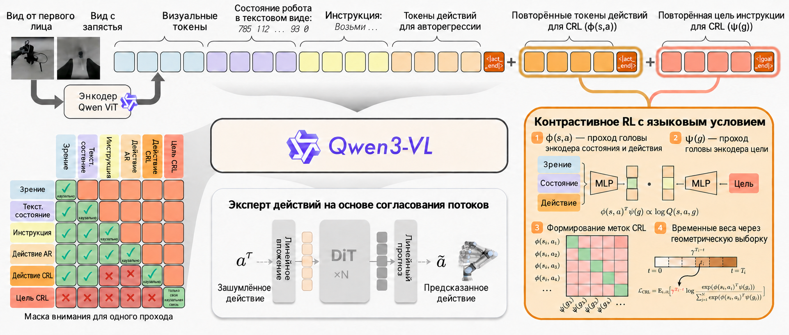
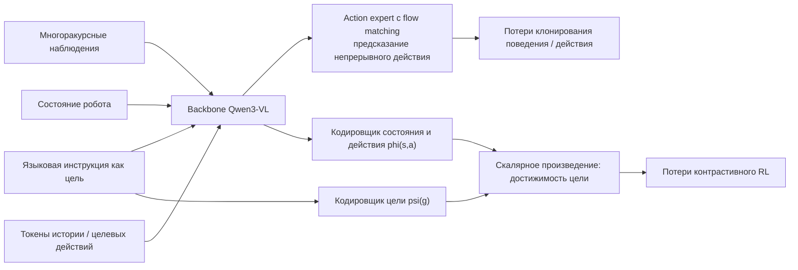
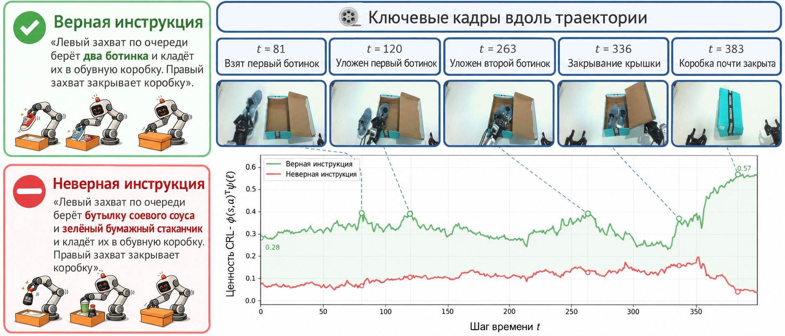
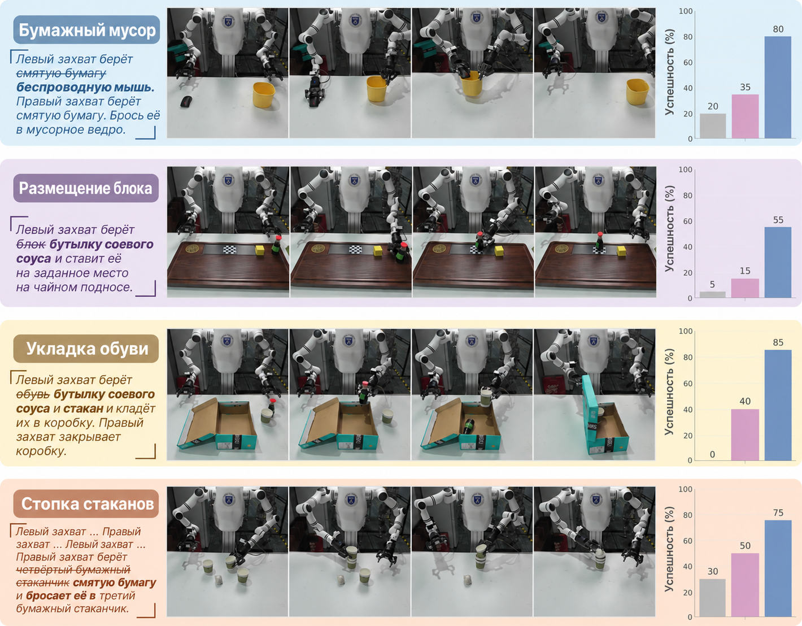
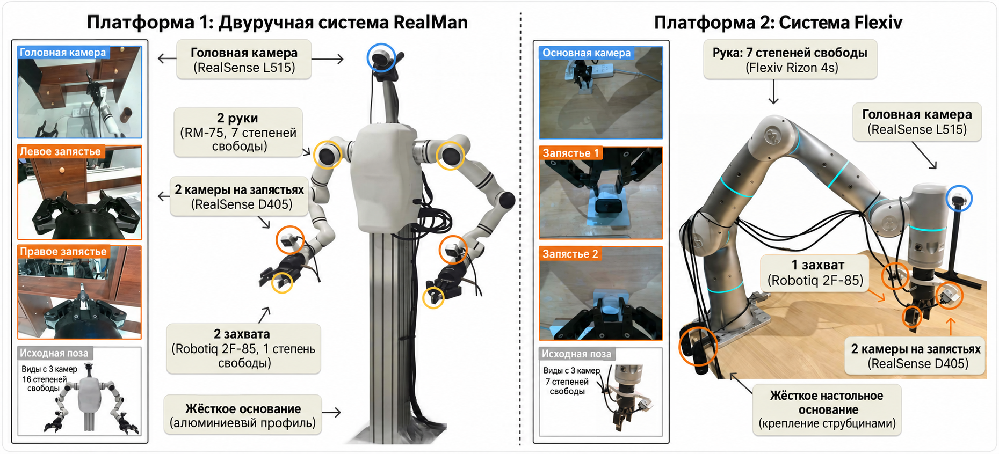
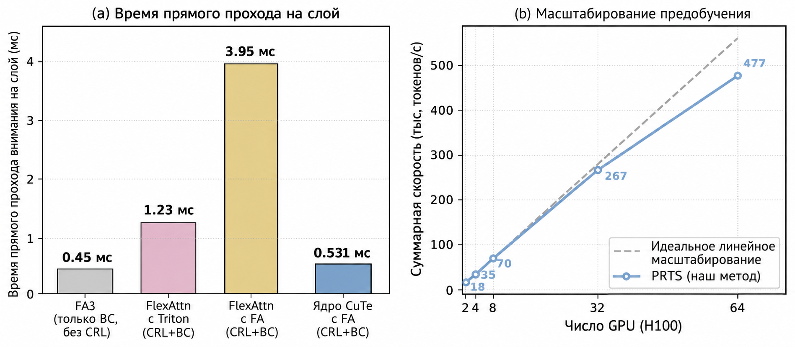

# PRTS: предобучение VLA с целевой достижимостью, заложенной на уровне обучения с подкреплением

> Это обзор статьи **PRTS: A Primitive Reasoning and Tasking System via Contrastive Representations**. Работа выполнена командами China Telecom Artificial Intelligence Research Institute (TeleAI), Цинхуа, Шанхайского университета Цзяо Тун, Фудань и других. PRTS — базовая модель VLA с «нативным» обучением с подкреплением: ключевая идея не в том, чтобы добавить RL после клонирования поведения, а в том, чтобы включить контрастивное обучение с подкреплением без меток награды прямо в предобучение VLA.

## 1. Главный вывод

PRTS важен для этого руководства по двум причинам.

Первая: метод ставит ясный вопрос. **Большинство VLA учатся тому, что эксперт делает в данном состоянии, но явно не учатся тому, насколько текущее состояние и действие далеки от языковой цели.** Из-за этого в длинных задачах, при возмущениях, при других начальных позах и при другой формулировке языка модели часто лишь копируют локальные действия и не чувствуют прогресса к цели.

Вторая: у метода есть конкретные публичные результаты. На официальной странице GitHub-новостей указано, что `PRTS-Droid` занимает 3-е место в таблице лидеров MolmoSpaces с успешностью `42.4%`; при этом он опережает NVIDIA DreamZero, MolmoAct2 и π0.5. В результатах поиска по таблице `/ms` тоже видна запись `PRTS-Droid, TeleAI` с полями TOP3 и масштабом 5B параметров.

Коротко:

> Суть PRTS — не в замене backbone на более крупный, а в том, что языковая цель трактуется как goal, временная структура траекторий используется для построения контрастивного обучения с подкреплением, и один и тот же backbone Qwen3-VL одновременно учится генерировать действия и осознавать достижимость цели.

Место этой работы в главе — после PhysBrain в `06-manipulation-and-vla/large-model-control-vla-vlm`. Это не модель мира и не бенчмарк навигации, а изменение парадигмы предобучения VLA.

## 2. Статья, проект, код и веса

| Ресурс | Ссылка | Статус |
| :--- | :--- | :--- |
| Статья | [arXiv:2604.27472](https://arxiv.org/abs/2604.27472) / [HTML](https://arxiv.org/html/2604.27472v1) | Подана 2026-04-30 |
| Страница проекта | [rhodes-team-prts.github.io](https://rhodes-team-prts.github.io/) | Официальная страница проекта |
| GitHub | [TeleHuman/PRTS](https://github.com/TeleHuman/PRTS) | Официальная реализация; открыты минимальный код дообучения с учителем (SFT), оценка на LIBERO, скрипты визуализации CRL-значений |
| Веса предобучения | [TeleEmbodied/PRTS-4B](https://huggingface.co/TeleEmbodied/PRTS-4B) | Открыты; в карточке модели указано, что основа — Qwen3-VL-4B, предобучение примерно на 167 млрд токенов |
| Контрольная точка для LIBERO | [TeleEmbodied/PRTS-4B-LIBERO](https://huggingface.co/TeleEmbodied/PRTS-4B-LIBERO) | В README официального репозитория сказано, что она соответствует числам статьи для LIBERO |
| Таблица MolmoSpaces | [MolmoSpaces Leaderboard](https://molmospaces.allen.ai/leaderboard/ms) | `PRTS-Droid, TeleAI` в TOP3, в README указана успешность 42.4 % |

Границы открытости важно назвать честно. В плане выпуска GitHub-репозитория указано:

- препринт PRTS на arXiv опубликован;
- предобученная контрольная точка PRTS-4B открыта;
- открыт стандартный пример набора данных LIBERO в формате LeRobot-v2.1;
- открыт минимальный код дообучения с учителем (SFT) для LIBERO и реальных роботов;
- открыта оценка PRTS на LIBERO;
- открыта контрольная точка PRTS-4B, дообученная на LIBERO;
- открыты скрипты визуализации CRL-значений;
- контрольная точка PRTS-4B, дообученная на SimplerEnv WidowX, пока находится в планах.

Лицензия — **CC BY-NC 4.0**: код и веса можно использовать в академических и некоммерческих целях, коммерческое использование этой лицензией не разрешено.

## 3. Таблица MolmoSpaces: что она означает

MolmoSpaces — открытая экосистема и набор бенчмарков для воплощённого ИИ от Ai2. По официальному описанию, она объединяет более 230 тысяч внутренних сред, более 130 тысяч моделей предметов и 42 миллиона устойчивых аннотаций захвата. Поддерживаются MuJoCo, Isaac, ManiSkill и другие популярные симуляторы. MolmoSpaces-Bench охватывает статические манипуляции, мобильные манипуляции, навигацию и многокомнатные долгосрочные задачи, чтобы оценить обобщение политик роботов в больших и разнообразных сценах.

Внимание к PRTS вызвало то, что `PRTS-Droid` вошёл в TOP3 глобальной таблицы политик MolmoSpaces. Здесь полезно различать два числа:

| Число | Источник | Значение |
| :--- | :--- | :--- |
| `42.4%` успешности | Официальные новости PRTS на GitHub | Успешность PRTS-Droid в таблице MolmoSpaces |
| `65.36` | Результат поиска по таблице MolmoSpaces `/ms` | Одно из полей Combined / score, которое видно на странице таблицы |

Для учебника не нужно писать, что «PRTS полностью превзошёл все VLA». Точнее так:

> На открытой платформе оценки воплощённого ИИ MolmoSpaces `PRTS-Droid` от TeleAI входит в TOP3. Это указывает, что контрастивное предобучение с обучением с подкреплением без меток награды конкурентно на открытых сценах типа DROID / MolmoSpaces.

## 4. Почему обычного клонирования поведения недостаточно

Традиционное обучение VLA часто можно описать так:

```text
Изображение + языковая инструкция + состояние робота
        ↓
Предсказание действия эксперта
```

Это и есть клонирование поведения (behavior cloning). Оно очень эффективно, но имеет слепое пятно: модель знает, что сделал эксперт, но не обязательно знает, **приближает ли это действие задачу к успеху**.

Пример. Инструкция — «положить чашку в коробку». Робот может находиться в разных состояниях:

- захват только что приблизился к чашке;
- чашка уже захвачена;
- чашка перемещена над коробкой;
- чашка упала на край стола;
- чашка положена в коробку, но крышка не закрыта.

Клонирование поведения может повторять локальные действия из обучающих траекторий, но если состояние отклонилось от демонстрации, модель не всегда понимает, приблизилась она к цели или отдалилась. PRTS пытается дать VLA внутреннее ощущение прогресса задачи: насколько текущая пара «состояние — действие» достижима для языковой цели. В статье это называется **осознанием достижимости цели (goal-reachability awareness)**.

## 5. Главная архитектура: Qwen3-VL + flow matching action expert + CRL



**Рисунок 1. Общий обзор PRTS.** Слева — многоракурсные изображения, текстовое состояние робота, языковая инструкция и токены действий; в центре — backbone Qwen3-VL и action expert с flow matching; справа — ветвь контрастивного обучения с подкреплением, зависящая от языка: оценка достижимости цели строится как скалярное произведение эмбеддингов пары «состояние — действие» и эмбеддинга цели.
Источник: [официальный GitHub TeleHuman/PRTS](https://github.com/TeleHuman/PRTS).

На рисунке четыре блока.

Первый — **поток входных токенов**. PRTS смотрит не только на один кадр: на входе есть вид от первого лица (egocentric), вид с запястья, визуальные токены, текстовое состояние робота, инструкция и токены действий. Текстовое представление состояния робота — важная деталь: состояние помещается в последовательность, которую может обработать языковая модель, и backbone одновременно видит визуальный, языковой, состоянийный и действенный контекст.

Второй — **однопроходная маска внимания (Single-Forward Attention Mask)**. На схеме в левом нижнем углу показано, какие токены могут обращать внимание друг на друга. Это позволяет выполнить и предсказание действий поведенческим клонированием, и обучение значениям CRL за один прямой проход, при этом не допускать утечек информации по причинному пути. Например, токены действия CRL и цели CRL не просто смотрят друг на друга без ограничений, а используют контекст, построенный согласно самоконтролируемой цели.

Третий — **action expert с flow matching**. PRTS по-прежнему выдаёт непрерывные действия робота, поэтому поверх представлений Qwen3-VL подключён action expert с flow matching: сеть в стиле DiT предсказывает очищенное действие из зашумлённого. Это соответствует современным непрерывным VLA: сложные действия манипулятора (6 DoF, суставы) не превращаются в языковые токены, а моделируются непрерывным генеративным процессом.

Четвёртый — **контрастивное обучение с подкреплением, зависящее от языка (Language-Conditioned Contrastive RL)**. Это ядро PRTS. Строятся кодировщик пары состояние-действие `phi(s,a)` и кодировщик цели `psi(g)`; их скалярное произведение приближает `log Q(s,a,g)`, то есть «достижимость языковой цели g из пары состояние-действие (s,a)».

Упрощённая схема:



## 6. Как CRL обучается без меток награды

PRTS не требует ручной разметки награды. Для этого используется временная структура демонстрационных траекторий.

В успешной траектории состояния ближе к концу обычно ближе и к языковой цели. Например, в задаче «открыть ящик и положить предмет»:

```text
t0: робот ещё не касается ящика
t1: захват приближается к ручке
t2: ящик открыт
t3: предмет помещён в ящик
t4: задача выполнена
```

PRTS строит контрастивный сигнал из такой временной структуры: при одной языковой цели пары «состояние-действие», которые ведут к успеху, должны быть ближе к эмбеддингу цели, а несоответствующие цели или ошибочные стадии — дальше. В статье используется геометрическое временное взвешивание (geometric temporal weighting), которое задаёт разный вклад близких и далёких по времени шагов.

Именно это подразумевается под обучением «без меток награды»:

| Обычное обучение с подкреплением | Контрастивное обучение с подкреплением PRTS |
| :--- | :--- |
| Нужны награды среды или ручные метки успеха | Сигнал достижимости строится из временной структуры офлайн-траекторий |
| Часто обучается отдельная сеть значений / Q | Голова значений обучается вместе с backbone VLA в одном проходе |
| Обычно дороже, чем клонирование поведения | По заявлению авторов, вычисления близки к клонированию поведения |
| Чаще используется на этапе дообучения | PRTS встраивает этот механизм в предобучение |

Важно понимать: PRTS по-прежнему требует много данных о траекториях, аннотации действий и данные для воплощённого рассуждения. «Без наград» означает, что не нужны отдельные метки награды; это не значит «без данных и без учителя».

## 7. Визуализация значений: действительно ли модель следит за прогрессом задачи



**Рисунок 2. Визуализация CRL-значений PRTS.** Зелёная кривая соответствует правильной инструкции, красная — ошибочной. По мере выполнения задачи значение достижимости для правильной инструкции в целом растёт, а для ошибочной остаётся низким.
Источник: [официальный GitHub TeleHuman/PRTS](https://github.com/TeleHuman/PRTS).

Рисунок хорошо показывает отличие PRTS от обычного VLA.

Слева даны две языковые цели:

- правильная: положить две туфли в коробку и правой рукой закрыть крышку;
- ошибочная: положить соевый соус и зелёный бумажный стакан в коробку и правой рукой закрыть крышку.

Справа — ключевые кадры траектории с реальным прогрессом задачи: первая туфля поднята, первая туфля положена, вторая туфля положена, крышка закрыта, коробка почти закрыта. Зелёная кривая значений на этих ключевых этапах постепенно растёт и достигает более высокого уровня; красная остаётся ниже.

Это значит, что значение PRTS определяется не тем, похоже ли изображение на обучающие данные, а тем, насколько задача, при данной языковой цели, близка к завершению. Для управления роботом это важно: когда действие отклоняется от демонстрации, модели нужно понимать, сохраняется ли возможность достичь цели, а не механически повторять следующий шаг.

## 8. Обобщение на задачи: почему длинные и новые инструкции выигрывают больше



**Рисунок 3. Пример обобщения PRTS на реальные задачи.** На рисунке показаны двуручные задачи: Paper Rubbish, Place Block, Pick Shoes, Stack Cups. Зачёркнутый текст слева — элементы исходной или обучающей инструкции, жирным выделены новые предметы или цели, подставленные при тестировании.
Источник: [официальный GitHub TeleHuman/PRTS](https://github.com/TeleHuman/PRTS).

На рисунке не просто захват. Речь о выполнении задач после смены предметов и инструкций. Преимущества PRTS стоит объяснять с двух сторон.

Первая — **изменение языковой цели**. Например, в исходной задаче может быть захват бумажного комка, а при тесте — беспроводная мышь; или в исходной — укладка блоков, а при тесте — бутылка соевого соуса. Клонирование поведения часто жёстко привязывает модель к предметам и шаблонам действий из обучения, тогда как CRL связывает пару «состояние-действие» с языковой целью, что помогает сохранять ощущение задачи при новой инструкции.

Вторая — **изменение длинного этапа**. Такие задачи, как Stack Cups или Pick Shoes, не заканчиваются одним захватом, а состоят из нескольких связанных стадий. Роботу нужно знать, какой этап уже сделан и продвигает ли следующий шаг к цели. Именно это и восполняет представление достижимости цели.

В статье отмечается, что преимущества PRTS особенно заметны в сценариях с длинным горизонтом, контактно насыщенными задачами и нулевым обобщением на новые инструкции. Это согласуется с замыслом: чем длиннее процесс и сильнее возмущения, тем важнее понимать прогресс задачи, а не только имитировать локальные действия.

## 9. Реальная аппаратура



**Рисунок 4. Аппаратура для оценки PRTS на реальном роботе.** Слева — двуручная система RealMan, справа — одноручная система Flexiv Rizon 4s. Указаны головная камера, камеры запястий, захваты и вид по умолчанию.
Источник: [официальный GitHub TeleHuman/PRTS](https://github.com/TeleHuman/PRTS).

PRTS проверяется не только в симуляции. В статье описаны две реальные платформы:

| Платформа | Конфигурация | Особенности задач |
| :--- | :--- | :--- |
| RealMan Dual-Arm | Двуручная, головная камера, две камеры запястий, два захвата | Смешанное многозадачное дообучение; проверка длинных двуручных задач и помех между задачами |
| Flexiv System | Одноручная 7-DoF, основная камера, камера запястья, захват Robotiq | Мелкие контактно насыщенные задачи; проверка пространственной привязки и накопления ошибок |

В статье перечислены реальные задачи, включая Office Long Term, Stack Cups, Flip Tennis Tube, Gear Assembly, Block Combination, Flower Arrangement. Здесь нужна трезвость: это реальная проверка, но не открытый бенчмарк, который каждый может воспроизвести на своём оборудовании. Для учебника это доказательство эффективности метода, а не обещание получить те же результаты на любом локальном роботе.

## 10. Эффективность предобучения и стоимость дообучения



**Рисунок 5. Эффективность предобучения PRTS.** Официальный рисунок подчёркивает, что за счёт объединения целей CRL в один прямой проход PRTS получает представление достижимости цели при вычислительных затратах, близких к клонированию поведения.
Источник: [официальный GitHub TeleHuman/PRTS](https://github.com/TeleHuman/PRTS).

Важная особенность PRTS — он не лечит VLA тяжёлым онлайн-RL или сложным офлайн-RL. Контрастивная цель встроена в предобучение и формирует представления. Отсюда преимущества:

- обучение опирается на офлайн-траектории и не требует онлайн-проб в реальной среде;
- не нужна ручная метка награды;
- не обязательно отдельно обучать полностью независимую модель значений;
- последующее дообучение действий может использовать обычный flow matching / SFT.

В статье отдельно сообщается, что на стандартном наборе LIBERO из четырёх групп PRTS в среднем достигает `98.4` % успешности, что близко к лучшим результатам-предшественникам или совпадает с ними. При одинаковом бюджете дообучения PRTS устойчивее ABot-M0, особенно в группе Long, где заметнее помогает представление, чувствительное к достижимости цели.

## 11. Что говорит MolmoSpaces и чего не говорит

Попадание PRTS-Droid в TOP3 MolmoSpaces — заметный результат, но он доказывает конкретную вещь:

> На более крупной многосценной таблице политик роботов с упором на zero-shot обобщение контрольная точка PRTS-Droid очень конкурентоспособна.

Из этого не следует, что:

- PRTS превосходит все модели на всех реальных роботах;
- каждая контрольная точка PRTS применима к любому роботу без адаптации;
- контрастивное предобучение с обучением с подкреплением уже заменило клонирование поведения или дообучение во всех случаях.

Более точное утверждение такое: результат MolmoSpaces подтверждает центральный тезис статьи — **добавление осознания достижимости цели в предобучение VLA может улучшать обобщение на открытых сценах и в длинных задачах**.

## 12. Как воспроизводить сейчас

Сейчас наиболее реалистичный путь — не предобучать PRTS с нуля: в карточке модели на Hugging Face указано, что предобучение заняло около 167 млрд токенов и 64 видеокарты H100. Для учебного использования разумно выбрать один из трёх уровней.

### 12.1 Только загрузка контрольной точки

Карточка модели даёт минимальный способ загрузки:

```bash
pip install "transformers==4.57.3" torch safetensors huggingface_hub \
    numpy pillow sentencepiece protobuf colorama tokenizers
pip install accelerate
```

```python
import torch
from transformers import AutoConfig, AutoModel, AutoProcessor

repo_id = "TeleEmbodied/PRTS-4B"

config = AutoConfig.from_pretrained(repo_id, trust_remote_code=True)
model = AutoModel.from_pretrained(
    repo_id,
    trust_remote_code=True,
    torch_dtype=torch.bfloat16,
    device_map="auto",
)
processor = AutoProcessor.from_pretrained(repo_id, trust_remote_code=True)
```

Такой smoke-тест показывает только, что:

- веса с Hugging Face загружаются;
- пользовательский код загружается через `transformers`;
- структура модели и процессор инициализируются.

Он не показывает:

- что выходы действий уже управляют реальным оборудованием;
- что результат MolmoSpaces можно воспроизвести локально;
- что визуализация CRL-значений и оценка на LIBERO уже работают.

### 12.2 Запуск примеров LIBERO / LeRobot

Для дальнейшего воспроизведения лучше начать с официальной контрольной точки для LIBERO и данных в формате LeRobot. В официальном GitHub есть каталоги `configs`, `examples`, `scripts`, `prts`, а также опубликован минимальный код дообучения с учителем (SFT).

Рекомендуемый порядок изучения:

1. Клонировать репозиторий.
2. Установить `requirements.txt`.
3. Скачать `TeleEmbodied/PRTS-4B-LIBERO`.
4. Использовать официальный набор LIBERO в формате LeRobot-v2.1.
5. Сначала провести оценку, и только потом менять конфигурацию дообучения.

Не стоит начинать с переделки на собственных данных манипулятора. Входы PRTS включают визуальные токены, текстовое состояние, инструкцию, токены действий, действия и цели CRL. Если раскладка действий или маска внимания будут заданы неверно, модель может работать, но давать бесполезные результаты.

### 12.3 Воспроизведение рейтинга MolmoSpaces

Воспроизведение таблицы MolmoSpaces требует большего:

- контрольная точка или запуск дообучения под DROID;
- среда бенчмарка MolmoSpaces;
- конкретные задачи, сцены, камеры, начальные состояния робота и протокол оценки;
- адаптация обёртки политики к каркасу оценки MolmoSpaces.

Официальные новости GitHub сообщают, что контрольная точка MolmoSpaces обучена с помощью последнего скрипта дообучения под DROID. Учебник сейчас не должен давать пошаговое воспроизведение MolmoSpaces: полный прогон таблицы требует значительных ресурсов и инженерных зависимостей. Разумнее рассматривать рейтинг как точку входа для чтения и как подтверждение метода.

## 13. Связь с другими работами VLA

| Метод | Основной фокус | Отличие от PRTS |
| :--- | :--- | :--- |
| OpenVLA / OpenVLA-OFT | Открытая основа VLA и конвейер дообучения | PRTS делает упор на контрастивное RL в предобучении для достижимости цели |
| π0 / π0.5 | Сильный базовый VLA | В статье и таблице MolmoSpaces π0.5 — объект сравнения, а не основа PRTS |
| 3DVLA | Внедрение трёхмерных пространственных и экземплярных токенов в VLA | PRTS — не геометрический модуль, а обучение представлениям достижимости цели |
| PhysBrain | Извлечение физического здравого смысла из видео человека и адаптация VLA | PRTS строит сигнал CRL достижимости из временной структуры траекторий |
| RAW-Dream | Улучшение VLA в task-agnostic модели мира | PRTS — не обучение с подкреплением на rollout модели мира, а изменение целей предобучения VLA |
| WALL-OSS | Открытая модель VLA и инженерный фреймворк | PRTS делает упор на безрасчётное контрастивное RL в предобучении |

Если классифицировать методы по причине провала VLA:

- 3DVLA считает, что провалы часто связаны с недостаточным пониманием трёхмерного пространства и экземпляров;
- PhysBrain — что провалы связаны с недостатком физического здравого смысла;
- PRTS — что провалы связаны с недостаточным пониманием прогресса задачи и достижимости цели.

Эти три статьи удобно сравнивать в одной задаче Task04 из группового курса.

## 14. Ограничения и трезвый взгляд

Первое. Результат MolmoSpaces TOP3 — сильный, но таблица лидеров обновляется. В руководстве описано состояние по данным на 2026-07-18; позже позиции могут измениться.

Второе. PRTS не является обучением с подкреплением без затрат. Он не требует меток награды, но опирается на большое число офлайн-траекторий, аннотации действий и данные воплощённого рассуждения. По карточке модели, предобучение заняло около 167 млрд токенов на 64 H100.

Третье. Коммерческое использование ограничено. Текущая лицензия — CC BY-NC 4.0, поэтому по умолчанию её нельзя использовать в коммерческих продуктах.

Четвёртое. Полное воспроизведение рейтинга MolmoSpaces — нелёгкая задача. Нужны среда MolmoSpaces, контрольная точка DROID, инструменты оценки и значительные вычислительные ресурсы.

Пятое. Достижимость цели не является универсальной наградой. Она помогает модели понимать прогресс задачи, но при экстремальных контактах, гибких предметах, шумах датчиков, ошибках приводов и неизвестном оборудовании всё равно нужны дообучение, адаптация контроллера и ограничения безопасности.

## 15. Рекомендуемое задание

В групповом курсе по манипуляции (Task04) PRTS можно использовать как задание:

> Сравните 3DVLA, PhysBrain и PRTS: каждый из них усиливает VLA с точки зрения трёхмерного пространства, физического здравого смысла или достижимости цели. Каковы у них входы, сигналы обучения, выходы действий и границы открытости?

Ожидаемый результат:

- объяснить, почему PRTS называют контрастивным обучением с подкреплением без меток награды;
- нарисовать связь `phi(s,a)`, `psi(g)` и action expert;
- объяснить, что доказывает попадание в TOP3 MolmoSpaces и чего оно не доказывает;
- указать, до какого этапа можно воспроизвести PRTS-4B, PRTS-4B-LIBERO и код GitHub;
- сравнить PRTS и π0.5: π0.5 — базовая линия для сравнения, а не основа PRTS.

## 16. Источники изображений и ссылки

Изображения в этой главе взяты из [официального GitHub TeleHuman/PRTS](https://github.com/TeleHuman/PRTS) и сохранены в `assets/` для стабильного доступа. Текст статьи опирается на [arXiv:2604.27472](https://arxiv.org/abs/2604.27472), [карточку модели PRTS-4B на Hugging Face](https://huggingface.co/TeleEmbodied/PRTS-4B), [таблицу MolmoSpaces](https://molmospaces.allen.ai/leaderboard/ms), [статью MolmoSpaces](https://arxiv.org/abs/2602.11337) и [описание MolmoSpaces от Ai2](https://allenai.org/blog/molmospaces).
