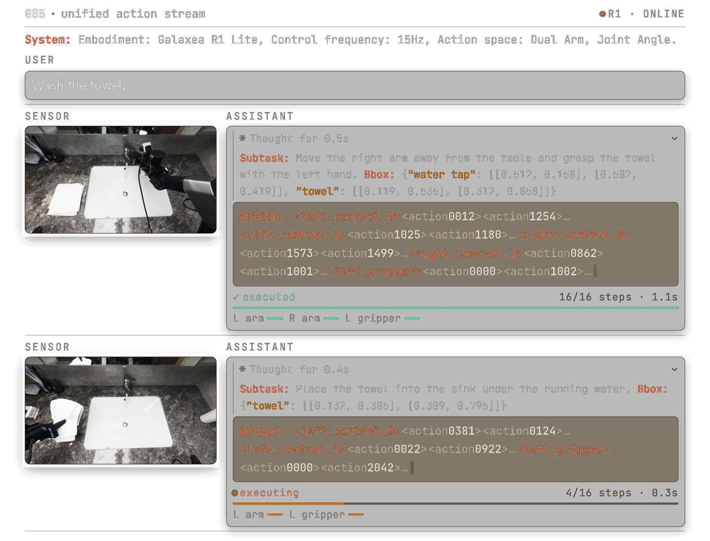
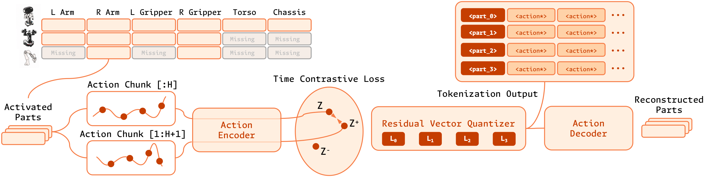
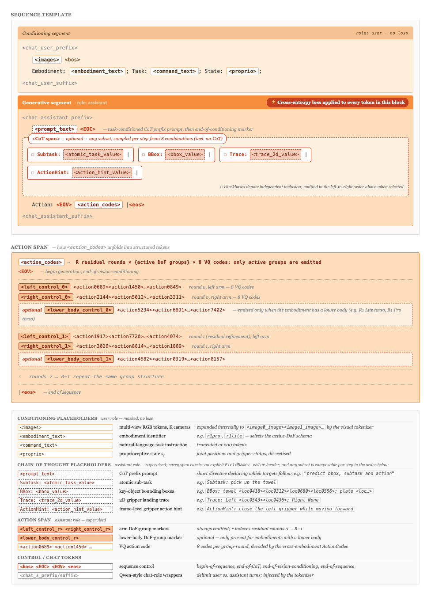
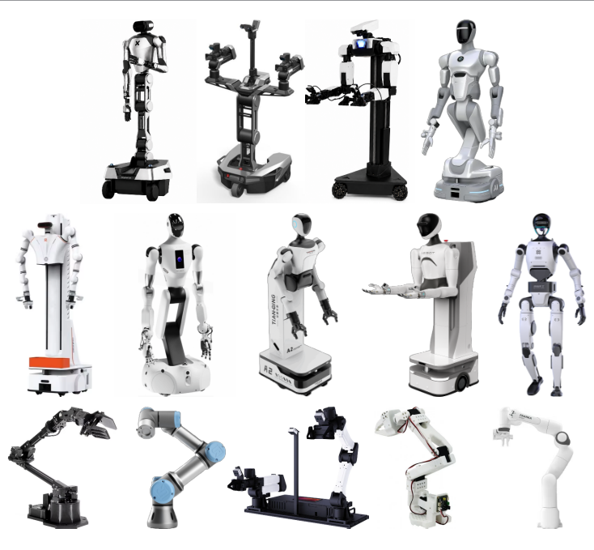
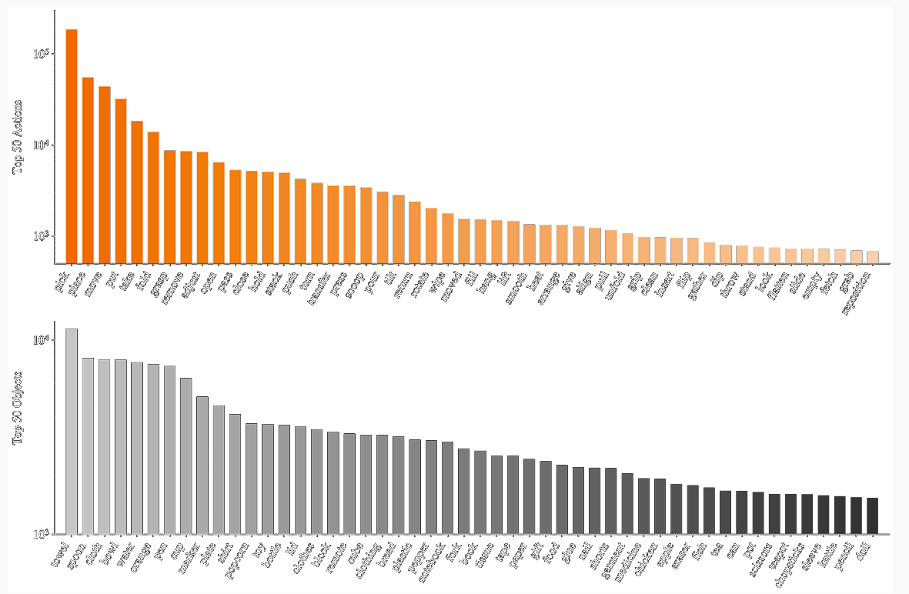
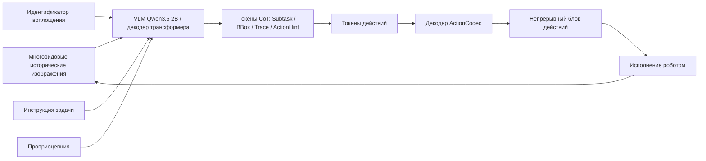
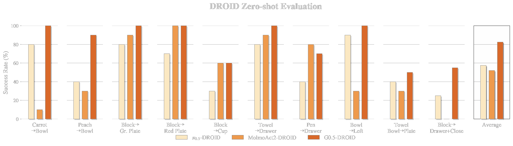
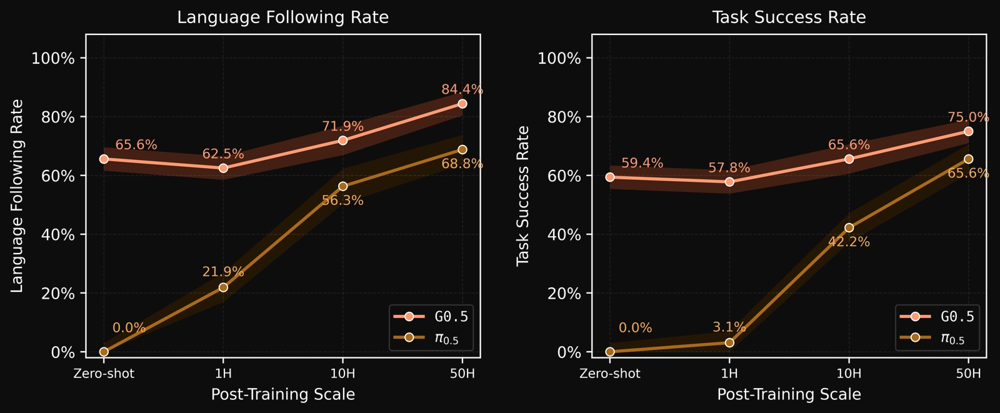
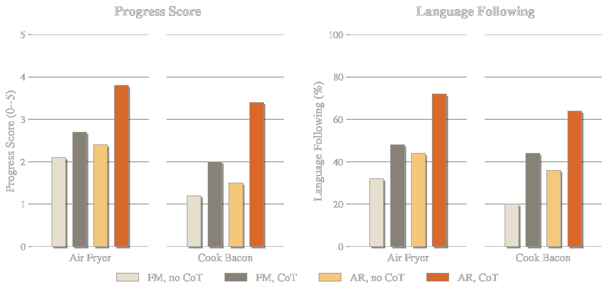

# Galaxea G0.5: память, рассуждения в виде цепочки мыслей (CoT) и токены действий в едином авторегрессивном потоке VLA

> Это обзор технического отчёта **Galaxea G0.5**. G0.5 — авторегрессивная модель «визуальное восприятие — язык — действие» (Vision-Language-Action), которую Galaxea выпустила в июне 2026 года. Её ключевая идея не в том, чтобы использовать VLM как энкодер визуального и языкового входа с отдельной головой действий сверху. Одна и та же декодирующая трансформерная модель генерирует и токены рассуждений, и токены действий. Что видно, какая подзадача выполняется, где цель и какую последовательность токенов действий выдать — всё это находится в одной цепочке предсказания следующего токена.

## 1. Главный вывод: почему память, CoT и представление действий работают вместе

Коротко суть G0.5 такова:

> G0.5 объединяет в одной авторегрессивной последовательности многовидовую визуальную память за последние несколько секунд, необязательную структурированную цепочку рассуждений (Chain-of-Thought) и кросс-воплощённую токенизацию действий. Поэтому VLA больше не делает упрощённую схему «посмотрел на текущий кадр — получил действие», а работает так: читает историю наблюдений, пишет промежуточные рассуждения, продолжает писать токены действий и декодирует их в блок действий (action chunk).

Это действительно заметный маршрут среди VLA. В официальном README и карточке модели приведены публичные результаты: DROID zero-shot `82.5%`, Bridge-SimplerEnv `87.3%`, RoboTwin 2.0 `93.3%`, LIBERO `98.9%`, оценка успешности BEHAVIOR-1K `0.3136`, а также средняя успешность `76.7%` после дообучения на реальных роботах R1-Lite и R1-Pro.

Однако слово «SOTA» здесь нужно воспринимать трезво. Сила G0.5 — не в одном приёме, а в сочетании трёх решений:

1. **Авторегрессивный единый интерфейс**: текст рассуждений и токены действий пишет один декодер. Нет внешнего планировщика, который пишет рассуждения, и отдельной головы действий, которая выдаёт действия.
2. **Представление действий ActionCodec**: действия разных роботов отображаются в общее 27-мерное пространство действий, а затем дискретизируются остаточным векторным квантователем (residual vector quantizer). Так авторегрессивная VLA действительно может выдавать действия в пространстве токенов.
3. **Визуальная память и структурированный CoT**: используются 6 кадров истории за окно 5 секунд, а модель может генерировать промежуточные структурированные токены `Subtask`, `BBox`, `Trace`, `ActionHint`, на которые затем опираются токены действий.

Поэтому глава естественно встаёт в `06-manipulation-and-vla/large-model-control-vla-vlm` после PRTS. G0.5 — не мировая модель и не система планирования навигации. Это заметный инженерный шаг в структуре VLA и в представлении действий.

## 2. Статья, проект, код и веса

| Ресурс | Ссылка | Статус |
| :--- | :--- | :--- |
| Технический отчёт | [Galaxea G0.5 Technical Report](https://opengalaxea.github.io/G05/Galaxea_G0_5.pdf) | Технический отчёт 2026 года |
| Страница проекта | [opengalaxea.github.io/G05](https://opengalaxea.github.io/G05/) | Официальная страница с рисунками, видео и показом бенчмарков |
| GitHub | [OpenGalaxea/GalaxeaVLA](https://github.com/OpenGalaxea/GalaxeaVLA) | Официальный открытый репозиторий с точками входа для обучения, оценки и развёртывания |
| Веса модели | [OpenGalaxea/G05](https://huggingface.co/OpenGalaxea/G05) | Модель с ограниченным доступом на Hugging Face: нужен вход в аккаунт и согласие с условиями |
| Набор данных | [OpenGalaxea/Galaxea-Open-World-Dataset](https://huggingface.co/datasets/OpenGalaxea/Galaxea-Open-World-Dataset) | Официальный набор данных для открытого мира роботов |
| Старая G0-VLA | [OpenGalaxea/G0-VLA](https://huggingface.co/OpenGalaxea/G0-VLA) | Вход для исторических весов G0 / G0Plus |

Границы открытости важно назвать явно. По README GitHub, материалы G0.5 с 2026-06-16 распространяются по **G0.5 Community License Agreement**: некоммерческое использование разрешено — научные исследования, личное использование, образование и оценка. Коммерческое развёртывание, предоставление сервиса третьим лицам и продуктизация требуют отдельной коммерческой лицензии. На странице модели на HF репозиторий виден публично, но для загрузки файлов нужно согласиться с условиями доступа.

## 3. Входы и выходы: что модель принимает и что выдаёт

Входы G0.5 можно записать так:

```text
6 кадров многовидовых RGB-изображений, взятых за последние 5 секунд
    + идентификатор воплощения / текстовое описание воплощения
    + инструкция на естественном языке
    + проприоцепция / состояние робота
```

Выходы:

```text
необязательные токены рассуждений CoT
    + обязательная последовательность токенов действий
    -> декодер ActionCodec
    -> блок непрерывных управляющих действий
```

Типичный фрагмент генерации выглядит так:

```text
Subtask: grasp the towel
BBox: {"towel": [[x1, y1], [x2, y2]]}
Trace: Left <loc0543><loc0436>; Right None
ActionHint: close the left gripper while moving forward
Action:
<left_control_0><action0689><action1450>...
<right_control_0><action2144><action5012>...
<left_gripper><action0000><action1002>...
```

Здесь важнее всего не то, что модель выдаёт правдоподобную «объяснительную» фразу. Важно, что **токены рассуждений и токены действий генерируются подряд в одном фрагменте ответа ассистента**. Значит, при генерации токенов действий уже видны предыдущие `Subtask`, `BBox`, `Trace` и `ActionHint`. Если CoT — внешний модуль или результат офлайн-разметки, голова действий использует его лишь косвенно. В G0.5 сами токены действий продолжают тот же поток токенов.

## 4. Общая картина: G0.5 превращает управление роботом в поток токенов



**Рисунок 1. Пример унифицированного потока действий в G0.5.** Слева — изображения с датчиков и языковая задача; справа ассистент сначала генерирует `Subtask` и `BBox`, затем продолжает токены действий. На рисунке также видно, что блок действий исполняется по 16 шагам и что модель после каждого нового наблюдения продолжает замкнутое перепланирование.
Источник: [страница проекта G0.5](https://opengalaxea.github.io/G05/).

Этот рисунок отвечает на вопрос, почему G0.5 считается сильным и в чём логика:

Во-первых, G0.5 явно записывает управление роботом как **последовательность в стиле диалога**. В системном сообщении указаны воплощение, частота управления и пространство действий; в пользовательском сообщении — инструкция; область сенсоров содержит визуальные наблюдения; в ответе ассистента есть и поля рассуждений, и поля действий.

Во-вторых, действие — это не предложение на естественном языке, а структурированные токены действий. Например, `<left_control_0><action0012><action1254>...` обозначает один раунд остаточной квантизации действий левой руки; после `<left_gripper>` идут токены захвата. Несколько групп токенов действий складываются, а ActionCodec декодирует их в непрерывное управление.

В-третьих, исполнение происходит блоками с замкнутой обратной связью. На рисунке первый блок выполнен на `16/16` шагов, второй — на `4/16`. Значит, G0.5 не предсказывает весь длинный путь сразу, а после каждого нового наблюдения заново генерирует следующий блок действий.

## 5. ActionCodec: почему представление действий — ключ



**Рисунок 2. Токенизатор ActionCodec в G0.5.** У разных роботов разное число степеней свободы и разная структура действий. G0.5 сначала переводит активные подвижные части в общее пространство действий, затем с помощью остаточного векторного квантователя получает дискретные токены действий, а декодер действий восстанавливает непрерывные движения соответствующих частей.
Источник: [официальный репозиторий OpenGalaxea/GalaxeaVLA](https://github.com/OpenGalaxea/GalaxeaVLA).

У VLA есть два распространённых пути для действий:

| Путь | Преимущества | Проблемы |
| :--- | :--- | :--- |
| Регрессия непрерывных действий, diffusion, flow matching | Хорошо подходит для многомерного непрерывного управления, движения плавные | Не образует естественно интерфейса генерации токенов, как у языковых моделей |
| Дискретные токены действий | Можно использовать один авторегрессивный интерфейс с языковыми токенами | Если токенизация плохая, теряются точность управления и обобщение между роботами |

G0.5 выбирает второй путь и с помощью ActionCodec смягчает проблемы дискретизации.

Официальный README сообщает, что G0.5 отображает разнородные действия роботов в общее 27-мерное пространство действий:

```text
left_control(9)
left_gripper(1)
right_control(9)
right_gripper(1)
lower_body(7)
```

Ключевая мысль — **группировка по частям**. Двурукие роботы, одноручные роботы, мобильные платформы и гуманоиды имеют разный набор степеней свободы. G0.5 не заставляет каждого робота выдавать полное 27-мерное действие, а генерирует только активные группы движений. На рисунке слева `Activated Parts` показывает, какие части нужны конкретному роботу в данный момент, а справа выход токенизации содержит токены только для этих частей. Неактивные или отсутствующие степени свободы не требуют заполнения бессмысленными токенами.

Остаточный векторный квантователь (Residual Vector Quantizer) можно понимать как многократное уточнение:

```text
непрерывный блок действий
    -> кодировщик действий
    -> код VQ нулевого раунда даёт грубое действие
    -> код VQ первого раунда исправляет остаток
    -> ...
    -> последовательность токенов действий
    -> декодер действий восстанавливает непрерывное управление
```

Так декодер в стиле LLM может генерировать действия, а сложное действие не описывается одним грубым дискретным кодом. Для робота это лучше, чем просто разбивать каждый угол сустава на корзины, потому что реальные действия связаны между частями и непрерывны во времени.

## 6. Шаблон токенов: CoT — не свободные рассуждения, а структурированный интерфейс



**Рисунок 3. Шаблон последовательности токенов G0.5.** Сегмент условий содержит изображения, воплощение, задачу и состояние; генеративный сегмент пишет ассистент. Фрагмент CoT может включать `Subtask`, `BBox`, `Trace`, `ActionHint`, затем идёт `Action: <action_codes>`.
Источник: [официальный репозиторий OpenGalaxea/GalaxeaVLA](https://github.com/OpenGalaxea/GalaxeaVLA).

Рисунок объясняет, что CoT в G0.5 — не просьба «подумай». Это ограниченный набор промежуточных переменных, которые полезны для управления роботом:

| Поле | Смысл | Как помогает действию |
| :--- | :--- | :--- |
| `Subtask` | Текущая атомарная подзадача | Делит длинную задачу на короткие этапы, например сначала взять полотенце, потом перенести к раковине |
| `BBox` | Ключевая рамка цели | Привязывает языковую цель к месту на изображении и снижает риск схватить не тот предмет |
| `Trace` | Двумерный след посадки захвата | Указывает точку касания и грубую траекторию, помогает токенам действий выровняться с целью |
| `ActionHint` | Подсказка действия на уровне кадра | Ограничивает тенденцию движения короткой фразой: приблизиться, закрыть захват, двигаться над контейнером |

Все эти поля необязательны. На рисунке также сказано, что фрагмент CoT может включать любое подмножество полей и даже вообще отсутствовать (no-CoT). То есть G0.5 не обязана при каждом шаге объяснять всё подробно; она может решать, нужна ли промежуточная запись в зависимости от сложности задачи.

С точки зрения обучающей цели сегмент условий — пользовательская часть, и по нему потери не считаются. Рассуждения и токены действий в части ассистента обучаются кросс-энтропией. Именно это делает G0.5 «похожей на LLM»: действие включено в предсказание следующего токена, а не решается отдельным регрессором вне языковой модели.

## 7. Визуальная память: почему 6 кадров за 5 секунд

Многие VLA проваливаются не потому, что не видят отдельный кадр, а потому, что не знают, **что было только что**. Например:

- полотенце уже задели захватом, но на текущем кадре оно ещё лежит около стола;
- ящик только что выдвинули, и цель была видна лишь в нескольких предыдущих кадрах;
- манипулятор закрывает цель, и на текущем кадре видны только захват и фон;
- в длинной задаче текущий шаг зависит от того, выполнен ли предыдущий.

G0.5 подаёт в визуальный энкодер 6 многовидовых RGB-кадров за последние 5 секунд и вводит историю через факторизованное пространственно-временное внимание (factorized spatial-temporal attention). В README также сказано, что при предобучении используется стохастическое отбрасывание кадров истории (stochastic history-frame dropout): это уменьшает риск, что модель запоминает одну фиксированную комбинацию исторических кадров. Токены истории удаляются на последнем слое, чтобы контролировать задержку вывода.

Это можно понимать как **краткосрочную визуальную рабочую память**. Она не похожа на поиск по базе данных с хранением опыта за минуты и не является прокруткой мировой модели. Скорее это дополнительный визуальный контекст за последние секунды, который помогает понять, на каком этапе задачи сейчас находится действие.

## 8. Данные нескольких воплощений: зачем нужен идентификатор воплощения



**Рисунок 4. Роботы разных воплощений, на которых работает G0.5.** На странице проекта показаны разные формы роботов: двурукие мобильные платформы, одноручные манипуляторы, гуманоидные платформы. У разных воплощений разное пространство действий, поэтому нужны условие по воплощению и единое кодирование действий.
Источник: [страница проекта G0.5](https://opengalaxea.github.io/G05/).

Предобучение G0.5 использует демонстрации роботов 14 воплощений и одновременно смешивает крупномасштабные данные из интернета и данные VQA о воплощённом мире. Здесь важна одна деталь: **идентификатор воплощения — не вспомогательная метка, а часть входной последовательности**. Модели нужно знать, управляет ли она R1 Lite, R1 Pro, SO-100/101, DROID/Franka или другим корпусом.

Это связано с ActionCodec:

```text
одна и та же инструкция: pick up the towel
    + воплощение R1 Lite  -> двурукая схема с платформой
    + воплощение SO-101   -> недорогая одноручная схема
    + воплощение DROID    -> схема Franka / DROID
    -> разные наборы активных групп действий
```

Без условия по воплощению единый токен действий стал бы неоднозначным интерфейсом. Один и тот же `<left_control_0>` мог бы значить совсем разное для разных роботов или вообще не иметь смысла на некоторых из них.

## 9. Распределение данных: что модель учит как словарь открытого мира



**Рисунок 5. Распределение действий и предметов в данных, показанное на странице проекта G0.5.** Сверху — частые глаголы действий, снизу — частые слова-предметы. Видны глаголы `pick`, `place`, `move`, `put`, `take` и бытовые предметы: towel, spoon, cloth, bowl, water, cup и др.
Источник: [страница проекта G0.5](https://opengalaxea.github.io/G05/).

G0.5 стремится не переобучиться под один стол из одного бенчмарка. Она делает упор на манипуляции в открытом мире, поэтому данные охватывают дома, кухни, розничную торговлю, офисы и большое число бытовых предметов и действий. Официальный набор данных Galaxea Open-World Dataset содержит более 500 часов реальных данных о мобильных манипуляциях и поставляется в форматах RLDS и LeRobot.

Это помогает понять, почему G0.5 конкурентоспособна в задачах вида «взять что угодно и положить куда угодно»: на этапе предобучения модель уже встречала много словесных описаний операций и визуальных образов бытовых предметов.

Однако разнообразие данных не гарантирует успех любой задачи. Обобщение VLA по-прежнему ограничено углом камеры, интерфейсом действий, возможностями захвата, материалом предметов, динамикой контакта, требованиями безопасности и качеством данных дообучения.

## 10. Цель обучения: VQA и действия под одной функцией потерь CE

Предобучение G0.5 — не только обучение на траекториях роботов. Официальный README сообщает, что модель инициализирована из Qwen3.5 2B VLM и обучалась на демонстрациях 14 воплощений роботов, крупном веб-корпусе и наборе воплощённых VQA-данных. Образцы действий и образцы VQA используют одну и ту же функцию потерь — кросс-энтропию (cross-entropy), а соотношение смешивания VQA и действий равно `1:4`.

Этот выбор имеет два смысла.

Первый — сохранение способностей VLM. Многие VLA, обученные только на действиях, теряют понимание языка, визуальные ответы на вопросы и открытую привязку объектов (grounding). G0.5 продолжает смешивать VQA, чтобы модель по-прежнему понимала задачу, предметы и сцену.

Второй — включение действий в обучение в стиле языковой модели. Пока действия можно дискретизировать в токены с помощью ActionCodec, модель может обучаться последовательностям действий той же функцией CE, что и языку. Это и есть суть «VLM как актора» (VLM-as-Actor): VLM не просто поставляет признаки для отдельного исполнителя, а сама декодирующая часть генерирует токены действий.

Упрощённая схема:



## 11. Zero-shot на DROID: что это доказывает



**Рисунок 6. Результаты G0.5 в zero-shot оценке DROID.** На странице проекта сравниваются `π0.5-DROID`, `MolmoAct2-DROID` и `G0.5-DROID`; на гистограмме средней успешности G0.5 выше остальных.
Источник: [страница проекта G0.5](https://opengalaxea.github.io/G05/).

Результаты zero-shot на DROID показывают, что в условиях данных и задач DROID/Franka авторегрессивный путь с токенами действий даёт сильные возможности zero-shot манипуляций. Официальный README называет цифру `82.5%` успешных zero-shot выполнений на DROID.

Но этот результат не доказывает, что:

- G0.5 можно zero-shot развернуть на любом роботе;
- G0.5 уже решает все длинные домашние задачи;
- токены действий всегда лучше головы действий в духе flow matching или diffusion для любой задачи.

Более точный вывод: результаты DROID подтверждают главный тезис G0.5 — **если токенизация действий достаточно хороша, авторегрессивный декодер может напрямую отвечать за генерацию действий, а не только за языковое планирование или кодирование визуальных признаков**.

## 12. Бенчмарк pick-and-place: почему небольшое дообучение работает



**Рисунок 7. Кривые масштаба данных в постановке «взять что угодно и положить куда угодно» (Pick up Anything & Place Anywhere).** По горизонтали — объём данных для дообучения, по вертикали — доля выполнения языковой инструкции и успешность задачи. G0.5 заметно выше кривой π0.5 при zero-shot и при 1H, 10H, 50H.
Источник: [страница проекта G0.5](https://opengalaxea.github.io/G05/).

Этот рисунок полезно связать с практикой. Многим командам не доступны тысячи часов данных роботов, и они могут только дообучать модель на небольшом количестве задач. Кривые G0.5 показывают, что сильная предобученная модель быстро адаптируется при 1H, 10H и 50H дообучения, особенно заметно растёт доля выполнения языковых инструкций.

Но нужно понимать определение оценки. Бенчмарк Pick-and-Place — официальная постановка, где в сцене несколько предметов и контейнеров; модель должна по языку найти цель, взять её и положить. Он ценен, но не покрывает все реальные домашние задачи. Лучше воспринимать его как локальное свидетельство «привязки языка и обобщения захвата и укладки».

## 13. Абляция CoT: почему AR + CoT лучше для длинных задач



**Рисунок 8. Зондирующий эксперимент G0.5 с CoT и головой действий.** Сравниваются четыре комбинации — `FM, no CoT`, `FM, CoT`, `AR, no CoT`, `AR, CoT` — на двух незнакомых длинных задачах Air Fryer и Cook Bacon по метрике оценки процесса (process score) и по следованию языку. Наибольший рост даёт `AR, CoT`.
Источник: [страница проекта G0.5](https://opengalaxea.github.io/G05/).

Эксперимент отвечает на частый вопрос: не является ли CoT просто красивым объяснением, которое почти ничего не даёт управлению роботом?

Вывод страницы проекта такой. На одноэтапном PP Bench включение CoT почти не повышает успешность AR-модели. Но на пятиэтапных незнакомых длинных задачах Air Fryer и Cook Bacon CoT даёт заметный прирост. Причина понятна: в коротких задачах структурировать почти нечего, и пространство для CoT невелико. В длинных задачах нужно сначала разбить задачу на этапы, найти предметы, а потом спланировать порядок действий, и структурированный CoT помогает токенам действий следовать ходу задачи.

Важнее всего разница между AR и FM. Согласно объяснению в проекте G0.5, токены действий AR находятся в одном потоке генерации с CoT, поэтому токены действий могут напрямую обращаться к предыдущему CoT. Экспертный блок в духе flow matching обычно опирается на сводку скрытых состояний и использует CoT менее прямо. Поэтому при сопоставимом CoT выигрывает именно AR-голова.

## 14. Связь с G0 и G0Plus

G0.5 — не первый VLA от Galaxea. Это новое поколение после G0 и G0Plus.

| Версия | Основной вид | Как понимать в этой главе |
| :--- | :--- | :--- |
| G0 | Двухсистемная VLA: VLM делает мультимодальное планирование, VLA — тонкое исполнение | Скорее сочетание планировщика и исполнителя |
| G0Plus / G0Tiny | Больше данных телеуправления и веб-данных, лёгкая модель для периферии, контрольные точки задач G0Plus | Старая линия выпуска, исторические веса остаются на HF |
| G0.5 | Единая авторегрессивная VLA: токены рассуждений и действий генерируются в одном потоке | Сейчас самый важный путь для чтения |

Официальный README также указывает, что текущая ветка сосредоточена на G0.5: старые Dockerfile для G0Plus, руководства по демонстрациям «сложить полотенца» и «передать подарок», а также конфигурации обучения pi0/pi0fast в текущую ветку не входят. Чтобы увидеть прежнюю структуру файлов, нужно смотреть указанный исторический коммит.

## 15. Как воспроизводить сейчас

Не стоит писать руководство «с нуля, до полного обучения G0.5». Реалистичны три уровня воспроизведения.

### 15.1 Проверка кода и входов в веса

Требования к окружению по официальному README:

| Режим | Требование к видеопамяти | Пример видеокарты |
| :--- | :--- | :--- |
| Вывод (Inference) | `> 8 ГБ` | RTX 3090 / RTX 4090 |
| Полное дообучение | `> 70 ГБ` | A100 80 ГБ / H20 96 ГБ |

Официальная тестовая среда: Linux, Python `>=3.10.16,<3.11`, CUDA 12.8, колёса PyTorch 2.7.1 cu128, `flash-attn-4`, `flash-linear-attention` и `ffmpeg`.

Минимальный путь установки:

```bash
git clone https://github.com/OpenGalaxea/GalaxeaVLA
cd GalaxeaVLA
uv sync --index-strategy unsafe-best-match
source .venv/bin/activate
```

Загрузка модели с Hugging Face:

```bash
huggingface-cli download OpenGalaxea/G05 \
    --repo-type model \
    --local-dir checkpoints
```

Важно: репозиторий HF требует входа в аккаунт и согласия с условиями доступа. Полная структура контрольных точек большая: по README набор с контрольной точкой RoboTwin занимает около 55 ГБ; одна контрольная точка модели G0.5 — около 11 ГБ, общий файл `action_tokenizer.pt` — около 484 МБ.

### 15.2 Официальная лёгкая проверка

Официальный README советует перед дорогими задачами выполнить лёгкие проверки:

```bash
python tools/resolve_config.py r1pro --key model.model_arch
python tools/resolve_config.py r1pro --key data.embodiment_datasets.galaxea_r1pro.dataset_groups
python -c "import torch, g05; print(torch.__version__); print(g05.__file__)"
```

Этот smoke-тест подтверждает только то, что:

- окружение можно импортировать;
- система конфигураций разбирает настройки;
- видны версия PyTorch и путь к пакету `g05`.

Он **не** подтверждает, что:

- веса модели полностью загружены;
- реальный робот можно безопасно исполнять;
- бенчмарки LIBERO / RoboTwin / DROID уже воспроизведены.

### 15.3 Выбор одной официальной точки входа

Если цель — учёба, приоритеты можно расставить так:

| Цель | Официальная точка входа | Сложность |
| :--- | :--- | :--- |
| Посмотреть модель и конфигурацию | `tools/resolve_config.py` | Низкая |
| Оценка на LIBERO | `experiments/libero` / `scripts/run/eval_libero.sh` | Средняя, нужен симулятор LIBERO |
| Оценка на RoboTwin 2.0 | `experiments/robotwin` | Средне-высокая, нужны зависимости и ассеты RoboTwin |
| Развёртывание SO-100/101 | `experiments/so100` | Средне-высокая, нужно реальное оборудование |
| Развёртывание R1 Lite / R1 Pro | `experiments/r1lite` / `experiments/r1pro` | Высокая, нужно оборудование Galaxea и ROS2 |
| Развёртывание DROID / Franka | `experiments/droid` + `OpenGalaxea/droid-franka-client` | Высокая, нужна цепочка управления Franka/DROID |

Не стоит сразу менять управление собственным роботом. Токены действий G0.5 связаны с воплощением, описанием активных частей, статистикой нормировки датасета и токенизатором ActionCodec. При смене робота чаще всего ошибаются не в прямом проходе модели, а в раскладке действий, статистике нормировки, активных частях, топиках ROS и ограничениях безопасности.

## 16. Связь с другими работами VLA

| Метод | Основное усиление | Отличие от G0.5 |
| :--- | :--- | :--- |
| OpenVLA / OpenVLA-OFT | Открытая основа VLA и конвейер дообучения | G0.5 делает упор на VLM-как-актора и авторегрессивные токены действий |
| π0 / π0.5 | Сильная базовая непрерывная VLA | В проекте G0.5 π0.5 — объект сравнения на DROID и PP Bench |
| EventVLA | Память визуальных доказательств | Визуальная память G0.5 — короткая история из нескольких кадров, а не библиотека событий |
| 3DVLA | Пространственное и экземплярное понимание в 3D | G0.5 делает упор на поток токенов, ActionCodec и CoT |
| PhysBrain | Предобучение физического здравого смысла | G0.5 больше про представление действий и интерфейс нескольких воплощений |
| PRTS | Предобучение с контрастивным RL на достижимость цели | G0.5 больше про авторегрессивный интерфейс и токенизацию действий |
| RAW-Dream | Воображаемое обучение с подкреплением в мировой модели | G0.5 — не rollout мировой модели, а политика VLA, которая напрямую выдаёт действия |

Если классифицировать методы по причине провалов VLA:

- EventVLA считает провалы следствием потери визуальных доказательств на длинном горизонте.
- 3DVLA — следствием недостатка понимания 3D-пространства и экземпляров.
- PhysBrain — следствием недостатка физического здравого смысла.
- PRTS — следствием недостатка осознания достижимости цели и прогресса задачи.
- G0.5 — ещё и следствием разрыва интерфейсов: рассуждения, представление действий и управление разными воплощениями не объединены в одном обучаемом и генерируемом потоке токенов.

## 17. Ограничения и трезвый взгляд

Первое. Веса G0.5 доступны на Hugging Face с условиями доступа, это не анонимная загрузка без ограничений. Лицензия G0.5 Community также ограничивает коммерческое использование.

Второе. ActionCodec решает задачу единого представления действий, но не делает любого нового робота подключаемым напрямую. Для нового воплощения всё равно нужно определить активные части, размерность действий, статистику нормировки, частоту управления, камеры наблюдения и цепочку безопасного управления.

Третье. CoT полезен, но не то, что «чем длиннее, тем лучше». В коротких задачах его выигрыш ограничен; в длинных задачах ошибка в промежуточной привязке к цели может привести к тому, что токены действий будут последовательно выполнять неверную цель.

Четвёртое. Визуальная память — краткосрочная. Шесть кадров за пять секунд помогают уловить недавние изменения состояния, но не заменяют долговременную семантическую память, поиск по опыту или планирование на основе мировой модели.

Пятое. Результаты бенчмарков нужно сверять по протоколу. DROID, Bridge-SimplerEnv, RoboTwin, LIBERO, BEHAVIOR-1K и реальные задачи R1 отличаются роботами, воплощениями, данными и критериями оценки, поэтому одна средняя цифра не описывает возможности модели целиком.

## 18. Рекомендуемое задание

В групповом курсе по манипуляции (Task04) G0.5 можно разобрать так:

> Сравните EventVLA, PRTS и G0.5: каждая работа решает разные части проблемы VLA — визуальную память, достижимость цели и единый авторегрессивный поток действий. Каковы у них входы, сигналы обучения, выходы действий и границы воспроизведения?

Примерные вопросы для ответа:

- Почему G0.5 называют VLM-как-актором, а не VLM-как-энкодером?
- Как организовано общее 27-мерное пространство действий ActionCodec?
- За что отвечают `Subtask`, `BBox`, `Trace` и `ActionHint`?
- Почему AR + CoT даёт больший выигрыш в длинных задачах, чем no-CoT?
- До какого этапа можно воспроизвести официальный код и веса, а что требует реального робота или больших вычислительных ресурсов?

## 19. Источники изображений и ссылки

Изображения в этой главе взяты со [страницы проекта G0.5](https://opengalaxea.github.io/G05/) и из [официального репозитория OpenGalaxea/GalaxeaVLA](https://github.com/OpenGalaxea/GalaxeaVLA) и сохранены в `assets/` для стабильного доступа. Текст опирается на [технический отчёт Galaxea G0.5](https://opengalaxea.github.io/G05/Galaxea_G0_5.pdf), [карточку модели OpenGalaxea/G05 на Hugging Face](https://huggingface.co/OpenGalaxea/G05) и [Galaxea Open-World Dataset](https://huggingface.co/datasets/OpenGalaxea/Galaxea-Open-World-Dataset).
