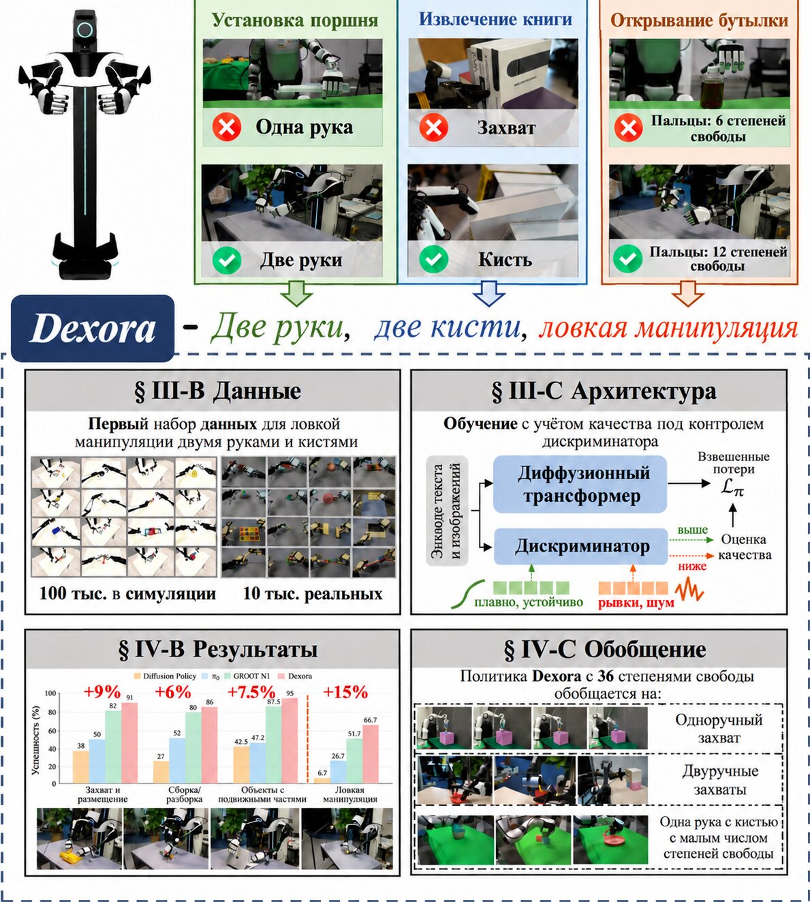
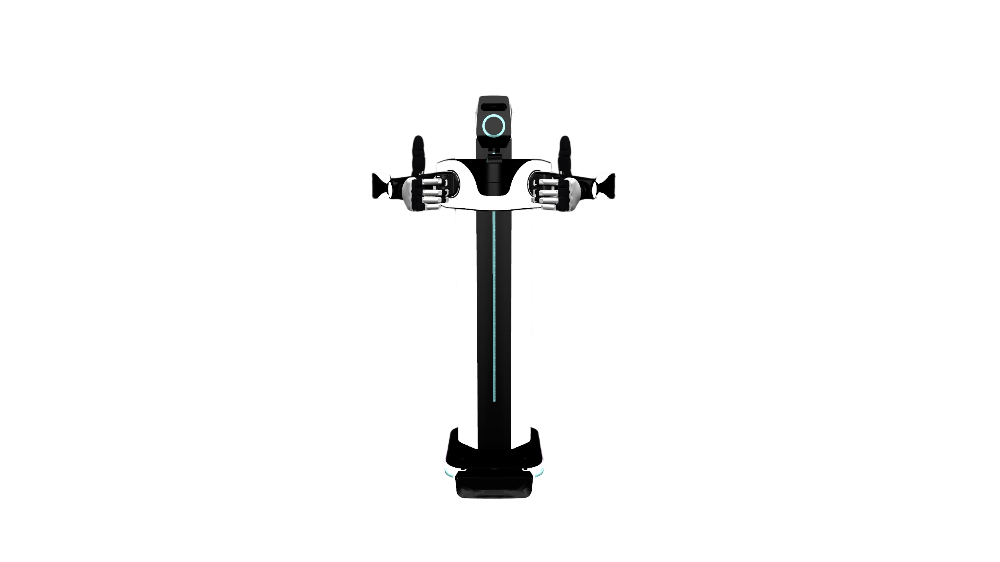
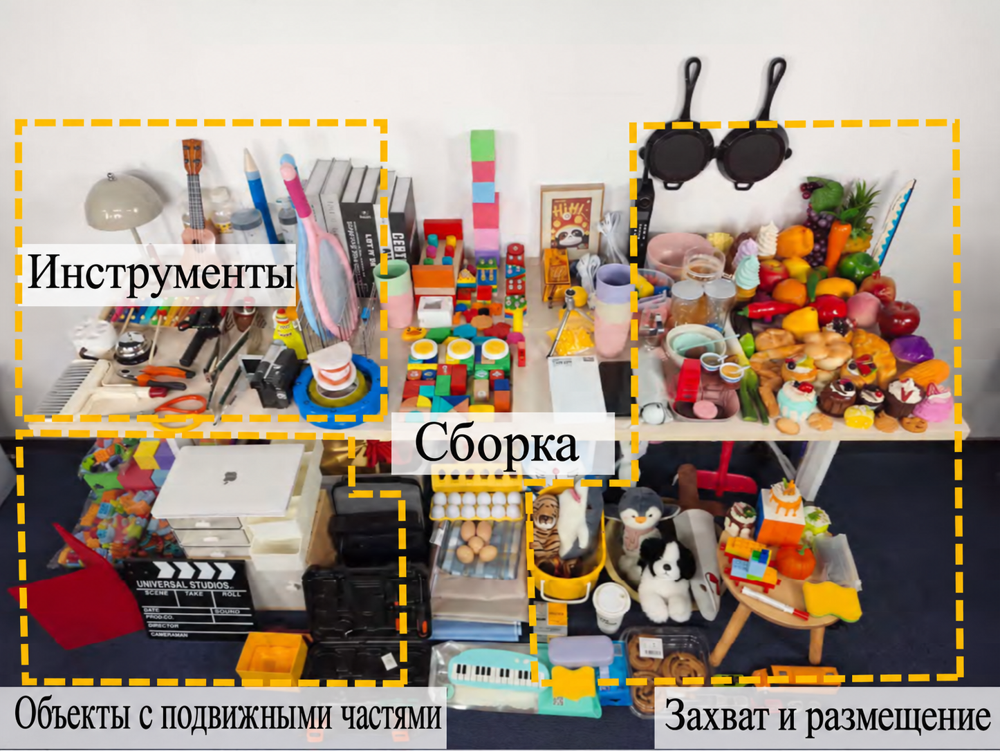
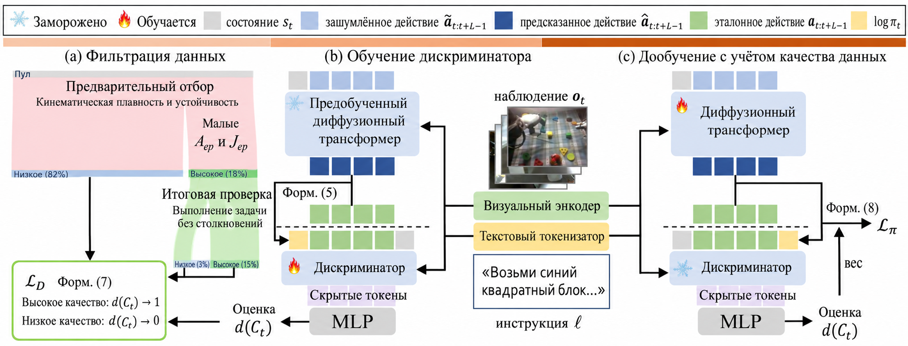
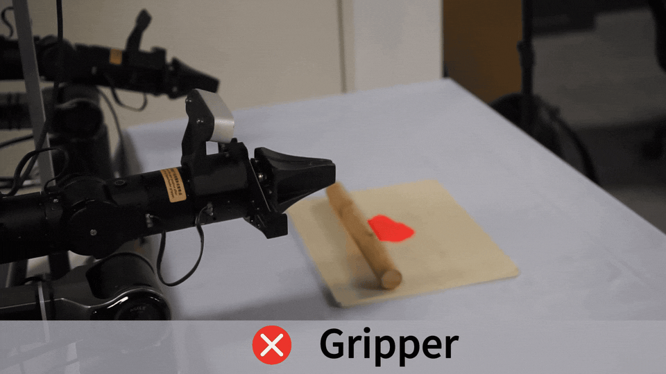

# Dexora: открытая VLA-система для двурукой ловкой манипуляции с высокой степенью свободы (36 DoF)

> Это обзор статьи **Dexora: Open-source VLA for High-DoF Bimanual Dexterity**. Работа выполнена командами Университета Цинхуа, Пекинской академии искусственного интеллекта BAAI, Гонконгского университета, Шанхайского университета Цзяо Тун, ShanghaiTech и Пекинского университета. Препринт на arXiv — `2605.18722v1`. Страница официальных наград ICRA 2026 включила Dexora в список кандидатов на **Best Paper Award on Robot Manipulation and Locomotion**.

## 1. Главный вывод: зачем Dexora в главе о VLA

Dexora решает задачу, которая хорошо известна: большинство VLA работает либо с одноручным захватом, либо с двуручными захватами с малым числом степеней свободы, либо с одной ловкой кистью. Такие модели умеют брать и класть, открывать и закрывать ящики, но когда задача требует одновременно **согласованной работы двух рук** и **точного контакта нескольких пальцев**, усложняются и пространство действий, и сбор данных, и устойчивость обучения.

Цель Dexora — поднять VLA до более высокой степени свободы:

```text
Две руки + две ловкие кисти + 36 DoF
    -> нарезка овощей, замешивание теста, откручивание крышки бутылки,
       вытаскивание книги с полки, перенос двумя руками, сборка и разборка
```

Сразу стоит поправить одно частое недоразумение: в рекламных текстах иногда пишут «двурукие кисти с 6 степенями свободы». Статья и страница проекта подчёркивают систему **с 36 степенями свободы: две руки и две ловкие кисти**. На рисунке встречается подпись `6-DoF Fingers` — это условие сравнения: кисти с малым числом степеней свободы хуже справляются с откручиванием крышки, чем кисти с `12-DoF Fingers`. Это не означает, что у Dexora всего 6 степеней свободы.

Ключ к Dexora — не в том, что взяли более «разговорчивую» VLM, а в связке трёх вещей:

1. **Аппаратура с высокой степенью свободы и цифровым двойником в MuJoCo**: физический и симулированный роботы имеют одинаковое воплощение (embodiment) — две руки и две кисти.
2. **Смешанный сбор данных телеуправлением**: экзоскелет на спине отвечает за крупные движения рук, а маркерная-безмаркерная трекинг-система Apple Vision Pro отвечает за тонкие движения пальцев.
3. **Обучение VLA с учётом качества**: офлайн-дискриминатор оценивает качество фрагментов телеуправления, а его оценки становятся весами функции потерь диффузионного трансформера. Так снижается вредное влияние дрожащих, неудачных и с коллизиями демонстраций.

Поэтому глава помещается в `06-manipulation-and-vla/large-model-control-vla-vlm`, а не в раздел о моделях мира. Dexora — системная инженерия и схема обучения VLA для двурукой ловкой манипуляции с высокой степенью свободы, а не предсказание видео по действиям.

## 2. Статья, проект, код и данные

| Ресурс | Ссылка | Статус |
| :--- | :--- | :--- |
| Статья | [arXiv:2605.18722](https://arxiv.org/abs/2605.18722) / [HTML](https://arxiv.org/html/2605.18722v1) | Подана 2026-05-18 |
| Страница проекта | [dexoravla.github.io](https://dexoravla.github.io/) | Официальная страница: анимации, схемы метода, данные и результаты |
| Код | [dexoravla/Dexora](https://github.com/dexoravla/Dexora) | Репозиторий со страницы проекта; в README указаны обучение, инференс, обработка данных и телеуправление |
| Набор данных | [Dexora/Dexora_Real-World_Dataset](https://huggingface.co/datasets/Dexora/Dexora_Real-World_Dataset) | Набор на Hugging Face с реальными данными телеуправления и представлениями на уровне задач |
| ICRA 2026 | [Award Finalists](https://2026.ieee-icra.org/awards/) | Кандидат на Best Paper Award on Robot Manipulation and Locomotion |

Открытость можно понимать так: статья, страница проекта, точка входа в код и страница набора реальных данных уже доступны. Пока полезнее всего **разбирать метод, изучать структуру данных, собирать учебные материалы и проверять вход в код**. Полное повторение реальных экспериментов с двуручной ловкой системой требует аппаратуры двух рук и двух кистей, устройств телеуправления, ассетов и модели цифрового двойника MuJoCo, весов модели и вычислительных ресурсов для обучения. В учебнике не стоит обещать «повторим нарезку овощей одной командой».

## 3. Общая схема: четыре ключевых блока Dexora



**Рисунок 1. Общая схема Dexora.** Сверху три примера — вставка поршня (Piston Insertion), извлечение книги (Book Retrieval), открывание бутылки (Bottle Opening) — объясняют, почему одной руки-захвата или малопалой кисти недостаточно. В центре подчёркивается, что Dexora объединяет двурукость, двойную ловкую кисть и ловкость манипуляции. Внизу показаны набор данных, архитектура, производительность и перенос между воплощениями.
Источник: [страница проекта Dexora](https://dexoravla.github.io/).

Рисунок удобно читать по четырём слоям.

Первый слой — **мотивация**. Вставка поршня требует, чтобы две руки одновременно позиционировали детали и прикладывали усилие. Извлечение книги требует, чтобы пальцы вошли в щель между книгами, захватили её и вытащили — обычный захват здесь не справляется. Открывание бутылки требует, чтобы пальцы охватили её, повернули и удерживали корпус, а малопалые кисти не дают нужного контакта.

Второй слой — **данные**. Dexora строит набор данных с совпадающим воплощением: часть получена из крупномасштабных симуляций в цифровом двойнике MuJoCo, часть — из реального телеуправления. В аннотации статьи указано `100 тыс.` симулированных траекторий, `6,5 млн` кадров и `10 тыс.` реальных эпизодов телеуправления, `2,92 млн` кадров. В текущей карточке набора на Hugging Face и в README для реальных данных приведены `12,2 тыс.` эпизодов телеуправления, `2,92 млн` кадров и `40,5 ч`. Эти цифры отличаются, поэтому в учебнике лучше использовать общую формулировку: **десятки тысяч реальных эпизодов телеуправления и порядка 100 тыс. симулированных траекторий**.

Третий слой — **архитектура обучения**. Dexora не подаёт все демонстрации одинаково. Сначала обучается дискриминатор, который оценивает качество фрагмента. Плавные, стабильные и успешные фрагменты получают больший вес; дрожащие, зашумлённые и часто неудачные — меньший.

Четвёртый слой — **производительность и перенос**. В статье сообщается, что на базовых задачах Dexora достигает примерно `90%` успешности, на ловких задачах средняя успешность составляет `66,7%` против `51,7%` у сравниваемой базовой модели. Также показан перенос с политики на 36 DoF на одноручный захват, двуручные захваты и одноручную кисть с малым числом степеней свободы.

## 4. Почему двурукая ловкая VLA трудна

У обычной задачи с захватом пространство действий, как правило, невелико:

```text
Приращение позы конца + открытие / закрытие захвата
```

Двурукая задача с ловкими кистями устроена куда сложнее:

```text
Поза левой руки + поза правой руки
    + суставы пальцев левой кисти
    + суставы пальцев правой кисти
    + согласование контактов обеих кистей по времени
    + состояние силы и трения объекта
```

Здесь три трудности.

Первая — **рост размерности действий**. Чем больше размерность, тем реже данные покрывают пространство состояний и действий. Захват может научиться «подходить, закрываться, поднимать» по небольшому числу демонстраций, а ловкой кисти нужно выучить, какой палец и когда сгибать, насколько и как не выбить объект из руки.

Вторая — **временная связанность рук**. Двурукие задачи не распадаются на два независимых действия. При откручивании крышки одна рука стабилизирует корпус бутылки, а другая поворачивает крышку. При извлечении книги одна рука может раздвигать пространство, а другая вставляет палец и вытаскивает книгу. Задержка, перерегулирование или сбой контакта одной стороны переходит на другую.

Третья — **шум данных телеуправления**. У телеуправления с высокой степенью свободы часто возникают дрожание пальцев, микровибрации суставов, нестабильный контакт, столкновения и траектории, которые формально выполнили задачу, но выглядят плохо. Если напрямую клонировать такое поведение, политика выучит и нестабильные движения.

Механизм дискриминатора в Dexora как раз решает третью проблему: он признаёт, что данные телеуправления несовершенны, и заставляет обучение меньше копировать плохие фрагменты и больше опираться на хорошие.

## 5. Аппаратура и телеуправление: экзоскелет отвечает за руки, Vision Pro — за пальцы



**Рисунок 2. Внешний вид двурукого робота с ловкими кистями Dexora.** Целевая платформа Dexora — двурукий высокостепенный робот с двумя ловкими кистями, предназначенный для согласованных двуручных и тонких пальцевых операций.
Источник: [страница проекта Dexora](https://dexoravla.github.io/).

Цепочка телеуправления в Dexora устроена важным образом. По описанию статьи, используется гибридный конвейер:

```text
Экзоскелет на спине
    -> фиксирует крупную кинематику двух рук

Трекинг кистей Apple Vision Pro без маркеров
    -> фиксирует тонкую артикуляцию пальцев

Один и тот же набор движений
    -> управляет физическими двуручными роботом
    -> синхронно управляет цифровым двойником в MuJoCo
```

Такая схема даёт два преимущества.

Во-первых, разделение задач при сборе. Положение, скорость и крупные движения рук надёжнее записываются экзоскелетом, а суставы пальцев удобнее отслеживать Vision Pro без маркеров — не нужно наклеивать на каждый палец сложные метки.

Во-вторых, общий интерфейс для реальности и симуляции. Когда оператор управляет физическим роботом, цифровой двойник MuJoCo повторяет то же движение. Это уменьшает рассогласование воплощений между симуляцией и реальностью, поэтому симулированные и реальные данные легче объединять в обучении.

В статье также указана низкая задержка телеуправления — около `11 мс` сквозной задержки. Для высокой степени свободы это важно: при большой задержке оператор начинает чрезмерно компенсировать движение, собранные действия становятся более дёрганными, и качество последующего обучения VLA падает.

## 6. Набор данных: зачем нужны и масштаб симуляции, и точность реальности



**Рисунок 3. Реальные объекты и сцены в данных Dexora.** На странице проекта показаны инструменты, собираемые объекты, шарнирные предметы, предметы для захвата и укладки. Реальная среда включает много бытовых предметов, перекрытия, загромождённый фон и разное освещение.
Источник: [страница проекта Dexora](https://dexoravla.github.io/).

Данные Dexora делятся на две части:

| Данные | Назначение | Официальная статистика |
| :--- | :--- | :--- |
| Симуляции MuJoCo | Масштаб, покрытие задач и предобучение с совпадающим воплощением | 100 тыс. траекторий, 6,5 млн кадров, около 361 ч видео |
| Реальное телеуправление | Реальный контакт, зрение, трение, тонкие движения пальцев | В статье / на странице около 10 тыс. эпизодов; в HF/README — 12,2 тыс. эпизодов, 2,92 млн кадров, 40,5 ч |

Симуляция и реальность решают разные задачи. Симуляция хорошо подходит для широкого покрытия базовых навыков — захват-укладка, сборка и разборка, манипуляции с шарнирными предметами. Реальные данные передают контакт пальцев, материалы предметов, освещение, перекрытия и привычки оператора.

Карточка набора на Hugging Face указывает, что реальные данные включают четыре синхронных вида: головную камеру от первого лица, две камеры на запястьях и камеру третьего лица; кроме того, синхронно записываются проприоцепция робота с 36 степенями свободы. Структура данных соответствует стилю LeRobot / LIBERO-2.1 и содержит наблюдения, состояние робота, действия и языковую инструкцию.

Для студента ценность этого набора не в «множестве видео». Важно, что он превращает двурукую ловкую манипуляцию в стандартный, изучаемый формат:

```text
многовидовые RGB
    + проприоцепция 36 DoF
    + низкоуровневые действия
    + языковая инструкция
    + метаданные задачи / категории
```

На таких данных можно исследовать представления действий, отбор по качеству, имитационное обучение, переразметку данных и перенос между воплощениями.

## 7. Схема метода: обучение с учётом качества по оценкам дискриминатора



**Рисунок 4. Обучение Dexora с учётом качества.** Слева данные предварительно фильтруются по гладкости движения и воспроизведению в симуляции; в центре замороженный предобученный диффузионный трансформер сопровождается дискриминатором, который оценивает качество фрагмента; справа на этапе дообучения оценки качества превращаются в веса функции потерь диффузии.
Источник: [страница проекта Dexora](https://dexoravla.github.io/).

Основу обучения Dexora можно записать в три шага.

**Шаг 1 — фильтрация данных.** Сначала реальные данные телеуправления отбираются по кинематическим показателям, например по ускорению и рывку (jerk). Если сустав меняется слишком резко, а контакт хаотичен, обычно это признак низкого качества демонстрации. Затем проверяется воспроизведение в симуляции: выполнена ли задача, нет ли столкновений, и явно плохие фрагменты отбрасываются.

**Шаг 2 — обучение дискриминатора.** При замороженной предобученной политике на основе диффузионного трансформера обучается дискриминатор. Условиями служат наблюдения и язык; на выходе — оценка качества фрагмента `d(C_t) ∈ (0, 1]`. Хорошие фрагменты получают оценку близкую к 1, плохие — близкую к 0.

**Шаг 3 — дообучение с учётом качества.** При обучении политики разные фрагменты дают разный вклад в функцию потерь:

```text
фрагмент высокого качества -> больший вес
фрагмент низкого качества  -> меньший вес
```

Для высокой степени свободы это особенно важно. У низкостепенного захвата иногда дрожание демонстраций скрывается постобработкой или фильтрацией в контроллере. В двурукой ловкой манипуляции микродрожание пальцев напрямую приводит к соскальзыванию, зажатию, столкновению с объектом или рассогласованию рук. Дискриминатор Dexora фактически говорит модели: не усредняйте все демонстрации, а предпочитайте фрагменты, которые **плавные, стабильные и выполняют задачу**.

На этапе инференса работает только политика, дискриминатор в онлайн-управлении не участвует. Значит, он — регулятор качества на этапе обучения, а не модель вознаграждения во время исполнения.

## 8. Иллюстрация: почему ловкость важна — пример с роликом теста



**Рисунок 5. Пример сравнения захвата и кисти при раскатывании теста.** Страница проекта показывает, что такие задачи, как раскатывание теста, откручивание крышки, извлечение книги или работа карандашом, — не простые захваты-укладки: площадь контакта пальцев, их положение и непрерывное приложение усилия напрямую влияют на успешность.
Источник: [страница проекта Dexora](https://dexoravla.github.io/).

Такие примеры демонстрируют не то, что рука должна «выглядеть как человеческая». Задача сама по себе предъявляет требования к воплощению. Раскатывание теста требует непрерывного перекатывания, нажатия и удержания контакта; откручивание крышки — одна рука фиксирует корпус, другая создаёт крутящий момент; извлечение книги — палец должен войти в тонкую щель и устойчиво её удержать. Захват может решать много промышленных задач «взять-положить», но в таких повседневных ловких задачах он быстро упирается в ограничения.

В этом и научная ценность Dexora: это не ещё один VLA для настольной задачи «взять-положить», а попытка продвинуть пространство действий VLA в область, ближе к повседневной ловкой работе человеческих рук.

## 9. Результаты: сильные, но не «ловкость полностью решена»

Основные результаты статьи и страницы проекта:

| Направление | Вывод статьи / страницы | Как это понимать |
| :--- | :--- | :--- |
| Базовые задачи | Вставка-захват, сборка / разборка, шарнирные предметы — средняя успешность около 90 % | Двурукая VLA на 36 DoF умеет и базовые операции |
| Ловкие задачи | Средняя успешность ловких операций `66,7 %` против `51,7 %` у базовой модели | Высокая степень свободы кистей и обучение с учётом качества дают заметный выигрыш |
| Обобщение вне распределения | Проверка незнакомого фона, освещения, объектов, перекрытий, загромождения, изменения высоты | Проверяет устойчивость к визуальным и физическим возмущениям |
| Перенос между воплощениями | С 36-DoF политики на одноручный захват, двуручные захваты и одноручную кисть с малым числом степеней | Переход с высокой степени свободы на низкую относительно реализуем, обратный переход трудно осуществим |
| Абляция дискриминатора | С дискриминатором действия плавнее, задачи выполняются успешнее | Веса качества данных — один из основных вкладов работы |

Не стоит писать, что Dexora «полностью решила ловкость». Страница проекта сама показывает случаи отказа: неоднозначность инструкции, путаница визуально похожих объектов, недостаточное трение при захвате, рассинхронизация рук, дрейф позы и нарушение границ рабочей зоны. Эти отказы хорошо показывают открытые проблемы высокостепенных двуруких VLA: привязку к языку, физический контакт, накопление ошибок на длинном горизонте, синхронизацию рук и ограничения рабочего пространства.

## 10. Как воспроизводить сейчас

Dexora не подходит для руководства «все смогут за выходные повторить нарезку овощей на реальном роботе». Разумно идти в три уровня.

### 10.1 Разбор статьи и страницы проекта

Первый уровень требует только статьи, страницы проекта и официальных рисунков. Ответьте на вопросы:

- почему одноручного захвата и малопалых кистей недостаточно?
- какие части входят в пространство действий на 36 DoF?
- зачем нужны одновременно симуляционные и реальные данные?
- как дискриминатор снижает влияние шумного телеуправления?
- что доказывают результаты OOD и переноса между воплощениями, а что — нет?

Этот уровень хорошо подходит для задания Task04 группового курса и не требует ни оборудования, ни большой вычислительной мощности.

### 10.2 Проверка структуры набора данных

Второй уровень — начать с набора данных на Hugging Face. В карточке показана структура с эпизодами и видео:

```text
data/chunk-xxx/episode_xxxxxx.parquet
videos/chunk-xxx/observation.images.*
meta/info.json
meta/episodes.jsonl
meta/episodes_stats.jsonl
meta/modality.json
meta/stats.json
meta/tasks.jsonl
```

Лёгкие учебные задачи:

1. Скачать небольшое подмножество задач.
2. Посмотреть `meta/info.json` и `modality.json`.
3. Прочитать один эпизод в формате parquet.
4. Согласовать многовидовые видео, состояние и действия с 36 DoF и языковую инструкцию.
5. Написать одностраничный отчёт о том, чем формат данных Dexora отличается от датасетов с обычным захватом.

### 10.3 Точка входа в код и границы полного воспроизведения

Третий уровень — изучение кода. Со страницы проекта ведёт ссылка:

```bash
git clone https://github.com/dexoravla/Dexora
cd Dexora
```

Судя по описанию README, репозиторий организован так:

```text
конвейер обучения
стек инференса для реального робота
конвертеры BSON -> LeRobot v2.1
инструменты телеуправления с Vision Pro
цифровой двойник MuJoCo / проверка воспроизведением
```

Для полного повторения эксперимента нужны:

- двурукое двуручное оборудование или эквивалентный цифровой двойник;
- экзоскелет и телеуправление через Apple Vision Pro;
- ассеты и модель робота в MuJoCo;
- доступ к реальным или симулированным данным и достаточный объём диска;
- вычислительные ресурсы для обучения диффузионного трансформера;
- ограничения безопасности: лимиты скорости, проверка коллизий, синхронное управление и аварийная остановка.

Поэтому в учебнике Dexora пока описывается как **разбор метода, изучение структуры данных и навигация по коду**. Полное пошаговое воспроизведение будет уместно, когда код, модели, симуляционные данные и конфигурации оборудования станут более стабильными.

## 11. Связь с другими VLA-работами

| Метод | Основное усиление | Отличие от Dexora |
| :--- | :--- | :--- |
| OpenVLA / OpenVLA-OFT | Открытая основа VLA и конвейер дообучения | Dexora делает упор на двурукое воплощение с высокой степенью свободы |
| π0 / π0.5 | Сильная базовая VLA для общих манипуляций | Dexora фокусируется на двуручной ловкости и данных высокой степени свободы |
| EventVLA | Память визуальных доказательств | Dexora фокусируется на пространстве действий, данных телеуправления и взвешивании по качеству |
| 3DVLA | Пространственное и экземплярное понимание в 3D | Dexora — о форме исполнителя и высокомерных действиях двух рук и двух кистей |
| PhysBrain | Предобучение физического здравого смысла | Dexora обучается непосредственно на реальных высокостепенных контактных данных |
| PRTS | Предобучение с целевой достижимостью (CRL) | Dexora использует дискриминатор для контроля качества телеуправления |
| G0.5 | Авторегрессивный CoT и поток токенов действий | Dexora использует диффузионный трансформер и обучение с учётом качества |
| HumanoidMimicGen | Генерация данных всего тела гуманоида из малого числа демонстраций | Dexora — двурукая VLA для ловкой манипуляции, а не генерация данных для всего тела (loco-manipulation) |

Если классифицировать методы по причине провалов VLA:

- EventVLA: провалы связаны с потерей визуальных доказательств на длинном горизонте.
- 3DVLA: провалы связаны с недостатком понимания 3D-пространства и экземпляров.
- PRTS: провалы связаны с недостатком осознания достижимости цели и прогресса задачи.
- G0.5: провалы связаны с разрывом между рассуждениями, представлением действий и управлением разными воплощениями.
- Dexora: провалы связаны и с упрощённостью воплощения (низкостепенные захваты не выражают настоящую двуручную ловкость), и с необходимостью моделировать качество данных телеуправления с высокой степенью свободы.

## 12. Рекомендуемое задание

В групповом курсе по манипуляции (Task04) Dexora можно сравнить с G0.5 и PRTS:

> G0.5 делает упор на единый авторегрессивный поток действий, PRTS — на предобучение целевой достижимостью, Dexora — на двурукое воплощение с 36 степенями свободы, смешанное телеуправление и обучение с учётом качества. Какую узкую часть проблемы VLA решает каждый из этих подходов?

Примерные вопросы:

- Почему Dexora — не обычная двуручная VLA с захватами?
- За что отвечают экзоскелет и Apple Vision Pro в телеуправлении?
- Почему нужны и симуляционные, и реальные данные?
- Почему обучение с учётом качества на основе дискриминатора хорошо подходит для данных телеуправления высокой степени свободы?
- Что означает попадание в кандидаты ICRA 2026, и чего оно не означает?
- До какого этапа доступно публичное воспроизведение и каких условий не хватает для полного повторения на реальном роботе?

## 13. Источники изображений и ссылки

Изображения и анимации в этой главе взяты со [страницы проекта Dexora](https://dexoravla.github.io/) и сохранены в `assets/` для стабильного доступа. Текст опирается на [arXiv:2605.18722](https://arxiv.org/abs/2605.18722), [репозиторий dexoravla/Dexora на GitHub](https://github.com/dexoravla/Dexora), [набор данных Dexora Real-World на Hugging Face](https://huggingface.co/datasets/Dexora/Dexora_Real-World_Dataset) и [список кандидатов ICRA 2026](https://2026.ieee-icra.org/awards/).
