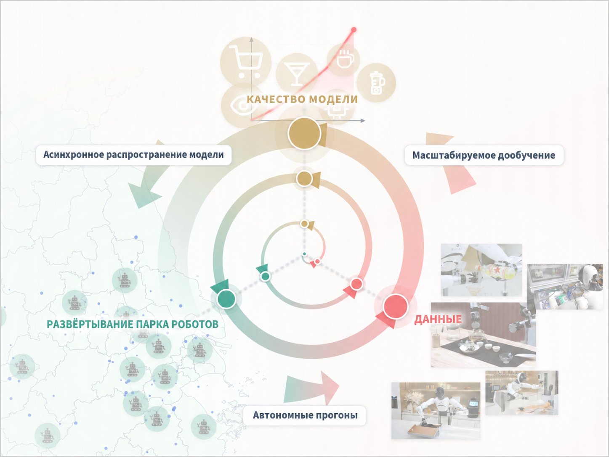
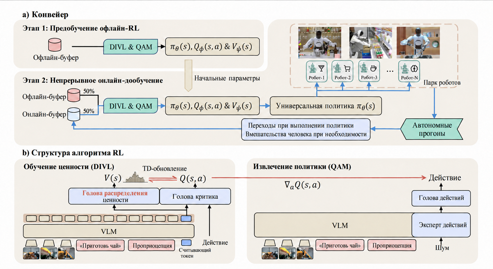
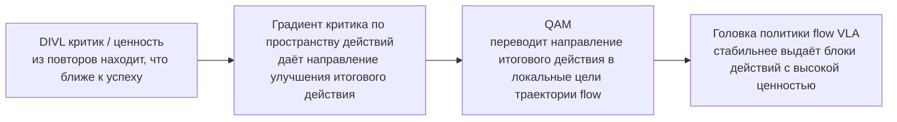
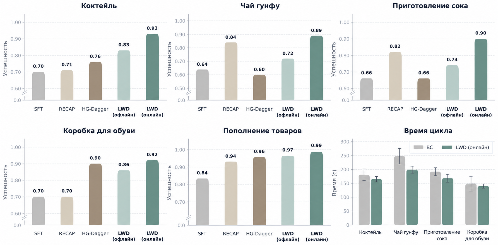

# LWD: обучение с подкреплением на парке реальных роботов от AgiBot

> Это обзор статьи **Learning while Deploying: Fleet-Scale Reinforcement Learning for Generalist Robot Policies**. Работа выполнена Shanghai Innovation Institute, AGIBOT Finch и Columbia University. Номер на arXiv — `2605.00416v1`, страница проекта опубликована 30 апреля 2026 года.

## 1. Главный вывод: что делает LWD

LWD расшифровывается как **Learning While Deploying**, то есть «обучение во время развёртывания». Задача сформулирована прямо: универсальная VLA, которая обучается только на офлайн-демонстрациях, плохо покрывает длинный хвост реальных ситуаций — редкие объекты, неожиданные формулировки команд, неудачные состояния, изменения окружения и необходимость исправлять ошибки на ходу. Как только робот попадает в реальную среду, он сам порождает новый опыт. Если этот опыт используется только как журнал событий и не обновляет общую политику, теряются самые ценные реальные данные.

LWD превращает развёртывание в замкнутый цикл:

```text
офлайн-предобучение VLA
    ↓
развёртывание на нескольких реальных роботах
    ↓
сбор успехов, провалов, восстановлений, вмешательств человека и истории rollout
    ↓
обновление одной общей VLA с помощью офлайн-в-онлайн RL
    ↓
повторное развёртывание более сильной политики
```

Это не алгоритм RL для одной задачи и не схема «для каждой задачи — отдельная экспертная политика». В статье речь идёт о **офлайн-в-онлайн обучении с подкреплением для универсальных VLA в масштабе парка роботов** (fleet-scale offline-to-online RL). На 16 двурукých роботах AgiBot G1 в 8 реальных задачах манипуляции собираются данные, и одна общая универсальная политика улучшается по мере накопления опыта парка. Задачи включают пополнение полок в супермаркете, заваривание улунского чая, смешивание коктейлей, выжимание сока, упаковку обувных коробок; длинные задачи обычно занимают от 3 до 5 минут.

Суть в одном предложении:

> Главное в LWD — не просто «перенести» QAM и не заменить actor на attention head, а соединить **DIVL — обучение ценности, QAM — извлечение политики и маховик данных парка реальных роботов** в процессе послетренировки универсальной VLA во время развёртывания.

Глава относится к разделу 06 «Манипуляции и VLA». Обучаемый объект здесь — политика VLA, а основной вопрос — как политика манипуляций набирается сил из данных реального развёртывания. LWD не является моделью мира и не чисто симуляционным бенчмарком.

## 2. Статья, проект и точки входа для воспроизведения

| Элемент | Ссылка | Текущий статус |
| :--- | :--- | :--- |
| Статья | [arXiv:2605.00416](https://arxiv.org/abs/2605.00416) / [HTML](https://arxiv.org/html/2605.00416v1) | Подана 1 мая 2026 года |
| Страница проекта | [AGIBOT Finch LWD](https://finch.agibot.com/research/lwd) | Официальная страница с методом, результатами и видео реальных задач |
| PDF | [lwd-paper.pdf](https://finch-static.agibot.com/LWD/lwd-paper.pdf) | PDF статьи с официальной страницы проекта |
| Код | На официальной странице проекта отдельного репозитория пока не указано | Подходит для чтения метода, разбора системы и проектирования воспроизведения, но не для пошаговой инструкции «запустить одной командой» |
| Предшествующая работа | [Q-learning with Adjoint Matching](https://arxiv.org/abs/2601.14234) | Метод извлечения flow-политики, который использует LWD |

Нужно честно обозначить границы открытости. На момент подготовки этого текста страница проекта публикует статью, рисунки и видео с реальными роботами, но не показывает репозитория, который позволил бы воспроизвести эксперименты, весов модели или скриптов развёртывания на роботе. Поэтому глава не даёт пошагового воспроизведения. Она объясняет принцип, структуру системы, цикл данных и то, с чего стоит начать, если код будет открыт.

## 3. Общая схема: развёртывание перестаёт быть финишем



**Рисунок 1. Маховик данных развёртывания LWD.** Предобученная VLA сначала разворачивается на реальных роботах; роботы генерируют интерактивные данные по нескольким задачам. Эти данные смешиваются с офлайн-буфером повторов, обновляют общую политику, которая затем снова развёртывается на парке.
Источник: [страница проекта AGIBOT Finch LWD](https://finch.agibot.com/research/lwd).

Самое важное на этом рисунке — развёртывание становится частью обучения, а не только тестирования. Традиционный процесс выглядит так:

```text
сбор демонстраций -> обучение модели -> тестовое развёртывание
```

Процесс LWD:

```text
сбор демонстраций -> офлайн RL-предобучение -> развёртывание -> сбор реального опыта -> онлайн-дообучение -> повторное развёртывание
```

Реальный опыт здесь — не только успешные демонстрации. В статье к данным развёртывания отнесены:

- **успешные rollout**: политика самостоятельно выполнила задачу;
- **неудачные rollout**: политика провалилась, но состояния провала полезны для обучения ценности;
- **частичный прогресс (partial progress)**: задача не выполнена полностью, но пройдены промежуточные этапы;
- **восстановление (recovery)**: робот вернулся из отклонённого состояния;
- **вмешательство человека (human intervention)**: оператор взял управление или поправил действие в критический момент;
- **игровые данные (play data)**: оператор намеренно исследовал режимы отказов и граничные состояния.

Именно это отличает LWD от обычного имитационного обучения. Клонирование поведения использует только метку «что сделал эксперт здесь». LWD использует информацию о том, **насколько хорошим оказался весь путь, где состояние ближе к успеху и каких состояний следует избегать**. В реальных развёртываниях много провалов и частичных успехов, и они дают критику полезный сигнал обучения.

## 4. Схема метода: DIVL оценивает, QAM извлекает политику



**Рисунок 2. Структура обучения LWD.** Слева — двухэтапный конвейер: сначала RL-предобучение на офлайн-буфере, затем продолжение послетренировки на смеси офлайн- и онлайн-буферов. Справа — структура алгоритма: политика на основе VLM выдаёт блоки действий через головку политики, критик и распределенная оценка ценности обучают цель TD, а функция потерь QAM превращает градиенты критика в стабильное обновление flow-политики.
Источник: [страница проекта AGIBOT Finch LWD](https://finch.agibot.com/research/lwd).

На этом рисунке три модуля.

**Первый — слой данных.** У LWD есть статичный офлайн-буфер и растущий онлайн-буфер. Офлайн-буфер состоит из человеческих демонстраций, исторических rollout политики и игровых данных; онлайн-буфер — из данных парка роботов в развёртывании. В приложении к статье указан общий объём офлайн-данных `652,5 ч`: экспертные демонстрации — `336,6 ч`, успешные rollout — `88,8 ч`, неудачные rollout — `39,2 ч`, игровые данные — `187,9 ч`. По задачам доля длинных выше, потому что эпизоды заваривания чая, коктейлей, выжимания сока и упаковки коробок сами по себе длиннее.

**Второй — обучение ценности.** LWD использует **Distributional Implicit Value Learning (DIVL)**. Обычный критик может регрессировать одно скалярное значение ценности, но реальные данные повторов неоднородны: для похожих состояний могут быть успехи, провалы, вмешательства, восстановления и действия разных версий политики. Скаляр усредняет их и стирает редкие, но выгодные модели поведения. DIVL вместо этого обучает **распределение** значений действие-ценность по повторам, а в качестве цели для бутстрэппинга TD берёт квантильную статистику этого распределения. Так сохраняется идея IQL — улучшение внутри распределения данных, — и метод лучше работает с разнородными повторами и разреженными наградами.

**Третий — извлечение политики.** Политика LWD — генератор действий на основе flow. Она выдаёт блок действий через многошаговый процесс генерации. Если напрямую максимизировать критика, пришлось бы передавать градиент назад через всю траекторию генерации (flow / ODE), что дорого и нестабильно. LWD использует **Q-learning with Adjoint Matching (QAM)**: градиент критика по итоговому действию направляет обновление политики, но оптимизация по всей траектории переписывается как локальная регрессионная цель на траектории flow. Так избегается хрупкое многошаговое обратное распространение через весь процесс генерации, и не требуется вычислимое правдоподобие действия.

## 5. QAM — это не Query Attention Module и не «удаление actor»

Сокращение здесь легко понять неправильно. В LWD QAM означает:

```text
Q-learning with Adjoint Matching
```

Это не `Query Attention Module`, который встречается в моделях зрения, и не замена актора головой внимания. Точнее так:

```text
критик / ценность оценивают, хорошо ли действие
        ↓
критик даёт направление улучшения для итогового действия
        ↓
QAM превращает это направление в локальный контроль на траектории flow
        ↓
обновляется головка политики flow в составе VLA
```

Поэтому LWD не отменяет понятие актора. В терминах actor-critic актор — это политика, которая выдаёт действия. В LWD эта политика остаётся, но это не небольшой MLP-актор, а головка действий на основе flow поверх backbone VLM/VLA. QAM выполняет **извлечение политики**: стабильно переносит ценностную информацию критика в генеративную политику.

Для сравнения с типичными обновлениями RL:

| Метод | Форма политики | Сложность обновления | Решение в LWD |
| :--- | :--- | :--- | :--- |
| SAC / TD3 и другие actor-critic | Явный актор выдаёт непрерывные действия | Градиент по действию вычисляется напрямую | Плохо переносится на большую flow-VLA |
| Клонирование поведения | Имитация действий эксперта | Не использует ценностную информацию о провалах и разреженных наградах | Полезно как предобучение, но данные развёртывания используются недостаточно |
| Прямое обратное распространение критика через flow-политику | Генеративная многошаговая политика | Нужно пройти весь процесс генерации назад, дорого и нестабильно | QAM заменяет это локальным adjoint matching |
| LWD | Политика на основе VLM + головка действий flow | Нужно стабильно улучшать генеративный блок действий по критику | DIVL учит ценность, QAM извлекает политику |

Итак, на вопрос «верно ли, что перенесли QAM и заменили actor на attention head» ответ такой:

> Не совсем. LWD действительно использует QAM, но QAM — это извлечение политики для flow-политики под управлением критика. Актор не исчез: его роль выполняет головка политики flow в составе универсальной VLA. Attention head может быть внутренним модулем архитектуры VLM/VLA, но это не главная точка замены в алгоритме LWD.

## 6. Зачем DIVL: повторы реальных роботов — не чистый набор демонстраций

Если все данные — успешные демонстрации эксперта, клонирования поведения уже достаточно для многого. Но данные после развёртывания сложнее:

```text
успешные траектории + неудачные траектории + траектории исторических политик + вмешательства человека + исследование режимов отказа
```

Ценность этих данных не в «чистоте меток действий», а в **богатстве информации об исходе**. Например, при заваривании чая робот может правильно взять чайник, но неверно угол наклона при наливании; при коктейлях — открыть бутылку, но провалиться на последующем наливании; при пополнении полок — распознать товар, но выложить его в неправильной позе. Клонирование поведения трудно определит, какой шаг был прогрессом, а какой привёл к последующему провалу.

DIVL задаёт для этих смешанных траекторий систему координат ценности. Ему не нужно, чтобы все данные были получены текущей политикой или были экспертными демонстрациями. Он оценивает распределение возможных доходов, если из данного состояния и блока действий продолжить выполнение. В задачах с разреженной наградой многошаговый TD-таргет передаёт сигнал успеха в конце назад по траектории, и промежуточным состояниям тоже присваивается информация о прогрессе.

Для реального робота это особенно важно. Испытания на настоящем железе дороги, их нельзя проводить бесконечно, как в игровых средах, а сама реальная среда постоянно меняется. Основное инженерное решение LWD: если развёртывание неизбежно порождает много внеполитичного (off-policy) опыта, алгоритм должен уметь его использовать, а не только считать такие данные журналом ошибок, который нужно очистить вручную.

## 7. Зачем QAM: действующая голова VLA уже не простой актор

Многие новые VLA выдают не одно действие за шаг, а блок действий (action chunk), иногда через генерацию diffusion или flow matching. Это даёт выразительность и возможность моделировать мультимодальное распределение действий, но усложняет обновления RL.

Для обычного актора критик выдаёт `∇a Q(s, a)`, и параметры актора можно сразу сдвинуть в сторону роста Q. Но итоговое действие flow-политики — результат многошагового процесса генерации:

```text
шум / начальное действие
    -> шаг flow 1
    -> шаг flow 2
    -> ...
    -> итоговый блок действий
```

Если передавать градиент критика от итогового блока действий назад через все шаги flow, обучение будет медленным и нестабильным. Идея QAM: направление улучшения на итоговом действии, полученное от критика, через adjoint matching превращается в локальные цели регрессии на каждом шаге flow. Тогда обновление политики больше похоже на обучение с учителем, а не на прямую оптимизацию полной траектории генерации с высокой дисперсией и высокой стоимостью.

Для читателя учебника QAM можно понимать как мост:



Этот мост позволяет RL направлять генеративную модель действий без требования простого правдоподобия действия от политики и без прямого обратного распространения через полный процесс ODE / flow.

## 8. Результаты: сильнее всего на длинных реальных задачах



**Рисунок 3. Успешность и время выполнения в экспериментах LWD.** Страница проекта показывает, что LWD стабильно повышает успешность по сравнению с несколькими базовыми методами дообучения; рост заметнее на длинных задачах, а на части длинных задач снижается среднее время цикла.
Источник: [страница проекта AGIBOT Finch LWD](https://finch.agibot.com/research/lwd).

Общий вывод из аннотации статьи: на 16 двурукých роботах и 8 реальных задачах манипуляции общая универсальная политика улучшается по мере накопления опыта парка, средняя успешность достигает `95%`, а наибольший прирост приходится на длинные задачи. Страница проекта дополнительно подчёркивает, что LWD не только повышает успешность, но и уменьшает среднее время цикла на длинных задачах. Значит, политика добивается успеха не за счёт более медленного и осторожного исполнения, а на части задач одновременно становится и успешнее, и эффективнее.

Здесь нужно учесть три ограничения.

Во-первых, результаты LWD — в основном **результаты реальной робототехнической системы**. Это сильное свидетельство, но внешним исследователям трудно повторить эксперименты. Для воспроизведения нужны несколько двурукých роботов, система диспетчеризации развёртывания, онлайн-буфер повторов, определение награды за задачу, интерфейс вмешательства человека и устойчивая политика безопасности.

Во-вторых, в статье используется собственный парк AGIBOT и собственная система задач, а не открытый симуляционный бенчмарк вроде LIBERO, который каждый может запустить локально. В учебнике можно изучать метод и проектирование системы, но не стоит отождествлять LWD с «открытым бенчмарком».

В-третьих, высокая средняя успешность не означает, что длинная роботизированная манипуляция решена. Вклад LWD — включить реальные данные развёртывания в маховик RL и показать его работоспособность на наборе сложных задач. Открытыми остаются проектирование награды, безопасность при аномалиях, перенос между аппаратными платформами, долгосрочная стабильность работы, конфиденциальность данных и риски онлайн-обновления.

## 9. Связь с SOP, PRTS, Dexora

LWD стоит читать вместе с несколькими недавними методами — это образует понятную линию:

| Метод | Основной вопрос | Сигнал обучения | Отличие от LWD |
| :--- | :--- | :--- | :--- |
| SOP | Как масштабировать систему онлайн-послетренировки VLA | Онлайн-rollout / система послетренировки | Больше системный каркас масштабируемой онлайн-послетренировки |
| PRTS | Как дать VLA осознание достижимости цели на этапе предобучения | Контрастивное RL без меток награды | Больше про представления VLA на предобучении и достижимость цели |
| Galaxea G0.5 | Как поместить память, CoT и токены действий в авторегрессивную VLA | Структурированный CoT + токены действий | Больше про авторегрессивное представление действий |
| Dexora | Как собирать данные и обучать высокостепенную двуручную VLA | Высокостепенные демонстрации + обучение с учётом качества | Больше про воплощение и моделирование качества телеуправления |
| LWD | Как реальный опыт развёртывания постоянно улучшает универсальную VLA | DIVL как критик / ценность + извлечение политики QAM + онлайн-буфер повторов | Больше про маховик RL на парке реальных роботов |

Эти работы хорошо читаются вместе. PRTS думает о том, чтобы на этапе предобучения уже учитывалась достижимость цели; Dexora — о высокостепенном двуручном воплощении и качестве данных; LWD — о том, как после развёртывания постоянно использовать реальный опыт взаимодействия. Все они отвечают на один большой вопрос: VLA не должна ограничиваться статичным офлайн-клонированием поведения, она должна лучше использовать цели, физику, ошибки и реальное взаимодействие.

## 10. Как воспроизводить, если код откроют

Сейчас не стоит писать руководство «скачайте код и запустите обучение». Разумный путь воспроизведения делится на три уровня.

Первый уровень — **разбор статьи**. Главное — ответить на четыре вопроса:

1. Что содержат офлайн-буфер и онлайн-буфер в LWD?
2. Почему DIVL лучше скалярной регрессии ценности для разнородных повторов?
3. Как QAM превращает градиент критика в локальные регрессионные цели для flow-политики?
4. Почему на длинных задачах RL лучше, чем простое клонирование поведения, использует ошибки, восстановления и частичный прогресс?

Второй уровень — **упрощённая копия в симуляции**. Если реальных роботов нет, можно сделать уменьшенную версию в LIBERO, RoboTwin, ManiSkill или собственной среде MuJoCo:

```text
буфер офлайн-демонстраций
    + буфер исторических rollout
    + онлайн-rollout новой политики
    -> обучить критика / ценность
    -> обновить flow- / diffusion-политику через QAM или приближённое извлечение политики
    -> сравнить BC, офлайн-RL и офлайн-в-онлайн RL
```

Такая версия не докажет масштабируемость LWD на парк реальных роботов, но поможет понять замкнутый цикл алгоритма.

Третий уровень — **копия реальной системы**. Для этого нужно выполнить больше инженерных условий:

- хотя бы одна механическая рука, на которой задача выполняется стабильно и повторяемо;
- безопасный механизм прерывания онлайн-rollout;
- определение награды успеха или провала для каждого эпизода;
- запись изображений, состояния, действий, языковой инструкции, версии политики, отметок вмешательства и терминальной награды;
- смешивание офлайн-данных, исторических rollout и онлайн-rollout при выборке;
- достаточно устойчивая базовая VLA или политика действий на diffusion / flow.

При воспроизведении на реальном роботе сначала нужны ворота безопасности, а не сразу онлайн-RL. Политика развёртывания должна ограничивать скорость, усилие, рабочую зону, зоны столкновений и способы восстановления после сбоя. Обновлённую политику стоит сначала проверить на офлайн-повторах, в симуляции или в режиме теневой работы (shadow mode) и только потом постепенно выпускать на реального робота.

## 11. Рекомендуемое задание для группового курса

В Task04 можно предложить такое задание:

> Сравните PRTS, Dexora и LWD: PRTS вводит достижимость цели в предобучение VLA, Dexora решает данные и качество обучения для высокостепенной двуручной манипуляции, LWD превращает реальное развёртывание в маховик офлайн-в-онлайн RL. Укажите, какие данные использует каждый метод, какое узкое место VLA он решает и где проходит граница воспроизводимости.

Для ответа можно не запускать эксперименты, но важно объяснить:

- почему LWD — не обычное клонирование поведения?
- в чём связь DIVL и IQL?
- почему QAM подходит для VLA с генеративным блоком действий на основе flow?
- что показывают эксперименты на 16 реальных роботах и 8 задачах и чего они не показывают?
- какие модули понадобятся, чтобы сделать упрощённую версию LWD в открытой симуляции?

## 12. Источники

Изображения этой главы взяты со [страницы проекта AGIBOT Finch LWD](https://finch.agibot.com/research/lwd) и сохранены в локальном `assets/` для стабильного доступа. Текст опирается на [arXiv:2605.00416](https://arxiv.org/abs/2605.00416), [HTML-версию arXiv](https://arxiv.org/html/2605.00416v1), [официальный PDF](https://finch-static.agibot.com/LWD/lwd-paper.pdf) и предшествующую работу по QAM [arXiv:2601.14234](https://arxiv.org/abs/2601.14234).
