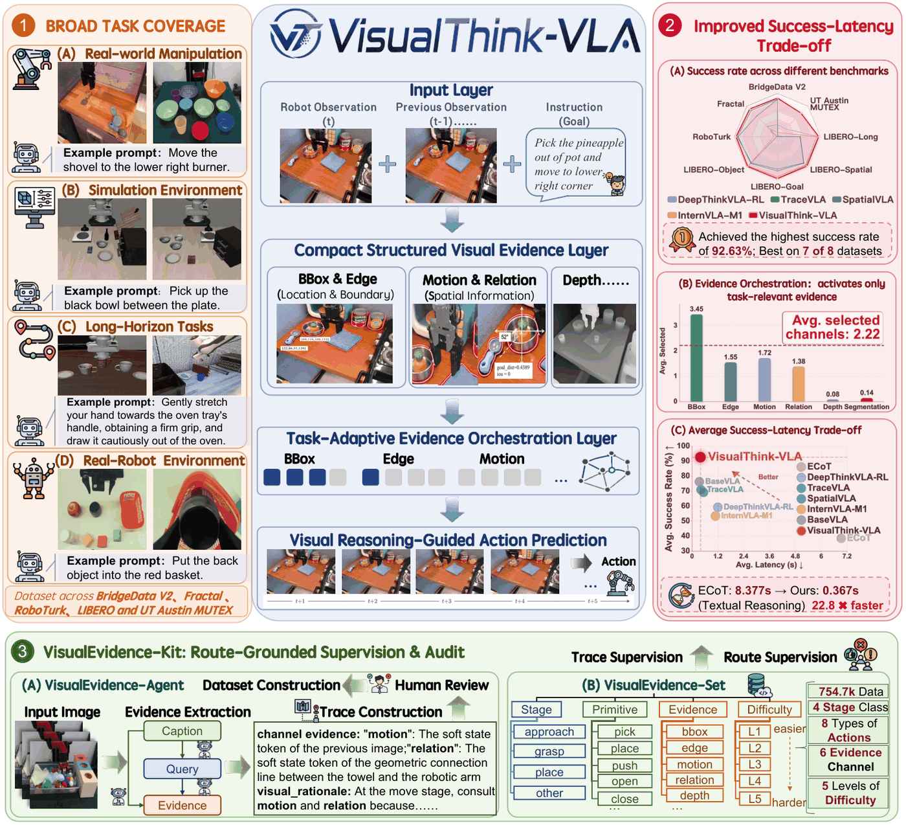
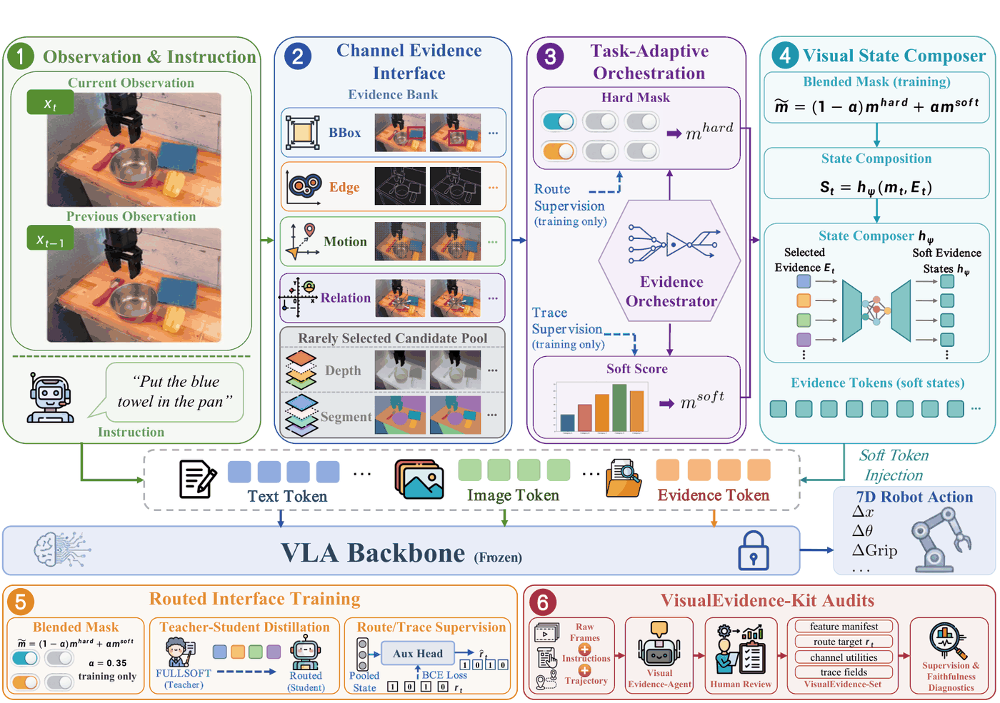
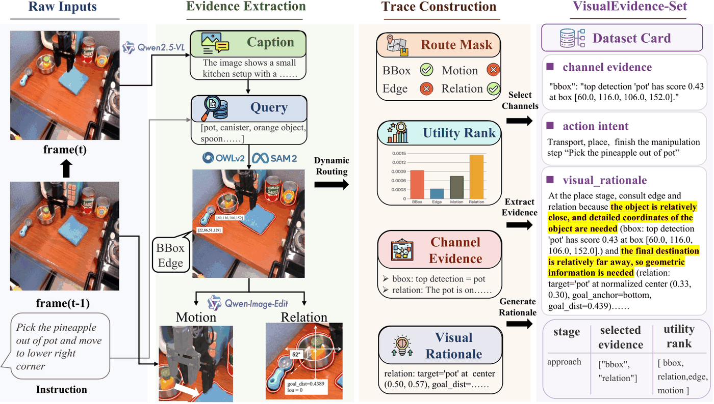
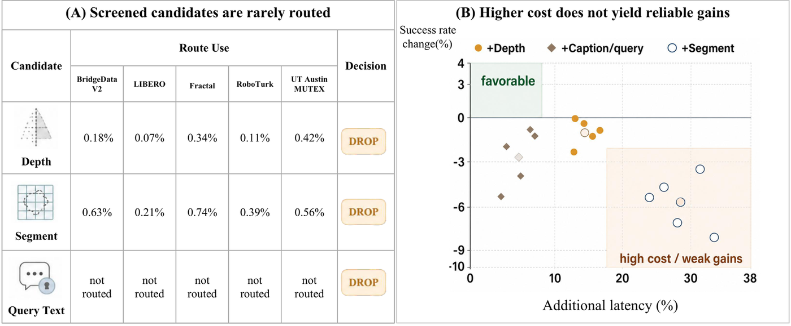

# VisualThink-VLA: сначала видеть доказательства, потом действовать

> Это обзор статьи **VisualThink-VLA: Visual Intermediate Reasoning for Effective and Low-Latency Vision-Language-Action Policies**. Номер на arXiv — `2605.30011v1`, подана 28 мая 2026 года. Авторы: Mingjian Gao, Wenqiao Zhang, Yuqian Yuan, Yang Dai, Binhe Yu, Zheqi Lv, Haoyu Zheng, Jiaqi Zhu, Zhiqi Ge, Zixuan Wan, Siliang Tang, Yueting Zhuang.

## 1. Главный вывод: почему эта работа нужна в главе о VLA

VisualThink-VLA рассматривает вопрос, который очень практичен для VLA: как роботу «подумать перед действием».

В последнее время у VLA распространён подход, при котором модель сначала генерирует текстовую цепочку рассуждений (Chain-of-Thought), а потом по ней выдаёт действие. На офлайн-оценке это выглядит естественно, но в замкнутом управлении роботом возникают две проблемы.

Первая: текстовые рассуждения не всегда подходят для пространственных операций. Чтобы взять красную миску, обойти помеху, проскользить вдоль края или понять взаимное расположение предметов, важны положение, границы, движение и пространственные отношения, а не длинное объяснение на естественном языке. Свободный текст CoT может принести в предсказание действия нерелевантные описания и помешать управлению.

Вторая: у текстового CoT заметная задержка. По данным статьи, ECoT на BridgeData V2 тратит `8,377 с` на шаг, а VisualThink-VLA снижает задержку до `0,367 с`, что даёт ускорение примерно в `22,8` раза. Для реального робота это не мелкая оптимизация: многосекундный вывод почти не годится для замкнутого управления, а субсекундный уже ближе к пригодной для развёртывания политике.

Основная идея VisualThink-VLA:

```text
Роботу не обязательно думать словами.
Более подходящая форма промежуточных рассуждений — компактные,
маршрутизируемые и поддающиеся аудиту визуальные доказательства.
```

Поэтому это не мировая модель и не обучение новой VLA с нуля. Скорее это **промежуточный слой визуальных доказательств**, добавляемый к замороженной VLA:

```text
текущий кадр RGB + предыдущий кадр + языковая инструкция
    -> извлечение визуальных доказательств: bbox / edge / motion / relation и др.
    -> маршрутизатор выбирает каналы доказательств, нужные для текущего действия
    -> Visual State Composer превращает доказательства в лёгкие мягкие состояния (soft states)
    -> замороженный backbone VLA предсказывает действие с учётом этих визуальных доказательств
```

Глава относится к разделу 06 «Манипуляции и VLA» и идёт сразу после LWD. Работа принадлежит той же линии методов, что EventVLA, G0.5, PRTS и LWD: не ограничиваться прямым клонированием поведения. Её отличие — акцент на **эффективности и аудируемости визуального промежуточного рассуждения**.

## 2. Статья, код и точки входа для воспроизведения

| Элемент | Ссылка | Текущий статус |
| :--- | :--- | :--- |
| Статья | [arXiv:2605.30011](https://arxiv.org/abs/2605.30011) / [HTML](https://arxiv.org/html/2605.30011v1) / [PDF](https://arxiv.org/pdf/2605.30011) | Подана 28 мая 2026 года |
| GitHub | [DCDmllm/VisualThink-VLA](https://github.com/DCDmllm/VisualThink-VLA) | Официальный репозиторий, лицензия MIT |
| Статус кода | В README GitHub указано, что начальный скелет кода открыт в 2026-05 | Включает извлечение доказательств, обучение маршрутизатора, обучение адаптера, построение VisualEvidence-Set и скрипты оценки |
| Крупные ресурсы | README указывает, что в репозиторий не включены чекпоинты OpenVLA, кэши моделей восприятия, сырые данные роботов, манифесты признаков, чекпоинты обучения и журналы оценки | Для воспроизведения нужно подготовить внешние модели и пути к данным |

Лучший способ начать — прочитать метод, запустить лёгкую структуру пайплайна из репозитория и понять, как связаны извлечение доказательств, маршрутизатор, адаптер и аудит. Полностью воспроизвести все бенчмарки и результаты на реальном роботе из статьи можно только при наличии OpenVLA/Prismatic, LIBERO, SAM2, Grounding DINO, Qwen2.5-VL, данных роботов, обученных чекпоинтов маршрутизатора и адаптера и среды оценки. Это не одна команда, которая даёт таблицы из статьи.

## 3. Общая схема: визуальные доказательства вместо длинного текстового CoT



**Рисунок 1. Общая схема VisualThink-VLA.** Слева показано, что метод охватывает несколько классов задач манипуляции; в центре — компромисс между успешностью и задержкой; справа — то, как VisualEvidence-Kit строит надзор с привязкой к маршруту и данные для аудита.
Источник: [официальный репозиторий DCDmllm/VisualThink-VLA](https://github.com/DCDmllm/VisualThink-VLA).

Рисунок удобно разбирать на трёх уровнях.

**Первый уровень — мотивация задачи.** VLA в реальных операциях часто сталкиваются с несколькими мешающими объектами, пространственными отношениями, геометрией контакта и изменением стадий длинной задачи. Непосредственное отображение «изображение → действие» возможно, но в сложной сцене политике нужна некоторая «промежуточная опора», чтобы понимать, от какого визуального признака сейчас должно зависеть действие.

**Второй уровень — ограничение по эффективности.** Если промежуточной опорой служит длинный текстовый CoT, рассуждение замедляется. Если же использовать полные карты сегментации, карты глубины или плотные вспомогательные признаки, в декодер действий могут попасть избыточные или ошибочные данные. VisualThink-VLA выбирает компромисс: оставить компактные визуальные доказательства и на каждом шаге активировать только нужные каналы.

**Третий уровень — аудируемость.** Метод не сворачивает визуальные доказательства в непрозрачное скрытое представление. Он сохраняет маску маршрута и трассировку, привязанную к каналам (channel-grounded trace). Это позволяет спросить: на какой канал — bbox, edge, motion или relation — опиралась политика на этом шаге? Если канал убрать контрфактически, сильно ли изменится действие? Это ближе к честности объяснения в управлении роботом, чем постфактум сгенерированная красивая фраза.

## 4. Схема метода: шесть кандидатных каналов, четыре рабочих



**Рисунок 2. Архитектура VisualThink-VLA.** Система извлекает шесть классов визуальных доказательств из текущего кадра, предыдущего кадра и языковой инструкции; после отбора каналов остаются четыре рабочих; маршрутизатор выбирает доказательства на текущем решении, а Visual State Composer вводит маршрутизированные доказательства в замороженный backbone VLA. Пунктирные линии показывают пути обучения, которые не нужны на этапе вывода.
Источник: [официальный репозиторий DCDmllm/VisualThink-VLA](https://github.com/DCDmllm/VisualThink-VLA).

Ключевая часть метода — **Visual Evidence Interface**. Сначала строятся шесть кандидатных классов доказательств:

| Канал | Назначение | Пример |
| :--- | :--- | :--- |
| `bbox` | Положение цели и рамка обнаружения | При захвате среди нескольких предметов найти красную миску, синюю кружку, целевой кубик |
| `edge` | Границы и геометрия контакта | При вставке, толкании, скольжении вдоль края или повороте оценить контур объекта |
| `motion` | Изменения за короткий промежуток времени | Понять, сдвинут ли объект, уже ли он переместился, изменилась ли стадия |
| `relation` | Пространственные отношения, связанные с инструкцией | «Положить слева от коробки», «положить чашку в тарелку» |
| `depth` | Геометрическая глубина по монокулярному изображению | Оценить расстояние вперёд-назад и локальную геометрию |
| `segment` | Маска области объекта | Выделить целевую область и области помех |

Но при развёртывании используются не все шесть. Отбор каналов (channel screening) показал, что `depth` и `segment` в их постановке бенчмарка дают малый выигрыш при высоких накладных расходах и увеличивают нагрузку на вспомогательное восприятие (side-perception overhead). Поэтому итоговый банк рабочих доказательств содержит четыре канала:

```text
bbox + edge + motion + relation
```

В этом и проявляется принцип «меньше — лучше» в VisualThink-VLA: не класть в VLA все результаты восприятия, а дать маршрутизатору на каждом шаге выбирать то, что нужнее всего. Например, при приближении к цели чаще нужен bbox; при контакте и переориентации — edge и motion; при инструкциях вида «слева», «внутри», «рядом» — relation.

## 5. Замороженный backbone VLA: не переобучение большой базы

В README GitHub прямо написано, что VisualThink-VLA держит базовую VLA замороженной (keeps the base VLA frozen). Этот момент важен.

Многие улучшения VLA заново дообучают большое число параметров backbone. Это дорого и может стереть исходную способность к обобщению. VisualThink-VLA работает скорее как внешний слой визуального рассуждения:

```text
замороженный backbone VLA
    + извлечение доказательств
    + маршрутизатор, зависящий от задачи
    + Visual State Composer / маршрутизируемый адаптер
    -> предсказание действия
```

Извлекатель доказательств превращает исходные наблюдения в компактные векторы доказательств; маршрутизатор выбирает каналы; Visual State Composer проецирует маршрутизированные векторы каналов в несколько обученных визуальных состояний и вставляет их перед декодированием действия. На этапе вывода модель не генерирует текст, не вызывает онлайн-редактор изображений и не выдаёт человекочитаемого длинного объяснения.

Именно это отличает метод от G0.5 и других VLA с CoT. G0.5 помещает структурированный CoT и токены действий в одну авторегрессивную последовательность; VisualThink-VLA старается не декодировать текстовые токены и держит промежуточное рассуждение в токенах визуальных доказательств и мягких состояниях.

## 6. Маршрутизатор с учётом задачи: не смотреть на все доказательства сразу

Маршрутизатор VisualThink-VLA предсказывает вероятность выбора каждого канала доказательств, а затем оператор затвердевания (hardening) превращает её в жёсткую маску маршрута для вывода. То есть на каждом шаге не фиксируются четыре канала, а выбор происходит динамически.

При обучении напрямую с жёстким маршрутом получается хрупкий результат, поэтому в статье используются смешанные маски soft-hard: на этапе обучения смешиваются мягкий и жёсткий маршруты, а на выводе используется жёсткий. Чтобы разреженный маршрут унаследовал способности плотных доказательств, обучается учитель `FullSoft`. `FullSoft` на каждом шаге видит все четыре рабочих канала, а ученик VisualThink-VLA учится на каналах, выбранных маршрутизатором, и сохраняет качество через дистилляцию учитель-ученик.

Эта схема решает конкретное противоречие:

```text
Плотные доказательства:
    информации достаточно, но медленно и может вносить помехи.

Разреженные маршрутизируемые доказательства:
    быстро и меньше помех, но обучение нестабильно и легко пропустить важную информацию.

Учитель FullSoft + ученик на маршрутизируемых каналах:
    плотный учитель даёт ёмкость, разреженный ученик учится выбирать по необходимости.
```

Результаты статьи это подтверждают: во внутреннем сравнении VisualThink-VLA даёт среднюю успешность `90,10%` при средней задержке `0,395 с`; FullSoft — среднюю успешность `89,83%` при задержке `0,470 с`. Значит, разреженный маршрут не только экономит вычисления, но и немного повышает среднюю успешность по сравнению с плотным учителем, вероятно потому, что отфильтрованы часть нерелевантных или конфликтующих доказательств.

## 7. VisualEvidence-Kit: контроль и аудит — не свободное текстовое объяснение



**Рисунок 3. Рабочий процесс VisualEvidence-Kit.** VisualEvidence-Agent извлекает кандидатные визуальные доказательства из траекторий робота, оценивает полезность каналов, строит трассировку с привязкой к каналам, а после ручной проверки получает VisualEvidence-Set, пригодный для обучения маршрутизатора и аудита честности (faithfulness).
Источник: [официальный репозиторий DCDmllm/VisualThink-VLA](https://github.com/DCDmllm/VisualThink-VLA).

VisualEvidence-Kit — самая интересная часть работы. Многие «объяснимые» роботизированные политики ограничиваются постфактум-объяснением: политика сначала выдаёт действие, а языковая модель потом сочиняет к нему комментарий. Такое объяснение не обязательно участвовало в решении.

VisualThink-VLA наоборот требует, чтобы путь доказательств можно было проверить. VisualEvidence-Agent делает четыре вещи:

1. **Извлечение доказательств (Evidence extraction)**: для каждого контекста решения извлекаются признаки кандидатных каналов.
2. **Оценка маршрута и полезности (Route and utility assessment)**: оценивается целевой маршрут для каждого канала и его контрфактическая полезность для текущего действия.
3. **Построение трассировки (Trace construction)**: фиксируются стадия манипуляции, примитив, зависимость от доказательств, сложность и выбранные доказательства — получается структурированная трассировка с привязкой к каналам.
4. **Проверка человеком (Human review)**: вручную проверяется согласованность и отфильтровываются ненадёжные метки.

В итоговый VisualEvidence-Set входят `754,7 тыс.` инструкций visual-thinking VLA, которые используются для контроля маршрута, уточнения адаптера с надзором по трассировке и тестов контрфактической честности. По статье, эти трассировки применяются при обучении и аудите, а на этапе вывода VisualEvidence-Agent не нужен и поля трассировки не генерируются.

Для учебника важно пояснить: VisualEvidence-Kit не является тяжёлым интерпретатором, который работает во время управления роботом. Это **цепочка инструментов для построения обучающих данных и проверки того, насколько маршрут доказательств заслуживает доверия**.

## 8. Отбор каналов: почему отброшены depth и segment



**Рисунок 4. Отбор каналов доказательств.** Исходный набор содержит шесть классов доказательств, но после отбора в статье остаются четыре рабочих канала `bbox / edge / motion / relation`; `depth` и `segment` можно использовать для диагностики или отбора, но они не входят в стандартный рабочий интерфейс.
Источник: [официальный репозиторий DCDmllm/VisualThink-VLA](https://github.com/DCDmllm/VisualThink-VLA).

В машинном зрении легко возникает интуиция, что чем больше информации — глубины, сегментации, детекции, движения, отношений — тем лучше. Эксперименты VisualThink-VLA показывают, что эта интуиция не всегда верна.

Причин три.

Во-первых, дополнительные каналы увеличивают нагрузку на восприятие. При управлении в реальном времени на каждом шаге запускать оценку глубины, сегментацию, детекцию и вывод отношений — значит накапливать задержку.

Во-вторых, дополнительные каналы вносят шум. Ошибки границ сегментации, дрейф оценки глубины и неверные маски целей при окклюзии могут ввести в заблуждение декодер действий.

В-третьих, доказательства конкурируют между собой. Декодер действий, получающий слишком много вспомогательных токенов, может распылить внимание и упустить действительно важное доказательство. Например, для задачи pick-place с несколькими объектами главное — bbox и relation, а для переориентации, чувствительной к контакту, — edge и motion; добавление неэффективных каналов не обязательно улучшает результат.

Поэтому путь VisualThink-VLA — не «чем больше мультимодальной информации, тем сильнее», а **поиск достаточно малого, но эффективного визуального интерфейса доказательств с помощью отбора и маршрутизации**.

## 9. Результаты: сильны и по успешности, и по задержке

Статья приводит четыре основных типа результатов.

**Первый — сравнение управления на нескольких бенчмарках.** VisualThink-VLA оценивается на BridgeData V2, Fractal, RoboTurk, LIBERO-Object, LIBERO-Goal, LIBERO-Spatial, LIBERO-Long и UT Austin MUTEX. По сравнению с повторной оценкой BaseVLA на тех же условиях успешность повышается на 7 из 8 бенчмарков. На BridgeData V2 BaseVLA даёт `75,37 %` при `0,345 с`, VisualThink-VLA — `89,49 %` при `0,367 с`; ECoT — `85,09 %` при `8,377 с`. Значит, метод повышает успешность не за счёт более длинного рассуждения, а добавляет визуальное промежуточное рассуждение почти при задержке BaseVLA.

**Второй — переносимость на backbone.** Авторы проверяют три базовые модели — OpenVLA, Octo и SmolVLA — на тестовом разбиении VisualEvidence-Set. VisualThink-VLA даёт прирост успешности `+16,37`, `+10,87` и `+11,95` соответственно, при этом задержка растёт только примерно на `0,05–0,10 с`. Это подтверждает, что метод работает как подключаемый (plug-and-play) слой визуального рассуждения, а не модификация, привязанная к OpenVLA.

**Третий — сравнение внутренних интерфейсов.** Текстовые доказательства в промпте повышают успешность, но средняя задержка достигает `1,428 с`; плотные доказательства — `0,592 с`; FullSoft — `0,470 с`; VisualThink-VLA — `0,395 с` при средней успешности `90,10 %`. Это показывает, что структурированные визуальные доказательства подходят для управления с малой задержкой лучше свободного текста, а разреженный маршрут эффективнее плотных побочных сигналов.

**Четвёртый — оценка на реальном роботе.** В статье используется 7-DoF манипулятор PIPER NERO и фиксированная внешняя RGB-камера, покрыто четыре класса задач: манипуляция с несколькими объектами, размещение с учётом отношений, переориентация, чувствительная к контакту, и составная двухэтапная задача. VisualThink-VLA превосходит BaseVLA во всех четырёх классах и FullSoft — в трёх. Среднее время выполнения `25,6 с` ниже, чем у FullSoft (`30,2 с`), при этом в среднем выбирается `1,83` канала доказательств.

Эти результаты показывают, что главная ценность VisualThink-VLA — не «ещё один модуль-объяснитель», а практичный промежуточный интерфейс рассуждения для VLA: достаточно визуальный, компактный, быстрый и поддающийся аудиту.

## 10. Как читать код репозитория

Официальный репозиторий сейчас содержит исследовательский пайплайн. Рекомендуемый порядок чтения такой.

Первый шаг — извлечение доказательств:

```bash
git clone https://github.com/DCDmllm/VisualThink-VLA
cd VisualThink-VLA

conda create -n visualthink-vla python=3.10 -y
conda activate visualthink-vla
pip install -r requirements.txt
pip install -e .

python scripts/extract_visual_evidence.py \
  --image_path path/to/current.png \
  --prev_image_path path/to/previous.png \
  --instruction "pick up the red bowl" \
  --output_dir outputs/evidence_one
```

Цель этой команды — не воспроизвести метрики статьи, а понять, как по одному текущему кадру, предыдущему кадру и языковой инструкции строятся визуальные доказательства. Она помогает увидеть, как каналы `bbox / edge / motion / relation` выглядят в коде.

Второй шаг — маршрутизатор:

```bash
python scripts/train_evidence_router.py \
  --feature_manifest outputs/features/feature_manifest.jsonl \
  --config configs/evidence_router.yaml \
  --output_dir outputs/router
```

Обучение маршрутизатора требует манифеста признаков и разметки маршрута (route supervision). Если полного VisualEvidence-Set нет, можно сначала прочитать конфигурацию и скрипты и понять поток данных: входные поля, выходной чекпоинт и маску маршрута.

Третий шаг — FullSoft и адаптер VisualThink-VLA:

```bash
python scripts/train_visualthink_adapter.py \
  --mode full \
  --feature_manifest outputs/features/feature_manifest.jsonl \
  --model_path path/to/openvla \
  --config configs/visualthink_adapter.yaml \
  --output_dir outputs/fullsoft

python scripts/train_visualthink_adapter.py \
  --mode visualthink \
  --feature_manifest outputs/features/feature_manifest.jsonl \
  --model_path path/to/openvla \
  --config configs/visualthink_adapter.yaml \
  --gate_checkpoint_dir outputs/router \
  --teacher_adapter_dir outputs/fullsoft \
  --output_dir outputs/visualthink
```

Здесь важно: `path/to/openvla`, чекпоинты восприятия, манифесты данных и результаты обучения не должны попадать в репозиторий учебника. Официальный README также подчёркивает, что такие крупные ресурсы хранятся вне Git-репозитория и передаются через аргументы командной строки.

Четвёртый шаг — VisualEvidence-Set и аудит:

```bash
python scripts/build_visualevidence_set.py \
  --feature_manifest outputs/features/feature_manifest.jsonl \
  --gate_checkpoint_dir outputs/router \
  --visualthink_checkpoint_dir outputs/visualthink \
  --output_path outputs/visualevidence/visualevidence_set.jsonl

python scripts/audit_faithfulness.py \
  --feature_manifest outputs/features/feature_manifest.jsonl \
  --model_path path/to/openvla \
  --visualthink_checkpoint_dir outputs/visualthink \
  --evidence_trace_manifest outputs/visualevidence/visualevidence_set.jsonl \
  --output_dir outputs/audit
```

Главная задача этого раздела — понять аудит честности (faithfulness audit): действительно ли маршрутизированные доказательства влияют на действие, а не являются лишь постфактум-объяснением.

## 11. Связь с другими методами визуального рассуждения VLA

| Метод | Форма промежуточного рассуждения | Преимущества | Отличие VisualThink-VLA |
| :--- | :--- | :--- | :--- |
| ECoT / текстовый CoT | Авторегрессивное текстовое рассуждение | Понятное объяснение | Высокая задержка, текст может слабо опираться на визуальные признаки |
| TraceVLA / SpatialVLA | Промежуточная информация об изображении или пространстве | Ближе к визуальному пространству | Могут вводиться много плотных побочных сигналов |
| Galaxea G0.5 | Структурированный CoT + поток токенов действий | Рассуждение и действие объединены в одной авторегрессивной последовательности | VisualThink-VLA избегает декодирования длинного текста и обусловливает действие мягкими визуальными состояниями |
| EventVLA | Память визуальных доказательств на длинном горизонте | Решает забывание визуальных доказательств на длинном горизонте | VisualThink-VLA фокусируется на маршрутизации каналов доказательств для решения на одном шаге |
| PRTS | Достижимость цели / предобучение CRL | Даёт VLA осознание достижимости цели | VisualThink-VLA фокусируется на визуальном интерфейсе доказательств и управлении с малой задержкой |
| LWD | Офлайн-в-онлайн RL после развёртывания на реальном роботе | Постоянно улучшает политику по реальному опыту | VisualThink-VLA фокусируется на интерфейсе рассуждения, LWD — на маховике данных развёртывания |

VisualThink-VLA удобно читать в линии «визуально-рассуждающих VLA»: модель не говорит больше, а перед действием смотрит на нужное.

## 12. Рекомендуемое задание для группового курса

В Task04 можно предложить такое задание:

> Сравните EventVLA, G0.5 и VisualThink-VLA: EventVLA делает упор на память визуальных доказательств на длинном горизонте, G0.5 — на структурированный CoT и поток токенов действий, VisualThink-VLA — на маршрутизируемые визуальные доказательства с низкой задержкой. Укажите, какое узкое место VLA решает каждый из них, и проанализируйте компромисс между текстовым CoT, токенами визуальных доказательств и токенами действий.

Для выполнения необязательно проводить полное обучение, но нужно ответить:

- почему VisualThink-VLA считает, что текстовый CoT не подходит для управления роботом в реальном времени?
- почему из шести кандидатных каналов оставлено только четыре?
- какие проблемы решают учитель `FullSoft` и маршрутизируемый ученик?
- почему VisualEvidence-Kit делает акцент на контрфактической честности (counterfactual faithfulness)?
- какие пайплайны можно воспроизвести по текущему коду, а какие зависят от внешних моделей, данных и чекпоинтов?

## 13. Источники

Изображения этой главы взяты из [официального репозитория DCDmllm/VisualThink-VLA](https://github.com/DCDmllm/VisualThink-VLA) и сохранены в локальном `assets/` для стабильного доступа. Текст опирается на [arXiv:2605.30011](https://arxiv.org/abs/2605.30011), [HTML-версию arXiv](https://arxiv.org/html/2605.30011v1) и официальный README на GitHub.
