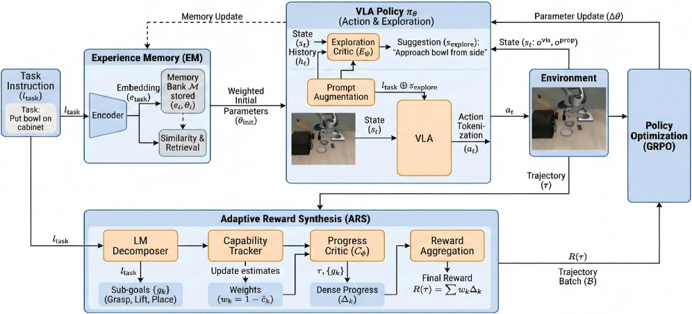
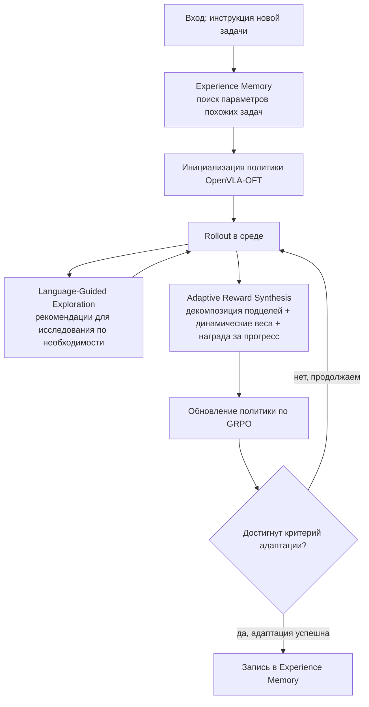
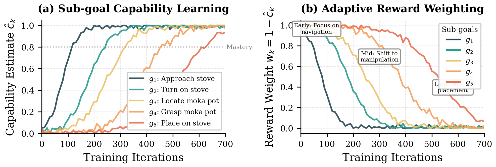
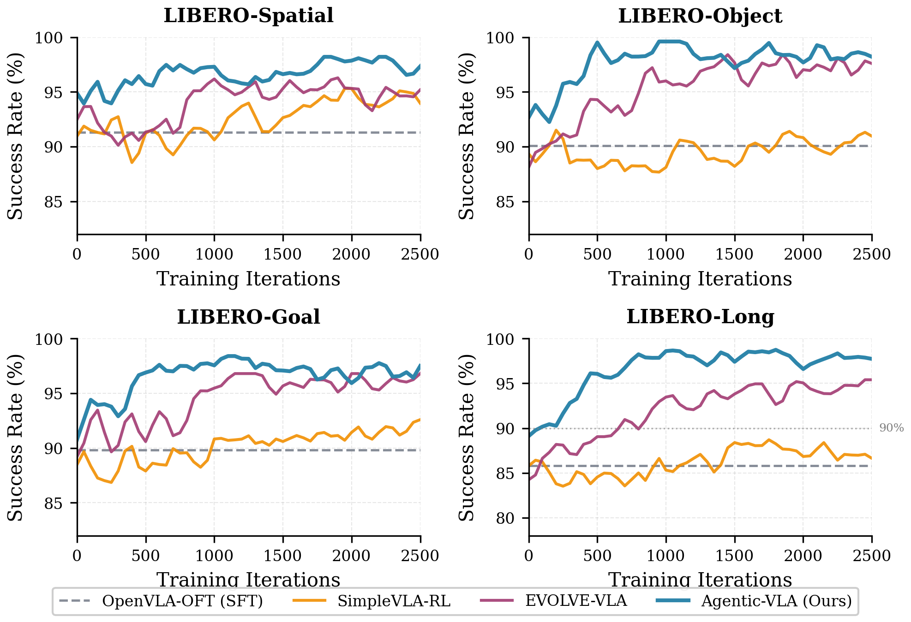
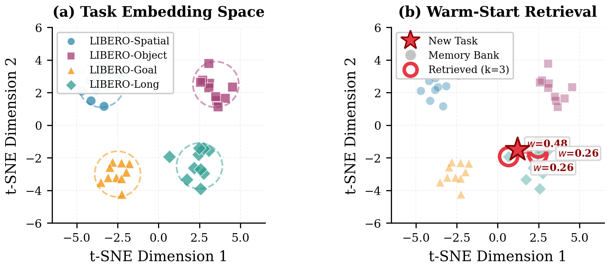
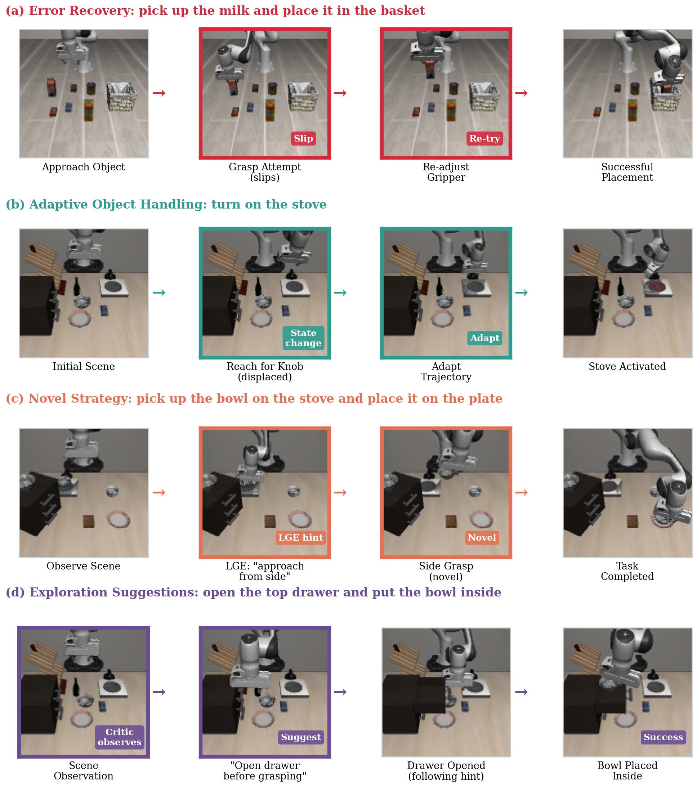

# Agentic-VLA: как заставить VLA адаптироваться к задаче в ходе работы

> Это обзор статьи **Agentic-VLA: Efficient Online Adaptation for Vision-Language-Action Models**. Номер на arXiv — `2605.22896v1`, подана 21 мая 2026 года. Авторы — Ruofan Jin и Zaixi Zhang.

## 1. Главный вывод: почему работа относится к главе о VLA

Agentic-VLA — не мировая модель и не новый симулятор роботов. Она решает важную задачу после развёртывания VLA: что делать, если уже обученная модель плохо работает на новой задаче или в новой сцене. Можно ли обойтись без повторного сбора демонстраций вручную и дать модели быстро адаптироваться через онлайн-взаимодействие, языковую обратную связь, динамические награды и память опыта?

Ключевое слово здесь — **онлайн-адаптация (online adaptation)**. Традиционный конвейер VLA выглядит так:

```text
экспертные демонстрации -> обучение SFT / BC -> офлайн-оценка -> развёртывание
```

Agentic-VLA предлагает переписать вторую половину:

```text
базовая политика OpenVLA-OFT
    -> появление новой задачи
    -> поиск похожих задач в Experience Memory и загрузка их весов
    -> онлайн-rollout
    -> Language-Guided Exploration даёт подсказки для исследования
    -> Adaptive Reward Synthesis формирует промежуточные награды
    -> обновление политики по GRPO
    -> веса успешно адаптированной задачи записываются обратно в память
```

Поэтому работа относится к разделу `06 — Манипуляции и VLA`, после VisualThink-VLA. Она связана с LWD, PRTS и RAW-Dream, но у каждой работы свой акцент:

- LWD — как парк реальных роботов использует данные развёртывания для офлайн-в-онлайн RL.
- PRTS — как на этапе предобучения дать VLA осознание достижимости цели.
- RAW-Dream — как обучаться с подкреплением внутри задачно-независимой мировой модели.
- Agentic-VLA — как собрать из reward synthesis, критика исследования и памяти задач контур агентной онлайн-адаптации.

Суть в одном предложении:

> Главное в Agentic-VLA — не замена базовой VLA, а внешний контур онлайн-адаптации к OpenVLA-OFT, который умеет проектировать награду, направлять исследование и повторно использовать веса прошлых задач.

## 2. Статья, код и точки входа для воспроизведения

| Элемент | Ссылка | Текущий статус |
| :--- | :--- | :--- |
| Статья | [arXiv:2605.22896](https://arxiv.org/abs/2605.22896) / [HTML](https://arxiv.org/html/2605.22896v1) / [PDF](https://arxiv.org/pdf/2605.22896) | Подана 21 мая 2026 года |
| Страница проекта | Официальная отдельная страница не найдена | Основной публичный источник — arXiv |
| Код | Официальный репозиторий GitHub не найден | Эксперимент можно воспроизвести по описанию метода, но это не инструкция «запустить одной командой» |
| Базовая политика | OpenVLA-OFT | В экспериментах Agentic-VLA применяется к OpenVLA-OFT, а для RL используются дискретные токены действий |
| Основные бенчмарки | LIBERO, RoboTwin 2.0 | Это существующие публичные бенчмарки, а не новый набор, созданный авторами |

На момент подготовки главы официальный репозиторий Agentic-VLA найден не был. Поэтому здесь описываются метод, модули, результаты эксперимента и границы воспроизведения, а команды, якобы позволяющие получить результаты статьи, не приводятся. Для настоящего воспроизведения нужно собрать самостоятельно OpenVLA-OFT, LIBERO / RoboTwin 2.0, GRPO, критик прогресса, VLM-критик исследования и Experience Memory.

## 3. Общая схема: внешний контур из трёх агентов



**Рисунок 1. Общая схема Agentic-VLA.** Система — не одна VLA-модель, а замкнутый контур онлайн-адаптации вокруг политики VLA: Experience Memory отвечает за теплый старт, Language-Guided Exploration — за структурированное исследование, Adaptive Reward Synthesis — за превращение прогресса задачи в оптимизируемую награду.
Источник: [arXiv HTML: Agentic-VLA](https://arxiv.org/html/2605.22896v1).

Рисунок удобно читать справа налево.

**Справа — Experience Memory.** Здесь хранятся веса уже адаптированных задач и встраивания (embedding) семантики задач. Когда появляется новая задача, система сначала по инструкции ищет похожие задачи и берёт их параметры политики с весами сходства как начальную инициализацию. Так решается проблема холодного старта: каждую задачу не нужно начинать с той же базовой модели с нуля.

**В центре — VLA-политика и онлайн-rollout.** Базовая политика — OpenVLA-OFT. Её вход по-прежнему составляют визуальные наблюдения, проприоцепция и языковая задача, а выход — последовательность дискретных токенов действий. Agentic-VLA не заменяет VLA агентом: несколько агентов лишь управляют процессом обучения вокруг VLA.

**Слева внизу — Language-Guided Exploration.** Обычный RL плохо исследует высокоразмерное пространство действий робота. Agentic-VLA использует VLM, который смотрит на текущее RGB-изображение, инструкцию задачи и недавнюю траекторию, и формулирует короткую рекомендацию по манипуляции — например, «подойти слева», «точка захвата ближе к центру», «уменьшить амплитуду действий». Эта рекомендация добавляется к промпту задачи только на этапе исследования и подталкивает политику выбирать более перспективные действия.

**Слева вверху — Adaptive Reward Synthesis.** В реальных развёртываниях обычно нет идеальной награды-оракула, а бинарная награда «успех / неудача» слишком разрежена. ARS сначала разбивает задачу с длинным горизонтом на подцели, затем корректирует вес награды для каждой подцели в зависимости от того, освоена ли она. Если модель застряла на какой-то подцели, её вес повышается; если этап уже устойчиво освоен — вес снижается, и внимание обучения переходит к следующим узким местам.

В конце политика обновляется с помощью **GRPO**. В приложении к статье указаны размер группы `8`, максимальный горизонт rollout `500` и размер батча `32`. Успешно адаптированные параметры политики записываются обратно в банк памяти, чтобы помочь при теплом старте похожих задач.

## 4. Разбор трёх основных модулей

### 4.1 Adaptive Reward Synthesis: награда не задана раз и навсегда

Самая трудная часть онлайн-адаптации VLA — награда. В реальных задачах обычно нет понятной числовой награды на каждом шаге: правильность выясняется только в самом конце. Например, для задачи «включи плиту и поставь на неё кастрюлю moka» при оценке только финального успеха промежуточные этапы — подойти к плите, повернуть ручку, найти кастрюлю, схватить её, поставить на плиту — не получают никакого обучающего сигнала.

ARS делает три вещи.

Первое — **декомпозиция задачи**. Языковая модель разбивает длинную инструкцию на подцели:

```text
turn on the stove and put the moka pot on it
    -> найти плиту и подойти к ней
    -> включить плиту
    -> найти кастрюлю moka
    -> схватить кастрюлю
    -> поставить кастрюлю на плиту
```

Второе — **оценка способностей**. Для каждой подцели система ведёт скользящее экспоненциальное среднее недавней успешности. Эта оценка нужна не для финальной проверки, а чтобы понять, на каком этапе обучение сейчас застревает.

Третье — **динамический вес награды**. Для уже освоенных подцелей вес награды снижается, для ещё не освоенных — остаётся высоким. Так естественным образом возникает учебный план (curriculum): сначала модель учится подходить и базово захватывать, а затем нагрузка переходит на составные действия.

Результаты декомпозиции задач в статье очень наглядны: без декомпозиции успешность на LIBERO-Long составляет `91,3 %`; при фиксированном шаблоне из трёх шагов — `93,8 %`; при подцелях, сгенерированных языковой моделью, — `98,1 %`; при подцелях, заданных человеком-оракулом, — `98,4 %`. Значит, декомпозиция, созданная LM, почти не уступает ручным ключевым этапам — это не произвольные пояснения, а структура обучения, очень близкая к разметке вехами человеком.

### 4.2 Language-Guided Exploration: исследование — не случайное дрожание действий

Пространство действий VLA сложно устроено. OpenVLA-OFT генерирует блок токенов действий авторегрессивно, и случайное исследование тратит много rollout на явно неудачные направления: неверный угол подхода, точка захвата у края, обход препятствия с провалом, продолжение увеличения амплитуды после перелёта.

Идея LGE — использовать VLM как критика исследования. Он не выдаёт действия робота напрямую, а формулирует короткую рекомендацию на естественном языке. В приложении к статье приведён промпт, в котором VLM играет роль эксперта по манипуляциям: он смотрит на текущее изображение и инструкцию, учитывает положение захвата, угол подхода, столкновения, точку захвата и устойчивость и затем даёт одну конкретную рекомендацию.

Рекомендация добавляется к промпту VLA:

```text
Исходная задача:       pick up the bowl and place it on the plate
Рекомендация для исследования: approach from the side to avoid collision
Расширенный промпт:    pick up the bowl and place it on the plate. approach from the side to avoid collision
```

Есть два ограничения.

Первое: LGE применяется только на этапе исследования. При оценке политика выполняет исходную инструкцию без дополнительных рекомендаций.

Второе: частота рекомендаций снижается по мере обучения. Пока политика слаба, рекомендации даются чаще; когда недавняя награда растёт, их становится меньше, и политика действует сама. Так уменьшается зависимость от подсказок VLM.

Это отличается от маршрутизируемых визуальных доказательств VisualThink-VLA. VisualThink-VLA отвечает на вопрос, какие визуальные доказательства использовать на каждом шаге вывода. LGE в Agentic-VLA — скорее тренер исследования на этапе обучения: он превращает «слепое сэмплирование» в структурированный поиск методом проб и ошибок с опорой на язык.

### 4.3 Experience Memory: похожие задачи не начинаются с нуля

Experience Memory хранит три типа информации:

| Поле | Смысл |
| :--- | :--- |
| Встраивание задачи (task embedding) | Получается из инструкции замороженным языковым энкодером |
| Параметры адаптированной политики | Параметры политики, полученные после адаптации к задаче |
| Метаданные | Успешность, число итераций обучения, сложность задачи и т. п. |

Для новой задачи система сначала вычисляет её embedding, находит несколько наиболее похожих записей памяти и берёт взвешенную по сходству комбинацию параметров как начальную инициализацию. В статье используются ёмкость памяти `100`, top-k поиска `3` и температура `0,1`.

Здесь легко ошибиться, решив, что это «усреднение весов». Обычно усреднять две независимо обученные нейросети опасно: они могут оказаться в разных впадинах функции потерь. Авторы статьи объясняют, почему здесь это работает относительно надёжно:

- все политики стартуют из одной и той же инициализации OpenVLA-OFT;
- адаптация к каждой задаче — локальное обновление, а не полностью независимое обучение;
- поиск очень избирательный и берёт лишь наиболее семантически близкие задачи;
- взвешенный результат служит только теплым стартом, после чего политика продолжает адаптироваться.

Поэтому это не общее слияние моделей, а эвристика теплого старта: набор локальных адаптеров или параметров политик для отдельных задач на одной базовой VLA.

## 5. Цикл обучения: как он работает

Цикл обучения Agentic-VLA можно записать так:



Ключевое здесь — **агентность процесса обучения**, а не агентность политики исполнения. При выполнении действий VLA остаётся политикой действий; агентные компоненты отвечают за проектирование награды, направление исследования и повторное использование опыта.

Если понимать Agentic-VLA как «VLA, которая сама планирует, вызывает инструменты и долго рефлексирует», это будет сильным преувеличением. Точнее сказать, что метод автоматизирует три самые трудоёмкие для инженерии части онлайн-RL.

## 6. Результаты на LIBERO: где основной прирост



**Рисунок 2. Основные результаты Agentic-VLA.** Рисунок показывает успешность по каждому набору LIBERO, сценарий с малым объёмом данных, перенос между задачами и эффективность обучения. Главный вывод: прирост связан не только с большим числом итераций RL, но и с сочетанием декомпозиции награды, языкового исследования и памяти опыта.
Источник: [arXiv HTML: Agentic-VLA](https://arxiv.org/html/2605.22896v1).

В основной таблице статьи Agentic-VLA превосходит OpenVLA-OFT и EVOLVE-VLA на всех четырёх наборах LIBERO:

| Метод | Spatial | Object | Goal | Long | Среднее |
| :--- | ---: | ---: | ---: | ---: | ---: |
| OpenVLA-OFT | 91,3 | 90,1 | 89,8 | 85,8 | 89,2 |
| EVOLVE-VLA | 95,4 | 97,4 | 95,8 | 94,4 | 95,8 |
| Agentic-VLA | 97,2 | 98,6 | 97,4 | 98,1 | 97,8 |

Особенно заметен результат на Long. У OpenVLA-OFT на LIBERO-Long успешность `85,8 %`, у Agentic-VLA — `98,1 %`, прирост `+12,3`. Это соответствует идее метода: длинные задачи больше всего выигрывают от наград за подцели, структурированного исследования и памяти задач.

Результаты в сценарии с малым объёмом данных тоже убедительны. При обучении на одном примере (1-shot) OpenVLA-OFT в среднем даёт `43,6 %`, EVOLVE-VLA — `61,3 %`, Agentic-VLA — `70,5 %`. Значит, метод полезен не только при обильных 50 демонстрациях, но и при малом объёме примеров, где онлайн-адаптация частично компенсирует нехватку данных.

Эксперимент по переносу между задачами такой: политика обучается на LIBERO-Long, а затем применяется к LIBERO-Object без демонстраций именно этой задачи. Прямой перенос SFT даёт `0,0 %`, EVOLVE-VLA — `20,8 %`, Agentic-VLA — `31,2 %`. Эти цифры далеки от полного обучения с учителем, но переход от `0` к `31,2 %` важен: сочетание онлайн-адаптации, памяти и направляемого исследования позволяет найти работающие стратегии без демонстраций целевой задачи.

По эффективности обучения Agentic-VLA на LIBERO-Long достигает `90 %` успешности за `700` итераций и `22,4 тыс.` rollout; EVOLVE-VLA требует `1680` итераций и `53,8 тыс.` rollout; SimpleVLA-RL — `2450` итераций и `78,4 тыс.` rollout. Авторы сообщают примерно `2,4`-кратное ускорение сходимости, которое в основном достигается за счёт теплого старта из памяти, снижения бесполезного исследования благодаря LGE и более плотного обучающего сигнала от ARS.

## 7. Анализ компонентов: каждый модуль не лишний



**Рисунок 3. Анализ компонентов Agentic-VLA.** Абляции показывают, что переход от бинарной награды к награде за прогресс, затем к ARS, LGE и EM повышает успешность и снижает число итераций; замена на фиксированный учебный план, RND/ICM или случайный поиск в памяти ухудшает результат.
Источник: [arXiv HTML: Agentic-VLA](https://arxiv.org/html/2605.22896v1).

Абляция на LIBERO-Long:

| Конфигурация | Успешность | Прогресс | Итерации |
| :--- | ---: | ---: | ---: |
| OpenVLA-OFT, только SFT | 85,8 | — | — |
| Обычный RL с бинарной наградой | 87,7 | 0,04 | 2100 |
| Награда за прогресс | 91,3 | 0,20 | 1850 |
| + ARS | 94,6 | 0,31 | 1200 |
| + LGE | 96,2 | 0,38 | 880 |
| + EM | 98,1 | 0,42 | 700 |

Из таблицы видно три вещи.

Во-первых, одного обычного RL мало. Бинарная награда слишком разреженна и поднимает успешность с `85,8` лишь до `87,7`; прогресс при этом ограничен.

Во-вторых, награда за прогресс — основа, но не всё. Она даёт `91,3`, то есть плотная оценка продвижения полезнее бинарной награды; однако без динамических весов подцелей длинные задачи всё равно упираются в жёсткую структуру награды.

В-третьих, ARS, LGE и EM дают накапливающийся эффект. ARS помогает понять, какую подцель учить; LGE делает исследование эффективнее; EM позволяет быстрее стартовать из похожих задач. Убрать любой из модулей — значит потерять качество.

В статье также есть контролируемые сравнения: фиксированные три шага, равные веса и выборка по прогрессу обучения хуже ARS; внутренние награды RND и ICM для исследования хуже LGE; случайный поиск в памяти хуже EM, который опирается на сходство задач. Это важно, потому что исключает подозрение «любой учебный план, любой бонус за исследование или любой теплый старт сами по себе дают прирост».

## 8. Граф памяти: как работает кэш политик по задачам



**Рисунок 4. Анализ Experience Memory.** Банк памяти связывает семантические embedding задач с параметрами адаптированных политик; новая задача получает теплый старт по похожим задачам. Это скорее кэш политик на уровне задач, чем общая долговременная память.
Источник: [arXiv HTML: Agentic-VLA](https://arxiv.org/html/2605.22896v1).

Experience Memory лучше понимать как **кэш политик**. В нём хранятся не текстовые дневники и не видеоклипы, которые VLA потом пересматривает, а параметры, которые для данного класса задач оказались удачными.

Например, уже изученные задачи:

```text
open the drawer and put the bowl inside
put the moka pot on the stove
pick up the bowl and place it on the plate
```

Если новая задача содержит структуру «открыть контейнер, взять предмет, положить в целевую зону», поиск в памяти поможет политике стартовать рядом с похожими задачами, а не из исходной точки OpenVLA-OFT. Это особенно полезно при малом количестве примеров и переносе между задачами.

Но у подхода есть границы. Одно из описанных в приложении нарушений — **интерференция памяти (memory interference)**: семантически похожие задачи с разными требованиями к манипуляции могут давать отрицательный перенос. Например, в двух инструкциях упоминаются шкаф и миска, но в одной нужно сначала открыть ящик, а в другой — обойти препятствие; неверный теплый старт уведёт политику к неподходящему поведению.

Поэтому, если воспроизводить или улучшать Agentic-VLA, поиск в памяти не стоит ограничивать сходством текстов. Более надёжно учитывать:

- языковое встраивание задачи;
- визуальное встраивание начальной сцены;
- тип примитива манипуляции;
- топологию отношений между концевым эффектором и объектами;
- то, действительно ли прошлая адаптация улучшала этот класс задач.

## 9. Качественный анализ: что меняет онлайн-адаптация



**Рисунок 5. Качественное поведение после онлайн-адаптации.** Авторы показывают восстановление после ошибок, адаптацию к изменению состояния объектов, открытие бокового захвата и рекомендации исследовательского критика по порядку подзадач.
Источник: [arXiv HTML: Agentic-VLA](https://arxiv.org/html/2605.22896v1).

Этот набор примеров помогает понять, что именно меняет онлайн-адаптация.

Первый тип — **восстановление после ошибки (Error Recovery)**. Типичная проблема политики SFT: как только действие уходит от траектории демонстрации, она продолжает двигаться по ошибочному пути и в итоге проваливается. Agentic-VLA в задаче «молоко в корзину» способна скорректировать захват после соскальзывания. Такое поведение не планируется языковым агентом явно: это замкнутая коррекция, которой политика научилась в ходе онлайн-исследования, пройдя через больше провалов и восстановлений.

Второй тип — **адаптация к объекту (Adaptive Object Handling)**. Когда ручку плиты случайно сдвинули, SFT обычно продолжает действовать по старой позиции; Agentic-VLA корректирует траекторию по новому состоянию. Это показывает, что данные онлайн-rollout покрывают возмущения, которых не было в демонстрациях.

Третий тип — **открытие новой стратегии (Novel Strategy Discovery)**. Когда критик исследования предлагает «подойти сбоку», политика находит боковой захват, которого не было в демонстрациях, и избегает столкновения с соседними предметами. В этом и ценность языкового управления исследованием: не генерация кода действий для VLA, а направление поиска в семантически разумную область.

Четвёртый тип — **рекомендации по исследованию (Exploration Suggestions)**. В задаче с ящиком и миской критик советует сначала открыть ящик, а потом взять миску. В задачах с длинным горизонтом неправильный порядок подзадач — частая причина провала; при одном лишь случайном исследовании правильная последовательность находилась бы очень долго.

## 10. Бенчмарки и границы эксперимента

Основные эксперименты Agentic-VLA проводятся не на закрытом бенчмарке, созданном авторами, а на существующих публичных наборах:

| Бенчмарк | Назначение | Настройка |
| :--- | :--- | :--- |
| LIBERO-Spatial | Обобщение по пространственным отношениям | По 50 экспертных демонстраций на задачу, 50 прогонов на задачу, 5 затравок |
| LIBERO-Object | Обобщение по объектам | То же |
| LIBERO-Goal | Обобщение по композиции целей | То же |
| LIBERO-Long | Длинные составные задачи | Наибольший прирост у Agentic-VLA |
| RoboTwin 2.0 | Двуручная манипуляция на Aloha AgileX | По 50 чистых демонстраций на задачу, 100 rollout на задачу, варианты Easy / Hard с доменной рандомизацией |

Результаты RoboTwin 2.0 показывают, что метод работает не только на коротких однорукых задачах LIBERO. В усреднённом репрезентативном подмножестве Agentic-VLA получает `62,5 %` в режиме Easy и `34,7 %` в режиме Hard; для сравнения, RDT — `34,5 % / 13,7 %`, ещё один базовый метод — `46,4 % / 16,3 %`. В режиме Hard добавлены беспорядок на столе, освещение, текстуры, высота стола и другие рандомизации, и преимущество Agentic-VLA там выражено сильнее.

Но и границы стоит назвать.

Первое: эксперименты в статье в основном выполнены в симуляции. Полный контур онлайн-адаптации на реальном роботе не показан. В приложении признаётся, что реальное развёртывание сложнее: нужно стабильно связать восприятие, языковую обратную связь VLM, онлайн-обновление политики, оценку награды за прогресс и поиск в памяти с реальными наблюдениями и ограничениями безопасности.

Второе: взлом награды (reward hacking) остаётся. В приложении указано, что около `12 %` неудач связаны с тем, что оценщик прогресса ставит высокий балл, хотя среда не отмечает успех. Это значит, что ARS смягчает проблему разреженной награды, но не гарантирует, что обученная награда полностью совпадает с реальным критерием успеха.

Третье: компонентов много. OpenVLA-OFT, GRPO, VLAC / критик прогресса, декомпозиция задач на Llama-3-8B, Qwen3-VL-8B-Instruct в качестве критика исследования и Experience Memory — всё это должно стабильно работать вместе. Для начинающего читателя это не лучшая статья для «воспроизведения одной кнопкой».

Четвёртое: вычислений нужно немало. В статье указано, что эксперименты проводились на `4` GPU NVIDIA A100 80 ГБ; обучение Agentic-VLA на одном наборе LIBERO занимает около `8` часов, EVOLVE-VLA — около `19` часов, SimpleVLA-RL — около `32` часов.

## 11. Как воспроизводить, если пока нет официального кода

Официального репозитория нет, поэтому в учебнике не стоит приводить конкретные команды. Более разумно воспроизводить по уровням.

Первый уровень — **LIBERO + базовая политика OpenVLA-OFT**. Сначала нужно добиться, чтобы базовая VLA выполняла rollout в LIBERO и записывала наблюдения, инструкцию, токены действий, успех, прогресс и метаданные эпизода.

Второй уровень — **базовая линия с наградой за прогресс**. Без ARS / LGE / EM реализуем критика прогресса или используем готовую модель награды типа VLAC и запускаем обновление по GRPO. Эта базовая линия показывает, что цепочка онлайн-RL работает.

Третий уровень — **ARS**. Сначала декомпозиция задачи и оценка прогресса подцелей, затем веса наград, зависящие от способностей. Здесь легче всего ошибиться в том, можно ли однозначно проверить подцель и согласован ли сигнал прогресса с критерием успеха в среде.

Четвёртый уровень — **LGE**. Используется локальный VLM вроде Qwen3-VL для коротких рекомендаций по исследованию, которые добавляются в промпт только на этапе rollout. Важно записывать, действительно ли рекомендация меняет поведение, чтобы не получить лишь дополнительные затраты на вывод.

Пятый уровень — **EM**. Для каждой задачи записываются адаптированные параметры, embedding задачи, успешность и число итераций обучения. Сначала проверьте на небольшом наборе задач, ускоряет ли теплый старт обучение, и только потом расширяйте набор.

Шестой уровень — **RoboTwin 2.0 или перенос на реального робота**. Этот шаг не стоит начинать сразу. Сначала нужно решить вопросы пространства действий, синхронизации двух рук, безопасной остановки, доменной рандомизации и определения награды. На реальном роботе особенно важно сначала проверить всё в режиме теневой работы или офлайн-повтора и не давать непроверенной онлайн-обновляемой политике напрямую управлять железом.

## 12. Связь с недавними работами по посттренировке VLA

| Метод | Основной вопрос | Главный механизм | Отличие от Agentic-VLA |
| :--- | :--- | :--- | :--- |
| DiT4DiT | Как использовать диффузионный трансформер как политику действий | Политика DiT + обучение и оценка на LIBERO | Больше про архитектуру политики и воспроизводимость |
| RAW-Dream | Можно ли усиливать VLA внутри мировой модели без нисходящих rollout | Задачно-независимая мировая модель + награда VLM + GRPO | Больше про RL в воображаемой среде и мировые модели |
| PRTS | Как VLA получает осознание достижимости цели на этапе предобучения | Контрастивное RL без меток награды | Больше про предобучение представлений |
| LWD | Как данные реального развёртывания возвращаются в общую VLA | Офлайн-в-онлайн RL парка роботов + DIVL + QAM | Больше про маховик данных парка реальных роботов |
| VisualThink-VLA | Как думать визуальными доказательствами на выводе с малой задержкой | Маршрутизируемые визуальные доказательства + замороженная VLA | Больше про визуальное промежуточное рассуждение с малой задержкой промежуточное рассуждение |
| Agentic-VLA | Как эффективно адаптироваться к новой задаче онлайн | ARS + LGE + EM + GRPO | Больше про агентную организацию процесса обучения |

Эти работы хорошо читаются вместе. Посттренировка VLA становится всё важнее, но каждая статья помещает «дополнительную информацию» в разное место:

- RAW-Dream — в воображаемые rollout мировой модели.
- LWD — в маховик данных реального развёртывания.
- VisualThink-VLA — в интерфейс визуальных доказательств при выводе.
- Agentic-VLA — в сам процесс обучения: награда, исследование и повторное использование опыта динамически координируются агентами.

## 13. Рекомендуемое задание для группового курса

В Task04 можно предложить такое задание:

> Сравните LWD, RAW-Dream, VisualThink-VLA и Agentic-VLA: все четыре работы пытаются выйти за пределы статичной VLA, обученной методом SFT, но используют разные источники сигнала — реальные данные развёртывания, воображаемые rollout мировой модели, визуальные доказательства при выводе и агентную онлайн-адаптацию. Объясните, откуда берётся сигнал обучения в каждом методе, нужно ли реальное взаимодействие с нисходящей задачей, легко ли воспроизвести результаты и какой главный риск провала.

Для ответа необязательно проводить эксперименты, но важно объяснить:

- почему Agentic-VLA — не новая базовая VLA?
- почему ARS лучше фиксированной награды или фиксированного учебного плана для задач с длинным горизонтом?
- чем LGE отличается от методов исследования RND / ICM?
- почему Experience Memory — не обычное слияние моделей?
- какие публичные бенчмарки использовались и какие результаты нельзя переносить на реального робота без дополнительной проверки?
- какие минимальные модули нужны для упрощённого воспроизведения?

## 14. Источники

Изображения этой главы взяты с [arXiv HTML: Agentic-VLA](https://arxiv.org/html/2605.22896v1) и сохранены в локальном `assets/` для стабильного доступа. Текст опирается на [arXiv:2605.22896](https://arxiv.org/abs/2605.22896), [HTML-версию arXiv](https://arxiv.org/html/2605.22896v1) и [PDF](https://arxiv.org/pdf/2605.22896). На момент подготовки главы официальная отдельная страница проекта и официальный репозиторий GitHub не найдены.
