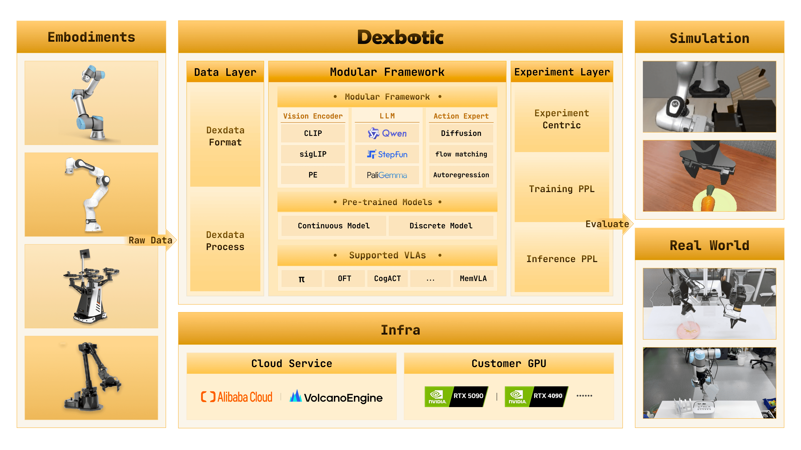
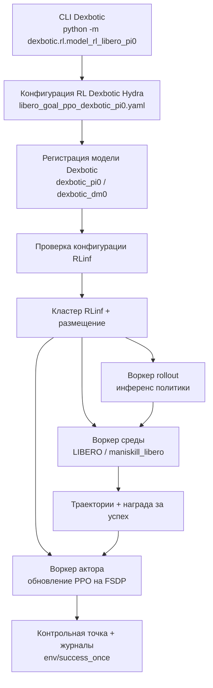

# Dexbotic-RLinf: подключение инженерной VLA-платформы к распределённому RL-обучению после тренировки

> Проект: Dexbotic + RLinf
> Тема: использовать RLinf как распределённый бэкенд обучения с подкреплением для Dexbotic и провести онлайн-дообучение политик VLA Dexbotic π0 / DM0 на LIBERO методом PPO
> Репозиторий Dexbotic: https://github.com/dexmal/dexbotic
> Документация Dexbotic: https://dexbotic.com/docs/
> Документ по Dexbotic + RLinf как бэкенду RL: https://github.com/dexmal/dexbotic/blob/main/docs/RLinfAsRLBackend.md
> Репозиторий RLinf: https://github.com/RLinf/RLinf
> Пример Dexbotic в RLinf: https://rlinf.readthedocs.io/en/latest/rst_source/examples/embodied/dexbotic.html
> Технический отчёт Dexbotic: https://arxiv.org/abs/2510.23511

Этот обзор логично поместить в главу о VLA. Работа не является мировой моделью и не предлагает новую архитектуру VLA. Это типичная **инженерная связка для посттренировки VLA**: Dexbotic отвечает за модель, данные, конфигурацию экспериментов и вход для пользователя, а RLinf — за распределённые rollout, рабочие процессы среды, обучение актора, FSDP, журналирование и сохранение контрольных точек. Связка решает практическую задачу: как соединить инструментарий VLA с онлайн-дообучением через RL, не переносить вручную адаптеры, пути к контрольным точкам и конфигурации задач между двумя репозиториями.

Главная мысль:

> Ценность Dexbotic-RLinf не в «ещё одной VLA», а в том, что вход в разработку модели VLA соединён с высокопроизводительным бэкендом RL. Благодаря этому Dexbotic π0 / DM0 можно настраивать и масштабировать при онлайн-дообучении методом PPO на LIBERO.

## 1. Зачем нужна эта связка

Обучение и посттренировка VLA часто упираются в две противоположные проблемы.

С одной стороны — репозиторий модели. Он знает свой формат данных, токенизатор, головку действий, схему имён контрольных точек и интерфейс инференса, но не обязательно имеет зрелый распределённый бэкенд RL. Если нужно добавить онлайн-RL, приходится самостоятельно писать rollout-воркеры, параллельные среды, обновление актора, синхронизацию весов, журналирование, сохранение контрольных точек и размещение на нескольких GPU.

С другой стороны — инфраструктура RL. Такие системы хорошо распределяют воркеры, параллельно собирают выборки, оптимизируют актора, ведут журналы и контрольные точки, но не обязательно знают, как конкретная модель VLA читает изображения, проприоцепцию и языковой промпт, как генерируются блоки действий, как настраиваются параметры flow matching / flow-SDE и как подключить оценщик LIBERO.

Dexbotic-RLinf разделяет эти роли:

- **Dexbotic** остаётся входом для пользователя VLA: сохраняет определения модели, адаптеры политик, обработку данных Dexdata, конфигурации Hydra, родословную контрольных точек и скрипты оценки.
- **RLinf** выступает бэкендом: предоставляет запуск кластера, размещение воркеров, сбор rollout, воркеры среды, обучение актора на FSDP, сохранение контрольных точек, журналирование и оркестрацию RL для воплощённых агентов.

Это чище, чем «скопировать код модели Dexbotic внутрь RLinf», и реалистичнее, чем «заставить Dexbotic написать собственную систему RL».

## 2. Что такое Dexbotic



**Рисунок 1. Общая схема инструментария Dexbotic.** Dexbotic организует данные роботов, слой моделей VLM / Action Expert, слой экспериментов, инфраструктуру локального и облачного обучения и точки входа для оценки в симуляции и на реальном роботе в единый инструментарий разработки VLA.
Источник: [репозиторий dexmal/dexbotic, resources/intro.png](https://github.com/dexmal/dexbotic).

Dexbotic — открытый инструментарий VLA от Dexmal. Официальный README и технический отчёт подчёркивают, что это универсальный инструментарий для разработки VLA: в одной среде можно воспроизводить, дообучать, запускать инференс и оценивать несколько основных методов VLA.

На рисунке 1 видно три слоя Dexbotic:

1. **Слой данных**: единый формат данных роботов, который в официальной документации называется Dexdata. Каждый эпизод описывается видеофайлами и файлом jsonl, где записаны многовидовые изображения, состояние робота, текстовый промпт и другая информация.
2. **Слой модели / модульной архитектуры**: VLA делится на VLM и Action Expert. Часть VLM включает энкодер зрения, проектор и LLM; Action Expert может быть модулем диффузии, flow matching или авторегрессии для непрерывной или дискретной генерации действий.
3. **Слой экспериментов**: процессы обучения, инференса и оценки организованы вокруг эксперимента. Пользователь в основном меняет скрипты Exp или конфигурацию Hydra, а не вручную соединяет множество разрозненных скриптов.

Из методов, которые Dexbotic поддерживает публично, перечислим π0, OpenVLA-OFT, CogACT, MemVLA, GR00TN1, NaVILA и другие. Также предоставляются предобученные или дообученные контрольные точки Dexbotic для сравнения на LIBERO, CALVIN, SimplerEnv, ManiSkill2, RoboTwin2.0 и других бенчмарках.

## 3. Роль RLinf

RLinf — инфраструктурный проект для обучения с подкреплением, который описывает себя как Reinforcement Learning Infrastructure for Embodied and Agentic AI. Для Dexbotic RLinf — не репозиторий моделей, а исполнительный бэкенд онлайн-RL.

Официальный пример Dexbotic в RLinf прямо указывает: RLinf использует Dexbotic π0 и DM0 как модели генерации действий для LIBERO и проводит онлайн-дообучение методом PPO. Пример охватывает:

| Пункт | Описание |
| :--- | :--- |
| Среда | LIBERO |
| Алгоритм | PPO |
| Задачи | LIBERO Spatial, Object, Goal, 10 |
| Модели | Dexbotic π0, DM0 |
| Аппаратура | В официальном примере — 1 узел, 8 GPU |
| Ключевая метрика мониторинга | `env/success_once` |

Значит, Dexbotic-RLinf — не чисто теоретическая концепция, а инженерная связка, у которой есть публичная документация, открытый репозиторий и исполняемые конфигурации. Цель — пройти путь от контрольной точки Dexbotic до цикла обучения PPO для воплощённых агентов в RLinf.

## 4. Два способа запуска: RLinf как frontend или как backend

Здесь легко запутаться. Официально существуют два рабочих пути.

Первый — **RLinf как frontend**. Пользователь запускает обучение из репозитория RLinf:

```bash
git clone https://github.com/RLinf/RLinf.git
cd RLinf
bash examples/embodiment/run_embodiment.sh libero_spatial_ppo_dexbotic_pi0
```

Этот путь подходит тем, кто уже работает в экосистеме RLinf. Конфигурации лежат в `examples/embodiment/config/`, например:

- `libero_spatial_ppo_dexbotic_pi0.yaml`
- `libero_spatial_ppo_dexbotic_dm0.yaml`
- `libero_object_ppo_dexbotic_pi0.yaml`
- `libero_goal_ppo_dexbotic_pi0.yaml`
- `libero_10_ppo_dexbotic_pi0.yaml`

Второй — **RLinf как бэкенд Dexbotic**. Пользователь запускает обучение из репозитория Dexbotic:

```bash
cd /path/to/dexbotic
python -m dexbotic.rl.model_rl_libero_pi0 --suite=libero_goal
```

Этот путь описан в официальной документации Dexbotic как новый рабочий процесс. Dexbotic выступает точкой входа для пользователя, а RLinf внутри работает как распределённый бэкенд RL. Если в журнале запуска появляется строка

```text
[Dexbotic RL] Launching from Dexbotic entrypoint with RLinf as backend.
```

значит обучение запущено со стороны Dexbotic, а RLinf вызывается как бэкенд, а не как верхнеуровневый frontend.

Семантика обучения в обоих путях должна совпадать: при одной и той же модели, алгоритме и эффективной конфигурации нижний уровень остаётся прежним — кластер, размещение, актор, rollout, воркеры среды и EmbodiedRunner из RLinf. Различаются в основном вход и удобство использования.

## 5. Схема архитектуры



Схему удобно читать по потоку данных.

Сначала точка входа Dexbotic `dexbotic.rl.model_rl_libero_pi0` выбирает локальную конфигурацию RL, например `libero_goal_ppo_dexbotic_pi0.yaml`. Конфигурация объединяет среду, модель и настройки бэкенда обучения; тип модели обычно `dexbotic_pi0` или `dexbotic_dm0`, а бэкенд обучения может использовать FSDP и параметры PPO.

Далее `dexbotic.rl.rlinf_registry` регистрирует модель Dexbotic в реестре моделей RLinf. Ключевой механизм, описанный в официальной документации:

```python
from rlinf.models import register_model

register_model("dexbotic_pi0", build_dexbotic_pi0, category="embodied", force=True)
```

В распределённых воркерах Dexbotic через переменную `RLINF_EXT_MODULE=dexbotic.rl.rlinf_registry` обеспечивает, что каждый воркер может импортировать этот реестр и вызвать `register()`. Так RLinf не нужно включать код моделей Dexbotic в себя: политику Dexbotic можно создать через `model_type`, как и встроенные модели.

Наконец, `dexbotic.rl._embodied_cli` работает как тонкий адаптер: проверяет конфигурацию, создаёт кластер RLinf и стратегию размещения, запускает группы воркеров актора, rollout и среды, а затем передаёт управление `EmbodiedRunner` для обучения PPO.

Главная идея здесь не в сложности, а в ясных границах: Dexbotic отвечает за модель, RLinf — за систему обучения.

## 6. Входы, выходы и сигнал награды

Связь наблюдений, действий и награды в Dexbotic-RLinf на LIBERO можно представить таблицей.

| Поле | Содержание | Кто отвечает |
| :--- | :--- | :--- |
| Наблюдение | Видеопотоки камер LIBERO и проприоцепция | Воркер среды LIBERO / maniskill_libero упаковывает, адаптер processor Dexbotic согласует |
| Промпт | Текстовая инструкция задачи LIBERO | Среда и конфигурация задачи предоставляют, processor политики Dexbotic использует |
| Действие | Непрерывные блоки действий, которые выдаёт Dexbotic π0 / DM0 | Бэкенд политики Dexbotic генерирует, воркер rollout RLinf вызывает |
| Награда | Сигнал успеха LIBERO или награда симулятора | Возвращается средой, PPO RLinf использует |
| Метрика журнала | `env/success_once` и другие показатели обучения | Журнал / TensorBoard RLinf |

Блоки действий тоже нужно различать. В примере RLinf для Dexbotic у π0 `num_action_chunks: 5`, у DM0 — `num_action_chunks: 10`. При оценке параметр `--action_chunk` нужно соответственно менять, иначе горизонт действий не совпадёт с выходом модели.

## 7. Как воспроизвести по публичной документации

Здесь описан путь, которым может пройти читатель. Сам обзор не выполнял обучение онлайн-RL на 8 GPU локально и не выдаёт результаты за воспроизведённые.

### 7.1 Подготовка окружения RLinf

Официальная рекомендация — Docker, потому что окружение для воплощённого RL сложное. Тег образа Docker, указанный в примере RLinf для Dexbotic:

```bash
docker run -it --rm --gpus all \
  --shm-size 20g \
  --network host \
  --name rlinf \
  -v .:/workspace/RLinf \
  rlinf/rlinf:agentic-rlinf0.3-maniskill_libero

source switch_env dexbotic
```

Без Docker можно установить набор embodied из репозитория RLinf:

```bash
git clone https://github.com/RLinf/RLinf.git
cd RLinf
bash requirements/install.sh embodied --model dexbotic --env maniskill_libero
source .venv/bin/activate
```

При сетевых ограничениях можно, как рекомендует официальная документация, использовать зеркало или переменную `HF_ENDPOINT=https://hf-mirror.com`, но не стоит записывать в публичные скрипты личные токены или адреса приватных образов.

### 7.2 Загрузка контрольных точек Dexbotic

Документация RLinf перечисляет два контрольных точки на Hugging Face:

```bash
git lfs install
git clone https://huggingface.co/Dexmal/libero-db-pi0
git clone https://huggingface.co/Dexmal/DM0-libero
```

Можно также использовать `huggingface-cli`:

```bash
pip install huggingface-hub
huggingface-cli download Dexmal/libero-db-pi0 --local-dir libero-db-pi0
huggingface-cli download Dexmal/DM0-libero --local-dir DM0-libero
```

После загрузки один и тот же путь к контрольной точке нужно указать и для модели rollout, и для модели актора:

```yaml
rollout:
  model:
    model_path: /path/to/downloaded-checkpoint
actor:
  model:
    model_path: /path/to/downloaded-checkpoint
```

Здесь важно не менять только актора. В онлайн-RL воркер rollout собирает выборки старой политикой, а воркер актора выполняет обновление PPO. Если пути инициализации двух моделей не совпадают, поведение обучения будет трудно объяснить.

### 7.3 Запуск со стороны RLinf

Если запускать из репозитория RLinf, можно сразу взять пример конфигурации:

```bash
cd /path/to/RLinf
bash examples/embodiment/run_embodiment.sh libero_spatial_ppo_dexbotic_pi0
```

Эта команда делает три вещи:

1. Загружает `examples/embodiment/config/libero_spatial_ppo_dexbotic_pi0.yaml`.
2. По `cluster.component_placement` создаёт воркеры актора, rollout и среды LIBERO.
3. Запускает PPO и записывает журналы и контрольные точки в `runner.logger.log_path`.

### 7.4 Запуск со стороны Dexbotic

Если интереснее опыт разработки модели в Dexbotic, можно запускать из его репозитория:

```bash
git clone https://github.com/dexmal/dexbotic.git
cd dexbotic
python -m dexbotic.rl.model_rl_libero_pi0 --suite=libero_goal
```

Конфигурацию и контрольную точку можно переопределить через Hydra:

```bash
python -m dexbotic.rl.model_rl_libero_pi0 \
  --config-name=libero_10_ppo_dexbotic_pi0 \
  actor.model.model_path=/path/to/dexbotic-pi0-checkpoint \
  rollout.model.model_path=/path/to/dexbotic-pi0-checkpoint
```

В официальной документации поддерживаемые наборы: 

- `libero_10`
- `libero_90`
- `libero_goal`
- `libero_object`
- `libero_spatial`

### 7.5 Мониторинг обучения и отдельная оценка

Во время обучения основная метрика — `env/success_once`. Просмотреть её можно в TensorBoard:

```bash
tensorboard --logdir ./logs --port 6006
```

После обучения можно выполнить отдельную оценку через LIBERO-оценщик Dexbotic:

```bash
python toolkits/standalone_eval_scripts/dexbotic/libero_eval.py \
  --config_name db_pi0_libero \
  --pretrained_path /path/to/checkpoint \
  --task_suite_name libero_spatial \
  --num_trials_per_task 50 \
  --action_chunk 5 \
  --num_steps 10
```

Для DM0 нужно переключить конфигурацию и размер блока действий:

```bash
python toolkits/standalone_eval_scripts/dexbotic/libero_eval.py \
  --config_name dm0_libero \
  --pretrained_path /path/to/checkpoint \
  --task_suite_name libero_spatial \
  --num_trials_per_task 50 \
  --action_chunk 10 \
  --num_steps 10
```

## 8. Чем это отличается от Agentic-VLA, LWD и PRTS

Dexbotic-RLinf легко спутать с недавними работами по посттренировке VLA, поэтому различия важно проговорить:

| Работа | Акцент | Связь с Dexbotic-RLinf |
| :--- | :--- | :--- |
| Agentic-VLA | Автоматическое синтезирование награды, языковое направление исследования, память опыта для повышения эффективности онлайн-адаптации | Скорее алгоритмический внешний контур; Dexbotic-RLinf — инженерный бэкенд и связка входа |
| LWD | Маховик данных развёртывания парка реальных роботов, офлайн-в-онлайн RL, QAM / DIVL | LWD подчёркивает постоянное обучение на реальных роботах; публичный пример Dexbotic-RLinf в основном касается онлайн-PPO на LIBERO |
| PRTS | Введение контрастивного RL без меток награды на этапе предобучения VLA | PRTS — парадигма обучения модели; Dexbotic-RLinf продолжает онлайн-дообучение уже готовой политики Dexbotic методом RL |
| Robots That Know What to Ask | Недоопределённые признаки награды в демонстрациях человека и активные вопросы | Решает согласование награды; Dexbotic-RLinf по умолчанию использует успех и награду среды для PPO |
| RAW-Dream / GE-Sim | Воображаемые rollout внутри мировой модели или обученного симулятора | Dexbotic-RLinf не генерирует мир и не является мировой моделью; он соединяет воркеры реальной или симулированной среды с бэкендом RL |

Коротко: это скорее **инженерная платформа посттренировки VLA**, а не заявление о SOTA для одного алгоритма.

## 9. Как использовать в учебнике

В группе эта работа подходит для углублённого разбора в Task04, а не для входного задания Task02. Причины:

- она охватывает Dexbotic, RLinf, LIBERO, ManiSkill-LIBERO, контрольные точки, PPO, FSDP и настройку нескольких воркеров;
- официальный пример рекомендует 1 узел и 8 GPU, и не у каждого участника есть вычислительные ресурсы для полного обучения;
- главная учебная ценность — понимание инженерных границ: как модель фреймворка регистрируется в бэкенде RL и как бэкенд RL связывает воркеры актора, rollout и среды.

Рекомендуемый формат работы:

1. Нарисовать чёткое разделение обязанностей Dexbotic и RLinf.
2. Объяснить, зачем регистрация `dexbotic_pi0` / `dexbotic_dm0` нужна как мост с реестром.
3. Сравнить запуск со стороны RLinf и запуск со стороны Dexbotic.
4. Объяснить, как контрольные точки π0 / DM0, блоки действий, набор LIBERO и скрипт оценки соответствуют друг другу.
5. Честно указать, запускали ли обучение: если нет, сдаётся только анализ метода и инженерной цепочки — без выдуманных результатов.

## 10. Границы воспроизведения

Этот путь открыт: публичными являются репозиторий Dexbotic, репозиторий RLinf, технический отчёт Dexbotic, документ по Dexbotic + RLinf как бэкенду и пример Dexbotic в RLinf. Но это всё же не лёгкая воспроизводимость уровня блокнота.

Основные ограничения:

- нужно тяжёлое окружение для воплощённого RL; официально рекомендуется Docker;
- полная посттренировка PPO рекомендуется на нескольких GPU, одна карта подходит для чтения конфигурации или короткого smoke-теста;
- окружение LIBERO, зависимости ManiSkill-LIBERO и бэкенд рендеринга могут создавать дополнительные проблемы;
- загрузка контрольных точек зависит от Hugging Face и Git LFS;
- при запуске со стороны Dexbotic среда Python всё равно должна содержать рабочее окружение RLinf для воплощённых агентов;
- результаты разных точек входа можно сравнивать только при одинаковой эффективной конфигурации.

Если цель — учёба, не стоит сразу запускать полное обучение. Надёжнее сначала прочитать `docs/RLinfAsRLBackend.md`, чтобы понять реестр, точку входа, конфигурацию и распределение обязанностей воркеров. Затем запустить короткий smoke-тест по примеру Dexbotic в RLinf, и только после этого переходить к полной оценке по наборам LIBERO.

## Ссылки

- GitHub Dexbotic: https://github.com/dexmal/dexbotic
- Документация Dexbotic (китайская / английская): https://dexbotic.com/docs/
- Документ по Dexbotic + RLinf как бэкенду RL: https://github.com/dexmal/dexbotic/blob/main/docs/RLinfAsRLBackend.md
- GitHub RLinf: https://github.com/RLinf/RLinf
- Пример Dexbotic в RLinf: https://rlinf.readthedocs.io/en/latest/rst_source/examples/embodied/dexbotic.html
- Технический отчёт Dexbotic: https://arxiv.org/abs/2510.23511
- Dexmal/libero-db-pi0: https://huggingface.co/Dexmal/libero-db-pi0
- Dexmal/DM0-libero: https://huggingface.co/Dexmal/DM0-libero
