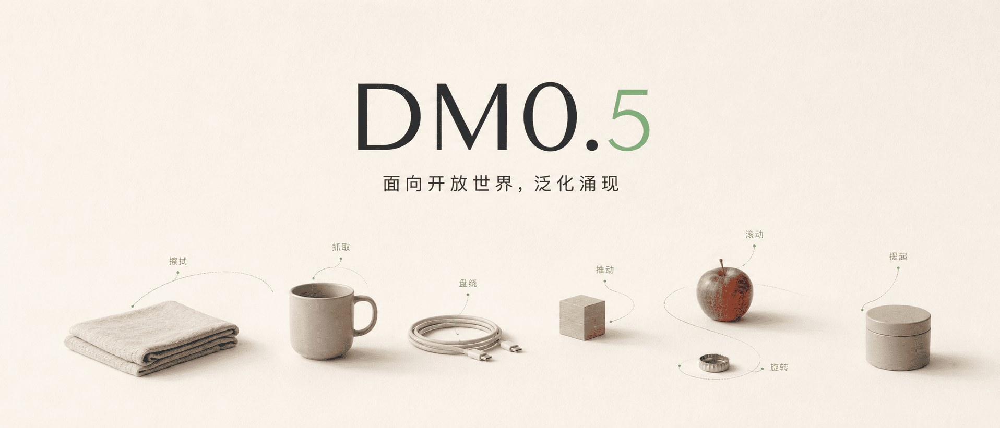
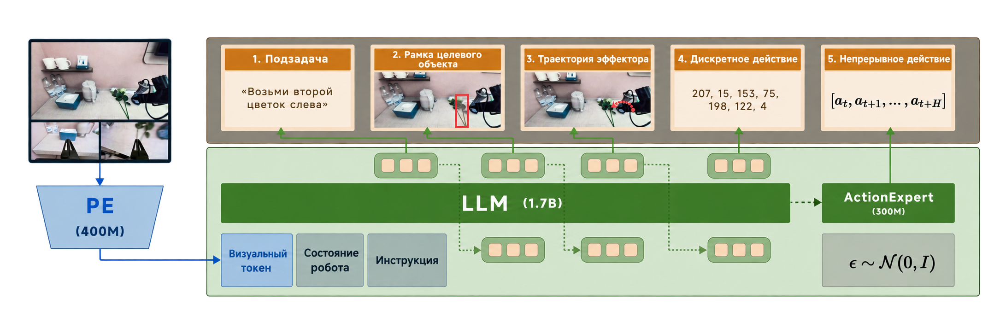
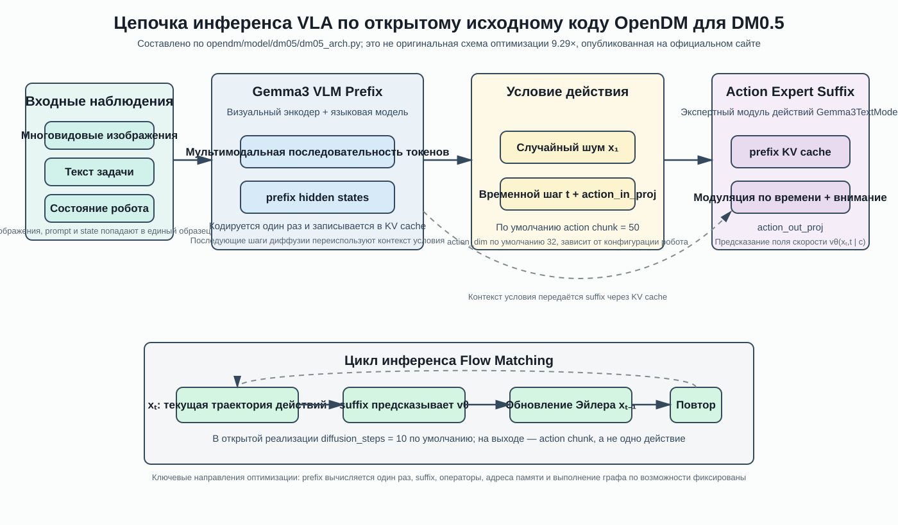

# DM0.5: высокопроизводительная воплощённая VLA и открытый OpenDM

> Назначение главы: разобрать публичную структуру модели DM0.5, путь инференса и опубликованное описание оптимизации производительности, а также указать входы в OpenDM, которые сейчас можно использовать для установки, инференса, дообучения и оценки.
>
> Важная оговорка: DM0.5 — это VLA, а не мировая модель. Ниже отдельно рассматривается оптимизация инференса, но «низколатентный инференс VLA» не выдаётся за развёртывание мировой модели.

## 1. Главный вывод: что в этом обновлении

DM0.5 — воплощённая модель «зрение — язык — действие» (VLA) от Dexmal для открытого мира. Открытый репозиторий `OpenDM` уже содержит веса модели, скрипты обучения, сервис инференса, примеры регистрации данных и руководства по оценке на LIBERO и RoboTwin2.0. В текущей карточке модели доступны входы `Dexmal/DM05`, `Dexmal/DM05-libero`, `Dexmal/DM05-robotwin2` и `Dexmal/DM05-SO101-Pick-Cube`.

Главное в обновлении — не «ещё одна более крупная VLM», а сокращение времени выполнения всего онлайн-пути:

```text
изображения / состояние / инструкция
    -> TensorRT для зрения
    -> префикс Gemma3 VLM + KV-кэш
    -> суффикс Action Expert / Flow Matching
    -> блок действий (action chunk)
    -> интерфейс управления роботом
```

По официальному объявлению о производительности, на RTX 4090D задержка ядра модели снизилась с `534,04 мс` до `57,49 мс`, суммарное ускорение составило `9,29×`. Задержка API: `p50 67,75 мс`, `p90 70,01 мс`. В объявлении также сообщается, что при том же контрольном файле и входах LIBERO успешность на 2000 эпизодах изменилась с `98,45 %` до `98,40 %`. Это цифры, опубликованные в объявлении, а не результаты, которые эта глава перемерила на своей машине.

Главное, чему стоит учиться: **как при практически неизменном поведении модели сочетать вычисления фиксированной формы, низкоточное матричное умножение, слитые операторы и выполнение на GPU через граф, чтобы получить сервис VLA с низкой задержкой.**

## 2. Официальные ресурсы и текущий статус открытости

| Ресурс | Назначение | Текущий статус |
| :--- | :--- | :--- |
| [Официальный репозиторий OpenDM](https://github.com/dexmal/opendm) | Веса DM0.5, обучение, инференс, регистрация данных, точки входа для оценки | Открыт, Apache-2.0 |
| [README OpenDM на китайском](https://github.com/dexmal/opendm/blob/main/README.zh-CN.md) | Установка, модели и команды на китайском языке | Открыт |
| [Карточка модели Dexmal/DM05](https://huggingface.co/Dexmal/DM05) | Веса DM0.5 уровня 6B и файлы модели | Открыта |
| [Техблог DM0.5](https://www.dexmal.com/blog/dm0.5/index.html) | Официальное описание модели и вход для объявления о производительности | Официальная страница проекта |
| [Репозиторий Dexbotic](https://github.com/dexmal/Dexbotic) | Инструментарий VLA Dexmal, документация DM0 и предшествующая линия развития | Открыт |
| [Документ по инференсу DM0 в реальном времени](https://github.com/dexmal/Dexbotic/blob/main/docs/DM0RealtimeInference.md) | Серверная часть реального времени DM0 и ограничения CUDA Graph | Открыт |
| [realtime-vla](https://github.com/dexmal/realtime-vla) | Справочный код инференса DM0 / Pi0 / Pi05 на Triton | Открыт, но в основном для DM0 / Pi0 / Pi05 |
| [Исходный код архитектуры DM0.5](https://github.com/dexmal/opendm/blob/main/opendm/model/dm05/dm05_arch.py) | Публичные классы модели, action expert, KV-кэш, инференс Flow Matching | Открыт |
| [Экспериментальные скрипты DM0.5](https://github.com/dexmal/opendm/blob/main/opendm/exp/dm05_exp.py) | Конфигурации обучения и оценки | Открыты |

### 2.1 Точный ответ на вопрос «есть ли код на официальном сайте»

Код есть, но его стоит разделить на два уровня.

1. **Модель DM0.5 и код обучения/инференса открыты.** OpenDM позволяет скачать контрольную точку, запустить сервер инференса, зарегистрировать собственный набор данных, выполнить SFT / LoRA и провести оценку на LIBERO и RoboTwin2.0 по официальному руководству.
2. **Оптимизационный стек 9,29× из объявления в текущем OpenDM полностью не представлен.** Мы проверили публичный исходный код: видны `FlexAttention`, слитое внимание (fused attention) и пути фиксированного блока действий на уровне модели, но нет полной реализации развёртывания DM0.5, которая связывала бы `Vision TensorRT + FP8 E4M3 Prefix MLP + слитые ядра Triton для суффикса + CUDA Graph при запуске`, и нет скриптов для бенчмарков `57,49`, `534,04` или `9,29`.

Поэтому эта глава не выдаёт ядра DM0 из `realtime-vla` за код DM0.5 с ускорением 9,29×. `realtime-vla` полезен как справочник: он открывает ядра Triton для DM0, конвертацию весов и вход в инференс с CUDA Graph. Но он подтверждает лишь то, что **существует открытый пример связанного пути низкой задержки**, а не то, что **все оптимизации из объявления DM0.5 открыты**.

## 3. Сначала изображения: продуктовый сигнал и родительская архитектура DM0



**Рисунок 1. Шапка страницы проекта DM0.5.** На картинке показаны действия протирки, захвата, обвязывания, толкания, прокатывания и извлечения; она передаёт позиционирование DM0.5 как модели для открытого мира, многозадачности и обобщения. Это рекламный визуал страницы проекта, а не схема сети.

Источник: [OpenDM, `docs/image/header-zh.png`](https://github.com/dexmal/opendm/blob/main/docs/image/header-zh.png).



**Рисунок 2. Схема родительской архитектуры DM0 из репозитория Dexbotic.** Схема показывает открытую родительскую линию DM0: визуальный энкодер превращает наблюдения в визуальные токены, которые вместе с состоянием робота и инструкцией поступают в LLM; ActionExpert преобразует мультимодальный контекст в подзадачи, целевые рамки, траектории конечного эффектора и дискретные / непрерывные действия. Она помогает понять путь Dexmal «VLM + Action Expert», но не является официальной точной схемой DM0.5.

Источник: [Dexbotic, `resources/dm0_arch.png`](https://github.com/dexmal/Dexbotic/blob/main/resources/dm0_arch.png).

## 4. Является ли DM0.5 pi0.5

Нет. Здесь два похожих названия:

- `pi0.5` — другая линия VLA от Physical Intelligence.
- `DM0.5` — модель семейства DM от Dexmal; по открытому исходному коду OpenDM она построена на VLM Gemma3 и собственном Action Expert.

Поэтому нельзя считать, что раз в названиях есть `0.5`, то базовая модель одна и та же, и нельзя переносить код Pi0 / Pi05 из `realtime-vla` на DM0.5 напрямую. Для DM0.5 сначала стоит читать в OpenDM классы `DM05Config`, `DM05ActionExpert`, метод `DM05Model.forward()` и функцию `inference_action()`.

## 5. Архитектурный разбор по открытому исходному коду

Схема ниже составлена по текущему открытому коду OpenDM. Это учебный рисунок, а не официальная схема из статьи. Цель — собрать префикс, суффикс, KV-кэш и процесс Flow Matching из кода `dm05_arch.py` на одном рисунке.



**Рисунок 3. Открытая архитектурная цепочка, составленная по `dm05_arch.py` из OpenDM.** Ключевое — связь между кодированием условий в префиксе и генерацией действий в суффиксе: префикс сначала кодирует изображения, инструкцию и состояние в контекст условий и кэширует его, а каждый временной шаг диффузии действий в основном выполняет суффикс действий.

### 5.1 Префикс: превращаем наблюдение в переиспользуемый контекст условий

Вход DM0.5 — не одно изображение, а целый образец решения робота:

```text
многовидовые изображения + текст задачи + проприоцепция / состояние + тип робота
```

Визуальный вход сначала проходит энкодер зрения, затем попадает в мультимодальный путь VLM Gemma3. Текст инструкции и состояние робота организуются согласно процессору OpenDM, трансформации набора данных и соглашению о промпте, после чего формируется последовательность токенов префикса.

Выход префикса нужен для двух вещей:

1. Получить мультимодальные скрытые состояния текущего наблюдения, которые служат условием для Action Expert.
2. Получить и сохранить KV-кэш VLM, чтобы последующим шагам генерации действий не приходилось заново пропускать те же изображения и текст через всю VLM.

Этот шаг — ключ к пониманию оптимизации задержки. Пусть блок действий требует 10 шагов Flow Matching. Если на каждом шаге заново выполнять кодирование зрения и языковой префикс, вычисления будут расточительными. Если же префикс выполняется один раз, а дальше обрабатывается только суффикс действий, цикл выборки действий можно сократить до нескольких десятков миллисекунд.

### 5.2 Суффикс: Action Expert — не простая линейная головка действий

Класс `DM05ActionExpert` в исходном коде OpenDM наследует структуру текстовой модели Gemma3, но выполняет работу суффикса действий. Он не просто пропускает последнее скрытое состояние через один MLP, а позволяет векторам действий взаимодействовать с условиями префикса внутри трансформера Action Expert.

Модули, которые видны в открытом коде:

- `action_in_proj` — проецирует вектор непрерывного действия в скрытое измерение языковой модели.
- `time_mlp_in` и `time_mlp_out` — кодируют временной шаг Flow Matching в модулирующий сигнал.
- Временной модулятор в каждом слое — сообщает Action Expert, в каком месте траектории с шумом он находится.
- KV-кэш префикса — позволяет суффиксу обращаться к условиям из изображений, текста и состояния.
- `action_out_proj` — проецирует скрытые состояния Action Expert обратно в размерность действий и получает предсказание векторного поля скорости.

Поэтому генерацию действий в DM0.5 можно понимать так:

```text
непрерывный блок действий x_t
    -> action_in_proj
    -> Action Expert с модуляцией по времени
    -> action_out_proj
    -> поле скорости v_theta(x_t, t | c)
```

Здесь `c` — условие, закодированное префиксом из изображений, языка и состояния.

### 5.3 Flow Matching: что делается при обучении и что при инференсе

Пусть `a` — реальный блок действий, `epsilon` — случайный шум. Открытая реализация строит промежуточное состояние линейной интерполяцией:

```text
x_t = t * epsilon + (1 - t) * a
u_t = epsilon - a
```

Модель получает `x_t`, временной шаг `t` и условие наблюдения `c` и предсказывает поле скорости `v_theta(x_t, t | c)`. Цель обучения можно записать как регрессию поля скорости с маской действий:

```text
L = MSE(v_theta(x_t, t | c), u_t)
```

Маска действий важна: функция потерь считается только по допустимым измерениям действия и допустимым временным шагам, чтобы заполнение (padding) и недопустимые измерения не мешали обучению Action Expert.

При инференсе настоящего `a` нет, поэтому начинают со случайного `x_1` и многократно вызывают суффикс действий, чтобы оценить скорость, а затем Эйлеровым шагом интегрируют шум в траекторию действий:

```text
x_{t-dt} = x_t + v_theta(x_t, t | c) * dt
```

В открытой реализации по умолчанию `diffusion_steps=10`, на выходе — блок действий. То есть один вызов VLA возвращает последовательность действий, а не одно суставное действие. Робот выполняет часть этой последовательности, затем считывает новое наблюдение и снова запускает инференс. Так устроено обычное замкнутое управление с горизонтом (receding-horizon) и блоками действий (action chunking).

## 6. Какие этапы ускорения на 9,29× и что именно оптимизировано

Объявление делит путь инференса на четыре слоя. Важно: описание ниже повторяет объявление; отметка «видно в открытом коде» стоит только там, где эту часть уже можно проверить по открытому исходному коду OpenDM.

| Слой | Технология из объявления | Какую проблему решает | Текущий статус открытости |
| :--- | :--- | :--- | :--- |
| Зрение | TensorRT под конкретную контрольную точку, FP16, статический ввод / вывод, фиксированный контракт числа изображений | Превращает энкодер зрения в эффективный движок фиксированной формы, уменьшая работу динамического графа и Python-диспетчеризации | В текущем OpenDM не открыт полный код построения движка TensorRT для DM0.5 |
| Внимание префикса | Настроенный FlexAttention | Для фиксированной маски префикса, длины последовательности и схемы доступа к вниманию снижает накладные расходы общей реализации | В конфигурации модели OpenDM видна точка входа FlexAttention, но это не полный пакет оптимизации для развёртывания |
| MLP префикса | GEMM gate / up / down в FP8 E4M3 на тензорных ядрах | Ускоряет три крупных матричных умножения в MLP с помощью FP8 на тензорных ядрах | В текущем OpenDM не найдено соответствующих ядер FP8 или скриптов калибровки для DM0.5 |
| Суффикс | Слитые ядра Triton | Объединяет несколько поэлементных, проекционных и нормализующих мелких операторов, уменьшая число запусков ядер и обращений к промежуточным тензорам | В `realtime-vla` есть справочный вариант Triton для DM0; полной реализации суффикса из объявления в текущем OpenDM нет |
| Среда выполнения | CUDA Graph, захваченный при запуске, буферы со статическими адресами, один replay | Превращает многократный запуск ядер при фиксированной форме в один replay графа | Документ DM0 realtime содержит похожее ограничение фиксированного числа шагов; специализированного кода DM0.5 для 9,29× в OpenDM полностью нет |

### 6.1 TensorRT для зрения: почему нужна привязка к контрольной точке

Движок TensorRT — не «установил TensorRT и всё стало быстрее». Обычно его нужно строить или выбирать под конкретную контрольную точку, размеры входа, число изображений и тип данных.

Четыре термина из объявления имеют практический смысл:

- **Привязка к контрольной точке (checkpoint-specific)**: веса, структура слоёв, стратегия точности и квантизации связаны с движком; нельзя взять движок от другой модели.
- **Выполнение в FP16**: стадия зрения работает в половинной точности, что снижает нагрузку на пропускную способность памяти и тензорные ядра.
- **Статический ввод и вывод (static I/O)**: формы буферов ввода и вывода фиксированы, что упрощает переиспользование памяти, стабильность адресов и захват CUDA Graph.
- **Фиксированный контракт числа изображений (fixed image-count contract)**: сервис должен всегда подавать одинаковое число изображений. Если иногда приходят 2, а иногда 3 изображения, статический движок и граф перестанут работать или потребуют несколько профилей.

Поэтому вывод для онлайн-робота — не «поставим TensorRT везде», а: **сначала зафиксировать протокол наблюдений, а затем строить движок под этот фиксированный протокол.**

### 6.2 FlexAttention: оптимизируется не семантика модели, а форма выполнения внимания

У префикса и суффикса VLA разная структура внимания. Префикс обрабатывает токены изображений, текста и состояния; суффикс обращается к кэшу префикса и одновременно обрабатывает текущий блок действий. Если каждый раз вызывать общее внимание, могут возникать дополнительные накладные расходы на маски, формы и макет KV-кэша на разных стадиях.

FlexAttention позволяет описать схему доступа к вниманию, соответствующую структуре модели, а затем PyTorch компилирует эффективный путь выполнения. Открытый код OpenDM уже сохраняет выбор реализации `flex_attention` / `sdpa` и т. п. для LLM VLM и Action Expert, но это не означает, что все настроенные ядра из объявления открыты.

### 6.3 FP8 E4M3: почему даже сжатие только MLP может дать большой выигрыш

В Transformer MLP обычно содержит крупные матричные проекции gate / up / down, поэтому вычислений и обращений к памяти здесь много. Объявление использует FP8 E4M3 на тензорных ядрах для GEMM gate / up / down в MLP префикса. Выигрыш складывается из:

1. Веса и активации занимают меньше пропускной способности памяти.
2. Тензорные ядра GPU класса 4090D дают более высокую производительность низкоточного матричного умножения.
3. FP8 применяют к самым чувствительным по производительности матричным умножениям, а не квантуют всю модель без разбора.

Но FP8 — не просто указание `dtype=torch.float8_e4m3fn`. Нужно учесть масштабы (scale), динамический диапазон, точность накопления, раскладку весов, данные для калибровки и ошибку выходов. Без официальной калибровки и реализации ядер читателю не стоит считать эту часть пошагово воспроизводимой на основе текущего OpenDM.

### 6.4 Слитые ядра Triton для суффикса: снижаем стоимость диспетчеризации и доступа к памяти

Суффикс действий обычно выполняется повторно на каждом шаге Flow Matching. Даже если каждый мелкий оператор занимает мало времени, при большом числе запусков ядер, записи и чтения временных тензоров и накладных расходах фреймворка задержка заметно растёт.

Типичная цель слитого ядра Triton — объединить последовательность фиксированных операций в одно ядро GPU, например:

```text
чтение входа -> нормализация / поэлементная модуляция -> проекция или GEMM -> активация -> запись результата
```

Реальные границы слияния зависят от размерностей модели, занятости регистров, occupancy, попаданий в L2 и численной ошибки, а не только от числа ядер. Открытый файл `realtime-vla/dm0_infer.py` даёт справочный пример для DM0 и показывает, как разбирать операции, похожие на GEMM, в энкодере зрения, LLM и Action Expert. Но это не замена официальному пакету оптимизации DM0.5.

### 6.5 CUDA Graph: зачем нужен захват при запуске, статические адреса и один replay

CUDA Graph подходит для цикла инференса, где фиксированы форма, поток управления и адреса памяти. При развёртывании сначала один раз запускают вычисления на фиктивных буферах фиксированной формы и захватывают граф; в рабочем режиме новое наблюдение копируют в уже выделенные статические буферы и выполняют replay.

В объявлении онлайн-этап описан так:

```text
копирование статических данных -> выполнение движка TensorRT -> один replay графа
```

Это уменьшает накладные расходы на многочисленные запуски ядер, но накладывает ограничения:

- число изображений, разрешение, длина промпта / токенов и форма блока действий должны быть фиксированы или разбиты по корзинам (bucket).
- Во время захвата графа поток CUDA, адреса буферов и путь выполнения должны оставаться стабильными.
- Нельзя на лету менять число шагов диффузии; чаще всего для этого нужно захватить граф заново.
- Сложные динамические ветвления Python, динамическое выделение памяти и обработка исключений не должны попадать внутрь графа без разбора.

Документ Dexbotic по DM0 в реальном времени показывает похожую инженерную дисциплину: при запуске сервиса захватывается граф с фиксированным числом шагов, а число шагов сэмплирования на стороне клиента должно совпадать со значением, которое возвращают capabilities. Это полезная соседняя практика для понимания CUDA Graph, но нельзя сравнивать бенчмарк DM0 с `5,5×` напрямую с бенчмарком DM0.5 с `9,29×`.

## 7. Как запустить открытый OpenDM

Здесь описаны точки входа, по которым читатель может работать с официальным репозиторием, но эта глава не выдаёт их за полное обучение, выполненное авторами учебника.

### 7.1 Требования к окружению

Текущий README OpenDM рекомендует Linux, GPU NVIDIA и Docker с NVIDIA Container Toolkit; обучение обычно требует нескольких GPU, а инференс может работать на одной. Точные версии CUDA, PyTorch, объёма памяти и образа контейнера смотрите в актуальном README репозитория.

Сначала проверьте:

```bash
nvidia-smi
docker --version
docker run --rm --gpus all nvidia/cuda:12.4.1-base-ubuntu22.04 nvidia-smi
```

Не скачивайте сначала контрольную точку размером 11 ГБ и только потом проверяйте окружение. Сначала убедитесь, что работают GPU, драйвер, среда контейнеров и доступ к Hugging Face.

### 7.2 Получение кода и модели

```bash
git clone https://github.com/dexmal/opendm.git
cd opendm

# Загрузка открытых весов через Hugging Face CLI; файлы большие, заранее освободите место на диске
hf download Dexmal/DM05 --local-dir ./checkpoints/DM05
```

В репозитории также есть файлы Docker и скрипты запуска. Лучше сначала использовать официальный контейнер и скрипты запуска, не обновляя сразу PyTorch, FlashAttention, xformers или версию CUDA: внимание VLA, обработка изображений и собственные ядра очень чувствительны к версиям.

### 7.3 Запуск сервиса инференса DM0.5

Примерный вход сервиса из официального README:

```bash
script/dm05_launcher.sh \
  --task inference \
  --nproc_per_node 1 \
  --model-config.model-name-or-path ./checkpoints/DM05 \
  --model-config.chunk-size 50 \
  --inference-config.port 7891
```

Затем вызывается пример curl из репозитория:

```bash
bash tests/curl_demo.sh http://127.0.0.1:7891/process_frame
```

В запросе обычно передаются текст задачи, состояние робота и поля изображений. Нужны ли поля `robot_type`, `control_mode`, `speed` и другие, зависит от модели и режима развёртывания. Не копируйте JSON из старых примеров: сначала посмотрите текущие `tests/curl_demo.sh`, процессор и README, и убедитесь, что число изображений, порядок ключей и размерность состояния совпадают со статистикой нормализации контрольной точки.

### 7.4 Публичные входы для SFT и LoRA

OpenDM уже открыл примеры регистрации данных и несколько руководств по дообучению. Общий вход для обучения выглядит так:

```bash
script/dm05_launcher.sh \
  --exp playground/dm05_sft_demo.py \
  --task train \
  --nproc_per_node 8 \
  --data-config.dataset-name my_robot \
  --model-config.model-name-or-path ./checkpoints/DM05 \
  --model-config.chunk-size 50 \
  --trainer-config.num-train-steps 50000
```

Перед настоящим обучением нужно:

1. Зарегистрировать набор данных по примеру из `opendm/dataset/`.
2. Проверить формат эпизода: поля изображений, состояние, действия и языковую инструкцию.
3. Убедиться, что автоматически созданная статистика нормализации соответствует контрольной точке, роботу и размерности действий.
4. Сначала прогнать очень короткое обучение (малое число шагов) для проверки загрузки данных и прямого прохода, и только потом увеличивать объём.
5. Использовать актуальные конфигурации из `docs/en/dm05_finetuning.md`, `docs/en/dm05_libero_lora_training.md` и `docs/en/dm05_so101_lora_training.md`, а не команды из сетевых статей.

Этот путь позволяет воспроизвести открытые возможности обучения и дообучения DM0.5. Но он не эквивалентен воспроизведению развёртывочного ядра из объявления с ускорением 9,29×.

## 8. Что можно воспроизвести, а что нельзя

| Цель | Текущая рекомендация | Вывод |
| :--- | :--- | :--- |
| Скачать веса DM0.5 | `Dexmal/DM05` | Можно |
| Запустить сервер инференса на одной GPU | `dm05_launcher.sh` из OpenDM | Можно, если выполнены требования официального окружения |
| Зарегистрировать собственные данные робота | Регистрация набора данных + статистика нормализации | Можно, начинать с короткого smoke-теста |
| SFT / LoRA | Официальные playground и руководства по дообучению | Можно, стоимость зависит от данных и видеокарты |
| Оценка на LIBERO / RoboTwin2.0 | Официальное руководство по бенчмаркам | Можно пробовать по текущей версии репозитория |
| Воспроизвести 534,04 → 57,49 мс | В объявлении не опубликован полный стенд бенчмарка и специализированный пакет оптимизации DM0.5 | Пока нельзя утверждать «воспроизведено по кнопке» |
| Воспроизвести FP8 E4M3 для MLP префикса | Нужны официальные ядра, масштабы / калибровка и детали преобразования весов | В текущем OpenDM недостаточно для прямого воспроизведения |
| Воспроизвести полный путь TensorRT + Triton для суффикса + CUDA Graph | Нужны соответствующая инженерия развёртывания, контракт фиксированной формы и тестовые скрипты | В OpenDM полной реализации не найдено |

## 9. Как читать цифры производительности

### 9.1 Задержка ядра модели и задержка API — не одна метрика

Объявление приводит задержку ядра модели и задержку API, и они измеряют разные вещи:

- **Задержка ядра модели**: ближе к вычислениям самой модели на GPU.
- **Задержка API**: может включать разбор запроса, перемещение данных, предобработку изображений, токенизацию, постобработку, сетевые и сервисные накладные расходы.

Поэтому `57,49 мс` и `p50 67,75 мс` не противоречат друг другу. В отчёте о любом эксперименте нужно указывать границы измерения, число прогревов, размер батча, число видов изображений, длину промпта, число шагов диффузии, размер блока действий, модель GPU, версии драйвера, CUDA и PyTorch.

### 9.2 Успешность 98,45 % → 98,40 % показывает, что оптимизация не сильно изменила поведение, но не доказывает общую производительность

Почти неизменная успешность на 2000 эпизодах LIBERO — полезное свидетельство того, что оптимизация инференса существенно не ухудшила результат. Но это относится только к конкретной контрольной точке, протоколу входа и бенчмарку. Чтобы судить о работе на реальном роботе, нужно измерять:

- частоту кадров сенсоров и дрожание задержки;
- свежесть наблюдений во время выполнения блока действий;
- p50 / p90 / p99, а не только среднее значение;
- передачу данных с CPU на GPU, предобработку изображений и постобработку действий;
- потерю кадров, блокировку камеры, колебания температуры и частоты GPU, стабильность при долгой работе;
- контракт формы для разного числа изображений, длины промпта и конкретного робота.

## 10. Связь DM0 realtime, realtime-vla и OpenDM

| Проект | DM0.5 / OpenDM | Dexbotic DM0 realtime / realtime-vla |
| :--- | :--- | :--- |
| Основной объект | Модель DM0.5 и экосистема обучения / инференса | Справочный инференс DM0 и Pi0 / Pi05 в реальном времени |
| Что открыто | Веса, структура модели, SFT / LoRA, оценка и сервис | Ядра Triton, конвертация весов, бенчмарки, справочная реализация CUDA Graph |
| Что удобно изучать | Структуру VLA, Flow Matching, данные и оценку | Разбиение вычислений на ядра Triton, фиксированные формы и replay графа |
| Совпадает ли с реализацией 9,29× для DM0.5 | Нет | Нет, но технологический путь близкий |

Эти два репозитория стоит читать вместе: сначала OpenDM, чтобы понять, что именно вычисляет DM0.5, затем `realtime-vla`, чтобы увидеть, как VLA такого типа разбивается на ядра Triton и выполняется в реальном времени. При переносе нужно заново проверить число слоёв, размерность скрытого слоя, разрешение зрения, размерность действий, раскладку весов, статистику нормализации и протокол процессора.

## 11. Рекомендуемый порядок чтения

Если пока не запускаете обучение, читайте в таком порядке:

1. Сначала [README OpenDM](https://github.com/dexmal/opendm): модель, веса и точки входа для оценки.
2. Затем рисунок 2 этой главы, чтобы понять родительскую линию Dexmal «VLM + Action Expert».
3. Откройте [`dm05_arch.py`](https://github.com/dexmal/opendm/blob/main/opendm/model/dm05/dm05_arch.py) и найдите `DM05ActionExpert`, `action_in_proj`, `action_out_proj`, `forward` и `inference_action`.
4. По рисунку 3 вручную пройдите путь KV-кэша префикса, шума действий, Flow Matching и шагов Эйлера.
5. Прочитайте [документ DM0 realtime](https://github.com/dexmal/Dexbotic/blob/main/docs/DM0RealtimeInference.md), чтобы понять фиксированные формы и захват CUDA Graph при запуске.
6. Наконец изучите `dm0_infer.py` и `benchmark.py` в [`realtime-vla`](https://github.com/dexmal/realtime-vla), чтобы увидеть, как реальная среда выполнения Triton организует зрение, LLM, Action Expert и граф.

## 12. Частые ошибки при воспроизведении

### 12.1 Путать DM0.5 и pi0.5

Похожие названия не означают одинаковую базовую модель. Для DM0.5 ориентируйтесь на реализацию OpenDM с Gemma3 и Action Expert, а для pi0.5 — на реализацию OpenPI / Physical Intelligence.

### 12.2 Смотреть только на задержку ядра модели, а не на замкнутый контур

Работает ли робот в реальном времени, зависит от всей цепочки: от экспозиции камеры до выдачи команды управления. Обязательно фиксируйте отдельно захват изображения, предобработку, инференс, обратную нормализацию, период управления, сетевые задержки и задержку исполнительных механизмов.

### 12.3 Динамические входы ломают статические оптимизации

Изменение числа изображений, разрешения, длины токенов, размера блока действий или числа шагов диффузии делает недействительными профили TensorRT, специализацию ядер или граф CUDA. Сначала определите контракт входа, а потом решайте, нужна ли статическая компиляция и захват графа.

### 12.4 Несоответствие статистики нормализации и размерности действий

Нормализация действий — основа того, что VLA может корректно исполнять команды. Недостаточно просто положить в набор данных изображения и файлы действий: нужно проверить размерность действий, размерность состояния робота, маску допустимых действий и источник `norm_stats.json`.

### 12.5 Запуск новых репозиториев по командам из старых руководств

OpenDM быстро обновляется. Скрипты обучения, каталоги моделей, имена весов и документация меняются. При воспроизведении ориентируйтесь на текущий README репозитория, `docs/en/` и справку по скриптам, а также записывайте хеш коммита.

## 13. Итог

Обновление DM0.5 стоит включить в главу о VLA не потому, что «9,29× — новый алгоритм VLA», а потому, что оно очень конкретно показывает слой, который часто упускают при развёртывании воплощённых моделей: **архитектура модели, протокол входа, низкоточные матричные умножения, слияние операторов, статическая память и CUDA Graph должны проектироваться вместе.**

Удобно разбить материал на три уровня:

1. **Алгоритмический уровень**: префикс Gemma3 VLM + суффикс Action Expert + блок действий Flow Matching.
2. **Уровень модели**: KV-кэш префикса, FlexAttention, временная модуляция, проекции действий и сэмплирование Эйлером.
3. **Уровень развёртывания**: TensorRT, FP8, слитые ядра Triton, фиксированные формы входа, CUDA Graph при запуске и сквозное измерение задержки.

Текущий OpenDM уже позволяет изучить модель DM0.5, скачать веса, запустить сервис инференса, провести SFT / LoRA и воспользоваться открытыми точками входа для оценки. Пакет оптимизации 9,29× из объявления стоит по-прежнему считать официальным обновлением производительности; строго воспроизводить его можно будет после публикации соответствующего кода развёртывания и полного стенда бенчмарка. Эта граница сама по себе важна для читателя: о том, что проверено, а что пока только заявлено, нужно говорить явно.
