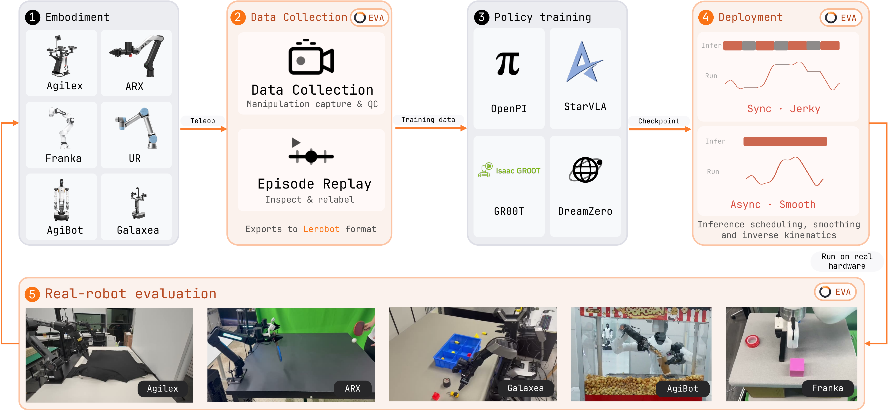
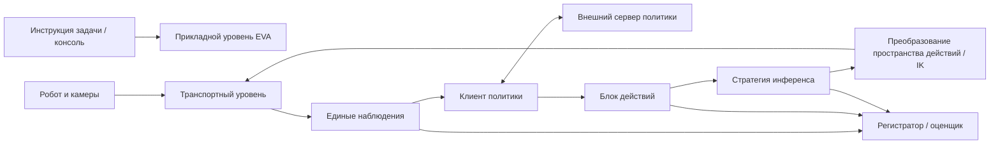

# EVA-Client: от весов VLA до развёртывания на реальном роботе и воспроизводимой оценки

> Назначение раздела: дополнительный материал по инженерному развёртыванию VLA. EVA-Client не обучает политики и не является новой архитектурой VLA. Он закрывает этап после обучения: сбор данных, подключение сервера политики, устойчивое исполнение блоков действий и сохранение воспроизводимых записей оценки.

## 1. Обзор проекта

| Пункт | Информация |
| :--- | :--- |
| Страница проекта | [EVA-Client Project Page](https://colalab.net/projects/eva-client) |
| Репозиторий | [Noietch/EVA-CLIENT](https://github.com/Noietch/EVA-CLIENT) |
| Технический отчёт | [EVA-Client Technical Report](https://colalab.net/projects/eva-client/paper/EVA_Client_Report.pdf) / [arXiv:2607.02646](https://arxiv.org/abs/2607.02646) |
| Лицензия | Apache-2.0 |
| Версия, на которой проверен раздел | Коммит официального репозитория `ff36587`, 19 августа 2026 года |
| Версия Python | `>=3.10,<3.12`, рекомендуется Python 3.10 |

EVA-Client отвечает не на вопрос «как заново обучить модель», а на четыре частых практических вопроса:

1. Как камеры, состояния суставов и текст задачи поступают к стороне политики в едином формате?
2. Политика возвращает блок действий (action chunk). Как робот выполняет его непрерывно, без частых остановок?
3. Что можно переиспользовать при смене робота, способа связи или серверной части политики?
4. Как считать успешность на реальном роботе, пересматривать неудачные попытки и использовать журналы для дальнейшего обучения?

Проект делит эти задачи на уровни: транспорт, описание робота, клиент политики, стратегия планирования действий, консоль и регистратор. Поэтому «инференс модели» и «исполнение на роботе» не нужно писать в одном скрипте.

## 2. Официальная схема: как оценка замыкает цикл данных

<p align="center">
  
</p>

**Рисунок 1. Официальный рабочий процесс EVA-Client.** Источник: [официальный репозиторий EVA-Client](https://github.com/Noietch/EVA-CLIENT/blob/main/assets/workflow.png).

Схему следует читать слева направо, в пять этапов.

### 2.1 Embodiment: сначала свести различия тел роботов к единому описанию

Слева показаны разные роботы. Они различаются числом суставов, группировкой рук, захватами, камерами, начальными позами и протоколами связи. EVA-Client не пытается использовать один драйвер для всех. Он записывает структуру тела, группы суставов, камеры и пространство действий в описание робота, а транспортный уровень подключает реальный драйвер.

Поэтому при смене робота в основном добавляются определение робота (robot definition), узел аппаратного обеспечения (hardware node) и конфигурация (config). Сбор данных, запросы к политике, планирование действий и интерфейс оценки переписывать не нужно.

### 2.2 Data Collection: запись, воспроизведение и экспорт в LeRobot

Второй этап записывает наблюдения и действия при телеуправлении в виде эпизодов, даёт воспроизведение и проверку качества. Данные экспортируются в структуру каталогов LeRobot v2.1, поэтому их можно передать в обучение SmolVLA и обработку данных LeRobot, которые уже есть в этом учебнике.

Важно не столько «уметь записывать видео», сколько правильно согласовать изображения, состояние робота, действия, временные метки, текст задачи и метаданные эпизода. Для реальной VLA ошибочные временные метки, потеря кадров, изменение имён камер или несовпадение размерности действий часто ломают обучение и развёртывание раньше, чем архитектура модели.

### 2.3 Policy Training: обучение выполняется внешними фреймворками

Центральный блок — OpenPI, StarVLA, GR00T и DreamZero. Они обозначают совместимую экосистему политик или обучения, но не означают, что EVA-Client включает эти алгоритмы обучения. В текущем коде напрямую видны такие клиенты политик:

- `openpi` — подключение к серверу инференса OpenPI;
- `openpi_rtc` — работа с Real-Time Chunking;
- `starvla` — подключение к серверу инференса StarVLA;
- `gr00t` — подключение к серверу инференса GR00T;
- `mock` — проверка связи и интерфейса без настоящей модели;
- `replay` — тест с воспроизведением уже записанных действий.

После обучения контрольную точку запускает как сервис политики соответствующий фреймворк. EVA-Client организует наблюдения, запрашивает действия и исполняет возвращённые блоки действий.

### 2.4 Deployment: планирование блоков действий определяет, работает ли система или работает стабильно

На схеме синхронное исполнение создаёт паузы, пока ждём следующего вывода. Асинхронное исполнение перекрывает вывод и управление роботом и сшивает старый и новый блоки действий. Дёрганье на реальном роботе, скачки действий и накопление задержки обычно возникают именно на этом уровне.

### 2.5 Evaluation: оценка одновременно оставляет данные для повторного обучения

Справа показаны не только проценты успеха, но и видео, состояние робота, кривые действий и журналы эпизодов. Одна оценка может одновременно стать:

- измерением успешности контрольной точки;
- визуальной диагностикой неудачных случаев;
- записью вмешательств человека или восстанавливающих действий;
- входом для следующего цикла очистки данных, имитационного обучения или онлайн-адаптации.

## 3. Архитектура: развязка политики, планирования и железа



### 3.1 Transport: отвечает только за приём и отправку

Транспортный уровень получает от исполнительного узла камеры и состояние робота и отправляет команды управления. Сейчас проект предоставляет точки входа ROS1, ROS2, ZMQ и офлайн-воспроизведение наборов данных LeRobot.

Разделение транспорта и политики даёт два прямых выигрыша: одну и ту же политику можно подключить к ROS или ZMQ; один и тот же робот можно переключать между настоящим железом, офлайн-данными и mock-окружением для послойной отладки.

### 3.2 Robot Definition: описание контракта тела робота

Описание робота должно как минимум явно задавать:

- имена, порядок, размерность суставов и группировку левой и правой руки;
- имена камер, размер изображений и ракурсы;
- начальную позу, пределы и частоту управления;
- использует ли политика `JointState` или `EEFPose`;
- URDF и конфигурацию IK, если нужно преобразовать позу концевого эффектора в углы суставов.

Представление позы концевого эффектора в EVA-Client организуется на руку как `xyz(3) + кватернион(4) + захват(1)`, то есть 8 измерений. Если низкоуровневый контроллер робота принимает положения суставов, а политика выдаёт позу концевого эффектора, преобразование в обратной кинематике выполняется через PyRoki.

### 3.3 Policy Client: адаптация к протоколу сервиса инференса

Клиент политики решает три задачи: переводит единые наблюдения во входы модели; отправляет запрос удалённому или локальному сервису инференса; восстанавливает ответ в единый блок действий. Токенизатор, загрузка контрольной точки и вывод на GPU могут остаться в исходном фреймворке обучения.

Поэтому EVA-Client подходит как лёгкий клиент на реальном роботе: управляющий компьютер не обязан одновременно содержать среду обучения большой модели. Сервис политики можно запустить на другом GPU-сервере и подключить через проброс портов или локальную сеть.

### 3.4 Inference Strategy: управление временной шкалой, а не изменение модели

| Стратегия | Как работает | Где подходит | Основной риск |
| :--- | :--- | :--- | :--- |
| `sync` | Блокирует выполнение до получения следующего блока действий | Самый понятный вариант для первого соединения | Робот останавливается во время вывода |
| `async` | В фоне предсказывает следующий блок и линейно перекрывает старые и новые действия | Режим по умолчанию для непрерывного исполнения на реальном роботе | Нужно правильно задать длину перекрытия и буфер |
| `naive` | Асинхронный запрос; когда приходит новый блок, он сразу заменяет старый буфер | Быстрая проверка пропускной способности | Скачки действий на границах блоков |
| `act` | Взвешивает по времени несколько перекрывающихся предсказаний | Политики типа ACT | Нужно хранить несколько блоков и их временные позиции |
| `rtc` | Выравнивает новые предсказания по уже зафиксированным к исполнению действиям | Низколатентные цепочки типа OpenPI RTC | Протокол сервера и клиента должен совпадать |

Если длина блока действий равна $H$, частота управления $f_c$, а задержка одного вывода $t_i$, то синхронное исполнение легко останавливается, когда $t_i$ близко к оставшемуся буферу или превышает его. Суть асинхронной стратегии: пока робот расходует текущий блок, следующий вывод уже завершается, и два блока согласуются по времени.

### 3.5 Recorder и Evaluator: превращаем «успешность» в цепочку доказательств

Регистратор одновременно сохраняет наблюдения, предсказания модели, фактически выполненные команды и метаданные оценки. Фактически выполненное действие не обязательно совпадает с исходным предсказанием: оно может быть обрезано, пересчитано через IK, сглажено, изменено вмешательством человека или фильтром безопасности. Если хранить эти величины раздельно, можно ответить, в чём причина провала: в модели, связи, планировании или контроллере.

## 4. Семь вкладок консоли и их назначение

Консоль EVA-Client разделяет типичный рабочий процесс на семь вкладок:

| Вкладка | Назначение |
| :--- | :--- |
| `MANUAL` | Ручная проверка суставов, камер, инструкции и базового управления |
| `COLLECT` | Запись эпизодов телеуправления или ручного показа |
| `REPLAY` | Воспроизведение данных для проверки синхронизации, ракурсов и качества действий |
| `DEBUG` | Пошаговое исполнение действий модели для поиска проблем политики или интерфейса |
| `RL` | Вмешательство человека во время rollout и наблюдение за сигналами критика / ценности |
| `EVAL` | Организация оценки на реальном роботе по задачам, контрольным точкам и числу попыток |
| `RESULT` | Сводка успешности, этапов, видео и журналов |

Рекомендуемый порядок входа в замкнутый цикл на реальном роботе: `MANUAL -> COLLECT/REPLAY -> DEBUG -> EVAL`. Не запускайте политику подряд, пока не проверены камеры, порядок суставов и аварийная остановка.

## 5. Данные и журналы: почему они подходят для LeRobot

Один сбор данных или rollout создаёт структуру, близкую к LeRobot v2.1:

```text
<log_dir>/<task>/
├── data/chunk-000/episode_000000.parquet
├── videos/chunk-000/<camera>/episode_000000.mp4
└── meta/
    ├── info.json
    ├── episodes.jsonl
    ├── episodes_stats.jsonl
    ├── tasks.jsonl
    └── stats.json
```

Помимо стандартных полей, которые нужны для обучения, оценка должна сохранять таблицу или боковой файл для аудита: с помощью `absolute_step` выравниваются исходное состояние, блок действий модели, фактически выполненные действия, задержка вывода, вмешательства человека и отметки неудач. Проверки качества в проекте обращают внимание на слишком короткие эпизоды, немонотонные временные метки и отсутствующие камеры.

Этот путь образует цикл:

```text
обучение на реальном роботе -> данные LeRobot -> внешнее обучение VLA -> развёртывание и оценка в EVA
        ^                                                   |
        |------------- неудачные фрагменты / вмешательства -|
```

## 6. Текущий список поддержки

На версии, которую проверяли для этого раздела, в официальном Robot Zoo перечислены такие роботы:

| Робот | Конфигурация |
| :--- | :--- |
| AgileX Piper | Две 6-DoF руки + захват |
| ARX R5 | Две 6-DoF руки + захват |
| Dual Franka Panda | Две 7-DoF руки + захват |
| Galaxea R1 Lite | Две руки + корпус |
| UR5e | Одна 6-DoF рука + захват |
| AgiBot G2 | Двурукий гуманоид, тело с 24 DoF |

В репозитории есть также роботы, которые помечены как находящиеся в разработке или ожидающие добавления. Список поддержки меняется вместе с проектом, поэтому перед развёртыванием проверьте одновременно три источника в официальном репозитории: `README.md`, `configs/` и `examples/hardware/`. Одного рекламного изображения проекта недостаточно.

### Можно ли сейчас напрямую использовать SO-101?

Нельзя писать, что SO-101 «поддерживается». В Issue #94 автор 9 июля 2026 года сообщил, что поддержку добавят позже; однако в официальном коммите `ff36587` описания робота, аппаратного узла и рабочей конфигурации для SO-101 не найдено.

Если сообщество захочет добавить SO-101, минимальный объём работы таков:

1. Добавить описание робота SO-101: зафиксировать имена, порядок, диапазоны и начальные позы суставов Feetech, а также имена камер;
2. Реализовать аппаратный исполнительный узел через интерфейс LeRobot / Feetech и выставить наблюдения и действия через существующий ZMQ или подходящий транспорт;
3. Явно определить, выдаёт ли политика положения суставов, приращения или другое представление действий, и проверить размерности и единицы;
4. Добавить конфигурации сбора, развёртывания и оценки;
5. Настроить пределы суставов, ограничения скорости, аварийную остановку и отладку на одном блоке действий;
6. Сначала провести интеграционные тесты с фиктивной политикой и записанными данными, и только потом подключать настоящий сервис VLA.

Это рабочий путь адаптации, но не готовая официальная функция.

## 7. Минимальный опыт без реального робота

Проект содержит конфигурацию open-loop на примере данных из репозитория. Она подходит для проверки установки, страниц интерфейса, чтения данных и визуализации; ROS, настоящий робот и контрольная точка VLA не нужны.

```bash
git clone https://github.com/Noietch/EVA-CLIENT.git
cd EVA-CLIENT

curl -LsSf https://astral.sh/uv/install.sh | sh
uv venv --python 3.10 .venv
source .venv/bin/activate
uv pip install -e ".[dev]"

eva --config configs/00_openloop/dual_agilex_piper_openloop.py
```

После запуска откройте консоль по подсказке в терминале; по умолчанию обычно `http://127.0.0.1:8080`. На этом этапе проверьте:

- видит ли страница эпизоды;
- совпадают ли имена камер с конфигурацией;
- меняются ли кривые суставов и 3D-сцена во времени;
- работают ли воспроизведение, пауза и переключение эпизодов.

Этот шаг доказывает только исправность клиента и цепочки работы с примерами данных. Он не доказывает, что какая-либо контрольная точка может управлять настоящим роботом.

## 8. Двухпроцессный режим реального развёртывания

Реальное развёртывание обычно состоит минимум из двух независимых процессов:

```text
Процесс A: узел аппаратного обеспечения
  читает камеры и суставы -> публикует единые наблюдения
  принимает команды действий -> после ограничений пределов приводит робота в движение

Процесс B: EVA-Client
  читает config -> подключает transport -> обращается к сервису политики
  планирует блоки действий -> записывает и оценивает
```

В официальном репозитории есть примеры запуска аппаратной части для разных роботов, например:

```bash
# Ниже показан только вид команд; перед запуском нужно установить SDK или ROS-окружение производителя
bash examples/hardware/agilex_piper/run_agilex_ros.sh
bash examples/hardware/arx/run_hardware.sh
bash examples/hardware/franka/run_hardware.sh
bash examples/hardware/ur5e/run_hardware.sh

# В другом терминале запускается конфигурация EVA
eva --config configs/01_deploy/dual_agilex_piper/openpi_qpos.py
```

Сервер политики может работать на том же компьютере или на удалённом GPU-сервере. При удалённом подключении явно проверяйте адрес, порт, таймауты, частоту действий и сетевые колебания; не выставляйте канал управления в открытый интернет.

## 9. Какие поля конфигурации проверять

Новую конфигурацию нельзя считать готовой, если поменяли только IP-адрес. Проверяйте в таком порядке:

| Блок конфигурации | Что обязательно проверить |
| :--- | :--- |
| Robot | Тип робота, группы суставов, камеры, начальная поза, URDF |
| Transport | ROS1 / ROS2 / ZMQ / набор данных, адрес, топик или канал |
| Policy | Бэкенд, адрес сервиса, текст задачи, ключи входных изображений |
| Action | `JointState` / `EEFPose`, размерность, единицы, соглашение о захвате |
| Strategy | sync / async / act / rtc, длина блока, перекрытие и частота управления |
| Safety | Ограничения суставов, скорости и рабочей зоны, таймауты, аварийная остановка |
| Logging | Каталог вывода, видео с камер, поля состояния и оценки |

Если «интерфейс показывает изображение, но робот не двигается», сначала проверьте пространство действий, порядок суставов и узел исполнения. Если «робот каждые несколько секунд останавливается», проверьте задержку вывода, скорость расходования блока и стратегию планирования. Если «действие внезапно скачет», сравните исходное предсказание модели, стык старого и нового блоков и реально отправленное действие.

## 10. Рекомендуемый путь воспроизведения

Учебник пока не даёт пошаговой инструкции «нажми кнопку на реальном роботе», но рекомендует идти от низкого риска к высокому:

1. Запустить open-loop пример из репозитория на данных.
2. Проверить клиент политики и форму блока действий через `mock` или `replay`.
3. Запустить аппаратный узел и только читать состояние и изображения, не подавая команд движения.
4. В `DEBUG` выполнить один короткий блок действий и проверить направление, единицы и пределы.
5. Сначала использовать `sync` как объяснимую базовую линию, затем сравнить `async`, `act` и `rtc`.
6. Провести несколько реальных эпизодов и построчно сверить видео, состояние, предсказания и фактические действия.
7. И только потом переходить к официальной оценке с несколькими контрольными точками, задачами и повторами.

В официальном отчёте об успешности обязательно укажите: робота, текст задачи, инициализацию сцены, число попыток на задачу, критерий успеха, контрольную точку, стратегию планирования действий и правила вмешательства человека. Иначе цифры разных стратегий нельзя сравнивать напрямую.

## 11. Связь с существующим материалом учебника

EVA-Client лучше всего ставить в конце учебной цепочки:

1. Сначала изучите [RDK-X5 и телеуправление манипулятором LeRobot](../../../03-robot-hardware-lerobot-and-rdk-x5/03-rdk-x5-connects-to-the-lerobot-robotic-arm-for-remote-manipulation.md) или главы о сборе данных в этом учебнике, чтобы понять эпизоды и выравнивание мультимодального времени.
2. Затем выполните обучение и вывод [SmolVLA](../01SmolVLA-LIBERO/01SmolVLA-libero.md), [OpenVLA](../02-openvla-reproduction/02-openvla-reproduction.md) или [OpenPI / π0](../04-mujoco-reproduction-act-pi0-smolvla).
3. Подключите EVA-Client к настоящему роботу, разберитесь с сервисом политики, планированием блоков действий, журналами и оценкой.
4. Верните неудачные rollout и вмешательства человека в LeRobot и цикл обучения, чтобы замкнуть контур данных.

Этот раздел дополняет модельные главы инфраструктурой развёртывания, но не заменяет их.

## 12. Границы применимости и безопасность

- EVA-Client унифицирует интерфейсы, но не гарантирует безопасность действий политики. Реальному роботу всё равно нужны аппаратная аварийная остановка, программные пределы и присутствие оператора.
- Управляющий канал ZMQ может запускать движения реального робота. По умолчанию его следует ограничивать доверенной локальной сетью или localhost, а внешний доступ организовывать через аутентифицированный туннель, а не открывать в интернет.
- Консоль и журналы повышают прослеживаемость, но критерий успеха должен задаваться на уровне задачи; нельзя полагаться только на модель или интерфейс, который сам выносит вердикт.
- «Поддерживается стратегия» обычно означает, что есть клиентский протокол. Это не значит, что репозиторий содержит веса политики, лицензию на них или полную среду обучения.
- «Поддерживается робот» подтверждается только тогда, когда есть описание робота, пример аппаратного узла и конфигурация, которые можно проверить.

## Литература и ссылки

1. [Страница проекта EVA-Client](https://colalab.net/projects/eva-client)
2. [Репозиторий EVA-Client на GitHub](https://github.com/Noietch/EVA-CLIENT)
3. [Технический отчёт EVA-Client](https://colalab.net/projects/eva-client/paper/EVA_Client_Report.pdf)
4. [arXiv:2607.02646](https://arxiv.org/abs/2607.02646)
5. [Issue #94 в every-embodied: рекомендация EVA-Client](https://github.com/datawhalechina/every-embodied/issues/94)
