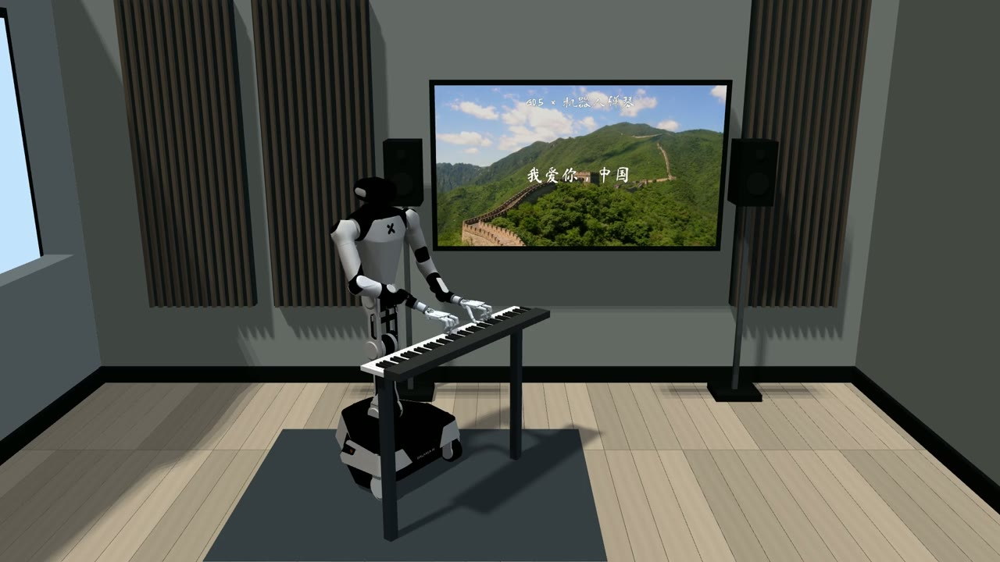
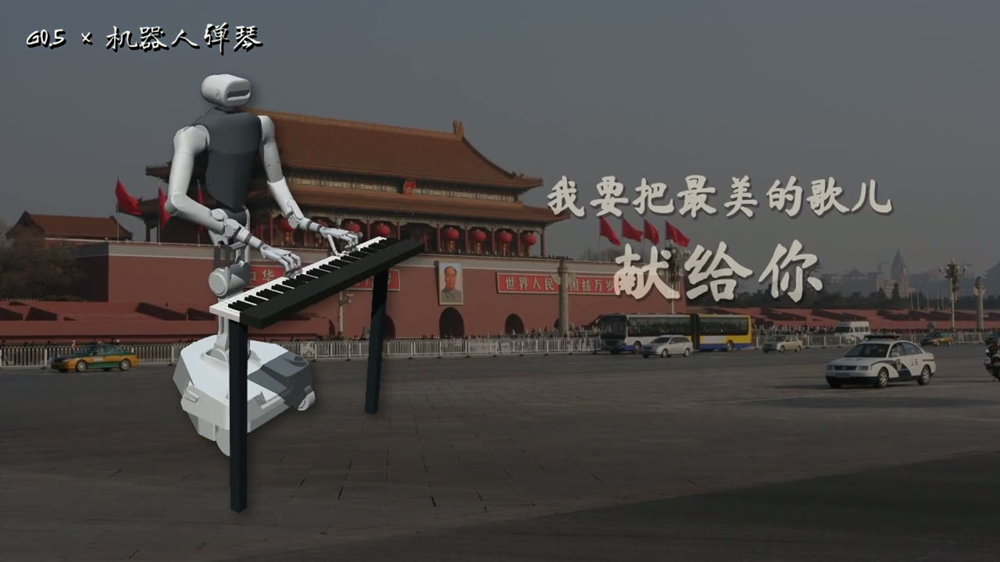
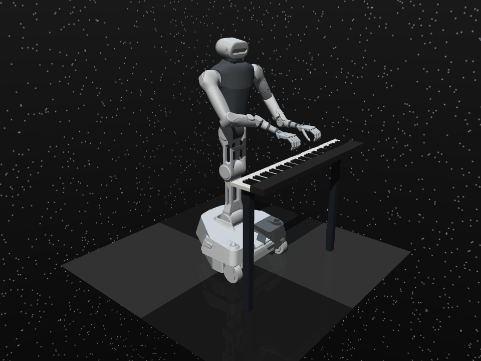

# G0.5 × двуручное фортепиано: перестановка инструмента, повторная постановка рук и продолжение игры

Робот играет музыкальную фразу, после чего фортепиано аккуратно отодвигают: робот поднимает руки, обновляет наблюдение, с помощью G0.5 и контроллера обратной кинематики (IK) заново находит позицию для игры и продолжает исполнение.

В этом разделе открыт код демонстрации: исполнение, вызовы модели, продолжение игры после перемещения инструмента и проверка результата. Робот — **Galaxea R1 Pro с двумя кистями Shadow Hand**, работает в симуляции MuJoCo / RoboPianist. Сначала запустите прилагаемое упражнение, а затем переходите к нотам, которые вы имеете право использовать.

## Видео исполнения

| Версия из музыкальной комнаты: «Я люблю тебя, Китай» | Продолжение игры после сдвига фортепиано |
| --- | --- |
| [](assets/piano-xiaohongshu.mp4) | [](assets/piano-relocation-performance.mp4) |
| Версия для соцсети, 34,6 секунды, 1080p | Ускоренная версия перемещения, 36 секунд, 1080p |

Нажмите на обложку, чтобы посмотреть видео со звуком. [Указание авторства материалов и записи сжатия](VIDEO_CREDITS.md)



[Смотреть открытое упражнение: продолжение после перемещения](assets/public-relocation-demo.mp4) · [Смотреть постановку на 6 сантиметров](assets/relocation-recovery.mp4) · [Инструкция по подключению G0.5](G05.md) · [Журнал запусков](REPRODUCTION.md) · [Ресурсы и лицензии](SOURCES.md)

## Что здесь даёт G0.5

**Подключение мультимодальной модели действий к навыку ловкой манипуляции с ясной целью.** G0.5 получает изображения с камеры головы и двух запястий, текущие углы суставов и текстовую инструкцию, а выдаёт предложение действий для двух рук. Контроллер фортепиано переводит это предложение в новую позицию игры и выполняет аппликатуру и ритм.

- **Перестройка действий после изменения сцены**: после перемещения фортепиано в модель подаётся текущее наблюдение, а не продолжается траектория рук, рассчитанная до сдвига.
- **Единый вход для языка, зрения и состояния тела**: один и тот же интерфейс модели подходит для подготовки к игре и для восстановления после перемещения, поэтому его легко расширять на другие инструкции.
- **Разделение труда между общей моделью и специализированным навыком**: модель формирует предложение для двух рук, IK обеспечивает геометрическое совпадение, а контроллер пальцев сохраняет аккорды и тайминг нажатий.
- **Повторное использование предобученной модели**: в этом процессе используется уже готовая контрольная точка G0.5, отдельная стратегия игры на фортепиано не обучалась.

В записанном непрерывном эксперименте фортепиано сдвигается по мировой оси Y на **4 сантиметра**. G0.5 делает **4 новых вывода по наблюдению** на этапе восстановления, а вместе с IK заново совмещает запястья с позицией игры, после чего исполнение продолжается. Здесь показан процесс адаптации всей комбинированной системы; целевое положение клавиатуры задаётся геометрией симуляции.

## Общая схема процесса

```text
нотная запись / план аппликатуры ──→ контроллер двуручной игры ──→ фактическое касание клавиш ──→ звук фортепиано
                         ↑
игра → поднять руки → сдвиг фортепиано → новое наблюдение → предложение G0.5 для двух рук + совмещение IK → опустить руки → продолжение
```

| Компонент | Роль | Точка входа в код |
| --- | --- | --- |
| G0.5 | По новому наблюдению формирует предложение действий для двух рук | g05_piano_worker.py |
| Постановка и передача | Ограничивает диапазон движения, совмещает запястья, переключает фазы игры | g05_recovery.py / g05_relocation_session.py |
| Двуручная игра | Аппликатура, нажатие и отпускание, аккорды, обратная связь от контакта | polyphonic_piano.py |
| Звук и проверка | Формирует события по фактическому состоянию клавиш, синтезирует тембр | audit_polyphonic_contacts.py |
| Astra (необязательно) | Организует контекст задачи, создаёт и проверяет структурированный план | piano_context.py |

## 1. Windows: сначала посмотреть воспроизведение всего робота

Нужны только Python 3.10 и MuJoCo; окружение модели устанавливать не обязательно. Откройте PowerShell в папке этой главы:

```powershell
py -3.10 -m venv .venv-replay
.\.venv-replay\Scripts\python.exe -m pip install mujoco==3.1.6 numpy==1.26.4
Expand-Archive -LiteralPath .\assets\galaxea-replay.zip -DestinationPath .\runs\galaxea-replay
.\.venv-replay\Scripts\python.exe replay_windows.py --run .\runs\galaxea-replay --viewer
```

Это прилагаемое воспроизведение траектории исполнителя для вводного примера «Twinkle Twinkle Little Star»; окно без звука. Программа заново выполняет последовательность управления через физическую симуляцию и создаёт `native_replay_report.json`. Для вывода модели по новому наблюдению переходите к следующему разделу.

## 2. Ubuntu: подготовка окружения симуляции

Рекомендуется запускать симуляцию и G0.5 на рабочей станции Linux, а результаты смотреть в Windows. Окружения Python устанавливайте отдельно, чтобы зависимости модели не перезаписали версии симулятора.

```bash
git clone https://github.com/datawhalechina/every-embodied.git
cd "every-embodied/06-manipulation-and-vla/large-model-control-vla-vlm/20-gpt6-astra-robot-playing-music-and-context-engineering"
export PIANO_ROOT="$PWD"

sudo apt-get update
sudo apt-get install -y ffmpeg libfluidsynth3 libegl1 libgl1
python3.10 -m venv "$HOME/.venvs/piano-sim"
export SIM_PY="$HOME/.venvs/piano-sim/bin/python"
"$SIM_PY" -m pip install -r requirements-sim.txt

export MUJOCO_GL=egl
export PYOPENGL_PLATFORM=egl
export OMP_NUM_THREADS=2
export OPENBLAS_NUM_THREADS=2
```

Тембры и ресурсы RoboPianist получаются по инструкции его установки. Если появляются ошибки `libEGL` или драйвера NVIDIA, сначала настройте рендеринг EGL на рабочей станции; на машине с рабочим столом можно использовать GLFW.

### Получение модели робота

```bash
git clone https://github.com/OpenGalaxea/GalaxeaManipSim.git "$HOME/GalaxeaManipSim"
git -C "$HOME/GalaxeaManipSim" checkout abe7f5161eeaa150e6eaffdf443af5df7f23f356
"$SIM_PY" prepare_galaxea.py --repo "$HOME/GalaxeaManipSim" --out runs/r1pro-model
```

Программа конвертации сохраняет лицензии ресурсов робота и создаёт `runs/r1pro-model/r1_pro.xml`. В симуляции в этой главе установлены две кисти Shadow Hand, основание зафиксировано, а компенсация гравитации идеальна.

### Генерация двуручного упражнения

Прилагаемый файл [relocation-exercise.json](relocation-exercise.json) содержит две музыкальные фразы, трёхзвучный аккорд левой руки, мелодию правой руки и паузу между фразами, которая используется для перемещения инструмента. Это распространяемое учебное упражнение и не зависит от MIDI какой-либо песни.

```bash
"$SIM_PY" polyphonic_piano.py \
  --model runs/r1pro-model --plan relocation-exercise.json \
  --out runs/public-physical --song-mode --fixed-torso --contact-surface \
  --little-abduction-limit 0.34 --hover-z 0.950 --pressed-z 0.912 \
  --song-staged-motion --song-active-priority --ik-max-step 0.08 \
  --max-hand-span 0.18 --video --video-fps 25
```

Результаты появляются в `runs/public-physical/`: `demo.mp4`, `measured.wav`, `trajectory.npz`, `source.plan.json`, `report.json`. Звук создаётся по фактически нажатым клавишам.

Программа включает строгую проверку нот: если выводится `Polyphonic performance failed`, сначала посмотрите `report.json`. В этом публичном упражнении полный прогон действительно выполнен, но есть пропущенная нота и отклонения в начале звуков, поэтому строгая музыкальная проверка не пройдена. Полученная полная траектория всё равно пригодна для проверки следующего шага — перемещения инструмента. Если окружение не загрузилось или выполнение остановилось раньше, и траектории нет, сначала исправьте соответствующую ошибку. [Подробные результаты](REPRODUCTION.md)

## 3. Подключение G0.5: продолжение игры после изменения положения инструмента

Подготовьте окружение модели по [G05.md](G05.md) и четыре переменные пути, затем запустите:

```bash
"$SIM_PY" g05_relocation_session.py \
  --reference runs/public-physical --out runs/public-relocation \
  --boundary 4.5 --piano-shift 0 -0.02 0 --model-weight 0.1 \
  --g05-python "$G05_PY" --g05-repo "$G05_REPO" \
  --g05-models "$G05_MODELS" --g05-checkpoint "$G05_CHECKPOINT" \
  --g05-config-mode checkpoint
```

Команда вставляет в паузу фразы последовательность «поднять руки → сдвинуть фортепиано на 2 сантиметра → заново наблюдать и корректировать → опустить руки → продолжить игру». Перемещение инструмента задаёт контроллер сцены, а предложение действий G0.5 получается новым выводом. Цикл управления не переписывает состояния суставов покадрово.

В публичном упражнении полный запуск занял 13,51 секунды, на этапе восстановления выполнено 4 новых вывода модели, максимальная ошибка положения запястья составила около 0,062 миллиметра; время опускания рук автоматически увеличилось до 1,19 секунды. [Отчёт этого запуска](assets/public-relocation-report.json)

Для повторного запуска используйте новый выходной каталог — тогда старые эксперименты не перезаписываются. Сначала проверьте `demo.mp4`, затем поля отчёта: `model_calls_during_session`, `recovery_final_error`, `playback_completed` и результат проверки нот.

## 4. Использование собственного произведения

1. Подготовьте MIDI или структурированные ноты, на которые у вас есть право, с правильной мелодией и метром.
2. Назначьте аппликатуру для обеих рук: сначала сохраняйте главную мелодию и ключевые аккорды, аккомпанемент подстраивайте под досягаемость.
3. Сначала сгенерируйте полное исполнение при фиксированном положении инструмента, затем задайте `--boundary` в паузе, где нет удерживаемых нот.
4. Подключите продолжение после перемещения и проверьте, как восстанавливается контакт с клавишами и непрерывность музыки.

Для обработки используйте `midi_score.py`, `bimanual_fingering.py`, `melody_review.py`; точки входа можно посмотреть через `--help`. Репозиторий содержит процесс и учебные упражнения, но не включает ноты или записи песен, которые использовались в рекламном видео.

## Дополнительное чтение

- [Установка G0.5, вызовы модели и объединение с управлением](G05.md)
- [Контекст Astra и генерация плана](ASTRA.md)
- [Записи эксперимента и поля результатов](REPRODUCTION.md)
- [Источники ресурсов, лицензии и описание каталога](SOURCES.md)

Точки входа `pianomime_runner.py` и `pianomime_galaxea.py` для PianoMime сохранены как будущие адаптеры стратегии и используют отдельный файл `requirements-pianomime.txt`; основной процесс аппликатуры и перемещения инструмента от их весов не зависит.
