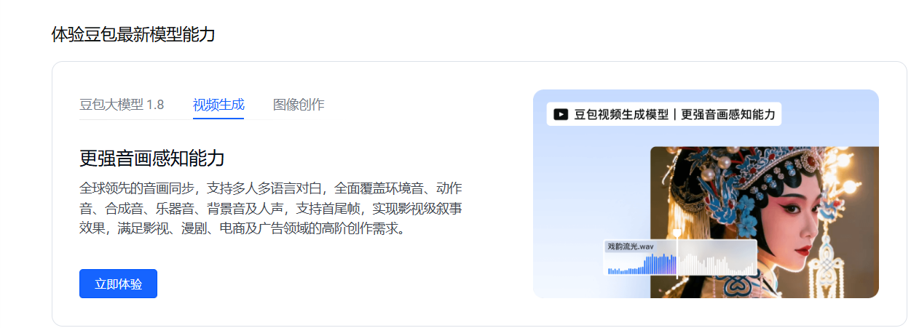

### Часть первая. Официальный основной канал: Volcano Engine (пока не открыт, ожидается запуск в марте)

#### 1. Регистрация и подтверждение личности

- Перейдите на [сайт Volcano Engine](https://www.volcengine.com/) → зарегистрируйте или войдите в аккаунт.
- Пройдите **верификацию личности** для физического или юридического лица (для компаний нужно загрузить подтверждающие документы).

#### 2. Подключите API Seedance и получите ключ

1. Откройте **консоль Volcano Engine** https://console.volcengine.com/home



2. Пока доступен только онлайн-режим тестирования.

# Часть вторая. Другие каналы

Можно зайти на https://seedanceapi.org/dashboard/api-keys

Пример вызова из Python:

```python
import requests
import time

API_KEY = "YOUR_API_KEY"
BASE_URL = "https://seedanceapi.org/v1"

# Генерация видео
response = requests.post(
    f"{BASE_URL}/generate",
    headers={
        "Authorization": f"Bearer {API_KEY}",
        "Content-Type": "application/json"
    },
    json={
        "prompt": "A cinematic shot of mountains at sunrise with flowing clouds",
        "aspect_ratio": "16:9",
        "resolution": "720p",
        "duration": "8"
    }
)

data = response.json()
task_id = data["data"]["task_id"]
print(f"Task created: {task_id}")

# Опрос статуса задачи
while True:
    status_response = requests.get(
        f"{BASE_URL}/status?task_id={task_id}",
        headers={"Authorization": f"Bearer {API_KEY}"}
    )
    status_data = status_response.json()["data"]

    if status_data["status"] == "SUCCESS":
        video_url = status_data["response"][0]
        print(f"Video URL: {video_url}")
        break
    elif status_data["status"] == "FAILED":
        print(f"Error: {status_data.get('error_message')}")
        break

    time.sleep(10)
```
