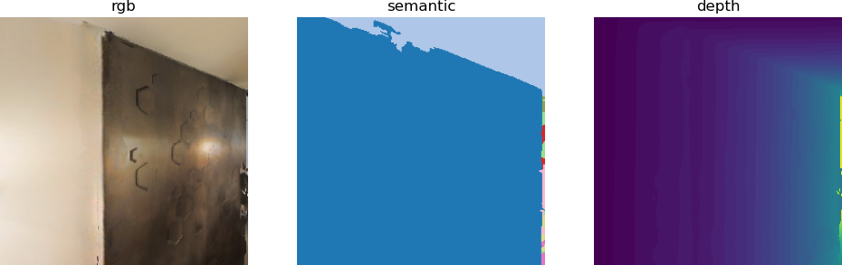

# Практика Habitat-Lab

### После знакомства с базовым окружением Habitat-Lab, конфигурацией YAML и базовыми тестами в этой главе цель — перейти от первых шагов к практической работе с Habitat-Lab версии 0.2.5 (сейчас это наиболее широко используемая стабильная версия): от полностью автоматического навигационного агента PointNav до агента с RL-фреймворком. (Далее навигация строится на большой языковой модели, а не на RL-алгоритме; RL-фреймворк используется только как среда. Некоторые проекты используют RL-фреймворк, но не обучают RL-агента, поэтому здесь также разбирается создание среды выполнения задачи через RLEnv.)

## 1. Полностью автоматическая навигация агента в Habitat-Lab

### В разделе «Установка и настройка Habitat-Lab» habitatlab_test.py позволяет управлять агентом с клавиатуры, выполняя задачу PointNav, и наблюдать состояние навигации в реальном времени. Однако при выполнении навигации агент обычно работает полностью автоматически, и это подготавливает почву для навигации с большой языковой моделью. Поэтому в этом разделе разбирается файл habitatlab_example.py: агент автоматически выполняет задачу PointNav и создаёт видео с богатой визуализацией.

Общая логика кода:

* Определяется класс ShortestPathFollowerAgent (реализует интерфейс Agent из Habitat); внутри он с помощью утилиты ShortestPathFollower автоматически вычисляет кратчайший путь до целевой точки и не требует вмешательства человека.
* Настроены измерения TopDownMap (вид сверху), Collisions (обнаружение столкновений) и другие, которые визуализируют путь агента, целевую точку, поле зрения (FogOfWar) и другие ключевые сведения.
* Для каждого шага RGB-D наблюдение, вид сверху и количественные метрики (например, расстояние до цели и число столкновений) склеиваются в кадр; в итоге создаётся видеофайл, который сохраняется и показывается.

Способ взаимодействия: полностью автоматический. После запуска кода навигация и создание видео выполняются без участия человека.

Результат: видео навигации сохраняется по указанному пути; в нём присутствуют визуальные наблюдения, вид сверху и наложенные количественные метрики.

### Подробное описание кода

habitatlab_example.py использует тот же YAML-файл, что и habitatlab_test.py, — по-прежнему pointnav_habitat_test.yaml. Если у вас остались вопросы по YAML-файлу, см. предыдущую главу: «Установка и настройка Habitat-Lab».

Главное отличие от habitatlab_test.py в том, что habitatlab_example.py использует ShortestPathFollowerAgent.

```python
class ShortestPathFollowerAgent(Agent):
    r"""Implementation of the :ref:`habitat.core.agent.Agent` interface that
    uses :ref`habitat.tasks.nav.shortest_path_follower.ShortestPathFollower` utility class
    for extracting the action on the shortest path to the goal.
    """

    def __init__(self, env: habitat.Env, goal_radius: float):
        self.env = env
        self.shortest_path_follower = ShortestPathFollower(
            sim=cast("HabitatSim", env.sim),
            goal_radius=goal_radius,
            return_one_hot=False,
        )

    def act(self, observations: "Observations") -> Union[int, np.ndarray]:
        return self.shortest_path_follower.get_next_action(
            cast(NavigationEpisode, self.env.current_episode).goals[0].position
        )

    def reset(self) -> None:
        pass
```

При инициализации класс принимает объект окружения habitat.Env и радиус цели goal_radius и создаёт экземпляр ShortestPathFollower. Метод act — основа интерфейса Agent: он берёт позицию цели из текущего эпизода и вызывает метод get_next_action у ShortestPathFollower, чтобы выбрать следующее действие.

Важнее всего ShortestPathFollower. Он находится в библиотеке habitat_lab по пути habitat-lab/habitat/tasks/nav/shortest_path_follower.py. Это не самостоятельный агент, а основная зависимость для реализации кратчайшего пути: он инкапсулирует низкоуровневую логику планирования. Далее разберём ShortestPathFollower.

В ShortestPathFollower.get_next_action участвуют два компонента: _build_follower и _get_return_value.

* _build_follower

```python
def _build_follower(self):
    if self._current_scene != self._sim.habitat_config.scene:
        self._follower = self._sim.make_greedy_follower(
            0,
            self._goal_radius,
            stop_key=HabitatSimActions.stop,
            forward_key=HabitatSimActions.move_forward,
            left_key=HabitatSimActions.turn_left,
            right_key=HabitatSimActions.turn_right,
        )
        self._current_scene = self._sim.habitat_config.scene
```

_build_follower инициализирует или пересоздаёт низкоуровневый планировщик пути по текущей сцене, чтобы планирование соответствовало сцене. Он вызывает `sim.make_greedy_follower`, который создаёт экземпляр `GreedyGeodesicFollower`, связывает сопоставление действий (вперёд, поворот влево, поворот вправо, остановка) и радиус цели.

* _get_return_value

```python
def _get_return_value(self, action) -> Union[int, np.ndarray]:
    if self._return_one_hot:
        return action_to_one_hot(action)
    else:
        return action
```

Этот метод преобразует формат действия в зависимости от параметра return_one_hot и подходит для разных сценариев использования. В данной задаче параметр установлен в False, поэтому фактически он не используется.

**В итоге в habitatlab_example.py вызов shortest_path_follower.get_next_action из ShortestPathFollowerAgent выглядит так:**

```python
def get_next_action(
    self, goal_pos: Union[List[float], np.ndarray]
) -> Optional[Union[int, np.ndarray]]:
    """Returns the next action along the shortest path."""
    self._build_follower()
    assert self._follower is not None
    try:
        next_action = self._follower.next_action_along(goal_pos)
    except habitat_sim.errors.GreedyFollowerError as e:
        if self._stop_on_error:
            next_action = HabitatSimActions.stop
        else:
            raise e

    return self._get_return_value(next_action)
```

Ход вызова и логика по шагам:

1) Адаптация к сцене: сначала вызывается `_build_follower`, чтобы планировщик соответствовал текущей сцене.

2) Вызов планирования пути: `_follower.next_action_along(goal_pos)` вычисляет действие. Низкоуровневый `GreedyGeodesicFollower` использует геометрию сцены симулятора, находит геодезически кратчайший путь от текущей позы агента до цели и возвращает первое действие на этом пути.

3) Обработка исключений: ошибка планирования перехватывается; в зависимости от стратегии `stop_on_error` возвращается действие остановки или ошибка передаётся дальше.

4) Преобразование формата действия: `_get_return_value` приводит действие к нужному формату и возвращает его вызывающему коду.

Остальной код относится к визуализации. Итоговый результат выглядит так:


На самом деле создаётся видео. Путь для вывода задан в коде строкой `output_path = "examples/tutorials/habitat_lab_visualization/"`; при необходимости его можно изменить.

## 2. Полностью автоматическая навигация агента на основе фреймворка RLEnv в Habitat-Lab

### Согласно habitat_rl.py, код в итоге решает ту же задачу, что и habitat_example.py, но использует habitat.RLEnv (класс-обёртку среды обучения с подкреплением): исходное окружение оборачивается в интерфейс RL-фреймворка.

```python
class SimpleRLEnv(habitat.RLEnv):
    def get_reward_range(self):
        return [-1, 1]

    def get_reward(self, observations):
        return 0

    def get_done(self, observations):
        return self.habitat_env.episode_over

    def get_info(self, observations):
        return self.habitat_env.get_metrics()
```

Кроме того, в RLEnv можно не использовать обёртку Agent, а прямо в цикле создать экземпляр ShortestPathFollower и вручную вызвать get_next_action(). Полученное действие передаётся в env для выполнения.

```python
while not env.habitat_env.episode_over:
    best_action = follower.get_next_action(
        env.habitat_env.current_episode.goals[0].position
    )
    if best_action is None:
        break

    observations, reward, done, info = env.step(best_action)
```

Итоговая визуализация совпадает с habitatlab_example.py. (Некоторые элементы визуализации отличаются; при необходимости их можно добавить самостоятельно.)




Ссылка для справки:

https://github.com/facebookresearch/habitat-lab
