# Практика Habitat-Sim

### В этой главе цель — пройти путь от первых шагов с Habitat-Sim до самостоятельной работы с ним. Используется версия Habitat-Sim 0.2.5 (сейчас самая широко применяемая стабильная версия). Изложение строится не на отвлечённой теории, а от практических задач: каждый шаг соответствует типичной потребности разработчика — например, как быстро загрузить сцену Matterport3D или как настроить RGB-D-датчики. Это закладывает основу для последующей реализации более сложных алгоритмов навигации.

## 1. Hello World в Habitat-Sim

### 1. Загрузка примера сцены MP3D

```python
conda activate habitat
```

```python
python -m habitat_sim.utils.datasets_download --uids mp3d_example_scene --data-path data/
```

### 2. Проверка базовых функций Habitat-Sim

Запустите файл habitat_test.py:

```python
python habitat_test.py
```

<div style="display: flex; justify-content: space-between;">
  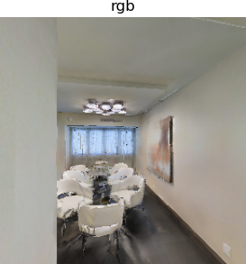
  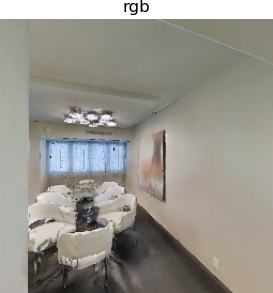
</div>

<div style="display: flex; justify-content: space-between;">
  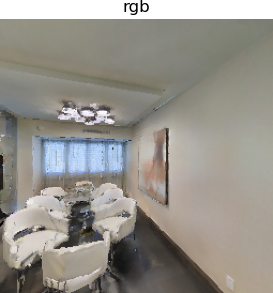
  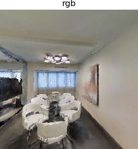
</div>

### 3. Разбор кода

Сначала настраивается окружение. Основная функция — make_simple_cfg(); она задаёт конфигурацию среды и датчиков робота. Переменная test_scene — путь к данным сцены на вашем компьютере.

```python
test_scene = "./data/scene_datasets/mp3d_example/17DRP5sb8fy/17DRP5sb8fy.glb"
sim_settings = {
    "scene": test_scene,
    "default_agent": 0,
    "sensor_height": 1.5,
    "width": 256,
    "height": 256,
}

def make_simple_cfg(settings):
    sim_cfg = habitat_sim.SimulatorConfiguration()
    sim_cfg.scene_id = settings["scene"]


    agent_cfg = habitat_sim.agent.AgentConfiguration()
    rgb_sensor_spec = habitat_sim.CameraSensorSpec()
    rgb_sensor_spec.uuid = "color_sensor"
    rgb_sensor_spec.sensor_type = habitat_sim.SensorType.COLOR
    rgb_sensor_spec.resolution = [settings["height"], settings["width"]]
    rgb_sensor_spec.position = habitat_sim.geo.UP * settings["sensor_height"]
    rgb_sensor_spec.position = [0.0, settings["sensor_height"], 0.0]

    agent_cfg.sensor_specifications = [rgb_sensor_spec]

    return habitat_sim.Configuration(sim_cfg, [agent_cfg])
```

Затем инициализируется агент, задаётся его начальное состояние и выводится состояние робота.

```python
agent = sim.initialize_agent(sim_settings["default_agent"])

agent_state = habitat_sim.AgentState()
agent_state.position = np.array([-0.6, 0.0, 0.0])
agent.set_state(agent_state)

agent_state = agent.get_state()
print("agent_state: position", agent_state.position, "rotation", agent_state.rotation)

action_names = list(cfg.agents[sim_settings["default_agent"]].action_space.keys())
print("Discrete action space: ", action_names)
```

Определяется функция движения робота navigateAndSee(), которая выполняет действие. Если установить display в True, изображение после каждого действия сохраняется.

```python
def navigateAndSee(action=""):
    if action in action_names:
        observations = sim.step(action)
        print("action: ", action)
        if display:
            display_sample(observations["color_sensor"])


action = "turn_right"
navigateAndSee(action)

action = "turn_right"
navigateAndSee(action)

action = "move_forward"
navigateAndSee(action)

action = "turn_left"
navigateAndSee(action)
```

Ниже показана функция отображения display_sample(), которая сохраняет изображение робота после каждого шага.

```python
def display_sample(rgb_obs, semantic_obs=np.array([]), depth_obs=np.array([])):
    from habitat_sim.utils.common import d3_40_colors_rgb

    rgb_img = Image.fromarray(rgb_obs, mode="RGBA")
    global img_counter

    arr = [rgb_img]
    titles = ["rgb"]
    if semantic_obs.size != 0:
        semantic_img = Image.new("P", (semantic_obs.shape[1], semantic_obs.shape[0]))
        semantic_img.putpalette(d3_40_colors_rgb.flatten())
        semantic_img.putdata((semantic_obs.flatten() % 40).astype(np.uint8))
        semantic_img = semantic_img.convert("RGBA")
        arr.append(semantic_img)
        titles.append("semantic")

    if depth_obs.size != 0:
        depth_img = Image.fromarray((depth_obs / 10 * 255).astype(np.uint8), mode="L")
        arr.append(depth_img)
        titles.append("depth")

    plt.figure(figsize=(12, 8))
    for i, data in enumerate(arr):
        ax = plt.subplot(1, 3, i + 1)
        ax.axis("off")
        ax.set_title(titles[i])
        plt.imshow(data)

    image_name = f"observation_{img_counter}.png"
    plt.savefig(image_name, bbox_inches='tight', pad_inches=0)
    img_counter +=1

    plt.show(block=False)
    plt.pause(3)  # показывать 3 секунды (можно изменить)
    plt.close()
```

## 2. Расширенная настройка Habitat-Sim (см. файл habitat_random.py)

### 1. Настройка датчиков

В Hello World мы использовали Color Sensor — RGB-датчик цвета. Часто применяются также Depth Sensor (датчик глубины) и Semantic Sensor (семантический датчик).

1) Color Sensor (RGB-датчик цвета)

Имитирует человеческое зрение или обычную RGB-камеру: захватывает цвет, текстуру и внешний вид сцены. Это самый базовый визуальный датчик; в коде ему соответствует habitat_sim.SensorType.COLOR.

Ключевой фрагмент настройки:

```python
color_sensor_spec = habitat_sim.CameraSensorSpec()
color_sensor_spec.uuid = "color_sensor"
color_sensor_spec.sensor_type = habitat_sim.SensorType.COLOR
color_sensor_spec.resolution = [settings["height"], settings["width"]]
color_sensor_spec.position = [0.0, settings["sensor_height"], 0.0]
color_sensor_spec.sensor_subtype = habitat_sim.SensorSubType.PINHOLE
sensor_specs.append(color_sensor_spec)
```

Формат вывода:

* Тип данных: uint8 (0–255), массив из 4 каналов (RGBA, где A — прозрачность, обычно 255);
* Форма: [height, width, 4] (например, 256×256×4);
* Смысл значений: красная, зелёная, синяя составляющие и прозрачность каждого пикселя (например, (255,0,0,255) — чистый красный).

Основное назначение: дать наглядные визуальные признаки сцены — внешний вид объектов, расположение, различия в текстурах.

2) Depth Sensor (датчик глубины)

Имитирует реальную глубинную камеру: для каждого пикселя измеряет физическое расстояние (в метрах), отражая трёхмерную структуру сцены. В коде ему соответствует habitat_sim.SensorType.DEPTH.

Ключевой фрагмент настройки:

```python
depth_sensor_spec = habitat_sim.CameraSensorSpec()
depth_sensor_spec.uuid = "depth_sensor"
depth_sensor_spec.sensor_type = habitat_sim.SensorType.DEPTH
depth_sensor_spec.resolution = [settings["height"], settings["width"]]
depth_sensor_spec.position = [0.0, settings["sensor_height"], 0.0]
depth_sensor_spec.sensor_subtype = habitat_sim.SensorSubType.PINHOLE
sensor_specs.append(depth_sensor_spec)
```

Формат вывода:

* Тип данных: float32 (вещественный), одноканальный массив;
* Форма: [height, width] (например, 256×256);
* Смысл значений: прямое расстояние от точки сцены, соответствующей пикселю, до камеры (в метрах). Например, 0.5 означает, что точка находится в 0,5 метра от камеры, 5.0 — в 5 метрах.

Основное назначение: добавить трёхмерную информацию, которой не хватает RGB-изображению (оно даёт только двумерный внешний вид), и восстановить геометрию сцены; значение глубины вместе с внутренними параметрами камеры позволяет перевести координаты пикселя в реальные трёхмерные координаты.

3) Semantic Sensor (семантический датчик)

Имитирует семантическую камеру: для каждого пикселя выдаёт идентификатор семантического класса объекта (привязанный к объекту трёхмерной сцены), то есть показывает, какому объекту или категории принадлежит пиксель. В коде ему соответствует habitat_sim.SensorType.SEMANTIC.

Ключевой фрагмент настройки:

```python
semantic_sensor_spec = habitat_sim.CameraSensorSpec()
semantic_sensor_spec.uuid = "semantic_sensor"
semantic_sensor_spec.sensor_type = habitat_sim.SensorType.SEMANTIC
semantic_sensor_spec.resolution = [settings["height"], settings["width"]]
semantic_sensor_spec.position = [0.0, settings["sensor_height"], 0.0]
semantic_sensor_spec.sensor_subtype = habitat_sim.SensorSubType.PINHOLE
sensor_specs.append(semantic_sensor_spec)
```

Формат вывода:

* Тип данных: uint32/int32, одноканальный массив;
* Форма: [height, width] (например, 256×256);
* Смысл значений: идентификатор семантического класса объекта для каждого пикселя (например, 1 — стена, 5 — кровать, 8 — стол); чтобы получить читаемое название категории, нужен JSON-файл конфигурации (mp3d.scene_dataset_config.json). **(Этот файл mp3d.scene_dataset_config.json будет разобран позже.)**

Основное назначение: высокоуровневое понимание сцены — от числовых значений пикселей к категориям объектов, то есть распознавание, какой пиксель относится к стене, а какой — к кровати; а также подсчёт распределения объектов в сцене (например, в спальне одна кровать и два стула).

В файле habitat_random.py для краткости и удобства изменения код этих датчиков объединён в такой формат. Функциональность при этом та же:

```python
sensors = {
    "color_sensor": {
        "sensor_type": habitat_sim.SensorType.COLOR,
        "resolution": [settings["height"], settings["width"]],
        "position": [0.0, settings["sensor_height"], 0.0],
    },
    "depth_sensor": {
        "sensor_type": habitat_sim.SensorType.DEPTH,
        "resolution": [settings["height"], settings["width"]],
        "position": [0.0, settings["sensor_height"], 0.0],
    },
    "semantic_sensor": {
        "sensor_type": habitat_sim.SensorType.SEMANTIC,
        "resolution": [settings["height"], settings["width"]],
        "position": [0.0, settings["sensor_height"], 0.0],
    },
}

sensor_specs = []
for sensor_uuid, sensor_params in sensors.items():
    if settings[sensor_uuid]:
        sensor_spec = habitat_sim.CameraSensorSpec()
        sensor_spec.uuid = sensor_uuid
        sensor_spec.sensor_type = sensor_params["sensor_type"]
        sensor_spec.resolution = sensor_params["resolution"]
        sensor_spec.position = sensor_params["position"]

        sensor_specs.append(sensor_spec)
```

### 2. Настройка действий

В файле habitat_test.py мы не задавали пространство действий робота, но AgentConfiguration() загружает действия по умолчанию. Если нужно изменить длину шага вперёд и угол поворота, пространство действий задаётся вручную:

```python
agent_cfg = habitat_sim.agent.AgentConfiguration()
agent_cfg.sensor_specifications = sensor_specs
agent_cfg.action_space = {
    "move_forward": habitat_sim.agent.ActionSpec(
        "move_forward", habitat_sim.agent.ActuationSpec(amount=0.25)
    ),
    "turn_left": habitat_sim.agent.ActionSpec(
        "turn_left", habitat_sim.agent.ActuationSpec(amount=30.0)
    ),
    "turn_right": habitat_sim.agent.ActionSpec(
        "turn_right", habitat_sim.agent.ActuationSpec(amount=30.0)
    ),
}
```

### 3. Результаты запуска кода и разбор JSON-файла

Запустите habitat_random.py:

```python
python habitat_random.py
```

После запуска получится такой результат:

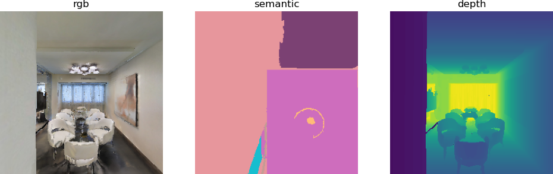
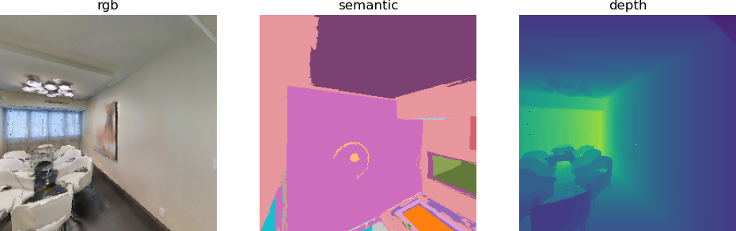
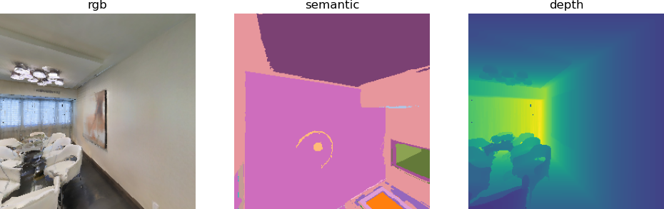
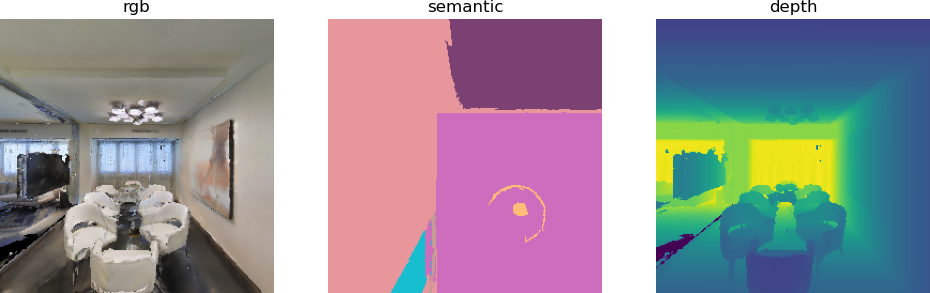
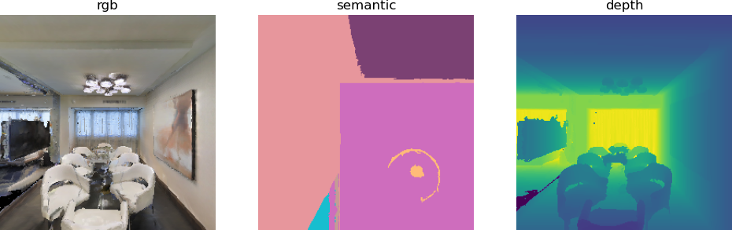

Видно, что RGB-изображение и изображение глубины выводятся нормально, а семантическое изображение — нет. Главная причина в том, что не загружен файл mp3d.scene_dataset_config.json. Этот файл задаёт соответствие значений пикселей категориям объектов и позволяет загрузить сетку карты mesh. (Про mesh-карту см. раздел о navmesh в habitat_sim.)

Чтобы загрузить файл mp3d.scene_dataset_config.json в habitat_random.py, раскомментируйте эти две строки:

```python
# mp3d_scene_dataset = "./data/scene_datasets/mp3d_example/mp3d.scene_dataset_config.json"

# "scene_dataset": mp3d_scene_dataset,

# sim_cfg.scene_dataset_config_file = settings["scene_dataset"]
```

После раскомментирования код выглядит так:

```python
test_scene = "./data/scene_datasets/mp3d_example/17DRP5sb8fy/17DRP5sb8fy.glb"
mp3d_scene_dataset = "./data/scene_datasets/mp3d_example/mp3d.scene_dataset_config.json"

rgb_sensor = True  # @param {type:"boolean"}
depth_sensor = True  # @param {type:"boolean"}
semantic_sensor = True  # @param {type:"boolean"}

sim_settings = {
    "width": 256,  # Spatial resolution of the observations
    "height": 256,
    "scene": test_scene,  # Scene path
    "scene_dataset": mp3d_scene_dataset,
    "default_agent": 0,
    "sensor_height": 1.5,  # Height of sensors in meters
    "color_sensor": rgb_sensor,  # RGB sensor
    "depth_sensor": depth_sensor,  # Depth sensor
    "semantic_sensor": semantic_sensor,  # Semantic sensor
    "seed": 1,  # used in the random navigation
    "enable_physics": False,  # kinematics only
}
```

Теперь получаем такой результат:

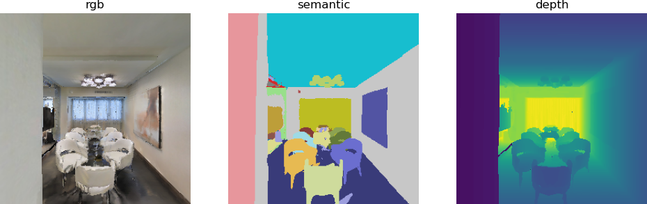
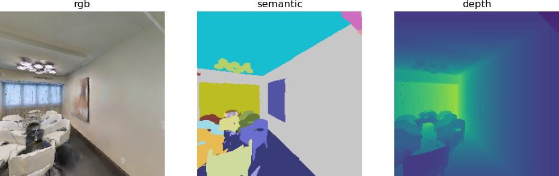
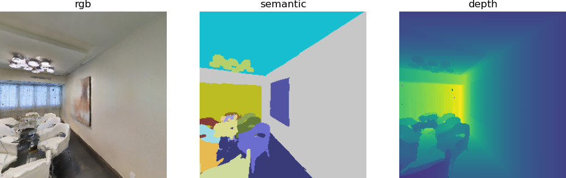
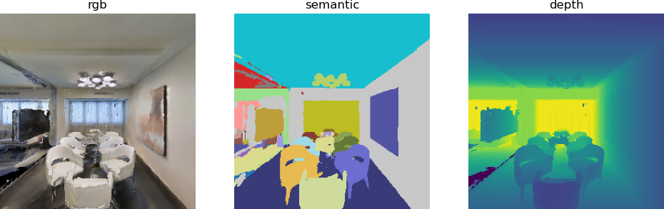
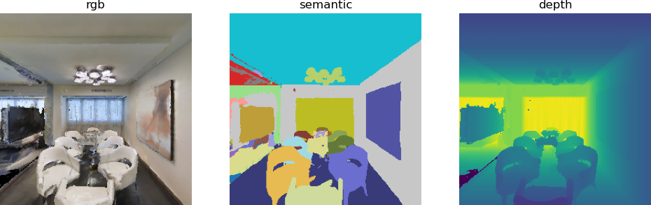

Видно, что семантическое изображение теперь отображается корректно.

## 3. NavMesh в Habitat-Sim

### 1. Введение в NavMesh

NavMesh (Navigation Mesh, навигационная сетка) — основное пространственное представление для навигации и планирования движения в Habitat-Sim. По сути это многоугольная сетка, покрывающая проходимые агентом области сцены; на ней основаны перемещение агента, поиск путей и избегание столкновений.

Основные функции:

* Определение проходимых областей: отмечаются места, где агент может ходить (пол, коридоры), а препятствия (стены, мебель, зависшие области и т. п.) исключаются.
* Основа планирования путей: PathFinder в Habitat быстро вычисляет оптимальный проходимый путь между двумя точками на основе NavMesh.
* Проверка допустимости движения: при движении и повороте агента NavMesh проверяет, проходима ли целевая позиция, чтобы не проходить сквозь стены и не застревать в препятствиях.
* Понижение размерности пространства: сложная трёхмерная геометрия сцены упрощается до двумерной навигационной сетки, что существенно снижает вычислительную сложность планирования движения.

### 2. Разбор кода habitat_mesh.py

habitat_mesh.py в основном генерирует NavMesh и визуализирует вид сверху на сцену.

Начальная часть — инициализация симуляции и робота — совпадает с кодом habitat_random.py из этой главы. Отличаются две вещи.

Первая — вид сверху, полученный через API Habitat-Sim:

```python
sim_topdown_map = sim.pathfinder.get_topdown_view(meters_per_pixel, height)
```

Вторая — вид сверху, полученный функцией get_topdown_map:

```python
def get_topdown_map(pathfinder, height, meters_per_pixel) -> np.ndarray:
    # Получаем границы навигации сцены (оси x и z; ось y, высоту, игнорируем)
    bounds = pathfinder.get_bounds()
    min_x, _, min_z = bounds[0]
    max_x, _, max_z = bounds[1]

    # Вычисляем размер карты в пикселях (x — ширина, z — высота)
    map_width = int(np.ceil((max_x - min_x) / meters_per_pixel))
    map_height = int(np.ceil((max_z - min_z) / meters_per_pixel))

    # Инициализируем карту: 0 = не проходимо, 1 = проходимо
    topdown_map = np.zeros((map_height, map_width), dtype=np.uint8)

    # Проверяем каждый пиксель на проходимость (оптимизация: векторные операции вместо двойного цикла)
    x_coords = np.linspace(min_x, max_x, map_width, endpoint=False)
    z_coords = np.linspace(min_z, max_z, map_height, endpoint=False)
    x_grid, z_grid = np.meshgrid(x_coords, z_coords)
    # Строим массив координат (x, height, z)
    world_coords = np.stack([x_grid.ravel(), np.full_like(x_grid.ravel(), height), z_grid.ravel()], axis=1)
    # Пакетно проверяем проходимость
    navigable = np.array([pathfinder.is_navigable(coord) for coord in world_coords])
    # Приводим к размеру карты
    topdown_map = navigable.reshape((map_height, map_width)).astype(np.uint8)

    # Вычисляем границы (необязательно; для совместимости со старой двузначной версией)
    edges = ndimage.laplace(topdown_map) != 0
    topdown_map[edges] = 2

    return topdown_map
```

Функция get_topdown_view() возвращает массив из значений 0/1/2 с отмеченными границами; для раскраски используется перекодировка цветов: 0 → белый (не проходимо), 1 → серый (проходимо), 2 → чёрный (граница).

```python
hablab_topdown_map = get_topdown_map(
    sim.pathfinder, height, meters_per_pixel=meters_per_pixel
)
recolor_map = np.array(
    [[255, 255, 255], [128, 128, 128], [0, 0, 0]], dtype=np.uint8
)
hablab_topdown_map = recolor_map[hablab_topdown_map]
```

Пользовательскую функцию get_topdown_view() тоже можно использовать напрямую. Однако для карт здесь нужен Habitat-Lab. Если вы хотите пройти всё руководство только средствами habitat_sim, используйте приведённую выше пользовательскую функцию: результат будет тем же.

```python
from habitat.utils.visualizations import maps
hablab_topdown_map = maps.get_topdown_map(
    sim.pathfinder, height, meters_per_pixel=meters_per_pixel
)
```

Итоговые изображения mesh-карты:

1) Вид сверху, полученный через sim.pathfinder.get_topdown_view:

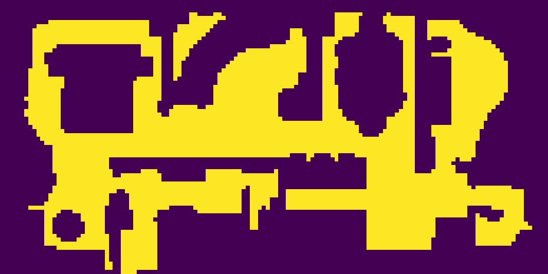

2) Вид сверху, полученный через get_topdown_map:

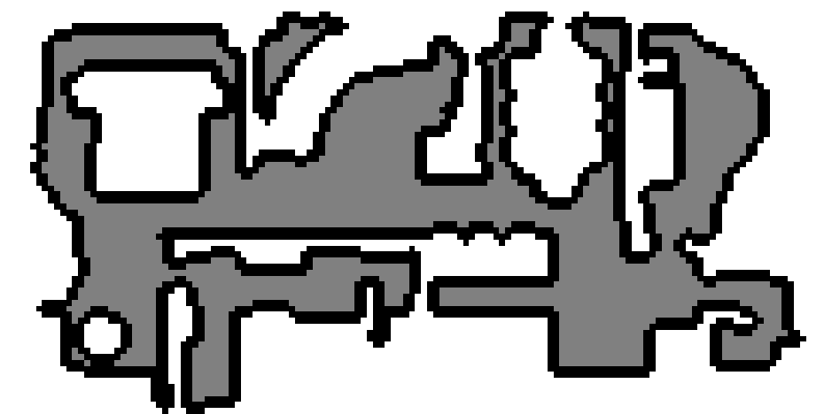

### 3. Разбор кода habitat_pathfind.py

habitat_pathfind.py дополняет генерацию вида сверху из habitat_mesh.py тремя основными функциями: поиск кратчайшего пути в сцене, визуализация пути и агента, а также рендеринг наблюдений в точках пути. Так получается полный цикл — от построения карты сцены до планирования и визуализации навигационного пути.

Повторно используются функции make_cfg, get_topdown_map и display_map из habitat_mesh.py. Добавлены новые функции для преобразования координат пути, отрисовки и рендеринга датчиков:

1) Функция to_grid: перевод мировых координат в координаты пикселей карты

Функция заменяет maps.to_grid из Habitat-Lab и решает задачу отображения трёхмерных мировых координат на двумерные пиксельные координаты карты; без неё нельзя нарисовать путь.

Описание параметров:

* z: значение z мировой координаты (path_point[2]);
* x: значение x мировой координаты (path_point[0]);
* grid_dimensions: размеры карты (height, width) (соответствуют top_down_map.shape[0], shape[1]);
* pathfinder: экземпляр sim.pathfinder.

```python
def to_grid(z, x, grid_dimensions, pathfinder):
    # Получаем границы навигационной сетки (min_x, _, min_z) и (max_x, _, max_z)
    min_bounds = pathfinder.get_bounds()[0]
    max_bounds = pathfinder.get_bounds()[1]
    min_x, _, min_z = min_bounds
    max_x, _, max_z = max_bounds

    # Нормируем x в [0, grid_width-1] и z в [0, grid_height-1]
    grid_height, grid_width = grid_dimensions
    px = (x - min_x) / (max_x - min_x) * (grid_width - 1)
    py = (z - min_z) / (max_z - min_z) * (grid_height - 1)

    # Ограничиваем координаты пределами карты, чтобы не выйти за границы
    px = np.clip(px, 0, grid_width - 1)
    py = np.clip(py, 0, grid_height - 1)

    # Переводим в целые пиксельные координаты
    return int(round(py)), int(round(px))
```

2) Функция draw_path: рисование линии пути на виде сверху

Функция заменяет maps.draw_path из Habitat-Lab; она рисует красную линию пути на RGB-версии карты, наглядно показывая кратчайший путь.

Описание параметров:

* top_down_map: RGB-массив карты (np.ndarray, shape=(H, W, 3));
* trajectory: список координат сетки; каждый элемент — (py, px), то есть (строка, столбец);
* color: цвет пути, по умолчанию красный (255,0,0);
* thickness: толщина линии, по умолчанию 2 пикселя.

```python
def draw_path(top_down_map, trajectory, color=(255, 0, 0), thickness=2):
    # Преобразуем в PIL Image для рисования линий (можно и через OpenCV)
    img = Image.fromarray(top_down_map)
    draw = ImageDraw.Draw(img)

    # Проходим по точкам траектории и рисуем отрезки
    for i in range(len(trajectory) - 1):
        # В PIL координаты записываются как (x, y), что соответствует (px, py) сетки
        start = (trajectory[i][1], trajectory[i][0])
        end = (trajectory[i+1][1], trajectory[i+1][0])
        draw.line([start, end], fill=color, width=thickness)

    # Возвращаем результат в numpy-массив
    top_down_map[:] = np.array(img)
```

3) Функция draw_agent: рисование агента на виде сверху

Функция заменяет maps.draw_agent из Habitat-Lab; она отмечает положение агента и направление его взгляда на карте, показывая начальное состояние навигации.

Описание параметров:

* top_down_map: RGB-массив карты (np.ndarray, shape=(H, W, 3));
* agent_pos: координаты агента в сетке (py, px), то есть (строка, столбец);
* angle: угол направления агента (в радианах);
* agent_radius_px: радиус круга агента, по умолчанию 8 пикселей;
* agent_color: цвет круга агента, по умолчанию зелёный (0,255,0);
* arrow_color: цвет стрелки направления, по умолчанию синий (0,0,255).

```python
def draw_agent(top_down_map, agent_pos, angle, agent_radius_px=8, agent_color=(0, 255, 0), arrow_color=(0, 0, 255)):
    # Преобразуем в PIL Image для рисования
    img = Image.fromarray(top_down_map)
    draw = ImageDraw.Draw(img)
    py, px = agent_pos  # координаты сетки (строка, столбец)
    x, y = px, py  # координаты PIL (x — столбец, y — строка)

    # 1. Рисуем круглое тело агента
    # Для эллипса в PIL нужны координаты левого верхнего и правого нижнего углов
    bbox = (x - agent_radius_px, y - agent_radius_px, x + agent_radius_px, y + agent_radius_px)
    draw.ellipse(bbox, fill=agent_color, outline=(0, 0, 0), width=1)

    # 2. Рисуем стрелку направления (конец стрелки вычисляем по углу)
    arrow_length = agent_radius_px * 1.5
    # Переход к углам: угол atan2 отсчитывается от оси x против часовой стрелки; здесь подстраиваем под ориентацию карты
    end_x = x + arrow_length * math.cos(angle)
    end_y = y + arrow_length * math.sin(angle)
    draw.line([(x, y), (end_x, end_y)], fill=arrow_color, width=2)

    # Возвращаем результат в numpy-массив
    top_down_map[:] = np.array(img)
```

Аналогично функции get_topdown_map из habitat_mesh.py функции to_grid, draw_path и draw_agent из habitat_pathfind.py можно заменить на maps.to_grid, maps.draw_path и maps.draw_agent.

**Описание основной логики**

Основная часть программы использует API поиска пути Habitat-Sim. Помимо пояснений в тексте, в коде есть подробные комментарии.

Шаг 1: инициализация симуляции (повторное использование логики)

habitat_pathfind.py совпадает с habitat_mesh.py: через make_cfg настраиваются сцена, датчики и пространство действий агента, затем создаётся экземпляр Simulator.

Шаг 2: генерация случайных проходимых точек и поиск кратчайшего пути (ключевой шаг)

```python
seed = 4
sim.pathfinder.seed(seed)
# Генерируем две случайные проходимые точки (места, по которым можно ходить в сцене)
sample1 = sim.pathfinder.get_random_navigable_point()
sample2 = sim.pathfinder.get_random_navigable_point()

# Создаём объект кратчайшего пути
path = habitat_sim.ShortestPath()
path.requested_start = sample1  # начало пути
path.requested_end = sample2    # конец пути
# Ищем кратчайший путь
found_path = sim.pathfinder.find_path(path)
# Получаем сведения о пути: геодезическое расстояние (реальное расстояние по поверхности) и список точек
geodesic_distance = path.geodesic_distance
path_points = path.points
```

Пояснения к ключевым функциям:

* get_random_navigable_point(): случайно выбирает проходимую трёхмерную точку из NavMesh сцены;
* ShortestPath: класс кратчайшего пути в Habitat-Sim; требует указать начало и конец;
* find_path(): выполняет поиск пути и возвращает логическое значение — найден ли корректный путь;
* geodesic_distance: реальное расстояние вдоль поверхности, по которой идёт путь (в метрах);
* path.points: список трёхмерных координат пути (все точки от начала до конца по порядку).

Шаг 3: визуализация пути (рисование пути и агента на виде сверху)

```python
if found_path:
    meters_per_pixel = 0.025  # более высокое разрешение (0.025 м на пиксель)
    # Получаем минимальную высоту сцены (соответствует высоте NavMesh)
    scene_bb = sim.get_active_scene_graph().get_root_node().cumulative_bb
    height = scene_bb.y().min
    # Строим вид сверху с границами (используем get_topdown_map)
    top_down_map = get_topdown_map(sim.pathfinder, height, meters_per_pixel)
    # Перекодировка цветов (0 → белый, 1 → серый, 2 → чёрный)
    recolor_map = np.array([[255,255,255],[128,128,128],[0,0,0]], dtype=np.uint8)
    top_down_map = recolor_map[top_down_map]

    # Переводим координаты пути из мировых в пиксельные
    grid_dimensions = (top_down_map.shape[0], top_down_map.shape[1])
    trajectory = [to_grid(p[2], p[0], grid_dimensions, sim.pathfinder) for p in path_points]

    # Вычисляем начальный угол направления агента по второй точке пути
    grid_tangent = mn.Vector2(trajectory[1][1]-trajectory[0][1], trajectory[1][0]-trajectory[0][0])
    path_initial_tangent = grid_tangent / grid_tangent.length()
    initial_angle = math.atan2(path_initial_tangent[0], path_initial_tangent[1])

    # Рисуем путь (красным) и агента (зелёный круг + синяя стрелка)
    draw_path(top_down_map, trajectory)
    draw_agent(top_down_map, trajectory[0], initial_angle)
    # Показываем и сохраняем карту с путём
    display_map(top_down_map)
```

Ключевые детали:
* Повышено разрешение карты (meters_per_pixel=0.025), чтобы путь рисовался точнее;
* Начальный угол направления вычисляется по разнице пиксельных координат первой и второй точек пути;
* Цветовая схема сохранена такой же, как в habitat_mesh.py; путь выделяется красным.

Шаг 4: рендеринг наблюдений в точках пути

Проходим по каждой точке пути, задаём позу агента (положение и направление) и получаем и отображаем наблюдения датчиков:

```python
display_path_agent_renders = True
if display_path_agent_renders:
    print("Rendering observations at path points:")
    tangent = path_points[1] - path_points[0]
    agent_state = habitat_sim.AgentState()
    for ix, point in enumerate(path_points):
        if ix < len(path_points) - 1:
            # Обновляем направление: в сторону следующей точки
            tangent = path_points[ix + 1] - point
            agent_state.position = point  # задаём позицию агента
            # Вычисляем матрицу ориентации (look_at: смотреть из текущей точки на следующую)
            tangent_orientation_matrix = mn.Matrix4.look_at(point, point + tangent, np.array([0, 1.0, 0]))
            # Переводим в кватернион (стандартный формат поворота агента в Habitat-Sim)
            tangent_orientation_q = mn.Quaternion.from_matrix(tangent_orientation_matrix.rotation())
            agent_state.rotation = utils.quat_from_magnum(tangent_orientation_q)
            agent.set_state(agent_state)  # применяем позу агента

            # Получаем наблюдения датчиков
            observations = sim.get_sensor_observations()
            rgb = observations["color_sensor"]
            semantic = observations["semantic_sensor"]
            depth = observations["depth_sensor"]

            # Рендерим и показываем наблюдения
            if display:
                display_sample(rgb, semantic, depth)
```

Основная логика:

* Проходим по точкам пути (кроме последней) и задаём агенту позицию каждой точки;
* Вычисляем направление так, чтобы агент всегда смотрел на следующую точку пути (матрица ориентации строится через mn.Matrix4.look_at);
* Преобразуем матрицу ориентации в кватернион (стандартный формат поворота агента в Habitat-Sim);
* После применения позы получаем данные RGB, глубины и семантики и выводим их через display_sample.

Итоговый вид сверху и кадры от первого лица:

Вид сверху:

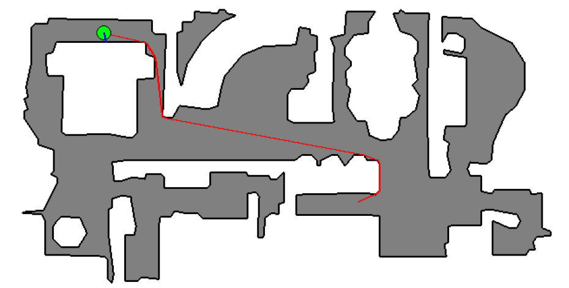

Кадры от первого лица во время движения робота:

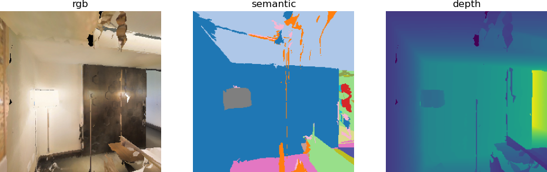


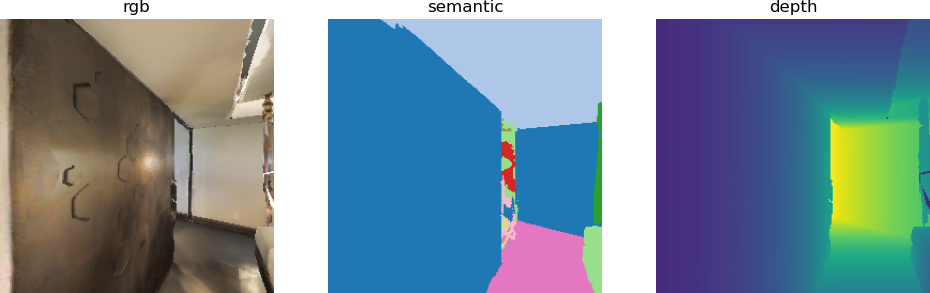

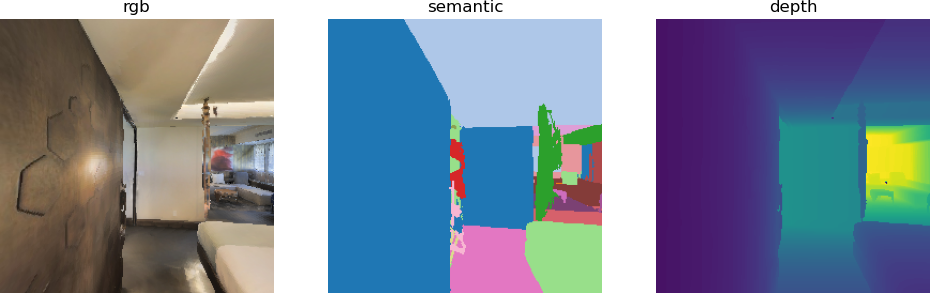

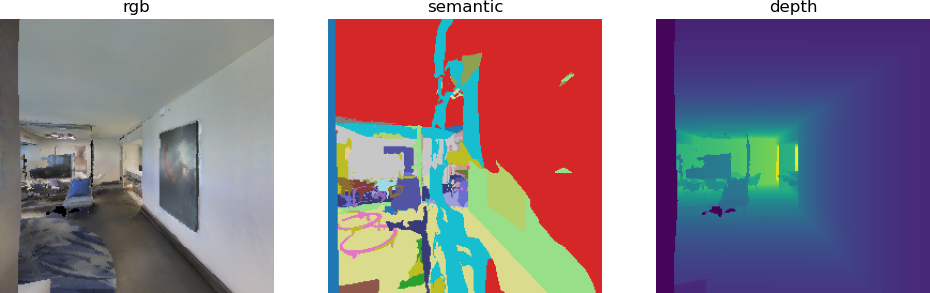

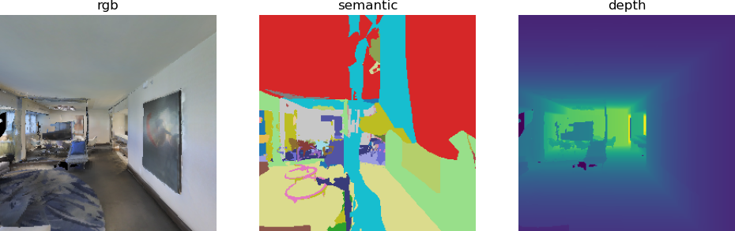

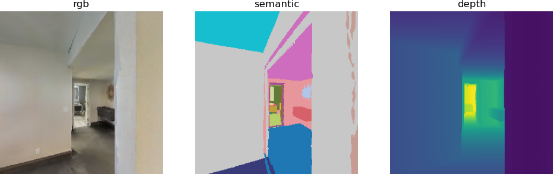

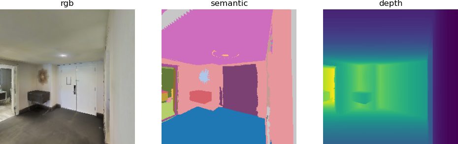

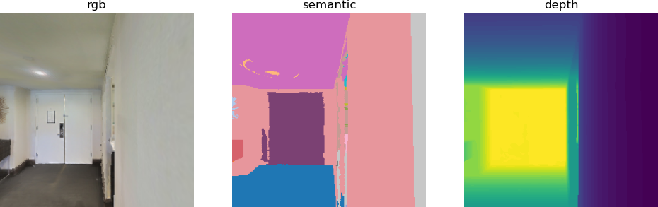

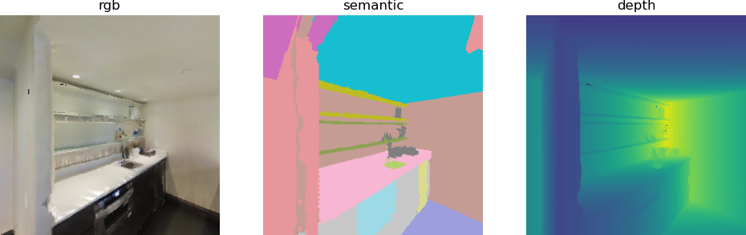

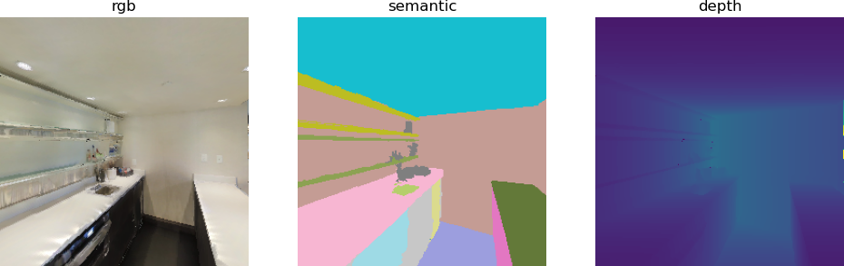

Справочные материалы:

https://github.com/facebookresearch/habitat-sim
