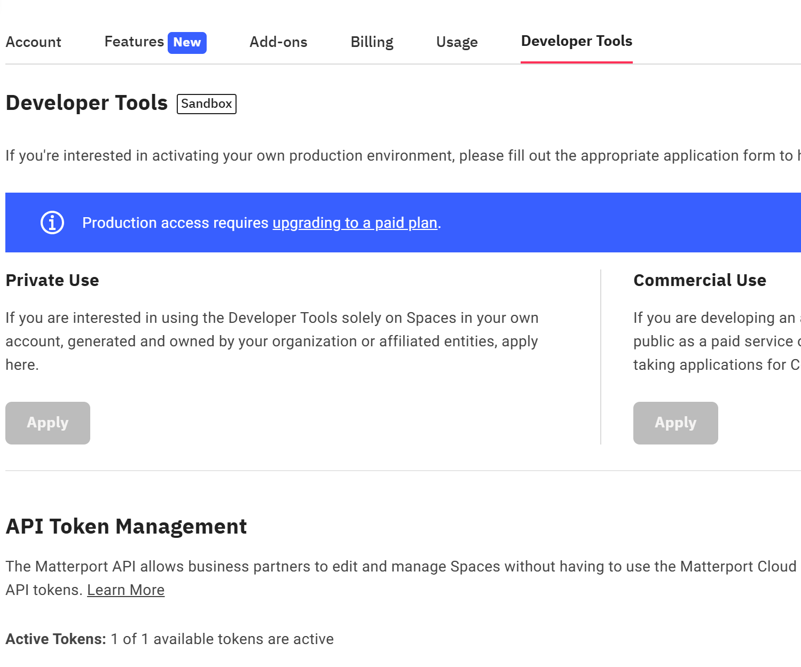

# Habitat-Sim: установка окружения и введение в наборы данных

### Habitat — открытая платформа воплощённого ИИ от Meta AI, созданная для исследований навигации, взаимодействия и принятия решений агентами в помещениях. Её основные компоненты: Habitat-Sim (движок симуляции) и Habitat-Lab (алгоритмический фреймворк). Первый отвечает за физику и визуальную симуляцию низкого уровня, второй — за определение задач высокого уровня, разработку алгоритмов и оценку.

## 1. Возможности Habitat-Sim

### 1. Реалистичный рендеринг

* Поддерживается физически корректный рендеринг, который создаёт близкие к реальности RGB-изображения, карты глубины и карты семантической сегментации.

* Поддерживаются пользовательские датчики (камеры, лидары, IMU); можно настраивать ракурс, разрешение и частоту кадров.

### 2. Эффективная загрузка сцен

* Нативная поддержка форматов GLB/GLTF; совместимость с основными наборами сцен (Matterport3D, Gibson, Replica, HM3D).

* Оптимизированы потребление памяти и скорость загрузки больших сцен, что подходит для пакетного обучения.

### 3. Лёгкое физическое моделирование

* Поддерживаются динамика твёрдых тел и суставное движение (например, работа манипулятора), что позволяет моделировать взаимодействие агента с объектами сцены.

* Низкая задержка, ускорение на GPU; на одном GPU одновременно работают тысячи параллельных симуляций.

### 4. Кроссплатформенность и расширяемость

* Поддерживаются Linux и Windows, совместимость с CUDA.

* Ядро на C++ с привязками к Python; можно расширять физические правила, датчики и логику рендеринга.

## 2. Установка окружения Habitat-Sim

Создайте conda-окружение (рекомендуется Ubuntu 22.04 или 24.04):

```python
conda create -n habitat python=3.9 cmake=3.14.0
conda activate habitat
```

Установите habitat через conda. По требованиям воспроизведения статьи или собственным задачам можно заменить habitat-sim на версию вида habitat-sim=0.2.5. В этом руководстве используется версия 0.2.5. При использовании версии 0.1 или другой могут возникнуть ошибки вызова функций или несоответствие наборов данных.

**Для изучения достаточно первой команды из списка ниже. Для воспроизведения других статей можно взять вторую команду и адаптировать первую.**

1) Если вы работаете на собственном компьютере или сервере с монитором, **рекомендуется** установить habitat-sim с поддержкой физического моделирования:

```python
conda install habitat-sim=0.2.5 withbullet -c conda-forge -c aihabitat
conda install habitat-sim withbullet -c conda-forge -c aihabitat
```

2) Если вы работаете на собственном компьютере или сервере с монитором, можно установить habitat-sim без физического моделирования:

```python
conda install habitat-sim=0.2.5 -c conda-forge -c aihabitat
conda install habitat-sim -c conda-forge -c aihabitat
```

3) Если вы работаете на арендованном сервере без монитора, используйте headless-версию habitat-sim (с физическим моделированием):

```python
conda install habitat-sim=0.2.5 withbullet headless -c conda-forge -c aihabitat
conda install habitat-sim withbullet headless -c conda-forge -c aihabitat
```

4) Если вы работаете на арендованном сервере без монитора, используйте headless-версию habitat-sim (без физического моделирования):

```python
conda install habitat-sim=0.2.5 -c conda-forge -c aihabitat
conda install habitat-sim -c conda-forge -c aihabitat
```

Поскольку аренда серверов очень распространена, для проверки достаточно запустить example.py. Перед этим нужно скачать несколько 3D-ресурсов: одну 3D-сцену и примеры объектов. Подробнее о наборах сцен — в третьей части. (В командах `path/to/` можно просто удалить и заменить на `data/` или указать собственный путь.)

Загрузите тестовую 3D-сцену:

```python
python -m habitat_sim.utils.datasets_download --uids habitat_test_scenes --data-path /path/to/data/
```

Загрузите примеры объектов:

```python
python -m habitat_sim.utils.datasets_download --uids habitat_example_objects --data-path /path/to/data/
```

Проверка example.py:

```python
python /path/to/habitat-sim/examples/example.py --scene /path/to/data/scene_datasets/habitat-test-scenes/skokloster-castle.glb
```

Если есть монитор, можно выполнить такой код:

```python
habitat-viewer /path/to/data/scene_datasets/habitat-test-scenes/skokloster-castle.glb
#или
python examples/viewer.py --scene /path/to/data/scene_datasets/habitat-test-scenes/skokloster-castle.glb
```

## 3. Наборы сцен Habitat-Sim

**Наборы данных, которые используются в этом руководстве, можно скачать без регистрации и авторизации. Третья часть посвящена только ознакомлению и подготовке к воспроизведению новейших алгоритмов.**

В последних практических работах часто используются обучающие и валидационные сцены HM3D. Для окружения habitat-sim=0.2.5 или 0.2.x обычно берут набор HM3D v0.2; его можно скачать по ссылке: https://github.com/matterport/habitat-matterport-3dresearch?tab=readme-ov-file.

Для доступа к Habitat нужна регистрация и получение авторизации. Процедура простая: откройте страницу https://my.matterport.com/settings/account/devtools?organization=Msg6zBCkcPg, зарегистрируйтесь и подтвердите адрес электронной почты. Затем на этой странице в разделе Developer Tools → API Token Management можно получить API-токен.



После этого можно загрузить нужный набор данных такой командой. Вместо `<api-token-id>` и `<api-token-secret>` подставьте полученный API-токен. **(Сейчас этот набор загружать не нужно — достаточно понимать, что он существует. В руководстве он не используется; он нужен только для справки при воспроизведении статей.)**

```python
python -m habitat_sim.utils.datasets_download --username <api-token-id> --password <api-token-secret> --uids hm3d_minival_v0.2
```

Через API из файла datasets_download.py в проекте habitat-sim можно загрузить hm3d-train-habitat-v0.2 или другие наборы; форматы идентификаторов uids — в самом файле.

```python
data_groups.update(
{
        f"hm3d_val_{version}": [
            f"hm3d_val_habitat_{version}",
            f"hm3d_val_configs_{version}",
            f"hm3d_val_semantic_annots_{version}",
            f"hm3d_val_semantic_configs_{version}",
        ],
    }
)
data_groups.update(
    {
        f"hm3d_train_{version}": [
            f"hm3d_train_habitat_{version}",
            f"hm3d_train_configs_{version}",
            f"hm3d_train_semantic_annots_{version}",
            f"hm3d_train_semantic_configs_{version}",
        ],
    }
)
data_groups.update(
    {
        f"hm3d_minival_{version}": [
            f"hm3d_minival_habitat_{version}",
            f"hm3d_minival_configs_{version}",
            f"hm3d_minival_semantic_annots_{version}",
            f"hm3d_minival_semantic_configs_{version}",
        ]
    }
)
data_groups.update(
    {
        f"hm3d_semantics_{version}": [
            f"hm3d_example_semantic_annots_{version}",
            f"hm3d_example_semantic_configs_{version}",
            f"hm3d_val_semantic_annots_{version}",
            f"hm3d_val_semantic_configs_{version}",
            f"hm3d_train_semantic_annots_{version}",
            f"hm3d_train_semantic_configs_{version}",
            f"hm3d_minival_semantic_annots_{version}",
            f"hm3d_minival_semantic_configs_{version}",
        ]
    }
)
```

Например, чтобы загрузить hm3d-train-habitat-v0.2, используйте такую команду:

```python
python -m habitat_sim.utils.datasets_download --username <api-token-id> --password <api-token-secret> --uids hm3d_train_habitat_v0.2
```

Другие ресурсы тоже можно найти в datasets_download.py, например уже загруженные habitat_test_scenes и habitat_example_objects. В datasets_download.py они описаны так:

```python
"habitat_test_scenes": {
    "source": "https://huggingface.co/datasets/ai-habitat/habitat_test_scenes.git",
    "link": data_path + "scene_datasets/habitat-test-scenes",
    "version": "main",
}
```

```python
"habitat_example_objects": {
    "source": "http://dl.fbaipublicfiles.com/habitat/objects_v0.2.zip",
    "package_name": "objects_v0.2.zip",
    "link": data_path + "objects/example_objects",
    "version": "0.2",
}
```
