# Постановка задачи

  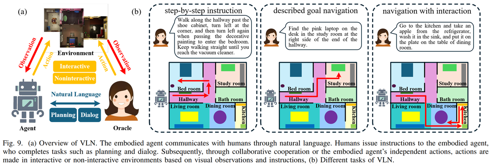

Визуально-языковая навигация (Visual Language Navigation, VLN) — ключевая исследовательская задача воплощённого ИИ: агент должен ориентироваться в незнакомой среде по языковой инструкции. VLN требует, чтобы робот понимал сложные и разнообразные визуальные наблюдения и трактовал инструкцию с разной степенью детализации.

Входы VLN обычно состоят из двух частей: визуальной информации и инструкции на естественном языке. Визуальная информация может быть видеозаписью прошедшей траектории или набором изображений «история — текущий кадр». Инструкция описывает цель, которой должен достичь воплощённый агент, или задачу, которую он должен выполнить. Используя эту информацию, агент выбирает из списка кандидатных действий одно действие или последовательность действий, чтобы выполнить инструкцию.

## Постановка задачи

Задачу VLN математически можно единообразно описать как частично наблюдаемый марковский процесс принятия решений (POMDP), заданный кортежем:

$$
\langle \mathcal{S}, \mathcal{A}, \mathcal{T}, \mathcal{O}, \mathcal{R}, \mathcal{J} \rangle
$$

где $\mathcal{S}$ — пространство состояний, $\mathcal{A}$ — пространство действий агента, $\mathcal{T}$ — функция перехода состояний, $\mathcal{O}$ — пространство визуальных наблюдений, $\mathcal{R}$ — функция награды, $\mathcal{J}$ — инструкция на естественном языке.

В этой рамке ядро задачи навигации — обучить функцию отображения политики $a_t = \pi(o_t, I, s_t)$ (обычно параметризованную глубокой нейросетью $F$). То есть в момент времени $t$ агент по текущему наблюдению от первого лица $o_t$, глобальной инструкции $I$ и своему состоянию $s_t$ выводит оптимальное действие $a_t$, чтобы максимизировать накопленную награду и приблизиться к цели.

В зависимости от пространства состояний, пространства действий и функции перехода VLN делится на дискретный VLN и непрерывный VLN.

---

### Постановка дискретного VLN

  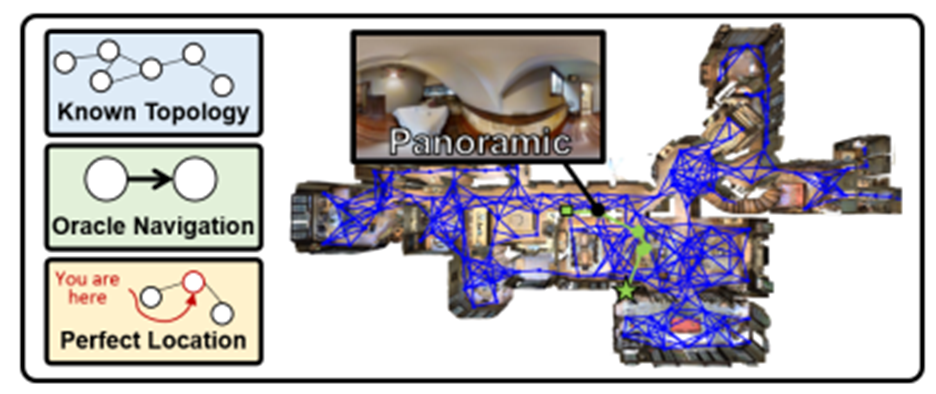
   
  <b>Рисунок 1. VLN в дискретной среде. Синий граф — заранее заданный связный граф; зелёные линии — траектории экспертов.</b>

 

Исследования дискретного VLN в основном опираются на симулятор Matterport3D. Как показано на рисунке 1, среда абстрагирована в заранее заданный связный граф $\mathcal{G}=\langle V,\mathcal{E}\rangle$; на синем графе узлы $V$ — фиксированный набор панорамных точек обзора, а $\mathcal{E}$ задаёт связи между точками.

* **Пространство состояний ($\boldsymbol{S}_{disc}$):** состояние агента $S_t$ строго ограничено узлом графа $\mathcal{G}$, то есть $s_t \in V$.
* **Пространство действий ($\mathcal{A}_{disc}$):** пусть $N(s_t)$ — множество всех узлов, связанных с состоянием $s_t$ на графе $\mathcal{G}$ в момент $t$. Каждый узел из $N(s_t)$ называется кандидатным узлом, а $N(s_t)$ и есть пространство действий агента в момент $t$. Решение агента в момент $t$ — «выбрать кандидатный узел»: функция политики $F$ выдаёт распределение вероятностей по $N(s_t)$, и агент выбирает из него один узел как следующую «точку перехода».
* **Переход состояний ($\mathcal{T}_{disc}$):** переход — детерминированный «мгновенный телепорт». Как только сгенерирована следующая «точка перехода», система мгновенно переносит агента в координаты выбранного кандидатного узла. Промежуточный путь при этом не учитывается, физические столкновения и трение не моделируются. Такая постановка «оракульной навигации» упрощает управление, но сильно расходится с реальными законами движения роботов в реальной среде.

---

### Постановка непрерывного VLN (VLNCE)

  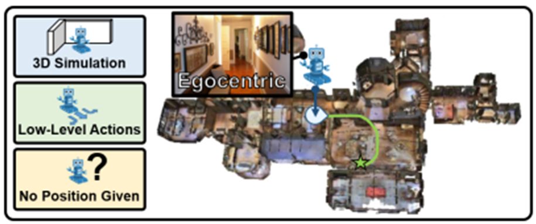
   
  <b>Рисунок 2. VLN в непрерывной среде. Зелёные линии — траектории экспертов.</b>

 

Чтобы сократить разрыв между симуляцией и реальностью, VLN-CE обучается в симуляторе Habitat. Как показано на рисунке 2, в среду загружаются высокореалистичные трёхмерные сканы помещений из набора Matterport3D, которые дают первое-личное визуальное наблюдение, согласованное с реальным миром. Одновременно Habitat вводит навигационную сетку (navigation mesh), которая задаёт физическое пространство движения. Сетка строит проходимую область как набор плотно связанных многоугольных поверхностей, и агент может находиться в любой непрерывной точке внутри сетки. Именно эта пространственная непрерывность позволяет агенту с опорой на физический движок выполнять низкоуровневые действия вроде «пройти фиксированное расстояние вперёд» и «повернуть на фиксированный угол». Когда агент получает команду пройти шаг вперёд (например, 0,25 м), навигационная сетка гарантирует, что это не скачок координат, а реальное скольжение по непрерывной геометрической поверхности, то есть непрерывное изменение позы, как в реальном мире. По сравнению с дискретным VLN, где агент «перескакивает» от узла к связанному узлу, движение непрерывного VLN по навигационной сетке ближе к законам перемещения в реальной среде.

* **Пространство состояний ($\boldsymbol{S}_{cont}$):** состояние агента задаётся точными трёхмерными координатами $P=(x,y,z)$ в мировой системе координат и ориентацией $\Phi =(\theta,\psi)$, где соответственно $\theta$ — угол тангажа, $\psi$ — угол курса.
* **Пространство действий ($\mathcal{A}_{cont}$):** в любой момент времени пространство действий агента состоит из набора низкоуровневых примитивов движения, как показано на рисунке 2 подписью «Low-Level Actions»: движение вперёд на фиксированное расстояние (например, 0,25 м), поворот влево на фиксированный угол (например, 15°), поворот вправо на фиксированный угол (например, 15°) и остановка (stop). Решение агента в момент $t$ — «выбрать один примитив действия»: функция политики выдаёт распределение вероятностей по всем примитивам, и один из них выбирается как конкретная команда управления движением.
* **Переход состояний ($\mathcal{T}_{cont}$):** переход $\mathcal{T}(s_t,a_t)$ строго определяется законами динамики физического движка симулятора. Если действие агента приводит к контакту с объектом среды, включается механизм «скольжения» (Sliding) или блокировки.

---

# Наборы данных VLNCE

### Распространённые наборы данных

#### 1. R2R-CE

**Симулятор**
* **Среда симуляции:** Habitat-Sim v0.1.7.
* **Сцены:** 90 реальных внутренних сцен (дома, офисы и т. п.) на основе набора Matterport3D (MP3D).

**Входы**

**Пространство наблюдений на каждом шаге ($O_t$)**

* **Визуальный вход:** RGB-D изображения (RGB и карта глубины).
* **Разрешение:** обычно RGB — (224×224), карта глубины — (256×256).
* **Угол обзора (FOV):** 90 градусов.
* **Ракурс:** по умолчанию монокулярный. Многие модели, например ETPNav, строят панорамный обзор, поворачиваясь слева направо 12 раз (шаг 30° между кадрами).

**Текстовая инструкция (Text Instruction)**
* **Язык инструкций:** только английский.
* **Тип инструкций:** **пошаговая навигация (Step-by-Step)**. Инструкция не просто говорит «куда идти (цель)», а описывает **последовательность действий**: как шаг за шагом дойти от текущей позиции до конечной точки.
* **Пример:** «Go down the stairs, turn left at the picture and enter the bedroom.» (Спуститесь по лестнице, у картины поверните налево и войдите в спальню.)

**Выход (пространство действий)**
* Агент выводит **дискретные низкоуровневые команды управления**:
    1.  `MoveForward` (движение вперёд на 0,25 м)
    2.  `TurnLeft` (поворот влево на 15°)
    3.  `TurnRight` (поворот вправо на 15°)
    4.  `Stop` (остановка; определяет, достигнут ли конец пути)
* **Критерий:** если агент выполняет `Stop` в пределах **3,0 м** от целевой точки, эпизод считается успешным.

**Объём набора данных**
* **Число путей:** около **4 475** непрерывных траекторий (восстановлены из дискретных путей R2R).
* **Число инструкций:** около **13 425** (в среднем 3 инструкции на путь).
* **Средняя длина пути:** около **9,89 м**.
* **Разбиение:** обучающая выборка (10,8 тыс.), валидационная (Seen: 778 / Unseen: 1,8 тыс.), тестовая (3,4 тыс.).

#### 2. RxR-CE

**Симулятор**
* **Среда симуляции:** Habitat-Sim v0.1.7.
* **Сцены:** тоже на основе набора Matterport3D (MP3D). Однако по сравнению с R2R-CE пути RxR-CE покрывают больше пространства, исследуют более сложные области и петли.

**Входы**

**Пространство наблюдений на каждом шаге ($O_t$)**

* **Визуальный вход:** RGB-D изображения (RGB и карта глубины).
* **Разрешение:** обычно RGB — (224×224), карта глубины — (256×256).
* **Угол обзора (FOV):** 79 градусов.
* **Примечание:** по умолчанию монокулярный ракурс.

**Текстовая инструкция (Text Instruction)**

* **Язык инструкций:** **многоязычные (Multilingual)**: английский, хинди, телугу.
* **Тип инструкций:** **процессно-ориентированные (Process-Oriented)**. Инструкции очень подробные: они описывают не только последовательность действий, но и все визуальные детали по пути, как экскурсовод. Самое важное — слова инструкции по времени согласованы с позой (Pose) агента на пути.
* **Пример:** «Standing on the rug, turn right and face the wooden cabinet. Walk past the cabinet, keeping it on your left, and enter the hallway. You will see a painting of a flower on the wall. Stop just after passing the painting.» (Стоя на ковре, поверните направо и посмотрите на деревянный шкаф. Пройдите мимо шкафа, оставляя его слева, и войдите в коридор. На стене вы увидите картину с цветком. Остановитесь сразу после того, как пройдёте картину.)

**Выход**

* **Пространство действий:** такое же, как у R2R-CE.
* **Критерии оценки:**
    * **Критерий успеха:** в пределах 3,0 м от цели.
    * **Согласованность пути (NDTW):** в задаче важнее, насколько агент **точно** следует маршруту, описанному в инструкции.

**Объём набора данных**
* **Число путей:** около **42 000+** непрерывных траекторий (на порядок больше, чем у R2R).
* **Число инструкций:** около **126 069**.
* **Средняя длина пути:** около **15 м**.

> **Адрес получения набора данных:** [https://github.com/jacobkrantz/VLN-CE](https://github.com/jacobkrantz/VLN-CE)

---

### Метрики оценки

**(1) Ошибка навигации (Navigation Error, NE)**
Определяется как средняя геодезическая дистанция (в метрах) между конечной остановкой агента и целевой точкой.

$$
NE = \frac{1}{N} \sum_{i=1}^N \mathrm{dist}(p_{final}^{(i)}, p_{target}^{(i)})
$$

**(2) Успешность (Success Rate, SR)**
Определяется как доля эпизодов, в которых геодезическая дистанция между точкой остановки агента и целевой точкой меньше заданного порога (стандартно 3 м).

$$
SR = \frac{1}{N} \sum_{i=1}^N \mathbb{I}(\mathrm{dist}(p_{final}^{(i)}, p_{target}^{(i)}) < 3m)
$$

**(3) Успешность, взвешенная по длине пути (Success weighted by Path Length, SPL)**
SPL — основная метрика VLN-CE: она уравновешивает «успешность» и «длину пути».

$$
SPL = \frac{1}{N} \sum_{i=1}^N S_i \frac{l_i}{\max(l_i, p_i)}
$$

**(4) Oracle-успешность (Oracle Success Rate, OSR)**
Если какая-либо точка траектории агента находится ближе порога к цели геодезически, эпизод считается успешным. OSR показывает потенциал агента «пройти мимо» цели. Разрыв между OSR и SR обычно отражает недостатки политики остановки (Stop Policy).

$$
OSR = \frac{1}{N} \sum_{i=1}^N \mathbb{I}(\min_t \mathrm{dist}(p_t^{(i)}, p_{target}^{(i)}) < 3m)
$$

**(5) Нормированное динамическое выравнивание времени (Normalized Dynamic Time Warping, nDTW)**
nDTW вычисляет с помощью динамического программирования минимальное накопленное расстояние между предсказанной траекторией $P$ и эталонной траекторией $Q$ и затем нормирует его экспоненциально.

$$
nDTW = \exp\left(-\frac{DTW(P,Q)}{\sqrt{|P|\cdot|Q|}}\right)
$$

**(6) SDTW (Success weighted by normalized Dynamic Time Warping)**
SDTW учитывает nDTW только для успешно завершённых задач и является комплексной метрикой «соблюдения инструкции» и «полноты выполнения».

$$
SDTW = \frac{1}{N} \sum_{i=1}^N S_i \cdot \text{nDTW}_i
$$

# Методы навигации в непрерывной среде

## 1. Традиционные одноэтапные методы

### Базовая сквозная модель (ECCV 2020)

**Название статьи:** Beyond the Nav-Graph: Vision-and-Language Navigation in Continuous Environments
**Авторы:** Jacob Krantz, Erik Wijmans, Arjun Majumdar, Dhruv Batra, Stefan Lee
**Организации:** Oregon State University, Georgia Tech, FAIR
**Ссылка на статью:** [PDF](https://www.ecva.net/papers/eccv_2020/papers_ECCV/papers/123730103.pdf) | **Страница проекта:** [Project Page](https://jacobkrantz.github.io/vlnce/)

  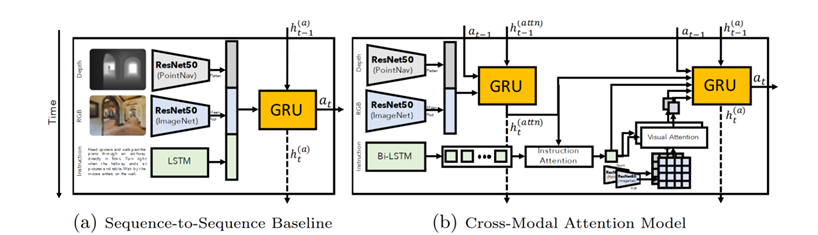

**Краткое описание метода:**
В основном используются модели «последовательность в последовательность» (Seq2Seq) и модель кросс-модального внимания (Cross-Modal Attention, CMA). Это сквозная архитектура: модель напрямую выводит вероятности низкоуровневых действий.
* **Архитектура Seq2Seq (рис. a):** языковой энкодер (LSTM) сжимает инструкцию в семантический вектор; декодер действий (RNN) предсказывает распределение действий по семантическому вектору и текущим визуальным признакам.
* **Модель CMA (рис. b):** добавляет механизм внимания: текущие визуальные признаки используются как запрос (Query), и кросс-внимание с последовательностью признаков инструкции динамически выделяет релевантные фрагменты инструкции, обеспечивая детальное согласование зрения и языка.

---

## 2. Традиционные двухэтапные методы навигации

Использует иерархическую структуру, которая разбивает навигацию на две стадии: «принятие решения» и «исполнение».
1.  **Стадия решения:** по панораме и инструкции предсказывается следующая высокоуровневая цель (локальная цель / путевая точка, Waypoint), обычно в координатах $r, \theta$.
2.  **Стадия исполнения:** низкоуровневый контроллер получает координаты цели и с помощью алгоритма (например, DWB) автоматически планирует путь и ведёт агента к ней.

### (1) Введение предсказателя путевых точек: начало двухэтапной навигации

**Название статьи:** Bridging the Gap Between Learning in Discrete and Continuous Environments for VLN (CVPR 2022)
**Авторы:** Yicong Hong, Zun Wang, Qi Wu, Stephen Gould
**Организации:** ANU, University of Adelaide
**Ссылка на статью:** [PDF](https://openaccess.thecvf.com/content/CVPR2022/papers/Hong_Bridging_the_Gap_Between_Learning_in_Discrete_and_Continuous_Environments_CVPR_2022_paper.pdf) | **Страница проекта:** [GitHub](https://github.com/YicongHong/Discrete-Continuous-VLN)

  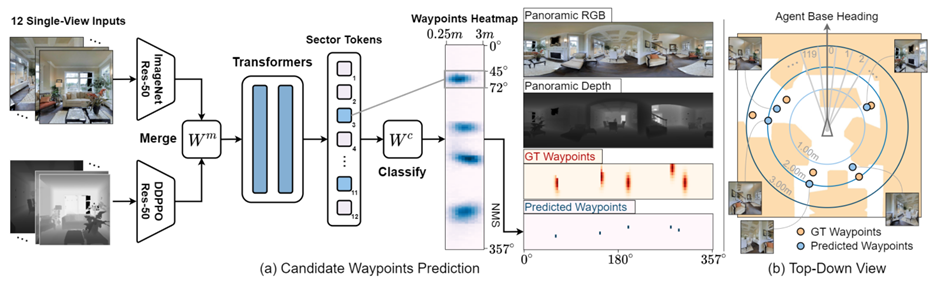
  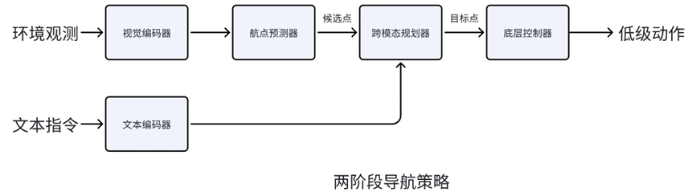

**Методические нововведения:**
* **Предсказатель кандидатных путевых точек (Candidate Waypoint Predictor):** в непрерывной среде по карте глубины в реальном времени генерируются проходимые «виртуальные узлы», благодаря чему непрерывное пространство выглядит как дискретный навигационный граф.
* **Иерархическая навигационная система:** разделяется на «высокоуровневое планирование» и «низкоуровневое исполнение».
* **Перенос из дискретной среды в непрерывную:** показано, что достаточно дообучить модель, обученную в дискретной среде (Nav-Graph), чтобы получить результаты SOTA в непрерывной среде.

### (2) Методы на основе карт

#### Топологическая карта: ETPNav

**Название статьи:** ETPNav: Evolving Topological Planning for Vision-Language Navigation in Continuous Environments (TPAMI 2024)
**Авторы:** Dong An, Hanqing Wang, Wenguan Wang, Zun Wang, Yan Huang, Keji He, Liang Wang
**Организации:** CASIA, UCAS
**Ссылка на статью:** [PDF](https://arxiv.org/abs/2304.03047) | **Страница проекта:** [GitHub](https://github.com/MarSaKi/ETPNav)

  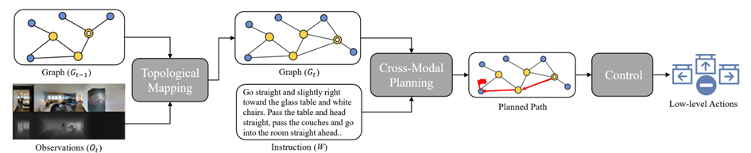
  
Схема ETP-навигации

  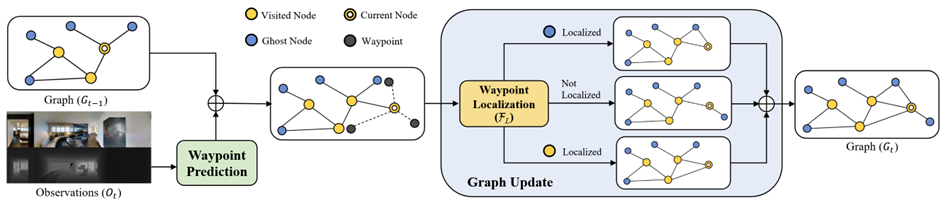
  
Процесс построения топологической карты ETPNav в момент t

**Краткое описание метода:**
Ядро ETPNav — **онлайн развивающееся топологическое картографирование (Online Evolving Topological Mapping)**. Неизвестное непрерывное физическое пространство в реальном времени абстрагируется в динамически обновляемый топологический граф, и история хранится на этом графе.
* **Кросс-модальный планировщик:** на основе топологической карты и инструкции выполняет долгосрочное семантическое рассуждение и выбирает лучшую путевую точку.
* **Контроллер «проб и ошибок» (Trial-and-Error Controller):** отвечает за низкоуровневое исполнение действий и устойчивое избегание препятствий, что решает проблему, когда традиционные модели попадают в тупики или сталкиваются.

#### Карта в виде птичьего полёта (BEV): BEVBert

**Название статьи:** BEVBert: Multimodal Map Pre-training for Language-guided Navigation (ICCV 2023)
**Авторы:** Dong An, Yuankai Qi, Yangguang Li, Yan Huang, Liang Wang, Tieniu Tan, Jing Shao
**Организации:** CASIA, UCAS, University of Adelaide, SenseTime, NJU, PJLab
**Ссылка на статью:** [PDF](https://arxiv.org/pdf/2212.04385) | **Страница проекта:** [GitHub](https://github.com/MarSaKi/VLN-BEVBert)

  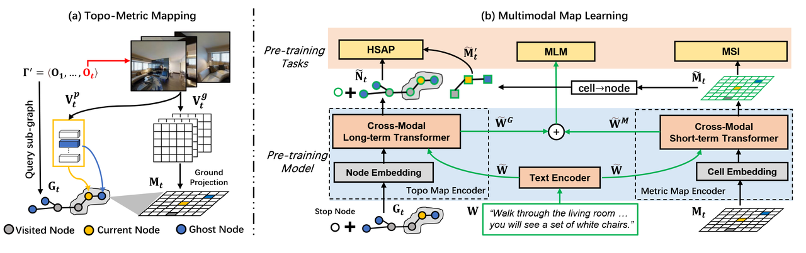

**Краткое описание метода:**
Предложена парадигма мультимодального предобучения карты с учётом пространства.
* **Гибридная карта (Hybrid Map):** сочетает локальную метрическую карту «вид сверху» (BEV) для устранения визуальных перекрытий и глобальную топологическую карту для запоминания длинных путей.
* **Задачи предобучения:** например, моделирование замаскированной карты, благодаря которым модель выполняет кросс-модальное рассуждение непосредственно над представлениями карты.

### (3) Методы, основанные на предсказании будущего

#### HNR

**Название статьи:** Lookahead Exploration with Neural Radiance Representation for Continuous Vision-Language Navigation (CVPR 2024)
**Авторы:** Zihan Wang, Xiangyang Li, Jiahao Yang, Yeqi Liu, Junjie Hu, Ming Jiang, Shuqiang Jiang
**Организации:** ICT, CAS, UCAS
**Ссылка на статью:** [PDF](https://openaccess.thecvf.com/content/CVPR2024/papers/Wang_Lookahead_Exploration_with_Neural_Radiance_Representation_for_Continuous_Vision-Language_Navigation_CVPR_2024_paper.pdf) | **Страница проекта:** [GitHub](https://github.com/MrZihan/HNR-VLN)

  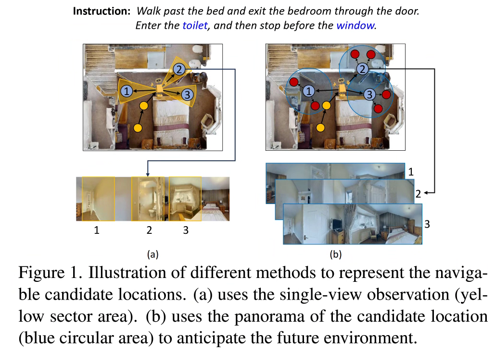
  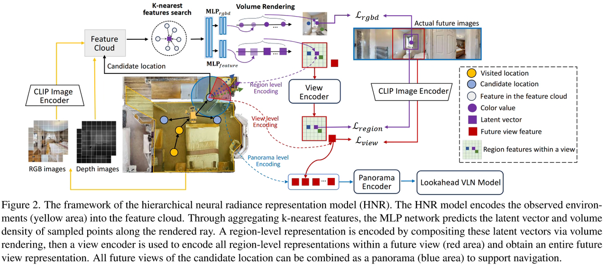

**Краткое описание метода:**
Предложена **иерархическая нейронная радиантная репрезентация (HNR)**.
* **Упреждающее исследование (Lookahead Exploration):** синтезирует признаки среды из семантических эмбеддингов CLIP и строит **дерево будущих путей**, которое выходит за пределы текущего поля зрения. Агент параллельно оценивает семантическое соответствие нескольких потенциальных ветвей, что позволяет выбирать глобально оптимальный путь с учётом долгосрочного планирования.

#### NavMorph (мировая модель)

**Название статьи:** NavMorph: A Self-Evolving World Model for Vision-and-Language Navigation in Continuous Environments (ICCV 2025)
**Авторы:** Xuan Yao, Junyu Gao, Changsheng Xu
**Организации:** CASIA, UCAS, Peng Cheng Lab
**Ссылка на статью:** [PDF](https://openaccess.thecvf.com/content/ICCV2025/papers/Yao_NavMorph_A_Self-Evolving_World_Model_for_Vision-and-Language_Navigation_in_Continuous_ICCV_2025_paper.pdf) | **Страница проекта:** [GitHub](https://github.com/Feliciaxyao/NavMorph)

  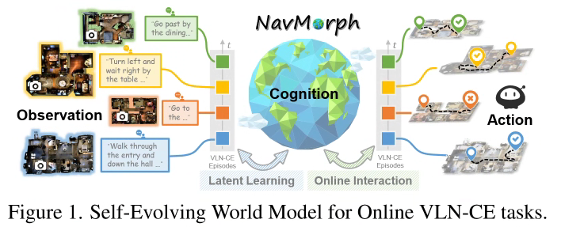
  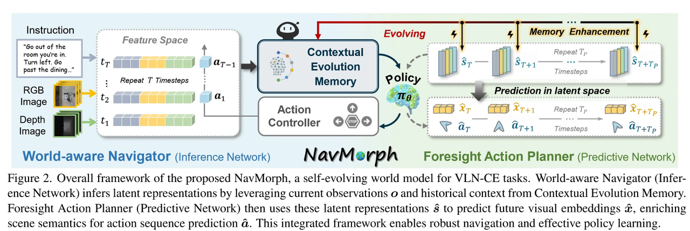

**Методические нововведения:**
* **Самоэволюционирующая мировая модель:** строит постоянно развивающееся латентное пространство через онлайн-взаимодействие.
* **Контекстно-эволюционирующая память (CEM):** использует механизм прямого итеративного обновления и быстро адаптируется к новым сценам на этапе онлайн-тестирования.
* **Иерархическая архитектура:** включает «мир-осознающий навигатор» и «упреждающий планировщик действий»; вместо предсказания на уровне пикселей предсказание и реконструкция будущего выполняются на **уровне признаков**, что заметно повышает эффективность.

### (4) Методы на основе Sim2Real (перенос из симуляции в реальность)

#### Sim2Real-VLN-3DFF

**Название статьи:** Sim-to-Real Transfer via 3D Feature Fields for Vision-and-Language Navigation (CoRL 2024)
**Авторы:** Zihan Wang и др.
**Ссылка на статью:** [PDF](https://proceedings.mlr.press/v155/anderson21a/anderson21a.pdf) | **Страница проекта:** [GitHub](https://github.com/MrZihan/Sim2Real-VLN-3DFF)

  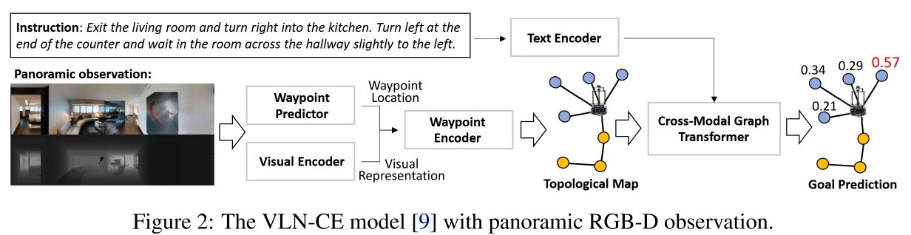
  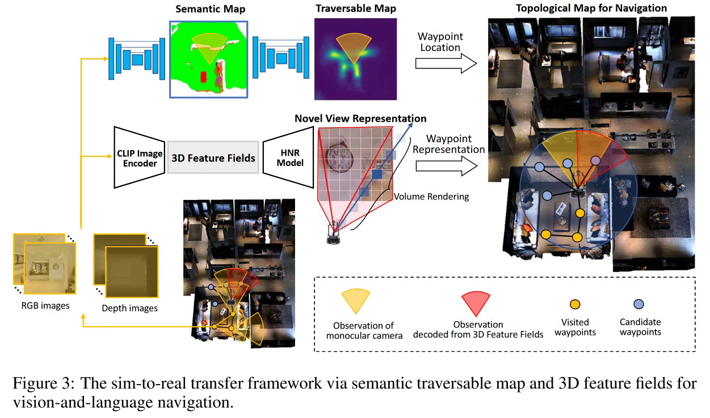

**Основная идея:**
Решается противоречие: реальные роботы часто оснащены **монокулярной камерой**, а модели требуют **панорамного входа**.
* **Трёхмерное поле признаков (3D Feature Field):** используя идеи NeRF, отображает монокулярные наблюдения в трёхмерное пространство и рендерит виртуальную панораму.
* **Семантическая проходимая карта:** карта с центром в агенте, одновременно выполняющая выравнивание семантики среды и предсказание препятствий.

#### monoVLN

**Название статьи:** monoVLN: Bridging the Observation Gap between Monocular and Panoramic Vision and Language Navigation (ICCV 2025)
**Авторы:** Renjie Lu, Yu Zhou, Hao Cheng, Jingke Meng, Wei-Shi Zheng
**Организации:** SYSU, HNU
**Ссылка на статью:** [PDF](https://openaccess.thecvf.com/content/ICCV2025/papers/Lu_monoVLN_Bridging_the_Observation_Gap_between_Monocular_and_Panoramic_Vision_ICCV_2025_paper.pdf)

  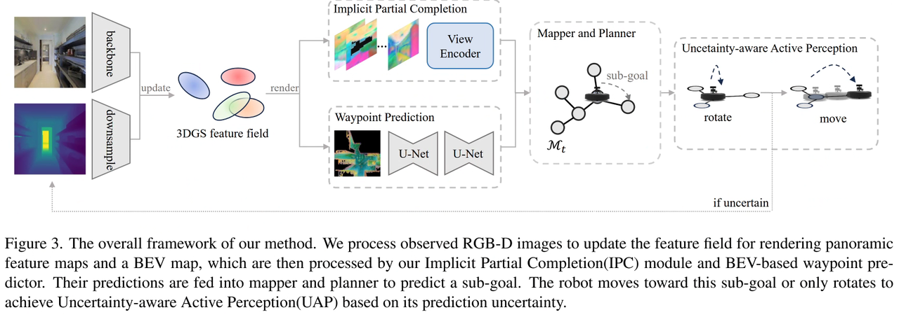

**Методические нововведения:**
* **3D Gaussian Splatting (3DGS):** быстро реконструирует трёхмерное поле признаков и рендерит виртуальную панораму.
* **Неявное локальное дополнение:** автоматически предсказывает и заполняет «дыры» в признаках, возникающие из-за окклюзий.
* **Стратегия с учётом неопределённости:** когда уверенность признаков низкая, активно выполняет действие «поворот», чтобы собрать данные.

---

## 3. Навигация с нулевым обучением (Zero-Shot VLN)

### Open-Nav (ICRA 2025)
**Статья:** [Open-Nav: Exploring Zero-Shot VLN with Open-Source LLMs](https://arxiv.org/abs/2409.18794)
**GitHub:** [Link](https://github.com/YanyuanQiao/Open-Nav)

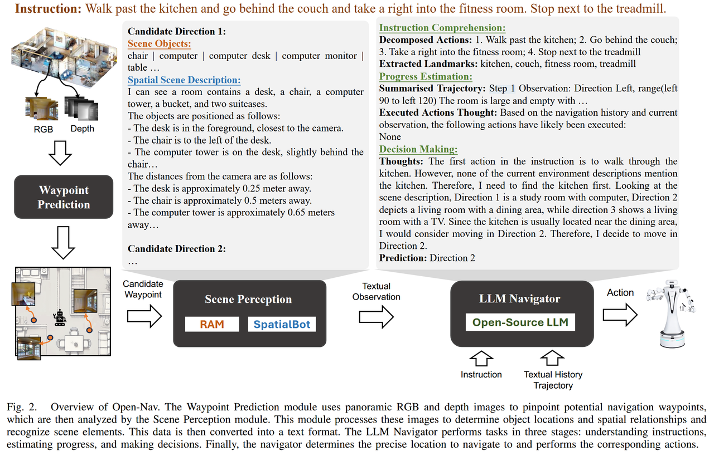

### CA-Nav (TPAMI 2025)
**Статья:** [Constraint-Aware Zero-Shot VLN](https://arxiv.org/pdf/2412.10137)
**GitHub:** [Link](https://chenkehan21.github.io/CA-Nav-project/)

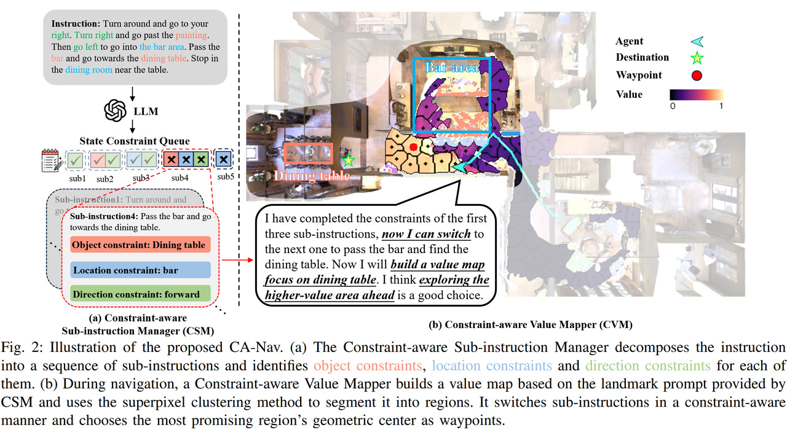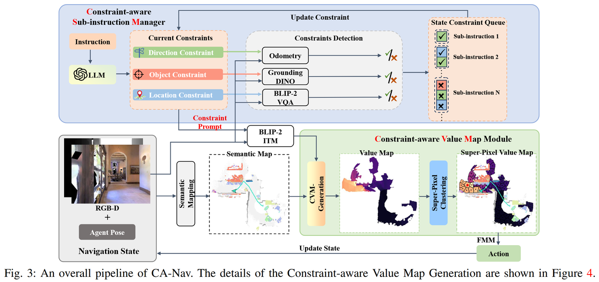

### Другие недавние работы
* **LaViRA:** [Language-Vision-Robot Actions Translation](https://arxiv.org/abs/2510.19655)
* **SmartWay (IROS 2025):** [Enhanced Waypoint Prediction](https://arxiv.org/abs/2503.10069)
* **Fast-SmartWay:** [Panoramic-Free End-to-End Zero-Shot](https://arxiv.org/pdf/2511.00933)

---

## 4. Методы на основе VLA (Vision-Language-Action)

Модели VLA объединяют восприятие, понимание и управление в едином сквозном каркасе и постепенно вытесняют модульные архитектуры.

### NaVILA

**Название статьи:** NaVILA: Legged Robot Vision-Language-Action Model for Navigation
**Авторы:** An-Chieh Cheng и др.
**Организации:** UCSD, USC, NVIDIA
**Ссылка на статью:** [PDF](https://navila-bot.github.io/static/navila_paper.pdf) | **GitHub:** [Link](https://github.com/AnjieCheng/NaVILA)

  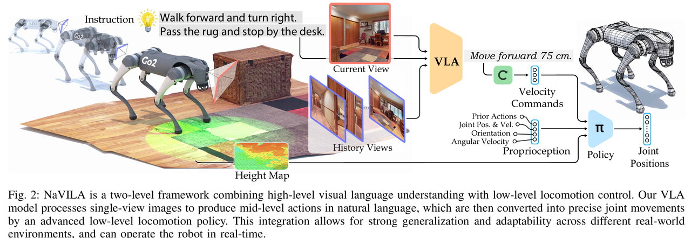
  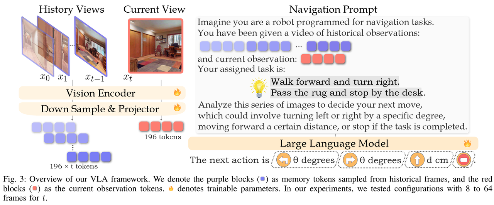
  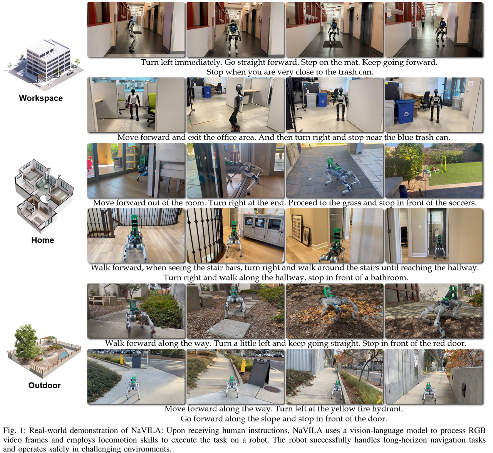

**Метод:**
* **Высокоуровневый слой VLA:** выводит «среднеуровневые действия» (например, «повернуть налево на 30 градусов»), используя данные интернет-видео для усиления.
* **Низкоуровневый слой исполнения:** политика на основе RL, которая переводит языковую инструкцию в команды управления моторами.

### StreamVLN

**Название статьи:** StreamVLN: Streaming Vision-and-Language Navigation via SlowFast Context Modeling
**Авторы:** Meng Wei и др.
**Организации:** PJLab, HKU
**Ссылка на статью:** [PDF](https://arxiv.org/abs/2507.05240) | **GitHub:** [Link](https://github.com/InternRobotics/StreamVLN)

  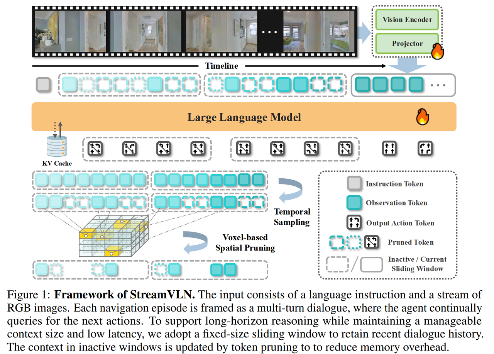

**Ключевое: моделирование контекста SlowFast**
* **Быстрый потоковый контекст (Fast-Streaming):** механизм скользящего окна, который смотрит только на последние несколько кадров и обеспечивает реакцию в реальном времени.
* **Медленно обновляемая память (Slow-Updating):** стратегия обрезки 3D-токенов, которая сохраняет только ключевые ориентиры и решает проблему взрыва видеопамяти, позволяя выполнять потоковую навигацию на длинных путях.

### DualVLN

**Название статьи:** GROUND SLOW, MOVE FAST: A DUAL-SYSTEM FOUNDATION MODEL
**Авторы:** Meng Wei и др.
**Организации:** PJLab, HKU, Tsinghua
**Ссылка на статью:** [PDF](https://arxiv.org/pdf/2512.08186) | **GitHub:** [Link](https://github.com/InternRobotics/InternNav?tab=readme-ov-file)

  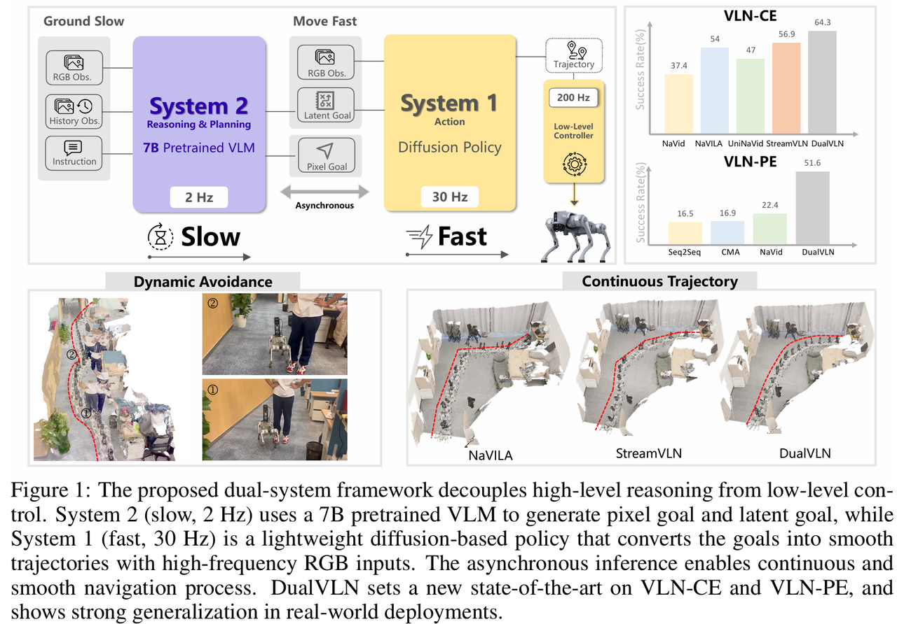

**Метод: имитация «теории двух процессов» человека**
* **System 2 (Ground Slow):** «мозг». Использует большую модель InternVLA для глобального планирования и с низкой частотой выводит промежуточные путевые точки (Pixel Goal).
* **System 1 (Move Fast):** «мозжечок». Лёгкий Diffusion Transformer с высокой частотой выводит линейную и угловую скорости, отвечая за обход препятствий и управление движением.
