# NBS для активного восприятия: планирование информационного пути мобильного робота с поиском лучом на уровне узлов

> В этом обзоре разбирается статья **An Efficient Beam Search Algorithm for Active Perception in Mobile Robotics**. Работа опубликована в *The International Journal of Robotics Research* (онлайн-версия до печати); соответствующая версия на arXiv — `2604.23327`. Это не VLA и не модель мира: это скорее системная статья о методах навигационного планирования, активного восприятия и планирования информационного пути.

## 1. Вывод в одном предложении

Статья решает такую задачу: **если робот не знает полной картины окружения, куда ему идти и куда смотреть, чтобы за ограниченное время или запас энергии получить как можно больше полезной информации.**

Традиционная навигация спрашивает: «как быстрее всего добраться из точки A в точку B». Активное восприятие ставит другой вопрос: **точка B может быть ещё неизвестна, карта неполна, и робот должен одновременно исследовать, строить карту и решать, по какому участку восприятия идти дальше.**

Основной вклад статьи можно свести к трём модулям:

| Модуль | Какую проблему решает | Ключевая идея |
| :--- | :--- | :--- |
| Node-wise Beam Search, NBS | Поиск путей с высокой информативностью на графе без дорогого TSP и без ограничения деревом кратчайших путей | Вместо глобального top-B на каждом слое для каждой конечной вершины отдельно сохраняется top-B кандидатных путей |
| Expected Gain | Баланс между известными точками с высокой выгодой и границами неизвестной области | В оценку пути добавляется будущая выгода от границ frontier |
| RRAG | В реальном активном восприятии граф не задан заранее и должен строиться онлайн | Rapidly-exploring Random Annulus Graph: инкрементальная выборка проходимых точек обзора с несколькими ориентациями |

С точки зрения учебника место статьи — `08-навигация и VLN / 03 Передовое воспроизведение VLN`. Хотя название раздела содержит VLN, эта работа посвящена не языковой навигации, а более базовому **планированию пути активного восприятия**: его можно переиспользовать в VLN, в исследовании дронами, в построении карт мобильными роботами, в сканировании сцен и т. д.

## 2. Статья и проект: где что находится

| Элемент | Ссылка | Текущий статус |
| :--- | :--- | :--- |
| Страница статьи в IJRR | [SAGE: An efficient beam search algorithm for active perception in mobile robotics](https://journals.sagepub.com/doi/10.1177/02783649261455911) | Опубликована онлайн до печати |
| arXiv | [arXiv:2604.23327](https://arxiv.org/abs/2604.23327) / [HTML-версия](https://arxiv.org/html/2604.23327v1) | Полный текст и рисунки доступны |
| Страница проекта | [efficient-beam-search.github.io](https://efficient-beam-search.github.io/) | Официальная страница проекта |
| OpenApero | [openapero.github.io](https://openapero.github.io/) | Страница библиотеки активного восприятия; указан релиз Summer 2026 |
| GitHub | [OpenApero/openapero](https://github.com/OpenApero/openapero) | Пока заглушка (placeholder): код, документация и примеры ещё не опубликованы |

По состоянию на 18 июля 2026 года в README репозитория OpenApero прямо написано **The code is not public yet** (код пока не опубликован), а целевой релиз — **Summer 2026**. Поэтому эта глава пока задаёт себе роль «обзора метода и описания пути воспроизведения», а не пошагового руководства по запуску.

## 3. Что именно делает метод

Активное восприятие можно понимать как такой замкнутый цикл:

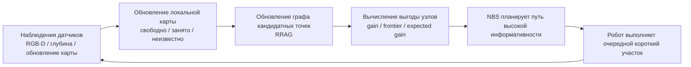

В этом цикле статью больше всего интересуют два средних шага:

1. **Как построить кандидатные точки обзора на карте**: где робот может стоять, в какую сторону смотреть и какие точки связаны проходимым путём.
2. **Как выбрать путь на графе**: при ограниченном бюджете по какой последовательности узлов пройти, чтобы получить максимум информации.

Это не обучение большой визуальной модели и не world model, которая предсказывает будущие видео. Метод остаётся классическим и очень «роботным»: есть граф, рёбра, стоимости, выгоды, бюджет, проверка столкновений и перепланирование онлайн.

## 4. Как читать общий рисунок

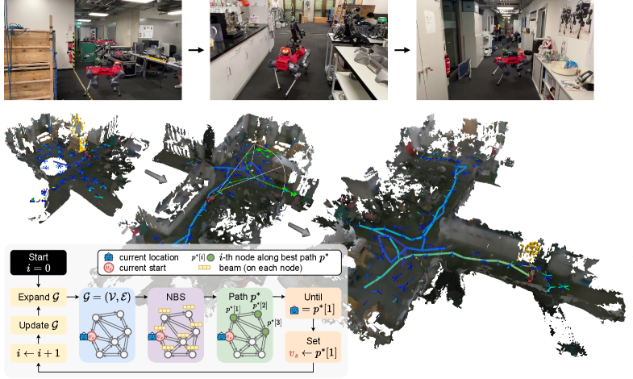

Рисунок 1 показывает реконструкцию поверхности в аппаратном эксперименте. Его можно разбить на четыре слоя:

1. **Траектория робота**: пройденный путь показан цветом от тёмно-синего до ярко-жёлтого, цвет отражает ход времени; текущий план обозначен светло-зелёными стрелками.
2. **Конус обзора камеры**: робот не видит всего, он наблюдает только ту часть, которая попадает в поле зрения камеры. Поэтому направление взгляда напрямую влияет на объём информации.
3. **Frontier**: жёлтые воксели — это граница поверхности (surface frontiers), то есть области около уже известных поверхностей, которые ещё не наблюдались полностью. Смысл активного восприятия как раз в том, чтобы ехать туда и закрывать эти «дыры».
4. **Замкнутый цикл планирования**: в левом нижнем углу показан основной цикл: NBS находит текущий лучший путь, робот доходит до следующего узла, карта и новая информация обновляются, затем планирование выполняется заново.

Рисунок удобен как первое изображение в учебнике, потому что он передаёт главную мысль статьи: **робот не строит полный маршрут сразу, а смотрит немного, идёт немного, обновляет карту и заново планирует.**

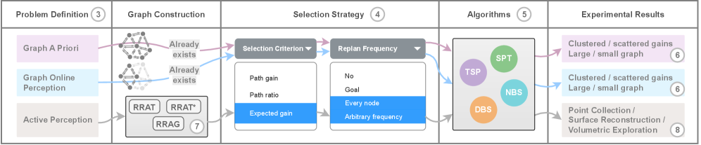

Рисунок 2 — структурная схема статьи. Она делит задачу на три уровня — от абстрактного к реальному:

| Уровень | Сценарий | Акцент |
| :--- | :--- | :--- |
| Graph a priori | Граф и выгода узлов известны заранее | Сначала сравнить, какой алгоритм поиска по графу сильнее сам по себе |
| Graph online perception | Граф постепенно открывается по мере наблюдения | Проверить перепланирование, frontier и expected gain |
| Active perception | Готового графа нет, его нужно строить из свободного пространства онлайн | Ввести RRAG и перенести поиск по графу на реальную задачу робота |

Такая организация заслуживает внимания. Авторы не начинают с результатов в Habitat или на реальном роботе, а сначала отдельно показывают вклад алгоритма поиска и критерия выбора, и только потом переносят лучшую комбинацию в реальную задачу активного восприятия. Логика изложения прозрачна: **сначала доказать, что планировщик работает, и только потом доказать, что построение графа стыкуется с реальным роботом.**

## 5. Постановка задачи: не кратчайший путь, а информационный путь

Обычное планирование пути выглядит так:

> Даны старт и цель, найти путь с минимальной стоимостью.

Планирование информационного пути (informative path planning) звучит иначе:

> Даны старт и бюджет; найти путь, на котором робот соберёт как можно больше информации.

Здесь важны такие величины:

| Понятие | Смысл |
| :--- | :--- |
| node | Кандидатное состояние робота, обычно включает позицию и ориентацию |
| edge | Допустимое движение между двумя кандидатными состояниями |
| cost | Стоимость прохождения ребра: расстояние, время или энергия |
| gain | Сколько новой информации даёт прибытие в точку обзора |
| budget | Общий бюджет движения, например максимальная длина пути или время исполнения |
| path | Последовательность узлов, суммарная стоимость которой не превышает бюджет |

Задача сложна по двум причинам:

1. **Выбор узлов и порядок пути связаны между собой**: нельзя просто выбрать несколько хороших точек и соединить их как попало, поскольку стоимость соединений меняет оптимальный выбор.
2. **Выгоды не складываются тривиально**: после того как область уже просмотрена, соседние узлы могут не дать новой информации; потенциальная выгода неизвестной области трудно вычисляется напрямую.

Статья последовательно расширяет постановку до трёх форм:

| Форма | Известен ли полный граф | Известна ли полная выгода | Смысл |
| :--- | :--- | :--- | :--- |
| Graph a priori | Известен | Известна | Чистый тест алгоритмов поиска пути |
| Graph online perception | Частично известен | Обновляется по мере наблюдений | Проверка перепланирования и frontier |
| Active perception | Неизвестен, строится онлайн | Оценивается по восприятию и построению карты | Приближение к реальному роботу |

## 6. Почему TSP и SPT недостаточно хороши

В статье в основном сравниваются два классических подхода.

**Подход TSP**: сначала выбрать или выборочно взять набор узлов с высокой информативностью, затем решить задачу коммивояжёра (TSP), чтобы найти маршрут их посещения.

Проблемы этого подхода:

- Выбор узлов и порядок их обхода разделены на два этапа, что легко приводит к локальному оптимуму.
- Сама задача TSP становится очень дорогой с ростом числа узлов.
- В онлайн-исследовании среда и frontier постоянно меняются, и многократно решать большой TSP неэкономично.

**Подход SPT**: ограничить пространство поиска деревом кратчайших путей (shortest path tree) и выбирать пути только внутри него.

Проблемы этого подхода:

- Он очень быстрый, но кандидатные пути сильно сужаются.
- Для каждого узла обычно сохраняется только один путь — кратчайший; можно потерять путь, который немного длиннее, но позволяет увидеть гораздо больше.
- В задачах активного восприятия повторное прохождение некоторых мест, выбор разных ориентаций и обход вокруг, чтобы посмотреть неизвестную область, могут быть ценными.

Позиция статьи — **компромисс между ними: более масштабируемо, чем TSP, и менее ограниченно, чем SPT.**

## 7. NBS: поиск лучом на уровне узлов

Обычный beam search широко используется в задачах с последовательностями: на каждом слое сохраняются глобально лучшие top-B последовательностей. Статья называет это depth-wise beam search (DBS).

Проблема DBS в том, что он склонен сконцентрировать все лучи в одной области высоких оценок. Например, на первом шаге обнаружено несколько узлов с высокой выгодой справа, и все лучи расширяются вправо. Левая сторона, которая на короткой дистанции даёт низкую оценку, но в перспективе ведёт к большой неизвестной области, отсекается заранее.

Идея NBS проста:

> Не отбирать top-B глобально по глубине, а для каждой конечной вершины отдельно сохранять top-B кандидатных путей.

То есть NBS поддерживает не такую структуру:

```text
depth d: top-B paths globally
```

а такую:

```text
node v1: top-B paths ending at v1
node v2: top-B paths ending at v2
node v3: top-B paths ending at v3
...
```

Упрощённый псевдокод:

```text
frontier[start] = {empty path}

repeat search_depth times:
    next_frontier = {}

    for each end_node in frontier:
        for each path ending at end_node:
            for each neighbor of end_node:
                candidate = path + neighbor
                if candidate cost > budget:
                    continue
                insert candidate into next_frontier[neighbor]
                keep only top-B candidates for this neighbor

    frontier = merge(frontier, next_frontier)

return best path among all stored feasible candidates
```

Главная выгода такого подхода — **сохранение разнообразия путей**. Даже если какой-то регион временно не попадает в глобальный top-B, он не будет вытеснен путями из других регионов, если он достаточно хорош в своей конечной вершине.

Сравнение подходов:

| Способ поиска | Что сохраняется | Преимущества | Риски |
| :--- | :--- | :--- | :--- |
| Greedy | Лучший выбор на текущем шаге | Очень быстрый | Близорукость |
| SPT | Кратчайший путь до каждого узла | Быстрый, простая структура | Видит только пути дерева кратчайших путей |
| DBS | Глобальный top-B путей на каждой глубине | Исследует больше, чем greedy | Лучи могут сгрупповаться в одной области |
| NBS | top-B путей на каждый узел | Лучше разнообразие, устойчив при малой ширине луча | Хранит больше состояний, чем DBS |
| TSP | Выбор точек, затем порядок обхода | Можно использовать зрелые решатели TSP | Два этапа, высокая стоимость, не лёгок онлайн |

Интересный результат статьи: NBS сохраняет стабильную работу даже при небольшой ширине луча. Для робота это важно: реальное планирование не может бесконечно расширять луч; обычно следующий исполнимый путь нужно получить за время от нескольких сотен миллисекунд до нескольких секунд.

## 8. Оценка путей: Path Gain, Path Ratio, Expected Gain

NBS — это лишь каркас поиска. Нужна ещё функция оценки, которая определяет, какой путь стоит сохранить. Статья в основном сравнивает три критерия.

| Критерий | Интуиция | Подходящие условия | Основная проблема |
| :--- | :--- | :--- | :--- |
| Path Gain | Сколько известной выгоды собирает путь | Когда распределение информации известно достаточно точно | Может жадно брать только известную выгоду и не идти к неизвестным frontier |
| Path Ratio | Выгода на единицу стоимости (gain / cost) | Когда бюджет ограничен и предпочтительны короткие пути | Легко выбирает близкие небольшие выгоды, недостаточно исследует |
| Expected Gain | Известная выгода плюс оценка будущей выгоды по frontier | Онлайн-исследование, активное построение карты | Зависит от определения frontier и оценки видимости |

<table>
  <tr>
    <td width="33%">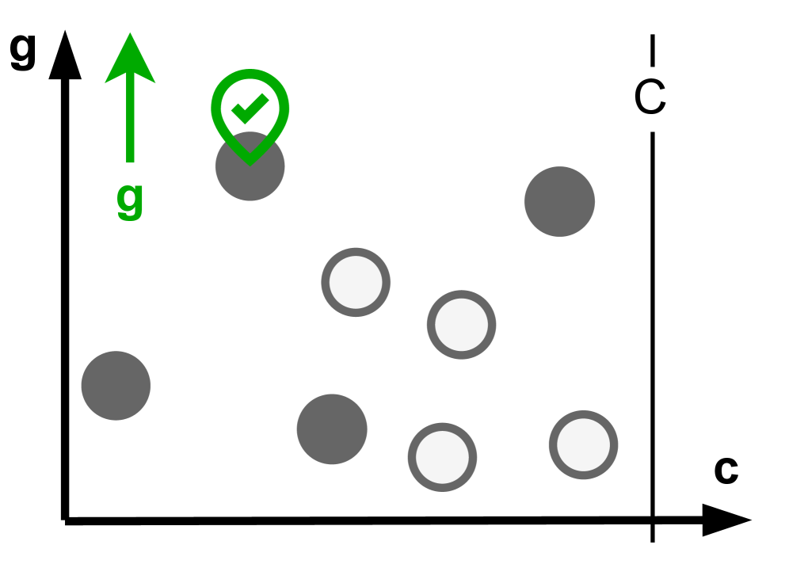</td>
    <td width="33%">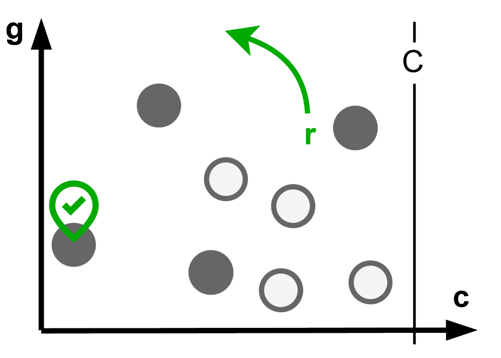</td>
    <td width="33%">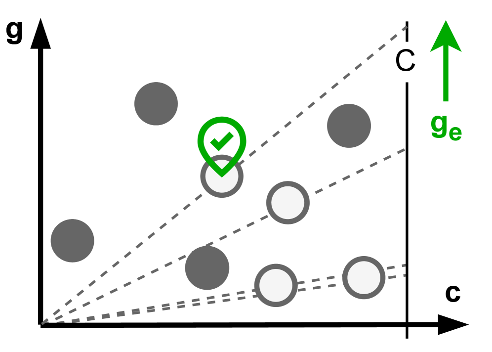</td>
  </tr>
  <tr>
    <td align="center">Path Gain: ориентирован на накопленную известную выгоду</td>
    <td align="center">Path Ratio: ориентирован на выгоду на единицу стоимости</td>
    <td align="center">Expected Gain: учитывает потенциальную выгоду frontier в оценке</td>
  </tr>
</table>

Expected Gain — второй важный вклад статьи. Он решает классический для активного восприятия баланс «исследование — использование» (exploration–exploitation):

- **Использование (exploitation)**: идти к точкам обзора, которые уже известны как ценные.
- **Исследование (exploration)**: идти к границам неизвестной области, потому что там могут открыться новое пространство, новые поверхности и новые цели.

Если учитывать только известную выгоду, робот будет ходить по кругу вокруг уже изученной области. Если учитывать только frontier, он может проигнорировать уже обнаруженную высокоценную цель. Expected Gain вводит информацию frontier в оценку пути и позволяет роботу оценить, сколько новых объектов можно найти, дойдя до данной точки.

Для читателя здесь важнее идея, а не формула:

> Активное восприятие не может оптимизировать только выгоду текущей карты; нужно разумно оценивать ожидаемую ценность областей-границ, которые дадут новые наблюдения.

## 9. RRAG: как подключить поиск по графу к реальному активному восприятию

Если запустить NBS только на заданном графе, это всё ещё алгоритмическая задача. Реальному роботу граф не дан: его нужно строить на ходу, выбирая кандидатные точки обзора. Статья предлагает RRAG — **Rapidly-exploring Random Annulus Graph** (быстро исследующий случайный кольцевой граф).

В названии RRAG три ключевых слова:

| Ключевое слово | Смысл |
| :--- | :--- |
| Rapidly-exploring | Как RRT/RRG, быстро покрывает проходимое пространство случайной выборкой |
| Random | Кандидатные состояния получаются случайной выборкой, что подходит для неизвестной среды и сложной геометрии |
| Annulus Graph | Использует правило кольцевых расстояний, чтобы контролировать плотность узлов и радиус соединений, избегая слишком редкого или слишком плотного графа |

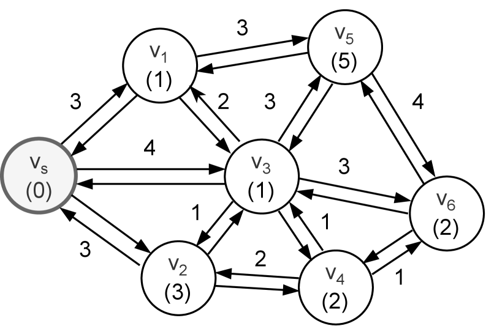

Каждый узел такого графа — не просто двумерная точка, а состояние робота. Для робота с камерой **ориентация важна**: стоя в одной и той же точке, при взгляде налево и направо получаешь совершенно разную информацию.

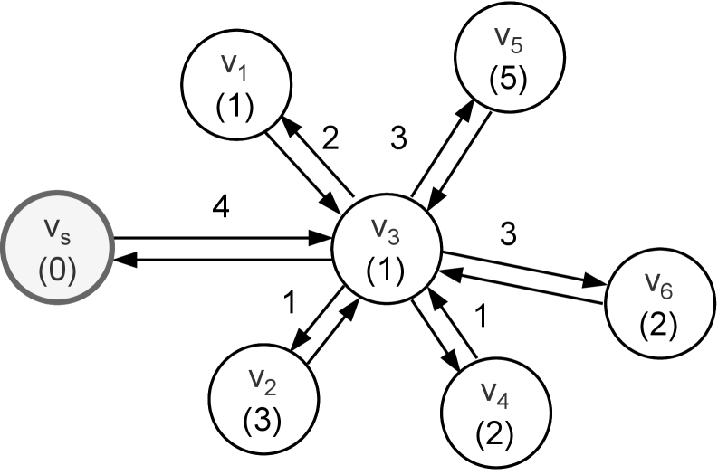

Статья подчёркивает, что RRAG должен сохранять полную дискретизацию направлений, то есть в окрестности одной позиции может быть несколько вариантов рысканья (yaw). Тогда NBS выбирает не только то, куда ехать, но и то, в каком направлении смотреть по прибытии.

По сравнению с древовидной структурой у RRAG есть ещё одно преимущество: граф допускает, что один узел достигается несколькими путями, и позволяет повторно использовать локальные участки пути. В дереве у каждого узла обычно один родитель, и «не самые короткие, но информативные» пути могут быть отсечены.

## 10. Узкие проходы и резервный локальный планировщик

В реальных помещениях часто встречаются узкие двери, зазоры между стульями и столами, повороты в коридорах. Если соединять две выборочные точки прямой линией, то из-за неудачной проверки столкновений граф легко распадается на части.

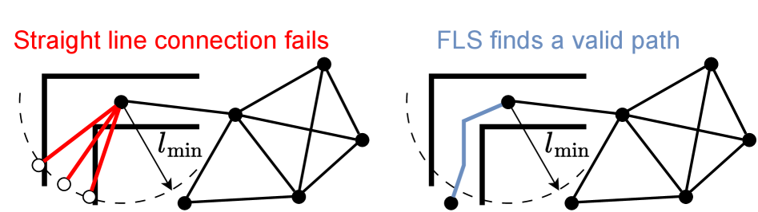

На рисунке показан смысл резервного локального планировщика (fallback local sampling-based planner): если два узла нельзя соединить простой прямой, локальный планировщик на основе выборки ищет допустимую кривую или ломаную траекторию и восстанавливает связность графа.

Для активного восприятия это критично. Если граф разорван в узком проходе, даже мощный NBS будет искать на неверном графе; планировщик решит, что некоторые области недостижимы, и пропустит будущие информационные выгоды. Резервный механизм RRAG — не украшение, а важный инженерный модуль, благодаря которому «онлайн-построение карты» работает в захламлённых помещениях.

## 11. Три типа задач активного восприятия

Авторы выполнили симуляционные эксперименты на 8 внутренних сценах из Habitat Synthetic Scenes Dataset и охватили три типа задач: point collection, surface reconstruction и volumetric exploration.

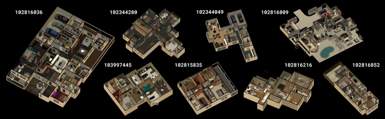

### 11.1 Point Collection

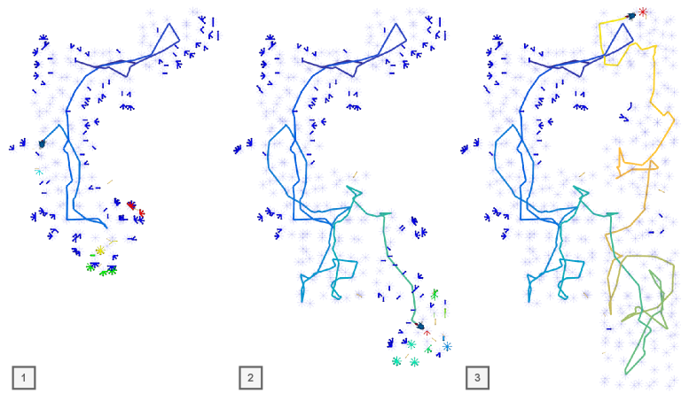

Point Collection можно понимать как задачу, похожую на ObjectNav, но без семантических меток:

- В среде есть точечные цели.
- В начале робот не знает, где они расположены.
- Точка обнаруживается, только когда соответствующая область попадает в поле зрения.
- Робот должен в пределах бюджета собрать как можно больше ценных точек.

Эта задача хорошо проверяет баланс исследования и использования. Если робот видит близкую точку, сразу ли ехать за ней или продолжить исследовать неизвестную область, где может быть ещё больше точек? Expected Gain как раз и решает этот компромисс.

### 11.2 Surface Reconstruction

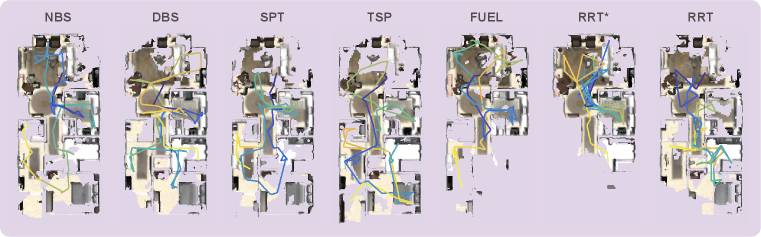

Цель Surface Reconstruction — как можно полнее отсканировать поверхности внутри помещения. Истинная цель — «сколько занятых вокселов или площади поверхности удалось восстановить в итоге», но робот в процессе исследования не знает полной среды, поэтому напрямую оптимизировать конечный показатель нельзя.

Статья использует surface frontier для оценки выгоды:

- Если рядом с известной занятой поверхностью остались неизвестные воксели, значит, там, возможно, не полностью отсканированная поверхность.
- Если точка обзора видит много surface frontier, она стоит того, чтобы туда ехать.
- После перепланирования робот продолжает закрывать дыры, и реконструкция постепенно становится полной.

Эти задачи очень близки к реальным сценариям: инспекция на производстве, сканирование помещений, картографирование после стихийных бедствий.

### 11.3 Volumetric Exploration

Volumetric Exploration ориентирован на исследование неизвестного объёма среды: цель ближе к «максимизации наблюдаемого свободного или занятого пространства». Отличие от surface reconstruction:

- Surface reconstruction важнее полнота сканирования поверхностей.
- Volumetric exploration важнее полнота исследования пространства.

Функции выгоды в этих задачах различаются, но каркас планировщика можно переиспользовать: везде обновляется карта, вычисляются frontier, строится RRAG и с помощью NBS ищется следующий участок пути.

## 12. Как понимать выводы эксперимента

Выводы статьи можно разделить на три уровня.

Первый уровень — на абстрактных графах: NBS устойчивее TSP, SPT и DBS. Особенно при малой ширине луча NBS сохраняет хорошие пути, что говорит о преимуществе «сохранения кандидатов для каждого узла» над «сохранением кандидатов для каждой глубины» при информационном планировании пути.

Второй уровень — в режиме онлайн-восприятия: Expected Gain лучше подходит для активного исследования, чем одни лишь Path Gain или Path Ratio. Причина не в магии, а в том, что метрика явно считает frontier потенциальной будущей выгодой и заставляет робота идти туда, где открываются новые области карты.

Третий уровень — в реальных задачах активного восприятия: сочетание NBS и RRAG показывает лучшие результаты в point collection, surface reconstruction и volumetric exploration. В аннотации статьи сказано, что по одной или нескольким задачам достигается улучшение не менее чем на 20 % относительно существующих SOTA-методов.

Это значит, что вклад статьи — не отдельный трюк, а целостная комбинация:

```text
Алгоритм поиска NBS
  + критерий выбора пути Expected Gain
  + онлайн-построение графа RRAG
  + частое перепланирование
  + оценка выгоды на основе frontier
= практичный планировщик активного восприятия
```

## 13. Границы реальных экспериментов

Авторы также проверили метод на реальном роботе. Аппаратная платформа — четвероногий робот ANYmal; фронтальные датчики — ZED X Mini; глубина камер обрабатывается на NVIDIA Jetson Orin, а построение карты и планирование работают на CPU Intel Core i7.

Реальные эксперименты включают:

- реконструкцию поверхностей в лаборатории;
- реконструкцию поверхностей на открытом воздухе и в музее двигателей (engine museum);
- volumetric exploration в столовой и в другой лаборатории.

Важно учитывать: реальная часть ближе к качественной проверке (qualitative validation). Она показывает, что полный конвейер может работать на борту, онлайн строить карту и планировать в сложной среде. Но это не масштабный бенчмарк на реальных роботах, и из неё нельзя делать вывод, что «все задачи активного восприятия для мобильных роботов уже решены».

## 14. Связь с VLA и моделями мира

Эту работу легко поставить не в тот раздел, поскольку сейчас в воплощённом ИИ очень популярны «модели мира», «VLA» и «интерактивные симуляции». Но её связь с ними такая:

| Направление | Основа ли это статьи | Связь |
| :--- | :--- | :--- |
| VLA | Нет | Визуально-языковая модель действий не обучается и не выводит токены для манипулятора |
| Модель мира | Нет | Не предсказываются будущие видео или латентная динамика |
| Традиционная навигация | Частично | Цель — не кратчайший путь к точке, а максимизация информационной выгоды |
| Активное восприятие | Да | Робот активно выбирает следующее место и направление наблюдения |
| Исследование и построение карты | Да | Используются frontier, ESDF, онлайн-обновление карты и перепланирование |

Если поместить работу в общую систему, она занимает такое место:

```text
Модуль восприятия и картографирования даёт свободно / занято / неизвестно
        ↓
Планировщик активного восприятия выбирает следующие ценные точки обзора
        ↓
Низкоуровневое управление движением исполняет путь
        ↓
Новые наблюдения снова обновляют карту
```

В будущем метод может сочетаться с VLA: например, VLA даёт высокоуровневое задание «проверить эту зону» или «найти определённый предмет», а NBS отвечает за низкоуровневое планирование точек наблюдения. Однако сама статья не решает понимание языка и привязку семантических целей (grounding).

## 15. Как воспроизводить сейчас

Прямо воспроизвести эксперименты по официальному репозиторию пока нельзя, поскольку код OpenApero не опубликован. Разумная последовательность изучения:

1. Сначала прочитайте HTML-версию arXiv, особенно рисунки 1 и 2 и разделы 4, 5, 7 и 8.
2. Когда в репозитории OpenApero выйдет код, начинайте с минимального графового бенчмарка и не сразу с Habitat или реального робота.
3. Сначала воспроизведите graph a priori: постройте небольшой граф с выгодами узлов и стоимостями рёбер и сравните SPT, DBS и NBS.
4. Затем воспроизведите graph online perception: на каждом шаге открывайте только локальные узлы и frontier и посмотрите, делает ли expected gain путь более склонным к исследованию.
5. В конце подключите Habitat: загрузите сцены HSSD, RGB-D наблюдения, карту Voxblox/ESDF, построение графа RRAG и перепланирование NBS.

Если хотите сделать упрощённую версию до публикации кода, достаточно реализовать такой минимальный эксперимент:

```text
Вход:
  граф NetworkX
  у каждого узла есть gain
  у каждого ребра есть cost
  начальный узел start
  бюджет budget

Реализация:
  базовый SPT
  depth-wise beam search
  node-wise beam search
  две функции оценки: path_gain и path_ratio

Выход:
  путь, найденный каждым методом
  суммарная выгода
  суммарная стоимость
  время поиска
```

Этот минимальный эксперимент не требует Habitat и симуляции робота, но позволяет глубоко понять главную идею статьи.

## 16. На что обратить внимание при чтении

Лучше читать статью, отвечая на вопросы, а не продираясь через формулы подряд:

1. **Почему планирование информационного пути нельзя свести к поиску кратчайшего пути?**
2. **Почему TSP-подход к активному восприятию дорог и почему двухэтапный выбор точек и соединение теряет качество решения?**
3. **Почему DBS «притягивает» все лучи к локальной области с высокими оценками?**
4. **Какое разнообразие сохраняет per-node top-B в NBS?**
5. **Как Expected Gain вводит будущую выгоду frontier в оценку пути?**
6. **Зачем RRAG сохраняет несколько ориентаций?**
7. **Какую реальную инженерную проблему онлайн-построения графа решает резервный локальный планировщик?**
8. **Чем отличаются функции выгоды в трёх типах задач?**
9. **Что доказывают симуляционные и реальные результаты и что они не доказывают?**

Если вы можете ответить на эти вопросы, значит, вы уловили основную линию статьи.

## 17. Ценность и ограничения работы

Ценность статьи в том, что она связывает в один конвейер три проблемы активного восприятия, которые долго существовали отдельно: **алгоритм поиска, оценка пути и онлайн-построение графа**. Метод последовательно проверяется на трёх уровнях — абстрактных графах, Habitat и реальном роботе. Для тех, кто занимается навигацией, исследованием, инспекцией и трёхмерной реконструкцией, эта работа ближе к традиционным робототехническим системам, чем модные направления VLA.

Ограничения тоже очевидны:

- Это приближённый поиск, а не точный решатель оптимальной IPP-задачи.
- Метод опирается на оценки выгоды и frontier; при плохой карте или плохой оценке видимости планирование тоже страдает.
- Количественные эксперименты в основном выполнены на внутренних сценах HSSD, а объём проверки в реальной среде ограничен.
- Код OpenApero пока не опубликован официально, поэтому полные команды воспроизведения в учебнике дать нельзя.
- Метод не обрабатывает языковые семантические цели и не отвечает за надёжность низкоуровневого контроллера.

Более взвешенный вывод: это очень основательная **работа по планированию активного восприятия**. Она закрывает пробел «как робот сам выбирает, куда смотреть», и её не стоит воспринимать как новую VLA или модель мира.

## 18. Рекомендуемое задание

В групповом курсе эту работу можно использовать как углублённое задание Task04 по планированию навигации:

> Сравните Habitat / ETPNav / NBS для активного восприятия: что оптимизируют обычная навигация, языковая навигация и активное восприятие? Каковы входы и выходы? Каковы границы применимости?

Рекомендуемый результат:

- Нарисовать замкнутый цикл активного восприятия NBS.
- Своими словами объяснить рисунки 1 и 2.
- Сравнить способы сохранения лучей в DBS и NBS.
- Объяснить, почему expected gain лучше подходит для исследования, чем одна только path gain.
- Указать, что код OpenApero пока не опубликован, и что воспроизведение следует отложить до официального релиза.

## 19. Источники изображений и ссылки

Изображения этой главы взяты из HTML-версии статьи на arXiv: [`An Efficient Beam Search Algorithm for Active Perception in Mobile Robotics`](https://arxiv.org/html/2604.23327v1); права и условия использования определяются оригинальной статьёй и страницей arXiv. Состояние проекта и кода описано по [репозиторию OpenApero на GitHub](https://github.com/OpenApero/openapero) и [странице проекта OpenApero](https://openapero.github.io/).
