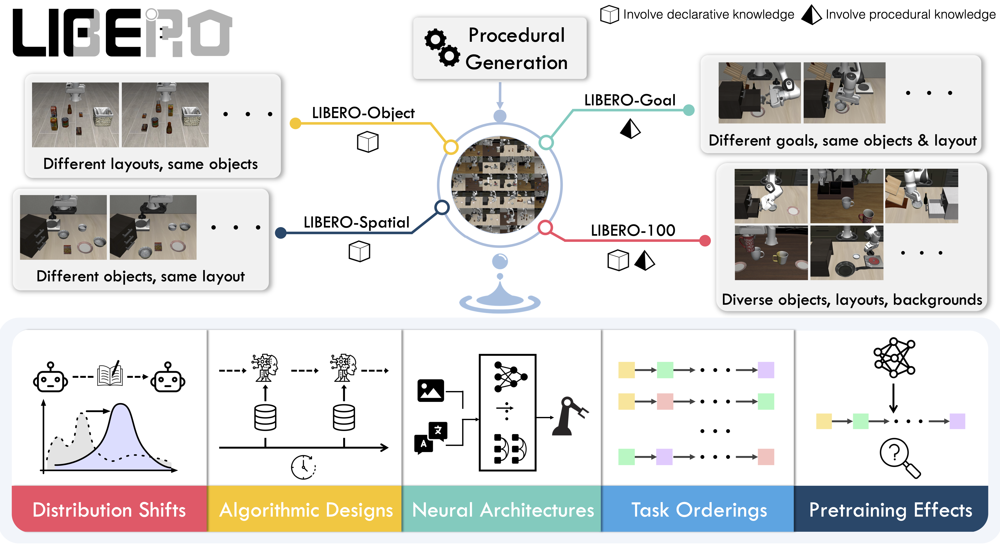

# LIBERO: подробный разбор набора данных — архитектура, статистика и инженерная реализация

## 1. Введение

В области обучения роботов (Robot Learning) **LIBERO** (Lifelong Learning Benchmark for Robot Manipulation) — веха в построении бенчмарков. Он создан для исследования **непрерывного обучения (Lifelong Learning)** и **переноса знаний (Knowledge Transfer)**. В отличие от традиционных наборов с одной задачей, LIBERO оценивает, как политика робота, получая новые последовательности задач, преодолевает **катастрофическое забывание (Catastrophic Forgetting)** и использует накопленные знания, чтобы учиться быстрее.

В этой главе на основе реального разведочного анализа данных (EDA) подробно разобраны четыре основных поднабора (Suites) LIBERO в количественном и качественном виде, а также различия формы данных в двух разных фреймворках обучения — LeRobot и OpenVLA.

<p align="center">
  
  <br>
  <b>Рисунок 1: Обзор данных LIBERO</b>
</p>

## 2. Архитектура набора данных и таксономия задач

Наборы LIBERO — не беспорядочная коллекция задач: они разделены на четыре поднабора с определёнными семантическими целями. В каждом поднаборе 10 основных задач, которые проверяют разные аспекты обобщения робота.

### 2.1 LIBERO-Object: обобщение на уровне объектов

- **Назначение**: проверить устойчивость робота к визуальным признакам объектов (цвету, форме, текстуре).
- **Основная логика**: последовательности действий очень похожи («взять X и положить в корзину»), но объект манипуляции X меняется.
- **Типичные задачи**:
  - взять банку супа с буквами (Alphabet Soup);
  - взять сливочный сыр (Cream Cheese);
  - взять кетчуп (Ketchup);
  - *Примечание: все действия — захват и укладка (Pick-and-Place); меняется только сам объект.*

### 2.2 LIBERO-Spatial: устойчивость к пространственной компоновке

- **Назначение**: проверить способность робота к пространственному восприятию и планированию, когда меняется относительное положение объектов.
- **Основная логика**: объект манипуляции фиксирован (обычно это чёрная миска), но меняются его начальное положение и окружение (положение помех).
- **Типичные задачи**:
  - взять чёрную миску **между тарелкой и формой**;
  - взять чёрную миску **из центра стола**;
  - взять чёрную миску **из верхнего ящика деревянного шкафа**.
  - *Примечание: это требует очень сильного понимания пространственной семантики, а не простого запоминания координат.*

### 2.3 LIBERO-Goal: разнообразие целевых состояний

- **Назначение**: проверить способность робота достигать заданных целевых состояний (изменения состояния, State Change), что подразумевает сложные взаимодействия.
- **Основная логика**: цель задачи — не просто захват, а открытие и закрытие, толкание, укладка и другие физические взаимодействия.
- **Типичные задачи**:
  - **открыть** средний ящик шкафа;
  - **толкнуть** тарелку к плите;
  - **поставить** бутылку вина на винную стойку;
  - **сложить**: поставить миску на тарелку.

### 2.4 LIBERO-10 (Long-Horizon): рассуждение над длинными последовательностями

- **Назначение**: проверить способность робота выполнять длинные многошаговые составные задачи. Это самый сложный поднабор.
- **Основная логика**: обычно включает две или более последовательных операций либо действия, которые запускаются условием.
- **Типичные задачи**:
  - положить в корзину **и** банку супа с буквами, **и** коробку сливочного сыра (последовательность с несколькими объектами);
  - положить чёрную миску в нижний ящик шкафа **и** закрыть его (сложная последовательность взаимодействий);
  - включить плиту, **а затем** поставить на неё кофейник мока (причинно-следственная последовательность).

------

## 3. Количественная статистика

Обходом и подсчётом файлов `Parquet` получено следующее точное распределение данных. Это важно для выбора `Batch Size` и планирования `Epoch` при обучении.

### 3.1 Общий объём

- **Всего эпизодов (Episodes)**: 1 693
- **Всего кадров (Samples/Frames)**: 273 465
- **Средняя длина эпизода**: около 161,5 кадра/эпизод

### 3.2 Подробная таблица по поднаборам

| **Поднабор (Dataset Suite)** | **Число задач** | **Число эпизодов** | **Всего кадров (Frames)** | **Средняя длина (шагов/эпизод)** | **Статистический смысл**                                      |
| ---------------------------- | --------------- | ------------------ | ------------------------- | -------------------------------- | ------------------------------------------------------------- |
| **libero_10**                | 10              | 379                | **101 469**               | **267,7**                        | **Длинные задачи**: средняя длина более чем в 2 раза больше, чем у остальных, что подтверждает «длинную последовательность». |
| **libero_goal**              | 10              | 428                | 52 042                    | 121,6                            | **Короткие взаимодействия**: самые короткие эпизоды, цели задач определены чётко, шаги компактны. |
| **libero_object**            | 10              | 454                | 66 984                    | 147,5                            | **Задачи средней длины**: включают распознавание и захват объектов, длина умеренная. |
| **libero_spatial**           | 10              | 432                | 52 970                    | 122,6                            | **Короткая локализация**: время уходит в основном на планирование движения, а не на физическое взаимодействие. |

### 3.3 Выводы о распределении данных

1. **Баланс выборки**: кроме `libero_10`, где из-за сложности задач выборка заметно больше, остальные три набора имеют объём 50–60 тысяч кадров, а число эпизодов по подзадачам в основном колеблется от 35 до 50. Такой баланс помогает избежать переобучения модели.
2. **Временные свойства**: средняя длина `libero_10` равна `267,7` шага. Это значит, что для обучения на этом поднаборе модели нужно более длинное контекстное окно (Context Window) или более эффективное управление памятью (Memory).

------

## 4. Инженерия данных: согласование форматов LeRobot и OpenVLA

На практике разнородность форматов данных — главное препятствие для обучения. Для LIBERO распространены два формата: **LeRobot (Parquet)**, ориентированный на экосистему HuggingFace, и **OpenVLA (RLDS/TFRecord)**, ориентированный на экосистему TensorFlow/Google.

### 4.1 Матрица сравнения форматов

| **Характеристика**   | **Формат LeRobot**           | **Формат OpenVLA (RLDS)**             | **Влияние на инженерию**                                     |
| -------------------- | ---------------------------- | ------------------------------------- | ------------------------------------------------------------ |
| **Низкоуровневое хранение** | **Apache Parquet**    | **TFRecord (Protocol Buffers)**       | Parquet удобен для колоночного чтения и анализа; TFRecord — для потоковой тренировки с высокой пропускной способностью. |
| **Структура данных** | **Плоская (Flat)**           | **Вложенная (Nested/Hierarchical)**   | LeRobot разворачивает изображения и состояния в столбцы; OpenVLA упаковывает данные в последовательность `steps`. |
| **Управление метаданными** | `info.json`            | `dataset_info.json` + `features.json` | Ключи-значения, описывающие метаданные, различаются, нужно сопоставление. |
| **Совместимость с экосистемой** | PyTorch, Pandas, HuggingFace | TensorFlow, JAX, DeepMind RLDS | Кросс-фреймворковое обучение требует ETL-преобразования.      |

### 4.2 Проблемы согласования данных и решения

По результатам аналитических скриптов, два формата **не совместимы**. Чтобы дообучить модель OpenVLA на данных в формате LeRobot, нужно выполнить процесс **ETL (Extract-Transform-Load)**:

1. **Extract (извлечение)**: с помощью `Pandas` или `PyArrow` прочитать файлы `.parquet` и разобрать плоские столбцы `observation.image` и `action`.
2. **Transform (преобразование)**:
   - **Перестройка структуры**: превратить плоские данные в иерархию `(episode, step)`.
   - **Преобразование типов**: перевести байтовые потоки изображений или массивы Numpy в формат TF Feature.
   - **Добавление метаданных**: добавить поля, обязательные для RLDS, такие как `is_first`, `is_last`, `reward`.
3. **Load (загрузка)**: с помощью `tf.io.TFRecordWriter` сериализовать данные в файлы `.tfrecord` и создать соответствующие подписанные файлы RLDS.

------

## 5. Итоги

Структурированный дизайн задач LIBERO чётко разделяет четыре измерения трудностей манипуляции роботом: **визуальное (Object)**, **пространственное (Spatial)**, **взаимодействие (Goal)** и **временное (10/Long-Horizon)**.

- **Для исследователей алгоритмов**: LIBERO — отличный эталон, по которому видно слабые места модели (например, если модель хорошо справляется с задачами Object, но плохо — со Spatial, значит, её механизм пространственного внимания несовершенен).
- **Для инженеров**: понимание различий форматов LeRobot и OpenVLA — необходимое условие построения эффективного конвейера данных (Data Pipeline). Заметное увеличение длины последовательностей в `libero_10` напоминает, что при развёртывании модели нужно учитывать задержку инференса и занимаемую видеопамять.

# Приложение: отчёт о статистике набора LIBERO и код анализа

```python
#!/usr/bin/env python3
"""
Анализ набора LIBERO: подсчёт числа подзадач и числа выборок в каждой крупной задаче
"""

import pandas as pd
import os
from pathlib import Path
import json
from collections import defaultdict

def analyze_libero_dataset():
    """Анализ набора LIBERO"""

    # Пути к наборам данных
    datasets = [
        "libero_10_no_noops_lerobot_v21",
        "libero_goal_no_noops_lerobot_v21",
        "libero_object_no_noops_lerobot_v21",
        "libero_spatial_no_noops_lerobot_v21"
    ]

    base_path = Path("/data1/DATA")

    results = {}

    for dataset_name in datasets:
        print(f"\nАнализ набора данных: {dataset_name}")
        print("=" * 50)

        dataset_path = base_path / dataset_name
        data_path = dataset_path / "data" / "chunk-000"

        if not data_path.exists():
            print(f"Путь к данным не существует: {data_path}")
            continue

        # Получаем все parquet-файлы
        parquet_files = list(data_path.glob("episode_*.parquet"))
        print(f"Общее число эпизодов: {len(parquet_files)}")

        # Анализируем каждый эпизод
        task_stats = defaultdict(lambda: {"episodes": 0, "total_samples": 0})
        episode_info = []

        for parquet_file in parquet_files:
            try:
                # Читаем parquet-файл
                df = pd.read_parquet(parquet_file)

                # Получаем информацию о задаче
                task_name = "unknown"
                if 'task_index' in df.columns and len(df) > 0:
                    task_index = df['task_index'].iloc[0]
                    task_name = f"task_{task_index}"
                elif 'task' in df.columns:
                    task_name = df['task'].iloc[0] if len(df) > 0 else "unknown"
                elif 'task_name' in df.columns:
                    task_name = df['task_name'].iloc[0] if len(df) > 0 else "unknown"
                else:
                    # Печатаем несколько первых строк, чтобы увидеть структуру данных
                    if len(episode_info) < 3:  # печатаем только для первых 3 файлов
                        print(f"Имена столбцов в файле {parquet_file.name}: {list(df.columns)}")
                        if len(df) > 0:
                            print(f"Число выборок: {len(df)}")
                            print(f"Первые строки данных:")
                            print(df.head(2))
                            print("-" * 30)

                # Статистика
                sample_count = len(df)
                task_stats[task_name]["episodes"] += 1
                task_stats[task_name]["total_samples"] += sample_count

                episode_info.append({
                    "file": parquet_file.name,
                    "task": task_name,
                    "samples": sample_count
                })

            except Exception as e:
                print(f"Ошибка при обработке файла {parquet_file.name}: {e}")

        # Вывод результатов статистики
        print(f"\nРезультаты статистики для {dataset_name}:")
        print(f"{'Название задачи':<15} {'Число эпизодов':<12} {'Всего выборок':<12} {'Среднее число выборок':<12}")
        print("-" * 60)

        total_episodes = 0
        total_samples = 0

        # Сортируем по индексу задачи
        sorted_tasks = sorted(task_stats.items(), key=lambda x: x[0])

        for task_name, stats in sorted_tasks:
            avg_samples = stats["total_samples"] / stats["episodes"] if stats["episodes"] > 0 else 0
            print(f"{task_name:<15} {stats['episodes']:<12} {stats['total_samples']:<12} {avg_samples:<12.1f}")
            total_episodes += stats["episodes"]
            total_samples += stats["total_samples"]

        print("-" * 60)
        print(f"{'Итого':<15} {total_episodes:<12} {total_samples:<12} {total_samples/total_episodes if total_episodes > 0 else 0:<12.1f}")

        # Сохраняем результаты
        results[dataset_name] = {
            "task_stats": dict(task_stats),
            "total_episodes": total_episodes,
            "total_samples": total_samples,
            "episode_info": episode_info
        }

    return results

if __name__ == "__main__":
    results = analyze_libero_dataset()

    # Сохраняем подробные результаты в JSON-файл
    with open("libero_analysis_results.json", "w", encoding="utf-8") as f:
        json.dump(results, f, ensure_ascii=False, indent=2)

    print("\n" + "=" * 80)
    print("Общая статистика:")
    print("=" * 80)

    for dataset_name, result in results.items():
        print(f"\n{dataset_name}:")
        print(f"  - Число типов задач: {len(result['task_stats'])}")
        print(f"  - Общее число эпизодов: {result['total_episodes']}")
        print(f"  - Общее число выборок: {result['total_samples']}")
        print(f"  - Среднее число выборок на эпизод: {result['total_samples']/result['total_episodes'] if result['total_episodes'] > 0 else 0:.1f}")

        # Подробная статистика по каждой задаче
        print(f"  - Распределение задач:")
        sorted_tasks = sorted(result['task_stats'].items(), key=lambda x: x[0])
        for task_name, stats in sorted_tasks:
            print(f"    * {task_name}: {stats['episodes']} эпизодов, {stats['total_samples']} выборок")
```

Выше — анализ данных в формате LeRobot.

Ниже — анализ данных в формате OpenVLA.

```python
#!/usr/bin/env python3
"""
Анализ набора LIBERO: подсчёт числа подзадач и числа выборок в каждой крупной задаче
"""

import os
import tensorflow_datasets as tfds
import tensorflow as tf

def analyze_dataset(dataset_path):
    """
    Анализирует один набор данных и извлекает уникальные языковые инструкции через tfds.
    """
    try:
        # Подавляем подробные журналы
        tf.get_logger().setLevel('ERROR')

        builder = tfds.builder_from_directory(builder_dir=dataset_path)
        dataset = builder.as_dataset(split='train')

        unique_instructions = set()

        for episode in dataset:
            # Языковая инструкция одинакова для всех шагов эпизода
            # Нужно пройти по набору шагов и взять первый шаг
            for step in episode['steps'].take(1):
                instruction = step['language_instruction'].numpy().decode('utf-8')
                unique_instructions.add(instruction)

        return sorted(list(unique_instructions))

    except Exception as e:
        print(f"Ошибка при анализе {dataset_path}: {e}")
        return []

def main():
    base_dir = "/data/DATA/modified_libero_rlds"
    task_categories = [d for d in os.listdir(base_dir) if os.path.isdir(os.path.join(base_dir, d)) and not d.startswith('.')]

    for category in task_categories:
        print(f"--- Категория задач: {category} ---")

        version_dir = os.path.join(base_dir, category, "1.0.0") # предполагаем версию 1.0.0

        if not os.path.exists(version_dir):
            print(f"Каталог версии не найден для {category}")
            continue

        subtasks = analyze_dataset(version_dir)

        print(f"  Найдено подзадач: {len(subtasks)}:")
        for i, task in enumerate(subtasks):
            print(f"    {i+1}. {task}")
        print("\n")

if __name__ == "__main__":
    main()
```

Общая информация о наборе данных

Проанализированы 4 набора LIBERO; каждый содержит 10 типов задач (от task_0 до task_9).

## Подробные результаты статистики

### 1. libero_10_no_noops_lerobot_v21

- **Общее число эпизодов**: 379
- **Общее число выборок**: 101 469
- **Среднее число выборок на эпизод**: 267,7
- **Число типов задач**: 10

**Подробная статистика по задачам**:

| Номер задачи | Число эпизодов | Всего выборок | Среднее число выборок |
| ------------ | -------------- | ------------- | --------------------- |
| task_0       | 38             | 9 807         | 258,1                 |
| task_1       | 36             | 9 020         | 250,6                 |
| task_2       | 34             | 9 990         | 293,8                 |
| task_3       | 41             | 10 866        | 265,0                 |
| task_4       | 43             | 11 494        | 267,3                 |
| task_5       | 33             | 9 571         | 290,0                 |
| task_6       | 29             | 11 808        | 407,2                 |
| task_7       | 49             | 12 702        | 259,2                 |
| task_8       | 35             | 8 577         | 245,1                 |
| task_9       | 41             | 7 634         | 186,2                 |

### 2. libero_goal_no_noops_lerobot_v21

- **Общее число эпизодов**: 428
- **Общее число выборок**: 52 042
- **Среднее число выборок на эпизод**: 121,6
- **Число типов задач**: 10

**Подробная статистика по задачам**:

| Номер задачи | Число эпизодов | Всего выборок | Среднее число выборок |
| ------------ | -------------- | ------------- | --------------------- |
| task_0       | 49             | 4 563         | 93,1                  |
| task_1       | 36             | 6 224         | 172,9                 |
| task_2       | 36             | 7 157         | 198,8                 |
| task_3       | 40             | 4 203         | 105,1                 |
| task_4       | 47             | 5 004         | 106,5                 |
| task_5       | 33             | 4 990         | 151,2                 |
| task_6       | 50             | 4 454         | 89,1                  |
| task_7       | 48             | 4 854         | 101,1                 |
| task_8       | 46             | 4 574         | 99,4                  |
| task_9       | 43             | 6 019         | 140,0                 |

### 3. libero_object_no_noops_lerobot_v21

- **Общее число эпизодов**: 454
- **Общее число выборок**: 66 984
- **Среднее число выборок на эпизод**: 147,5
- **Число типов задач**: 10

**Подробная статистика по задачам**:

| Номер задачи | Число эпизодов | Всего выборок | Среднее число выборок |
| ------------ | -------------- | ------------- | --------------------- |
| task_0       | 45             | 6 291         | 139,8                 |
| task_1       | 45             | 6 919         | 153,8                 |
| task_2       | 45             | 6 378         | 141,7                 |
| task_3       | 46             | 6 723         | 146,2                 |
| task_4       | 44             | 6 867         | 156,1                 |
| task_5       | 45             | 6 443         | 143,2                 |
| task_6       | 47             | 6 200         | 131,9                 |
| task_7       | 45             | 7 102         | 157,8                 |
| task_8       | 42             | 6 097         | 145,2                 |
| task_9       | 50             | 7 964         | 159,3                 |

### 4. libero_spatial_no_noops_lerobot_v21

- **Общее число эпизодов**: 432
- **Общее число выборок**: 52 970
- **Среднее число выборок на эпизод**: 122,6
- **Число типов задач**: 10

**Подробная статистика по задачам**:

| Номер задачи | Число эпизодов | Всего выборок | Среднее число выборок |
| ------------ | -------------- | ------------- | --------------------- |
| task_0       | 46             | 5 775         | 125,5                 |
| task_1       | 42             | 6 257         | 149,0                 |
| task_2       | 39             | 4 472         | 114,7                 |
| task_3       | 35             | 4 747         | 135,6                 |
| task_4       | 45             | 4 487         | 99,7                  |
| task_5       | 43             | 4 287         | 99,7                  |
| task_6       | 47             | 5 570         | 118,5                 |
| task_7       | 45             | 5 940         | 132,0                 |
| task_8       | 46             | 5 343         | 116,2                 |
| task_9       | 44             | 6 092         | 138,5                 |

## Сводка

| Название набора данных | Число задач | Всего эпизодов | Всего выборок | Среднее число выборок на эпизод |
| ---------------------- | ----------- | -------------- | ------------- | ------------------------------- |
| libero_10              | 10          | 379            | 101 469       | 267,7                           |
| libero_goal            | 10          | 428            | 52 042        | 121,6                           |
| libero_object          | 10          | 454            | 66 984        | 147,5                           |
| libero_spatial         | 10          | 432            | 52 970        | 122,6                           |
| **Итого**              | **40**      | **1 693**      | **273 465**   | **161,5**                       |

## Основные выводы

1. **Единая структура наборов**: во всех четырёх наборах по 10 типов задач (от task_0 до task_9).
2. **Различие объёмов выборок**: у libero_10 больше всего выборок (101 469), затем libero_object (66 984).
3. **Различие длины эпизодов**: у libero_10 самая большая средняя длина эпизода (267,7), у libero_goal и libero_spatial эпизоды короче (около 122).
4. **Распределение задач**: внутри каждого набора распределение задач довольно равномерное — примерно 30–50 эпизодов на задачу.
5. **Масштаб данных**: всего 1 693 эпизода и 273 465 точек выборки.

## Свойства данных

- **Формат данных**: все данные хранятся в формате parquet, по одному файлу на эпизод.
- **Структура данных**: каждая выборка содержит поля observation.state, action, timestamp и др.
- **Идентификация задач**: разные типы задач различаются по полю task_index.
- **Временная упорядоченность**: каждый эпизод соответствует полной последовательности выполнения задачи.

# Согласование данных LeRobot и OpenVLA: обсуждение

```
# Сравнительный анализ форматов данных OpenVLA и LeRobot

## 1. Сводка основных различий

| Пункт сравнения | OpenVLA (modified_libero_rlds) | LeRobot (lerobot_v21) | Статус согласования |
| :--- | :--- | :--- | :--- |
| **Формат хранения** | `TFRecord` | `Parquet` | 🔴 **Не совместимы** |
| **Метаданные признаков** | `features.json` (структура иная) | `info.json` | 🟡 **Нужно сопоставление** |
| **Структура признаков** | Вложена в `steps` и `episode_metadata` | Плоская структура | 🟡 **Нужно преобразование** |

**Вывод**: форматы OpenVLA и LeRobot **напрямую не согласованы**. Чтобы сделать их совместимыми, нужно преобразовать данные и сопоставить признаки.

---

## 2. Подробное сравнение

### Формат хранения

-   **OpenVLA**: используется формат `TFRecord` (`.tfrecord`). Это сериализованный двоичный формат, широко применяемый в экосистеме TensorFlow и подходящий для эффективных операций `I/O`.
-   **LeRobot**: используется формат `Apache Parquet` (`.parquet`). Это колоночный формат хранения, популярный в `Pandas` и `Spark`; он даёт эффективное сжатие и кодирование.

👉 **Анализ согласования**: на уровне двоичных данных форматы полностью различаются и не могут использоваться одинаково.

### Метаданные и определение признаков

#### OpenVLA

-   **`dataset_info.json`**: содержит высокоуровневые метаданные набора — версию, описание, информацию о фрагментах.
-   **`features.json`**: задаёт конкретную структуру данных. По результатам первого запуска аналитического скрипта, в корне нет ключа `features`, что говорит о том, что определение признаков может быть вложено глубже или его нужно разбирать вместе с загрузчиком `TensorFlow Datasets (TFDS)`. Обычно в формате RLDS/OpenVLA данные организованы в `steps`, и каждый `step` содержит `observation`, `action`, `reward`, `is_first`, `is_last` и т. д.

#### LeRobot

-   **`info.json`**: содержит и метаданные набора, и подробное определение признаков.
-   **Ключ `features`**: в `info.json` напрямую заданы все поля данных, в том числе:
    -   `observation.images.wrist_image` (видео)
    -   `observation.images.image` (видео)
    -   `observation.state` (состояние робота)
    -   `action` (действие)
    -   `timestamp`, `frame_index`, `episode_index` (метаданные)
    -   `task_index` (идентификатор задачи)

👉 **Анализ согласования**:
-   Признаки LeRobot **плоские**: каждое поле (например, `action`, `observation.state`) — отдельный столбец в файле `Parquet`.
-   Признаки OpenVLA **иерархические**: обычно упакованы в последовательность `steps`.

---

## 3. Как согласовать?

Чтобы привести данные LeRobot к виду OpenVLA, нужно выполнить такие шаги:

1.  **Прочитать данные Parquet**: с помощью `pandas` или `pyarrow` поочерёдно прочитать файлы `episode_*.parquet` из LeRobot.
2.  **Перестроить данные**:
    -   Преобразовать кадр данных каждого `episode` (строки `DataFrame`) в структуру `step` OpenVLA.
    -   Каждый `step` должен содержать `observation` (с изображениями и состоянием), `action` и другие поля.
    -   На уровне `episode` добавить `episode_metadata`, например `task_id`.
3.  **Сериализовать в TFRecord**:
    -   Сериализовать перестроенный `episode` в буфер протокола `tf.train.Example`.
    -   Записать сериализованные данные в файл `.tfrecord`.
4.  **Создать файлы метаданных**:
    -   Сгенерировать `dataset_info.json` и `features.json` по спецификации `OpenVLA`.

По сути это процесс `ETL` (Extract, Transform, Load), для которого нужен отдельный скрипт преобразования.

При необходимости могу помочь написать предварительный скрипт преобразования.
```

Подробный анализ задач

Этот набор `openvla` для LIBERO делится на 4 крупные категории задач; в каждой ровно по 10 различных подзадач.

### Результаты подробного анализа

**1. `libero_object_no_noops`**

Эта категория в основном посвящена **захвату определённых предметов и помещению их в корзину**.

* **Список подзадач:**
  1. Взять банку супа с буквами и положить в корзину.
  2. Взять соус для барбекю и положить в корзину.
  3. Взять масло и положить в корзину.
  4. Взять шоколадный пудинг и положить в корзину.
  5. Взять сливочный сыр и положить в корзину.
  6. Взять кетчуп и положить в корзину.
  7. Взять молоко и положить в корзину.
  8. Взять апельсиновый сок и положить в корзину.
  9. Взять салатную заправку и положить в корзину.
  10. Взять кетчуп и положить в корзину.

**2. `libero_goal_no_noops`**

Эта категория в основном посвящена **достижению определённых целевых состояний**, например открытию и закрытию ящиков, размещению предметов в определённых местах.

* **Список подзадач:**
  1. Открыть средний ящик шкафа.
  2. Открыть верхний ящик и положить туда миску.
  3. Толкнуть тарелку к плите.
  4. Поставить миску на тарелку.
  5. Поставить миску на плиту.
  6. Поставить миску на верх шкафа.
  7. Положить сливочный сыр в миску.
  8. Поставить бутылку вина на винную стойку.
  9. Поставить бутылку вина на верх шкафа.
  10. Включить плиту.

**3. `libero_10_no_noops`**

Эта категория содержит **составные задачи**, в которых одновременно нужно работать с несколькими предметами.

* **Список подзадач:**
  1. Взять книгу и поместить её в заднее отделение тележки.
  2. Поставить обе кофейные турки на плиту.
  3. Положить банку супа с буквами и коробку сливочного сыра в корзину.
  4. Положить банку супа с буквами и кетчуп в корзину.
  5. Положить коробку сливочного сыра и масло в корзину.
  6. Положить чёрную миску в нижний ящик шкафа и закрыть его.
  7. Поставить белую чашку на левую тарелку, а желто-белую чашку — на правую тарелку.
  8. Поставить белую чашку на тарелку, а шоколадный пудинг — справа от тарелки.
  9. Поставить желто-белую чашку в микроволновку и закрыть её.
  10. Включить плиту и поставить на неё кофейник мока.

**4. `libero_spatial_no_noops`**

Эта категория в основном посвящена **пространственным отношениям**: операции выполняются по относительному положению предметов.

* **Список подзадач:**
  1. Взять чёрную миску между тарелкой и формой, затем поставить на тарелку.
  2. Взять чёрную миску из центра стола, затем поставить на тарелку.
  3. Взять чёрную миску из верхнего ящика деревянного шкафа, затем поставить на тарелку.
  4. Взять чёрную миску рядом с коробкой печенья, затем поставить на тарелку.
  5. Взять чёрную миску рядом с тарелкой, затем поставить на тарелку.
  6. Взять чёрную миску рядом с формой, затем поставить на тарелку.
  7. Взять чёрную миску с коробки печенья, затем поставить на тарелку.
  8. Взять чёрную миску с формы, затем поставить на тарелку.
  9. Взять чёрную миску с плиты, затем поставить на тарелку.
  10. Взять чёрную миску с деревянного шкафа, затем поставить на тарелку.
