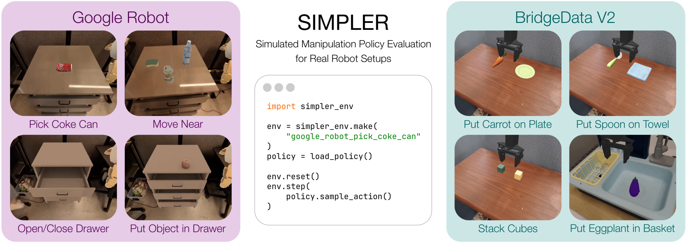

# SimplerEnv: подробный разбор системы бенчмарков

## 1 Обзор

SimplerEnv — замкнутая симуляционная среда, созданная для оценки **реальных роботизированных политик (Real-Robot Policies)**. Она построена на физическом движке ManiSkill2 и призвана сократить разрыв между «симуляцией и реальностью» (Sim-to-Real) и «реальностью и симуляцией» (Real-to-Sim).

В этой главе разобран бенчмарк SimplerEnv. Он оценивает не только способность робота к планированию движений, но и устойчивость политики к изменению визуальных условий и к помехам физических свойств. По официальному стандартному протоколу оценки основной набор тестов делится на **18 стандартных сценариев оценки**, которые охватывают две основные платформы: **Google Robot** и **WidowX**.

  
   
  <b>Рисунок 1: Схема среды SimplerEnv</b>

------

## 2 Платформы роботов и классификация задач

Задачи SimplerEnv построены по принципу **визуального соответствия (Visual Matching)**: текстуры, освещение и компоновка объектов в симуляции стараются повторить реальные наборы данных роботов (такие как RT-1 и Bridge).

### 2.1 Группа задач Google Robot (на основе RT-1)

Группа Google Robot имитирует взаимодействие мобильного манипулятора (Mobile Manipulator) в кухонных и офисных сценах. Эти задачи проверяют управление всем телом (База + Рука) и работу с сочленёнными объектами (Articulated Objects), например ящиками.

Мы объединили 14 конкретных сценариев оценки Google Robot в три основные группы способностей:

1. **Захват и манипуляция (Grasping & Manipulation)**: захват предметов в разных позах.
2. **Навигация и подход (Navigation & Reaching)**: движение к основанию и приближение к цели.
3. **Взаимодействие с сочленёнными объектами (Articulated Object Interaction)**: открытие и закрытие ящиков.

#### Таблица 1: подробный перечень сценариев оценки Google Robot

| **Основная способность (Capability)** | **Код задачи (Task ID)**     | **Описание сценария (Scenario Description)**                 | **Число сценариев** | **Разбор технических трудностей**     |
| ------------------------------------ | ---------------------------- | ------------------------------------------------------------ | ------------------- | ------------------------------------- |
| **Захват банки** *(Pick Coke Can)*   | `pick_horizontal_coke_can`   | **Взять горизонтально лежащую банку колы.** Целевой предмет лежит на боку на столе; нужно подстроить угол концевого эффектора для бокового или пикирующего захвата. | 1                   | Оценка позы объекта, планирование захвата |
|                                      | `pick_vertical_coke_can`     | **Взять вертикально стоящую банку колы.** Целевой предмет стоит прямо; это самая стандартная задача захвата. | 1                   | Базовая успешность захвата            |
|                                      | `pick_standing_coke_can`     | **Взять стоящую банку колы.** (Примечание: в SimplerEnv вариант «vertical/standing» иногда рассматривается как тонкое различие или как синоним для теста.) | 1                   | Тест устойчивости                     |
| **Общий захват** *(Pick Object)*     | `GraspSingleRandomObject`    | **Взять случайный предмет в сцене.** Объекты не ограничиваются банкой колы, а выбираются случайно из геометрических фигур или предметов быта. | 1                   | Способность к обобщению (Generalization) |
| **Движение рядом** *(Move Near)*     | `MoveNearGoogleBakedTex`     | **Переместиться к объекту в сцене.** Робот должен управлять шасси так, чтобы концевой эффектор подошёл к целевой области без столкновений. | 1                   | Управление всем телом (Whole-body Control) |
| **Открыть ящик** *(Open Drawer)*     | `open_top_drawer`            | **Открыть верхний ящик.**                                    | 1                   | Управление контактной силой, кинематические ограничения |
|                                      | `open_middle_drawer`         | **Открыть средний ящик.**                                    | 1                   | Другая высота манипуляции             |
|                                      | `open_bottom_drawer`         | **Открыть нижний ящик.**                                     | 1                   | Планирование работы на низкой высоте  |
| **Закрыть ящик** *(Close Drawer)*    | `close_top_drawer`           | **Закрыть верхний ящик.**                                    | 1                   | Управление направлением усилия        |
|                                      | `close_middle_drawer`        | **Закрыть средний ящик.**                                    | 1                   |                                       |
|                                      | `close_bottom_drawer`        | **Закрыть нижний ящик.**                                     | 1                   |                                       |
| **Положить в ящик** *(Place in Drawer)* | `place_in_closed_top_drawer` | **Положить в закрытый верхний ящик.** Составная задача: открыть ящик → положить предмет → (по желанию) закрыть ящик. | 1                   | Длинная последовательность (Long-horizon), многоэтапное планирование |
|                                      | `place_in_closed_middle_`    | **Положить в закрытый средний ящик.**                        | 1                   |                                       |
|                                      | `place_in_closed_bottom_`    | **Положить в закрытый нижний ящик.**                         | 1                   |                                       |
| **Итого**                            |                              |                                                              | **14**              |                                       |

------

### 2.2 Группа задач WidowX Robot (на основе Bridge Data V2)

Группа WidowX имитирует настольный манипулятор с неподвижным основанием (Tabletop Manipulator). Данные для этих задач взяты из Bridge Data V2; акцент сделан на точные операции на столе, укладку друг на друга и простое размещение предметов. Фон обычно содержит визуальное разнообразие, вызванное разными лабораторными условиями.

#### Таблица 4-2: подробный перечень сценариев оценки WidowX Robot

| **Основная способность (Capability)**  | **Код задачи (Task ID)** | **Описание сценария (Scenario Description)**                 | **Число сценариев** | **Разбор технических трудностей** |
| -------------------------------------- | ------------------------ | ------------------------------------------------------------ | ------------------- | --------------------------------- |
| **Точное размещение** *(Pick & Place)* | `PutSpoonOnTableCloth`   | **Положить ложку на скатерть.** Нужно распознать область деформируемого предмета (скатерти) и точно положить жёсткий предмет (ложку). | 1                   | Распознавание целевой области, тонкая манипуляция |
|                                        | `PutCarrotOnPlate`       | **Положить морковь на тарелку.** Типичная задача взаимодействия «предмет — контейнер». | 1                   | Глубинное восприятие, обход препятствий |
| **Укладка друг на друга** *(Stacking)* | `StackGreenCubeOnYellow` | **Поставить зелёный кубик на жёлтый.** Классическая задача укладки кубиков, требующая очень высокой точности вертикального выравнивания. | 1                   | Контроль точности, устойчивость объекта, физическое моделирование |
| **Взаимодействие с контейнером** *(Container Interaction)* | `PutEggplantInBasket` | **Положить баклажан в корзину.** Взаимодействие предмета неправильной формы (баклажана) с глубоким контейнером (корзиной). | 1                   | Выбор точки захвата, защита от падения |
| **Итого**                              |                          |                                                              | **4**               |                                   |

------

## 3 Расширяемость системы оценки и агрегирование вариантов

Хотя выше перечислены **18 стандартных сценариев**, важно понимать, что основная ценность SimplerEnv — в **широте** и **устойчивости** оценки. В реальном коде бенчмарка каждый стандартный сценарий включает сложный механизм «агрегирования вариантов (Variant Aggregation)».

### 3.1 Что такое агрегирование вариантов?

В SimplerEnv отдельная «задача» (например, `pick_coke_can`) не статична. Чтобы честно оценить способность робота к обобщению, при каждом сбросе среды (Reset) случайным образом меняются следующие параметры — и так создаются сотни и тысячи реальных состояний запуска:

1. **Визуальные варианты (Visual Variants)**:
   - **Текстуры фона**: смена цвета скатерти, материала пола.
   - **Условия освещения**: изменение силы источника света и направления теней.
   - **Помехи (Distractors)**: в рабочем пространстве случайно появляются предметы, не относящиеся к задаче, чтобы проверить механизм внимания визуальной модели.
2. **Физические варианты (Physical Variants)**:
   - **Начальное положение объекта**: случайные $(x, y)$ и угол поворота $\theta$ целевого объекта в заданном диапазоне.
   - **Поза камеры**: небольшие возмущения ракурса камеры, имитирующие погрешности калибровки в реальном мире.

### 3.2 Метрики оценки

Для указанных 18 сценариев SimplerEnv обычно использует следующие метрики:

- **Успешность (Success Rate)**: доля успешно выполненных целей в $N$ испытаниях (эпизодах). Обычно рекомендуется $N \ge 100$, чтобы результаты имели статистическую значимость.
- **Среднее число шагов (Average Steps)**: среднее число шагов управления, необходимых для выполнения задачи; показывает эффективность политики.
- **Корреляция «симуляция — реальность» (Sim-to-Real Correlation)**: самая отличительная метрика SimplerEnv. Она вычисляет корреляцию (коэффициенты Пирсона или Спирмена) между рейтингом политик по успешности в симуляции и рейтингом тех же политик в реальных экспериментах. Хороший симуляционный бенчмарк должен точно предсказывать, какая политика окажется лучше на реальном роботе.

------

## 4 Итоги главы

SimplerEnv задаёт **18 базовых сценариев оценки** и формирует стандартный тестовый набор, который охватывает как мобильную манипуляцию (Google Robot), так и настольную манипуляцию (WidowX). Эти сценарии простираются от простых задач захвата до сложных длинных операций с сочленёнными объектами. В сочетании с механизмами визуальной и физической рандомизации этот бенчмарк даёт строгое и воспроизводимое «экзаменационное поле» для универсальных политик роботов в области воплощённого ИИ (Embodied AI).
