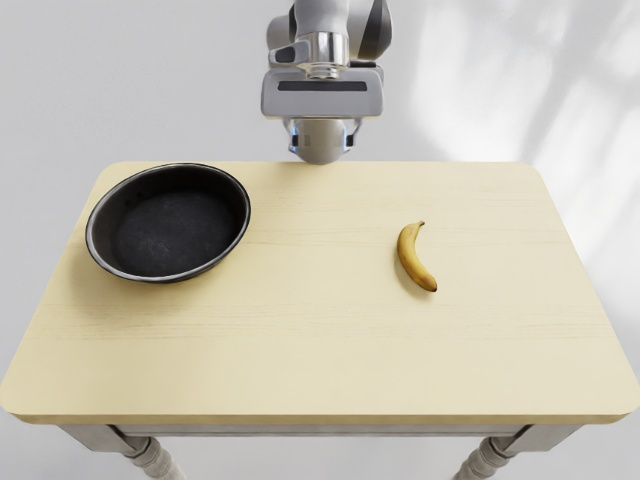

# Запись воспроизведения EBench / GenManip: от настройки окружения до минимального рендеринга видео

## 1 Обзор

EBench — бенчмарк для оценки задач манипуляции в воплощённом ИИ. Это воспроизведение сначала не ставит целью полный подсчёт результатов бенчмарка; оно проверяет один минимальный конвейер: установить среду выполнения Isaac Sim 4.1, запустить задачу `Minimal_Banana` из GenManip, выполнить планирование, генерацию траекторий, рендеринг RGB и экспорт воспроизводимого видео.

Эта глава описывает воспроизведение уровня дымового теста (smoke test). Оно показывает, что симуляция, планирование и рендеринг работают вместе, но не означает, что полная оценка EBench завершена.

## 2 Окружение проверки

Удалённая машина работает на Ubuntu 22.04, GPU — RTX 4090. Окружение установлено на диске данных, чтобы большие пакеты Python и кэш Isaac не занимали общий диск.

| Параметр | Что использовалось |
| --- | --- |
| Python | 3.10 |
| Isaac Sim | 4.1.0.0 |
| NumPy | 1.26.4 |
| PyTorch | 2.4.0+cu121 |
| cuRobo | v0.7.8 |
| Точка входа задачи | `GenManip/configs/tasks/minimal.yml` |
| Выходная задача | `Minimal_Banana` |

Ключевой вывод: для минимального дымового теста EBench/GenManip достаточно одной карты с 24 ГБ видеопамяти. Полная генерация данных, пакетная оценка или развёртывание крупной политики (policy) потребуют дополнительной памяти и хранилища; их нужно оценивать отдельно под масштаб задачи.

## 3 Ключевые моменты настройки окружения

Рабочий каталог:

```bash
/path/to/share/ebench_repro/GenManip
```

Окружение Python — на диске данных:

```bash
/path/to/data/ebench_repro/venv_ebench
```

После установки базовых зависимостей нужно явно принять лицензионное соглашение Omniverse EULA, иначе при первом запуске Isaac Sim зависнет на интерактивном запросе:

```bash
export OMNI_KIT_ACCEPT_EULA=YES
export HF_HOME=/path/to/data/hf_home
export TMPDIR=/path/to/data/tmp
```

Пакет Isaac Sim 4.1 в PyPI требует Python 3.10. При использовании Python 3.11 появится несовпадение версий примерно такого вида:

```text
isaacsim 4.1.0.0 Requires-Python ==3.10.*
```

cuRobo нужно зафиксировать на старом API. Код GenManip импортирует:

```python
from curobo.geom.sdf.world import CollisionCheckerType
```

Текущая главная ветка cuRobo уже изменила структуру пакета, поэтому здесь фиксируется версия:

```bash
cd saved/envs/curobo
git checkout v0.7.8
pip install -e . --no-build-isolation
```

## 4 Запуск минимальной задачи

Перейдите в корневой каталог GenManip и активируйте окружение:

```bash
cd /path/to/share/ebench_repro/GenManip
source /path/to/data/ebench_repro/venv_ebench/bin/activate
export OMNI_KIT_ACCEPT_EULA=YES
export HF_HOME=/path/to/data/hf_home
export TMPDIR=/path/to/data/tmp
```

Сначала запустите минимальную задачу планирования:

```bash
python demogen.py \
  --config configs/tasks/minimal.yml \
  --record minimal_planning
```

В результате сгенерировано 10 траекторий `Minimal_Banana`. Каталог каждой траектории содержит `lmdb/data.mdb`, `info.json`, `meta_info.pkl` и другие файлы.

## 5 Рендеринг видео

Конфигурация камеры по умолчанию включает depth, семантическую сегментацию, 2D/3D bbox и motion vector. В этом воспроизведении на связке Isaac Sim 4.1 и двух 4090 такая конфигурация вызвала ошибку CUDA/Hydra при рендеринге:

```text
CUDA error 700: an illegal memory access was encountered
HydraEngine::render failed
Rendering failed
```

Чтобы завершить дымовой тест, использовалась конфигурация рендеринга только RGB, а многопроцессорный режим Isaac явно отключён:

```python
simulation_app = SimulationApp(
    {
        "headless": True,
        "active_gpu": 0,
        "physics_gpu": 0,
        "multi_gpu": False,
        "max_gpu_count": 1,
    }
)
```

В конфигурации камеры отключены все не-RGB аннотаторы:

```yaml
with_distance: false
with_semantic: false
with_bbox2d: false
with_bbox3d: false
with_motion_vector: false
```

Полная команда рендеринга:

```bash
python render_single_gpu.py \
  --config configs/tasks/minimal_rgb_only.yml \
  --without_depth \
  --record rgb_only_single_gpu_full
```

В результате получено 316 кадров RGB, после чего они декодированы из LMDB в MP4. Видео с трёх камер:

<video controls muted preload="metadata" width="100%">
  <source src="assets/ebench/ebench_minimal_banana_obs_camera.mp4" type="video/mp4">
</video>

<video controls muted preload="metadata" width="100%">
  <source src="assets/ebench/ebench_minimal_banana_obs_camera_2.mp4" type="video/mp4">
</video>

<video controls muted preload="metadata" width="100%">
  <source src="assets/ebench/ebench_minimal_banana_realsense.mp4" type="video/mp4">
</video>

Во время рендеринга также сохранён снимок вида сверху:

<p align="center">
  
  <br>
  <b>Рисунок 1: Вид сверху рендеринга Minimal_Banana</b>
</p>

## 6 Подтверждённые результаты

В этом дымовом тесте проверено следующее:

- Isaac Sim 4.1 запускается на удалённой машине.
- Задача `Minimal_Banana` из GenManip выполняет планирование через cuRobo.
- Данные траекторий успешно записаны в LMDB.
- Рендеринг только RGB создаёт 316 кадров.
- Видео с трёх камер экспортированы в MP4 с разрешением 640×480 и частотой 30 кадров/с.

## 7 Частые проблемы

### 7.1 Зависание на вводе EULA

Установите переменную окружения:

```bash
export OMNI_KIT_ACCEPT_EULA=YES
```

### 7.2 Не найден модуль `curobo.geom`

Используйте cuRobo `v0.7.8`, а не текущую главную ветку.

### 7.3 Ошибки CUDA/Hydra при стандартном рендеринге

Сначала отключите многопроцессорный режим и переключите конфигурацию камеры на RGB only. Для дымового теста важно сначала добиться работы конвейера видео; если нужно полностью экспортировать семантическую сегментацию, bbox и depth, отдельно проверяйте версию Isaac, драйвер, взаимодействие Vulkan и CUDA, а также настройки Replicator.

### 7.4 После запуска только с `--without_planning` видео не рендерится полностью

`--without_planning` подходит только для проверки загрузки сцены и сохранения минимальной информации о траектории. `render.py` требует результаты планирования, поэтому для создания видео с движением сначала запустите `demogen.py` без `--without_planning`.

## 8 Итоги

Это воспроизведение замкнуло минимальный конвейер EBench/GenManip: установка окружения, планирование минимальной задачи, рендеринг RGB и экспорт видео. Для полноценного бенчмарка нужно дополнительно загрузить полные ресурсы EBench, выбрать базовую политику (baseline policy) и запустить оценку по официальному набору задач пакетом.
