Установка Vulkan

```bash
sudo apt-get install libvulkan1
sudo apt-get install vulkan-utils
# или
sudo apt install vulkan-tools
vulkaninfo
```

Если файла нет, попробуйте создать `/usr/share/vulkan/icd.d/nvidia_icd.json` со следующим содержимым:

```json
{
 "file_format_version" : "1.0.0",
 "ICD": {
 "library_path": "libGLX_nvidia.so.0",
 "api_version" : "1.2.155"
 }
}
```

Проверка установки:

```bash
python -m mani_skill.examples.demo_random_action
```

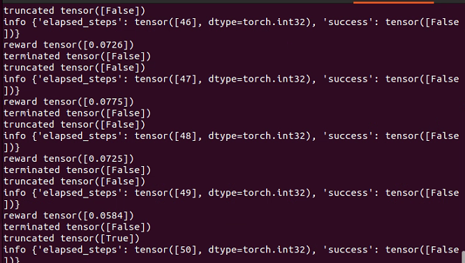

```python
import gymnasium as gym
import mani_skill.envs

env = gym.make(
    "PickCube-v1", # Есть и другие задачи, например "PushCube-v1", "PegInsertionSide-v1", ...
    num_envs=1,
    obs_mode="state", # Есть также "state_dict", "rgbd", ...
    control_mode="pd_ee_delta_pose", # Есть также "pd_joint_delta_pos", ...
    render_mode="human"
)
print("Observation space", env.observation_space)
print("Action space", env.action_space)

obs, _ = env.reset(seed=0) # Сброс с зерном (seed) для воспроизводимости
done = False
while not done:
    action = env.action_space.sample()
    obs, reward, terminated, truncated, info = env.step(action)
    done = terminated or truncated
    env.render()  # Для рендеринга нужен дисплей
env.close()

# Запуск без графического интерфейса (headless)

python -m mani_skill.examples.demo_random_action -e PickCube-v1

# Запуск с GUI и трассировкой лучей

python -m mani_skill.examples.demo_random_action -e PickCube-v1 --render-mode="human" --shader="rt-fast"

python -m mani_skill.examples.benchmarking.gpu_sim --num-envs=1024

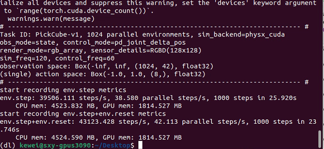

Параллельная работа действительно очень быстрая.

# Рендеринг RGB и данных глубины со всех камер

python -m mani_skill.examples.benchmarking.gpu_sim --num-envs=64 --obs-mode="rgbd"

# Сразу сохранить 64 видео визуальных наблюдений, объединённых в одно видео

python -m mani_skill.examples.benchmarking.gpu_sim --num-envs=64 --save-video
```

```python
import gymnasium as gym
import mani_skill.envs

env = gym.make(
    "PickCube-v1",
    obs_mode="state",
    control_mode="pd_joint_delta_pos",
    num_envs=16,
    parallel_in_single_scene=True,
    viewer_camera_configs=dict(shader_pack="rt-fast"),
)
env.reset()
while True:
    env.step(env.action_space.sample())
    env.render_human()
```

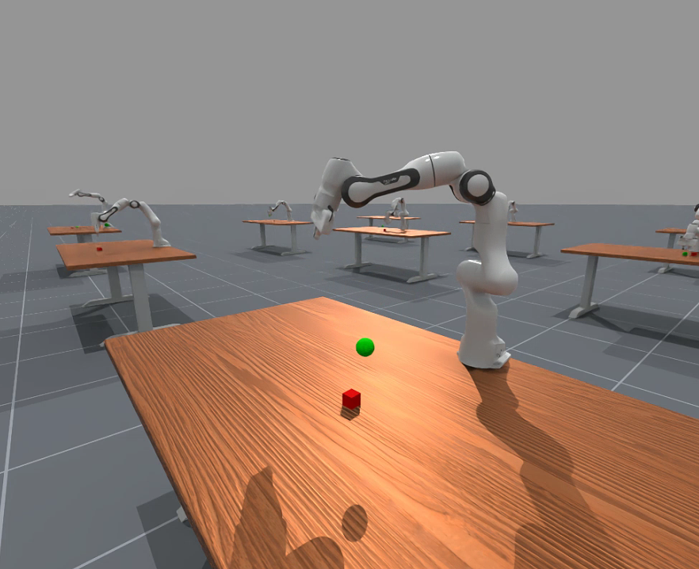

```bash
python -m mani_skill.examples.demo_random_action -e PushCube-v1 -b gpu --render-mode human --seed 42
```

Генерация случайной симуляции

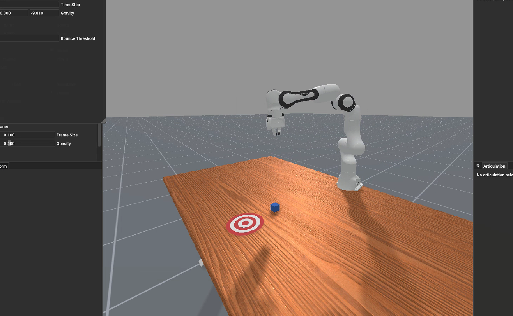

Путь к данным по умолчанию:

```bash
python -m mani_skill.utils.download_asset "ReplicaCAD"
```

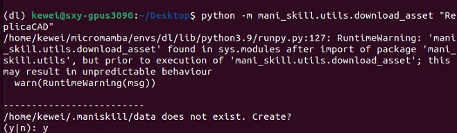

```bash
python -m mani_skill.examples.demo_random_action -e "ReplicaCAD_SceneManipulation-v1" \
  --render-mode="rgb_array" --record-dir="videos"

python -m mani_skill.examples.demo_random_action -e "ReplicaCAD_SceneManipulation-v1" \
  --render-mode="human" # Запуск с GUI

python -m mani_skill.examples.demo_random_action -e "ReplicaCAD_SceneManipulation-v1" \
  --render-mode="human" --shader="rt-fast" # Быстрее трассировка лучей, но ниже качество

python -m mani_skill.examples.demo_random_action -e "ReplicaCAD_SceneManipulation-v1" \
  --render-mode="human" --shader="rt"
```

Рекомендуется среднее разрешение.

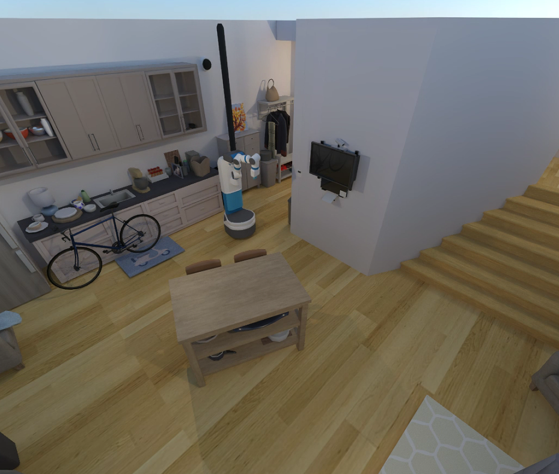

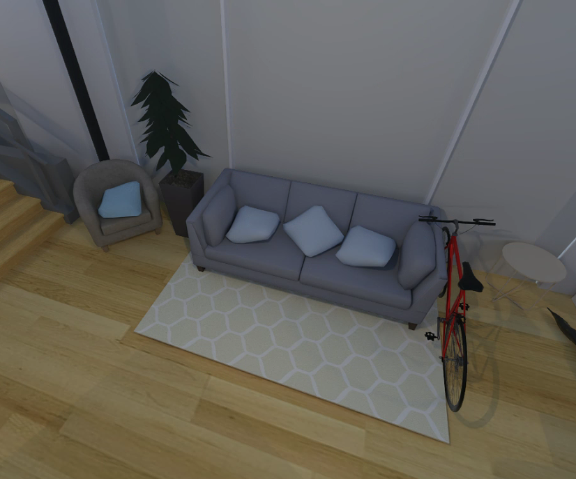

```bash
python -m mani_skill.examples.demo_random_action -e "TwoRobotStackCube-v1" \
  --render-mode="human"
```

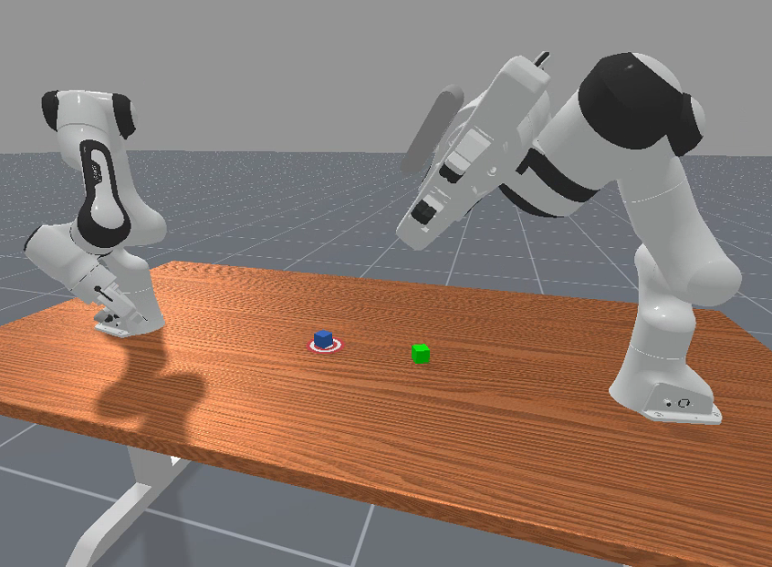

```bash
python -m mani_skill.examples.demo_random_action -e "RotateValveLevel2-v1" \
  --render-mode="human"
```

Ловкая кисть

```bash
python -m mani_skill.examples.demo_random_action -e "RotateSingleObjectInHandLevel3-v1" \
  --render-mode="human"
```

Имитация тактильных ощущений

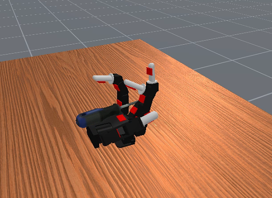

Чтобы провести бенчмарк GPU-симуляции на задаче PickCube-v1 с 4096 параллельными задачами, запустите:

```bash
python -m mani_skill.examples.benchmarking.gpu_sim -e "PickCube-v1" -n 4096
```

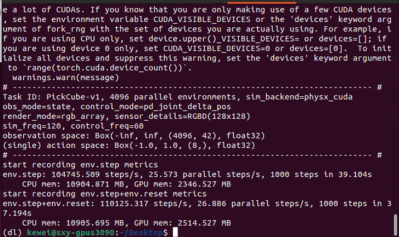

Скорость очень высокая.

Чтобы сохранить видео визуальных наблюдений агента (в этом примере только rgb и глубина), запустите:

```bash
python -m mani_skill.examples.benchmarking.gpu_sim -e "PickCube-v1" -n 64 \
  --save-video --render-mode="sensors"
```

Должно работать достаточно быстро: на 4090 более 3000 кадров в секунду; чтобы получить больший FPS, можно увеличить число сред. Для рендеринга с более качественной камеры можно заменить `--render-mode="sensors"` на `--render-mode="rgb_array"`.

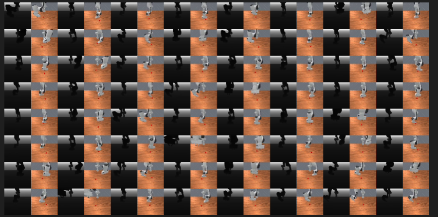

Чтобы попробовать разные функции параллельной симуляции, запустите:

```bash
python -m mani_skill.examples.benchmarking.gpu_sim -e "PickSingleYCB-v1" -n 64 \
  --save-video --render-mode="sensors"
```

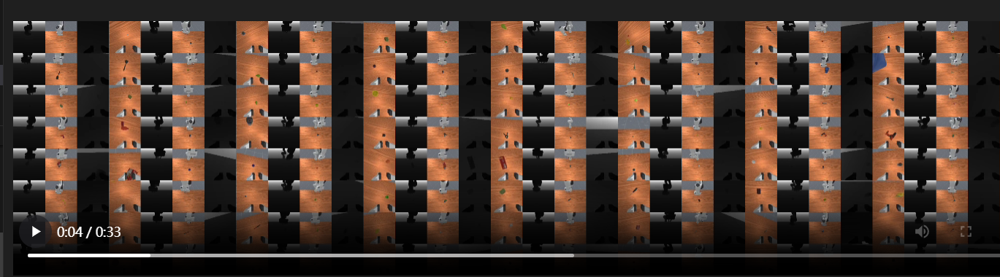

Одновременное обучение захвату разных объектов:

```bash
python -m mani_skill.examples.benchmarking.gpu_sim -e "OpenCabinetDrawer-v1" -n 64 \
  --save-video --render-mode="sensors"
```

Показаны две задачи с разными объектами и суставами в каждой параллельной среде. Ниже пример задачи OpenCabinetDrawer.

[Подробности и результаты бенчмарков производительности доступны на этой странице](https://maniskill.readthedocs.io/en/latest/user_guide/additional_resources/performance_benchmarking.html)

## Интерактивное управление

Телеуправление «щелчок + перетаскивание»:

Простой инструмент, который позволяет решать разные задачи, кликая и перетаскивая концевой эффектор манипулятора Panda. Просто щёлкните и перетащите, нажмите «n», чтобы перейти в точку, куда перетащили, «g» — чтобы переключить захват (открыть/закрыть), и повторяйте. Нажмите «q», чтобы выйти и сохранить итоговое видео.

```bash
python -m mani_skill.examples.teleoperation.interactive_panda -e "StackCube-v1"
```

Подробнее о том, как использовать этот инструмент для демонстраций и сбора данных, см. на [главной странице](https://maniskill.readthedocs.io/en/latest/user_guide/data_collection/teleoperation.html#click-drag-system). Ниже видео работы системы.

Здесь есть ошибка, о которой я сообщил в Discord.

- `python -m mani_skill.examples.teleoperation.interactive_panda -e "StackCube-v1"` выдаёт Traceback: `ModuleNotFoundError: No module named 'mani_skill.examples.motionplanning.panda_stick'`. Есть ли у кого-нибудь решение?

- Решение: я всё исправил. Помогла установка из GitHub, а не из PyPI.

- Похоже, ошибка в примере кода. Правильно так:

  `from mani_skill.examples.motionplanning.panda.motionplanner_stick import PandaStickMotionPlanningSolver`

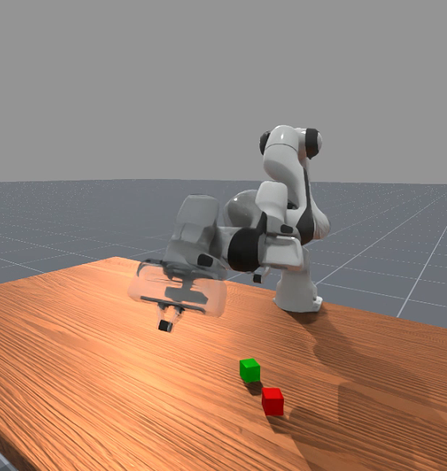

## Решения на основе планирования движения

Для манипулятора Panda есть решения и демонстрации на основе планирования движения для некоторых задач. Попробовать их и записать демонстрации можно так:

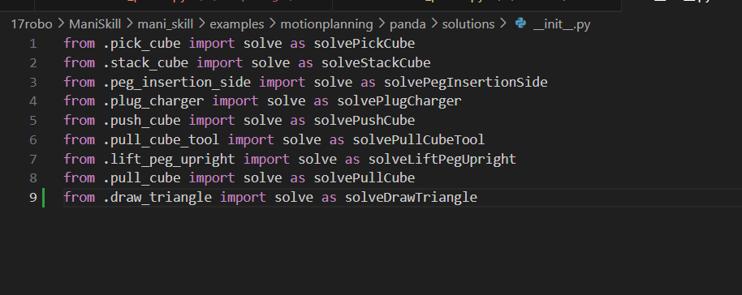

```bash
python -m mani_skill.examples.motionplanning.panda.run -e "PickCube-v1" # Запускается без GUI и только сохраняет видео
python -m mani_skill.examples.motionplanning.panda.run -e "StackCube-v1" --vis # Открывает GUI
python -m mani_skill.examples.motionplanning.panda.run -h # Открывает справку и показывает задачи, для которых есть решения
```

```text
(dl) user@host:~/Desktop$ python -m mani_skill.examples.motionplanning.panda.run -h
usage: run.py [-h] [-e ENV_ID] [-o OBS_MODE] [-n NUM_TRAJ]
              [--only-count-success] [--reward-mode REWARD_MODE]
              [-b SIM_BACKEND] [--render-mode RENDER_MODE] [--vis]
              [--save-video] [--traj-name TRAJ_NAME] [--shader SHADER]
              [--record-dir RECORD_DIR] [--num-procs NUM_PROCS]

optional arguments:
  -h, --help            show this help message and exit
  -e ENV_ID, --env-id ENV_ID
                        Environment to run motion planning solver on.
                        Available options are ['DrawTriangle-v1',
                        'PickCube-v1', 'StackCube-v1', 'PegInsertionSide-v1',
                        'PlugCharger-v1', 'PushCube-v1', 'PullCubeTool-v1',
                        'LiftPegUpright-v1', 'PullCube-v1']
  -o OBS_MODE, --obs-mode OBS_MODE
                        Observation mode to use. Usually this is kept as
                        'none' as observations are not necesary to be stored,
                        they can be replayed later via the
                        mani_skill.trajectory.replay_trajectory script.
  -n NUM_TRAJ, --num-traj NUM_TRAJ
                        Number of trajectories to generate.
  --only-count-success  If true, generates trajectories until num_traj of them
                        are successful and only saves the successful
                        trajectories/videos
  --reward-mode REWARD_MODE
  -b SIM_BACKEND, --sim-backend SIM_BACKEND
                        Which simulation backend to use. Can be 'auto', 'cpu',
                        'gpu'
  --render-mode RENDER_MODE
                        can be 'sensors' or 'rgb_array' which only affect what
                        is saved to videos
  --vis                 whether or not to open a GUI to visualize the solution
                        live
  --save-video          whether or not to save videos locally
  --traj-name TRAJ_NAME
                        The name of the trajectory .h5 file that will be
                        created.
  --shader SHADER       Change shader used for rendering. Default is 'default'
                        which is very fast. Can also be 'rt' for ray tracing
                        and generating photo-realistic renders. Can also be
                        'rt-fast' for a faster but lower quality ray-traced
                        renderer
  --record-dir RECORD_DIR
                        where to save the recorded trajectories
  --num-procs NUM_PROCS
                        Number of processes to use to help parallelize the
                        trajectory replay process. This uses CPU
                        multiprocessing and only works with the CPU simulation
                        backend at the moment.
```

## Оценка Real2Sim

ManiSkill3 поддерживает очень быструю оценку real2sim: политики вроде RT-1 и Octo запускаются на GPU-симуляции с рендерингом. Подробности о поддерживаемых средах см. на [этой странице](https://maniskill.readthedocs.io/en/latest/tasks/digital_twins/index.html). Для инференса RT-1 и Octo см. ветку `maniskill3` проекта [SimplerEnv](https://github.com/simpler-env/SimplerEnv/tree/maniskill3).

## Визуализация данных облака точек

Визуализировать наблюдения облака точек можно следующей командой (для работы нужен монитор):

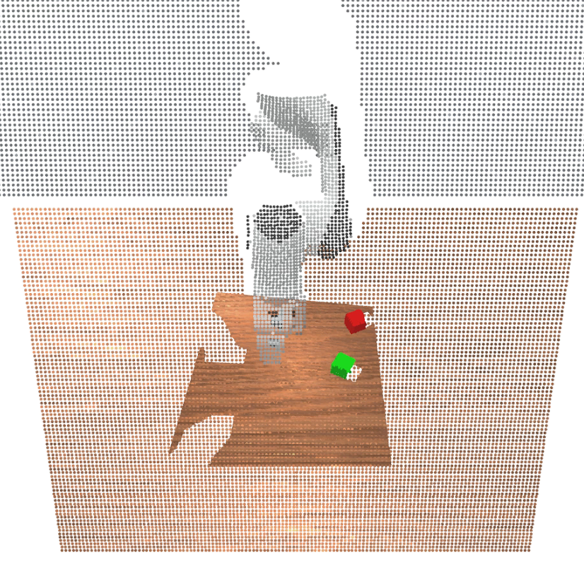

```bash
pip install "pyglet<2" # Обязательно установите эту зависимость
python -m mani_skill.examples.demo_vis_pcd -e "StackCube-v1"
```

`/home/user/17robo/ManiSkill/mani_skill/examples/demo_vis_pcd.py`
Этот файл тоже нужно изменить.

В `demo_vis_pcd.py` в строке 46:

`pcd = trimesh.points.PointCloud(xyz, colors)`

Нужно вызвать **`.cpu().numpy()`** у переменных `xyz` и `colors`, чтобы получить массивы NumPy на CPU, а не тензоры GPU.

**Исправленный код:**

`pcd = trimesh.points.PointCloud(xyz.cpu().numpy(), colors.cpu().numpy())`

## Визуализация данных сегментации

Визуализировать данные сегментации можно так:

```bash
python -m mani_skill.examples.demo_vis_segmentation -e "StackCube-v1"
python -m mani_skill.examples.demo_vis_segmentation -e "StackCube-v1" \
  --id id_of_part # Скрыть всё, кроме выбранной части
```

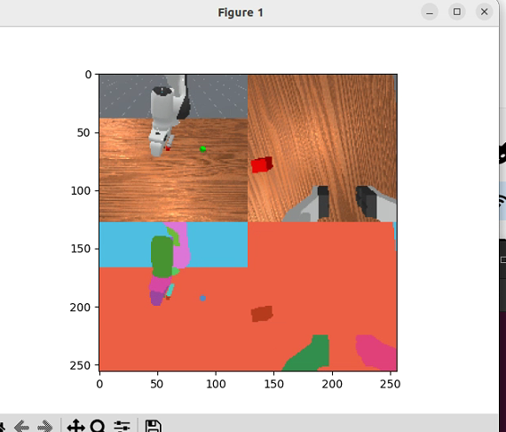

Эта команда пока выдаёт ошибку:

```text
Visualizing 2 RGBD cameras
ID to Actor/Link name mappings
0: Background
1: Link, name - panda_link0
2: Link, name - panda_link1
3: Link, name - panda_link2
4: Link, name - panda_link3
5: Link, name - panda_link4
6: Link, name - panda_link5
7: Link, name - panda_link6
8: Link, name - panda_link7
9: Link, name - panda_link8
10: Link, name - panda_hand
11: Link, name - panda_hand_tcp
12: Link, name - panda_leftfinger
13: Link, name - panda_rightfinger
14: Link, name - camera_base_link
15: Link, name - camera_link
16: Actor, name - table-workspace
17: Actor, name - ground
18: Actor, name - cubeA
19: Actor, name - cubeB
Traceback (most recent call last):
  File "/home/user/micromamba/envs/dl/lib/python3.9/runpy.py", line 197, in _run_module_as_main
    return _run_code(code, main_globals, None,
  File "/home/user/micromamba/envs/dl/lib/python3.9/runpy.py", line 87, in _run_code
    exec(code, run_globals)
  File "/home/user/17robo/ManiSkill/mani_skill/examples/demo_vis_segmentation.py", line 144, in <module>
    main(parse_args())
  File "/home/user/17robo/ManiSkill/mani_skill/examples/demo_vis_segmentation.py", line 118, in main
    selected_id = reverse_seg_id_map[selected_id]
KeyError: 'id_of_part'
```

## Визуализация текстур камеры (RGB, глубина, альбедо и др.)

Визуализировать любое число текстур камеры можно такой командой. Обратите внимание: по умолчанию используется шейдер «default», который выводит почти все нужные текстуры. См. [страницу о камерах и шейдерах](https://maniskill.readthedocs.io/en/latest/user_guide/demos/scripts.html#../../).

```bash
python -m mani_skill.examples.demo_vis_textures -e "StackCube-v1" -o rgb+depth
python -m mani_skill.examples.demo_vis_textures -e "OpenCabinetDrawer-v1" -o rgb+depth+albedo+normal
```

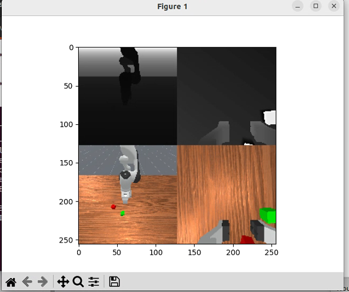

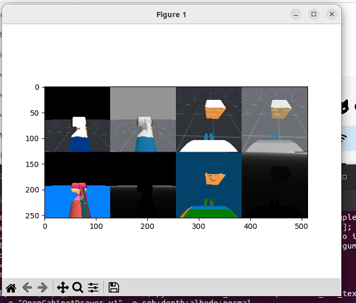

## Визуализация распределения сброса

От распределения сброса (reset distribution) во многом зависит сложность задачи для алгоритмов машинного обучения, таких как обучение с подкреплением и имитационное обучение. Чтобы увидеть распределение сброса для любой задачи (результат многократных вызовов env.reset), сохраните видео в папку `videos`:

```bash
python -m mani_skill.examples.demo_reset_distribution -e "PegInsertionSide-v1" --record-dir="videos"
```

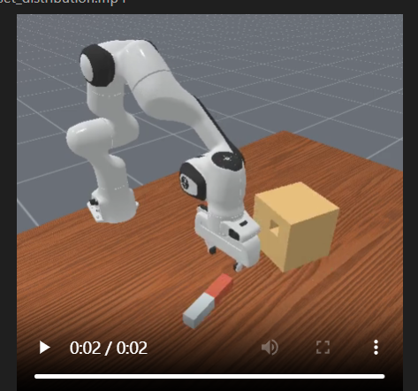

## Визуализация любого робота

Чтобы открыть просмотрщик с заданным роботом в пустой сцене (только пол), запустите:

```bash
python -m mani_skill.examples.demo_robot -r "panda"
```

Если нужно визуализировать предопределённые ключевые кадры, их тоже можно указать.

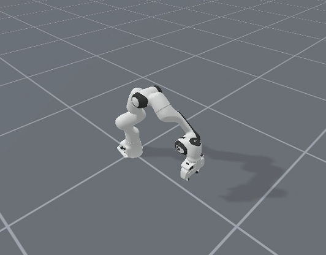
