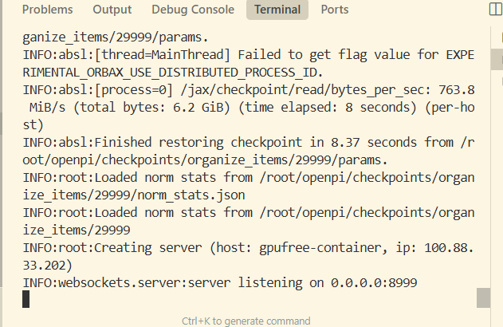
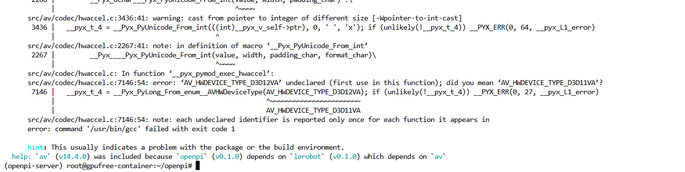
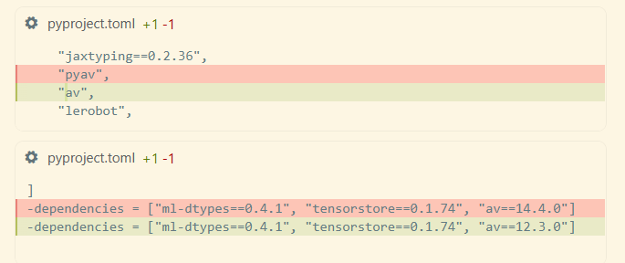
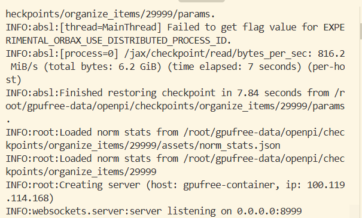
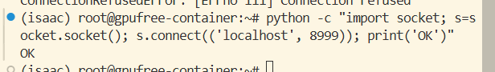
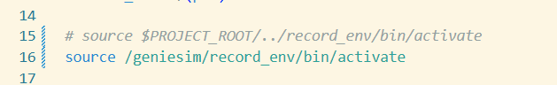
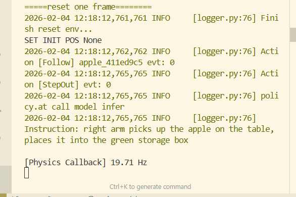

# 1. Запуск серверной части openpi

Видеоурок по одношаговому запуску GenieSim: https://www.datawhale.cn/learn/content/258/6172


```bash
cd /path/to/openpi

XLA_PYTHON_CLIENT_MEM_FRACTION=0.7 uv run scripts/serve_policy.py --host='0.0.0.0' --port=8999 policy:checkpoint --policy.config=organize_items --policy.dir ./checkpoints/organize_items/29999
# Также можно выполнить:
python scripts/serve_policy.py --host='0.0.0.0' --port=8999 policy:checkpoint --policy.config=organize_items --policy.dir ./checkpoints/organize_items/29999
# Причина: команда запуска с uv run заново создаёт виртуальное окружение вместо использования уже созданного окружения openpi-server. Достаточно заменить uv run на python. Модели openpi, которые загружаются автоматически, сохраняются в ~/.cache/openpi; если пользователь случайно их удалит, повторная загрузка будет очень долгой. Поэтому тоже стоит сказать: не удаляйте файлы без необходимости.
# Внимание: не удаляйте ~/.cache — повторная загрузка моделей занимает очень много времени!
```


---

Если появился этот IP-адрес, значит, всё прошло успешно.



Если есть ошибка версии av, согласно зависимостям lerobot замените её на pyav (в новом образе это уже исправлено).

Нужно изменить одно место.



Нужно изменить pyproject.toml.



# 2. Клиент GenieSim



```
(isaac) user@<container>:~# ssh -CNg -L 8999:127.0.0.1:8999 user@<server-ip>
user@<server-ip>'s password:
(нужно посмотреть IP-адрес в журнале серверной части)
пароль xxxxx
python -c "import socket; s=socket.socket(); s.connect(('localhost', 8000)); print('OK')"

```




Загрузка ассетов (в нашем образе всё уже настроено, дополнительно ничего делать не нужно):

```
Клонировать в каталог
genie_sim/source/geniesim/assets
https://modelscope.cn/datasets/agibot_world/GenieSimAssets

```

Настройка переменных окружения (уже прописана в .bashrc образа сервера, дополнительно ничего делать не нужно):

```
# 1. Базовые переменные
export SIM_REPO_ROOT=/path/to/genie_sim


# 5. Ключ API
export BASE_URL="https://dashscope.aliyuncs.com/compatible-mode/v1"
export API_KEY="sk-"
export MODEL="qwen3-max"
export VL_MODEL="qwen3-vl-plus"

# 6. Переменные окружения Genie Sim
export SIM_ASSETS=$SIM_REPO_ROOT/source/geniesim/assets

```

Затем

```
cd /path/to/genie_sim

/isaac-sim/python.sh source/geniesim/app/app.py --config source/geniesim/config/organize_items.yaml
или
omni_python source/geniesim/app/app.py --config source/geniesim/config/organize_items.yaml

```

После этого можно увидеть, как рендерящий симулятор выполняет действия.

# 3. Запись результатов симуляции

Замените
/path/to/genie_sim/scripts/auto_record_and_extract.py

файлом [auto_record_and_extract.py](auto_record_and_extract.py) из папки текущего урока.

Измените
/path/to/genie_sim/scripts/start_auto_record.sh



```
cd /path/to/genie_sim

/isaac-sim/python.sh source/geniesim/app/app.py --config source/geniesim/config/organize_items_record.yaml
или
omni_python source/geniesim/app/app.py --config source/geniesim/config/organize_items_record.yaml


```

Затем откройте новый терминал.

Дождитесь появления частоты симуляции.



```
cd /path/to/genie_sim
bash scripts/start_auto_record.sh
```

После завершения симуляции файл cmap автоматически разбирается и сохраняется в mp4.

```
ls /path/to/genie_sim/output/recording_data/recording_data/place_object_into_box_color/recording_20260204_121814/recording_20260204_121814_0.mcap -lh
```


Если mcap уже есть:

```
# Переходим в корневой каталог проекта
cd /path/to/genie_sim

# Используем добавленный параметр --bag_path, указывающий на уже имеющийся каталог записи
python3 scripts/auto_record_and_extract.py \
  --bag_path "/path/to/genie_sim/output/recording_data/recording_data/place_object_into_box_color/recording_20260204_141040"  #--delete_db3_after необязательно: определяет, нужно ли удалять файл mcap после запуска, так как он большой
```
