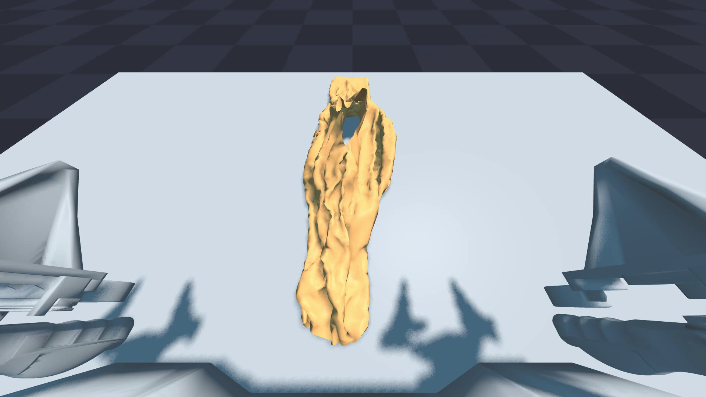
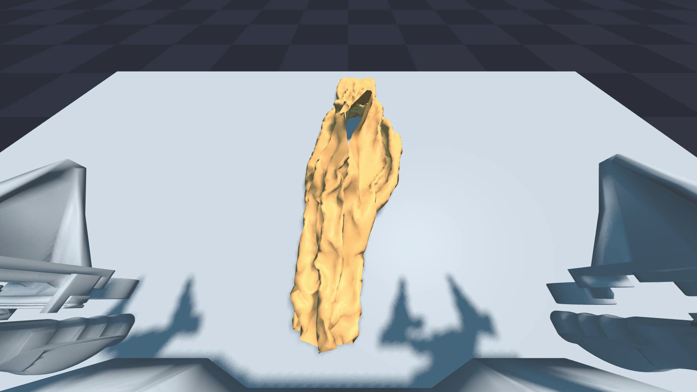
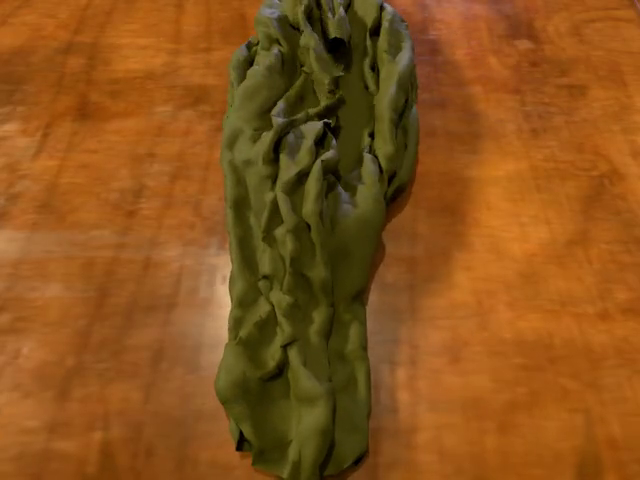
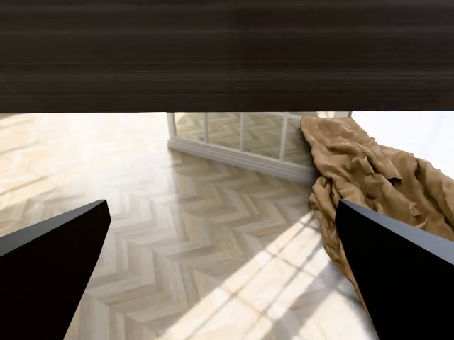
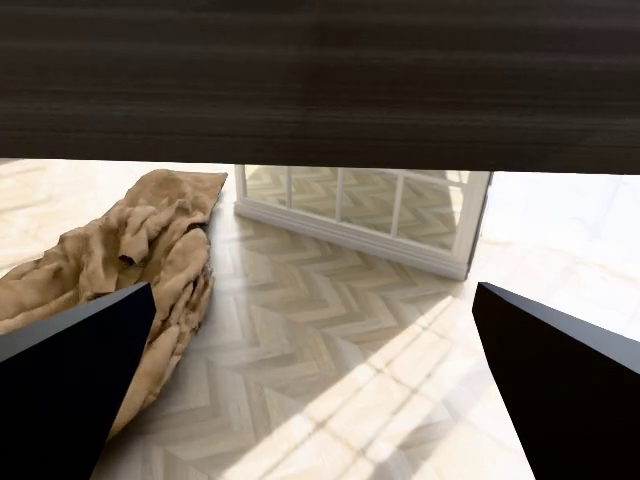

# SIM1: симуляция мягких тел и генерация данных — от телеуправления до отфильтрованных данных

SIM1 — проект InternRobotics с открытым кодом для симуляции манипуляций с деформируемыми объектами и генерации данных. Полное название проекта: **SIM1: Physics-Aligned Simulator as Zero-Shot Data Scaler in Deformable Worlds**. Он предназначен для двуруких манипуляций с тканью и предоставляет полный конвейер: интерактивное телеуправление, генерацию траекторий диффузионной политикой, физическое воспроизведение (replay), фильтрацию по качеству, а также необязательный высококачественный рендеринг и преобразование в формат набора данных LeRobot.

В этой главе сначала описан минимальный воспроизводимый путь. После его выполнения читатель сможет увидеть окно взаимодействия SIM1 на своём компьютере, сохранить видео replay, понять, почему конвейер отсеивает большую часть траекторий мягких тел, и продолжить преобразование тестового образца в высококачественное видео рендеринга, LMDB и набор данных LeRobot.

## Что будет сделано в этой главе

Все команды проверены в среде Windows с видеокартой NVIDIA:

1. Установить Python-окружение `sim1` для SIM1.
2. Скачать ресурсы Hugging Face и пример траекторий, необходимые для запуска.
3. Запустить интерактивное окно двуруких манипуляций с тканью.
4. Воспроизвести траекторию через replay и сохранить `.npz`, `.usd` и `.mp4`.
5. Запустить генерацию данных диффузионной политикой и полный конвейер.
6. Объяснить, почему для мягких тел низкая доля успешных траекторий, и как читать результаты фильтрации.
7. Выполнить цепочку `USD -> Blender -> camera/random scene -> MeisterRender -> LMDB`.
8. Преобразовать LMDB в набор данных LeRobot v2.

SIM1 не зависит от Isaac Sim. Его симуляция в реальном времени основана на Newton, NVIDIA Warp, MuJoCo-Warp и PyTorch; установленный Isaac Sim не влияет на основной ход этого руководства.

## Проверенное окружение

Команды этой главы выполнены в следующем окружении:

| Параметр | Конфигурация на тестовом компьютере |
|---|---|
| Система | Windows PowerShell |
| Python | 3.11 |
| Управление окружениями | micromamba, имя окружения `sim1` |
| GPU | NVIDIA GeForce RTX 3060 Laptop GPU, 6 ГиБ видеопамяти |
| PyTorch | `torch==2.6.0+cu124` |
| Warp | `1.13.0.dev20260417` |
| CUDA | По журналу Warp: CUDA Toolkit 12.9, драйвер 13.0 |

6 ГиБ видеопамяти достаточно для телеуправления, replay, небольшой генерации данных и рендеринга тестового образца на 97 кадров. Высококачественный рендеринг заметно медленнее: на тестовом компьютере шаг 4 занимал около `2,6 с` на кадр, поэтому полные длинные траектории лучше запускать отдельно в очереди.

## Структура каталогов

Ниже предполагается, что репозиторий SIM1 находится в каталоге:

```powershell
C:\path\to\SIM1
```

Репозиторий Every Embodied (учебник) — в каталоге:

```powershell
C:\path\to\every-embodied
```

Если ваши пути отличаются, замените рабочий каталог в командах на корень вашего репозитория SIM1.

## Клонирование и установка

В Windows рекомендуется запускать скрипты `.sh` из репозитория через Git Bash. PowerShell можно оставить основным терминалом, явно вызывая Git Bash для скриптов:

```powershell
cd C:\path\to\SIM1\..
git clone --recurse-submodules https://github.com/InternRobotics/SIM1.git
cd SIM1

micromamba create -n sim1 python=3.11 -y
micromamba run -n sim1 "C:\Program Files\Git\bin\bash.exe" setup.sh
```

Если сначала нужна только симуляция без высококачественного рендеринга, можно пропустить установку зависимостей рендеринга:

```powershell
$env:SIM1_SKIP_RENDER='1'
micromamba run -n sim1 "C:\Program Files\Git\bin\bash.exe" setup.sh
```

В Windows, если в пользовательском каталоге Python есть посторонние пакеты, которые мешают, перед запуском SIM1 лучше задать:

```powershell
$env:PYTHONNOUSERSITE='1'
```

Если путь к репозиторию содержит китайские символы, а Python при запуске выдаёт ошибки, связанные с файлами `.pth` или кодировкой, можно смонтировать репозиторий SIM1 в путь только из латинских символов и указать editable-установку на него. Эта проблема возникает из-за совместного влияния кодировки путей в терминале Windows и site-packages Python; это не ошибка физической симуляции SIM1.

## Загрузка ресурсов и примеров данных

Ресурсы и данные SIM1 размещены на Hugging Face. Перед загрузкой нужно войти в аккаунт Hugging Face; достаточно токена с правом чтения. Не записывайте токен в руководство, код или историю коммитов.

```powershell
cd C:\path\to\SIM1
$env:PYTHONNOUSERSITE='1'

micromamba run -n sim1 hf auth login
micromamba run -n sim1 "C:\Program Files\Git\bin\bash.exe" download_assets.sh
```

После загрузки как минимум должны появиться такие файлы или каталоги:

```text
assets/acone/acone.urdf
assets/cloth/short-shirt.usdc
assets/model/flow_ckpt_three.pth
assets/sim_teleoperated_npz/npz/*.npz
```

Размеры основных каталогов на тестовом компьютере после загрузки и первичной обработки:

| Каталог | Размер |
|---|---:|
| `assets/acone` | 65,87 МБ |
| `assets/cloth` | 2,49 МБ |
| `assets/model` | 131,11 МБ |
| `assets/sim_teleoperated_npz` | 35,74 МБ |

Для высококачественного рендеринга понадобятся полные материалы случайных сцен `assets/random/`. Они гораздо больше минимального набора ресурсов симуляции, поэтому скачивать их стоит, предварительно проверив свободное место на диске.

## Шаг 1: интерактивное телеуправление

Запустите из корня репозитория SIM1:

```powershell
cd C:\path\to\SIM1
$env:PYTHONNOUSERSITE='1'

micromamba run -n sim1 python apps\teleoperation_app.py --task lift_manip_shirt
```

Если запуск прошёл успешно, в терминале появится примерно такой вывод:

```text
Warp initialized
joint dq cnt check: 19 == 19
=== Cloth Information ===
vertices=(7021, 3), faces=(41301,)
=== Keyboard Teleoperation Controls ===
Left gripper:  W/S=front/back, A/D=left/right, Q/E=down/up, X=toggle grip
Right gripper: I/K=front/back, J/L=left/right, U/O=down/up, M=toggle grip
```

Белые или серые манипуляторы и стол в окне — это нормально. Окно представляет собой отладочный просмотрщик Newton/Warp в реальном времени, а не итоговый высококачественный рендерер. Ткань окрашена, а белая «болванка» манипуляторов и столешницы не означает, что ресурсы отсутствуют.

После закрытия окна данные телеуправления сохранятся в:

```text
dataset/lift_manip_shirt/<дата>/<время>.npz
```

## Шаг 2: replay и сохранение видео

`replay_app.py` заново выполняет существующую траекторию `.npz` в симуляторе и сохраняет обогащённый `.npz` и симуляционный `.usd`. Если добавить `--save_video`, сохраняется также `.mp4` с видом из OpenGL-просмотрщика.

`--save_video` требует настоящего просмотрщика, поэтому обязательно добавляйте `--no-headless`:

```powershell
cd C:\path\to\SIM1
$env:PYTHONNOUSERSITE='1'

micromamba run -n sim1 python apps\replay_app.py dataset\smoke_00000_8f.npz --folder_name tutorial_smoke --sim_substeps 4 --no-headless --save_video --fps 30
```

Если файла `dataset\smoke_00000_8f.npz` нет, короткий тестовый файл можно вырезать из скачанной эталонной траектории:

```powershell
cd C:\path\to\SIM1

@'
import numpy as np
from pathlib import Path

src = Path("assets/sim_teleoperated_npz/npz/00000.npz")
dst = Path("dataset/smoke_00000_8f.npz")
dst.parent.mkdir(parents=True, exist_ok=True)

data = np.load(src, allow_pickle=True)
out = {}
for key in data.files:
    value = data[key]
    if hasattr(value, "shape") and len(value.shape) > 0 and value.shape[0] >= 8:
        out[key] = value[:8]
    else:
        out[key] = value

np.savez_compressed(dst, **out)
print(dst)
'@ | micromamba run -n sim1 python -
```

Видео, сохранённое на тестовом компьютере, получено из 8-кадрового тестового replay. Оно нужно прежде всего для проверки цепочки replay, записи USD и сохранения видео; это не показатель качества итогового высококачественного рендеринга.

<video controls muted preload="metadata" width="100%">
  <source src="assets/sim1/sim1-replay-smoke.mp4" type="video/mp4">
  Браузер не поддерживает встроенное видео; откройте assets/sim1/sim1-replay-smoke.mp4 напрямую.
</video>

Соответствующий каталог результатов:

```text
replay/tutorial_smoke_0001/
  npz/smoke_00000_8f.npz
  usd/smoke_00000_8f.usd
  video/smoke_00000_8f.mp4
```

Если в терминале появилась строка `Video saved to: ...\video\smoke_00000_8f.mp4`, видео сохранено успешно.

## Шаг 3: генерация траекторий диффузионной политикой

Генерация данных в SIM1 не требует ещё одного ручного телеуправления. Она извлекает позы концевых эффекторов из эталонных траекторий, делит их на подзадачи и с помощью модели генерирует новые двуручные траектории. По умолчанию в репозитории используется контрольная точка:

```text
assets/model/flow_ckpt_three.pth
```

Сгенерируем 2 траектории:

```powershell
cd C:\path\to\SIM1
$env:PYTHONNOUSERSITE='1'

micromamba run -n sim1 python apps\datagen_app.py --data_folder assets\sim_teleoperated_npz --num 2 --use_dp --mode fine
```

При первом запуске программа сначала вычисляет статистику нормализации и переводит эталонные `.npz` в представление позы концевого эффектора:

```text
Calculating normalization stats...
Processing 00000.npz...
Saved: assets\sim_teleoperated_npz\ee_pos\00000.npz
...
Saving normalization stats to: assets\sim_teleoperated_npz\ee_pos
```

Обратите внимание: даже при `--num 2` сначала обрабатываются все эталонные траектории. Параметр `--num 2` определяет, сколько новых траекторий будет сгенерировано в итоге, а не сколько эталонных файлов обработать на этапе предварительной подготовки.

Затем вы увидите число параметров модели и ход генерации:

```text
Number of parameters: 10279440
[INFO] processed 9 subtasks (each with several records)
[OK] saved assets\sim_teleoperated_npz\temp_trajs\000000.json
[OK] saved assets\sim_teleoperated_npz\temp_trajs\000001.json
Data Generation in Progress: 100%|...
```

По умолчанию результаты записываются в:

```text
assets/sim_teleoperated_npz/gen/*.npz
```

## Шаг 4: полный конвейер

Рекомендуемый способ — готовый скрипт `run_pipeline.sh` из репозитория. Он последовательно выполняет четыре этапа:

```text
Generate -> Smooth -> Replay -> Filter
```

Запуск в PowerShell под Windows:

```powershell
cd C:\path\to\SIM1
$env:PYTHONNOUSERSITE='1'

micromamba run -n sim1 "C:\Program Files\Git\bin\bash.exe" run_pipeline.sh --num 2 --workers 1
```

Назначение этапов:

| Этап | Что вызывается | Результат |
|---|---|---|
| Generate | `apps/datagen_app.py --use_dp --mode fine` | `assets/sim_teleoperated_npz/gen/*.npz` |
| Smooth | Сглаживание фильтром Калмана | `assets/sim_teleoperated_npz/gen/kf/*.npz` |
| Replay | `apps/replay_app.py` выполняет физику заново | `replay/pipeline_output_0001/npz` и `usd` |
| Filter | Скачки суставов, достижимость концевого эффектора, фильтр качества ткани | Непрошедшие файлы переносятся в каталоги bad |

В одном запуске на тестовом компьютере с `--num 2` оба replay выполнились, но фильтр качества ткани отсеял обе траектории:

```text
Passed : 0 / 2
Failed : 2

Moved 2 bad USD  -> replay/pipeline_output_0001/usd_bad_cloth
Moved 2 bad NPZ  -> replay/pipeline_output_0001/npz_bad_cloth

Good trajs    : 0
```

Это нормальное поведение конвейера для манипуляций с мягкими телами. Захват, подъём и складывание ткани очень чувствительны к контакту, смыканию захвата, самопересечению ткани и устойчивости решателя. Диффузионная модель генерирует кандидатные траектории, и только после физического replay и фильтра качества их можно использовать для рендеринга или обучения.

Если доля успешных траекторий составляет менее 10 %, вероятность того, что все 2 сгенерированные траектории окажутся неуспешными, примерно такая:

```text
(1 - 0.1)^2 = 81%
```

Поэтому `--num 2` подходит как проверка работоспособности функций, но не для оценки качества метода. Чтобы получить пригодные образцы, увеличьте число:

```powershell
micromamba run -n sim1 "C:\Program Files\Git\bin\bash.exe" run_pipeline.sh --num 20 --workers 1
```

Если нужно только посмотреть сгенерированные траектории и не хочется, чтобы этап фильтрации переносил файлы, фильтрацию можно временно пропустить:

```powershell
micromamba run -n sim1 "C:\Program Files\Git\bin\bash.exe" run_pipeline.sh --num 2 --workers 1 --skip_filter
```

## Как читать каталоги результатов

Полный конвейер создаёт примерно такую структуру:

```text
replay/pipeline_output_0001/
  npz/                    # replay npz, которые прошли фильтр
  usd/                    # replay usd, которые прошли фильтр
  npz_bad_cloth/          # npz, не прошедшие фильтр качества ткани
  usd_bad_cloth/          # usd, не прошедшие фильтр качества ткани
  npz_unreachable/        # результаты фильтра по суставам и достижимости
  cloth_filter_summary.txt
```

Только файлы, которые остались в `npz/` и `usd/` после фильтрации, идут на последующий рендеринг. Если `Good trajs` равно 0, на этапе рендеринга обрабатывать нечего.

## Ошибки при сохранении видео

Если запустить так:

```powershell
micromamba run -n sim1 python apps\replay_app.py dataset\smoke_00000_8f.npz --save_video
```

будет ошибка, потому что по умолчанию режим headless включён:

```text
--save-video needs an OpenGL viewer; run with --no-headless
```

Правильная команда:

```powershell
micromamba run -n sim1 python apps\replay_app.py dataset\smoke_00000_8f.npz --folder_name tutorial_smoke --no-headless --save_video
```

`run_pipeline.sh` по умолчанию не добавляет `--save_video`, поэтому полный конвейер обычно сохраняет только `.npz` и `.usd`. Чтобы записать видео, запустите replay отдельно для нужного `.npz`.

## Частые вопросы

### Почему манипуляторы и стол белые?

Это нормально. Окна телеуправления и replay — отладочные просмотрщики в реальном времени, а не итоговый рендеринг. Белые манипуляторы и поверхность стола не влияют на физическую симуляцию и не означают, что ресурсы Isaac Sim отсутствуют.

### Нужна ли SIM1 определённая версия Isaac Sim?

Основной путь этого руководства не требует Isaac Sim: SIM1 выполняет симуляцию и генерацию данных на Newton, Warp, MuJoCo-Warp и PyTorch. Высококачественный рендеринг использует цепочку Blender/MeisterRender из репозитория, а не привязан к версии Isaac Sim.

### `huggingface-cli` помечен как устаревший — что делать?

В новых версиях Hugging Face рекомендуется команда `hf`. Проверить можно так:

```powershell
micromamba run -n sim1 hf auth whoami
micromamba run -n sim1 hf download --help
```

Если старый скрипт всё ещё вызывает `huggingface-cli`, перепишите скрипт загрузки на `hf download` или вручную скачайте нужное содержимое репозитория в `assets/`.

### Что означает `fatal: expected 'packfile'`?

Это может быть сетевой сбой или проблема Git LFS при разреженном checkout (sparse checkout) на Hugging Face. Сначала попробуйте `hf download`; если нужно обязательно использовать Git LFS, очистите временный каталог и повторите попытку, а также убедитесь, что у аккаунта есть доступ к набору данных.

### Значит ли провал фильтрации, что диффузионная модель работает плохо?

Нельзя делать такой вывод напрямую. Отказ фильтрации может возникать на разных этапах: кандидатная траектория диффузии, достижимость по обратной кинематике, контакт захвата, устойчивость решателя ткани, порог итоговой позы ткани. Идея SIM1 как раз в том, чтобы сначала сгенерировать много кандидатов, а затем с помощью физического replay и фильтра качества сохранить пригодные данные.

## Таблица видов рандомизации

В SIM1 часто смешивают два вида «рандомизации». Один происходит на этапе физического replay и меняет начальную позу ткани и последующую физическую траекторию. Другой происходит на этапе рендеринга (Step 3) и меняет только внешний вид, выход камеры и обучающие изображения. Таблица ниже составлена по реально доступным в текущем коде вариантам.

| Вид | Этап | Что рандомизируется | Команда или место | Влияние на данные | Превью smoke |
|---|---|---|---|---|---|
| Фиксированный replay | Физический replay | Рандомизация позы ткани не включена; используется поза из `.npz` или по умолчанию | `apps\replay_app.py ... --no-headless --save_video` | Подходит, чтобы сначала проверить траекторию, USD и цепочку сохранения видео | <br>[видео](assets/sim1/sim1-replay-smoke.mp4) |
| Рандомизация позы ткани | Физический replay | Начальное положение ткани по `x/y` смещается в пределах `±2 см`, поворот вокруг оси `z` (yaw) — в пределах `±15°` | `--position-randomize` | Меняет физический контакт и результаты фильтра; конвейер сначала проверяет достижимость EE, затем качество выровненной ткани | <br>[видео](assets/sim1/sim1-replay-posrand.mp4) |
| Полная рандомизация рендеринга | Рендеринг, Step 3 | Случайный HDRI-фон, случайная модель стола, случайный материал ткани | `components\render\main.py --step3 random` | Физическую траекторию не меняет; меняет итоговое RGB-изображение и видео LMDB/LeRobot | <br>[head](assets/sim1/sim1-render-head.mp4) / [left](assets/sim1/sim1-render-hand-left.mp4) / [right](assets/sim1/sim1-render-hand-right.mp4) |
| Фиксированный скрипт рендеринга стола | Рендеринг, Step 3 | Сейчас `--step3 no_random` фиксирует имя объекта стола `wooden_table_02`, но код по-прежнему случайно выбирает HDRI и материал ткани | `--step3 no_random`, при необходимости ограничить каталог стола через `SIM1_TABLE_ROOT` | Уменьшает изменения геометрии стола; это не полностью отсутствие случайности | <br>[head](assets/sim1/sim1-render-fixed-table-head.mp4) / [left](assets/sim1/sim1-render-fixed-table-hand-left.mp4) / [right](assets/sim1/sim1-render-fixed-table-hand-right.mp4) |
| Выход трёх камер | Рендеринг, Step 4 / LeRobot | Три фиксированных потока камер `head`, `hand_left`, `hand_right` | Step 4 автоматически выводит `images.rgb.*` | Не рандомизация; это разные ракурсы одной и той же траектории | Показано в двух наборах превью выше |
| Возмущение pitch главной камеры | Рендеринг, Step 2 | В коде есть jitter pitch главной камеры, но сейчас `max_pitch_noise_deg = 0.0`, по умолчанию не включён | `components/render/step2_compute_camera_acone_yourdf.py` | Чтобы изменить pitch главной камеры, нужно править код; CLI-переключателя нет | В этом руководстве не включено |
| Ограничение каталога ресурсов рендеринга | Рендеринг, Step 3 | Ограничивает пул рандомизации через переменные окружения, а не добавляет новые случайные параметры | `SIM1_BG_ROOT`, `SIM1_TABLE_ROOT`, `SIM1_MAT_ROOT` | Позволяет сузить случайный выбор до заданного набора фонов, столов или материалов | Превью с фиксированным столом использует `SIM1_TABLE_ROOT` |
| Языковая инструкция | Метаданные Step 4 | Текстовое описание, записываемое в `meta_info.pkl` | `batch_step4.sh <session> "Fold the blue short shirt"` | Визуальный результат не меняет; влияет на текст задачи в LMDB/LeRobot | Визуальных различий нет |

Если нужно сравнить только внешний вид, сравнивайте `--step3 random` и `--step3 no_random`. Если нужно сравнить траектории и фильтрацию, сравнивайте фиксированный replay и `--position-randomize`.

## Шаг 5: высококачественный рендеринг и LMDB

Цепочка высококачественного рендеринга читает пары `npz/` и `usd/` из сессии replay и последовательно выполняет:

```text
USD -> Blender scene -> camera/random scene -> MeisterRender -> LMDB
```

Перед рендерингом нужны полные материалы случайных сцен:

```powershell
cd C:\path\to\SIM1
$env:PYTHONNOUSERSITE='1'

micromamba run -n sim1 hf download InternRobotics/Sim1_Assets --include "assets/random/*" --local-dir .
```

На тестовом компьютере после загрузки `assets/random/` занимает около `4,1 ГБ`. Если зависимости рендеринга при установке пропускались с `SIM1_SKIP_RENDER=1`, их нужно доустановить:

```powershell
micromamba run -n sim1 python -m pip install bpy==4.5 yourdfpy minexr omegaconf opencv-python
```

Можно сначала проверить импорт и наличие ресурсов:

```powershell
micromamba run -n sim1 python -c "import numpy,bpy,cv2; from scripts.sim1_asset_paths import validate_render_assets; print(numpy.__version__); print(bpy.app.version_string); print(validate_render_assets())"
```

Вывод на тестовом компьютере:

```text
numpy 1.26.4
bpy 4.5.0
asset_problems []
```

В Windows, если путь содержит китайские символы, Blender/USD может неправильно разобрать путь к `.usd` и выдать ошибку вида `unable to open stage to read ... .usd`. В этом случае не меняйте файлы USD, а скопируйте или смонтируйте репозиторий в путь только из латинских символов и запускайте оттуда. Junction-ссылки USD может разрешить обратно в реальный путь с китайскими символами, поэтому на тестовом компьютере использовалась минимальная англоязычная копия:

```powershell
C:\sim1_ascii
```

Чтобы быстро проверить цепочку рендеринга, в этом руководстве используется smoke-сессия из 8 кадров replay, а не длинная траектория из 1378 кадров:

```text
replay/render_smoke_0001/
  npz/000000.npz
  usd/000000.usd
```

Сначала запустите шаги 1–3:

```powershell
cd C:\sim1_ascii
$env:PYTHONNOUSERSITE='1'

micromamba run -n sim1 python components\render\main.py --root_dir replay\render_smoke_0001 --step3 random --language_instruction "Fold the blue short shirt"
```

Ключевой вывод:

```text
USD import completed successfully
Frame range: 0 - 97
Selected BG: brown_photostudio_06_2k.exr
Table: ClassicNightstand_01_1k.gltf
Mat: polar_fleece_1k.gltf
Scene saved to replay\render_smoke_0001\blend_out\000000\*.blend
```

Затем запустите MeisterRender, шаг 4:

```powershell
micromamba run -n sim1 "C:\Program Files\Git\bin\bash.exe" components/render/batch_step4.sh replay/render_smoke_0001 "Fold the blue short shirt" 0 1
```

На тестовой видеокарте 3060 Laptop шаг 4 обработал `97` кадров с `3` камер примерно за `4 мин 50 с`; в журнале видно:

```text
OPTIX device: NVIDIA GeForce RTX 3060 Laptop GPU: True
Path tracing 97 frames × 3 cameras
Writing LMDB / MP4 under replay\render_smoke_0001\out_updated\000000
Saved: ... (lmdb/, meta_info.pkl, */demo.mp4)
```

Структура выходных каталогов:

```text
replay/render_smoke_0001/out_updated/000000/
  lmdb/data.mdb
  meta_info.pkl
  images.rgb.head/demo.mp4
  images.rgb.hand_left/demo.mp4
  images.rgb.hand_right/demo.mp4
```

Три видео ниже получены с трёх камер одного и того же тестового образца. Они нужны для проверки рендеринга, записи LMDB и цепочки данных камер, а не показывают качество полного обучающего набора.


<video controls muted preload="metadata" width="100%">
  <source src="assets/sim1/sim1-render-head.mp4" type="video/mp4">
  Браузер не поддерживает встроенное видео; откройте assets/sim1/sim1-render-head.mp4 напрямую.
</video>



<video controls muted preload="metadata" width="100%">
  <source src="assets/sim1/sim1-render-hand-left.mp4" type="video/mp4">
  Браузер не поддерживает встроенное видео; откройте assets/sim1/sim1-render-hand-left.mp4 напрямую.
</video>



<video controls muted preload="metadata" width="100%">
  <source src="assets/sim1/sim1-render-hand-right.mp4" type="video/mp4">
  Браузер не поддерживает встроенное видео; откройте assets/sim1/sim1-render-hand-right.mp4 напрямую.
</video>

## Шаг 6: преобразование LMDB в LeRobot v2

`components/lmdb2lerobot/run_local.sh` преобразует `out_updated/` шага 4 в набор данных LeRobot v2. По умолчанию он также выполняет постобработку параметров sim2real и удаление статичных кадров. Для проверки на тестовом образце можно сохранить все кадры:

```powershell
cd C:\sim1_ascii

micromamba run -n py310-lerobot "C:\Program Files\Git\bin\bash.exe" components/lmdb2lerobot/run_local.sh --src ./replay/render_smoke_0001/out_updated --out ./replay/render_smoke_0001/lerobot_dataset --keep-static-frames
```

Если в окружении не хватает `lmdb`, `scipy` и других зависимостей, сначала установите файл зависимостей из репозитория:

```powershell
micromamba run -n py310-lerobot python -m pip install -r C:\sim1_ascii\components\lmdb2lerobot\requirements.txt
```

Журнал преобразования на тестовом компьютере:

```text
Found 1 episode(s)
total_steps: [97, 97, ...]
Finished episode .../out_updated/000000
counter_episodes_uncomplete: 0
Step 2: sim2real (parquet)
Skipped remove_static_frames (--keep-static-frames)
Done. LeRobot dataset: .../lerobot_dataset
```

Структура результата:

```text
replay/render_smoke_0001/lerobot_dataset/
  data/chunk-000/episode_000000.parquet
  videos/chunk-000/images.rgb.head/episode_000000.mp4
  videos/chunk-000/images.rgb.hand_left/episode_000000.mp4
  videos/chunk-000/images.rgb.hand_right/episode_000000.mp4
  meta/info.json
  meta/episodes.jsonl
  meta/tasks.jsonl
```

В тестовом наборе `1` эпизод и `97` кадров. Файл `meta/info.json` сохранён в учебнике как `assets/sim1/sim1-lerobot-info.json` и фиксирует метаинформацию LeRobot, полученную при этом преобразовании.

## Дальнейшие шаги

После выполнения этого руководства основные направления работы такие:

1. Увеличить `--num` и посмотреть на долю прошедших фильтр и на типы отказов.
2. Выполнить рендеринг для траекторий, прошедших фильтр, длинных траекторий; если путь содержит китайские символы, предпочтительно запускать Blender/USD в пути только из латинских символов.
3. Убрать `--keep-static-frames` и получить набор данных с удалением статичных кадров по умолчанию, ближе к тому, что используется для обучения.

## Ссылки

- Репозиторий SIM1 на GitHub: https://github.com/InternRobotics/SIM1
- Страница проекта SIM1: https://internrobotics.github.io/sim1.github.io/
- arXiv SIM1: https://arxiv.org/abs/2604.08544
- Newton: https://newton-physics.github.io/newton/
- NVIDIA Warp: https://nvidia.github.io/warp/
