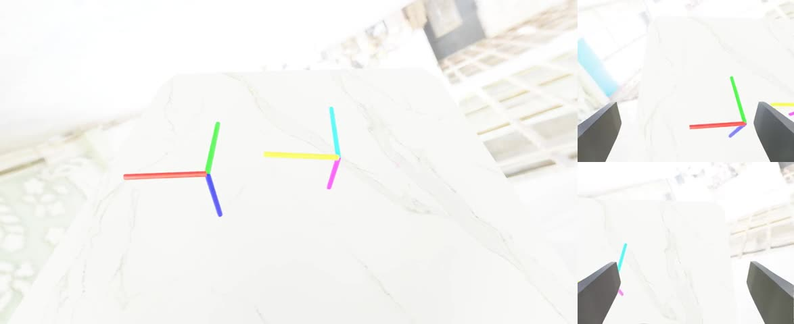

# Знакомство с InternDataEngine без загрузки 200 ГБ ассетов: практическое руководство для малого пространства

InternDataEngine — движок синтеза данных в платформе воплощённых данных InternVerse. Официальная документация охватывает установку, быстрый старт, рабочие процессы (Workflow), навыки (Skills), объекты, камеры, роботов, контроллеры, доменную рандомизацию, ассеты и обучение. Однако если нужно лишь «посмотреть, что умеет система», полная загрузка ассетов (около 200 ГБ) и запуск всей библиотеки задач — неоправданно дорого.

Этот документ идёт более лёгким путём: не загружает полный пакет ассетов, а использует небольшие ассеты из репозитория, необходимые зависимости CuRobo и Drake и одну примерно 1-мегабайтную модель сочленённой урны. Так удаётся охватить основные возможности InternDataEngine и получить видео с тремя ракурсами, которые можно вставлять в Markdown.

Руководство подходит трём типам читателей:

- тем, кто хочет быстро проверить, может ли сервер запускать InternDataEngine;
- тем, кто готовит демонстрации для курса, доклада или блога;
- тем, кто хочет разобраться в цепочке конфигураций, навыков, камер, рандомизации и вывода данных InternDataEngine, но пока не готов загружать полные ассеты.

В руководстве не утверждается, что полный набор официальных задач Pick / Place / Open успешно выполнен. В малой конфигурации эти задачи доходят до этапа планирования, но ещё требуют подстройки ограничений и поз. Основная цель — на малом пространстве запустить основной конвейер платформы и подготовить материалы, которые стабильно демонстрируют её функции.

## Итоговые результаты

В руководстве подготовлены четыре группы видео с локальным рендерингом, они лежат в каталоге `assets/` рядом с этим документом.

### Отслеживание целей: Workflow, робот, контроллер, три камеры

<video controls muted preload="metadata" width="100%">
  <source src="assets/track_three_views.mp4" type="video/mp4">
</video>

[Открыть видео: assets/track_three_views.mp4](assets/track_three_views.mp4)


### Комбинация навыков управления: суставы, захват, отслеживание траектории

<video controls muted preload="metadata" width="100%">
  <source src="assets/control_mix_three_views.mp4" type="video/mp4">
</video>

[Открыть видео: assets/control_mix_three_views.mp4](assets/control_mix_three_views.mp4)


### Объекты и доменная рандомизация: классы объектов, позы, освещение и возмущения камер

<video controls muted preload="metadata" width="100%">
  <source src="assets/object_dr_three_views.mp4" type="video/mp4">
</video>

[Открыть видео: assets/object_dr_three_views.mp4](assets/object_dr_three_views.mp4)



### Малый ассет с сочленённым объектом: загрузка и рендеринг ArticulatedObject

<video controls muted preload="metadata" width="100%">
  <source src="assets/articulation_three_views.mp4" type="video/mp4">
</video>

[Открыть видео: assets/articulation_three_views.mp4](assets/articulation_three_views.mp4)


## Что воспроизводится в этом руководстве

После выполнения руководства вы получите:

- локальный Markdown-документ (имя файла в исходном репозитории сохранено):
  `docs_artifacts/InternDataEngine_小空间功能体验教程.md`
- локальный каталог видеоресурсов:
  `docs_artifacts/assets/`
- четыре группы видео с тремя ракурсами, которые можно вставить в Markdown;
- четыре воспроизводимые минимальные конфигурации задач;
- ясное описание необходимых патчей совместимости для текущего окружения;
- честную запись о текущем состоянии задач Pick / Place / Open.

Этот путь на практике охватывает:

- рабочий процесс `simbox_plan_and_render`;
- конфигурацию задач в YAML;
- загрузку робота Split ALOHA;
- цепочку управления CuRobo;
- навыки `track`, `joint__ctrl`, `gripper__action`;
- `RigidObject`, `GeometryObject`, `ArticulatedObject`;
- камеры головы, левого и правого запястья;
- рандомизацию освещения, объектов, поз и камер;
- вывод LMDB, `meta_info.pkl` и видео MP4.

## Соглашения о каталогах

В этом руководстве проект предполагается по пути:

```bash
/path/to/InternDataEngine
```

Python Isaac Sim находится по пути:

```bash
/isaac-sim/python.sh
```

Каталог вспомогательных ассетов:

```bash
/path/to/internverse_assets
```

Перейдите в корень проекта:

```bash
cd /path/to/InternDataEngine
```

Все последующие команды по умолчанию выполняются из этого каталога.

Руководство рассчитано на подготовленный сервер с уже установленным Isaac Sim: здесь описано, как с минимальными затратами дискового пространства познакомиться с основными возможностями InternDataEngine и получить видео для вставки в Markdown.

Цель руководства — не воспроизвести полную библиотеку официальных задач и не скачивать около 200 ГБ полных ассетов, а на малых ассетах охватить:

- Workflow: сквозное выполнение `simbox_plan_and_render`;
- YAML-конфигурацию: задачи, роботы, камеры, навыки, ассеты;
- Роботов и контроллеры: Split ALOHA и контроллер CuRobo;
- Навыки: `track`, `joint__ctrl`, `gripper__action`;
- Объекты: твёрдые тела, геометрические объекты, сочленённые объекты;
- Камеры: головная, левая и правая запястные камеры;
- Доменную рандомизацию: освещение, класс объекта, позу, возмущения камер;
- Вывод данных: LMDB, `meta_info.pkl`, три видео MP4;
- Сочленённые объекты: проверка загрузки и отображения `ArticulatedObject` на малом ассете около 1 МБ.

По завершении у вас будут видео, которые можно напрямую вставить в Markdown, курсовой материал или отчёт по проекту.

## 1. Результаты руководства

Файл руководства:

```bash
/path/to/InternDataEngine/docs_artifacts/InternDataEngine_小空间功能体验教程.md
```

Видео и обложки лежат в каталоге `assets/` рядом с ним:

```bash
/path/to/InternDataEngine/docs_artifacts/assets/
```

Уже подготовленные материалы:

```bash
assets/track_three_views.mp4
assets/control_mix_three_views.mp4
assets/object_dr_three_views.mp4
assets/articulation_three_views.mp4
```

Все эти видео получены локальным рендерингом InternDataEngine и не являются внешними ссылками.

## 2. Ответ на вопрос: какие API Isaac Sim / InternDataEngine были изменены

В этот раз сам Isaac Sim не модифицировался, интерфейсы в каталоге установки `/isaac-sim` тоже не менялись. Фактические изменения сделаны в коде InternDataEngine в рабочем каталоге проекта; цель — чтобы официальный код продолжал работать в текущем окружении с Isaac Sim 5.1, Python 3.11, Torch 2.7 и новым API Drake.

### 2.1 Сохранение `arena_file`, чтобы повторный reset не терял конфигурацию

Файл:

```bash
/path/to/InternDataEngine/workflows/simbox_dual_workflow.py
```

До исправления во время reset workflow выполнял:

```python
self.task_cfg.pop("arena_file", None)
```

Из-за этого при повторном reset того же конвейера `arena_file` удалялся из конфигурации, и последующая загрузка арены получала `None`. В локальном многонавыковом smoke-тесте с малой задачей это проявлялось как сбой reset сцены.

Текущий патч сохраняет `arena_file`:

```python
# Keep arena_file available because the same task_cfg can be reset more
# than once inside the local plan-and-render pipeline.
self.task_cfg.pop("camera_file", None)
self.task_cfg.pop("logger_file", None)
```

Это исправление совместимости управления состоянием workflow InternDataEngine, а не изменение API Isaac Sim.

### 2.2 Совместимость с `MultibodyPlantConfig` в Drake

Файл:

```bash
/path/to/InternDataEngine/workflows/simbox/solver/planner_utils.py
```

Официальный код предполагает, что `pydrake.multibody.plant.MultibodyPlantConfig` поддерживает параметр `discrete_contact_solver`:

```python
MultibodyPlantConfig(
    time_step=time_step,
    discrete_contact_solver=discrete_contact_solver,
)
```

В версии Drake этого окружения такого поля нет, и появляется ошибка:

```text
AttributeError: 'pydrake.multibody.plant.MultibodyPlantConfig' object has no attribute 'discrete_contact_solver'
```

Патч использует совместимую с новым и старым API запись:

```python
try:
    multibody_plant_config = MultibodyPlantConfig(
        time_step=time_step,
        discrete_contact_solver=discrete_contact_solver,
    )
except AttributeError:
    multibody_plant_config = MultibodyPlantConfig(time_step=time_step)
```

### 2.3 Совместимость с `AddModels` парсера Drake

В том же файле:

```bash
/path/to/InternDataEngine/workflows/simbox/solver/planner_utils.py
```

Официальный код использует старый интерфейс:

```python
parser.AddModelFromFile(franka_combined_path)
```

В текущей версии Drake этого метода нет, и появляется ошибка:

```text
AttributeError: 'pydrake.multibody.parsing.Parser' object has no attribute 'AddModelFromFile'
```

Патч добавляет функцию совместимости:

```python
def add_model_from_file(parser, model_path):
    if hasattr(parser, "AddModelFromFile"):
        return parser.AddModelFromFile(model_path)
    return parser.AddModels(model_path)[0]
```

И затем в `AddR5a`, `AddPiper`, `AddFranka` вызов заменяется на:

```python
franka = add_model_from_file(parser, franka_combined_path)
```

### 2.4 Вывод

В официальном репозитории InternDataEngine код действительно изменён, но только небольшими патчами совместимости:

- Isaac Sim сам по себе не менялся;
- крупная структура логики официальных задач не переписывалась;
- неудачные задачи не объявлялись успешными искусственно;
- патчи в основном устраняют различия API между текущим окружением выполнения и версией кода в репозитории.

Если позже перейти на рекомендуемую официально комбинацию Isaac Sim / Python / Drake, эти патчи могут стать ненужными. Сохранять их обычно безвредно, поскольку они реализованы как ветвление совместимости, а старый API продолжает работать.

## 3. Окружение

Руководство опирается на такие пути:

```bash
/path/to/InternDataEngine
/isaac-sim/python.sh
/path/to/internverse_assets
```

Перед началом перейдите в репозиторий:

```bash
cd /path/to/InternDataEngine
```

Проверьте, что Python Isaac Sim существует:

```bash
test -x /isaac-sim/python.sh && echo "Isaac Sim python found"
```

Проверьте GPU:

```bash
nvidia-smi
```

Проверьте состояние репозитория:

```bash
git status --short
```

Демонстрации этого руководства не требуют полных 200 ГБ ассетов. Используются:

- `workflows/simbox/example_assets`, которые поставляются в репозитории;
- уже загруженный `workflows/simbox/curobo`;
- уже загруженный `workflows/simbox/panda_drake`;
- дополнительно добавленная модель сочленённой урны размером около 1 МБ.

## 4. Локальная копия документации

Официальная документация зеркалирована локально:

```bash
/path/to/internverse-docs-mirror/internrobotics.github.io/InternDataEngine-Docs/index.html
```

Этот HTML можно открыть в браузере и просматривать офлайн страницы Installation, Quick Start, Workflow, Skills, Objects, Cameras, Robots, Controllers, Domain Randomization, Assets и Training.

Если нужно заново создать зеркало официальной документации, можно использовать такую команду:

```bash
cd /path/to
wget \
  --mirror \
  --convert-links \
  --adjust-extension \
  --page-requisites \
  --no-parent \
  https://internrobotics.github.io/InternDataEngine-Docs/
```

После зеркалирования точка входа обычно находится здесь:

```bash
internrobotics.github.io/InternDataEngine-Docs/index.html
```

## 5. Конфигурация задач для малого пространства

Новые конфигурации задач этого руководства лежат в каталоге:

```bash
workflows/simbox/core/configs/tasks/example/
```

Основные файлы:

```bash
workflows/simbox/core/configs/tasks/example/track_the_targets.yaml
workflows/simbox/core/configs/tasks/example/local_control_mix.yaml
workflows/simbox/core/configs/tasks/example/local_object_dr_showcase.yaml
workflows/simbox/core/configs/tasks/example/local_articulation_showcase.yaml
workflows/simbox/core/configs/tasks/example/local_pick_left.yaml
workflows/simbox/core/configs/tasks/example/local_pick_place_right.yaml
workflows/simbox/core/configs/tasks/example/local_open_trashcan.yaml
```

Четыре задачи, которые стабильно сгенерировали видео:

- `track_the_targets.yaml`
- `local_control_mix.yaml`
- `local_object_dr_showcase.yaml`
- `local_articulation_showcase.yaml`

`local_pick_left.yaml`, `local_pick_place_right.yaml` и `local_open_trashcan.yaml` — попытки проверить навыки Pick / Place / Open. Пока что для них нужно подстраивать ограничения планирования; об этом подробнее ниже.

## 6. Демо 1: Track The Targets

Демо использует двуруку Split ALOHA для простого отслеживания целей. Основная задача — проверить workflow, YAML, робота, контроллер, камеры, рендеринг и запись LMDB.

Команда запуска:

```bash
cd /path/to/InternDataEngine
bash scripts/simbox/simbox_plan_and_render.sh \
  workflows/simbox/core/configs/tasks/example/track_the_targets.yaml \
  1 \
  9
```

Значение параметров:

- первый параметр — YAML задачи;
- второй `1` — сгенерировать 1 случайный образец;
- третий `9` — seed случайных чисел.

После успешного выполнения выходной каталог выглядит так:

```bash
output/track_the_targets_plan_and_render_seed_9/
```

Видео можно найти командой:

```bash
find output/track_the_targets_plan_and_render_seed_9 \
  -type f -name 'demo.mp4' -print
```

Подготовленное демонстрационное видео:

<video controls muted preload="metadata" width="100%">
  <source src="assets/track_three_views.mp4" type="video/mp4">
</video>

Если Markdown-рендерер не поддерживает тег HTML video, откройте напрямую:

[assets/track_three_views.mp4](assets/track_three_views.mp4)

Превью кадра:


Это демо показывает, что текущее окружение может выполнить:

- запуск Isaac Sim;
- выполнение SimBox workflow;
- загрузку Split ALOHA;
- планирование CuRobo;
- рендеринг с трёх камер;
- запись данных LMDB;
- экспорт MP4.

## 7. Демо 2: Control Mix

Демо объединяет несколько недорогих навыков управления и показывает систему навыков и цепочку команд контроллера.

Команда запуска:

```bash
cd /path/to/InternDataEngine
bash scripts/simbox/simbox_plan_and_render.sh \
  workflows/simbox/core/configs/tasks/example/local_control_mix.yaml \
  1 \
  24
```

Обратите внимание на имена навыков:

```yaml
name: joint__ctrl
name: gripper__action
name: track
```

`joint__ctrl` и `gripper__action` — имена, которые регистрирует текущий код, с двойным подчёркиванием посередине. Если написать `joint_ctrl` или `gripper_action`, навык не будет найден в реестре.

Демонстрационное видео:

<video controls muted preload="metadata" width="100%">
  <source src="assets/control_mix_three_views.mp4" type="video/mp4">
</video>

Прямая ссылка:

[assets/control_mix_three_views.mp4](assets/control_mix_three_views.mp4)

Превью кадра:


Это демо охватывает:

- `joint__ctrl`;
- `gripper__action`;
- `track`;
- контроллер двуруких манипуляций;
- три видеопотока: голова, левое запястье, правое запястье.

## 8. Демо 3: Объекты и доменная рандомизация

Демо использует объекты для сортировки мусора и урну из малого пакета ассетов и показывает загрузку объектов, рандомизацию класса, позы объекта, освещения, возмущения камер и поведение повторных попыток (retry).

Команда запуска:

```bash
cd /path/to/InternDataEngine
bash scripts/simbox/simbox_plan_and_render.sh \
  workflows/simbox/core/configs/tasks/example/local_object_dr_showcase.yaml \
  1 \
  41
```

Корневой каталог ассетов, который использует задача:

```yaml
asset_root: workflows/simbox/example_assets
```

В конфигурации включены такие поля:

```yaml
env_map:
  apply_randomization: True
  intensity_range: [2500, 7500]
  rotation_range: [0, 180]
```

Для твёрдых тел включено:

```yaml
apply_randomization: True
randomization_scope: category
orientation_mode: random
optimize_2d_layout: True
```

Демонстрационное видео:

<video controls muted preload="metadata" width="100%">
  <source src="assets/object_dr_three_views.mp4" type="video/mp4">
</video>

Прямая ссылка:

[assets/object_dr_three_views.mp4](assets/object_dr_three_views.mp4)

Превью кадра:


Это демо охватывает:

- `RigidObject`;
- `GeometryObject`;
- рандомизацию класса объекта;
- случайный поворот (yaw) и позу;
- рандомизацию освещения окружения;
- рандомизацию позы камеры;
- неверную компоновку и повторную попытку планирования;
- вывод трёх видео и LMDB.

## 9. Демо 4: ArticulatedObject на малом ассете

Полные задачи с сочленёнными объектами обычно требуют много ассетов с суставами. Здесь полный пакет не загружался, а добавлен только небольшой ассет урны:

```bash
workflows/simbox/example_assets/art/trashcan/trashcan_0001
```

Этот каталог весит около 1 МБ и содержит:

```bash
instance.usd
Kps/open_h/info.json
Kps/open_h/keypoints.json
Kps/open_h/keypoints_final.json
Kps/close_h/info.json
Kps/close_h/keypoints.json
Kps/close_h/keypoints_final.json
```

Запуск демонстрационной задачи:

```bash
cd /path/to/InternDataEngine
bash scripts/simbox/simbox_plan_and_render.sh \
  workflows/simbox/core/configs/tasks/example/local_articulation_showcase.yaml \
  1 \
  52
```

Демонстрационное видео:

<video controls muted preload="metadata" width="100%">
  <source src="assets/articulation_three_views.mp4" type="video/mp4">
</video>

Прямая ссылка:

[assets/articulation_three_views.mp4](assets/articulation_three_views.mp4)

Превью кадра:


Это демо охватывает:

- загрузку `ArticulatedObject`;
- загрузку метаданных ключевых точек для `info_name: open_h`;
- инициализацию углов суставов через `joint_position_range`;
- фиксацию основания сочленённого объекта через `fix_base: True`;
- размещение сочленённого объекта на столе;
- случайное освещение и возмущения камер;
- экспорт трёх видео.

Важно: это демо показывает визуализацию и цепочку данных для ArticulatedObject, но не эквивалентно успешному открытию крышки навыком open.

## 10. Структура выходных данных

Каждая успешная задача обычно создаёт структуру такого вида:

```bash
output/<task_name>_plan_and_render_seed_<seed>/
└── BananaBaseTask/
    └── split_aloha/
        └── <task_dir>/
            └── <collect_info>/
                └── <timestamp>/
                    ├── lmdb/
                    │   ├── data.mdb
                    │   └── info.json
                    ├── meta_info.pkl
                    ├── images.rgb.head/
                    │   └── demo.mp4
                    ├── images.rgb.hand_left/
                    │   └── demo.mp4
                    └── images.rgb.hand_right/
                        └── demo.mp4
```

Просмотр выходных данных задачи:

```bash
find output/local_articulation_showcase_plan_and_render_seed_52 \
  -type f \
  \( -name 'demo.mp4' -o -name 'data.mdb' -o -name 'meta_info.pkl' \) \
  -print
```

Просмотр информации о видео:

```bash
ffprobe -v error \
  -select_streams v:0 \
  -show_entries stream=width,height,duration \
  -of default=nw=1 \
  docs_artifacts/assets/articulation_three_views.mp4
```

Фактические параметры склеенного видео для сочленённого демо:

```text
width=2134
height=480
duration=14.666667
```

## 11. Как разложить видео по каталогу assets для Markdown

Команды ниже копируют склеенные видео с тремя ракурсами в каталог `assets/` рядом с руководством.

```bash
cd /path/to/InternDataEngine
mkdir -p docs_artifacts/assets

cp docs_artifacts/videos/track_the_targets/seed9_three_views.mp4 \
  docs_artifacts/assets/track_three_views.mp4
cp docs_artifacts/videos/track_the_targets/seed9_three_views.jpg \
  docs_artifacts/assets/track_three_views.jpg

cp docs_artifacts/videos/control_mix/three_views.mp4 \
  docs_artifacts/assets/control_mix_three_views.mp4
cp docs_artifacts/videos/control_mix/three_views.jpg \
  docs_artifacts/assets/control_mix_three_views.jpg

cp docs_artifacts/videos/object_dr/three_views.mp4 \
  docs_artifacts/assets/object_dr_three_views.mp4
cp docs_artifacts/videos/object_dr/three_views.jpg \
  docs_artifacts/assets/object_dr_three_views.jpg

cp docs_artifacts/videos/articulation_showcase/three_views.mp4 \
  docs_artifacts/assets/articulation_three_views.mp4
cp docs_artifacts/videos/articulation_showcase/three_views.jpg \
  docs_artifacts/assets/articulation_three_views.jpg
```

Для вставки видео в Markdown лучше использовать HTML:

```html
<video controls muted preload="metadata" width="100%">
  <source src="assets/object_dr_three_views.mp4" type="video/mp4">
</video>
```

А для Markdown-рендереров, которые не поддерживают HTML video, дополнительно сохраните обычную ссылку:

```markdown
[assets/object_dr_three_views.mp4](assets/object_dr_three_views.mp4)
```

## 12. Функции, которые пока не работают полностью

Чтобы сэкономить место, полный пакет ассетов не загружался. Поэтому Pick, Place и полноценный навык открытия/закрытия сочленённого объекта пока не дают стабильного успешного видео.

### 12.1 Pick

Конфигурация:

```bash
workflows/simbox/core/configs/tasks/example/local_pick_left.yaml
```

Наблюдаемый результат:

```text
Plan did not converge to a solution.
```

Это значит, что сцена, объект и цепочка разметки захвата уже дошли до этапа планирования, но в малой конфигурации CuRobo не нашёл допустимой траектории. Дальнейшая отладка — понизить сложность положения объекта, скорректировать домашнюю позу, уменьшить число препятствий, ослабить ограничения позы захвата или выбрать объект, который легче захватить.

### 12.2 Pick + Place

Конфигурация:

```bash
workflows/simbox/core/configs/tasks/example/local_pick_place_right.yaml
```

Конфигурация готова, но поскольку одиночный Pick пока нестабилен, полный Pick + Place пока не запускался до конца.

### 12.3 Навык Open

Конфигурация:

```bash
workflows/simbox/core/configs/tasks/example/local_open_trashcan.yaml
```

Уже исправлены две точки совместимости с API Drake; навык open доходит до генерации ключевых поз KPAM, но сейчас результат такой:

```text
No keyframes found, return empty manip_list
```

Это означает, что проблемы установки и API уже не главные препятствия. Дальше нужно подстраивать:

- положение урны на столе;
- расстояние от базы робота до урны;
- `constraint_list`;
- `contact_pose_index`;
- `post_actuation_motions`;
- соответствие направления ключевых точек и ключевых точек захвата.

## 13. Частые вопросы

### 13.1 `arena_file` становится пустым или reset падает

Проверьте, сохранён ли патч из раздела 2.1. В конвейере с несколькими этапами не удаляйте `arena_file` из `task_cfg` после первого reset.

### 13.2 У `MultibodyPlantConfig` нет `discrete_contact_solver`

Это различие версий Drake. Используйте совместимую запись из раздела 2.2.

### 13.3 У `Parser` нет `AddModelFromFile`

Это различие API парсера Drake. Используйте функцию совместимости `add_model_from_file()` из раздела 2.3.

### 13.4 Не находится имя навыка

Сначала посмотрите зарегистрированное имя в классе навыка. В локальном control mix сейчас используется:

```yaml
name: joint__ctrl
name: gripper__action
```

а не:

```yaml
name: joint_ctrl
name: gripper_action
```

### 13.5 Планирование не сходится

Это не обязательно ошибка установки. `Plan did not converge to a solution` обычно означает, что сочетание начальной позы робота, целевой позы, препятствий и ограничений позы захвата слишком сложно. Сначала проверьте окружение на `track_the_targets.yaml` или `local_control_mix.yaml`, а уже потом усложняйте задачу.

### 13.6 Проверка остаточных процессов после запуска

```bash
pgrep -af 'simbox_plan_and_render|launcher.py|isaac-sim/kit/python' || true
```

Если нужно остановить текущее демо:

```bash
pkill -f 'launcher.py --config configs/simbox/de_plan_and_render_template.yaml' || true
```

## 14. Рекомендуемый порядок воспроизведения

Для первого воспроизведения рекомендуется такой порядок:

```bash
cd /path/to/InternDataEngine

bash scripts/simbox/simbox_plan_and_render.sh \
  workflows/simbox/core/configs/tasks/example/track_the_targets.yaml \
  1 9

bash scripts/simbox/simbox_plan_and_render.sh \
  workflows/simbox/core/configs/tasks/example/local_control_mix.yaml \
  1 24

bash scripts/simbox/simbox_plan_and_render.sh \
  workflows/simbox/core/configs/tasks/example/local_object_dr_showcase.yaml \
  1 41

bash scripts/simbox/simbox_plan_and_render.sh \
  workflows/simbox/core/configs/tasks/example/local_articulation_showcase.yaml \
  1 52
```

После каждой задачи сначала проверьте выход:

```bash
find output -type f -name 'demo.mp4' | tail -20
```

И убедитесь, что не осталось остаточных процессов:

```bash
pgrep -af 'simbox_plan_and_render|launcher.py|isaac-sim/kit/python' || true
```

## 15. Итоги

Без загрузки полных ассетов это руководство на малом пространстве охватило основные функции InternDataEngine:

- можно запустить Isaac Sim 5.1;
- можно выполнить SimBox workflow;
- можно загрузить Split ALOHA;
- можно выполнить цепочку управления CuRobo;
- можно вывести LMDB и три MP4;
- можно показать несколько навыков;
- можно показать рандомизацию объектов и доменов;
- можно показать ArticulatedObject с дополнительными ассетами около 1 МБ.

Официальные Pick, Place и Open/Close навыки здесь не объявлены полностью работающими. Они дошли до соответствующего этапа планирования или генерации ключевых поз, но требуют дальнейшей настройки ограничений и поз. Для демонстрации задачи, описания функций платформы и видеоиллюстраций для Markdown четыре подготовленные группы видео уже достаточны для обзора основных возможностей InternDataEngine на малом пространстве.
