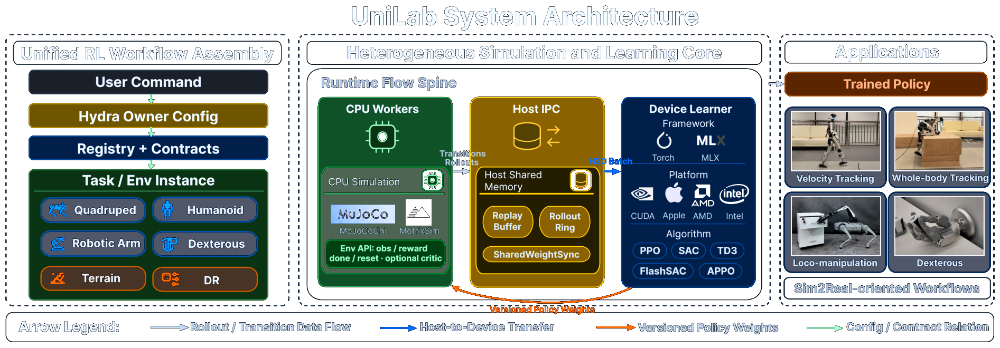
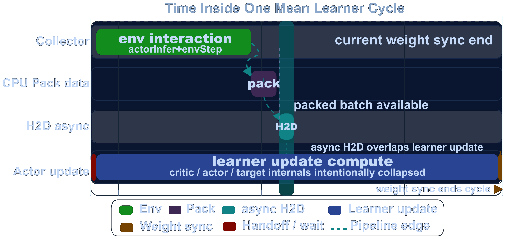
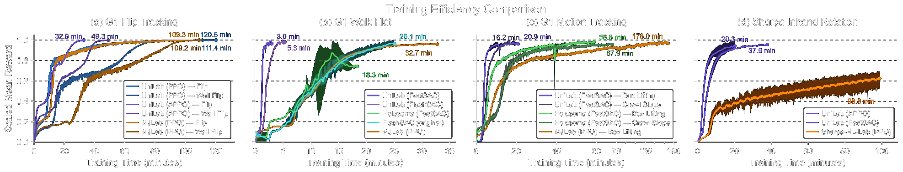
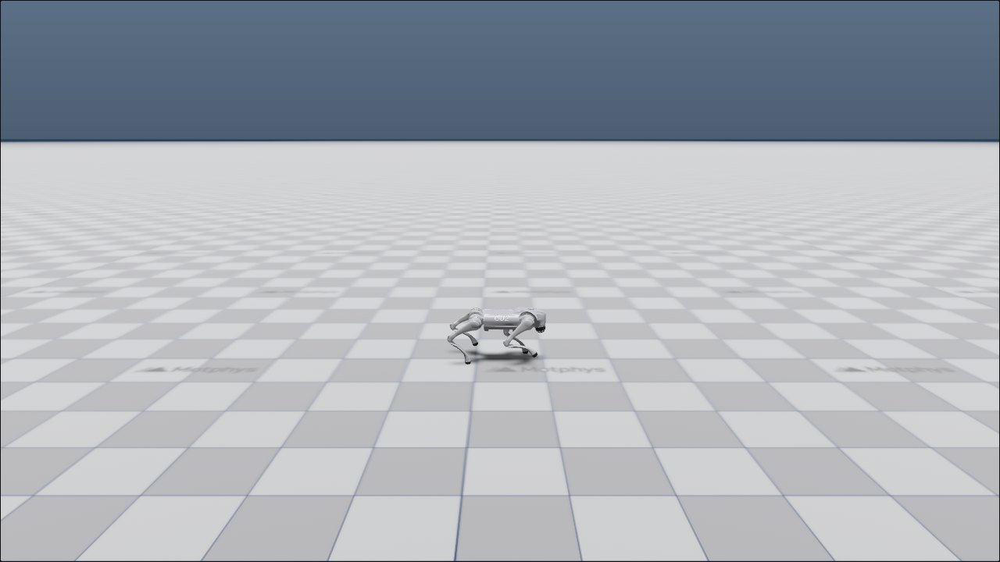
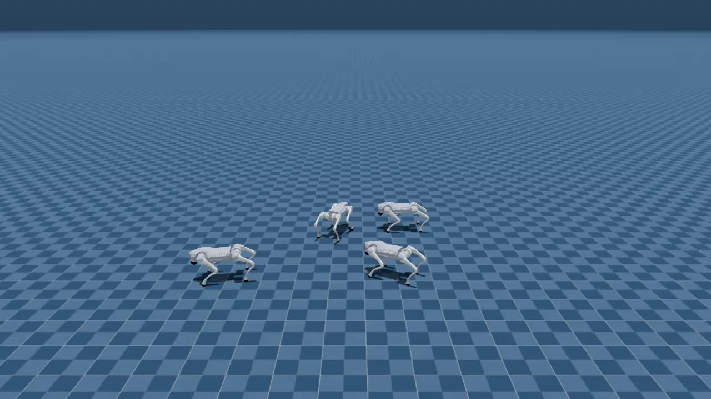
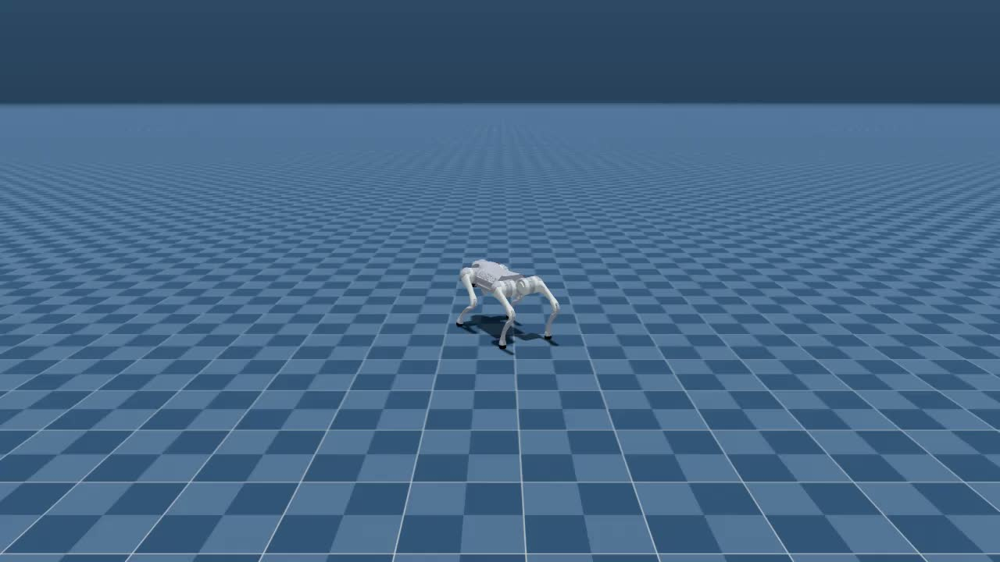
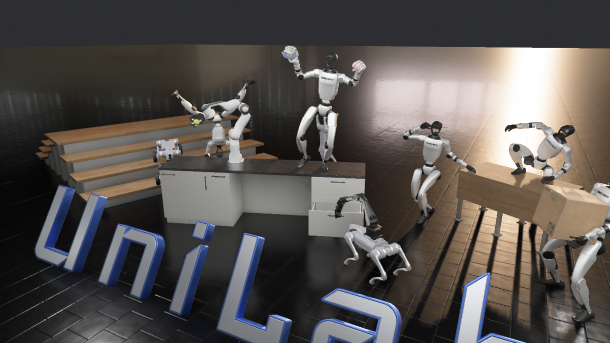
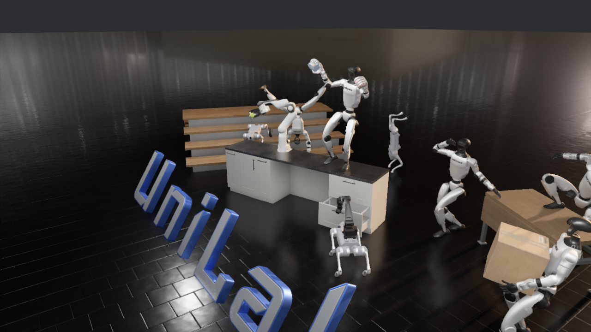
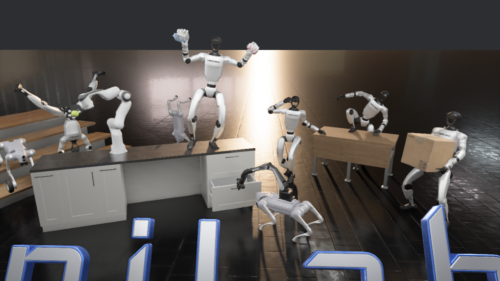

# Воспроизведение UniLab + MotrixSim: гетерогенное обучение с подкреплением роботов

В этой главе описано, как на ноутбуке Windows с видеокартой 6 ГБ запустить бэкенд MotrixSim в UniLab и процесс обучения PPO. Основная линия — обучение с подкреплением роботов на основе состояния (state-based RL): сеть политики читает состояние робота, команды скорости и историю наблюдений, сэмплирование выполняется в симуляции на CPU, а параметры обновляет learner на GPU. Рендеринг здесь не является основным методом; он нужен как вспомогательный этап — для проверки контрольных точек, показа результатов и знакомства с PBR-тизером MotrixSim.

Тестовая машина: RTX 3060 Laptop 6 ГБ, AMD Ryzen 7 5800H, 64 ГБ оперативной памяти. В итоге запущена связка `go2_joystick_flat + motrix + ppo` с максимальной конфигурацией 512 параллельных сред и 100 итерациями обучения, всего `1 228 800` шагов среды.

## 1. Какую проблему решает UniLab

Главная идея UniLab — разделить обучение с подкреплением роботов на две части: на стороне CPU идёт крупномасштабная физическая симуляция и сбор данных, на стороне GPU — обучение сети политики. Это значит, что для больших пакетов экспериментов с RL роботов не обязательно иметь GPU-симулятор физики; если CPU может параллельно вести достаточно много сред, GPU нужен только для learner.



Рисунок 1. Официальная архитектура системы UniLab. Обратите внимание на центральную часть — Runtime Flow Spine: CPU Workers отвечают за симуляцию MuJoCo/MotrixSim, Host IPC — за общую память, rollout и буфер replay, а Device Learner — это модуль обучения на устройствах CUDA / Apple / AMD / Intel. Источник: [официальная страница проекта UniLab](https://unilabsim.github.io).



Рисунок 2. Официальная временная шкала конвейера UniLab. Она показывает, как сэмплирование в симуляции, передача данных Host-to-Device и обновление learner располагаются в гетерогенном конвейере. Источник: [официальная страница проекта UniLab](https://unilabsim.github.io).



Рисунок 3. Официальное сравнение эффективности обучения UniLab. Полный вывод о производительности нужно проверять строго по аппаратной и задачной матрице из статьи; в этой главе выполнен только лёгкий smoke-тест и запись потребления ресурсов на видеокарте 6 ГБ. Источник: [официальная страница проекта UniLab](https://unilabsim.github.io).



Рисунок 4. Скриншот из официальной страницы UniLab: задача отслеживания скорости Go2 на ровной поверхности. Для первого пробного обучения выбрана именно эта задача, потому что она проще человекоподобных танцев или манипуляций ловкой кистью. Источник: [официальная страница проекта UniLab](https://unilabsim.github.io).

## 2. До какой степени можно воспроизвести на этой машине

Видеокарта на 6 ГБ позволяет запускать небольшие эксперименты обучения, но её не стоит считать полноценной платформой для воспроизведения статьи. Причин две. Во-первых, заявленное в статье ускорение сквозного конвейера в 3–10 раз требует сравнения на нескольких задачах, алгоритмах и аппаратных конфигурациях. Во-вторых, официально основными считаются Linux CUDA, Linux ROCm, Linux XPU и macOS; Windows не входит в основной официальный путь.

Результаты, полученные в этой главе, лучше использовать для первого практического вывода:

| Пункт | Статус в этой главе |
| --- | --- |
| Клонирование официального репозитория UniLab | Выполнено |
| Импорт бэкенда MotrixSim | Выполнено |
| PyTorch с поддержкой CUDA | Выполнено, `torch 2.7.0+cu128` |
| Обучение `go2_joystick_flat` | Выполнено |
| Сохранение контрольных точек | Выполнено |
| Оценка без рендеринга | Выполнено |
| Запись видео MotrixSim | Выполнено |
| Бэкенд MuJoCo | В Windows не запущен: сборка `mujoco-uni` не прошла |
| Полный бенчмарк статьи | Не воспроизведён: нужны Linux/облачный сервер и более систематическая матрица экспериментов |

## 3. Подготовка окружения

Официально рекомендуется управлять окружением через `uv`. На машине уже было окружение `py310` в `micromamba`, поэтому новое окружение micromamba здесь не создавалось: UniLab создаёт собственный `.venv` внутри каталога проекта. Так зависимости UniLab изолированы и не загрязняют уже существующие окружения.

Сначала запишем рабочий каталог и путь к репозиторию в переменные:

```powershell
$WORKSPACE = "C:\path\to\workspace"
$UNILAB_ROOT = "$WORKSPACE\UniLab"
git clone https://github.com/unilabsim/UniLab.git $UNILAB_ROOT
cd $UNILAB_ROOT
```

Если воспроизведение выполняется в Linux, используйте официальную команду:

```bash
make setup-motrix
```

При тестировании в Windows для `mujoco-uni==3.8.0` нет готового wheel под Windows, а сборка из исходников требует переменную `MUJOCO_PATH`. Чтобы сначала запустить маршрут MotrixSim, используйте такой обходной вариант: установка без `mujoco-uni`:

```powershell
uv sync --extra motrix --no-install-package mujoco-uni `
  --python C:\path\to\micromamba\envs\py310\python.exe
```

Затем заменим PyTorch в `.venv` проекта на сборку под Windows с CUDA 12.8:

```powershell
uv pip install --python .\.venv\Scripts\python.exe --reinstall `
  torch==2.7.0 --index-url https://download.pytorch.org/whl/cu128
```

Проверка доступности CUDA:

```powershell
$env:PYTHONPATH = "src"
uv run --no-sync python -c "import torch; print(torch.__version__, torch.version.cuda, torch.cuda.is_available()); print(torch.cuda.get_device_name(0))"
```

Вывод на этой машине:

```text
2.7.0+cu128 12.8 True
NVIDIA GeForce RTX 3060 Laptop GPU
```

## 4. Контрольная точка 1: небольшое обучение на 256 средах

В первый раз не стоит сразу использовать официальное значение по умолчанию — `1024` среды. На машине с 6 ГБ видеопамяти начните с `256` сред и проверьте, что цикл обучения, журналы и контрольные точки работают корректно.

```powershell
$env:PYTHONPATH = "src"
$env:WANDB_MODE = "disabled"

uv run --no-sync train --algo ppo --task go2_joystick_flat --sim motrix `
  training.no_play=true training.device=cuda:0 `
  algo.num_envs=256 algo.max_iterations=50 algo.save_interval=50
```

Эта команда делает три вещи: с помощью MotrixSim на стороне CPU продвигает задачу отслеживания скорости Go2 на ровной поверхности; с помощью PPO learner на CUDA обновляет политику; сохраняет контрольную точку каждые 50 итераций. Параметр `training.no_play=true` отключает интерактивное воспроизведение после обучения, чтобы окно рендеринга не влияло на проверку обучения.

Сводка одного успешного запуска на этой машине:

| Показатель | Значение |
| --- | ---: |
| Число параллельных сред | 256 |
| Итерации | 50 |
| `num_steps_per_env` | 24 |
| Всего шагов среды | 307 200 |
| Время обучения (wall time) | 51,30 с |
| Финальная средняя награда | 22,48 |
| Лучшая средняя награда | 25,52 |
| Финальная контрольная точка | `model_49.pt` |

Этот smoke-тест подтверждает, что сбор данных, обучение на GPU, запись журналов и сохранение контрольных точек работают; но он не доказывает, что политика достигла уровня статьи или официального бенчмарка.

## 5. Контрольная точка 2: 512 сред, 100 итераций и потребление ресурсов

Убедившись, что 256 сред работают, на той же машине запустили `512` сред и `100` итераций и грубо отслеживали загрузку с помощью `nvidia-smi`, счётчиков Windows и RSS процессов.

```powershell
$env:PYTHONPATH = "src"
$env:WANDB_MODE = "disabled"

uv run --no-sync train --algo ppo --task go2_joystick_flat --sim motrix `
  training.no_play=true training.device=cuda:0 `
  algo.num_envs=512 algo.max_iterations=100 algo.save_interval=50
```

Сводка обучения:

| Показатель | Значение |
| --- | ---: |
| Число параллельных сред | 512 |
| Итерации | 100 |
| Всего шагов среды | 1 228 800 |
| Время обучения (wall time) | 132,90 с |
| Длительность внешней записи мониторинга | 141,94 с |
| Финальная средняя награда | 34,97 |
| Лучшая средняя награда | 37,40 |
| Средняя длина эпизода | 1000,0 |

Записи потребления ресурсов:

| Ресурс | Среднее | Пик | Комментарий |
| --- | ---: | ---: | --- |
| Видеопамять GPU | 233 МиБ | 263 МиБ | Только значения, снятые `nvidia-smi`; показывает, что сама сеть политики очень лёгкая |
| Загрузка GPU | 13,54 % | 60 % | Learner обновляется периодически, поэтому загрузка не остаётся на максимуме |
| Загрузка CPU системы | 62,80 % | 81,05 % | Основная нагрузка — параллельная симуляция MotrixSim/CPU |
| Занятая оперативная память системы | 31,22 ГиБ | 32,24 ГиБ | Включает систему и фоновые программы, а не только UniLab |
| RSS процессов Python, связанных с UniLab | 1397 МиБ | 1538 МиБ | Оценка по рабочему набору процессов Python/uv |

Файлы мониторинга сохранены в каталоге:

- `assets/local_runs/20260531-210237/resource_monitor.csv`
- `assets/local_runs/20260531-210237/resource_summary_512x100.json`
- `assets/local_runs/20260531-210237/train_summary_512x100.json`

Из этих данных видно, что для такой лёгкой задачи видеокарта на 6 ГБ не является узким местом; более заметная нагрузка приходится на CPU. Это соответствует архитектуре UniLab: сторона CPU отвечает за физическую симуляцию, а сторона GPU — только за обучение политики.

## 6. Контрольная точка 3: экспорт воспроизведения обученной политики в MotrixSim

В Windows, если путь к репозиторию содержит китайские символы, `eval --render-mode record` при экспорте политики TorchScript может выдать ошибку:

```text
RuntimeError: Parent directory ... does not exist.
```

Причина в том, что исходный путь содержит китайские символы, а TorchScript не может корректно обработать такой путь при сохранении. Решение — поместить корневой каталог журналов обучения в путь только из ASCII-символов, например `C:/unilab_logs`.

```powershell
$env:PYTHONPATH = "src"
$env:WANDB_MODE = "disabled"

uv run --no-sync train --algo ppo --task go2_joystick_flat --sim motrix `
  training.no_play=true training.device=cuda:0 training.log_root=C:/unilab_logs `
  algo.num_envs=256 algo.max_iterations=50 algo.save_interval=50
```

Здесь экспортируется воспроизведение политики из обученной контрольной точки, а не PBR-тизер. Цель — проверить, что политика, обучавшаяся на состоянии, загружается и может стабильно выполнять несколько шагов в MotrixSim.

Воспроизведение с несколькими средами:

```powershell
uv run --no-sync eval --algo ppo --task go2_joystick_flat --sim motrix `
  --load-run -1 --render-mode record `
  training.log_root=C:/unilab_logs `
  training.play_steps=300 training.play_env_num=4 training.render_spacing=1.4
```

Воспроизведение одной среды с камерой, следующей за роботом:

```powershell
uv run --no-sync eval --algo ppo --task go2_joystick_flat --sim motrix `
  --load-run -1 --render-mode record `
  training.log_root=C:/unilab_logs `
  training.play_steps=300 training.play_env_num=1 `
  training.cam_tracking=true training.cam_distance=4.0 training.cam_elevation=-15.0
```

<video controls muted preload="metadata" width="100%">
  <source src="assets/videos/go2_flat_4env_300steps.mp4" type="video/mp4">
</video>

Рисунок 5. Записанное на этой машине воспроизведение с 4 средами в MotrixSim. Оно подтверждает, что контрольная точка загружается и может управлять записью в MotrixSim на 300 шагов политики.

<video controls muted preload="metadata" width="100%">
  <source src="assets/videos/go2_flat_1env_300steps.mp4" type="video/mp4">
</video>

Рисунок 6. Записанное на этой машине видео одной среды с камерой, следующей за роботом. Оно лучше подходит для проверки того, что поза и действия робота непрерывны.

Если веб-сборка не показывает видео напрямую, сначала посмотрите покадровые превью:



Рисунок 7. Покадровое превью воспроизведения с 4 средами.



Рисунок 8. Покадровое превью воспроизведения одной среды.

## 7. Дополнительно: рендерер PBR-тизера MotrixSim

Основная цель UniLab — не бенчмарк рендеринга, однако рендерер MotrixSim уже поддерживает PBR. В официальном репозитории есть отдельная точка входа-тизер, которую можно использовать как знакомство с визуализацией: она загружает сцену-тизер из статьи, открывает рендерер MotrixSim и показывает статичную сцену; обучение политики и rollout RL при этом не выполняются.

Запустите из корня репозитория UniLab:

```powershell
$env:PYTHONPATH = "src"
uv run --no-sync demo teaser
```

Первый запуск автоматически загрузит ресурсы сцены-тизера. После загрузки программа перейдёт в `src/unilab/tools/render_teaser.py`, вызовет `RenderSettings.quality()` и включит тени, SSGI и полную сетку рендеринга. После открытия окна сцену можно просматривать интерактивно; чтобы выйти, закройте окно.

На этой машине для стабильного получения снимков с разных точек зрения использовался headless-захват системной камеры MotrixSim, а не запись видео чата или скриншот переднего окна. Основная идея — загрузить ту же MJCF-сцену тизера и несколько раз изменить:

```python
render.system_camera.set_view(lookat, distance, elevation, azimuth)
```

Когда ресурсы сцены уже загружены, экспорт трёх PNG-снимков разрешением `1280x720` занимает около `24 с`. При первом запуске дополнительно загружаются ресурсы `scenes/teaser`; если в журнале появляются предупреждения `convex hull partial success`, `Duplicate AssetLoader` или `wgpu_core::validation`, но снимки создаются нормально, их можно считать сообщениями инициализации рендерера.

Три изображения ниже получены на этой машине при реальном запуске рендерера MotrixSim PBR.

<table>
  <tr>
    <td></td>
    <td></td>
  </tr>
  <tr>
    <td>Рисунок 9. Основной вид PBR-тизера. Видны отражающий пол, сильный световой проём, робот и картонные коробки — демонстрационные ассеты.</td>
    <td>Рисунок 10. Вид слева сверху в PBR-тизере. Этот ракурс удобнее для наблюдения общей компоновки сцены и слоёв теней.</td>
  </tr>
</table>



Рисунок 11. Крупный план PBR-тизера. Этот снимок лучше подходит для проверки PBR-материалов, отражений на полу, теней на столешнице и бликов на поверхности робота.

Этот тизер удобно включить в учебник как раздел «Знакомство с рендерером MotrixSim», но не стоит смешивать его с метриками обучения RL из предыдущих разделов: `go2_joystick_flat` — воспроизведение обучения с RL на основе состояния, а здесь показан только рендеринг статичной сцены.

## 8. Частые проблемы

### Сборка `mujoco-uni` в Windows не проходит

Сообщение об ошибке на этой машине было таким:

```text
RuntimeError: MUJOCO_PATH environment variable is not set, and no bundled MuJoCo found in package.
```

Это ограничение маршрута Windows, а не признак того, что сам UniLab не работает. Если нужно серьёзно воспроизвести бэкенд MuJoCo и эксперименты статьи, перейдите на Linux CUDA или Docker. Если нужно только запустить MotrixSim, можно пропустить `mujoco-uni», как описано в этой главе.

### Не находится пакет `unilab` при импорте

На Windows иногда `uv run train` не находит `unilab`. Решение — явно задать переменную в текущей сессии PowerShell:

```powershell
$env:PYTHONPATH = "src"
```

### Ошибка экспорта видео при китайских символах в пути

Разместите журналы обучения и контрольные точки в пути только из ASCII-символов:

```powershell
training.log_root=C:/unilab_logs
```

Это надёжнее, чем переносить весь проект, и не нарушает структуру репозитория учебника.

### Можно ли увеличить число сред на видеокарте 6 ГБ

Для этой задачи 512 сред не заполняют 6 ГБ видеопамяти; узким местом выступают симуляция и планирование на CPU. Можно попробовать `algo.num_envs=768` или `1024`, но лучше менять по одному параметру за раз и оставлять `training.no_play=true`. Если загрузка CPU постоянно высокая, а скорость обучения не растёт, значит, число сред уже превысило эффективный диапазон параллелизма этой машины.

## 9. Выводы главы

Эта ноутбучная видеокарта RTX 3060 6 ГБ позволяет в Windows через маршрут MotrixSim запустить лёгкое state-based RL-обучение UniLab. Самый ценный результат — не числа награды, а подтверждение того, что архитектура UniLab с разделением ролей работает даже на небольшой машине: CPU выполняет параллельную симуляцию, GPU обучает политику, видеопамяти нужно очень мало, а основная нагрузка приходится на CPU.

Для полноценного воспроизведения статьи лучше перейти на Linux CUDA и официально поддерживаемый путь `make setup-motrix`, а также добавить бэкенд MuJoCo, несколько задач, несколько алгоритмов и сравнение на разном оборудовании. Видеокарта на 6 ГБ лучше подходит как учебная проверка на курсе, платформа для проверки окружения и небольших экспериментов по абляции.

## Ссылки

- Официальная страница проекта UniLab: https://unilabsim.github.io
- Репозиторий UniLab на GitHub: https://github.com/unilabsim/UniLab
- Страница статьи UniLab: https://unilabsim.github.io/paper/
- arXiv UniLab: https://arxiv.org/abs/2605.30313
- Официальная документация UniLab: https://unilabsim.github.io/UniLab-doc/
