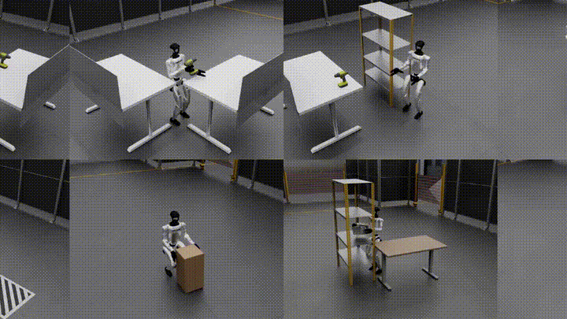
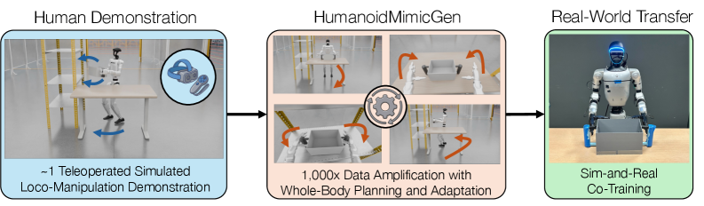
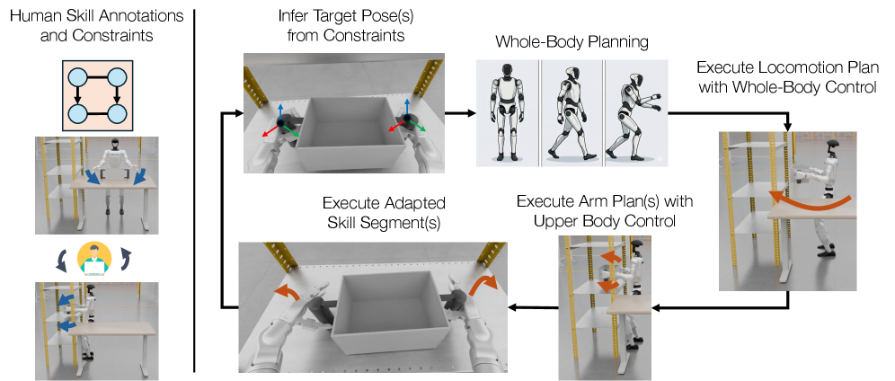
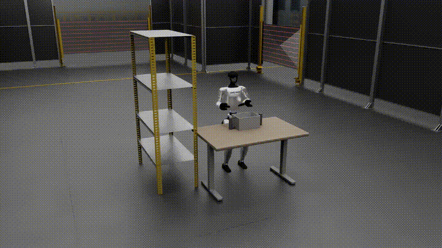
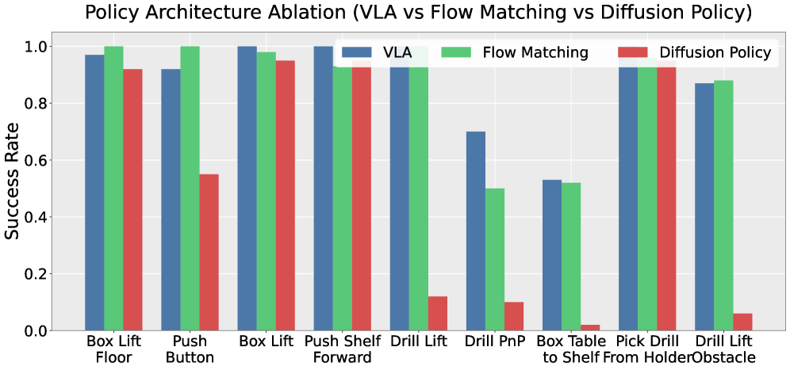
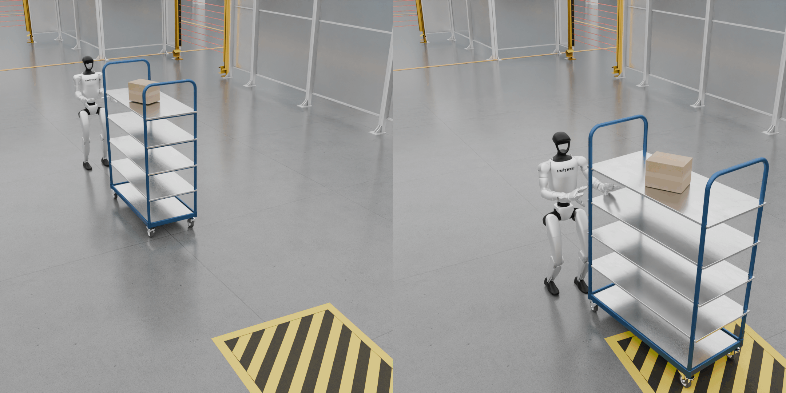
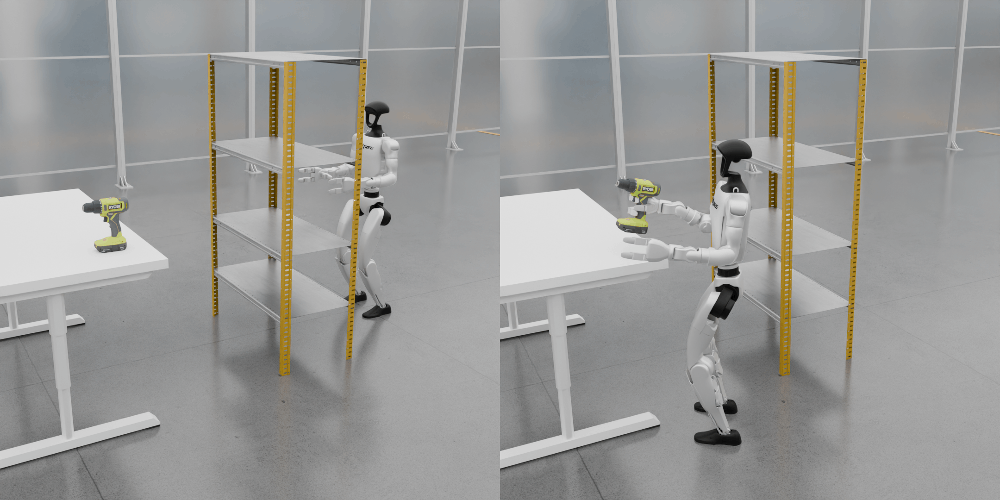

# HumanoidMimicGen: масштабирование нескольких демонстраций человекоподобного робота до больших наборов данных с помощью полнотелого планирования

Этот обзор относится к статье **HumanoidMimicGen: Data Generation for Loco-Manipulation via Whole-Body Planning** от NVIDIA, UT Austin и соавторов. В учебнике его место — раздел `10-simulation-tools-and-frontiers`, сразу после SIM1, InternDataEngine и UniLab + MotrixSim: это дополнение к теме «генерация данных в симуляции и полнотелые манипуляции человекоподобных роботов».

Коротко:

> HumanoidMimicGen — не новая базовая модель VLA и не чисто визуальная мировая модель, а система генерации данных для loco-manipulation человекоподобных роботов. Она берёт несколько (иногда одну) телеоперационную демонстрацию, разбивает её на ограниченные навыки и с помощью полнотелой обратной кинематики, планирования движения, контроллера движения ног и повторного воспроизведения навыков переносит ту же задачу на множество положений объектов, начальных поз робота и компоновок сцены.

Ключевая ценность в том, что демонстрации для человекоподобного робота очень дороги. Методы расширения данных для стационарных манипуляторов работают только с концевым эффектором, но у человекоподобного робота есть ноги, туловище, баланс, походка и длинные горизонты задач, поэтому траекторию руки нельзя просто перенести. Главный вклад HumanoidMimicGen — переход от «повторного использования демонстраций» к системе «навыки демонстрации + полнотелое планирование + управление движением».

## 1. Статья, проект и статус открытости

| Элемент | Информация |
| :--- | :--- |
| Страница проекта | [humanoidmimicgen.github.io](https://humanoidmimicgen.github.io/) |
| Статья | [arXiv:2605.27724](https://arxiv.org/abs/2605.27724), подана 26 мая 2026 года |
| HTML arXiv | [HumanoidMimicGen HTML](https://arxiv.org/html/2605.27724v1) |
| Организации | NVIDIA, The University of Texas at Austin |
| Робот | В основных экспериментах — человекоподобный робот форм-фактора Unitree G1 |
| Симуляционный стек | Бенчмарк из статьи основан на MuJoCo и robosuite; детали планирования движения используют cuRobo для GPU-ускоренной проверки столкновений и пакетной IK |
| Обучение политик | В симуляционных экспериментах дообучается GR00T N1.6 VLA; в реальных экспериментах используется политика flow matching с совместным обучением на симуляции и реальности (sim-and-real co-training) |
| Код | По состоянию на 18 июля 2026 года на странице проекта не указана ссылка на GitHub/код |
| Связанная открытая точка входа | [NVlabs/mimicgen](https://github.com/NVlabs/mimicgen) — официальный репозиторий исходного MimicGen, полезен для понимания линии «расширение по нескольким демонстрациям» |

Важно: сейчас полностью воспроизвести результаты HumanoidMimicGen по официальному коду и скриптам генерации данных нельзя, потому что они ещё не опубликованы. Поэтому данный раздел — обзор метода и подготовка к воспроизведению, а не руководство, которое можно выполнить за один шаг. Читатель может заранее изучить интерфейсы MimicGen / DexMimicGen / robosuite / MuJoCo / cuRobo, а после публикации официального репозитория дополнить инструкции по запуску.

## 2. Обзор эффекта



**Рисунок 1. Тизер HumanoidMimicGen со страницы проекта.** Основной эффект: из нескольких телеоперационных демонстраций автоматически получаются многие траектории человекоподобного робота для переноски, толкания шкафа, взятия дрели, обхода препятствий в разных компоновках.
Источник: [страница проекта HumanoidMimicGen](https://humanoidmimicgen.github.io/).

Эта анимация показывает отличие от обычного «расширения данных для манипулятора»:

- Робот не стоит неподвижно у стола: сначала ему нужно переместить тело в зону манипуляции.
- Операция выполняется не только руками: важны положение туловища, опора стоп, положение корня робота и стадия длинной задачи.
- Одна и та же исходная демонстрация переносится на новые позы объектов, начальные позы робота и препятствия и даёт новые исполнимые траектории.

## 3. Почему генерация данных для loco-manipulation человекоподобного робота сложнее

Исходный MimicGen решал задачу расширения демонстраций для стационарных или относительно стабильных манипуляторов. Например, манипулятор берёт чашку со стола: траекторию «рука относительно чашки» в пространстве SE(3) можно перенести на новую позицию чашки, а контроллер манипулятора просто отслеживает её.

Человекоподобный робот устроен иначе. Его задача обычно сочетает передвижение и манипуляцию:

```text
подойти к объекту -> подстроить шаг и позу тела -> протянуть руку и взять -> перенести или толкнуть -> переместиться к цели -> поставить или завершить взаимодействие
```

Здесь минимум четыре связи:

| Трудность | Смысл | Что будет при прямом переносе механизма MimicGen |
| :--- | :--- | :--- |
| Связь ног и рук | Достижима ли рука, зависит от того, где стоят ступни, как повёрнут корпус и сохраняется ли баланс | Траектория руки выглядит правильной, но положение тела неверно, и конечный эффектор вообще недостижим |
| Динамическая устойчивость | Фаза ходьбы и фаза статической работы руками подчиняются разным законам управления | Интерполяция траектории манипулятора не гарантирует устойчивого перемещения двуногого робота |
| Длинный горизонт | Толкание шкафа, перенос коробки, обход препятствия и взятие дрели — не один короткий захват | Перенос одного сегмента часто проваливается на промежуточной фазе |
| Богатый контакт | Двуручный захват коробки, толкание стойки, извлечение дрели из держателя — это непрерывные контакты | Перенос только позы концевого эффектора может привести к столкновениям, проникновению моделей или потере контакта |

Поэтому статья решает такую задачу: **как разбить одну демонстрацию человекоподобного робота на переносимые локальные навыки и как с помощью полнотелого планирования гарантировать, что каждый навык в новой сцене остаётся достижимым, устойчивым и без столкновений.**

## 4. Общая схема: от одной демонстрации до тысяч данных



**Рисунок 2. Обзор HumanoidMimicGen.** Слева — телеоперационный сбор нескольких исходных демонстраций человеком; в центре — расширение данных примерно в 1000 раз через полнотелое планирование и адаптацию; справа — обучение политик на этих симуляционных данных и совместное дообучение на симуляции и реальности.
Источник: [arXiv HTML HumanoidMimicGen](https://arxiv.org/html/2605.27724v1).

Этот рисунок делится на три части.

1. **Демонстрация человеком (Human Demonstration)**: человек выполняет полную задачу однократно с помощью VR-контроллера. В экспериментах для каждой симуляционной задачи собирается одна исходная демонстрация; в реальных экспериментах тоже подчёркивается небольшой объём реальных данных.
2. **Расширение данных (Data Amplification)**: система не случайно возмущает всю траекторию, а сначала понимает цель и ограничения каждого навыка, а затем заново планирует исполнимый путь в новой сцене.
3. **Обучение политики (Policy Learning)**: сгенерированные траектории — не конечный контроллер, а обучающие данные для имитационного обучения. В симуляции статья дообучает GR00T N1.6 VLA; на реальном G1 смешивает сгенерированные и реальные данные для обучения политики.

Этот процесс важен для учебника: он не относится к интерактивным симуляторам «играй в мире» и не является предсказанием видео следующего кадра. Это скорее движок синтеза данных, цель которого — создать демонстрации «состояние — наблюдение — действие», пригодные для обучения политик.

## 5. Схема метода: разметка навыков, ограничения, полнотелое планирование и адаптация навыков



**Рисунок 3. Схема метода HumanoidMimicGen.** Слева — исходная демонстрация с разметкой навыков и ограничений; справа — система по ограничениям выводит целевые позы концевых эффекторов, затем последовательно выполняет полнотелое планирование, перемещение ног, планирование рук и адаптацию сегментов навыков.
Источник: [arXiv HTML HumanoidMimicGen](https://arxiv.org/html/2605.27724v1).

Схему удобно читать по четырём уровням: вход, планирование, исполнение, выход.

### 5.1 Вход: исходная демонстрация и разметка навыков для каждой руки

Исходная демонстрация — не неструктурированная последовательность траекторий, а траектория с разбиением на навыки. Задача делится на несколько навыков, центрированных на объекте, например:

| Задача | Возможные сегменты навыков |
| :--- | :--- |
| Box Table To Shelf | Левая рука подходит к коробке; правая рука подходит к коробке; обе руки поднимают коробку; подход к стеллажу; обе руки ставят коробку |
| Drill PnP | Подход к первому столу; захват дрели; подъём дрели; подход ко второму столу; постановка дрели |
| Push Shelf Forward | Подход к стеллажу; обе руки касаются стеллажа; непрерывное толкание; остановка в целевой зоне |

Каждый сегмент навыка обычно привязан к конкретному концевому эффектору и системе координат опорного объекта. Например, навык «правая рука берёт дрель» записывает не мировую позицию правой руки, а траекторию правой руки относительно системы координат дрели. Поэтому, когда дрель меняет положение, траекторию можно перенести через преобразование системы координат объекта.

### 5.2 Ограничения: предшествование и координация

Задачи двуруких человекоподобных роботов часто не строго последовательны. В статье используются два типа ограничений:

- **Ограничение предшествования (precedence constraint)**: какой навык должен выполниться раньше другого. Например, сначала поднять коробку, потом положить её на стеллаж.
- **Ограничение координации (coordination constraint)**: какие навыки должны выполняться одновременно. Например, обе руки одновременно поднимают коробку или одновременно толкают стеллаж.

Эти ограничения компилируются в граф порядка выполнения навыков. Простые задачи могут быть линейными, двуручные — содержать группы параллельных навыков. Система в каждый момент выбирает набор навыков, который может выполняться сейчас, и для них вычисляет целевые позы и полнотелую конфигурацию.

### 5.3 Вывод цели: от ограничений к целевым позам концевых эффекторов

В новой сцене объекты могут сместиться, а начальная позиция робота тоже может измениться. HumanoidMimicGen должна по относительным связям из исходной демонстрации вывести новые целевые положения концевых эффекторов:

```text
в исходной демонстрации: целевая поза концевого эффектора относительно объекта
в новой сцене: новая мировая поза объекта
вывод: новая мировая целевая поза концевого эффектора
```

Этот шаг сохраняет смысловые относительные связи задачи. Например, «рука подходит к ручке дрели сбоку» переносится лучше, чем «рука должна прийти в фиксированную точку мира».

### 5.4 Полнотелая IK: сначала выяснить, достижимо ли это

Когда целевая поза концевого эффектора найдена, система ищет полнотелую конфигурацию человекоподобного робота, при которой активный концевой эффектор достигает цели, а тело остаётся разумным. В статье используется полнотелая обратная кинематика; в приложении описано, что для GPU-ускоренной пакетной IK и проверки столкновений применяется cuRobo.

Отличие от IK манипулятора в том, что у человекоподобного робота очень много степеней свободы. Если рука не достаёт, можно не только двигать плечо, локоть и запястье, но и повернуть туловище, изменить положение ног или даже сменить позу корня робота. Поэтому IK здесь — не просто нахождение углов суставов руки, а поиск достижимого, устойчивого решения в пространстве полнотелых конфигураций, которое по возможности не двигает лишние суставы.

### 5.5 Разделённое планирование: отдельно динамическая ходьба и статическая работа руками

Статья использует инженерный подход раздельного планирования (decoupled planning). Фазы делятся так:

```text
текущая конфигурация
  -> план передвижения: ноги и шасси переходят в конфигурацию переключения (switch configuration)
  -> план манипуляции: после устойчивой стойки верхняя часть тела приближается к целевой конфигурации
  -> адаптированный сегмент навыка: повторяется и адаптируется контактный навык из исходной демонстрации
```

Такой подход оправдан: фаза ходьбы двуногого робота — задача динамической устойчивости, а тонкая работа руками ближе к статической устойчивости. Если пытаться планировать все степени свободы одним контроллером, сложность и частота отказов резко возрастают. HumanoidMimicGen разделяет их: при перемещении ног используется обученная политика движения (locomotion policy), которая исполняет команды скорости таза (pelvis velocity commands), а при операции — управление суставами верхней части тела в пространстве суставов.

### 5.6 Адаптация навыка: недостаточно просто дойти до цели, нужно повторить контакт

Когда система приблизилась к целевой позе, она выполняет локальные навыки из исходной демонстрации: взять, поднять, толкнуть, поставить. Адаптация навыка пересчитывает траекторию концевого эффектора в соответствии с новыми позами объектов и отслеживает адаптированные целевые позы концевых эффекторов полнотелой IK. Детали суставов пальцев в описании статьи повторяются по исходной демонстрации.

Этот шаг — ядро линии MimicGen: не нужно заново обучать все действия, а можно использовать локальный контактный опыт из исходной демонстрации, который задан относительно объекта. Вклад HumanoidMimicGen в том, что вокруг этих навыков добавляются ограничения полнотелой достижимости, движения ходьбой и проверки столкновений.

## 6. Видео метода: как чередуются планирование и адаптация навыков



**Рисунок 4. Официальное видео метода, преобразованное в GIF.** Видео показывает, как система чередует планирование передвижения, планирование манипуляции и адаптацию навыков.
Источник: [страница проекта HumanoidMimicGen](https://humanoidmimicgen.github.io/).

При просмотре этого видео важно не только то, что движения «плавные». Нужно понимать, какую задачу решает каждая фаза:

- **Планирование передвижения (Locomotion Planning)** решает: куда должен встать человекоподобный робот и как туда дойти.
- **Планирование манипуляции (Manipulation Planning)** решает: как, стоя устойчиво, верхняя часть тела и руки приходят в начальную позу навыка.
- **Адаптация навыка (Skill Adaptation)** решает: как локальный контактный навык из исходной демонстрации переносится на текущие позы объектов.

Эти три фазы чередуются, поэтому одна исходная демонстрация становится успешным rollout в новой компоновке.

## 7. Случайность движения: почему недостаточно генерировать идеальные траектории

В статье особо подчёркиваются шум движения (motion noise) и рандомизация инициализации (initialization randomization). Причина в том, что политика имитации не должна учиться только на «идеальной траектории эксперта». При замкнутом исполнении в реальности или симуляции робот отклоняется от траектории эксперта; если обучающие данные не покрывают эти отклонённые состояния (off-nominal states), то при уходе в сторону политика будет всё больше ошибаться.

Логику HumanoidMimicGen можно записать так:

```text
при исполнении: в действие добавляется шум, робот переживает небольшое отклонение
при сохранении меток: сохраняется исходное действие эксперта как сигнал супервизии
при обучении: политика видит отклонённые состояния и учится возвращаться к траектории эксперта
```

Идея отчасти напоминает DAgger: обучающие данные должны покрывать состояния, которых может достичь политика, а не только состояния идеальной траектории эксперта. В статье показано, что без шума движения средняя успешность снижается с 0,89 до 0,49; без рандомизации инициализации при фиксированной начальной позе — с 0,89 до 0,51.

## 8. Бенчмарк G1 Loco-Manipulation



**Рисунок 5. Бенчмарк G1 Loco-Manipulation.** В статье предложено 9 симуляционных задач loco-manipulation для человекоподобного робота; для каждой задачи показана одна случайная начальная сцена и одно завершённое состояние.
Источник: [arXiv HTML HumanoidMimicGen](https://arxiv.org/html/2605.27724v1).

Эти 9 задач охватывают переходы от короткого подхода к длинному горизонту, от одноручных операций к двуручным, от настольных объектов к стеллажам и препятствиям:

| Задача | Требование |
| :--- | :--- |
| Box Lift Floor | Взять коробку с пола и поднять её до целевой высоты |
| Push Button | Подойти к промышленной панели и нажать кнопку |
| Box Lift | Подойти к столу, взять коробку и поднять её |
| Push Shelf Forward | Толкнуть тележку со стеллажом в целевую зону |
| Drill Lift | Подойти к столу и взять дрель |
| Drill PnP | Взять дрель с одного стола и положить на другой |
| Box Table To Shelf | Переместить коробку со стола на стеллаж |
| Pick Drill From Holder | Вынуть дрель из держателя и поднять её |
| Drill Lift Obstacle | Обойти загораживающий стеллаж и взять дрель |

Ценность бенчмарка не только в количестве задач, а в том, что задачи попадают в самые трудные места для человекоподобного робота: небольшая ошибка в положении стоп — и рука не достаёт; небольшая нестабильность корпуса — и двуручный контакт срывается; ранняя ошибка навигации в длинной задаче влияет на достижимость последующих операций.




**Рисунок 6. Скриншоты задач со страницы проекта: Push Shelf Forward и Obstacle-Aware Pick Drill.** Левое изображение подчёркивает длительный контакт обеих рук при толкании стеллажа на длинном горизонте; правое — сочетание обхода препятствия, выбора позиции и захвата одной рукой.
Источник: [страница проекта HumanoidMimicGen](https://humanoidmimicgen.github.io/).

## 9. Как читать результаты экспериментов

В статье на симуляционном бенчмарке сравнивается четыре источника данных:

| Источник данных | Средняя успешность |
| :--- | :--- |
| 1 человеческая демонстрация | 0,26 |
| 100 человеческих демонстраций | 0,48 |
| DexMimicGen+ | 0,33 |
| HumanoidMimicGen | 0,89 |

Главный вывод не в том, что метод «сильнее 100 человеческих демонстраций» сам по себе. Он показывает, что для loco-manipulation человекоподобного робота количество демонстраций — не единственное узкое место: важно, покрывает ли набор разумные позы стояния, возмущения объектов, достижимость навыков и стадии длинного горизонта. 100 человеческих демонстраций при недостаточном покрытии сцен всё равно ведут к узкому распределению обучения; HumanoidMimicGen за счёт планирования и рандомизации создаёт 1000 траекторий, покрывающих больше исполнимых состояний.

В статье есть и наглядные примеры для длинных горизонтов:

- PushShelfForward — около 1230 шагов; HumanoidMimicGen достигает 1,00 PSR, DexMimicGen+ — 0,35, одна исходная демонстрация — 0,70.
- BoxLiftFloor — около 900 шагов; HumanoidMimicGen достигает 0,97 PSR, DexMimicGen+ — 0,87, одна исходная демонстрация — 0,14.

Это показывает, что метод особенно эффективен для составных задач «длинный горизонт + передвижение всего тела + контактные операции».

## 10. Политика: почему в статье упоминается VLA

HumanoidMimicGen генерирует данные демонстраций, а в конце всё равно обучается политика. В симуляционном сравнении архитектур статья использует базовую модель GR00T N1.6 для дообучения VLA и сравнивает её с Flow Matching и Diffusion Policy:

| Архитектура политики | Средняя успешность |
| :--- | :--- |
| VLA | 0,89 |
| Flow Matching | 0,86 |
| Diffusion Policy | 0,51 |

Здесь важны два момента:

- Сам HumanoidMimicGen — не VLA, а источник данных для VLA.
- Результаты показывают, что на этом бенчмарке дообучение VLA на данных HumanoidMimicGen эффективно; но ценность генератора данных не привязана к конкретной архитектуре политики: Flow Matching тоже близка к VLA.

Для читателя учебника это можно связать с главами о GR00T, OpenVLA, pi0 и SmolVLA: возможности VLA зависят не только от структуры модели, но и от того, достаточно ли разнообразны данные робота. HumanoidMimicGen как раз восполняет этот пробел со стороны данных.

## 11. Результаты на реальном роботе: совместное обучение на симуляции и реальности

Статья также проверяет метод на реальном G1 на четырёх задачах:

| Задача | Только реальные данные | Совместное обучение |
| :--- | :--- | :--- |
| ThrowBottle | 0,60 | 0,75 |
| BoxToCart | 0,35 | 0,60 |
| PickCanister | 0,50 | 0,75 |
| PickCanisterWithObstruction | 0,60 | 0,75 |
| Среднее | 0,51 | 0,71 |

Вывод однозначный: если объединить данные симуляции HumanoidMimicGen с небольшим количеством реальных данных робота, результат лучше, чем при обучении только на реальных данных; в среднем прирост составляет 20 процентных пунктов. Это важно, потому что именно такого данных сейчас не хватает внедрению человекоподобных роботов: реальные данные полнотелых операций дороги, а в симуляции планировщик может создать гораздо больше покрытия.

Но и границы стоит назвать: число реальных задач невелико, они по-прежнему опираются на вручную построенные симуляционные окружения, распределение начальных состояний и условия успеха. Это доказывает эффективность такого пути дополнения данных, но не доказывает, что одной только автоматической генерацией в симуляции можно решить открытую задачу манипуляции человекоподобными роботами.

## 12. Отличие от MimicGen, DexMimicGen+ и RoboDream

| Метод | Основной объект | Что генерирует | Ключевое допущение | Отличие HumanoidMimicGen |
| :--- | :--- | :--- | :--- | :--- |
| MimicGen | Стационарный или относительно стабильный манипулятор | Много демонстраций манипулятора | Управление концевым эффектором относительно независимо и стабильно | У человекоподобного робота ноги, туловище и руки должны координироваться целиком |
| DexMimicGen | Двуручная / ловкая манипуляция | Демонстрации двух рук или ловкой кисти | Упор на кисти и контакт верхней части тела | HumanoidMimicGen явно учитывает передвижение, стойку и полнотелую достижимость |
| Базовый DexMimicGen+ | Расширение DexMimicGen на человекоподобного робота | Упрощённые траектории расширения для человекоподобного робота | Прямые линии и слабое планирование | Нет полного рассуждения о навыках, планирования движения и проверки столкновений |
| RoboDream | Синтез видео и траекторий данных робота | Синтетические видео или траектории демонстраций | Опора на траектории только робота, априорные данные сцены и объектов | Более генеративный синтез данных; HumanoidMimicGen — скорее генерация данных на основе планирования и управления |
| HumanoidMimicGen | Двуногий человекоподобный loco-manipulation | Траектории демонстраций «наблюдение — действие» | Есть небольшая разметка навыков, задачная среда и условия успеха | Объединяет навыки демонстрации, полнотелую IK, планирование движения, управление ногами и рандомизацию в одну систему генерации данных |

Если включать это в учебную программу, можно понимать так:

- **MimicGen** — классическая отправная точка «расширения по нескольким демонстрациям».
- **RoboDream** — представитель линии «синтеза данных робота с помощью генеративной мировой модели или априорных знаний».
- **HumanoidMimicGen** — представитель линии «расширения полнотелых демонстраций человекоподобного робота с помощью планирования и управления».

## 13. Рекомендации по воспроизведению

Сейчас не стоит писать пошаговое руководство по воспроизведению, потому что официальный код HumanoidMimicGen и вход в бенчмарк на странице проекта ещё не опубликованы. Более разумный путь изучения — сначала разбить зависимости, а потом дождаться официального кода:

1. **Прочитать страницу проекта и рисунки статьи**: сначала разобраться с Figure 1, Figure 2 и Figure 3, понять входы, выходы и промежуточные модули.
2. **Изучить исходный MimicGen**: читать [NVlabs/mimicgen](https://github.com/NVlabs/mimicgen), понять навыки, центрированные на объекте, расширение по малому числу демонстраций и процесс генерации данных в robosuite.
3. **Понять robosuite / MuJoCo**: бенчмарк G1 построен на MuJoCo и robosuite, поэтому официальный код, вероятно, будет организован вокруг этих интерфейсов.
4. **Освоить cuRobo / IK / проверку столкновений**: в приложении упомянуто использование cuRobo для GPU-ускоренной полнотелой IK и планирования движения; это будет основной сложностью воспроизведения.
5. **Следить за официальным входом в код**: когда на странице проекта появятся GitHub/код, сначала запустить одну задачу, одно расширение демонстрации и визуализацию небольшого числа rollout, и только потом переходить к обучению GR00T или другой политики.
6. **Не гнаться за полным набором метрик**: в статье симуляционное обучение использует 1000 демонстраций на задачу, дообучение VLA — 25 тыс. шагов и обучение и оценка на 8 GPU H100. Для обычного учащегося реалистичнее сначала воспроизвести визуализацию генерации данных и одну небольшую задачу.

Если нужна курсовая работа, можно обойтись без обучения и сдать обзор метода. Ключевые вопросы:

- Какая информация в исходной демонстрации требует ручной разметки?
- Как сегмент навыка переносится с исходной позы объекта на новую?
- Почему локомоцию ног и манипуляцию верхней частью тела нужно обрабатывать отдельно?
- Какие проблемы обобщения решают шум движения и рандомизация инициализации?
- Как сгенерированные данные в итоге служат VLA или политике flow matching?

## 14. Ограничения и направления дальнейших исследований

Сама статья признаёт следующие границы:

- Нужна ручная разметка сегментов навыков и ограничений предшествования / координации между навыками.
- Симуляционная среда, распределение начальных состояний и условия успеха по-прежнему задаются вручную.
- Предполагается, что задача состоит из фиксированного набора навыков и фиксированной структуры их порядка, поэтому обобщение на открытые задачи с новой последовательностью навыков или высокоуровневым планированием ограничено.
- В основном используется перенос координат жёстких объектов; метод плохо справляется с объектами, у которых геометрия внутри одного класса сильно различается, и с неоднозначными аффордансами контакта.

Эти ограничения задают направления дальнейших исследований:

- Автоматическая разметка сегментов навыков и ограничений с помощью VLM/LLM.
- Автоматическое построение планируемых симуляционных сред на основе реконструкции 3D-сцен.
- Подключение данных HumanoidMimicGen к более полным полнотелым VLA человекоподобных роботов, например GR00T, OpenHLM или WholeBodyVLA.
- Изучение того, какая рандомизация данных для sim2real действительно эффективна, а какая лишь кажется полезной в симуляции.

## 15. Рекомендуемый порядок чтения

Если вы последовательно прошли учебник, стоит восстановить контекст в таком порядке:

1. [Воспроизведение ACT, Pi0, SmolVLA в MuJoCo](../../06-manipulation-and-vla/large-model-control-vla-vlm/04-mujoco-reproduction-act-pi0-smolvla/README.md): понять симуляционные задачи манипуляции и обучение политик.
2. [Навигатор по развёртыванию Isaac Sim, Isaac Lab и GR00T](../01-isaac-deployment-and-gr00t-practices/00-isaac-deployment-navigation.md): понять инженерный путь человекоподобных политик и GR00T.
3. [SIM1: симуляция мягких тел и генерация данных](../09-sim1-soft-body-simulation-and-data-generation/01-sim1-environment-configuration-and-operation.md): понять генерацию симуляционных данных и фильтрацию траекторий.
4. [RoboDream: обзор синтеза данных для составных мировых моделей](../../17-world-models/robodream-compositional-world-model-data-synthesis-guide/README.md): сравнить с генеративным путём синтеза данных.
5. Настоящая глава: понять, почему для loco-manipulation человекоподобного робота нужно полнотелое планирование, чтобы генерировать обучаемые данные.

## 16. Ссылки

- [Страница проекта HumanoidMimicGen](https://humanoidmimicgen.github.io/)
- [HumanoidMimicGen на arXiv](https://arxiv.org/abs/2605.27724)
- [HumanoidMimicGen, HTML arXiv](https://arxiv.org/html/2605.27724v1)
- [Публикация NVIDIA Research](https://research.nvidia.com/publication/2026-06_humanoidmimicgen-data-generation-loco-manipulation-whole-body-planning)
- [NVlabs/mimicgen](https://github.com/NVlabs/mimicgen)
