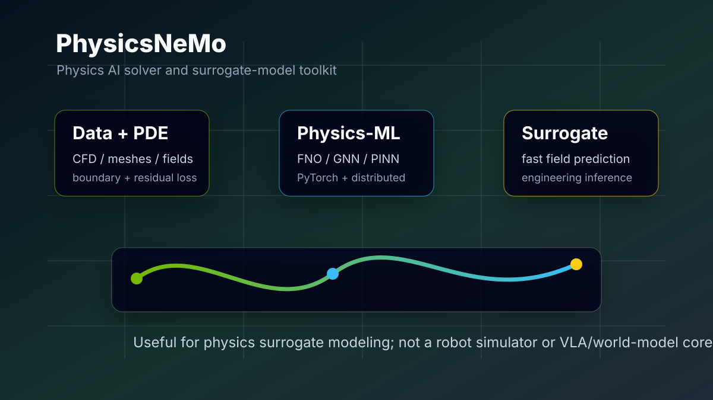
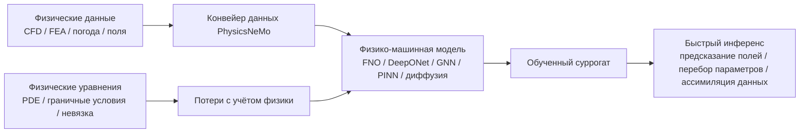

# PhysicsNeMo: обзор физического ИИ-решателя от NVIDIA

> Официальная страница: https://developer.nvidia.com/physicsnemo
> GitHub: https://github.com/NVIDIA/physicsnemo
> Документация: https://docs.nvidia.com/physicsnemo/latest/
> Каталог примеров: https://docs.nvidia.com/physicsnemo/latest/examples_catalog.html
> Установка: https://docs.nvidia.com/physicsnemo/latest/getting-started/installation.html
> Лицензия: Apache-2.0

PhysicsNeMo — открытый фреймворк глубокого обучения от NVIDIA для физического ИИ (Physics AI), AI4Science и инженерного моделирования. Его главная цель — не обучение VLA и не взаимодействие в робототехнической симуляции, а построение, обучение, дообучение и инференс физико-машинных моделей: нейронных операторов, графовых нейронных сетей, диффузионных моделей, PINN, моделей погоды и климата, суррогатных моделей CFD, структурной механики или электромагнитных полей.

Эта глава помещена в раздел `10-simulation-tools-and-frontiers` как дополнительное чтение. Связь с воплощённым ИИ есть, но она косвенная: роботы тоже заботятся о контакте, жидкостях, материалах, мягких телах и многофизических задачах, однако основные учебные курсы чаще используют интерактивные симуляторы вроде MuJoCo, Isaac Sim, ManiSkill, Genesis или Habitat. PhysicsNeMo скорее обучает «быстрый нейросетевой суррогатный решатель» для уравнений в частных производных (PDE) и инженерной симуляции; это не среда, в которой робот вызывает `env.step(action)`.



**Рисунок 1. Место PhysicsNeMo в учебнике.** Схема показывает основную цепочку: физические данные и ограничения PDE поступают в физико-машинную модель, которая обучается как быстрый суррогат. Официальная страница developer в основном содержит иллюстрации клиентских случаев, а не понятную архитектурную схему, поэтому в главе используется собственная схема.

## 1. Главный вывод: связь с робототехникой слабая, но знать полезно

Если цель — воспроизвести OpenVLA, SmolVLA, ACT, захват роботом, навигацию, мировую модель или управление реальным роботом, PhysicsNeMo — инструмент невысокого приоритета. Он не заменяет:

- динамическую симуляцию роботов в MuJoCo / Isaac Sim / ManiSkill;
- навигационные среды Habitat / VLN-CE;
- обучение политик LeRobot / OpenPI / OpenVLA;
- мировые модели, управляемые действиями, такие как RAW-Dream / GE-Sim / BWM;
- платформы, которые напрямую ориентированы на робототехнику или физическую симуляцию, например Genesis и SIM1.

Он больше подходит для таких задач:

- обучение решателям PDE с помощью FNO / DeepONet / графовых нейронных сетей;
- обучение суррогатных моделей на результатах CFD, структурной механики, электромагнетизма и погоды;
- добавление к физическим данным невязки PDE, граничных условий или законов сохранения;
- крупномасштабное обучение Physics-ML на PyTorch с GPU NVIDIA;
- исследования PINN, нейронных операторов, конвейеров данных по сеткам и облакам точек, распределённого обучения.

Поэтому в учебнике PhysicsNeMo не предлагается как основная задача для воспроизведения. Это подходящее «расширение по физическому ИИ-решателю»: достаточно понимать, что это за инструмент, какие задачи он решает и чем отличается от симуляторов роботов.

## 2. Смена названия: от Modulus к PhysicsNeMo

PhysicsNeMo возник не из ниоткуда. Он тесно связан с прежним проектом NVIDIA Modulus. Теперь официальный GitHub и документация используют PhysicsNeMo как основное название; в README репозитория сказано, что PhysicsNeMo проходит обновление до версии 2.0 и есть руководство по миграции.

Упрощённо:

```text
NVIDIA Modulus / Modulus Sym
    -> PhysicsNeMo / PhysicsNeMo Sym / PhysicsNeMo CFD / PhysicsNeMo Curator
```

Поэтому во многих старых учебниках, блогах, issue и зеркалах встречается название `modulus`. При поиске материалов обращайте внимание на версию и имя пакета и не переносите старые команды Modulus напрямую в новое окружение PhysicsNeMo.

## 3. Действительно ли это «физический ИИ-решатель»

Так можно сказать, но важно уточнить смысл слова «решатель».

Традиционные физические решатели обычно являются численными методами: конечные разности, конечные элементы, конечные объёмы, спектральные методы, методы частиц, решатели динамики твёрдых и мягких тел. Они непосредственно дискретизируют уравнения физики и шаг за шагом вычисляют на сетке, в сетке или на частицах.

Решатель PhysicsNeMo скорее является нейросетевым суррогатным решателем:



На этапе обучения может требоваться много симуляционных данных, данных наблюдений или невязок PDE. На этапе инференса модель может быстрее традиционной симуляции дать приближённое решение: по граничным условиям, геометрическим параметрам или начальному полю предсказать будущие значения поля — давление, скорость, температуру, напряжение или метеорологические переменные.

Основная ценность таких моделей — ускорение перебора параметров, оптимизации конструкции, ассимиляции данных и интерактивного инженерного исследования, а не замена всех высокоточных симуляций.

## 4. Основные компоненты

Согласно официальному README NVIDIA, PhysicsNeMo организован модульно. Ключевые компоненты:

| Компонент | Назначение |
| :--- | :--- |
| `physicsnemo.models` | Библиотека архитектур моделей: нейронные операторы, GNN, диффузия, трансформеры, PINN и др. |
| `physicsnemo.datapipes` | Конвейеры данных для инженерных и научных данных, например облака точек, сетки, поля |
| `physicsnemo.distributed` | Инструменты распределённого обучения на основе `torch.distributed` |
| `physicsnemo.curator` | Подмодуль для систематизации инженерных данных и ускорения их подготовки |
| `physicsnemo.sym` | Символические невязки PDE, сэмплирование геометрии и областей, потери с учётом физики |
| `physicsnemo-cfd` | Доменный подмодуль для CFD-рабочих процессов и инференса предобученных моделей |

Из них ближе всего к «физическому ИИ-решателю» `models`, `datapipes` и `sym`. Если нужно просто запустить нейросетевую модель, достаточно базового ядра; если требуется явно включить в обучение невязку PDE, граничные условия и сэмплирование геометрии, придётся работать с `physicsnemo-sym`.

## 5. Какие архитектуры моделей поддерживаются

Официальная страница архитектур моделей и README упоминают такие представительные модели:

- **Fourier Neural Operator (FNO)**: изучает отображение между функциональными пространствами; часто используется как суррогат PDE.
- **DeepONet**: тоже относится к линии нейронных операторов; использует сети ветви (branch) и ствола (trunk) для изучения оператора.
- **DoMINO**: класс моделей NVIDIA для предсказания инженерных полей по геометрии.
- **Графовые нейронные сети (GNN)**: подходят для сеток, частиц, графовых структур и нерегулярной геометрии.
- **MeshGraphNet**: распространён в лагранжевых или сеточных физических системах.
- **XAeroNet**: ориентирован на суррогатное моделирование аэродинамики.
- **Диффузионные модели / коррекционная диффузия / DDPM**: для вероятностного предсказания, коррекции и генеративного физического моделирования.
- **GraphCast / модели погоды**: для погоды и систем Земли.
- **Трансформеры / Transsolver / RNN / SwinVRNN**: для пространственно-временных последовательностей и предсказания полей.
- **PINN**: вводят физические ограничения в функцию потерь через невязку PDE и автоматическое дифференцирование.

Для учебника о роботах важнее всего знать три типа моделей: FNO, GNN и PINN. FNO типичен для предсказания полей на регулярной сетке, GNN естественнее работает с сетками, графами и частицами, а PINN подчёркивает идею: если размеченных данных мало, модель ограничивают невязкой уравнения.

## 6. Отличие от симуляторов роботов

Этот пункт нужно проговорить ясно, иначе легко возникнет путаница.

| Вопрос | MuJoCo / Isaac Sim / ManiSkill | PhysicsNeMo |
| :--- | :--- | :--- |
| Можно ли вызвать `step(action)` напрямую | Да, типичные RL-среды роботов позволяют выполнять действия шаг за шагом | Обычно нет: он обучает и выполняет инференс физико-машинных моделей |
| Основные входы | Состояние робота, управляющие сигналы, ассеты сцены, параметры контакта | Физические данные, значения полей, PDE, граничные условия, геометрия, сетки |
| Основные выходы | Следующее состояние, наблюдения, награда, результаты коллизий и контакта | Предсказанные поля, суррогатные результаты симуляции, выходы суррогата PDE |
| Типичные задачи | Захват, навигация, ходьба, манипуляция, сэмплирование симуляции | CFD, погода, конструкции, электромагнетизм, решение PDE, ассимиляция данных |
| Цель обучения | Обучение политик, имитационное обучение, обучение с подкреплением | Суррогатное моделирование, Physics-ML, PINN / нейронный оператор |

Поэтому PhysicsNeMo — не «более продвинутый Isaac Sim». Если нужно обучить манипулятор хватать чашку, PhysicsNeMo — не первый выбор; если нужно выучить быструю аппроксимацию модели для гибкого материала, поля течения, аэродинамической нагрузки или теплового поля, то он гораздо более уместен.

## 7. Способы установки

Официальная документация описывает два варианта установки: через pip / uv и через образ контейнера NVIDIA.

Проще всего попробовать через pip:

```bash
pip install nvidia-physicsnemo
```

Если нужны символические PDE, области, сэмплирование геометрии и потери с учётом физики, можно установить расширение с `sym`:

```bash
pip install "nvidia-physicsnemo[sym]"
```

Чтобы избежать проблем с зависимостями, особенно при запуске официальных примеров, контейнер NVIDIA надёжнее. Контейнер подходит для обучения, запуска примеров и проверки согласованности окружения. Конкретный тег образа следует брать с официальной страницы установки; в учебнике не стоит фиксировать тег, который может устареть.

Минимальная проверка импорта после установки:

```python
import torch
from physicsnemo.models.mlp.fully_connected import FullyConnected

model = FullyConnected(in_features=32, out_features=64)
x = torch.randn(128, 32)
y = model(x)

print(y.shape)
```

Эта проверка подтверждает только то, что пакет `physicsnemo` импортируется и модельный модуль создаётся. Она не доказывает, что CUDA, распределённое обучение, невязка PDE или официальные примеры уже работают.

## 8. С какого примера начинать

В каталоге официальных примеров много задач: CFD, погода, PDE, GNN, диффузия. Новичкам рекомендуется начать с Darcy Flow + FNO.

Darcy Flow — очень классическая задача PDE-суррогата в учебниках по нейронным операторам. Обычно на вход подаются поле проницаемости, граничные условия и т. п., а на выход — поле давления или связанное решение. Преимущества этой задачи:

- она гораздо легче трёхмерных моделей CFD;
- она проще моделей погоды или больших сеточных GNN;
- ясно видна структура «входное поле -> FNO -> выходное поле»;
- её можно расширить до потерь с учётом физики или PINO.

Рекомендуемый порядок чтения:

1. `2D Darcy Flow using Fourier Neural Operators`
2. `2D Darcy Flow using Fourier Neural Operators and Physics Losses`
3. Раздел FNO / нейронных операторов в документации архитектур моделей PhysicsNeMo
4. Материалы `physicsnemo-sym` о невязке PDE и геометрии / областях

Не стоит сразу запускать GraphCast, климатические или сложные инженерные CFD-задачи. Они ближе к реальным приложениям, но требуют существенно больше времени на установку, данных и вычислительных ресурсов.

## 9. Простое понимание: что делает FNO

FNO можно грубо понимать так: модель изучает отображение из «входной функции» в «выходную функцию». Обычная нейронная сеть изучает отображение векторов:

```text
x ∈ R^d -> y ∈ R^k
```

Нейронный оператор изучает отображение функций:

```text
a(x, y) -> u(x, y)
```

В задаче Darcy Flow `a(x, y)` — пространственно меняющийся параметр материала или проницаемость, а `u(x, y)` — давление, полученное решением PDE. После обучения, если дать новое поле проницаемости, FNO может сразу предсказать всё поле давления, не вызывая традиционный решатель PDE заново.

В этом и состоит главная ценность PhysicsNeMo: он не решает PDE строго на каждом инференсе, а обучает модель, которая быстро приближает оператор решения PDE.

## 10. Возможные точки соприкосновения с воплощённым ИИ

Хотя PhysicsNeMo не является основным инструментом, есть несколько потенциальных точек пересечения.

### 10.1 Суррогаты мягких тел, жидкостей и материалов

Складывание одежды, мягкие роботы, манипуляции с жидкостью, сыпучими материалами и кухонные задачи включают сложную физику. Основные симуляторы роботов часто не могут одновременно обеспечить точность и скорость для этих задач. В будущем можно обучить суррогаты для некоторых полевых переменных или отклика материала с PhysicsNeMo и затем подключить результаты к политике робота или оценке задачи.

### 10.2 Предсказание непрерывных полей помимо контактных событий

VLA и мировые модели обычно предсказывают изображения, действия или низкоразмерные состояния, но в реальной физике есть поля давления, температуры, скорости потока и деформации. PhysicsNeMo лучше подходит для суррогатного моделирования таких непрерывных полей.

### 10.3 Инженерное проектирование и ускорение симуляции

Конструкции роботов, концевых эффекторов, форма дронов, конструкция теплоотвода могут требовать CFD и FEA. PhysicsNeMo может служить инструментом «сначала генерируем данные высокоточной симуляцией, затем обучаем суррогат для быстрого перебора параметров».

### 10.4 Ассимиляция данных и дополнение наблюдений

Если у робота только разреженные датчики, например несколько точек силы, температуры, скорости потока или деформации, модели Physics-ML могут сочетать наблюдения с физическими уравнениями и восстанавливать полное поле. Но это уже скорее исследовательское направление, а не вводный раздел учебника.

## 11. Почему его называют «немного старым»

«Старость» здесь относится скорее к линиям методов, чем к прекращению поддержки проекта.

PINN, FNO, DeepONet, MeshGraphNet, GraphCast — эти подходы развиваются уже несколько лет; NVIDIA Modulus тоже не новый проект, просто его переименовали и интегрировали в PhysicsNeMo. Для передовых направлений воплощённого ИИ сейчас больше внимания получают VLA, мировые модели, RL на реальных роботах, генерация данных, трёхмерное зрение и базовые политики роботов; PhysicsNeMo не находится на самом прямом пути этих направлений.

Но с точки зрения инженерии и AI4Science он остаётся активным проектом. README GitHub показывает статус active, а официальная документация продолжает поддерживать новые инструкции по установке, примеры и руководство по миграции на v2.0. Поэтому более точное утверждение: методическая линия относительно зрелая и слабо связана с основной линией учебника по роботам, но проект не заброшен.

## 12. Границы воспроизведения

В этой главе не предлагается пошагово воспроизводить полный бенчмарк PhysicsNeMo. Причины:

- официальные примеры охватывают CFD, погоду, PDE, GNN и диффузию — диапазон очень широк;
- многим задачам нужны специальные наборы данных, и простой `pip install` не даёт осмысленного результата;
- крупномасштабное обучение Physics-ML в большей степени зависит от GPU NVIDIA и контейнерной среды;
- для специалиста по воплощённому ИИ полное воспроизведение даёт меньше пользы, чем изучение MuJoCo / Isaac / ManiSkill / Genesis;
- версионные названия PhysicsNeMo и миграция с Modulus легко делают старые учебники неработоспособными.

Целевые уровни воспроизведения:

| Уровень | Цель | Для кого |
| :--- | :--- | :--- |
| L1 | Установить пакет и пройти минимальную проверку импорта `FullyConnected` | Тем, кому нужно только понять, работает ли инструмент |
| L2 | Запустить пример Darcy Flow FNO | Тем, кто хочет понять нейронные операторы |
| L3 | Изменить PDE / данные / архитектуру сети и обучить собственный суррогат | Направление AI4Science / инженерного моделирования |

Для курса по воплощённому ИИ достаточно L1 или L2. L3 относится к специальным исследованиям и не подходит для общего задания в группе.

## 13. Рекомендуемый порядок чтения и использования

1. Сначала прочитать страницу NVIDIA developer и понять официальное позиционирование PhysicsNeMo.
2. Затем прочитать README на GitHub и определить основные модули: models, datapipes, distributed, curator, sym.
3. Потом прочитать документацию по установке и выбрать pip / uv / контейнер.
4. Посмотреть каталог примеров и начать с Darcy Flow FNO.
5. Наконец, изучить архитектуры моделей и восполнить фон по FNO, DeepONet, GNN и PINN.

Если вы занимаетесь только роботами, не нужно глубоко вникать в каждую модель. Достаточно уметь объяснить, что PhysicsNeMo — фреймворк физического суррогатного ИИ, а не интерактивный симулятор роботов; этого достаточно для целей главы.

## Ссылки

- Страница NVIDIA PhysicsNeMo для разработчиков: https://developer.nvidia.com/physicsnemo
- NVIDIA/physicsnemo на GitHub: https://github.com/NVIDIA/physicsnemo
- Документация PhysicsNeMo: https://docs.nvidia.com/physicsnemo/latest/
- Руководство по установке: https://docs.nvidia.com/physicsnemo/latest/getting-started/installation.html
- Архитектуры моделей: https://docs.nvidia.com/physicsnemo/latest/user-guide/model_architectures.html
- Каталог примеров: https://docs.nvidia.com/physicsnemo/latest/examples_catalog.html
- PhysicsNeMo Sym: https://github.com/NVIDIA/physicsnemo-sym
- PhysicsNeMo CFD: https://github.com/NVIDIA/physicsnemo-cfd
