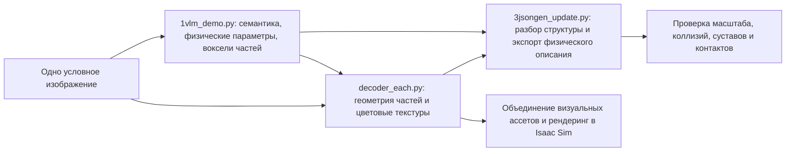
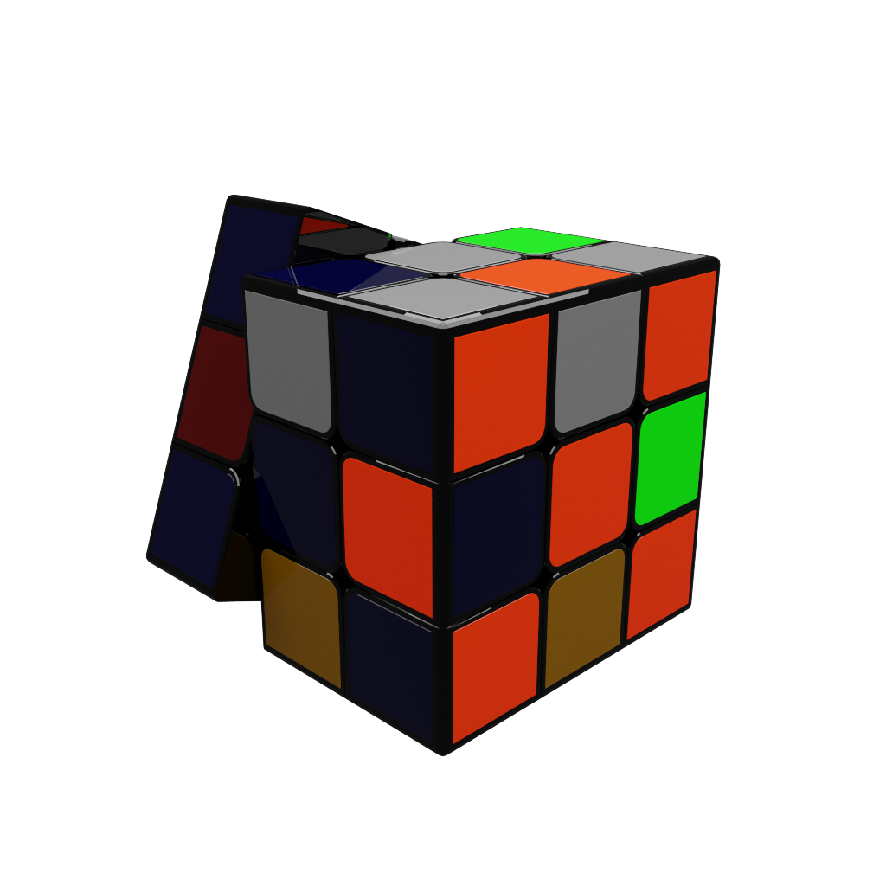
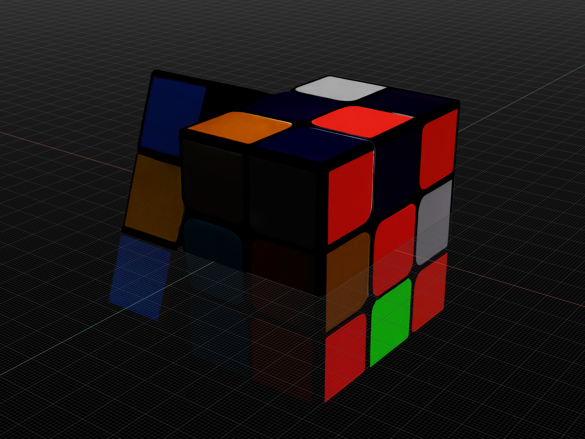
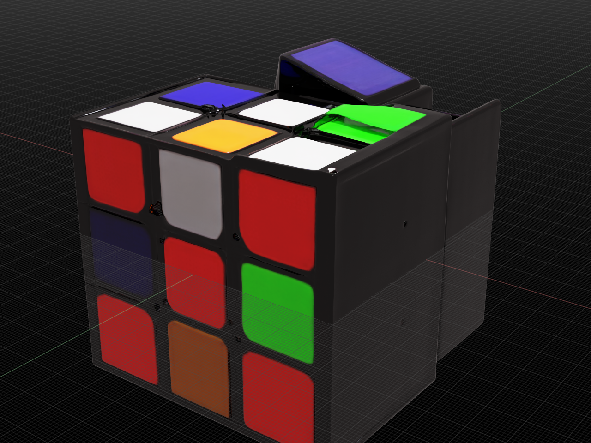

# PhysX-Omni: от одного изображения к цветному симуляционному ассету — опыт воспроизведения

В этой главе на примере кубика Рубика объясняется, как PhysX-Omni превращает изображение в геометрию частей, цветовые текстуры и описание физической структуры, а затем проверяет результат в Isaac Sim. Эксперимент проведён в июне 2026 года, код и доказательства были приведены в порядок в сентябре 2026 года. Здесь проверены инференс по одному изображению, экспорт 26 частей и рендеринг в симуляторе; обучение модели, повторная проверка результатов статьи, проверка динамики суставов и эксперименты с захватом роботом не проводились.

Кубик Рубика хорошо подходит для изучения этой цепочки: цветные блоки позволяют проверить, сохраняются ли текстуры, прямые рёбра и плоскости выявляют ошибки геометрии, а вращающиеся слои — корректность описания частей и суставов. Из 26 видимых внешних блоков нельзя делать вывод, что модель восстановила реальный механизм кубика.

## 1. Разделение обязанностей трёх модулей

PhysX-Omni — генеративный фреймворк; PhysXVerse — связанный набор физических трёхмерных данных; PhysX-Bench — инструмент оценки. Они отвечают соответственно за генерацию ассетов, обучающие данные и оценку. В этой главе используются только предобученная модель и примеры из репозитория, полностью скачивать обучающий набор не нужно.



Рисунок 1. Поток данных в этом воспроизведении. Последний пункт — проверка, необходимая для робототехнических приложений; в данном эксперименте она не выполнялась.

`1vlm_demo.py` вызывает VLM (визуально-языковую модель), дообученную на основе Qwen2.5-VL, и сначала создаёт `basic_info.txt`: категория, размеры, материал, плотность, части и отношения движения. Затем для каждой части генерируется текст RLE (кодирование длин серий) в пространстве вокселей 64³, который декодируется в массив координат `ind_<номер>.npy` и объединяется в `allind.npy`. Текст семантики и координаты вокселей — общий входной контракт для следующих этапов.

`decoder_each.py` передаёт разреженные координаты вокселей и условное изображение в TRELLIS, который восстанавливает геометрию и внешний вид частей. Экспорт включает параметризацию UV (координаты текстуры) и запекание текстуры и даёт GLB (бинарный формат трёхмерной сцены) с материалами и отдельные сетки. Данный патч дополнительно сохраняет `material_0.png` для каждой части, чтобы файл физического описания мог на него ссылаться.

`3jsongen_update.py` разбирает семантический текст в `basic_info.json`, затем выводит файл URDF (унифицированное описание робота) `basic.urdf` и файл MJCF (формат описания модели MuJoCo) `basic.xml`. Плотность, упругие параметры и связи суставов взяты из предсказаний модели и не проверены измерениями реального объекта.

## 2. Фактические результаты и источник цветов



Рисунок 2. Условное изображение из репозитория. Источник — `demo/86e0dfc688cd4927b355015e31455903.png` в upstream, это не данные, снятые для этого руководства.



Рисунок 3. Рендеринг в Isaac Sim после объединения 26 частей. Цвета сохранились, но боковые блоки наклонены, часть поверхностей накладывается на сетку, и в целом геометрия не соответствует требованиям к точной механике. Это результат отладки, а не физический ассет, годный для проверки контактов.

Цвета по умолчанию определяются входным изображением и генеративной моделью вместе; заранее задавать цвет каждой грани не нужно. Запекание текстуры переносит внешний вид на поверхность сетки, а рендерер на основе материала, освещения и камеры формирует итоговое изображение. Если нужно задать цвета полностью вручную, их можно заменить после экспорта — текстуру или материал; форма коллизий при этом не меняется.



Рисунок 4. Ранний предпросмотр, в котором пропущены этапы распознавания семантики и частей, а выполнено только шесть шагов быстрой генерации геометрии. Он появился до того, как полностью скачались сегменты модели, поэтому «появление кубика» не доказывает, что все модели загружены. Процесс и параметры двух результатов различаются, поэтому разницу во внешнем виде нельзя считать строгим сравнением качества.

Причина прозрачности и смещения частей пока не установлена. Нужно проверить координаты исходных частей, трансформации узлов сцены, нормали, прозрачность материала, преобразованную сцену и отображение сетки во вьюпорте. Одних скриншотов недостаточно, чтобы утверждать, что все эти явления вызваны генеративной моделью.

## 3. Ключевой опыт для окружения Blackwell

Эксперимент проводился на NVIDIA RTX PRO 6000 Blackwell Workstation Edition с вычислительной способностью `(12, 0)`. Это не минимальные требования к оборудованию, и минимальный объём видеопамяти не измерялся. Исторически работавшая комбинация версий приведена ниже; при смене версий нужно заново проверить операторы.

| Компонент | Исторически проверенная версия или настройка |
| --- | --- |
| PyTorch | `torch==2.7.0+cu128` |
| Пакеты изображений и аудио | `torchvision==0.22.0+cu128`, `torchaudio==2.7.0+cu128` |
| Реализация внимания | `xformers==0.0.30` с явным выбором операторов CUTLASS (библиотека матричных ядер) |
| Разреженные свёртки | `spconv-cu120==2.3.6`, `cumm-cu120==0.4.11` |
| Геометрия и растеризация | `kaolin==0.18.0`, `nvdiffrast==0.4.0` |
| Загрузка моделей | `transformers==4.50.0`, `numpy==1.26.4` |
| Расширение растеризации Гаусса | Собирается из исходников `diff_gaussian_rasterization` с `TORCH_CUDA_ARCH_LIST=12.0` |

Таблица 1. Основная комбинация, с которой на этой рабочей станции удалось выполнить инференс. `cu128` означает сборку под CUDA (платформа параллельных вычислений) 12.8.

Исходная зависимость `torch==2.1.1+cu118` не подходит как отправная точка для воспроизведения на Blackwell. Успешная установка и импорт пакета подтверждают только часть условий: расширение всё равно может сообщить `no kernel image is available for execution on the device`, когда реально выполняется ядро на видеокарте.

В этом эксперименте в четырёх местах внимания оператор задан явно, чтобы не допустить автоматического выбора несовместимой реализации:

```python
from xformers.ops import fmha

out = xops.memory_efficient_attention(
    q, k, v, op=(fmha.cutlass.FwOp, fmha.cutlass.BwOp)
)
```

Это изменение привязано к исторической версии и не означает, что всем окружениям Blackwell нужна одна и та же реализация. Отдельная проблема — отсутствие `flash_attn`; поэтому скрипт семантического инференса получил откат на SDPA (масштабированное скалярное произведение внимания). Расширение растеризации Гаусса требует проверки целевой архитектуры компиляции, а не только поддержки основным фреймворком.

## 4. Материалы для воспроизведения и соглашения о каталогах

В главе приводятся [патч совместимости](patches/blackwell.patch), [скрипт рендеринга](scripts/render_glb_in_isaac.py) и небольшие доказательства. Патч экспортирован из upstream-коммита `5ba54ee3d0e11c8690fd414d2343d47e514930dd` на момент подготовки; полный исторический запуск проходил в июне, точный коммит июня не записан, поэтому коммит сентября не называется исходной версией эксперимента. Успешная проверка применения патча не означает повторного выполнения всего инференса.

Команды ниже рассчитаны на Linux. Сначала измените `TUTORIAL_DIR` на абсолютный путь к этой главе, а `DATA_ROOT` укажите на фактический диск большой ёмкости. Модели, окружения, кэш и результаты записываются на большой диск, исходный код управляется отдельно. На тестовой машине корень большого диска по умолчанию — `/data/Data14TB`.

```bash
export TUTORIAL_DIR="/path/to/every-embodied/10-simulation-tools-and-frontiers/14-physx-omni-color-asset-generation-practice"
export DATA_ROOT="/data/Data14TB"
export PROJECT_ROOT="$DATA_ROOT/01Proj/PhysX-Omni"
export MODEL_ROOT="$DATA_ROOT/models/physx-omni"
export RUN_ROOT="$DATA_ROOT/outputs/physx-omni"
export ENV_ROOT="$DATA_ROOT/envs/physx-omni"
export HF_HOME="$DATA_ROOT/cache/huggingface"
export PIP_CACHE_DIR="$DATA_ROOT/cache/pip"
export TORCH_HOME="$DATA_ROOT/cache/torch"
export TORCH_EXTENSIONS_DIR="$DATA_ROOT/cache/torch_extensions"
mkdir -p "$MODEL_ROOT" "$RUN_ROOT" "$DATA_ROOT/01Proj" "$DATA_ROOT/envs"
git clone --recurse-submodules https://github.com/physx-omni/PhysX-Omni.git "$PROJECT_ROOT"
cd "$PROJECT_ROOT"
git checkout 5ba54ee3d0e11c8690fd414d2343d47e514930dd
git apply --check "$TUTORIAL_DIR/patches/blackwell.patch"
git apply "$TUTORIAL_DIR/patches/blackwell.patch"
```

Если рабочая копия уже существует, сначала проверьте собственные изменения и не применяйте патч повторно. Патч охватывает откат семантического инференса, поэтапную длину генерации, выбор интерпретатора, пути к локальным моделям, сохранение текстур и совместимость внимания; он также позволяет пропускать часть постобработки при отсутствии зависимостей для ремонта сеток, что может повлиять на качество геометрии.

Полное окружение включает несколько нативных расширений. В главе сохранены проверенные версии и ключевые изменения, но однократного скрипта установки, не перепроверенного заново, мы не даём. Базовое окружение создаётся так, затем остальные зависимости из таблицы 1 ставятся по инструкциям upstream; не нужно целиком перезаписывать исходный полный список зависимостей.

```bash
python3.10 -m venv "$ENV_ROOT"
source "$ENV_ROOT/bin/activate"
python -m pip install --upgrade pip
python -m pip install torch==2.7.0 torchvision==0.22.0 torchaudio==2.7.0 \
  --index-url https://download.pytorch.org/whl/cu128
python -m pip install transformers==4.50.0 numpy==1.26.4 qwen-vl-utils 'accelerate>=0.26.0'
```

Контрольная точка 1: помимо проверки `torch.cuda.get_device_capability()`, нужно реально запустить операторы внимания, разреженной свёртки и растеризации. Только после успешной работы операторов можно загружать модель. Исторический проверочный скрипт использовал выбор внимания по умолчанию, а основной сценарий — явно заданные операторы, поэтому их нельзя без проверки считать полностью эквивалентными.

## 5. Загрузка и проверка: файл открывается, но может быть повреждён

Официальные точки входа модели — [веса PhysX-Omni](https://huggingface.co/PhysX-Omni/PhysX-Omni) и [TRELLIS для условия изображением](https://huggingface.co/microsoft/TRELLIS-image-large). Исходный код также загружает конфигурацию обработки изображений и текста для Qwen2.5-VL; это не означает, что нужно скачивать все веса базовой модели целиком.

Следующая команда выполняется в окружении с установленными зависимостями проекта, продолжая переменные из предыдущего раздела:

```bash
python - <<'PY'
import os
from pathlib import Path
from huggingface_hub import snapshot_download

root = Path(os.environ['MODEL_ROOT'])
snapshot_download('PhysX-Omni/PhysX-Omni', local_dir=root / 'vlm')
snapshot_download('microsoft/TRELLIS-image-large', local_dir=root / 'trellis')
PY
```

В этом эксперименте модель многократно выдавала повторяющееся слово `Rencontre`, и в итоге не получались корректные координаты частей, а сборка падала. Проверка показала, что SHA256 (контрольная сумма) первых трёх шардов весов отличалась от официальных метаданных, а четвёртый совпадал. После замены повреждённых файлов то же изображение дало и текст структуры, и координаты частей. При поиске неполадок сначала проверяйте целостность весов, и только потом обсуждайте подсказки и возможности модели.

Исторические контрольные суммы сохранены в [списке SHA-проверок шардов](assets/vlm-sha256.txt). После загрузки выполните:

```bash
cd "$MODEL_ROOT/vlm"
sha256sum -c "$TUTORIAL_DIR/assets/vlm-sha256.txt"
cd "$PROJECT_ROOT"
```

Контрольная точка 2: все четыре пункта должны вернуть `OK`. Список соответствует историческим байтам весов; если upstream выпустил новую версию, нужно сверить метаданные именно этой версии и не смешивать значения разных версий. Семантический инференс также деградировал на простых текстовых инструкциях; это помогло сузить проблему до загрузки модели и весов.

В исторической сетевой среде инструмент загрузки с поддержкой докачки оказался стабильнее многопоточной загрузки шардов. Этот вывод относится только к тому сетевому пути, а не является общим рейтингом инструментов загрузки. Завершение загрузки определяйте по проверке содержимого, а не по наличию файла, близкому размеру или готовому предпросмотру.

## 6. Инференс по одному изображению и экспорт частей

Каталог вывода `1vlm_demo.py` жёстко задан как `ours_demo` в текущей рабочей директории. Новую копию можно связать символической ссылкой на большой диск. Команда ниже требует, чтобы этого пути ещё не было; если результаты уже есть, сначала их проверьте и не перезаписывайте.

```bash
cd "$PROJECT_ROOT"
mkdir -p "$RUN_ROOT/input" "$RUN_ROOT/ours_demo"
ln -s "$RUN_ROOT/ours_demo" ours_demo
cp "$TUTORIAL_DIR/assets/input.png" "$RUN_ROOT/input/sample.png"
export ATTN_BACKEND=xformers
export XFORMERS_DISABLED=1
export SPCONV_ALGO=native
export TRELLIS_MODEL_PATH="$MODEL_ROOT/trellis"
python 1vlm_demo.py --imagepath "$RUN_ROOT/input" --modelpath "$MODEL_ROOT/vlm"
python decoder_each.py --name sample --basepath ours_demo --imgpath ours_demo/sample/cond_img.png
python 3jsongen_update.py --basepath ours_demo
```

Контрольная точка 3: первый шаг должен создать семантический текст и корректные координаты, второй — сетки и текстуры по каждой части, третий — разобрать описание структуры. В историческом примере получилось 26 частей, в каждом каталоге есть `.glb`, `.obj` и `material_0.png`. Нельзя ограничиваться подсчётом каталогов: пакетный скрипт считает работу завершённой по числу каталогов, и неполные каталоги могут привести к ложному пропуску.

Полное время генерации не было сохранено в воспроизводимом виде, поэтому оценку в минутах здесь не даём. На общее время влияют первая загрузка, компиляция расширений, число частей и запекание текстур.

## 7. Что проверять перед импортом в Isaac Sim

В этом эксперименте сначала части объединялись в визуальную сцену, затем конвертировались в USD (универсальный формат описания сцен) и снимались. Поэтому этот рендеринг не доказывает, что суставы или коллизии из физического описания работают в Isaac Sim.

При объединении нужно сохранять трансформации каждого узла. В исторической процедуре геометрические объекты обходились напрямую, без явного сохранения трансформаций узлов; если исходный файл содержит неединичные трансформации, возникнет ошибка положения. При повторном экспорте сначала проверьте граф сцены и не сваливайте все смещения на предсказание модели.

Прилагаемый скрипт рендеринга принимает `PHYSX_OMNI_RENDER_INPUT` и `PHYSX_OMNI_RENDER_OUTPUT` и требует, чтобы входом была уже подготовленная цельная цветная сцена. `ISAACSIM_BIN` указывает на отдельно установленную точку входа Isaac Sim 5.1, которая уже прошла первичную инициализацию; не устанавливайте её в окружение генерации модели.

```bash
export ISAACSIM_BIN="/path/to/isaacsim"
export PHYSX_OMNI_RENDER_INPUT="$RUN_ROOT/ours_demo/sample/sample_full_parts.glb"
export PHYSX_OMNI_RENDER_OUTPUT="$RUN_ROOT/ours_demo/sample/isaac_render.png"
"$ISAACSIM_BIN" --enable omni.kit.asset_converter \
  --enable omni.kit.viewport.utility --enable omni.kit.capture.viewport \
  --/app/window/enabled=false \
  --exec "$TUTORIAL_DIR/scripts/render_glb_in_isaac.py"
```

Это исторический отладочный скрипт: входные данные для объединения нужно подготовить самостоятельно, он не оформлен как автоматический инструмент объединения. Сначала скрипт получал пустую сетку, поэтому был изменён: теперь он суммирует ограничивающие рамки фактических сеток и получает видимый объект. Существование снимка ещё не доказывает успех — откройте изображение и убедитесь, что объект виден в кадре. В историческом скрипте процесс после создания снимка не завершался; проверьте целевую задачу и завершите соответствующий процесс, а не записывайте зависание выхода как незавершённый рендеринг.

## 8. Физическая приёмка перед использованием в манипуляциях роботов

В примере семантический файл предсказывает размер `5.7*5.7*5.7`; единицы измерения нужно согласовать с кодом экспорта. При подготовке главы обнаружено, что `3jsongen_update.py` использует `re.findall(r'\d+', ...)`, из-за чего дробное число `5.7` разбивается на `5` и `7`, и получается масштаб `0.07`; если сторона должна быть 5.7 сантиметра, правильным переводом будет `0.057` метра. Прилагаемый исторический патч это не исправляет, поэтому перед повторным использованием физического описания нужно обработать разбор дробных чисел и единицы.

Пример URDF (унифицированное описание робота) в основном содержит визуальную геометрию и не имеет явного `<collision>`. Пример MJCF (формат описания MuJoCo) ссылается на сетки как на геометрию коллизий, но ссылка на треугольную сетку не означает, что решатель точно моделирует контакт по каждой грани: реальное приближение зависит от движка и настроек. Проверяйте в целевом симуляторе отображение форм коллизий и тесты контакта.

Кубик Рубика лучше моделировать как регулярные твёрдые блоки с явными коллизионными телами: сначала проверить масштаб, массу и контакт одного жёсткого тела со столом, и только потом изучать вращающиеся механизмы. Если просто соединить 26 блоков фиксированными осями, это не гарантирует, что можно непрерывно выполнять многослойные повороты, как у настоящего кубика. Три группы соединений и два отношения вращения, предсказанные моделью, — лишь гипотезы структуры, которые нужно проверить.

Для нерегулярной игрушки, например персонажа «Найлун», можно сохранить высокодетальный внешний вид, а для коллизий построить выпуклую декомпозицию меньшей сложности. Если нужно моделировать вогнутые углубления, можно рассмотреть коллизию по SDF (знаковое расстояние), в зависимости от поддержки симулятора. Приёмка должна включать: проникновение при падении, дрожание в состоянии покоя, отсутствие аномального отскока при закрытии захвата и положение контакта в реальном масштабе. Если нужно моделировать мягкую игрушку, понадобятся материал, дискретизация объёма и проверка соответствующего решателя; одних текстовых упругих параметров недостаточно.

## 9. Небольшие доказательства и управление большими файлами

В главе сохранены условное изображение, два скриншота, семантическое описание, исторические физические описания, патч и скрипт рендеринга. Файлы `assets/evidence/basic.urdf` и `assets/evidence/basic.xml` нужны для чтения структуры; подключённые крупные сетки удалены, поэтому загрузить их как полную модель нельзя.

Веса модели можно восстановить с официальных адресов; новых весов, которые требовали бы отдельного хранения, не обучалось, полный обучающий набор данных не скачивался. По требованию экономии места удалены два набора предобученных моделей внутри проекта и крупные каталоги генерации, официальные модели повторно в Datawhale не загружались. Список удалённого и объёмы байтов — в [манифесте хранения](assets/storage-manifest.json). Сгенерированные сетки удалены без удалённой копии; для воспроизведения нужно выполнить инференс заново, побайтовое совпадение не гарантируется.

Исходный код upstream распространяется по лицензии S-Lab (некоммерческой для исследований); текст сохранён в `patches/UPSTREAM_LICENSE`. Лицензию на странице модели и лицензию кода нужно проверять отдельно. Сторонние патчи и официальные изображения сохраняют своё происхождение и не меняют лицензию из-за размещения в каталоге учебника. Токены доступа не должны попадать в примеры команд, патчи или файлы доказательств.

## 10. Ссылки и дополнительные материалы

- [Официальный репозиторий PhysX-Omni](https://github.com/physx-omni/PhysX-Omni): код генерации, точки входа обучения, наборы данных и каталог оценки.
- [Страница проекта PhysX-Omni](https://physx-omni.github.io/): вход в статью и демонстрацию метода.
- [Предобученные модели PhysX-Omni](https://huggingface.co/PhysX-Omni/PhysX-Omni): веса для семантического и вокселного инференса в этом эксперименте.
- [Официальный репозиторий TRELLIS](https://github.com/microsoft/TRELLIS): трёхмерная генерация и инструкции по установке.
- [Веса TRELLIS для условия изображением](https://huggingface.co/microsoft/TRELLIS-image-large): вход для модели декодирования частей.
- [Набор данных PhysXVerse](https://huggingface.co/datasets/PhysX-Omni/PhysXVerse): вход к обучающим данным; для инференса по одному изображению полная загрузка не нужна.
- [Обзор развёртывания Isaac Sim](../01-isaac-deployment-and-gr00t-practices/00-isaac-deployment-navigation.md): отдельная установка целевой среды симуляции.
