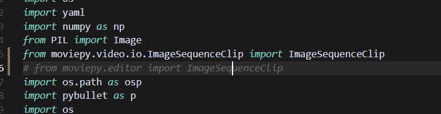
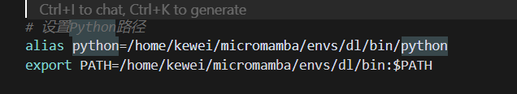

```
   # Клонируем репозиторий RoboGen
   git clone https://github.com/Genesis-Embodied-AI/RoboGen.git

   # Настраиваем окружение
   conda env create -f environment.yaml
   conda activate robogen

   # В начале файла gpt_4/query.py задайте ключ API OpenAI

   # Генерируем задачи, связанные с микроволновкой
   python run.py --category Microwave
   pip install openai pybullet

   # Или генерируем задачу по конкретному описанию
   python gpt_4/prompts/prompt_from_description.py --task_description "A mobile franka arm heats the corn with the bowl and the microwave" --object "Microwave"
```



Нужно изменить всё, что связано с moviepy.

```ag-0-1inqkk4k9ag-1-1inqkk4kaag-0-1inqkk4k9ag-1-1inqkk4ka
(robogen) user@host:~/robo/RoboGen$ python -c "import pybullet; print('успешно')"
Traceback (most recent call last):
  File "<string>", line 1, in <module>
ModuleNotFoundError: No module named 'pybullet'
(robogen) user@host:~/robo/RoboGen$ which python
/home/user/micromamba/envs/robogen/bin/python
(robogen) user@host:~/robo/RoboGen$    /home/user/micromamba/envs/robogen/bin/python -c "import pybullet; print('успешно')"
pybullet build time: Sep  3 2024 12:55:23

A module that was compiled using NumPy 1.x cannot be run in
NumPy 2.0.2 as it may crash. To support both 1.x and 2.x
versions of NumPy, modules must be compiled with NumPy 2.0.
Some module may need to rebuild instead e.g. with 'pybind11>=2.12'.

If you are a user of the module, the easiest solution will be to
downgrade to 'numpy<2' or try to upgrade the affected module.
We expect that some modules will need time to support NumPy 2.

Traceback (most recent call last):  File "<string>", line 1, in <module>
AttributeError: _ARRAY_API not found
Traceback (most recent call last):
  File "<string>", line 1, in <module>
ImportError: numpy.core.multiarray failed to import
```

Причина — настройка в .bashrc: для удобства Python не был установлен в основном окружении, и вот что из этого вышло.



Но второе окружение можно пока оставить: в нём есть nvitop и jupyter из окружения dl.

Чтобы установить OMPL из исходного кода, выполните

    ./install_ompl_1.5.2.sh --python

Это установит ompl для системного python. Обратите внимание, что в скрипте установки в строке 19 для OMPL требуется `sudo apt-get -y upgrade`. Это может создать проблемы для системных пакетов, поэтому эту строку при установке можно закомментировать (установка может не завершиться, закомментированная строка не была тщательно проверена). Затем экспортируйте установку в conda-окружение для работы с RoboGen:

    echo "/home/user/17robo/RoboGen/ompl-1.5.2/py-bindings" >> ~/micromamba/envs/robogen/lib/python3.9/site-packages/ompl.pth

    echo "/home/user/17robo/RoboGen/ompl-1.5.2/py-bindings" >> ~/miniconda3/envs/robogen/lib/python3.9/site-packages/ompl.pth

Не забудьте заменить пути на путь к вашей установке OMPL и путь к вашему conda-окружению.

[dataset.zip — Google Drive](https://drive.google.com/file/d/1d-1txzcg_ke17NkHKAolXlfDnmPePFc6/view)

Скачайте этот файл

и распакуйте его в data/dataset

[objaverse-sentence-bert-embeddings.zip — Google Drive](https://drive.google.com/file/d/1dFDpG3tlckTUSy7VYdfkNqtfVctpn3T6/view)

в objaverse_utils/data/
