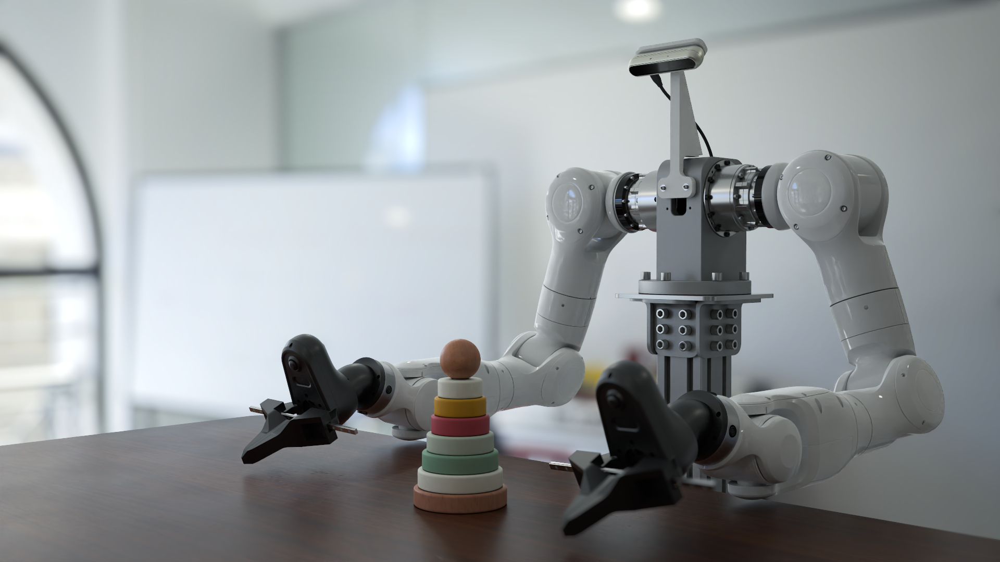
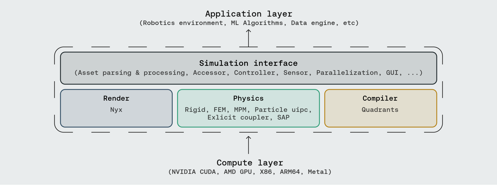
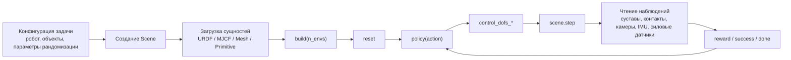
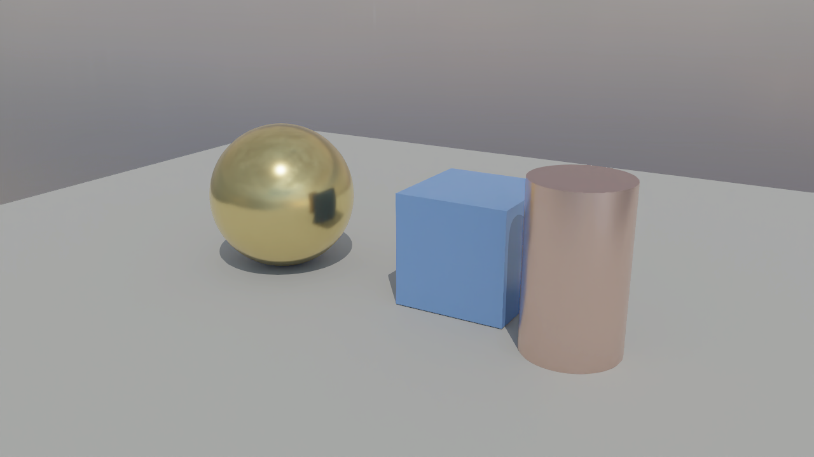
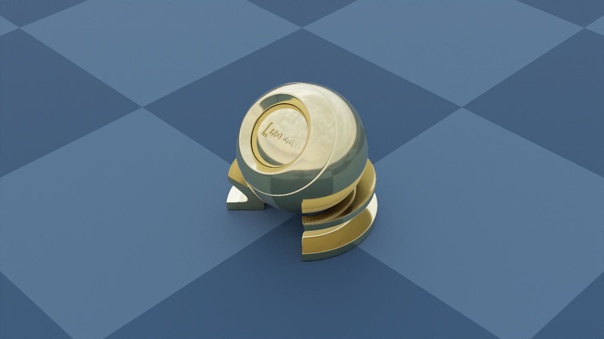
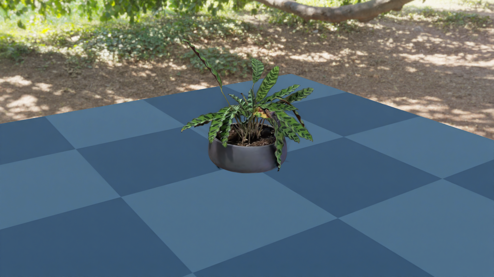
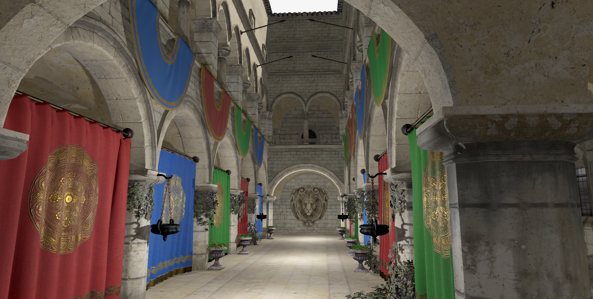
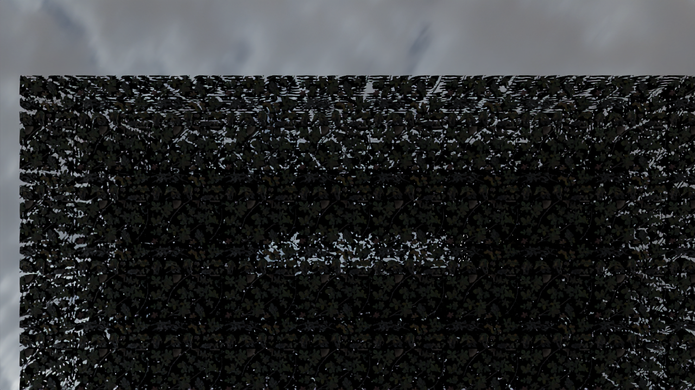

# Genesis World 1.0: полный обзор — от базы симуляции до рендеринга высокой точности Nyx

После этой главы вы сможете:

1. Понимать место Genesis World 1.0 в стеке симуляции воплощённого ИИ: это скорее основа «физика + интерфейс робота + рендеринг + компилятор», а не готовая библиотека домашних задач для роботов.
2. Локально запустить симуляцию робота в Genesis World, рендеринг высокой точности Nyx и пример Gaussian Splat и понимать, что проверяет каждый шаг.
3. Отличать «официальные рекламные изображения», «локально воспроизводимые изображения» и «границы импорта ассетов», чтобы не принимать рендеринг высокой точности за готовый бенчмарк домашних сцен из открытого репозитория.

Глава рассчитана на тех, кто уже прошёл два предыдущих руководства по настройке Genesis. Если Genesis ещё не установлен, сначала прочитайте [01 Настройка окружения и тестирование](01-environment-configuration-and-testing.md) и [02 Визуализация и рендеринг](02-visualization-and-rendering.md).

---

## 1. Что такое Genesis World 1.0

Genesis World 1.0 — открытая платформа симуляции роботов от Genesis AI. Она не является ни отдельным рендерером, ни отдельным физическим движком; это инфраструктурный стек для Physical AI и Embodied AI.

<div align="center">
  
  <br>
  <strong>Рисунок 1. Официальная обложка Genesis World</strong>
  <br>
  <sub>Изображение показывает, какого уровня визуального реализма стремится достичь Genesis World в симуляции роботов. Это рекламное изображение из README, а не результат одного готового воспроизводимого скрипта в репозитории. Источник: официальный README Genesis World на GitHub.</sub>
</div>

С точки зрения обучения роботов Genesis World охватывает четыре слоя:

<div align="center">
  
  <br>
  <strong>Рисунок 2. Официальный стек Genesis World</strong>
  <br>
  <sub>Обратите внимание на четыре средних слоя: Simulation Interface, Physics, Render и Compiler. Верхние слои можно подключать к задачам RL, VLA и генерации данных, нижние работают на разных вычислительных бэкендах. Источник: официальный README Genesis World на GitHub.</sub>
</div>

| Слой | Значение для обучения роботов |
|---|---|
| Simulation Interface | Создание сцен, загрузка роботов, чтение датчиков, управление суставами и построение параллельных сред через Python. |
| Physics | Поддерживаются твёрдые тела, FEM, MPM, PBD/SPH, IPC, SAP и связанные многофизические модели; подходит для изучения контактов, мягких тел, зернистых материалов и тканей. |
| Render | Обычный вьюер, пути рендеринга Pyrender/Luisa/Nyx. Nyx предназначен для наблюдений визуальной высокой точности. |
| Compiler | Quadrants компилирует Python-ядра в CUDA/ROCm/Metal/Vulkan/x86/ARM, повышая пропускную способность симуляции. |

Главный вывод здесь такой: **открытый репозиторий Genesis World сейчас предоставляет в основном базу симуляции и примеры сред, а не готовый крупномасштабный бенчмарк робота для домашних сцен.** Если вы хотите решать задачи домашней манипуляции, придётся подключить RoboCasa, iGibson, Habitat, BEHAVIOR, Replica/HM3D или собственные ассеты и слой коллизий.

---

## 2. Локальное окружение, на котором проводился эксперимент

Эксперимент выполнялся на видеокарте NVIDIA Blackwell. Для Blackwell при установке PyTorch нужно внимательно следить за версией CUDA; не стоит копировать старые примеры с `cu126`.

Проверенная комбинация:

| Компонент | Результат проверки |
|---|---|
| GPU | NVIDIA RTX PRO 6000 Blackwell Workstation Edition |
| Вычислительная способность | 12.0 |
| PyTorch | `2.8.0+cu128` |
| Среда выполнения CUDA | 12.8 |
| Genesis World | 1.0.0 |
| Quadrants | 0.8.0 |
| gs-nyx | 0.1.1 |
| gs-nyx-plugin | 0.1.2 |

Контрольная точка 1: убедитесь, что PyTorch действительно поддерживает Blackwell.

```bash
python - <<'PY'
import torch
print("torch:", torch.__version__)
print("cuda runtime:", torch.version.cuda)
print("device:", torch.cuda.get_device_name(0))
print("capability:", torch.cuda.get_device_capability(0))
print("arch list:", torch.cuda.get_arch_list())
x = torch.arange(16, device="cuda", dtype=torch.float32)
print("cuda sum:", float((x * x).sum().item()))
PY
```

Успешный результат — в списке архитектур видны `sm_120` или `compute_120`, а операции с тензорами CUDA не выдают ошибок. Эта проверка надёжнее, чем просто `nvidia-smi`.

---

## 3. Клонирование и установка Genesis World

Рабочий каталог лучше размещать на диске с достаточным объёмом. Ниже `$WORKSPACE` — корень вашего проекта:

```bash
export WORKSPACE=/path/to/workspace
mkdir -p "$WORKSPACE"
cd "$WORKSPACE"

git clone https://github.com/Genesis-Embodied-AI/genesis-world.git
cd genesis-world
```

Сначала установите PyTorch, подходящий для вашего GPU. Для Blackwell и CUDA 12.8 используйте официальный wheel PyTorch `cu128`:

```bash
# Пример: выберите официальный wheel по вашей версии Python и CUDA
pip install torch --index-url https://download.pytorch.org/whl/cu128
```

Затем установите Genesis:

```bash
pip install -e ".[dev]"
```

Для рендеринга высокой точности Nyx понадобится дополнительно:

```bash
pip install gs-nyx gs-nyx-plugin
```

Контрольная точка 2: убедитесь, что основные пакеты импортируются.

```bash
python - <<'PY'
import genesis as gs
import quadrants
import gs_nyx
import gs_nyx_plugin

print("genesis:", getattr(gs, "__version__", "unknown"))
print("quadrants:", getattr(quadrants, "__version__", "unknown"))
print("gs_nyx:", getattr(gs_nyx, "__version__", "unknown"))
print("gs_nyx_plugin: ok")
PY
```

Если здесь возникает ошибка разбора версии `matplotlib`, обычно это значит, что установлен пре-релиз (release candidate); можно вернуться к стабильной версии:

```bash
pip install "matplotlib>=3.10,<3.11"
```

---

## 4. Минимальная симуляция робота: Franka и плоскость

Минимальный пример симуляции робота в Genesis очень короткий. Здесь загружаются плоскость и манипулятор Franka, затем симуляция продвигается:

```python
import genesis as gs

gs.init(backend=gs.gpu)

scene = gs.Scene(show_viewer=True)
plane = scene.add_entity(gs.morphs.Plane())
franka = scene.add_entity(
    gs.morphs.MJCF(file="xml/franka_emika_panda/panda.xml"),
)

scene.build()

for _ in range(1000):
    scene.step()
```

Этот smoke-тест подтверждает три вещи:

- бэкенд Genesis инициализируется;
- ресурс робота в формате MJCF разбирается;
- цикл физической симуляции `scene.step()` работает.

Он не доказывает, что контроллер, обучающая среда или визуальный рендеринг полностью работоспособны. Дальше стоит изучить `examples/rigid/control_franka.py`, `examples/manipulation/grasp_env.py` и `examples/locomotion/go2_env.py`.

---

## 5. Типичный конвейер симуляции робота в Genesis

Когда на Genesis решается реальная задача с роботом, код обычно организуется в такой поток данных:



**Рисунок 3. Базовый замкнутый цикл задачи робота в Genesis.** Его можно понимать как робототехническую версию среды Gym/RL: `reset()` задаёт начальное состояние, `step(action)` продвигает физику, датчики возвращают observation, а код задачи вычисляет reward и done.

В открытом репозитории удобно изучать задачи по типам:

| Цель обучения | Рекомендуемый файл |
|---|---|
| Управление Franka | `examples/rigid/control_franka.py` |
| IK и захват с планированием движения | `examples/tutorials/IK_motion_planning_grasp.py` |
| Среда манипуляции | `examples/manipulation/grasp_env.py` |
| Локомоция четвероногого робота | `examples/locomotion/go2_env.py` |
| Обучение зависанию дрона | `examples/drone/hover_env.py` |
| Тесты производительности | `examples/speed_benchmark/franka.py`, `examples/speed_benchmark/anymal_c.py` |

---

## 6. Nyx: замена камеры Genesis на датчик рендеринга высокой точности

Nyx — GPU-трассировщик путей (path tracer) в экосистеме Genesis. Официальный README Nyx показывает сцену с двумя манипуляторами на столе:

<div align="center">
  
  <br>
  <strong>Рисунок 4. Официальный рендеринг Nyx с двуруким столом</strong>
  <br>
  <sub>Изображение показывает целевой уровень качества Nyx. В текущем репозитории примеров Nyx нет полного скрипта или ассетов сцены, которые создают это изображение. Источник: официальный README Nyx for Genesis.</sub>
</div>

Nyx используется не через `scene.add_camera()`, а через `scene.add_sensor(NyxCameraOptions(...))`:

```python
import genesis as gs
import gs_nyx.nyx_py_renderer as npr
import gs_nyx.nyx_py_sdk as nps
from gs_nyx_plugin.nyx_camera_options import NyxCameraOptions

gs.init(backend=gs.gpu)

scene = gs.Scene(show_viewer=False)
scene.add_entity(gs.morphs.Plane())
scene.add_entity(
    gs.morphs.Sphere(
        radius=0.4,
        pos=(0.0, 0.0, 0.4),
        fixed=True,
        collision=False,
    ),
    surface=gs.surfaces.Gold(),
)

env_map = nps.EnvironmentMapAsset()
env_map.texture = "examples/assets/kloppenheim_07_puresky_4k.hdr"
env_map.layout = nps.EEnvMapLayout.LongLat
env_map.multiplier = 2.0

cam = scene.add_sensor(
    NyxCameraOptions(
        res=(1280, 720),
        pos=(2.0, -3.0, 1.5),
        lookat=(0.0, 0.0, 0.3),
        fov=35.0,
        spp=64,
        denoise=True,
        render_mode=npr.ERenderMode.FastPathTracer,
        env_maps=(env_map,),
    )
)

scene.build(n_envs=1)
scene.step()
rgb = cam.read().rgb
```

Здесь важны два момента:

- `spp` — число выборок на пиксель: чем выше значение, тем меньше шума, но медленнее рендеринг;
- `cam.read().rgb` возвращает RGB-тензор на GPU, который можно сразу использовать как observation для визуальной политики.

---

## 7. Локальное воспроизведение: минимальный рендеринг Nyx, PBR-шар и Gaussian Splat

Локально были проверены три контрольные точки.

<div align="center">
  
  <br>
  <strong>Рисунок 5. Локальный smoke-тест Nyx с примитивом</strong>
  <br>
  <sub>Результат подтверждает, что трассировка путей Nyx выдаёт RGB-изображение на локальном GPU, но это только тест с базовой геометрией; он не означает воспроизведения официального изображения с двумя руками.</sub>
</div>

<div align="center">
  
  <br>
  <strong>Рисунок 6. Локальный результат официального примера 01_hello_nyx</strong>
  <br>
  <sub>Пример загружает PBR_Ball.glb и HDRI-карту окружения и проверяет цепочку glTF-материалов, окружающего света и датчика камеры Nyx. Источник скрипта: genesis-nyx/examples/01_hello_nyx.py.</sub>
</div>

<div align="center">
  
  <br>
  <strong>Рисунок 7. Локальный результат примера Nyx Gaussian Splat</strong>
  <br>
  <sub>Пример рендерит реально захваченный Gaussian Splat вместе с плоской геометрией Genesis в одном кадре; подходит для изучения способа сочетания реального внешнего вида сцены и симуляционной геометрии. Источник скрипта: genesis-nyx/examples/05_gaussian_splat.py.</sub>
</div>

Если вы скачиваете примеры Nyx как zip с GitHub, можно столкнуться с файлами-указателями Git LFS. Признак — файлы `.glb` или `.ply` очень маленькие и начинаются так:

```text
version https://git-lfs.github.com/spec/v1
```

В этом случае выполните `git lfs pull` или скачайте настоящие файлы с `media.githubusercontent.com`. Локально были получены:

- `PBR_Ball.glb`
- `plant.ply`

---

## 8. Ловушка с высокоточными интерьерными ассетами: Sponza — не домашняя сцена

Чтобы проверить поддержку Genesis/Nyx для высокоточных интерьерных glTF, мы дополнительно скачали Sponza из набора Khronos glTF Sample Assets.

<div align="center">
  
  <br>
  <strong>Рисунок 8. Эталонный вид Sponza</strong>
  <br>
  <sub>Sponza — классическая сцена для проверки освещения архитектурного атриума и аркад, а не домашняя сцена. Освещение на изображении приведено только как ориентир и не обязательно входит в модель glTF. Источник: Khronos glTF Sample Assets / Sponza.</sub>
</div>

Этот эксперимент полезен тем, что показывает распространённое заблуждение: **если модель корректно отображается в glTF-вьюере, это не значит, что её можно сразу использовать как высококачественную задачную сцену в симуляторе робота.**

При импорте Sponza в Genesis использовалось:

```python
scene.add_entity(
    gs.morphs.Mesh(
        file="Models/Sponza/glTF/Sponza.gltf",
        collision=False,
        fixed=True,
    )
)
```

`trimesh` загружает модель, и Genesis успешно выполняет `build`, однако вьюер Genesis и текущий путь Nyx плохо поддерживают для неё альфа-маски, прозрачные материалы, систему координат и освещение.

<div align="center">
  
  <br>
  <strong>Рисунок 9. Пределы Sponza в текущем пути Nyx</strong>
  <br>
  <sub>Это не итоговый результат, а контрольная точка для отладки: альфа-маски растительности и тканей в сложном glTF легко превращаются в крупные непрозрачные закрытия. Для сцен робота визуальную сетку, прокси коллизий и задачные объекты лучше разделять по слоям.</sub>
</div>

Для симуляции робота правильный подход такой:

- визуальный слой: высокоточная сетка, PBR-текстуры, HDRI, освещение;
- слой коллизий: упрощённые box, capsule, cylinder или низкополигональная collision mesh;
- задачный слой: интерактивные объекты, робот, целевые позы, критерии успеха;
- семантический слой: классы объектов, области захвата, зоны навигации, связи ограничений.

Не стоит напрямую включать `collision=True` для высокополигональной интерьерной glTF-модели и загружать её в симулятор. Сложные сцены вызывают дорогую выпуклую декомпозицию, которая замедляет работу и не всегда даёт сетку коллизий, пригодную для планирования движения робота.

---

## 9. Есть ли у Genesis крупномасштабный бенчмарк домашних роботов

На момент подготовки главы в открытом репозитории Genesis World нет полного крупномасштабного бенчмарка домашних роботов, похожего на Habitat Challenge, RoboCasa или LIBERO.

В публичном репозитории есть три типа материалов:

| Тип | Является ли официальным бенчмарком | Комментарий |
|---|---|---|
| Тесты скорости | Частично | `examples/speed_benchmark/franka.py` и `anymal_c.py` в основном проверяют пропускную способность симуляции. |
| Мини-среды обучения | Подходят для обучения, но не для таблицы лидеров | `go2_env.py`, `hover_env.py`, `grasp_env.py` помогают изучить обёртки сред и процесс обучения. |
| Официальные рекламные и внутренние оценки | Публичной информации мало | Блог Genesis AI упоминает household/lab/industrial workflows, но открытый репозиторий не публикует эти наборы задач полностью. |

Если цель — бенчмарк для домашних операций, лучше использовать Genesis как основу для физики и рендеринга, а задачи брать из других библиотек:

| Направление задач | Подходящие платформы |
|---|---|
| Кухня и настольные операции | RoboCasa, robosuite, ManiSkill |
| Домашняя навигация и понимание сцены | Habitat, Replica, HM3D, iGibson |
| Длинные домашние задачи | BEHAVIOR / OmniGibson |
| Оценка бенчмарков | LIBERO, RoboTwin, EBench и др. |

Ценность Genesis проявляется тогда, когда нужна более высокая физическая пропускная способность, многофизическое связывание, GPU-симуляция или подключение Nyx/Gaussian Splat к наблюдениям для обучения: тогда он может стать новым нижним уровнем.

---

## 10. Рекомендуемый путь обучения

Если вы хотите системно освоить Genesis World, идите в таком порядке:

1. Запустить минимальный Franka + Plane и понять `scene.add_entity`, `scene.build`, `scene.step`.
2. Запустить `examples/rigid/control_franka.py` и изучить управление суставами, коэффициенты усиления и силу захвата.
3. Запустить `examples/tutorials/IK_motion_planning_grasp.py` и изучить IK, планирование пути и процесс захвата.
4. Прочитать `examples/manipulation/grasp_env.py` и понять, как среда RL определяет reset, step, reward и observation.
5. Запустить `01_hello_nyx.py` и `05_gaussian_splat.py` из Nyx и понять, как подключаются наблюдения высокой визуальной точности.
6. Попробовать загрузить простой GLB-объект, сначала проверить визуал с `collision=False`, потом отдельно построить прокси коллизий.
7. Для домашних задач не начинать с таких сцен, как Sponza, которые предназначены только для рендеринга; сначала выбрать наборы с семантикой робота, коллизиями или определением задач.

---

## 11. Частые вопросы

**Вопрос 1: почему официальные изображения так хороши, а локальные примеры до такого качества не доходят?**
Официальная обложка и изображение Nyx показывают предел возможностей рендеринга, но открытый репозиторий не содержит полных скриптов сцены, моделей роботов, схем освещения и конфигурации камер для этих изображений. Локальные изображения из этой главы подтверждают, что цепочка Nyx работает, но не воспроизводят пиксель в пиксель рекламные изображения.

**Вопрос 2: почему Sponza в Genesis выглядит плохо?**
Sponza — тестовая сцена освещения glTF, в которой много прозрачных текстур и альфа-масок. Вьюер Genesis и текущий плагин Nyx поддерживают такие материалы ограниченно. Она подходит для стресс-теста импорта ассетов, но не для домашней сцены робота.

**Вопрос 3: нужно ли включать collision для интерьерной сцены?**
Не рекомендуется включать коллизии напрямую для высокополигональной интерьерной сцены. Надёжнее использовать высокополигональный слой для визуала и упрощённую геометрию для коллизий: например, большой box для пола, тонкий box для стен, box для столешницы, cylinder для колонны.

**Вопрос 4: поддерживает ли Nyx карту глубины и сегментацию?**
В текущей документации Nyx хорошо поддерживается RGB, а каналы depth, segmentation, normal и optical flow ещё не полностью реализованы. Если нужны глубина или сегментация, можно пока использовать обычный путь камеры/растеризатора Genesis или дождаться дальнейших возможностей Nyx.

---

## 12. Справочные материалы

- Официальный репозиторий Genesis World: <https://github.com/Genesis-Embodied-AI/genesis-world>
- Официальная документация Genesis World: <https://genesis-world.readthedocs.io/>
- Технический блог Genesis World 1.0: <https://www.genesis.ai/blog/the-role-of-simulation-in-scalable-robotics-genesis-world-10-and-the-path-forward>
- Nyx for Genesis, официальный репозиторий: <https://github.com/Genesis-Embodied-AI/genesis-nyx>
- Документация Nyx for Genesis: <https://genesis-embodied-ai.github.io/genesis-nyx/latest/>
- Khronos glTF Sample Assets / Sponza: <https://github.com/KhronosGroup/glTF-Sample-Assets/tree/main/Models/Sponza>
