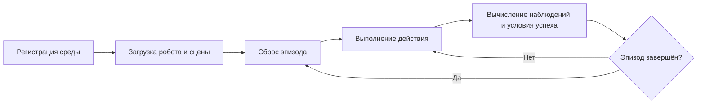

# Построение пользовательской задачи в ManiSkill

Этот раздел разбивает цель манипуляции роботом на необходимые части класса среды ManiSkill: регистрацию среды, загрузку сцены, инициализацию эпизода, вычисление условия успеха, а при необходимости — плотную награду и дополнительные наблюдения. Только после освоения этих интерфейсов имеет смысл переходить к сбору демонстраций и обучению с подкреплением.

## Жизненный цикл задачи



Основные методы класса среды:

| Интерфейс | Назначение |
| --- | --- |
| `@register_env` | Регистрирует имя среды и максимальное число шагов по умолчанию |
| `_load_scene` | Создаёт землю, объекты, кроме робота, и датчики |
| `_initialize_episode` | Сбрасывает позы для каждой параллельной среды и сэмплирует случайные величины |
| `evaluate` | Возвращает условия успеха и диагностические метрики задачи |
| `_get_obs_extra` | Добавляет к состоянию наблюдения информацию, связанную с задачей |
| `compute_dense_reward` | Даёт непрерывную награду для обучения с подкреплением (необязательно) |

## Минимальный каркас задачи

Каркас ниже показывает структуру пользовательской задачи. Он не содержит деталей построения конкретных объектов; их нужно дописать с помощью builder-акторов и интерфейсов робота текущей версии ManiSkill.

```python
import torch

from mani_skill.envs.sapien_env import BaseEnv
from mani_skill.utils.registration import register_env


@register_env("MyPickTask-v1", max_episode_steps=200)
class MyPickTaskEnv(BaseEnv):
    SUPPORTED_ROBOTS = ["panda"]

    def _load_scene(self, options: dict):
        # Здесь создаём стол, целевой объект и маркер цели.
        raise NotImplementedError

    def _initialize_episode(self, env_idx: torch.Tensor, options: dict):
        # Сбрасываем только те параллельные среды, которые выбраны через env_idx.
        raise NotImplementedError

    def evaluate(self):
        # Каждый элемент — тензор с одним значением на параллельную среду.
        reached = self._reached_target()
        grasped = self.agent.is_grasping(self.target)
        lifted = self.target.pose.p[:, 2] > self.lift_height
        return {
            "reached": reached,
            "grasped": grasped,
            "lifted": lifted,
            "success": grasped & lifted,
        }
```

`evaluate` возвращает не только `success`. Если разделить достижение цели, захват и подъём, при оценке можно определить, на каком этапе застревает политика, и плотная награда может напрямую использовать эти промежуточные величины.

## Сцена и инициализация эпизода

`_load_scene` отвечает только за создание объектов при построении среды; `_initialize_episode` при каждом `reset` обновляет состояние уже существующих объектов. Не пересоздавайте геометрию в каждом эпизоде, иначе пострадают производительность параллельных сред и индексация объектов.

При инициализации должны выполняться два условия:

1. Все случайные величины берутся из генератора случайных чисел, предоставляемого средой, чтобы при фиксированном зерне (seed) эпизоды воспроизводились одинаково.
2. С помощью `env_idx` сбрасываются только выбранные подсреды, состояние других параллельных эпизодов не меняется.

## Условие успеха и награда

Условие успеха должно соответствовать наблюдаемому физическому состоянию, а не просто проверке того, что действие было выполнено. Например, для задачи «поднять предмет» нужно одновременно проверить:

- захват даёт надёжное удержание предмета;
- высота предмета превышает порог;
- предмет остаётся поднятым в течение нескольких последовательных кадров.

Плотную награду можно составлять по этапам: «приближение — контакт — захват — подъём — удержание». Масштаб награды стоит проверить до параллельного обучения, чтобы одно слагаемое по расстоянию не перекрыло итоговую награду за успех.

## Регистрация и проверка

После импорта модуля среды сначала проверьте на одной среде сброс, случайные действия и вывод оценки:

```python
import gymnasium as gym
import my_pick_task  # Регистрирует MyPickTask-v1.

env = gym.make("MyPickTask-v1", num_envs=1, obs_mode="state")
obs, info = env.reset(seed=0)
for _ in range(20):
    obs, reward, terminated, truncated, info = env.step(env.action_space.sample())
env.close()
```

**Контрольная точка 1:** при сбросе с одним и тем же зерном начальное состояние цели и робота должно совпадать.

**Контрольная точка 2:** в `info` должны быть `reached`, `grasped`, `lifted` и `success`, а первое измерение тензоров должно совпадать с числом параллельных сред.

**Контрольная точка 3:** в проверке цепочки со случайной политикой нужно следить за исключениями времени выполнения, формами наблюдений и тем, вычисляется ли условие успеха. Результат случайной политики нельзя принимать за показатель качества обученной политики.

## Частые проблемы

- **Имя среды не зарегистрировано:** убедитесь, что модуль с классом среды импортирован до вызова `gym.make`.
- **Сбросы параллельных сред мешают друг другу:** проверьте, что `_initialize_episode` правильно использует `env_idx`.
- **Картинка нормальная, но успеха никогда нет:** по отдельности выводите условия приближения, захвата и подъёма, проверьте пороги, систему координат и критерии контакта.
- **В состоянии наблюдения нет цели задачи:** добавьте через `_get_obs_extra` позу цели, относительное положение объекта и т. п.

## Ссылки

- [Официальное руководство ManiSkill по пользовательским задачам](https://maniskill.readthedocs.io/en/latest/user_guide/tutorials/custom_tasks/intro.html)
- [Официальное краткое руководство ManiSkill](https://maniskill.readthedocs.io/en/latest/user_guide/getting_started/quickstart.html)
